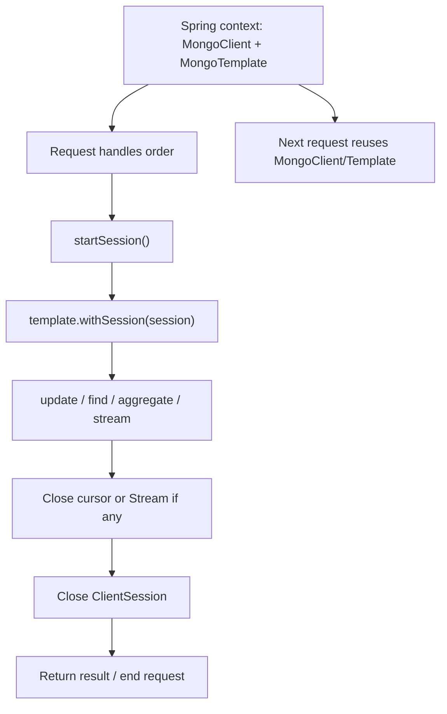
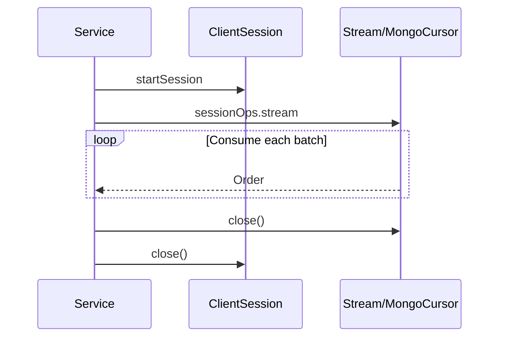

# withSession, Resource Scope, and Closing Sessions

## 1. Why Is Session Management a Design Problem?

In **Spring Data MongoDB**, an application usually holds a shared `MongoTemplate` bean or repository across many requests. However, a **MongoDB `ClientSession`** does not share the lifecycle of these singleton beans: a session represents the **context of a single sequence of operations**, may carry causal timing or transaction state, and must be closed at the right time.

Suppose an order-confirmation API performs:

1. Updating `orders.state` from `PENDING` to `PAID`.
2. Re-reading the document within the same causal context.
3. Returning the updated data to the caller.

One way to structure this:

```java
try (ClientSession session = client.startSession(options)) {
    MongoOperations inSession = template.withSession(session);

    inSession.updateFirst(query, update, Order.class);
    Order refreshed = inSession.findOne(query, Order.class);

    return refreshed;
}
```

Here, `withSession` binds **calls invoked on `inSession`** to the created `ClientSession`. It **does not mean** every call on the original `template` bean or another repository automatically receives that session. `try-with-resources` closes the session when the block exits, even when an exception occurs.

If scope is mismanaged, the application can:

- Omit the session on a call, breaking causal context across the read–write chain.
- Close the session **too early** while a cursor or reactive stream still needs to fetch data.
- Leak open sessions on exceptions or cancellations.
- Share one session across concurrent requests or threads, causing races.
- Confuse `withSession` with `startTransaction` or `@Transactional`.
- Leave MongoDB cursors open too long, increasing server/client overhead and hindering resource cleanup.

**Lesson objectives** in the **Sessions and Transactions** chapter, module **SPRING_DATA_MONGODB**: clearly understand `MongoOperations.withSession`, **resource ownership**, how to close sessions safely in synchronous/reactive code, their relationship to transactions, `MongoTemplate`/repository examples, plus testing and diagnostics. These skills support data operations, transactions, testing, reactive access, and MongoDB performance evaluation.

## 2. Three Distinct Lifecycle Scopes

Separate **client**, **session**, and **cursor** before writing code.

| Object | Role | Typical Lifecycle | Who Closes It? |
| --- | --- | --- | --- |
| `MongoClient` | Manages connections/pools, topology, driver settings | Entire application | Spring container or component that created the client |
| `MongoTemplate` | MongoDB access bean, document mapping | Entire application | Spring container manages bean; never closed per query |
| `MongoRepository` | Data access proxy/abstraction | Entire application | Spring container |
| `ClientSession` | Session context for a sequence of operations | One controlled use case, request, or transaction | The component that **created/owns the session**, unless managed by a framework |
| `template.withSession(session)` | `MongoOperations` bound to the given session | Must not outlive the session | Does not replace closing the session |
| `MongoCursor` / MongoDB `Stream` | Consumes results in batches | Until data consumption finishes | The consumer, typically via `try-with-resources` |
| Reactive `Publisher` | Describes work that runs upon subscription | From subscription to completion/error/cancel | Clean up session/cursor inside reactive lifecycle |

**Ownership rule:** whichever component **creates** a `ClientSession` is responsible for **closing** it, unless the session is provisioned and managed by a transaction framework. Never close a shared `MongoClient` just because a single request finished.

### 2.1. A Session Is Not a Fixed TCP Connection

A logical session is not identical to a socket. The driver manages the connection pool and session state; depending on the operation — especially **transactions** — the driver may pin connection resources per topology rules. Having a session does not mean "one session = one new connection."

Therefore:

- Never open a new `MongoClient` per request just to "get a separate session."
- Never store a session in a singleton bean.
- Never keep a session open waiting minutes for a user to click a UI button.
- Never assume `session.close()` closes the entire connection pool.

### 2.2. Diagram of Proper Scope



`MongoClient` stays alive to serve subsequent requests after the current request's session has closed.

## 3. What Does withSession Actually Do?

`MongoOperations.withSession(ClientSession)` provides an operations instance bound to the given session. MongoDB commands executed through **this operations instance** use the `ClientSession` in supported APIs.

```java
MongoOperations sessionOps = template.withSession(session);

sessionOps.insert(newOrder);
sessionOps.findOne(query, Order.class);
sessionOps.updateFirst(query, update, Order.class);
sessionOps.aggregate(pipeline, Order.class, OrderSummary.class);
```

Key facts to remember:

1. `withSession` **does not start a transaction**.
2. `withSession` **does not set read concern majority or write concern majority**.
3. `withSession` **does not make other repository calls automatically join the session**.
4. `withSession` **does not close the session when a single command finishes**.
5. The session must originate from the **same logical `MongoClient`** used by `MongoTemplate`.
6. Never call `sessionOps` after `session` has been closed.

### 3.1. Distinguishing the Original Template from Session-Bound Operations

```java
MongoOperations sessionOps = template.withSession(session);

sessionOps.updateFirst(query, update, Order.class); // In session.

template.findOne(query, Order.class);                // Not guaranteed
                                                    // to use the
                                                    // same session.
```

On the second line, the original `template` bean **is not `sessionOps`**. If a causal chain is required, continue using `sessionOps.findOne(...)`.

This mistake easily happens when service A calls `sessionOps.updateFirst` and then invokes service B, which reads through a default repository. Sharing a Java transaction/request/thread **is not proof** that commands share the same explicit session unless proper session/transaction binding is in place.

### 3.2. Do Not Use Sessions to Replace Write Correctness

If an update fails to match ID, tenant, or state, `read-your-writes` cannot conjure a modification that never occurred.

```java
UpdateResult result = sessionOps.updateFirst(
    Query.query(
        Criteria.where("id").is(orderId)
            .and("tenantId").is(authorizedTenantId)
            .and("state").is("PENDING")
    ),
    new Update().set("state", "PAID"),
    Order.class
);

if (result.getMatchedCount() != 1) {
    throw new IllegalStateException(
        "Order does not exist or state has already changed"
    );
}
```

**Matched count** confirms the query matched a document. It does not by itself prove payment succeeded or stop other clients from modifying the document afterward. Business invariants require conditional updates, idempotency, optimistic locking, or transactions as appropriate.

## 4. Sample Data and Entity

Suppose the `orders` collection contains one document:

```javascript
db.orders.insertOne({
  _id: "order-101",
  tenantId: "tenant-01",
  state: "PENDING",
  totalCents: NumberLong("12500"),
  createdAt: ISODate("2026-11-20T08:00:00Z")
});
```

Spring Data entity:

```java
package example.orders;

import java.time.Instant;
import org.springframework.data.mongodb.core.mapping.Document;
import org.springframework.data.mongodb.core.mapping.FieldType;
import org.springframework.data.mongodb.core.mapping.MongoId;

@Document(collection = "orders")
public record Order(
    @MongoId(FieldType.STRING) String id,
    String tenantId,
    String state,
    long totalCents,
    Instant createdAt
) {}
```

`@MongoId(FieldType.STRING)` indicates the ID is stored as a BSON String. In `Query` instances typed with `Order.class`, Spring Data maps the Java `id` property to `_id`. When using **raw BSON** directly via the driver, you must specify the actual `_id` field.

For illustration, the workflow below transitions `PENDING -> PAID` and re-reads within the same session. The example **does not** assume full payment processing consists of a single field; production may need reconciliation, a ledger, idempotency, and transactions.

## 5. Synchronous: try-with-resources Is the Default Choice

### 5.1. Service Using MongoTemplate.withSession

```java
package example.orders;

import com.mongodb.ClientSessionOptions;
import com.mongodb.client.ClientSession;
import com.mongodb.client.MongoClient;
import com.mongodb.client.result.UpdateResult;
import org.springframework.data.mongodb.core.MongoOperations;
import org.springframework.data.mongodb.core.MongoTemplate;
import org.springframework.data.mongodb.core.query.Criteria;
import org.springframework.data.mongodb.core.query.Query;
import org.springframework.data.mongodb.core.query.Update;
import org.springframework.stereotype.Service;

@Service
public class OrderSessionService {

    private final MongoClient client;
    private final MongoTemplate template;

    public OrderSessionService(
            MongoClient client,
            MongoTemplate template) {
        this.client = client;
        this.template = template;
    }

    public Order confirmThenRead(
            String authorizedTenantId,
            String orderId) {

        if (authorizedTenantId == null
                || authorizedTenantId.isBlank()
                || orderId == null
                || orderId.isBlank()) {
            throw new IllegalArgumentException(
                "Invalid tenant or orderId"
            );
        }

        ClientSessionOptions options =
            ClientSessionOptions.builder()
                .causallyConsistent(true)
                .build();

        try (ClientSession session =
                client.startSession(options)) {

            MongoOperations ops =
                template.withSession(session);

            Query target = Query.query(
                Criteria.where("id").is(orderId)
                    .and("tenantId").is(authorizedTenantId)
            );
            Query pending = Query.query(
                Criteria.where("id").is(orderId)
                    .and("tenantId").is(authorizedTenantId)
                    .and("state").is("PENDING")
            );

            UpdateResult result = ops.updateFirst(
                pending,
                new Update().set("state", "PAID"),
                Order.class
            );

            if (result.getMatchedCount() != 1) {
                throw new IllegalStateException(
                    "Cannot confirm order"
                );
            }

            Order updated =
                ops.findOne(target, Order.class);

            if (updated == null) {
                throw new IllegalStateException(
                    "Order not found after update"
                );
            }
            return updated;
        }
    }
}
```

Key points:

1. `MongoClient` is an **injected** bean, never instantiated per request.
2. `ClientSession` lives only within the `try` block of **one service call**.
3. `template.withSession(session)` creates `ops` bound to the active session.
4. Both `updateFirst` and `findOne` are invoked on **`ops`**, not the original `template` bean.
5. `matchedCount` is verified before reading back.
6. If the update, read, or mapping throws an exception, Java still calls `session.close()`.
7. The returned `Order` is **materialized** data, not a cursor or publisher needing the session to stay open.

### 5.2. Sessions Do Not Automatically Set Concerns

To obtain full **durable causal consistency** guarantees in a replica set, MongoDB requires operations in a causally consistent session to run sequentially with:

- `readConcern: "majority"` for reads.
- `writeConcern: "majority"` for writes.

`withSession` **does not automatically elevate** read/write concerns. If the application has `MongoTemplate` configured with `ReadConcern.LOCAL` and write concern `w:1`, the Java snippet above demonstrates **proper session binding and resource closing**, not proof of majority-causal guarantees under failover.

If the goal is merely to illustrate session resource handling, do not label a test reading immediately on the primary as a "causal guarantee." If causal guarantees are required, configure the concerns and verify real commands.

### 5.3. Configuring Majority on the MongoDB Java Client

Example creating a client **once** for the application:

```java
import com.mongodb.ConnectionString;
import com.mongodb.MongoClientSettings;
import com.mongodb.ReadConcern;
import com.mongodb.ReadPreference;
import com.mongodb.WriteConcern;
import com.mongodb.client.MongoClient;
import com.mongodb.client.MongoClients;

ConnectionString connectionString = new ConnectionString(
    "mongodb://node1:27017,node2:27017,node3:27017/"
        + "?replicaSet=rs0"
);

MongoClientSettings settings = MongoClientSettings.builder()
    .applyConnectionString(connectionString)
    .readConcern(ReadConcern.MAJORITY)
    .writeConcern(WriteConcern.MAJORITY)
    .readPreference(ReadPreference.secondaryPreferred())
    .build();

MongoClient client = MongoClients.create(settings);
```

`node1/node2/node3` are **placeholders** for the example, not real addresses to copy. In Spring Boot, use application-managed configuration/beans with credentials from a secure source and ensure `MongoTemplate` uses this same client. Never open a new client inside every service method; doing so wastes pools and connections.

## 6. Why Must ClientSession Be Closed?

`ClientSession` holds driver/server logical state that can affect resources tied to active commands. When the session is finished, notify the driver to release/return resources belonging to its lifecycle.

### 6.1. close Differs from commit and abort

| Action | Meaning |
| --- | --- |
| `session.close()` | Ends the client-managed session lifecycle; not "commit transaction" |
| `session.startTransaction()` | Starts a multi-document transaction inside the session |
| `session.commitTransaction()` | Requests committing the active transaction |
| `session.abortTransaction()` | Requests aborting the active transaction |
| `mongoClient.close()` | Closes the shared client/pool; normally only on application shutdown |

**Never rely on `close` to commit an unfinished transaction.** When a transaction is open, explicitly commit or abort based on business outcome, and only then close the session; if a try-with-resources block exits due to an exception, rollback/abort logic must be explicit.

### 6.2. Distinguishing Driver-Side and Server-Side Resources

Sessions may be pooled/managed by the driver; the MongoDB server also tracks logical sessions and expires/cleans them up over time. The server having a session TTL **does not replace** the client closing the session when work finishes. Letting resources expire passively only makes bugs harder to detect.

During transactions, the driver may hold/pin connections depending on topology and version. Lingering sessions or cursors degrade pool/resource health, especially under high concurrency.

### 6.3. Final Ownership Rules

```text
Who called startSession()? -> That component is responsible for close.
Who created the cursor?    -> The consumer must close the cursor.
Who started the tx?        -> The tx coordinator must commit or abort.
Who created MongoClient?   -> Application-level owner closes on shutdown.
```

If a framework such as a Spring transaction manager creates/manages the session, **never manually close that session** from a repository helper that does not own it.

## 7. try/finally and try-with-resources

### 7.1. Preferred Concise Pattern

```java
try (ClientSession session = client.startSession()) {
    MongoOperations ops = template.withSession(session);
    return ops.findOne(query, Order.class);
}
```

Java automatically calls `session.close()` whether `findOne` finishes normally or throws an exception. That is why `try-with-resources` is preferred for synchronous code with clear lexical scope.

### 7.2. finally Form When Additional Controlled Cleanup Is Needed

```java
ClientSession session = client.startSession();
try {
    MongoOperations ops = template.withSession(session);
    return ops.findOne(query, Order.class);
} finally {
    session.close();
}
```

When closing multiple resources, mind the **cleanup order** and exceptions thrown during close. `try-with-resources` handles suppressed exceptions better than hand-rolled `finally` blocks in many cases.

### 7.3. Wrong Pattern: Closing Only on the Happy Path

```java
ClientSession session = client.startSession();
MongoOperations ops = template.withSession(session);

Order order = ops.findOne(query, Order.class);

session.close();   // Never runs if findOne throws an exception.
return order;
```

**Wrong due to potential resource leak.** Never put cleanup after operations that can throw without `finally`/`try-with-resources`.

### 7.4. Wrong Pattern: Returning a Lazy Operation Out of a Closed Scope

```java
Stream<Order> openStream() {
    try (ClientSession session = client.startSession()) {
        MongoOperations ops = template.withSession(session);
        return ops.stream(query, Order.class);
    } // Session closes before the caller consumes the Stream.
}
```

**Do not use**: `Stream` reads lazily from a cursor. Once the method returns, the session is closed while the caller still tries to fetch batches. This can cause cursor/session errors, incomplete data, or leaked resources.

## 8. Cursor and Stream: Close in Reverse Order of Creation

A simple rule to apply: **close resources using the session first, then close the session**.

### 8.1. Correct Example with MongoTemplate.stream

```java
import java.util.stream.Stream;

try (ClientSession session = client.startSession()) {
    MongoOperations ops = template.withSession(session);

    try (Stream<Order> orders =
            ops.stream(query, Order.class)) {

        orders.forEach(this::exportOrder);
    } // Close Stream/cursor here.

} // Close ClientSession last.
```

Here, `exportOrder` is an application method supplied by the developer; the code sits inside a service where `client`, `template`, and `query` are defined. Using `Stream` avoids loading every document into a `List`, though **it does not reduce the total documents/bytes transferred over the network**.

### 8.2. What Does Nested try-with-resources Achieve?



Even if `forEach` throws an exception, nested `try-with-resources` cleanup still runs in order: **cursor first, session second**.

### 8.3. Never Return a Cursor/Stream Without Transferring Ownership

If an API truly must return a `Stream`, you must transfer the entire session/cursor lifecycle to the caller via a clearly contracted `AutoCloseable` abstraction. However, that complicates the API and invites callers to forget closing. For most service methods, **consume the entire `Stream` within scope** and return a materialized DTO or write results to a controlled sink.

### 8.4. MongoDB Cursors Can Wait Across Multiple getMore Calls

A cursor may initially receive only the first batch and issue `getMore` calls while consumed. Closing the session while the cursor awaits batches or a request is reading is unsafe. For large cursors:

- Bound data volume and operation duration.
- Close the cursor as soon as enough results are read, on error, or on client cancellation.
- Never rely on GC to close cursors.
- Never keep a `Stream` alive across HTTP response streaming without designing the full lifecycle.

`cursorBatchSize` controls batch size, **not total result count**, and does not solve forgotten session cleanup.

## 9. Callback Version: Keeping Ownership in One Place

When multiple service methods follow the same session pattern, you can abstract **session creation and closing**:

```java
package example.orders;

import java.util.function.Function;
import com.mongodb.ClientSessionOptions;
import com.mongodb.client.ClientSession;
import com.mongodb.client.MongoClient;
import org.springframework.data.mongodb.core.MongoOperations;
import org.springframework.data.mongodb.core.MongoTemplate;

public final class MongoSessionRunner {

    private final MongoClient client;
    private final MongoTemplate template;

    public MongoSessionRunner(
            MongoClient client,
            MongoTemplate template) {
        this.client = client;
        this.template = template;
    }

    public <T> T run(
            Function<MongoOperations, T> work) {

        try (ClientSession session = client.startSession(
                ClientSessionOptions.builder()
                    .causallyConsistent(true)
                    .build())) {

            MongoOperations ops =
                template.withSession(session);
            return work.apply(ops);
        }
    }
}
```

Usage:

```java
Order order = runner.run(ops ->
    ops.findOne(
        Query.query(Criteria.where("id").is(orderId)),
        Order.class
    )
);
```

**Contract of this callback:** `work` must finish **synchronously** before returning; it must never return a `Stream`, `Publisher`, or object holding an open cursor for later use. `MongoSessionRunner` does not configure majority read/write concerns, and it **does not create a transaction**.

Such a runner avoids copy-pasting `startSession`/`close` across services. However, if a project primarily uses Spring-managed transactions, avoid building a "homegrown transaction manager" just to wrap every call.

### 9.1. Beware of Nested Callbacks

```java
runner.run(ops1 -> {
    return runner.run(ops2 -> {
        // ops2 uses a different session from ops1.
        return ops2.findOne(query, Order.class);
    });
});
```

Two `run` calls create **two separate sessions**. If a single causal chain is required, pass the already-bound `MongoOperations` into the inner helper rather than silently opening a new session.

### 9.2. Do Not Make a Session a Shared Field

Never design a singleton like:

```java
@Service
class BadSharedSessionService {
    private ClientSession session; // Wrong if shared across requests.
}
```

Sessions hold mutable state and require sequential execution; concurrent requests/threads will hit undefined ordering, unexpected closes, and driver contract violations. Singleton fields should hold `MongoClient`/`MongoTemplate`; sessions belong as local variables scoped per use case.

## 10. Session and Transaction: Two Different Concepts

A transaction **is bound to a session**, yet creating a session **does not start a transaction**.

```text
ClientSession:
  - Used for causal operation context.
  - Can contain multiple independent read/write commands.
  - Has no shared commit/rollback unless startTransaction is called.

ClientSession + Transaction:
  - startTransaction.
  - Commands in the transaction share the same session.
  - commitTransaction or abortTransaction.
  - Close session after the transaction is resolved.
```

### 10.1. Minimal Manual Transaction Example

```java
import com.mongodb.ReadConcern;
import com.mongodb.ReadPreference;
import com.mongodb.TransactionOptions;
import com.mongodb.WriteConcern;
import com.mongodb.client.ClientSession;
import com.mongodb.client.MongoClient;
import org.springframework.data.mongodb.core.MongoOperations;
import org.springframework.data.mongodb.core.MongoTemplate;

TransactionOptions txOptions = TransactionOptions.builder()
    .readConcern(ReadConcern.SNAPSHOT)
    .writeConcern(WriteConcern.MAJORITY)
    .readPreference(ReadPreference.primary())
    .build();

try (ClientSession session = client.startSession()) {
    session.startTransaction(txOptions);

    try {
        MongoOperations txOps =
            template.withSession(session);

        txOps.updateFirst(
            debitQuery, debitUpdate, Account.class
        );
        txOps.updateFirst(
            creditQuery, creditUpdate, Account.class
        );

        // Request commit only after verifying all invariants.
        session.commitTransaction();
    } catch (RuntimeException | Error failure) {
        if (session.hasActiveTransaction()) {
            try {
                session.abortTransaction();
            } catch (RuntimeException abortFailure) {
                failure.addSuppressed(abortFailure);
            }
        }
        throw failure;
    }
} // After commit/abort, close session.
```

This is a **lifecycle skeleton**, not complete production transfer code. `debitQuery`, `debitUpdate`, `creditQuery`, `creditUpdate`, and `Account` are application-defined components; you must verify balances, update results, idempotency, and transaction retries per MongoDB error labels.

### 10.2. Do Not Treat a Commit Error as "Nothing Was Written"

When `commitTransaction()` encounters a network error, the client may not know whether the commit succeeded. MongoDB defines error labels and retry rules, notably `UnknownTransactionCommitResult` and `TransientTransactionError`. A plain `catch RuntimeException -> abort` wrapper **does not** resolve all retry/commit ambiguity.

For financial workflows, design proper retries, idempotency keys, auditing, and reconciliation; never blindly repeat debit/credit operations after a timeout.

### 10.3. Standard Approach: Let the Transaction Manager Handle It

If a Spring application uses transactions routinely, prefer integrating `MongoTransactionManager` and `@Transactional` in supported configurations over repeating manual commit/abort boilerplate across services.

## 11. Spring-Managed Transactions: Who Owns the Session?

### 11.1. Configuring MongoTransactionManager

```java
package example.orders;

import org.springframework.context.annotation.Bean;
import org.springframework.context.annotation.Configuration;
import org.springframework.data.mongodb.MongoDatabaseFactory;
import org.springframework.data.mongodb.MongoTransactionManager;

@Configuration
public class MongoTransactionConfiguration {

    @Bean
    MongoTransactionManager transactionManager(
            MongoDatabaseFactory factory) {
        return new MongoTransactionManager(factory);
    }
}
```

When using `@Transactional` with the Mongo transaction manager and a transaction-capable topology, Spring creates, binds, and manages the session/transaction across the transaction boundary.

```java
package example.orders;

import org.springframework.stereotype.Service;
import org.springframework.transaction.annotation.Transactional;

@Service
public class AccountTransferService {

    private final AccountRepository accounts;

    public AccountTransferService(
            AccountRepository accounts) {
        this.accounts = accounts;
    }

    @Transactional
    public void transfer(/* validated transfer command */) {
        // Repository operations join the Spring-managed
        // transaction when configured properly.
        // Verify conditions and update counts before commit.
    }
}
```

`AccountRepository` and the `transfer` body here are boundary illustrations, not a full implementation. Correct transactions also require a supporting MongoDB replica set/sharded topology, timeouts, write concerns, retry handling, and proper Spring proxy wiring.

### 11.2. Never Close a Spring-Owned Session

When a session is bound to operations by the transaction manager, **Spring** is responsible for ending and cleaning it up. Never manually call `session.close()` inside a repository/helper if that session belongs to an active transaction. Closing before commit can fail the transaction.

A clear rule:

| Session Origin | Who Manages Its Lifecycle? |
| --- | --- |
| `client.startSession()` inside a service | Service, via `try-with-resources`/`finally` |
| `MongoTransactionManager` via `@Transactional` | Transaction manager / Spring |
| Test manually opens a session | Test must close it |
| Reactive subscriber creates a session | Reactive resource scope must clean up on complete/error/cancel |

### 11.3. Avoid Unknowingly Mixing Explicit Sessions and @Transactional

If a method running inside a Spring-managed transaction calls `client.startSession()` and `template.withSession(newSession)`, operations on that new session **do not automatically belong** to the old transaction.

```java
@Transactional
public void confusingFlow() {
    repository.save(orderA); // May belong to Spring's transaction.

    try (ClientSession other = client.startSession()) {
        template.withSession(other)
            .insert(orderB);  // Different session.
    }
}
```

This is an **illustrative anti-pattern**: the code above must not be treated as a single atomic transaction covering `orderA` and `orderB`. If shared commit is required, use operations participating in the same Spring transaction or one unified explicit-session strategy — never mix both.

### 11.4. Transaction Boundaries Differ from Request Boundaries

Never open a transaction at the start of an HTTP request and hold it until the client finishes reading a long stream. Transactions should be short, with a clear set of operations, result checks, and early commit/abort. If you must export large reports or stream HTTP responses, decouple them from write transactions whenever possible.

## 12. Sessions Do Not Automatically Propagate Across Repositories and Threads

### 12.1. Repository Calls Outside Proper Binding

```java
try (ClientSession session = client.startSession()) {
    MongoOperations sessionOps =
        template.withSession(session);

    sessionOps.updateFirst(query, update, Order.class);

    // Do not assume this shares the same explicit session:
    Order order = repository.findById(id).orElseThrow();
}
```

Here `repository.findById` does not automatically use `sessionOps`. Unless special Spring transaction/session synchronization is configured, these are **two separate access paths**.

For explicit non-transactional sessions where a causal chain is required, use `sessionOps` consistently or build custom repositories that accept session-bound operations explicitly.

### 12.2. @Async and Thread Pools

`ClientSession` is not safe for concurrent use from multiple threads. Never hand it to an executor and fire parallel MongoDB commands.

```java
// Wrong: sharing a mutable session across concurrent tasks.
CompletableFuture.runAsync(
    () -> sessionOps.insert(a)
);
CompletableFuture.runAsync(
    () -> sessionOps.insert(b)
);
```

If a workflow has causal dependencies, commands in the same session must execute **sequentially**, awaiting the prior command before starting the next. If independent tasks run in parallel, give them **separate sessions** with appropriate consistency settings; never share one session across a pool.

### 12.3. HTTP Request A Then Request B Do Not Share a Session

```text
POST /orders/101/confirm -> instance A, session A -> closed.
GET  /orders/101         -> instance B, session B -> new.
```

Two sessions have no automatic causal relationship merely because they involve the same user or order ID. If cross-request read-your-writes is required, design for it explicitly: return the new read model directly in the write response, read from the primary per policy, propagate causal tokens via a trusted mechanism, or wait until caches/read models reach the expected business version.

Never keep request A's session alive until request B in a static map to "preserve consistency." That leaks resources, breaks concurrency, fails to scale, and breaks when clients vanish.

## 13. Lazy Data: When May Results Escape Session Scope?

| Return Value | Depends on Session After Method Returns? | How to Handle |
| --- | --- | --- |
| `Order` materialized via `findOne` | Normally no | Return DTO/entity as materialized data |
| `List<Order>` fully loaded | No open cursor once operation finishes | Return list; watch memory usage |
| `Stream<Order>` from `MongoOperations.stream` | **May hold an open cursor** | Consume and close within session scope |
| MongoDB `MongoCursor<Document>` | Yes | Close cursor before session |
| Unsubscribed reactive `Mono<Order>`/`Flux<Order>` | Not yet executed or still running later | Session must live for the subscription lifecycle |
| DTO holding a `Supplier` that queries later | Yes if supplier queries DB later | Never close session prematurely before the query runs |

### 13.1. Materialize First, Then Return

```java
public List<Order> findOrders(String tenantId) {
    try (ClientSession session = client.startSession()) {
        MongoOperations ops = template.withSession(session);
        Query query = Query.query(
            Criteria.where("tenantId").is(tenantId)
        );
        query.limit(100);
        return ops.find(query, Order.class);
    }
}
```

`ops.find` finishes and returns the loaded list before the session closes. In a real app, still validate `tenantId` and consider sorting/pagination.

### 13.2. Do Not Misunderstand "Close Session After Return"

In Java, the `return` expression is evaluated **before** `try-with-resources` runs cleanup. If the `return` expression builds **a lazy object** instead of consuming the data, closing the session after return does not magically turn that lazy object into loaded results.

This causes "passes in small-data tests, fails in production on `getMore`" bugs that appear only with large cursors despite identical method code.

## 14. Reactive: Session Lives by Subscription, Not Lexical try

Reactive APIs begin executing only on subscription; a Java method returning `Mono`/`Flux` has not necessarily issued any MongoDB command yet.

### 14.1. Wrong Pattern: Wrapping Publisher Creation in try-with-resources

```java
Mono<Order> loadOrder(String id) {
    try (ReactiveClientSession session = obtainSession()) {
        return loadWithSession(session, id);
    } // Closes session before Mono is subscribed.
}
```

`ReactiveClientSession` and `obtainSession` here are **pseudocode illustrating the lifecycle bug**, not real importable APIs. The real error is that the publisher **has not executed yet** when the Java method returns, yet the session is already closed.

### 14.2. Resource Scope Must Wrap the Subscription

Reactor provides `usingWhen` to manage asynchronous resources across **complete, error, and cancel** branches:

```java
Mono<Order> result = Mono.usingWhen(
    createSessionPublisher(),
    session -> workWithSession(session),
    session -> cleanupSession(session),
    (session, error) -> cleanupSession(session),
    session -> cleanupSession(session)
);
```

The three helpers `createSessionPublisher`, `workWithSession`, and `cleanupSession` are **application placeholder functions**; the snippet shows the Reactor pattern, not a complete MongoDB implementation. In real code, the resource is a reactive-driver `ClientSession` compatible with `ReactiveMongoTemplate`.

**Advantage:** the session is acquired **on subscribe**, closed after work completes or errors, and cleaned up when the subscription is cancelled. Never rely on Java `finally` in a method returning a Publisher.

### 14.3. ReactiveMongoTemplate.withSession

Reactive Spring Data MongoDB provides session-aware APIs so operations share the same reactive client session. Depending on the version, passing the session goes through an appropriate publisher/session callback. Conceptually:

```text
subscribe:
    acquire reactive ClientSession
    bind session to ReactiveMongoOperations
    update / read sequentially
    emit DTO or error
    cleanup session on complete / error / cancel
```

**Do not mix** `com.mongodb.client.ClientSession` from the synchronous driver with `com.mongodb.reactivestreams.client.ClientSession` from the reactive driver. Check the exact API of your project's Spring Data/driver version to build cleanly.

### 14.4. Subscription Order Must Be Explicit

```java
// Two publishers may be subscribed concurrently:
Mono.zip(writePublisher, readPublisher);

// Read starts only after write completes:
writePublisher.then(readPublisher);
```

These two lines assume `writePublisher` and `readPublisher` are already defined. `then` expresses reactive ordering, though it **does not automatically bind a session or elevate majority concerns**. Firing concurrent operations on the same session can violate driver constraints and break causal ordering.

### 14.5. Is doFinally Enough?

`doFinally` runs on termination/cancel, yet when cleanup itself is asynchronous, triggering a side effect inside `doFinally` does not **await cleanup completion**. `usingWhen` models cleanup as a `Publisher` that is executed, error-tracked, and tied to the lifecycle.

If `session.close()` is synchronous, mind threading rules and avoid placing blocking calls on an event loop. If the driver/session exposes a cleanup publisher, use it as the API specifies; never call `block()` in a reactive service just to close a session.

## 15. Error Paths: Cleanup Must Happen Before Returning an Error

### 15.1. Database or Mapping Errors

```java
try (ClientSession session = client.startSession()) {
    MongoOperations ops = template.withSession(session);
    Order order = ops.findOne(query, Order.class);

    if (order == null) {
        throw new IllegalStateException("Order not found");
    }

    return order;
}
```

If `findOne`, converter mapping, or business validation throws an exception, the session still closes. **Never swallow exceptions just to avoid resource-error noise.**

### 15.2. What If Close Itself Throws an Exception?

In `try-with-resources`, if business code throws an error and `close` also throws, Java preserves the primary exception and attaches the cleanup error as a **suppressed exception**. This avoids losing the root cause.

Avoid manually writing:

```java
try {
    doWork();
} finally {
    session.close(); // Can mask the original error if close also throws.
}
```

This reminds you about complex `finally` blocks; when multiple cleanups are needed, `try-with-resources` or resource abstractions are usually safer.

### 15.3. With Transactions, Cleanup Order Matters

If a transaction has not committed/aborted yet, resolve the transaction per policy first; only then close the session. Never call `session.close()` **before** `commitTransaction()`, and never return success before commit is confirmed.

An exception in `commitTransaction()` requires **`unknown commit result`** handling, not just cleanup. Closing resources properly **does not mean** transaction semantics were handled successfully.

## 16. Diagnosing Session and Cursor Leaks

### 16.1. Common Symptoms

- An export API runs very slowly while other requests wait on the connection pool.
- `getMore` counts or open cursors climb abnormally.
- Transactions stay open too long, raising lock/commit latency or lifetime-limit errors.
- Increasing errors from closed sessions or sessions from the wrong client.
- Reactive flows get cancelled without invoking session cleanup.
- After deploy, things run fine initially and then latency degrades with traffic.

Do not blame every pool exhaustion on a session leak. Check **pool metrics, MongoDB current operations, cursor metrics, transaction metrics**, network, query plans, and timeouts; a poorly tuned `$group` pipeline can also keep cursors/requests alive too long.

### 16.2. Investigation Checklist

| Question | How to Verify |
| --- | --- |
| Who created the session? | Locate `startSession`/transaction manager boundaries |
| Is there `try-with-resources` or `finally`? | Review every exit path and exception |
| Are Streams/cursors closed before the session? | Check nested `try` blocks and return types |
| Are repositories invoked outside `sessionOps`? | Trace code paths and command `lsid` in tests |
| Is a session stored in a singleton/request cache? | Review field scope and concurrency |
| Are transactions committed/aborted properly? | Inspect transaction boundaries and error labels |
| Does reactive cleanup run on cancel? | `usingWhen` tests with cancellation |
| Are sessions created from a different `MongoClient`? | Verify client factory/beans and connections |
| Do read/write concerns match requirements? | Inspect effective configuration and runtime commands |
| Is delay from cursors or query plans? | Check `explain`, server metrics, and `getMore` |

### 16.3. Command Monitoring in Test Environments

The MongoDB Java Driver supports `CommandListener` to inspect executed commands. You can observe command names and `lsid` to verify a sequence shares a session:

```java
import com.mongodb.event.CommandListener;
import com.mongodb.event.CommandStartedEvent;

public final class SessionCommandObserver
        implements CommandListener {

    @Override
    public void commandStarted(CommandStartedEvent event) {
        if (!"find".equals(event.getCommandName())
                && !"update".equals(event.getCommandName())) {
            return;
        }

        boolean hasLsid =
            event.getCommand().containsKey("lsid");
        System.out.println("command=" +
            event.getCommandName()
            + ", hasLsid=" + hasLsid);
    }
}
```

**Important:** MongoDB drivers also use **implicit sessions**. Therefore, seeing `lsid` on both commands **does not prove** they belong to the **same explicit `ClientSession`**. To test properly, compare exact session identity/`lsid`, concerns, ordering, and targets in a controlled environment rather than checking a boolean `hasLsid`.

Never log full commands containing customer data or credentials in production without redaction and retention controls.

### 16.4. Cleaning Up Resources Does Not Replace Query Bounds

Closing sessions properly prevents leaks, yet a query scanning millions of documents in one request still consumes huge CPU/RAM/disk. Combine projections/limits/indexes, cursor batch sizes, `maxTimeMS`, and concurrency limits where appropriate. Never simply bump pool sizes to compensate for an unbounded query or cursor.

## 17. Integration Testing: Sessions Stay Alive and Never Close Early

### 17.1. Environment Prerequisites

Testing real sessions/transactions requires a MongoDB deployment supporting client sessions; testing transactions requires a supported replica set/sharded topology. `@DataMongoTest` does not automatically guarantee a running MongoDB server. Use a test MongoDB instance or Testcontainers matching your Spring Boot/MongoDB driver version.

This document **has not executed Gradle, Python, or integration tests**: examples show how to write/design tests; a subsequent QA step can verify them in the actual repository.

### 17.2. Testing the Service with Spring Data MongoTemplate

```java
package example.orders;

import static org.junit.jupiter.api.Assertions.*;

import java.time.Instant;
import java.util.UUID;
import org.junit.jupiter.api.Test;
import org.springframework.beans.factory.annotation.Autowired;
import org.springframework.boot.test.autoconfigure.data.mongo.DataMongoTest;
import org.springframework.context.annotation.Import;
import org.springframework.data.mongodb.core.MongoTemplate;

@DataMongoTest
@Import(OrderSessionService.class)
class OrderSessionServiceTest {

    @Autowired
    MongoTemplate template;

    @Autowired
    OrderSessionService service;

    @Test
    void sessionBoundUpdateThenReadReturnsMaterializedEntity() {
        String id = "order-" + UUID.randomUUID();
        String tenant = "tenant-" + UUID.randomUUID();

        template.insert(new Order(
            id,
            tenant,
            "PENDING",
            12500L,
            Instant.parse("2026-11-20T08:00:00Z")
        ));

        Order updated = service.confirmThenRead(tenant, id);

        assertNotNull(updated);
        assertEquals("PAID", updated.state());
        assertEquals(tenant, updated.tenantId());

        // After the method closes the session, the DTO/entity
        // remains usable because it was materialized.
        assertEquals(id, updated.id());
    }

    @Test
    void unmatchedConditionalUpdateFailsCleanly() {
        String id = "order-" + UUID.randomUUID();
        String tenant = "tenant-" + UUID.randomUUID();

        template.insert(new Order(
            id,
            tenant,
            "CANCELLED",
            12500L,
            Instant.now()
        ));

        assertThrows(IllegalStateException.class, () ->
            service.confirmThenRead(tenant, id)
        );
    }
}
```

The test proves the service uses session-bound operations to update and read back data, and handles unmatched updates. It does not by itself prove the session was closed or that secondary reads enjoy causal guarantees. To verify cleanup, add a test asserting `close`; to verify majority-causal behavior, configure real concerns and topology.

### 17.3. Unit Testing Ownership with Mocks

`ClientSession` implements `AutoCloseable`. With Mockito:

```java
import static org.junit.jupiter.api.Assertions.*;
import static org.mockito.Mockito.*;

import com.mongodb.client.ClientSession;
import org.junit.jupiter.api.Test;

class SessionCleanupTest {

    @Test
    void tryWithResourcesClosesSessionOnFailure() {
        ClientSession session = mock(ClientSession.class);

        assertThrows(IllegalStateException.class, () -> {
            try (ClientSession ignored = session) {
                throw new IllegalStateException(
                    "Simulated business error"
                );
            }
        });

        verify(session, times(1)).close();
    }
}
```

This test verifies **Java's `try-with-resources` mechanism**, not the real MongoDB driver. For `OrderSessionService`, you can extract a **session factory** as an injectable dependency to mock/verify `startSession` and `close` on both success and failure paths.

### 17.4. Testing That Stream Closes in the Right Order

In an integration test with MongoDB and a session:

```java
try (ClientSession session = client.startSession()) {
    MongoOperations ops = template.withSession(session);

    try (Stream<Order> stream =
            ops.stream(Query.query(
                Criteria.where("tenantId").is(tenant)
            ), Order.class)) {
        assertTrue(stream.anyMatch(
            order -> order.tenantId().equals(tenant)
        ));
    } // Stream/cursor closes first.
} // Session closes afterward.
```

`anyMatch` can short-circuit early upon finding a match, so **closing the stream** remains crucial even when the cursor is not exhausted.

### 17.5. Testing Reactive Errors and Cancellation

A reactive test suite should use `StepVerifier` or equivalent tooling to:

1. Subscribe to the pipeline using the session.
2. On success, verify cleanup was called.
3. On error, verify cleanup was called.
4. On cancellation, cancel the subscription before completion and verify cleanup was called.
5. If cleanup is asynchronous, wait for the cleanup publisher to complete per resource-manager rules.

Do not merely test that `block()` returns the right DTO and conclude the reactive lifecycle is safe when clients disconnect.

## 18. Common Mistakes

| Symptom / Anti-Pattern | Cause | Remedy |
| --- | --- | --- |
| `find` runs on `template` instead of `sessionOps` | Query not bound to explicit session | Use the same `MongoOperations` from `withSession` |
| Session closed while `Stream` is still unread | Returned lazy result out of `try` scope | Consume/close cursor before closing session |
| Session never closes on exception | Cleanup only at end of happy path | Use `try-with-resources` or proper `finally` |
| Closing `MongoClient` after every API call | Confused client lifecycle with session lifecycle | Let container manage `MongoClient` |
| Using one session across multiple requests | Session stored in singleton/static map | Scope session per use case/request; never share concurrently |
| `@Transactional` while also creating a new session | Two session/transaction boundaries | Use Spring-managed transaction or one unified explicit session |
| Assuming `withSession` started a transaction | Confused causal context with transaction | Use `startTransaction`/transaction manager for atomic commits |
| Closing session then calling `commitTransaction` | Wrong lifecycle order | Commit/abort first, close afterward |
| Using `w:1` and local reads while promising causal durability | Missing majority concerns | Configure appropriate read/write concerns |
| Reactive publisher fails with session closed | Opened in lexical `try` before subscribe | Manage session via subscription/resource scope |
| Reactive cancel skips cleanup | Missing cancel cleanup path | Use `usingWhen` or a resource-management operator |
| Session accessed from multiple threads | Violates sequential rule and mutable state | Keep separate sequential chains/sessions |
| Seeing `lsid` on two commands and assuming same session | Implicit sessions also carry `lsid` | Compare exact session IDs and command contexts |
| Write succeeded, out-of-session read sees stale data | Secondary lag or cache | Bind causal session or address read model freshness |
| Retrying commit/write endlessly on timeout | Unhandled ambiguous result/idempotency | Retry per error labels and reconcile |
| Driver pool exhausted despite closed sessions | Long cursors/queries/transactions or high concurrency | Inspect all metrics, query plans, and concurrency |

### Pre-Merge Checklist

1. Is `MongoClient` a shared bean rather than created per request?
2. Is the session scoped to a single use case rather than stored in a singleton?
3. Is there exactly one owner calling `close` on an explicit session?
4. Do all commands needing the same context go through `template.withSession(session)`?
5. If a cursor/stream is used, is it consumed and closed **before** the session?
6. If a transaction is used, does code commit/abort before cleanup and handle commit ambiguity?
7. With `@Transactional`, does code avoid inadvertently creating a separate session outside the transaction?
8. In reactive code, does cleanup run on complete, error, and cancel?
9. When causal guarantees are required, are majority concerns and sequential execution enforced?
10. Do tests verify failure paths and cleanup, not just the happy path?

## 19. Practice Exercises

### Exercise 1 — Session Closing Responsibility

Write a service using `client.startSession()`, `template.withSession(session)`, and `try-with-resources` to look up an order by ID. Explain who closes the session and whether `MongoTemplate` remains usable after the method returns.

### Exercise 2 — Reading Through the Wrong Path

Create two calls: update with `sessionOps.updateFirst` and then read with `template.findOne`. Point out the explicit-session scope bug; fix it so both commands use `sessionOps`. Compare actual `lsid` values using command monitoring in a test.

### Exercise 3 — Stream Must Not Escape Scope

Write a buggy method returning `ops.stream(...)` from inside `try (ClientSession ...)`. Fix it to consume the stream in scope, closing `Stream` before `ClientSession`. Measure open cursor counts if server/test tooling supports it.

### Exercise 4 — Exception Path

Simulate an exception after an update or while processing a stream element. Use Mockito to verify `close` is called exactly once, without cleanup exceptions masking the original business error.

### Exercise 5 — Manual Transaction

Create a transaction containing two updates across two account documents. Explicitly trace `startTransaction`, writes via session-bound operations, `commit`/`abort`, and `close`. Add a lost-commit-response scenario and propose a retry strategy using error labels and idempotency.

### Exercise 6 — Spring-Managed Transaction

Configure `MongoTransactionManager` and write a `@Transactional` service with two repository updates. Explain why you must not manually call `startSession` inside the service. Verify both commands join the same transaction in test config.

### Exercise 7 — Reactive Cancellation

Design `Mono.usingWhen` wrapping a reactive client session resource. Write three tests: complete, error, and cancel. Verify cleanup runs in all three cases and avoid wrapping a Publisher-returning method in `try-with-resources`.

### Exercise 8 — Freshness and Lifecycle

Perform a majority write and then read from a secondary within the same causally consistent session using majority read concern. Compare against an out-of-session read, **without** asserting the out-of-session read must be stale. Explain why the difference is a **guarantee** rather than a fixed timing race.

### Self-Check Questions

- Why does `MongoClient` live longer than `ClientSession`?
- Does `withSession` automatically create a session, transaction, or majority concern?
- Is a call on the original `template` guaranteed to share `sessionOps`'s session?
- Who closes an explicit `ClientSession` created via `startSession`?
- Does `session.close()` mean `commitTransaction()`?
- Why must a `Stream`/cursor be closed before the session?
- Why is returning a `Stream` from `try-with-resources` dangerous?
- Why must a session not be stored in a singleton bean across requests?
- How does manual session usage differ from a session managed by `MongoTransactionManager`?
- Why can creating another session inside a `@Transactional` method break expected atomicity?
- Why does an unsubscribed `Mono` break lexical `try-with-resources` lifecycle management?
- On which signals must `usingWhen` run cleanup?
- Does seeing `lsid` on two commands prove they share the same explicit session?
- Why are `w:1` and `readConcern local` insufficient for durable causal guarantees?
- Why does proper session cleanup not replace handling unknown commit results or overly heavy cursors/queries?

## Key Takeaways

**`MongoTemplate.withSession(session)` binds operations to an existing `ClientSession`; it does not create a transaction, elevate read/write concerns, or close the session on the owner's behalf.** In synchronous code, wrap the whole operation chain in **`try-with-resources`**; if using a cursor or `Stream`, **close it before closing the session**. Never share a `ClientSession` across concurrent threads/requests, never open a `MongoClient` per request, and never return lazy resources out of session scope. When using **`@Transactional`/`MongoTransactionManager`**, let Spring manage the session and commit/abort; avoid inadvertently opening a separate explicit session. In **reactive** code, lifecycle must follow **subscription/complete/error/cancel**, typically via resource-management operators such as `usingWhen`, never via a lexical `try` around a Publisher-returning method. Always test failure paths and cleanup, and distinguish **proper resource management** from **causal consistency guarantees**, **transaction atomicity**, and **query optimization**.

## References

- [Spring Data MongoDB Reference — Client Sessions](https://docs.spring.io/spring-data/mongodb/reference/mongodb/client-session-transactions.html)
- [Spring Data MongoDB Reference — Transactions](https://docs.spring.io/spring-data/mongodb/reference/mongodb/client-session-transactions.html#mongo.transactions)
- [Spring Data MongoDB API — MongoOperations](https://docs.spring.io/spring-data/mongodb/docs/current/api/org/springframework/data/mongodb/core/MongoOperations.html)
- [MongoDB Java Sync Driver — Client-Side Sessions](https://www.mongodb.com/docs/drivers/java/sync/current/crud/transactions/)
- [MongoDB Manual — Sessions](https://www.mongodb.com/docs/manual/core/sessions/)
- [MongoDB Manual — Production Considerations for Transactions](https://www.mongodb.com/docs/manual/core/transactions-production-consideration/)
- [MongoDB Manual — Causal Consistency and Read/Write Concerns](https://www.mongodb.com/docs/manual/core/causal-consistency-read-write-concerns/)
- [Reactor Reference — Resource Cleanup with usingWhen](https://projectreactor.io/docs/core/release/reference/coreFeatures/error-handling.html)
