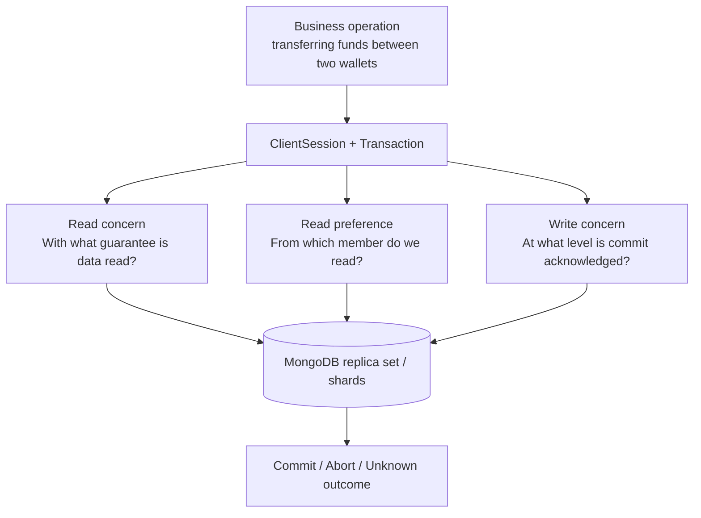
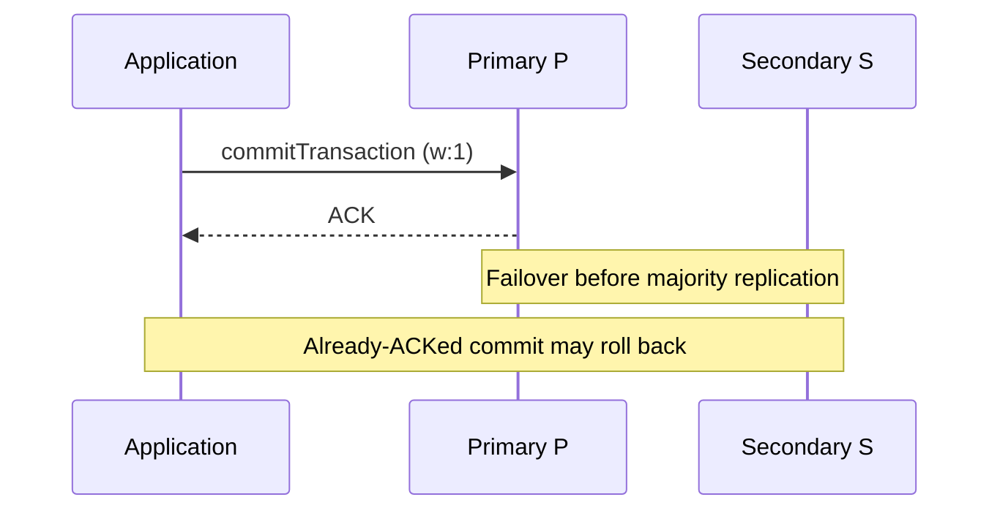
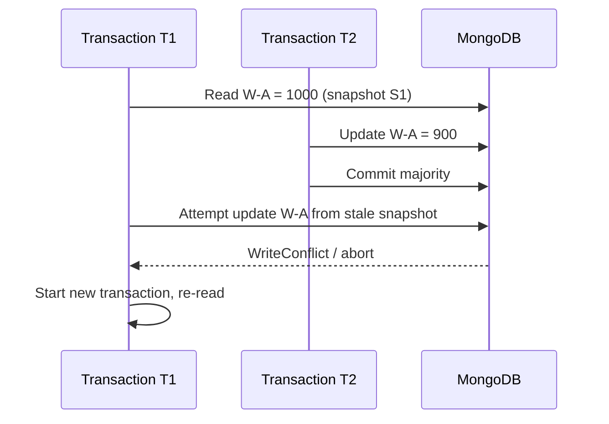

# Read Concern, Write Concern, and Read Preference in Transactions

A MongoDB transaction can transfer money between two wallets, deduct stock while recording history, or update multiple documents and **commit or roll back as a single unit**. Yet simply enabling `@Transactional` does not answer every consistency question: *Has the data being read already been confirmed by a majority of replicas? When commit succeeds, what durability level is guaranteed? Will queries hit the primary or a secondary? Do shards observe the same point in time?*

Three concepts must be distinguished: **read concern**, **write concern**, and **read preference**. In MongoDB, they control three separate dimensions of consistency, durability, and routing. Specifically, inside **multi-document transactions**, guarantees of `readConcern: "majority"` and `readConcern: "snapshot"` **depend on the write concern used at commit**. Consequently, configuring any single option in isolation is not enough to claim the entire transaction is safe.

This lesson belongs to the **Sessions and Transactions** chapter of the `SPRING_DATA_MONGODB` module. The module focuses on using Spring Data MongoDB to connect, map documents, and work via `MongoTemplate`/repositories, alongside practicing aggregation, indexes, transactions, reactive access, testing, and data performance diagnostics. Here we dive into **combining these three settings in transactions**, applying them via `MongoTransactionManager`/`TransactionOptions`, distinguishing sessions from transactions, and verifying behavior on a real replica set.

After this lesson, you will be able to:

1. Explain the differences between **what data is read** (`read concern`), **at what level commit is acknowledged** (`write concern`), and **which node serves reads** (`read preference`).
2. Compare `local`, `majority`, and `snapshot` within transaction scope, especially on **sharded clusters**.
3. Understand why `snapshot + majority commit` is commonly chosen for multi-document transactions needing a majority-committed snapshot.
4. Explain why a transaction performing reads must use `readPreference: primary` instead of pointing reads to secondaries to offload traffic.
5. Configure `TransactionOptions` in the Java Driver, Spring Data `MongoTransactionManager`, and `ReactiveMongoTransactionManager`.
6. Recognize **write conflicts**, **unknown commit outcomes**, **stale reads**, or **failover rollbacks**, and pick the right retry policy.
7. Write integration tests against a MongoDB **replica set** with proper fixtures verifying commit and rollback rather than mocking repositories.

## 1. Map: Three Choices, Three Different Questions



| Property | Question Answered | Examples | What It Does Not Guarantee Alone |
| --- | --- | --- | --- |
| **Read concern** | Isolation/durability level of read data | `local`, `majority`, `snapshot` | Does not choose the target node; does not make commits majority |
| **Write concern** | Acknowledgment level at transaction commit | `w:1`, `w:"majority"` | Does not set read snapshot; does not replace business invariants |
| **Read preference** | Routing reads to replica set members | `primary`, `secondary` | Does not mean data is majority-committed or always newest |

Do not confuse them:

- **`readConcern: "majority"`** does not mean **`readPreference: "secondary"`**. Majority is a data guarantee, whereas secondary is a read target.
- **`writeConcern: "majority"`** does not mean a transaction automatically uses `readConcern: "snapshot"`. It only defines the commit acknowledgment level.
- **`readPreference: "primary"`** does not guarantee a transaction always reads the newest changes from every writer: a transaction's snapshot may be **older** than data just committed externally.

### 1.1. A Running Example

The `wallets` collection has two documents:

```javascript
{
  _id: "W-A",
  tenantId: "T-A",
  owner: "Alice",
  balance: NumberLong("1000")
}

{
  _id: "W-B",
  tenantId: "T-A",
  owner: "Bob",
  balance: NumberLong("200")
}
```

Business command: transfer **300 units** from W-A to W-B. Genuine success means:

```text
Before: W-A=1000, W-B=200, total=1200
After:  W-A=700,  W-B=500, total=1200
```

If deducting W-A succeeds yet crediting W-B fails, the system must not leave a half-applied state. Transactions **commit/abort both commands together**; read concern, write concern, and read preference express read consistency and commit durability.

## 2. First Understand `ClientSession` and Transactions

MongoDB uses **logical sessions** (`ClientSession`) to attach context to a sequence of operations. Transactions execute on a session, yet **a session is not automatically a transaction**:

```text
MongoClient
    └── ClientSession
          ├── normal operations (can use causal consistency)
          └── startTransaction(options)
                  ├── read #1
                  ├── update #1
                  ├── update #2
                  └── commitTransaction() or abortTransaction()
```

Two separate requests using two different sessions **do not share a snapshot**. A request holding a session without calling `startTransaction` also **lacks multi-document atomicity**.

In Spring Data MongoDB:

- `MongoTransactionManager` binds a `ClientSession` to Spring's **execution thread** (thread-bound transaction resources).
- `ReactiveMongoTransactionManager` manages the session in the **Reactor Context**, not in a traditional `ThreadLocal`.
- `MongoTemplate`/`ReactiveMongoTemplate` sharing the same database factory use the session bound by the transaction manager.
- When obtaining `MongoCollection` or `MongoDatabase` directly from the driver, ensure you invoke overloads taking `ClientSession`; never assume raw driver operations join the Spring transaction automatically.

### 2.1. Deployment Requirements

Multi-document transactions require a **transaction-capable MongoDB replica set or sharded cluster**; they do not run on an uninitialized standalone `mongod`. Locally, you can use a **single-node replica set**; in production, verify topology, feature compatibility version, and privileges.

**Do not wrap every single-document operation in a transaction**: MongoDB already supports atomic single-document writes. If the goal is "deduct stock if sufficient," an `updateOne` with filter `stock >= quantity` is simpler; reserve transactions for invariants spanning multiple documents or collections.

### 2.2. "All or Nothing" Does Not Replace Business Constraints

Even a strong transaction must check:

- W-A has sufficient balance at write time.
- Both wallets belong to the allowed tenant.
- W-A and W-B are not the same account if business forbids self-transfers.
- A command is not applied twice when a client retries.
- Events outside MongoDB (payments, emails, queues) are not part of the MongoDB transaction.

Consistency options **never replace validation, optimistic locking, unique indexes, or idempotency**.

## 3. Read Concern in Transactions: `local`, `majority`, `snapshot`

For **multi-document transactions**, MongoDB supports three primary read concern levels: `local`, `majority`, and `snapshot`. Configuration applies at the **transaction level**, not differently per read command inside.

| Read Concern | Meaning in Transactions | Crucial Detail |
| --- | --- | --- |
| `local` | Reads data available on the node, possibly not majority-committed | On sharded clusters, does not guarantee a synchronized snapshot across shards |
| `majority` | Reads majority-committed data provided commit uses `w:"majority"` | Does not guarantee shards share a single snapshot point |
| `snapshot` | Reads a snapshot; when committed with `w:"majority"`, guaranteed to be a majority-committed snapshot | In sharded transactions, the view is synchronized across shards |

**Important warning:** guarantees for `majority`/`snapshot` **inside transactions** are documented by MongoDB under the condition that **the transaction commits using write concern `"majority"`**. If committed with `w:1`, you cannot claim `majority`/`snapshot` read concern observed a **majority-committed snapshot**.

### 3.1. `readConcern: "local"`

`local` can read data on a node not yet acknowledged by a majority of replicas; that data could roll back on failover. On a replica set, transactions may still provide stronger isolation than bare reads, yet **never assume `local` equals `majority`/`snapshot`**.

On a sharded cluster, `local` **does not guarantee** shards expose data from a synchronized snapshot point. Thus it is unsuitable for reports or conditions needing two shards viewed as one consistent point-in-time snapshot.

### 3.2. `readConcern: "majority"`

When a transaction commits with `writeConcern: "majority"`, read concern `majority` guarantees data has been acknowledged by a majority of replicas. This characterizes the durability of **read data**, not routing queries to secondaries.

On a sharded cluster, `majority` **does not synchronize snapshots across shards**. If a report must represent state "at the same cluster-wide point in time," `snapshot` is typically the right choice.

### 3.3. `readConcern: "snapshot"`

In a transaction with majority commit, `snapshot` gives a consistent view from a snapshot of majority-committed data. On a **sharded cluster**, that snapshot is synchronized across shards; this matters when a transaction reads collections/partitions spread across multiple shards.

However, `snapshot` **does not mean the newest version at the instant each query runs**. The snapshot stays consistent for the transaction; another transaction committing after the snapshot was chosen may **not appear** in subsequent reads inside the current transaction.

```text
t0: Transaction T1 starts, reads balance(W-A)=1000.
t1: Transaction T2 updates and commits balance(W-A)=900.
t2: T1 reads W-A inside its snapshot;
    may still see balance=1000.
```

If T1 tries to update a document already modified by T2, it can hit a **write conflict** and must abort/retry from the start. Never crank read concern up to `snapshot` thinking the transaction "locks" all data away from other writers.

### 3.4. Why Not `available` or `linearizable`?

MongoDB offers additional read concern levels for **reads outside transactions**, whereas multi-document transactions primarily support `local`, `majority`, and `snapshot`. Never copy the Java Driver enum list or Spring Data label list assuming the server accepts every value for multi-document transactions.

**MongoDB Server validation** is the source of truth for validity. If you pass `mongo:readConcern=LINEARIZABLE` on a transaction and the server rejects it, that is a server rule, not a missing enum in Spring Data.

## 4. Write Concern: At What Level Is **Commit** Acknowledged?

Write concern governs the acknowledgment level the client requires when a transaction **commits**. Two levels are most commonly evaluated:

| Transaction Write Concern | Basic Meaning | Risks / Trade-offs |
| --- | --- | --- |
| `w:1` | Acknowledged once commit is applied on the primary | Can roll back if failover occurs before majority replication |
| `w:"majority"` | Waits for acknowledgment from a majority of voting members per server rules | Latency depends on replication and majority availability, trading for stronger durability |

### 4.1. Do Not Set Write Concern per Operation Inside a Transaction

This differs easily from regular writes. In multi-document transactions, **write concern applies at the transaction/commit level**. MongoDB requires write commands inside a transaction **not to specify their own individual write concern**.

```javascript
// RIGHT: set write concern when starting the transaction.
session.startTransaction({
  readConcern: { level: "snapshot" },
  writeConcern: { w: "majority" }
});

// Inserts/updates inside share the session,
// without passing {writeConcern: ...} on individual operations.
```

Attempting to ask for `w:1` on one update and `w:"majority"` on the next inside the same transaction fails: the application **does not get two independent commit guarantees**; the whole transaction commits or aborts together.

### 4.2. `w:1` Can Still Roll Back After Failover

Suppose a transaction commits on the primary and returns a `w:1` ACK, yet the primary crashes before a majority of replicas replicate the transaction. When a secondary is elected primary, writes not majority-committed **can be rolled back**.



**Never interpret a `w:1` `ACK` as having majority-commit durability.** For money transfers, ledgers, or hard-to-reverse changes, evaluate `w:"majority"` alongside durability and reconciliation policies.

### 4.3. `w:"majority"` and Journaling

`w:"majority"` waits for acknowledgment from the required voting members per server config. Exact **journal durability** also depends on the storage engine and settings like `writeConcernMajorityJournalDefault`. For high-assurance systems, inspect the actual deployment rather than treating the word `majority` as a standalone guarantee regardless of configuration.

When a majority is unavailable or the network is slow, commit may fail, stall, or produce an unknown outcome. `wtimeout` or commit time limits avoid infinite waits, yet **a timeout does not prove rollback succeeded**. Applications must handle errors and ambiguous commit states properly.

### 4.4. Defaults Vary by MongoDB Version and Topology

If transaction write concern is omitted, it is inherited from the session/client or deployment default. In MongoDB 5.0+, the implicit default write concern on many replica sets is `majority`, **with exceptions when arbiters or specific configurations exist**; earlier versions often defaulted to `w:1`.

Therefore, never write tests or business contracts assuming "MongoDB transactions always default to majority," especially across multiple environments. For use cases requiring majority commit, **configure it explicitly in `TransactionOptions`** and verify via command monitoring/config.

## 5. Read Preference: Which Node Receives Reads in a Transaction?

Read preference controls how clients choose a replica set member for **read operations**:

| Mode | Outside Transactions | Inside Transactions with Reads |
| --- | --- | --- |
| `primary` | Reads from primary | **Required** |
| `secondary` | Reads from secondary | Unsuitable / unsupported |
| `secondaryPreferred` | Prefers secondary, can fall back | Do not use to bypass primary requirement |
| `primaryPreferred` | Prefers primary, can fall back | Do not treat as equivalent to mandatory primary |
| `nearest` | Selects eligible member by latency | Do not use instead of primary inside transactions |

Per MongoDB documentation, **transactions containing read operations must use `readPreference: primary`**; operations inside a transaction must route to the appropriate primary member. Thus a read-only query might target a secondary **outside a transaction**, whereas a read-then-write multi-document transaction **cannot simply be shifted to a secondary to reduce primary load**.

### 5.1. `primary` Does Not Equal `readConcern: "majority"`

A primary read with `readConcern: "local"` can still observe non-majority-committed data. Conversely, an out-of-transaction query with `readPreference: secondary` and `readConcern: "majority"` sees majority-committed data, yet **not necessarily the very latest version at query start time**.

Hence all three settings must be evaluated **individually and together**.

### 5.2. Does a Read-Only Report Always Need a Transaction?

No. A report reading one collection without needing multiple operations on a single snapshot and accepting eventual consistency can run with an **appropriate read concern/read preference outside a transaction**.

Conversely, a report needing multiple documents/collections from **one consistent snapshot** may use snapshot reads or a transaction depending on MongoDB version and query support. Setting `@Transactional(readOnly = true)` in Spring Data MongoDB **can still open a transaction/session**, rather than being a free hint that speeds up queries.

### 5.3. What If the Client URI Specifies Secondary?

If the URI or client configures `readPreference=secondary`, a transaction performing read operations **can fail** when inheriting that read preference. Do not assume `MongoTransactionManager` silently overrides everything to primary without verifying. Explicitly set `TransactionOptions.readPreference(ReadPreference.primary())` for read/write transactions.

## 6. Read Concern – Write Concern Combination Matrix

Whether a transaction works as intended also depends on topology, version, and other options. This table summarizes **guarantees supported** by MongoDB documentation:

| Read Concern | Commit Write Concern | Safety Conclusion |
| --- | --- | --- |
| `local` | `w:1` | Lower majority guarantees; commit may roll back after failover |
| `local` | `majority` | Commit acknowledged by majority; read concern is not upgraded to a synchronized majority snapshot |
| `majority` | `w:1` | **Not guaranteed** that reads in the transaction are majority-committed |
| `majority` | `majority` | Reads are guaranteed majority-committed, yet on a sharded cluster **no synchronized snapshot across shards** |
| `snapshot` | `w:1` | **Not guaranteed** that the read snapshot is majority-committed |
| `snapshot` | `majority` | Guarantees reading from a synchronized majority-committed snapshot; suitable for cross-shard consistency |

In the following read/write examples, we use:

```javascript
{
  readConcern: { level: "snapshot" },
  writeConcern: { w: "majority" },
  readPreference: { mode: "primary" }
}
```

This is a **strong configuration for multi-document transactions**, not a mandatory optimal choice for every workload. For latency-sensitive apps where eventual consistency suffices, evaluate guarantees, latency, and recovery via real benchmarks and tests.

### 6.1. Is `snapshot + majority` Enough to "Never Conflict"?

No. It does not prevent write conflicts, stale snapshots when another writer commits after the snapshot was taken, or business errors. Two transactions can read the same balance and both attempt to update the document; MongoDB may abort one due to a write conflict. You must retry the whole transaction from scratch per rules.

### 6.2. Does `majority` Mean "Read the Latest Data"?

No. Majority means data crossed an acknowledgment threshold; **it does not automatically become linearizable "immediately latest."** Different read concerns, read preferences, and operations can observe snapshot/replication lag. Never substitute "majority" for explicit recency requirements.

### 6.3. What Is Special About `snapshot` on a Sharded Cluster?

A transaction may access two shards at different replication points. `majority` ensures each shard serves majority-committed data per commit rules, yet does not guarantee they form **one synchronized point-in-time cut**. `snapshot` provides a synchronized snapshot across shards with majority commit, preventing reports from seeing "new shard A, old shard B" from misaligned timestamps.

**Snapshot consistency does not make external side effects atomic.** Sending emails, calling banks, or publishing messages in a transaction still requires outbox/idempotency, because MongoDB only governs MongoDB operations inside the transaction.

## 7. Distinguishing Defaults, Inherited Values, and Explicit Configuration

Suppose the application omits `TransactionOptions`:

```text
Explicit transaction option?
        |
        +-- Yes -> use the option passed at transaction start
        |
        +-- No
              |
              v
           Session option?
              |
              +-- Yes -> inherit from session
              |
              +-- No  -> inherit from client/deployment
```

For read concern, MongoDB usually defaults to `local` on the primary when unconfigured. For read preference, the default is normally `primary`. For write concern, the implicit default varies by server version/topology; never guess.

### 7.1. MongoDB Server Decides Final Validity

A Java Driver enum or Spring label may let you supply many `ReadConcern`, `ReadPreference`, or `WriteConcern` values. However, server transactions support only a **specific subset and semantics**. Constructing options with a builder does not prove a transaction is valid until tested against your deployment.

### 7.2. An Active Transaction Does Not Dynamically Upgrade Options

If a `@Transactional` method joins a transaction **already started by the caller**, new options declared on the inner method **do not alter** the outer transaction's read concern, write concern, or read preference. Identify **which service owns the transaction boundary** and set options before the transaction starts.

Example:

```text
OuterService.method()  @Transactional (already started transaction)
    └── InnerService.method() @Transactional (asks for snapshot)

Do not assume the inner method can switch the open
transaction's readConcern to snapshot mid-flight.
```

With Spring propagation, some modes behave differently; do not treat `REQUIRES_NEW` as a free fix, since it opens an extra transaction/session and increases contention. Only change boundaries when there is a clear consistency purpose.

## 8. Hands-on `mongosh`: Starting a Transaction with Three Explicit Options

Before writing Spring Boot code, run a real transaction in `mongosh` on a **test replica set**. The example uses a dedicated `tx_demo` database and must never run against production wallets.

### 8.1. Preparing Fixtures Before Opening the Transaction

```javascript
// Run on a disposable test database, never production.
const demoDb = db.getSiblingDB("tx_demo");

demoDb.wallets.insertMany([
  {
    _id: "W-A",
    tenantId: "T-A",
    owner: "Alice",
    balance: NumberLong("1000")
  },
  {
    _id: "W-B",
    tenantId: "T-A",
    owner: "Bob",
    balance: NumberLong("200")
  }
]);

// Prepare the history collection before the transaction.
demoDb.createCollection("transferLogs");
```

Seed commands should run **once on an empty test database**; if documents/collections already exist, inspect and clean fixtures only within authorized test scope. The example intentionally avoids `dropDatabase()` to prevent accidental data loss.

### 8.2. Opening Session/Transaction and Updating

```javascript
const session = db.getMongo().startSession({
  readPreference: { mode: "primary" }
});

const txDb = session.getDatabase("tx_demo");

try {
  await session.withTransaction(async () => {
    const debited = txDb.wallets.updateOne(
      { _id: "W-A", tenantId: "T-A", balance: { $gte: 300 } },
      { $inc: { balance: NumberLong("-300") } }
    );
    if (debited.matchedCount !== 1) {
      throw new Error("Source wallet missing or insufficient balance");
    }

    const credited = txDb.wallets.updateOne(
      { _id: "W-B", tenantId: "T-A" },
      { $inc: { balance: NumberLong("300") } }
    );
    if (credited.matchedCount !== 1) {
      throw new Error("Destination wallet does not exist");
    }

    txDb.transferLogs.insertOne({
      _id: "OP-001",
      tenantId: "T-A",
      fromWallet: "W-A",
      toWallet: "W-B",
      amount: NumberLong("300")
    });
  }, {
    readConcern: { level: "snapshot" },
    writeConcern: { w: "majority" }
  });
} finally {
  session.endSession();
}
```

After commit succeeds:

```javascript
demoDb.wallets.find({}, {
  _id: 1,
  balance: 1
}).sort({ _id: 1 }).toArray();

// W-A: 700; W-B: 500.

demoDb.transferLogs.findOne({ _id: "OP-001" });
// Matching transfer log is present.
```

**Error handling note:** `Session.withTransaction` in `mongosh` retries transactions/commits on eligible errors, meaning **the callback may run multiple times**. Never place external side effects outside MongoDB inside the callback. When `commitTransaction()` reports **`UnknownTransactionCommitResult`**, the transaction may already have committed; never assume an exception equals rollback. In real Java applications, use the driver/framework transaction helpers and retry commit per rules, while tracking **operation IDs** to avoid re-applying an already-committed transfer.

### 8.3. Pausing Before Commit to See Changes Isolated Inside the Session

In a test database, start a new transaction, update W-A, and **do not commit yet**. From a second session, uncommitted changes are **not visible** as completed updates. Upon abort, balances return to pre-transaction values.

This verifies **basic atomicity and isolation**. You **cannot visually tell apart** `local`, `majority`, and `snapshot` on a healthy low-contention replica set, because all three return identical values on quiescent data. To test majority/failover guarantees, you need controlled replication/failover tests.

### 8.4. Testing Invalid Read Preference Separately

Do not modify an important transaction just to try secondary reads. On a test deployment, start a transaction with a read operation under a non-`primary` read preference and confirm the driver/server rejects it properly, rather than assuming an API enum allowing the value means the server accepts it.

**Never assume an app with URI `readPreference=secondaryPreferred` is permitted to run transactional reads on secondaries.** Transactional reads impose their own routing rules.

## 9. Java Driver: `TransactionOptions` and `ClientSession`

Spring Data MongoDB delegates to the Java Driver underneath. The core configuration API is `com.mongodb.TransactionOptions`:

```java
import com.mongodb.ReadConcern;
import com.mongodb.ReadPreference;
import com.mongodb.TransactionOptions;
import com.mongodb.WriteConcern;

TransactionOptions options = TransactionOptions.builder()
        .readConcern(ReadConcern.SNAPSHOT)
        .writeConcern(WriteConcern.MAJORITY)
        .readPreference(ReadPreference.primary())
        .build();
```

Placed together, the three options express clear intent:

```text
ReadConcern.SNAPSHOT          -> synchronized read snapshot, single view
WriteConcern.MAJORITY         -> majority commit acknowledgment
ReadPreference.primary()      -> read operations route to primary
```

### 9.1. Driver Sync Transaction Helper

The Java Driver manages session lifecycle via `try-with-resources` and provides `withTransaction(...)`:

```java
import com.mongodb.client.ClientSession;
import com.mongodb.client.MongoClient;
import com.mongodb.client.MongoCollection;
import com.mongodb.client.model.Filters;
import com.mongodb.client.model.Updates;
import com.mongodb.client.result.UpdateResult;
import org.bson.Document;

// client is a MongoClient configured for the test/production replica set.
try (ClientSession session = client.startSession()) {
    MongoCollection<Document> wallets = client
            .getDatabase("tx_demo")
            .getCollection("wallets");

    String outcome = session.withTransaction(() -> {
        UpdateResult debit = wallets.updateOne(
                session,
                Filters.and(
                        Filters.eq("_id", "W-A"),
                        Filters.eq("tenantId", "T-A"),
                        Filters.gte("balance", 300L)
                ),
                Updates.inc("balance", -300L)
        );
        if (debit.getMatchedCount() != 1) {
            throw new IllegalStateException("Insufficient balance");
        }

        UpdateResult credit = wallets.updateOne(
                session,
                Filters.and(
                        Filters.eq("_id", "W-B"),
                        Filters.eq("tenantId", "T-A")
                ),
                Updates.inc("balance", 300L)
        );
        if (credit.getMatchedCount() != 1) {
            throw new IllegalStateException("Destination wallet missing");
        }

        return "TRANSFER_ACCEPTED";
    }, options);
}
```

In this example, `client` and `options` are declared in the enclosing scope. Every `wallets.updateOne(...)` receives **`session`**; omitting the session argument leaves that driver operation **outside the open transaction**.

The driver's `withTransaction` helper retries transient/unknown-commit errors per docs; hence **the body may execute multiple times**. Never send emails, charge banks, publish non-idempotent messages, or mutate external state **directly inside the lambda**.

### 9.2. Direct Driver Differs from `MongoTemplate`

With `MongoTemplate` inside a Spring transaction manager, Spring Data operations through the template automatically use the bound session. Yet if inside that method you directly call:

```java
MongoCollection<Document> raw = template
        .getCollection("wallets");

raw.updateOne(
        Filters.eq("_id", "W-A"),
        Updates.inc("balance", -300L));
```

you **cannot assume** the raw driver call participates in Spring's transaction session. Use managed `MongoTemplate` APIs or driver methods taking `ClientSession` in the right context. Specifically, `MongoOperations.getCollection` returns a driver gateway and **does not automatically session-proxy** every raw command.

### 9.3. Standalone Sessions and Causal Consistency

A session **outside a transaction** can enable `causallyConsistent(true)` to support causal ordering guarantees such as read-your-writes under MongoDB's documented conditions. To achieve distributed causal consistency guarantees across reads/writes, MongoDB docs require **`majority` read concern and `majority` write concern**, alongside proper sequential session usage.

**Causal consistency != multi-document transaction.** It does not make two updates on two documents commit atomically together; it solves a different problem about observation ordering across operations.

## 10. Spring Data: Configuring `MongoTransactionManager` with `TransactionOptions`

In Spring Boot, the cleanest and most auditable setup is configuring a `MongoTransactionManager` sharing the **same `MongoDatabaseFactory`** as `MongoTemplate` and supplying the three options when transactions start.

### 10.1. Transaction Manager Configuration

```java
import com.mongodb.ReadConcern;
import com.mongodb.ReadPreference;
import com.mongodb.TransactionOptions;
import com.mongodb.WriteConcern;
import org.springframework.context.annotation.Bean;
import org.springframework.context.annotation.Configuration;
import org.springframework.data.mongodb.MongoDatabaseFactory;
import org.springframework.data.mongodb.MongoTransactionManager;

@Configuration
public class MongoTxConfig {

    @Bean
    MongoTransactionManager mongoTransactionManager(
            MongoDatabaseFactory factory
    ) {
        TransactionOptions options = TransactionOptions.builder()
                .readConcern(ReadConcern.SNAPSHOT)
                .writeConcern(WriteConcern.MAJORITY)
                .readPreference(ReadPreference.primary())
                .build();

        return new MongoTransactionManager(factory, options);
    }
}
```

This uses Spring Data MongoDB's `MongoTransactionManager(MongoDatabaseFactory, TransactionOptions)` constructor. When a new Spring transaction starts, the manager provides the `ClientSession` and applies the options. `MongoTemplate`/repository operations sharing the **same factory and session context** join the transaction.

**Do not manually call `session.startTransaction()` inside a method managed by `MongoTransactionManager`.** Mixing manual session/transaction calls with declarative transactions easily pushes operations outside the commit boundary.

### 10.2. Real Transaction: Transferring Balances and Writing History

Entities:

```java
import org.springframework.data.mongodb.core.mapping.Document;
import org.springframework.data.mongodb.core.mapping.MongoId;

@Document(collection = "wallets")
public record Wallet(
        @MongoId String id,
        String tenantId,
        String owner,
        long balance
) {}

@Document(collection = "transferLogs")
record TransferLog(
        @MongoId String id,
        String tenantId,
        String fromWallet,
        String toWallet,
        long amount
) {}
```

Service using atomic single-document updates **grouped inside one transaction**:

```java
import com.mongodb.client.result.UpdateResult;
import org.springframework.data.mongodb.core.MongoTemplate;
import org.springframework.data.mongodb.core.query.Criteria;
import org.springframework.data.mongodb.core.query.Query;
import org.springframework.data.mongodb.core.query.Update;
import org.springframework.stereotype.Service;
import org.springframework.transaction.annotation.Transactional;

@Service
public class WalletTransferService {
    private final MongoTemplate template;

    public WalletTransferService(MongoTemplate template) {
        this.template = template;
    }

    @Transactional(transactionManager = "mongoTransactionManager")
    public String transfer(
            String authorizedTenantId,
            String operationId,
            String fromWallet,
            String toWallet,
            long amount
    ) {
        if (authorizedTenantId == null || authorizedTenantId.isBlank()
                || operationId == null || operationId.isBlank()
                || fromWallet == null || fromWallet.isBlank()
                || toWallet == null || toWallet.isBlank()
                || fromWallet.equals(toWallet)
                || amount <= 0) {
            throw new IllegalArgumentException("Invalid transfer details");
        }

        // If this command committed previously, read exact operationId.
        // Return same result only when payload matches, avoiding wrong replies.
        TransferLog existing = template.findOne(
                Query.query(Criteria.where("_id").is(operationId)
                        .and("tenantId").is(authorizedTenantId)),
                TransferLog.class);
        if (existing != null) {
            if (!existing.fromWallet().equals(fromWallet)
                    || !existing.toWallet().equals(toWallet)
                    || existing.amount() != amount) {
                throw new IllegalStateException(
                        "operationId reused with different payload");
            }
            return existing.id();
        }

        Query debitFilter = Query.query(
                Criteria.where("_id").is(fromWallet)
                        .and("tenantId").is(authorizedTenantId)
                        .and("balance").gte(amount));

        UpdateResult debit = template.updateFirst(
                debitFilter,
                new Update().inc("balance", -amount),
                Wallet.class);
        if (debit.getMatchedCount() != 1) {
            throw new IllegalStateException(
                    "Source wallet missing or insufficient balance");
        }

        Query creditFilter = Query.query(
                Criteria.where("_id").is(toWallet)
                        .and("tenantId").is(authorizedTenantId));
        UpdateResult credit = template.updateFirst(
                creditFilter,
                new Update().inc("balance", amount),
                Wallet.class);
        if (credit.getMatchedCount() != 1) {
            // Runtime exception => Spring rolls back transaction.
            throw new IllegalStateException("Destination wallet missing");
        }

        template.insert(new TransferLog(
                operationId,
                authorizedTenantId,
                fromWallet,
                toWallet,
                amount));

        // Commit happens WHEN exiting through the Spring transaction interceptor.
        return operationId;
    }
}
```

When the transaction commits successfully, **source debit, destination credit, and history insert** all commit together. If credit fails or inserting the log triggers a duplicate key, the exception rolls back the transaction under Spring's default handling for unchecked exceptions.

**Prerequisite for proper execution:** `WalletTransferService.transfer` must be called **through the Spring-managed bean/proxy** from outside, not via `this.transfer(...)` inside the same class bypassing transaction advice. `MongoTemplate` must use the same `MongoDatabaseFactory` managed by the transaction manager.

### 10.3. Why Use `operationId`?

MongoDB transactions make multiple documents commit atomically, yet an HTTP request can be **resent after a client loses the response**. If the resent request uses a new `operationId`, the transfer can execute a second time even though the first transaction committed cleanly.

This example uses `TransferLog.id` as a unique key and returns the existing result if the same ID/payload was already saved. In real systems, also handle **concurrent duplicate requests**, duplicate key errors, payload mismatches, unconfirmed operations, and unknown commit outcomes. Never treat this snippet as a full payment gateway with complete exactly-once semantics.

### 10.4. Do Not Run Non-MongoDB I/O Inside Transactions

Avoid doing:

```java
@Transactional(transactionManager = "mongoTransactionManager")
public void transferAndNotify(...) {
    // MongoDB update...
    sendEmail();       // Not part of transaction.
    chargePaymentApi(); // Not part of transaction.
}
```

If the transaction rolls back after the email or payment API finishes, the two systems **do not automatically roll back together**. For reliability, use a **transactional outbox**, idempotent consumers, state machines, and proper compensation.

## 11. Configuring Transaction Options per Method

In Spring Data MongoDB **versions supporting `MongoTransactionOptionsResolver` and transaction labels**, you can declare requirements using `@Transactional(label = ...)`:

```java
import org.springframework.transaction.annotation.Transactional;

@Transactional(
    transactionManager = "mongoTransactionManager",
    label = {
        "mongo:readConcern=SNAPSHOT",
        "mongo:writeConcern=MAJORITY",
        "mongo:readPreference=PRIMARY"
    }
)
public void reconcileBalances() {
    // MongoTemplate operations sharing the session/transaction.
}
```

This illustrates **annotating a Spring-managed service method**, not a standalone snippet to drop into a top-level class. Labels prefixed with `mongo:` are parsed by Spring Data into transaction options when a new transaction starts, on supported releases.

### 11.1. Labels Are Only a Configuration Mechanism, Not Bypassing Server Limits

The API parser may accept `mongo:readConcern=AVAILABLE` or `mongo:readPreference=SECONDARY` because the enums support them in other contexts. However, **MongoDB multi-document transactions** have strict rules: read concern `local/majority/snapshot` and read-bearing transactions must use `primary`. Never treat a syntactically valid label as proof it is valid on the server.

### 11.2. Spring Data Version Matters

Per-method options via `label`/`MongoTransactionOptionsResolver` are supported in modern Spring Data releases. On older Spring Data apps, prefer `new MongoTransactionManager(factory, options)` configured uniformly on the transaction manager; **never assume every version parses transaction labels automatically**.

### 11.3. Nested Methods Cannot Alter an Active Transaction's Options

If `outer()` already started a transaction with default `local`, an `inner()` method with `label=SNAPSHOT` that merely **joins the same transaction** cannot upgrade read concern mid-flight. Put options on the **owner of the transaction boundary**, or design a fresh transaction boundary if appropriate.

### 11.4. `@Transactional(readOnly = true)`

In Spring Data MongoDB, a read-only transaction can still open a transaction to bind `ClientSession`. It does not force the driver to read secondaries or turn reads into majority read concern. If you need a cheap read-only report, first check whether **a transaction is truly necessary** and whether out-of-transaction queries satisfy your consistency requirements.

## 12. `TransactionTemplate` and `TransactionalOperator`

Not every use case suits annotations. For **imperative transactions** needing explicit method-level boundary control, use `TransactionTemplate`:

```java
import org.springframework.data.mongodb.MongoTransactionManager;
import org.springframework.transaction.support.TransactionTemplate;

// manager is the MongoTransactionManager bean configured in section 10.
TransactionTemplate tx = new TransactionTemplate(manager);

String operationId = tx.execute(status ->
        walletTransferService.transfer(
                "T-A", "OP-002", "W-A", "W-B", 100));
```

This is shown inside a class holding the `manager` and `walletTransferService` beans. Here `transfer` already carries `@Transactional` and will **join the existing transaction**, so **you do not necessarily need both `TransactionTemplate` and `@Transactional` simultaneously**; choose one clear owner for the transaction boundary.

In **reactive** applications, use `TransactionalOperator` to wrap a Publisher in a transaction boundary instead of opening thread-local sessions:

```java
import org.springframework.transaction.reactive.TransactionalOperator;
import reactor.core.publisher.Mono;

// operator was created from ReactiveMongoTransactionManager.
Mono<String> result = reactiveWalletTransferService
        .transfer("T-A", "OP-003", "W-A", "W-B", 50)
        .as(operator::transactional);
```

For the reactive flow to stay inside the transaction, inner calls must use **`ReactiveMongoTemplate`/`ReactiveMongoRepository`** participating in the reactive transaction context. A blocking `MongoTemplate` call mixed into a reactive pipeline **will not enlist automatically** and can block the event loop.

### 12.1. Configuring the Reactive Transaction Manager with the Same Options

```java
import com.mongodb.ReadConcern;
import com.mongodb.ReadPreference;
import com.mongodb.TransactionOptions;
import com.mongodb.WriteConcern;
import org.springframework.context.annotation.Bean;
import org.springframework.context.annotation.Configuration;
import org.springframework.data.mongodb.ReactiveMongoDatabaseFactory;
import org.springframework.data.mongodb.ReactiveMongoTransactionManager;
import org.springframework.transaction.reactive.TransactionalOperator;

@Configuration
public class ReactiveMongoTxConfig {

    @Bean
    ReactiveMongoTransactionManager reactiveMongoTransactionManager(
            ReactiveMongoDatabaseFactory factory
    ) {
        TransactionOptions options = TransactionOptions.builder()
                .readConcern(ReadConcern.SNAPSHOT)
                .writeConcern(WriteConcern.MAJORITY)
                .readPreference(ReadPreference.primary())
                .build();

        return new ReactiveMongoTransactionManager(factory, options);
    }

    @Bean
    TransactionalOperator mongoTransactionalOperator(
            ReactiveMongoTransactionManager manager
    ) {
        return TransactionalOperator.create(manager);
    }
}
```

Never register both imperative and reactive transaction manager beans with identical names without distinguishing where each is used. In hybrid apps, **name managers distinctly and specify them explicitly per service** so `@Transactional` never picks the wrong manager.

### 12.2. Reactive Write Example Sharing the Transaction Context

```java
import com.mongodb.client.result.UpdateResult;
import org.springframework.data.mongodb.core.ReactiveMongoTemplate;
import org.springframework.data.mongodb.core.query.Criteria;
import org.springframework.data.mongodb.core.query.Query;
import org.springframework.data.mongodb.core.query.Update;
import org.springframework.stereotype.Service;
import org.springframework.transaction.reactive.TransactionalOperator;
import reactor.core.publisher.Mono;

@Service
public class ReactiveWalletTransferService {

    private final ReactiveMongoTemplate template;
    private final TransactionalOperator operator;

    public ReactiveWalletTransferService(
            ReactiveMongoTemplate template,
            TransactionalOperator operator
    ) {
        this.template = template;
        this.operator = operator;
    }

    public Mono<String> transfer(
            String tenantId, String operationId,
            String fromId, String toId, long amount
    ) {
        if (tenantId == null || tenantId.isBlank()
                || operationId == null || operationId.isBlank()
                || fromId == null || toId == null
                || fromId.equals(toId) || amount <= 0) {
            return Mono.error(new IllegalArgumentException(
                    "Invalid input"));
        }

        Query debitQuery = Query.query(
                Criteria.where("_id").is(fromId)
                        .and("tenantId").is(tenantId)
                        .and("balance").gte(amount));

        Query creditQuery = Query.query(
                Criteria.where("_id").is(toId)
                        .and("tenantId").is(tenantId));

        Mono<String> work = Mono.defer(() ->
                template.updateFirst(
                        debitQuery,
                        new Update().inc("balance", -amount),
                        Wallet.class)
                    .flatMap(debit -> {
                        if (debit.getMatchedCount() != 1) {
                            return Mono.error(new IllegalStateException(
                                    "Source wallet has insufficient balance"));
                        }
                        return template.updateFirst(
                                creditQuery,
                                new Update().inc("balance", amount),
                                Wallet.class);
                    })
                    .flatMap(credit -> {
                        if (credit.getMatchedCount() != 1) {
                            return Mono.error(new IllegalStateException(
                                    "Destination wallet does not exist"));
                        }
                        return template.insert(new TransferLog(
                                operationId, tenantId,
                                fromId, toId, amount));
                    })
                    .map(TransferLog::id));

        return work.as(operator::transactional);
    }
}
```

This example **omits an idempotency lookup beforehand**, and does not handle ambiguous commits. It strictly illustrates the **reactive update–update–insert chain sharing the same context**; to turn it into a retry-safe endpoint, add an operation ledger and reconciliation like sections 10.3 and 14.

### 12.3. Reactive Retries Must Wrap the Entire Transaction Boundary

A publisher starts a transaction when subscribed. When a retryable `TransientTransactionError` occurs, the retry must open a **fresh transaction and re-read state**, not continue an aborted session. When applying `retryWhen`, ensure it wraps the **entire transactional workflow**, not just the second update.

Never call `block()` on a Reactor event loop; never use `Thread.sleep` for backoff. Avoid parallelizing multiple operations on the **same `ClientSession`**, as MongoDB sessions are not safe for arbitrary concurrent execution and drivers disallow parallel ops inside one transaction.

## 13. Stale Reads, Write Conflicts, and Data Changing Mid-Transaction

Setting `readConcern: "snapshot"` does not freeze database writes. A transaction can read from a snapshot **older than current values**; when attempting to update a document just modified by another writer, MongoDB can report a **write conflict**.

### 13.1. Timeline of Two Conflicting Transactions



A transactional read does not place an **exclusive lock** on every read document. MongoDB allows transactions to read snapshots concurrently, aborting one when write conflicts arise. Therefore "read, check stock, update" must handle conflicts at the **whole-transaction level**, not by retrying a single update statement after the transaction already failed.

### 13.2. Stale Data Inside a Transaction Is Not Always a Bug

For reports requiring a **consistent point in time**, not seeing newer commits occurring after the snapshot was chosen is often the **exact design goal**.

Conversely, for authorization or transfer workflows that must act on current state, enforce invariants inside the write filter, use atomic filters, or apply proper locks/transaction retries. Never assume `"snapshot"` means always reading every session's very latest writes.

### 13.3. Retries Must Execute in a Fresh Transaction

```text
Attempt 1:
  startTransaction(snapshot, majority, primary)
  read -> validate -> write
  write conflict
  abort / cleanup transaction

Attempt 2:
  start NEW transaction
  re-read FRESH data
  re-validate business invariant
  write -> commit
```

Once a transaction aborts or a driver reports a fatal operation error, **never keep the old transaction and retry a single statement**. Spring's transaction manager typically requires exiting the transactional method so an outer layer retries the whole call, or using a driver helper with built-in transaction retry support.

### 13.4. What Does a Lost Response at Commit Mean?

Certain MongoDB Driver errors carry **error labels**, notably:

- `TransientTransactionError`: indicates the transaction may be **retried from scratch** under eligible conditions.
- `UnknownTransactionCommitResult`: client **does not know** whether commit succeeded; must **retry commit per rules**, or look up an idempotent operation ledger where appropriate.

**Do not handle both with "catch exception and call `transfer()` again."** On an unknown commit, re-invoking the entire business operation can double-transfer funds without idempotency. MongoDB Driver helpers implement dedicated commit/transaction retry policies; Spring's transaction manager may wrap commit errors in Spring exceptions, so inspect causes/driver exceptions per your actual version.

### 13.5. Transaction Duration Is Also a Resource

MongoDB enforces `transactionLifetimeLimitSeconds`, typically defaulting to about **60 seconds** depending on deployment. Long transactions retain snapshots and resources longer, pressuring WiredTiger cache/locks and raising write conflict rates.

Keep transactions **short and restricted to MongoDB writes that must commit together**. Never leave a transaction open while waiting for a user form, calling slow APIs, or processing large files.

## 14. When to Use Causal Consistency Instead of Multi-Document Transactions

Not every "read what I just wrote" problem needs a transaction:

| Goal | Mechanism to Consider |
| --- | --- |
| Reading changes just written in a previous request within a causal session | `ClientSession` causal consistency with `majority` read/write concerns per docs |
| Writing two documents that must commit/roll back together | MongoDB multi-document transaction |
| Reading a multi-shard report from one consistent snapshot | `snapshot` with appropriate guarantees |
| Incrementing a counter or deducting stock in a single document | Atomic `$inc`/conditional filter update |
| Reading search/results that may lag the primary by a few seconds | Non-transactional read preference aligned with SLA |
| Publishing a message after data commit | Outbox/idempotent consumer instead of expecting one MongoDB tx to cover external systems |

### 14.1. A Causal Session Does Not Mean "You Can Read Secondaries Inside a Transaction"

MongoDB allows secondary read preferences for **some reads outside transactions**, paired with causal consistency and majority settings when needed. Once you enter a transaction with read operations, the `primary` rule applies.

### 14.2. A Single Transaction Does Not Protect Every Concurrency Phenomenon

Transactions do not automatically replace database constraints such as:

- "Never have two invoices with the same invoice number": requires unique index/constraints.
- "Never overspend a limit": requires filters/invariants/constraints and conflict handling.
- "Never send two emails": requires outbox/idempotent consumers.
- "Never lose a commit response": impossible to guarantee over a network; requires commit-outcome handling.

**Putting strong concerns in the right places protects data, while business invariants still depend on accurate commands and workflows.**

## 15. Testing Transactions on a MongoDB Replica Set

`@Transactional` examples **cannot be verified by mocking repositories**. A unit test can verify the service called `updateFirst` twice, yet cannot prove MongoDB rolls back when the second command fails. Write integration tests against a **test MongoDB replica set** (e.g., a single-node `rs0` in Testcontainers or a test MongoDB Atlas cluster).

### 15.1. Test Environment Requirements

- MongoDB Server runs as a **replica set**, not an uninitialized standalone instance without `rs.initiate()`.
- The connection URI discovers the right primary; for a test replica set, typically specify `replicaSet=rs0`, adjusting host addresses to your container/network configuration.
- Tests use a dedicated database, e.g., `tx_demo_test`. Never use a production URI or a database shared across parallel test runs.
- `wallets` and `transferLogs` collections **are created before the transaction**.
- `MongoTransactionManager` and `MongoTemplate` share the same `MongoDatabaseFactory`.
- Write operations inside the transaction **do not specify per-statement write concerns**.

**Illustrative** URI for a pre-configured test replica set:

```properties
spring.data.mongodb.uri=mongodb://localhost:27017/tx_demo_test?replicaSet=rs0
```

This is not instructions to run a standalone container and expect transactions to work. With Docker/Testcontainers, ensure hostnames advertised in the replica set configuration are actually reachable from the Java Driver; verify `rs.status()` in the test environment.

### 15.2. Test Slice and Fixture Setup Outside the Transaction

Using `Wallet`, `TransferLog`, `MongoTxConfig`, and `WalletTransferService` from section 10:

```java
import static org.assertj.core.api.Assertions.assertThat;
import static org.assertj.core.api.Assertions.assertThatThrownBy;

import org.junit.jupiter.api.BeforeEach;
import org.junit.jupiter.api.Test;
import org.springframework.beans.factory.annotation.Autowired;
import org.springframework.boot.test.autoconfigure.data.mongo.DataMongoTest;
import org.springframework.context.annotation.Import;
import org.springframework.data.mongodb.core.MongoTemplate;
import org.springframework.data.mongodb.core.query.Query;

@DataMongoTest
@Import({MongoTxConfig.class, WalletTransferService.class})
class WalletTransactionIntegrationTest {

    @Autowired MongoTemplate template;
    @Autowired WalletTransferService service;

    @BeforeEach
    void prepare() {
        // Run only on a dedicated test database.
        // Explicitly create collections OUTSIDE transactions.
        if (!template.collectionExists(Wallet.class)) {
            template.createCollection(Wallet.class);
        }
        if (!template.collectionExists(TransferLog.class)) {
            template.createCollection(TransferLog.class);
        }

        template.remove(new Query(), Wallet.class);
        template.remove(new Query(), TransferLog.class);

        template.insert(new Wallet("W-A", "T-A", "Alice", 1000));
        template.insert(new Wallet("W-B", "T-A", "Bob", 200));
    }

    private long balance(String id) {
        return template.findById(id, Wallet.class).balance();
    }

    @Test
    void commitUpdatesBothWalletsAndLog() {
        String op = service.transfer(
                "T-A", "OP-001", "W-A", "W-B", 300);

        assertThat(op).isEqualTo("OP-001");
        assertThat(balance("W-A")).isEqualTo(700);
        assertThat(balance("W-B")).isEqualTo(500);
        assertThat(template.findById(
                "OP-001", TransferLog.class)).isNotNull();
    }

    @Test
    void destinationMissingRollsBackDebit() {
        assertThatThrownBy(() -> service.transfer(
                "T-A", "OP-002", "W-A", "MISSING", 300))
                .isInstanceOf(IllegalStateException.class);

        assertThat(balance("W-A")).isEqualTo(1000);
        assertThat(balance("W-B")).isEqualTo(200);
        assertThat(template.findById(
                "OP-002", TransferLog.class)).isNull();
    }

    @Test
    void insufficientFundsChangesNothing() {
        assertThatThrownBy(() -> service.transfer(
                "T-A", "OP-003", "W-A", "W-B", 2000))
                .isInstanceOf(IllegalStateException.class);

        assertThat(balance("W-A")).isEqualTo(1000);
        assertThat(balance("W-B")).isEqualTo(200);
        assertThat(template.findById(
                "OP-003", TransferLog.class)).isNull();
    }

    @Test
    void repeatingCommittedOperationDoesNotTransferAgain() {
        service.transfer("T-A", "OP-004", "W-A", "W-B", 300);
        service.transfer("T-A", "OP-004", "W-A", "W-B", 300);

        assertThat(balance("W-A")).isEqualTo(700);
        assertThat(balance("W-B")).isEqualTo(500);
        assertThat(template.findById(
                "OP-004", TransferLog.class)).isNotNull();
    }
}
```

The `destinationMissingRollsBackDebit` test is critical proof: **debit matched and ran inside the transaction, yet because credit did not match, the exception rolled back the debit**. If `MongoTransactionManager` is broken or the template uses a different session, this test exposes W-A dropping to 700 — a severe bug.

**Special conditions:** `@DataMongoTest` does not automatically guarantee a running MongoDB Server. Configure a replica set and valid URI. Tests whose `@BeforeEach` wipes documents **must not run in parallel** against the same database/collection; isolate databases or serialize execution.

### 15.3. Testing Operation ID with Different Payload

After `OP-004` commits with amount 300, re-calling `OP-004` with amount 100 must **be rejected**, never treated as the same request:

```java
@Test
void sameOperationIdWithDifferentAmountIsRejected() {
    service.transfer("T-A", "OP-005", "W-A", "W-B", 300);

    assertThatThrownBy(() -> service.transfer(
            "T-A", "OP-005", "W-A", "W-B", 100))
            .isInstanceOf(IllegalStateException.class);

    assertThat(balance("W-A")).isEqualTo(700);
    assertThat(balance("W-B")).isEqualTo(500);
}
```

Place this test method **inside `WalletTransactionIntegrationTest`** above; it reuses `service` and `balance(...)`. Duplicate operation IDs submitted **concurrently** require a separate latch-based concurrency test and duplicate-key/commit-conflict handling; two sequential calls do not prove exactly-once under concurrent submissions.

### 15.4. How to Verify Concerns Actually Sent to the Server

Do not just read the code:

```java
TransactionOptions.builder()
        .readConcern(ReadConcern.SNAPSHOT)
        .writeConcern(WriteConcern.MAJORITY)
        .readPreference(ReadPreference.primary())
        .build();
```

In tests, use a **MongoDB Java Driver `CommandListener`** or profiler in an authorized environment to inspect commands involving `startTransaction`, `readConcern`, `commitTransaction`, and `writeConcern`. Drivers attach transaction/session fields to actual commands when needed; in Java, `startTransaction` sets up client-side state before the first command reaches the server.

Never dump raw commands holding sensitive payloads into production logs. Mask tenant IDs, accounts, transaction details, and tokens; prefer logging **command name, concern mode, latency, and outcome** in test environments.

### 15.5. Distinguishing Read Concerns Requires More Than a Simple Count Test

On a healthy replica set with zero replication lag, the same read can return **identical values** under `local`, `majority`, and `snapshot`. Never **conclude** the three modes are equivalent from that.

Testing deeper guarantees may require controlled tests for:

- Failover to observe rollback risk on `w:1` commits.
- Delayed secondaries or replication lag to verify majority semantics.
- Sharded cluster tests to verify synchronized snapshots across shards.
- Contending transactions to test aborts/retries.

**Failover/network partition** tests can disrupt shared environments; run them in isolated clusters with clear recovery procedures, never on production just to "see the difference."

### 15.6. Integration Testing Reactive Flows

In reactive tests, use `StepVerifier` to subscribe to a `Mono` wrapping the **entire transactional workflow** and verify state after complete/error. Ensure `ReactiveMongoTransactionManager` is registered and reactive templates share the same factory.

A test that "never subscribes and only asserts the bean exists" does not prove reactive transactions execute. If a publisher is cancelled mid-flight, verify cancel/cleanup/rollback behavior per your Reactor transaction manager and API.

## 16. Production Operations: Common Traps

### 16.1. Long Transactions and Cache Pressure

Transactions retain snapshots while executing. A long transaction or one touching excessive data raises memory/cache pressure, hurts concurrency, and risks hitting the transaction lifetime limit.

Avoid:

```java
@Transactional(transactionManager = "mongoTransactionManager")
public void processLargeBatch(...) {
    for (Item item : millionItems) {
        // Writes many documents and holds the transaction very long.
    }
    callSlowExternalApi(); // Not part of Mongo transaction.
}
```

This is an **anti-pattern pseudo-code snippet**, not a complete example. Instead, break work into small transactional business units and use checkpoints/idempotent jobs for batch processing.

### 16.2. Missing Collections/Indexes

MongoDB enforces **DDL/collection creation** limits in transactions depending on version, topology, and operation. Spring Data mapping may auto-create collections on first write; if this happens inside an open transaction, unexpected errors can occur.

Stable practice: **create essential collections and indexes before accepting traffic** via controlled migrations/bootstrapping, rather than relying on collection auto-creation inside critical transactions. Never enable runtime DDL on every replica to mask missing collections.

### 16.3. Missing `MongoTransactionManager`

`@Transactional` only works when Spring has the right transaction manager and calls pass through the proxy. An application might use a JDBC `@Transactional` while `MongoTemplate` operations **fail to enlist in the desired transaction**, or lack a Mongo transaction manager altogether.

When rollback tests fail, check:

1. Is the `MongoTransactionManager` bean registered?
2. Does `@Transactional(transactionManager = "...")` point to the right bean?
3. Does `MongoTemplate` use the same `MongoDatabaseFactory`?
4. Is the method `public` and called from another bean through the proxy?
5. Did any raw driver operation bypass the session?
6. Is the MongoDB Server a replica set with the right URI?

### 16.4. Nested Transactions/Propagation

Spring propagation modes govern joining existing transactions. `REQUIRED` joins the outer transaction, meaning **the initial read concern and write concern continue to apply**. Never put `SNAPSHOT` on an inner method expecting it to upgrade the snapshot created by an outer transaction.

`REQUIRES_NEW` starts a new boundary at additional cost; with `MongoTransactionManager`, verify suspend/resume support and session/connection counts in your deployment/version. Never use nested transactions to mimic savepoints unless the framework supports your business requirement.

### 16.5. App-Wide Secondary Read Preference

If an application wants normal read-only queries routed to secondaries while certain services need transactions, you may need **distinctly separated templates/clients or transaction options**. Never set `readPreference=secondary` globally and assume transactions magically still read the primary.

Pick a tested approach:

- Configure `TransactionOptions.readPreference(primary)` explicitly in the transaction manager.
- Use separate purpose-built clients/templates, ensuring all operations inside a transaction share the same compatible factory/session.
- Keep stale-tolerant reports outside transactions with their own read preference per SLA.

### 16.6. Sharded Clusters and Commit Visibility

A multi-document transaction writing across multiple shards has an atomic commit boundary, yet **reads outside transactions** at certain concern levels (such as `local`) can observe changes exposed on one shard before another. Never assume every read on every member instantly sees all cross-shard changes as a single post-commit snapshot.

For external reports needing cross-shard consistency, evaluate **snapshot read concern / causal sessions** in server-supported contexts, rather than assuming "writer transaction committed" guarantees all external read styles.

## 17. Troubleshooting: Correct Options Configured Yet Transactions Still Fail

| Symptom | Likely Cause to Inspect | Resolution |
| --- | --- | --- |
| `Transaction numbers are only allowed on a replica set member or mongos` | Connecting to standalone `mongod` or unsupported topology | Use a test replica set and right URI/topology |
| Transaction read reports read preference error | Inheriting `secondary`, `nearest`, etc. | Use `primary` for transactions with reads |
| Read concern `available`/`linearizable` rejected | Mode unsupported inside multi-document transactions | Use `local`, `majority`, or `snapshot` |
| `@Transactional` does not roll back debit | Missing `MongoTransactionManager`, wrong bean/factory, or self-invocation | Verify manager, proxy, and session; run rollback integration test |
| Only part of operations ran inside transaction | A raw driver call omitted `ClientSession` | Use bound template or driver overload taking session |
| Commit returned ACK, yet data disappeared after failover | Likely committed with `w:1` and rolled back | Evaluate `w:"majority"` and topology/journaling |
| `readConcern:"snapshot"` set without proving majority-committed | Commit did not use `w:"majority"` | Pair read/write concerns and inspect commands |
| `majority` still gives inconsistent cross-shard reports | `majority` does not guarantee a synchronized snapshot across shards | Use `snapshot` when a cross-shard snapshot is needed |
| Transaction reads stale balance | Snapshot preserves view prior to external update | Review stale-read semantics, CAS/write conflict/retry |
| `WriteConflict` or `TransientTransactionError` | Concurrent writers on same document, lock/cache pressure | Abort and retry **entire transaction** within bounds |
| `UnknownTransactionCommitResult` | Commit may have succeeded despite client uncertainty | Retry commit / reconcile operation ID; do not transfer twice |
| Transaction aborts after long duration | Lifetime limit, cache pressure, locks/timeouts | Shorten transaction, batch work, remove external side effects |
| Collection/index creation inside transaction fails | Missing collection or DDL restrictions | Migrate/bootstrap outside transactions per version |
| `@Transactional(readOnly=true)` still opens session/transaction | Behavior of Mongo transaction manager | Evaluate whether a read transaction is genuinely needed |
| Transaction labels seem to have no effect | Older Spring Data version or method joined an already-open tx | Verify API version/resolver and transaction boundary owner |
| Reactive workflow commits/rolls back wrongly | Using blocking template or lost Reactor context | Use `ReactiveMongoTransactionManager`/Operator, test with `StepVerifier` |
| Raw update from `getCollection()` does not roll back | Driver gateway does not session-proxy automatically | Use `MongoTemplate` or pass session explicitly |
| Driver times out when majority is unavailable | Replication lag/network/majority outage | Investigate topology, bounded timeouts, commit outcomes |
| Double-charged on HTTP retry | Missing idempotency or operation ledger | Stable `operationId` + unique index + transaction reconciliation |

### 17.1. Distinguishing Three Failure Types

```text
A. Error BEFORE writing
   - validation, insufficient funds, wrong tenant
   -> do not auto-retry since input/business state is invalid.

B. Transaction ABORTED
   - write conflict, transient error
   -> eligible for a NEW transaction with FRESH data,
      with bounded attempts and controlled side effects.

C. COMMIT outcome unknown
   - network dropped after sending commitTransaction
   -> DO NOT assume "rollback" and repeat business command;
      use protocol-compliant commit retry and operation ID.
```

Confusing B with C can cause two valid transfers to both commit. Confusing A with B creates endless retry loops when funds are insufficient.

### 17.2. Investigating a "Did Not Roll Back" Failure

If `destinationMissingRollsBackDebit` shows W-A deducted by 300 after credit failed:

1. Verify W-A/W-B/`transferLogs` **before the test** match expected values and were not altered by another test.
2. Verify `service.transfer` is called through the injected bean's **Spring proxy**.
3. Verify `MongoTxConfig` registers `MongoTransactionManager` with the expected bean name.
4. Verify `MongoTemplate` shares the same `MongoDatabaseFactory`.
5. Verify collections exist and the test is not hitting standalone MongoDB.
6. Search for any raw driver/update call **omitting session** or running outside the Spring context.
7. Enable command monitoring in the test to check session and transaction metadata on updates/inserts.
8. Only after fixing the transaction boundary, re-run both success and rollback tests.

Never patch around this by executing an "add 300 back" update in a catch block without finding why rollback failed. That is **compensation, not an atomic transaction**, and can itself fail or run twice.

### 17.3. When Read Preference Fails Expectations

If a client specifies `readPreference=secondaryPreferred` and transactional reads fail, check:

- Is `ReadPreference.primary()` configured on `TransactionOptions`?
- Did `MongoTransactionManager` actually receive those options?
- Did an outer transaction open earlier with a different read preference?
- Do raw driver calls pass the session and honor session settings?
- Did you confuse an **out-of-transaction** report with an **in-transaction** query?

Do not switch the whole app to secondary reads just for one read-heavy reporting API; separate reporting workloads from write transactions if business permits.

### 17.4. When Majority Commits Are Slow

Write concern majority is impacted by replication, network latency, and voting member health. If latency climbs:

```text
Check replica set health / replication lag
        |
        v
Inspect commitTransaction command latency
        |
        v
Inspect long transactions and write conflicts
        |
        v
Verify wtimeout / maxCommitTime policies
        |
        v
Optimize transaction scope or cluster capacity
```

Never drop `w:"majority"` down to `w:1` just to "fix slowness" without accepting and designing recovery for failover rollback risk. That changes **data guarantees**, not merely performance tuning.

### 17.5. Metrics and Logging

Custom metric names can be structured like:

```text
mongo.tx.commit_latency_ms{service="wallet-transfer"}
mongo.tx.abort_total{reason="business|write_conflict|timeout"}
mongo.tx.unknown_commit_total{service="wallet-transfer"}
mongo.tx.retry_total{operation="transfer"}
mongo.tx.retry_exhausted_total{operation="transfer"}
mongo.tx.read_concern{mode="snapshot"}
mongo.tx.write_concern{mode="majority"}
```

These are **naming examples**, not default Spring Data MongoDB metrics. Avoid using `operationId`, account IDs, or full tenant IDs as high-cardinality metric labels; restrict log/trace access and protect sensitive data.

## 18. Scenario Exercises: Choosing the Three Concerns for Three Requirements

Suppose a business has three APIs:

**API A — Internal money transfer**: debit source wallet, credit destination wallet, insert transfer log. Critical data requiring full rollback if any step fails.

**API B — Product leaderboard**: reads hundreds of thousands of products, tolerates data lagging by a few seconds; queries do not need a shared snapshot if the product owner agrees.

**API C — Multi-shard reconciliation report**: reads multiple collections across shards from a single consistent slice of data so totals never skew across timestamps.

### 18.1. Choose Your Configuration Before Checking the Solution

| API | Needs a Transaction? | Read Concern | Commit Write Concern | Read Preference |
| --- | --- | --- | --- | --- |
| A | Yes, multiple writes needing atomicity | `snapshot` when synchronized view needed | `majority` | `primary` |
| B | Usually no | Per SLA, consider `local`/`majority` outside transactions | No transaction commit | Secondary acceptable if stale reads allowed |
| C | Can use snapshot read/transaction as supported | `snapshot` when synchronized snapshot across shards needed | If transactional: `majority` | If transaction reads: `primary` |

Answer A does not imply every transfer needs a **very long** transaction. Keep input validation, cacheable lookups, network calls, and notifications outside the transaction boundary; keep only the MongoDB writes that must commit together.

For API B, querying secondaries can offload the primary yet still incurs replication lag and stale reads; document the product's freshness SLA clearly. Never force secondaries into a read-bearing transaction.

For API C, if the report uses **`snapshot` read concern outside a multi-document transaction** where server operations/versions support it, check server docs and verify cursor/snapshot boundaries; never assume separate `find` calls outside a transaction automatically share one snapshot across collections.

### 18.2. Sub-Problem: Two Shards and Two Timestamps

Suppose an operation just transferred 100 from W-A on shard S1 to W-B on shard S2:

```text
Before commit:
  S1: W-A = 500
  S2: W-B = 100

After commit:
  S1: W-A = 400
  S2: W-B = 200
```

A report reading each shard at mismatched times could sum `500 + 200 = 700` or `400 + 100 = 500`, even though the true sum before and after is 600. Synchronized snapshots aim to **avoid mixing incompatible timestamps** when consistency is required.

This is a **mental model** of an unsynchronized read; it does not assert every `majority` read is guaranteed to skew. Real environments also involve transaction commit visibility, read concern/`atClusterTime`, and routing rules.

### 18.3. Advanced Exercise: What Is This Code Configuring?

```java
TransactionOptions options = TransactionOptions.builder()
        .readConcern(ReadConcern.MAJORITY)
        .writeConcern(WriteConcern.W1)
        .readPreference(ReadPreference.secondary())
        .build();
```

Question: using these options for a transaction that **reads W-A and updates W-A/W-B** has what two problems?

**Answer:**

1. Transactions with read operations must use `primary`; `secondary` is invalid.
2. With `w:1` commit, `majority` read concern inside the transaction **lacks the corresponding majority-committed guarantee**, and commits can roll back on failover.

To express a multi-document transaction needing a consistent view and majority commit:

```java
TransactionOptions corrected = TransactionOptions.builder()
        .readConcern(ReadConcern.SNAPSHOT)
        .writeConcern(WriteConcern.MAJORITY)
        .readPreference(ReadPreference.primary())
        .build();
```

You still need business validation, proper sessions, transaction retries/idempotency, and replica set tests.

### 18.4. Self-Check Questions

1. **Does a session automatically guarantee multi-document commit/rollback?** No. You must start a transaction.
2. **Does `majority` read concern force reading from secondaries?** No. Read preference controls routing.
3. **Does `primary` read preference guarantee data is majority-committed?** No.
4. **Does `snapshot + w:1` provide the same guarantees as `snapshot + majority`?** No.
5. **On a sharded cluster, does `majority` read concern guarantee the same snapshot across shards?** No; `snapshot` applies when synchronization is needed.
6. **Does a transaction using `readConcern:snapshot` always see the newest commit from another session?** No; the snapshot can be older.
7. **Can you set a distinct write concern per update inside a transaction?** No.
8. **Can `@Transactional(readOnly=true)` open a MongoDB transaction?** Yes.
9. **If a raw driver update omits the session, is it guaranteed to roll back with `@Transactional`?** No.
10. **Does `UnknownTransactionCommitResult` prove rollback occurred?** No.
11. **Do replica set transaction tests run on a standalone server?** No.
12. **Are causal sessions and multi-document transactions the same thing?** No.
13. **Can you downgrade `majority` to `w:1` solely to cut latency without affecting the data contract?** No.
14. **Can an inner method joining an open transaction change its read concern?** No.
15. **Can you call a payment API inside a retryable transaction callback expecting emails/payments to roll back?** No.

## 19. Checklist for Applying Transaction Concerns in Production

### 19.1. Before Writing Code

1. **Have you identified the business invariant?** Do multiple documents need shared commit/rollback, or does an atomic single-document update suffice?
2. **Have you distinguished read concern, write concern, and read preference?** Do not treat one option as covering all three.
3. **Do you need a synchronized snapshot across shards?** If so, evaluate `snapshot` instead of `majority` alone.
4. **How critical is post-failover durability?** For sensitive workflows, evaluate majority commit and journaling/topology setup.
5. **Do you expect secondary reads inside transactions?** Transactions with read operations need `primary`; if a workload needs secondaries, separate it from transactions.
6. **Is idempotency in place for resendable commands?** Atomic transactions **do not prevent** executing an operation twice on HTTP retry.

### 19.2. In Java / Spring Data

7. **Does `TransactionOptions` set all three options?** E.g., `SNAPSHOT + MAJORITY + primary` if required by contract.
8. **Is `MongoTransactionManager` registered properly?** Sharing the same `MongoDatabaseFactory` as participating templates.
9. **Do `@Transactional` methods pass through Spring proxies?** Avoid self-invocation bypassing advice.
10. **Do any raw driver commands escape the session?** Pass `ClientSession` explicitly or use `MongoTemplate` properly.
11. **Are DDL operations or collection auto-creation happening inside transactions?** Provision schemas/indexes before running business flows.
12. **Do writes inside transactions specify per-operation write concerns?** Never specify per-operation write concerns.
13. **Do inner methods try to change options of an already-open transaction?** Assign a clear owner for the transaction boundary.
14. **If reactive, are transactions bound via Reactor Context?** Avoid blocking templates or `block()` on event loops.

### 19.3. Running in Production

15. **Does the topology support transactions and the URI recognize the replica set/shards?** Never test transactions on standalone.
16. **Are transactions short enough?** Avoid cache pressure, lock waits, lifetime limits, and slow external I/O.
17. **Could read preference be inherited from the client?** Check when the app uses read-only secondary routing.
18. **Is contention managed?** Catch write conflicts, retry whole transactions within bounds, and re-run business checks.
19. **Are unknown commit outcomes handled differently from transient aborts?** Never blindly resend business commands.
20. **Are commit latencies, aborts, and retry exhaustion monitored?** Track tail latency and replication lag too.
21. **Is sensitive data protected in transaction logs?** Never put raw accounts/tenants/secrets in metric labels.
22. **Has performance been measured under production-like data and concurrency?** Strong consistency has cost; never extrapolate from a two-document fixture.

### 19.4. Testing

23. **Did tests run against a real replica set?** Not just repository mocks or H2/JDBC transactions.
24. **Do rollback tests confirm the source wallet returns to its pre-debit balance?** That proves the transaction boundary actually works.
25. **Do commit tests verify both wallets and `transferLog`?** Inspect state, not just method invocation counts.
26. **Have missing destination, insufficient funds, and duplicate operation IDs been tested?** Cover failure and retry paths.
27. **Were the concerns actually sent to the server verified?** Use driver command listeners/profilers in tests when needed.
28. **Are failover/network partition tests isolated from regular CI tests?** Never break shared databases to test rollback.
29. **If sharded, have synchronized snapshot requirements been tested?** Single-shard replica set tests do not substitute for a sharded cluster.
30. **After changing options, were both correctness and performance tests re-run?** Switching from `w:majority` to `w:1` alters semantics, not just latency tuning.

**Rule to remember:** **`readConcern`** governs guarantees of **read data**; **`writeConcern`** governs **commit acknowledgment**; **`readPreference`** selects **which node serves reads**. For multi-document transactions needing a synchronized majority-committed snapshot, the commonly evaluated setup is **`readConcern: "snapshot"` + `writeConcern: "majority"` + `readPreference: "primary"`**. Still, transactions require business constraints, valid sessions, rollback tests, error-label-aware retries, and idempotency when commit outcomes are unknown.

### Official References

- [MongoDB Manual — Transactions](https://www.mongodb.com/docs/manual/core/transactions/): read concern, write concern, read preference in transactions, defaults, and guarantees with majority commit.
- [MongoDB Manual — Read Concern](https://www.mongodb.com/docs/manual/reference/read-concern/): `local`, `majority`, `snapshot`, applicability, and transaction limits.
- [MongoDB Manual — Write Concern](https://www.mongodb.com/docs/manual/reference/write-concern/): `w:1`/`majority`, journaling, replication, and deployment defaults.
- [MongoDB Manual — Read Preference](https://www.mongodb.com/docs/manual/core/read-preference/): read routing and the `primary` requirement for read-bearing transactions.
- [MongoDB Manual — Transactions Production Considerations](https://www.mongodb.com/docs/manual/core/transactions-production-consideration/): transaction lifetime, write conflicts, stale reads, cache/locks, and topology.
- [MongoDB Manual — Transactions on Sharded Clusters](https://www.mongodb.com/docs/manual/core/transactions-sharded-clusters/): synchronized snapshots across shards and deployment limits.
- [MongoDB Manual — Transaction Error Handling](https://www.mongodb.com/docs/manual/core/transactions-in-applications/): retries, commit/abort, and error labels.
- [MongoDB Manual — `Session.withTransaction()`](https://www.mongodb.com/docs/manual/reference/method/session.withtransaction/): transaction helper in `mongosh`.
- [Spring Data MongoDB — Sessions & Transactions](https://docs.spring.io/spring-data/mongodb/reference/mongodb/client-session-transactions.html): `MongoTransactionManager`, `ReactiveMongoTransactionManager`, `ClientSession`, `@Transactional`, and transaction labels.
- [Spring Data MongoDB — `MongoTransactionManager` API](https://docs.spring.io/spring-data/mongodb/docs/current/api/org/springframework/data/mongodb/MongoTransactionManager.html): constructor with `TransactionOptions`, session binding, and commit lifecycle.
- [Spring Data MongoDB — `ReactiveMongoTransactionManager` API](https://docs.spring.io/spring-data/mongodb/docs/current/api/org/springframework/data/mongodb/ReactiveMongoTransactionManager.html): configuring reactive transactions with Reactor context.
- [Spring Framework — Transaction Management](https://docs.spring.io/spring-framework/reference/data-access/transaction.html): propagation, proxies, and rollback policies.
