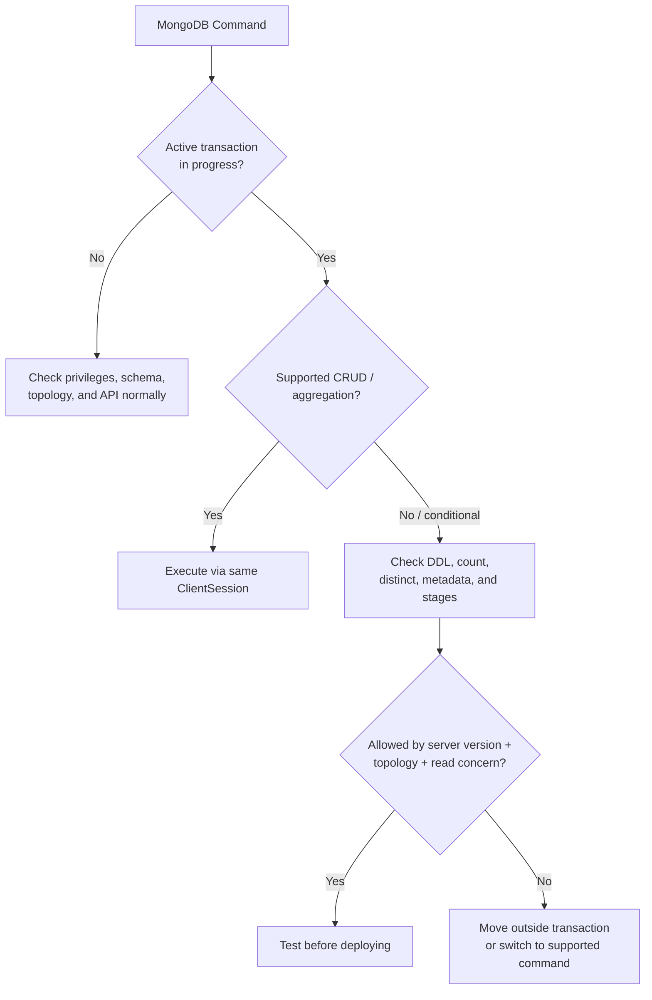

# Collection, Index, Count, and Special Query Limits by Version

## 1. Why Does the Same MongoDB Command Work Outside Yet Fail Inside a Transaction?

In **Spring Data MongoDB**, a transaction uses a `ClientSession` to group read/write operations into one commit or rollback unit. That **does not mean every MongoDB command is allowed inside a transaction**. Beyond ordinary CRUD operations, applications commonly also:

- Auto-create a collection when an entity is inserted for the first time.
- Create a unique or TTL index before writing.
- Call `count()` to check the number of documents matching a predicate.
- Find distinct values (`distinct`), run geospatial queries, or execute aggregations.
- Inspect collections/indexes, or run `explain` to analyze performance.

Some operations belong to **DDL/administration**, some use collection metadata rather than reading documents consistently within the transaction, and certain aggregation stages carry specific side effects or restrictions. MongoDB can return an error even when the Java code is valid.

Example of a common failure:

```text
Spring service with @Transactional
    |
    +--> insert reservation                  [CRUD: usually allowed]
    +--> MongoTemplate.count(query, ...)     [Spring translates to aggregation]
    +--> db.runCommand({ count: "orders" })  [legacy count command: disallowed]
    +--> createIndex if missing              [depends on server, DDL rules]
    +--> explain(query)                      [disallowed inside transaction]
    |
    +--> error -> transaction aborts/rolls back
```

**Lesson objectives:** understand limits across **MongoDB server version, topology (replica set/sharded), read concern, and Spring Data APIs** so you can pick the right command, place it in the right phase, and test it properly. This is part of using Spring Data MongoDB effectively for transactions, queries, indexes, reactive access, and performance diagnostics.

### A Transaction Is Not a Regular ClientSession

A `ClientSession` can support causal-consistency operations **without opening a transaction**. Only after a transaction starts do the restrictions described in this lesson apply in that context. A transaction is also bound to **one session at a time** and must conclude via commit or abort; never hold a session open indefinitely as a "data lock."



## 2. Version Matrix and Rules to Remember

Key milestones:

| MongoDB Server | Relevant Capabilities |
| --- | --- |
| Before **4.0** | No multi-document transactions under MongoDB's modern mechanism |
| **4.0+** | Multi-document transactions on supported replica sets |
| **4.2+** | Distributed transactions on sharded clusters subject to version/topology rules |
| **4.4+** | Allows certain collection/index creation operations inside transactions under strict conditions |
| **5.0+** | Specific restrictions on reading capped collections with read concern `snapshot` |
| Newer versions | Ongoing changes to sharding, execution, DDL, and stages; check the manual for your exact deployed version |

**Never state "MongoDB forbids all `createCollection`/`createIndex` inside transactions"** as an absolute rule across modern versions. At the same time, **never rely on dynamic collection/index creation inside business transactions**: constraints on empty/new collections, read concerns, cross-shard writes, and framework support make that fragile. The practical solution is to **provision schemas/indexes via migrations before handling requests**.

### Quick Comparison of Commands Inside Transactions

| Command / Operation Group | Inside Transaction | Notes |
| --- | --- | --- |
| `find`, `insert`, `update`, `delete` | **Supported** | Must share the session and satisfy other constraints |
| `aggregate` with `$match`/`$group`/`$count` | **Supported** | Avoid disallowed stages |
| `countDocuments(filter)` | **Supported** | Counting mechanism backed by aggregation |
| Legacy `count` command / `db.collection.count()` | **No** | Use `countDocuments` or `$count` |
| `estimatedDocumentCount()` | **Do not use for transactional counts** | Metadata-based estimate; does not reflect transactional snapshot/count |
| `distinct` on unsharded collection | **Yes** | Still subject to scope, transaction, and resource considerations |
| `distinct` on sharded collection | **No** | Replace with aggregation `$group` |
| Creating new collection/index | **Conditional by version** | Requires `readConcern: "local"`, new/empty collection, cross-shard limits |
| `listCollections`, `listIndexes` | **No** | Move metadata checks outside transactions |
| `explain` | **No** | Run outside transaction with equivalent filter |
| `$out`, `$merge` | **No** | Aggregation stages writing externally via separate mechanism |
| Multiple parallel commands on one session | **No** | Serialize operations or redesign |
| Writing to capped collections, `system.*` | **No** | System/special collections carry explicit restrictions |

### Spring Data MongoDB and MongoDB Server May Describe This Differently

**Spring Data MongoDB** documentation strongly recommends **collections exist before running transactions** and describes collection operations as unsupported in transactions. Meanwhile, **MongoDB server** documentation from 4.4+ permits **a narrow set of DDL operations** under specific conditions.

This is not necessarily an implementation contradiction: one emphasizes **safe framework-level defaults and practices**, while the other documents **server capabilities**. With `@Transactional`/`MongoTemplate`, **never rely on auto-creating collections/indexes**. Use DDL inside transactions only for specialized needs after verifying the exact driver/Spring Data/server behavior with dedicated integration tests.

Primary references:

- MongoDB Transactions and Operations: https://www.mongodb.com/docs/manual/core/transactions-operations/
- MongoDB Transactions: https://www.mongodb.com/docs/manual/core/transactions/
- Spring Data MongoDB Sessions & Transactions: https://docs.spring.io/spring-data/mongodb/reference/mongodb/client-session-transactions.html

## 3. Preparing the Environment and Test Data Model

Running example: an API reserves inventory and inserts a `reservation` inside the **same transaction**, then counts pending reservations. The `inventory` and `reservations` collections must be prepared **before** business transactions begin.

### 3.1. Topology and Connection

Multi-document transactions require a properly configured MongoDB replica set or sharded cluster; a standard standalone `mongod` is not valid for proving transactions work.

Illustrative URI for a pre-configured local replica set:

```properties
spring.data.mongodb.uri=mongodb://localhost:27017/tx_limits_demo?replicaSet=rs0
```

This is only a configuration example; `replicaSet=rs0` must match a real replica set initialized properly. Never copy this URI directly to production. In a sharded cluster, the URI, read/write concerns, cross-shard transaction capabilities, and user privileges differ.

Check **outside transactions** in `mongosh`:

```javascript
db.version()
db.hello()
```

`db.hello()` reports topology info matching current privileges; it does not replace checking full cluster configuration. Administrative commands should only run under appropriately authorized monitoring/migration accounts, never least-privilege application runtime accounts.

### 3.2. Creating Collections and Indexes Outside Transactions

On a demo database **with no critical data**:

```javascript
use tx_limits_demo

db.createCollection("inventory")
db.createCollection("reservations")

db.inventory.createIndex(
  { tenant_id: 1, sku: 1 },
  { unique: true, name: "inventory_tenant_sku_unique" }
)

db.reservations.createIndex(
  { tenant_id: 1, request_id: 1 },
  { unique: true, name: "reservation_request_unique" }
)

db.inventory.insertOne({
  _id: "SHOP-A:BOOK-101",
  tenant_id: "SHOP-A",
  sku: "BOOK-101",
  available: NumberLong("10"),
  reserved: NumberLong("0")
})
```

`insertOne` throws a duplicate key error if executed twice with the same ID. On databases containing legacy data, **check for duplicates before creating unique indexes** and run index builds only through controlled migrations. Schema creation statements above do not belong inside HTTP-handling `@Transactional` methods.

### 3.3. Fields Used in This Lesson

| Collection | BSON Fields | Meaning |
| --- | --- | --- |
| `inventory` | `_id`, `tenant_id`, `sku` | Product identifier within tenant |
| `inventory` | `available`, `reserved` | Available and reserved quantities |
| `reservations` | `_id`, `tenant_id`, `request_id` | Reservation identifier and idempotency |
| `reservations` | `sku`, `quantity`, `status` | Reservation payload and status |
| `reservations` | `created_at` | BSON Date of creation timestamp |

In this lesson, `request_id` must stay stable when clients/workers retry the same request. The unique index on `(tenant_id, request_id)` prevents storing two reservations for the same intent, yet does not verify matching payloads; the application must compare SKU/quantity on duplicate key errors.

## 4. Collection Creation Limits Inside Transactions

### 4.1. Possible on Newer Servers, Yet Not Arbitrary

On MongoDB 4.4+ and compatible versions, the server supports certain ways to **create collections inside transactions**:

- **Explicit creation**: `create`/`db.createCollection()`, when the transaction uses `readConcern: "local"`.
- **Implicit creation**: `insert`/`upsert` into a nonexistent collection, under server-permitted conditions.
- The transaction must not be a **cross-shard write** creating a new collection on another shard; that case is disallowed.

Example *strictly for a test environment* on a compliant MongoDB server:

```javascript
// Run in mongosh against a dedicated test database.
const session = db.getMongo().startSession();
const txdb = session.getDatabase("tx_limits_demo");

try {
  session.startTransaction({
    readConcern: { level: "local" },
    writeConcern: { w: "majority" }
  });

  // New collection name that does not exist yet.
  txdb.createCollection("temporary_tx_demo");

  txdb.temporary_tx_demo.insertOne({
    _id: "DOC-1",
    status: "CREATED"
  });

  session.commitTransaction();
} catch (error) {
  session.abortTransaction();
  throw error;
} finally {
  session.endSession();
}
```

Do **not** turn this snippet into a production migration or a recurring API call. If the collection already exists, `createCollection` may fail; if disallowed cross-shard writes occur or the server version is too old, the transaction errors out. The example assumes `temporary_tx_demo` does not yet exist and runs operations on the newly created session.

### 4.2. Avoid Creating Collections "During the First Order"

In Spring Data, a first insert often implicitly creates a missing collection. Inside a transaction, however, success or failure depends on topology, version, and runtime conditions. A newly deployed system could fail on its very first order while subsequent orders succeed — **never rely on implicit creation as a bootstrap mechanism**.

Safe practices:

1. Migrate `inventory`, `reservations`, `outbox`, and validators before the service accepts transactions.
2. Create unique indexes and verify metadata before allowing concurrent traffic.
3. If collections must be created per tenant, use a monitored provisioning workflow rather than creating hundreds of collections inside user transactions.
4. Fail startup/readiness checks if required schemas are missing.

### 4.3. DDL and Transactions Can Contend for Locks

An active transaction on a collection can interact with create/drop/rename/index operations outside the transaction. Pending DDL waiting on locks can block or abort new transactions depending on version and lock acquisition timing. Therefore **avoid DDL migrations during peak traffic**, keep transactions short, and monitor lock waits/aborts. If creating/dropping a collection immediately before starting a transaction, follow write concern recommendations so DDL visibility is settled across the cluster.

## 5. Index Creation Limits Inside Transactions

### 5.1. Creating New Indexes Works Only in Very Narrow Cases

Current MongoDB server documentation allows `createIndexes`/`createIndex` inside a transaction only when **all conditions are met**, notably:

1. The server supports transactional DDL (introduced in **MongoDB 4.4**).
2. The transaction uses `readConcern: "local"` for **explicit DDL**.
3. The new index is created on a **nonexistent collection**, or on a **new, empty collection created earlier inside the same transaction**.
4. It does not violate cross-shard write restrictions, index privileges, or collection-type rules.

Illustrative example:

```javascript
// Run once on test MongoDB; requires compatible server.
const session = db.getMongo().startSession();
const txdb = session.getDatabase("tx_limits_demo");

try {
  session.startTransaction({
    readConcern: { level: "local" },
    writeConcern: { w: "majority" }
  });

  txdb.createCollection("tx_new_indexed");

  // Newly created collection, still empty.
  txdb.tx_new_indexed.createIndex(
    { business_key: 1 },
    { unique: true, name: "tx_demo_business_key_unique" }
  );

  txdb.tx_new_indexed.insertOne({
    _id: "ONE",
    business_key: "K1"
  });

  session.commitTransaction();
} catch (error) {
  session.abortTransaction();
  throw error;
} finally {
  session.endSession();
}
```

**Never assume** you can open a transaction and create a **new** unique index on an existing `orders` collection holding data as arbitrary transactional DDL. Index migrations on existing collections belong **outside business transactions**, after cleaning duplicates and managing index-build load.

Calling `createIndex` with an **exact existing index definition** may return success as a no-op existence check in supported scenarios; that **does not mean** a new index definition was created.

### 5.2. Spring Data `@Indexed`, `indexOps`, and Auto-Index

In Java:

```java
import org.springframework.data.domain.Sort;
import org.springframework.data.mongodb.core.index.Index;

Index uniqueRequest = new Index()
    .on("tenantId", Sort.Direction.ASC)
    .on("requestId", Sort.Direction.ASC)
    .unique()
    .named("reservation_request_unique");

mongoTemplate.indexOps(ReservationDocument.class)
    .ensureIndex(uniqueRequest);
```

Here `ReservationDocument` is the entity defined in section 10. `tenantId` and `requestId` are **Java property names**; Spring Data maps them to `tenant_id` and `request_id` via metadata.

**Where this code belongs:** in a schema migration/initialization step outside transactions after connecting to the right MongoDB. Never put `ensureIndex(...)` inside a `@Transactional` `reserve` method or run it on every incoming request. Newer Spring Data versions may use `createIndex(...)` instead of `ensureIndex(...)`; verify against your API version.

`@Indexed`/`@CompoundIndex` annotations merely describe metadata; they do not guarantee indexes exist, especially when auto-index creation is disabled. Verify via:

```javascript
// Run outside transactions.
db.reservations.getIndexes()
```

### 5.3. Never Call `getIndexInfo` / `getIndexes` Mid-Transaction

`db.collection.getIndexes()` issues `listIndexes`, which is **disallowed inside transactions**. The same applies to `db.getCollectionNames()`/`listCollections`.

Avoid Java code checking indexes right before inserting:

```java
@Transactional
public void doWork() {
    // Wrong placement: metadata/index introspection does not belong in business tx.
    // mongoTemplate.indexOps(ReservationDocument.class).getIndexInfo();
    // ... write data ...
}
```

Inspect schemas at **deployment/startup time**, verify per environment, and open business traffic only once indexes are valid. If migrations run concurrently while services are live, use proper rollout/locking coordination rather than checking indexes on every request.

### 5.4. Distinguishing DDL from Rolled-Back CRUD Operations

Suppose a transaction inserts an order, discovers out-of-stock, and rolls back; the **order insert** is discarded. However, you cannot assume **external administrative steps** (creating indexes beforehand, running separate migrations, or writing to external systems) roll back with that transaction. A MongoDB transaction boundary covers only valid operations bound to the **same session and transaction**.

## 6. Legacy `count` Fails; `countDocuments` Is the Solution

### 6.1. Why Does `count` Fail Inside Transactions?

The legacy `count` command and helpers like `db.collection.count()`/`cursor.count()` rely on collection metadata; inside a transaction, such counts **do not reflect uncommitted transactional documents accurately**. MongoDB forbids running the legacy `count` command inside multi-document transactions (Spring Data docs cite error code **50851** as an example).

Do not use:

```javascript
// Do not use inside transactions:
db.orders.count({ status: "PENDING" })
db.runCommand({
  count: "orders",
  query: { status: "PENDING" }
})
```

If test code invokes native `runCommand({count: ...})` inside a transactional session, the server returns an error instead of a number. Never "fix" it by catching the error and returning `0`.

### 6.2. `countDocuments` Uses Aggregation

On supported MongoDB versions, use `countDocuments(filter)`:

```javascript
const session = db.getMongo().startSession();
const txdb = session.getDatabase("tx_limits_demo");

try {
  session.startTransaction();

  const total = txdb.reservations.countDocuments({
    tenant_id: "SHOP-A",
    status: "PENDING"
  });

  print("Pending reservations count: " + total);
  session.commitTransaction();
} catch (e) {
  session.abortTransaction();
  throw e;
} finally {
  session.endSession();
}
```

Conceptually, the driver/`mongosh` helper computes the count via `$match` and `$group`/`$sum` aggregation (or equivalent stages). It **counts matching documents accurately**, rather than reading approximate totals from collection metadata.

Writing the aggregation directly:

```javascript
db.reservations.aggregate([
  {
    $match: {
      tenant_id: "SHOP-A",
      status: "PENDING"
    }
  },
  { $count: "total" }
])
```

Example output:

```javascript
{ total: 3 }
```

**Watch out:** if no documents match, `$count` **emits no documents at all**; your Java/JavaScript code must interpret an empty result as **0** if a numeric total is required. By contrast, `countDocuments` returns numeric `0` when nothing matches.

### 6.3. In Spring Data, `MongoTemplate.count(...)` Has Special Handling

Spring Data MongoDB detects when `MongoTemplate` is running inside a session-bound transaction and automatically translates `count(...)` overloads to a `$match` + `$count` aggregation to avoid the disallowed `count` command. Compatible query options such as `collation` are preserved per framework/server support.

```java
import org.springframework.data.mongodb.core.query.Criteria;
import org.springframework.data.mongodb.core.query.Query;

Query pending = Query.query(
    Criteria.where("tenantId").is(authorizedTenantId)
        .and("status").is("PENDING")
);

long count = mongoTemplate.count(
    pending, ReservationDocument.class);
```

**Do not confuse** `MongoTemplate.count(...)` with invoking the raw driver `count` command directly; Spring Data's translation applies only when going through the template API with active session context. Calling native `MongoCollection` methods with different semantics or opening manual sessions without template binding must be verified separately.

### 6.4. `estimatedDocumentCount` Solves a Different Problem

`estimatedDocumentCount()` (and equivalent estimated count APIs) reads collection metadata and is optimized for **whole-collection approximations**, making it unsuitable for counting documents inserted or deleted inside a transaction. Avoid estimated counts for business rules such as "at most N reservations" or transactional calculations.

Outside transactions, `estimatedDocumentCount` helps dashboards needing quick rough totals, not exact filtered counts. For concurrency-sensitive quotas, use atomic conditional updates or unique constraints — **never rely on counting N and deciding to insert**: two concurrent transactions can both observe the same count and exceed the quota without a shared contention point.

### 6.5. `countDocuments` Does Not Support Every Filter

Because it runs as an aggregation-based count, these filter expressions **cannot be used** in `countDocuments`:

| Original Expression | Rewrite Direction |
| --- | --- |
| `$where` | Express equivalent logic via `$expr` |
| `$near` | Use `$geoWithin` with `$center` when **semantically accurate** |
| `$nearSphere` | Use `$geoWithin` with `$centerSphere` when **semantically accurate** |

Never treat "find nearest by distance" and "filter within region" as identical problems. `$near` implies distance sorting, while `$geoWithin` only checks containment; when rewriting for **counting**, confirm the requirement truly means "how many documents inside radius" rather than "top N nearest documents."

In Spring Data, review derived queries using `Near` or `Criteria.near(...)`/`nearSphere(...)` on count paths; for containment counts, use `Criteria.within(...)`/`withinSphere(...)` and test against real MongoDB.

## 7. `distinct` and `$group`: Unsharded vs Sharded Differences

`distinct` returns **unique values** of a field, such as reservation statuses within a tenant. Transaction rules depend on **sharding**:

| Collection | `distinct` Inside Transaction | Implementation Approach |
| --- | --- | --- |
| **Unsharded** | Supported under transaction conditions | Can use `distinct` or `$group` aggregation |
| **Sharded** | `distinct` command is **disallowed** inside transactions | Use `$group` aggregation |

Example `distinct` in `mongosh` when the collection is **unsharded**:

```javascript
const session = db.getMongo().startSession();
const txdb = session.getDatabase("tx_limits_demo");

try {
  session.startTransaction();

  const states = txdb.reservations.distinct(
    "status",
    { tenant_id: "SHOP-A" }
  );

  printjson(states);
  session.commitTransaction();
} catch (error) {
  session.abortTransaction();
  throw error;
} finally {
  session.endSession();
}
```

If `reservations` is sharded, do not use the `distinct` helper inside a transaction expecting automatic fallback. Replace it with:

```javascript
db.reservations.aggregate([
  { $match: { tenant_id: "SHOP-A" } },
  { $group: { _id: "$status" } },
  { $project: { _id: 0, status: "$_id" } },
  { $sort: { status: 1 } }
])
```

Example result:

```javascript
{ status: "CONFIRMED" }
{ status: "PENDING" }
```

`$group` produces one document per distinct value; a trailing `$sort` provides deterministic ordering if the response requires it. This pipeline runs inside transactions as long as no restricted stages are used and other limits are satisfied.

### Can You Use `$addToSet` in `$group`?

Yes, if you want **one document containing an array of values**:

```javascript
db.reservations.aggregate([
  { $match: { tenant_id: "SHOP-A" } },
  {
    $group: {
      _id: null,
      statuses: { $addToSet: "$status" }
    }
  },
  { $project: { _id: 0, statuses: 1 } }
])
```

However, `$addToSet` does not guarantee array element order. For fields with **very high cardinality**, collecting every value into one array inside a single document can exceed the BSON size limit; grouping into individual documents with pagination/bounds is usually safer.

### Java `MongoTemplate.aggregate` Instead of the `distinct` Command

```java
import java.util.List;
import org.bson.Document;
import org.springframework.data.mongodb.core.aggregation.Aggregation;
import org.springframework.data.mongodb.core.aggregation.AggregationResults;
import org.springframework.data.mongodb.core.query.Criteria;

Aggregation byStatus = Aggregation.newAggregation(
    Aggregation.match(
        Criteria.where("tenantId").is(authorizedTenantId)),
    Aggregation.group("status"),
    Aggregation.project()
        .and("_id").as("status")
        .andExclude("_id")
);

AggregationResults<Document> results =
    mongoTemplate.aggregate(
        byStatus,
        ReservationDocument.class,
        Document.class);

List<String> statuses = results.getMappedResults()
    .stream()
    .map(d -> d.getString("status"))
    .toList();
```

In `Aggregation.match` and `group("status")`, Spring Data uses `ReservationDocument` metadata to map property names to BSON fields. These aggregations run on the transaction-bound `MongoTemplate`; never fall back to a session-less native `MongoCollection` expecting to read the same snapshot.

**Never use `distinct`/`$group` to enforce a system-wide "at most N distinct statuses" rule via check-then-write.** Two concurrent transactions can both pass the read/count check while writing different documents. Concurrent invariants require unique constraints, CAS, atomic counter documents, or proper resource locks.

## 8. Aggregations and Special Queries: Which Stages Are Restricted?

Transactions support many standard read aggregations, yet several stages are **disallowed** inside transactions. Per current MongoDB server docs:

| Stage Disallowed in Transactions | Why Avoid in Design |
| --- | --- |
| `$out`, `$merge` | Writes pipeline results to collections via external mechanisms |
| `$collStats`, `$indexStats` | Queries collection/index statistics and metadata |
| `$currentOp` | Inspects currently running operations |
| `$listSessions`, `$listLocalSessions` | Exposes session/administrative information |
| `$planCacheStats` | Exposes query plan cache statistics |
| `$unionWith` | Stage unsupported inside transactions per this restriction list |

Even permitted stages like `$match`, `$project`, `$group`, and `$count` remain subject to collection, topology, memory, and driver constraints. **Never infer from "`aggregate` is allowed" that every stage runs inside transactions.**

### 8.1. Why Not Use `$merge` Instead of Business Updates?

Misguided intent:

```javascript
// Never place this pipeline inside a transaction:
db.reservations.aggregate([
  { $match: { tenant_id: "SHOP-A" } },
  { $set: { status: "ARCHIVED" } },
  { $merge: { into: "reservation_archive" } }
])
```

To modify data inside the same transaction, use CRUD APIs like `MongoTemplate.updateFirst`/`updateMulti` or `insert` into pre-created collections with CAS/unique keys. Large ETL/archival pipelines belong **outside business transactions**, with their own checkpoints and idempotency.

### 8.2. `$graphLookup` on Sharded Collections

MongoDB supports `$graphLookup` in many contexts, yet **disallows `$graphLookup` inside a transaction when targeting a sharded collection**. This is a classic **stage + topology** restriction — you cannot look at the stage name alone and declare it always allowed or always forbidden.

If complex graph/hierarchical queries are required, consider:

- Computing the read/traversal outside the transaction, then passing verified IDs into a short transaction.
- Redesigning the schema, bounding traversal depth, and picking matching consistency semantics.
- If conditions can change between traversal and write, **re-verify predicates inside the transaction** or use CAS rather than trusting an out-of-transaction read.

### 8.3. `$geoNear`, `$near`, and `$geoWithin`

Geospatial queries must distinguish **finding nearest**, **filtering within radius**, and **counting documents in a region**. Specifically:

```javascript
// When countDocuments uses aggregation, avoid:
{ location: { $near: { $geometry: point, $maxDistance: 1000 } } }

// If only containment within a region is needed on compatible coordinates:
{
  location: {
    $geoWithin: {
      $centerSphere: [[106.7, 10.8], 1.0 / 6378.1]
    }
  }
}
```

`$centerSphere` takes radius in **radians**; `1 km / 6378.1 km` is merely an illustration for compatible legacy coordinates. With GeoJSON and `2dsphere` indexes, follow the exact geometry definitions, bounds, and units of the operator used. Never treat one distance snippet as exact spherical geometry for all datasets.

**Transaction takeaway:** count helpers reject `$near`/`$nearSphere`, and rewrites must preserve business intent. `$geoNear` is a **separate aggregation stage** requiring a geospatial index and typically placed first in the pipeline; verify compatibility for your topology/version and operation, and never swap it with `$geoWithin` when distance-sorted nearest results are required.

### 8.4. Atlas Search, Vector Search, and Non-CRUD Server Features

Atlas Search and Vector Search stages carry product-, index-, and version-specific requirements; never assume they work inside transactions simply because `aggregate()` supports `$match`/`$group`. Check documentation for your **exact stage and environment**. A common pattern is running **search/recommendations outside the transaction**, then opening a short transaction to verify availability and apply conditional writes.

## 9. Metadata Commands, `explain`, Cursors, and Special Collections

Beyond DDL and `count`, several command groups are forbidden or heavily restricted inside transactions:

| Category | Examples | Practical Consequence |
| --- | --- | --- |
| Collection/index metadata | `listCollections`, `listIndexes`, `getIndexes()` | Inspect outside transactions |
| Query plan analysis | `explain()`, `explain` command | Run outside transactions with equivalent filters |
| Non-CRUD/non-info admin commands | `createUser`, `getParameter` | Never mix administration with business transactions |
| Capped collections | Writing documents to capped collections | Disallowed inside transactions |
| Capped + snapshot | Reading capped collections with read concern `snapshot` (MongoDB 5.0+) | Restricted |
| System collections | Reading/writing `config`, `admin`, `local`; writing `system.*` | Disallowed per server rules |
| Cursors | `getMore` outside tx for an in-tx cursor, or vice versa | Breaks session/transaction scope |
| Parallel operations | Issuing concurrent commands on the same transaction/session | Disallowed |
| Status info | `hello`, `buildInfo`, `connectionStatus` | May be permitted, yet **never as the first command** in a transaction |

### 9.1. `explain` Belongs Strictly Outside Transactions

```javascript
// Valid for out-of-transaction investigation:
db.reservations.find({
  tenant_id: "SHOP-A",
  status: "PENDING"
})
.explain("executionStats")
```

To evaluate query performance inside transactions, run `explain` **before or after** the transaction using matching filters, indexes, and representative data. Never embed `explain` in business logic to "decide which index to use."

Remember that `explain` outside a transaction **does not reproduce** transaction snapshots, lock contention, or commit overhead. It assesses index/scan paths, while total transaction latency must be measured through application and MongoDB metrics.

### 9.2. Cursors Must Not Cross Transaction Boundaries

Invalid intent:

```text
1. Open transaction T.
2. Create cursor via find/aggregate inside T.
3. Commit T.
4. Continue calling getMore on that cursor outside T.
=> Restricted; never detach cursor lifecycle from the transaction.
```

In Java, never hold a reading `CloseableIterator`/`Stream` to consume **after the `@Transactional` method returns**. Returning a lazy `Stream` lets execution continue after the transaction/session has closed. For large outputs or long streaming responses, use out-of-transaction watermark/keyset pagination rather than holding a multi-document transaction open across an HTTP response.

### 9.3. Concurrent Commands on One Session

Never write:

```java
// DO NOT do this inside a single transaction:
// CompletableFuture.allOf(
//   CompletableFuture.runAsync(() -> template.insert(a)),
//   CompletableFuture.runAsync(() -> template.insert(b))
// );
```

MongoDB forbids running multiple operations **in parallel inside the same transaction**. In imperative Spring, transactions/sessions are also thread-bound; spawning a new thread can **drop the transaction context** and execute writes outside the transaction — worse than a loud error.

In reactive flows, `zip` or concurrent `flatMap` can issue parallel operations on a single transactional session; chain atomic operations sequentially via `then(...)`/`flatMap(...)` rather than fanning out concurrently.

### 9.4. Do Not Use Transactions as Metadata/Monitoring Tools

Work that belongs outside business transactions:

- Checking server version, topology, privileges, and migration readiness.
- Inspecting collection/index lists or query plans.
- Running long ETL jobs, archives, or collection-writing aggregations.
- Creating/dropping/renaming/indexing active schemas.
- Running massive reporting queries that are slow and memory-heavy.

Transactions fit **short read/write groups with clear consistency boundaries**. Dashboard stats generally should not open a multi-document transaction just to count approximate figures for JSON output.

## 10. Spring Data MongoDB: Configuration and Sample Entities

Spring Data MongoDB offers two main models:

- **Imperative:** `MongoTransactionManager` binds `ClientSession` to the thread, letting `MongoTemplate`/repositories join transactions via `@Transactional`.
- **Reactive:** `ReactiveMongoTransactionManager` binds transactions to the **Reactor Context**, requiring publishers to stay in the same reactive chain subscribed under that context.

### 10.1. Imperative Transaction Manager Configuration

```java
package com.example.tx;

import org.springframework.context.annotation.Bean;
import org.springframework.context.annotation.Configuration;
import org.springframework.data.mongodb.MongoDatabaseFactory;
import org.springframework.data.mongodb.MongoTransactionManager;

@Configuration
public class MongoTxConfiguration {

    @Bean
    MongoTransactionManager mongoTransactionManager(
            MongoDatabaseFactory factory) {
        return new MongoTransactionManager(factory);
    }
}
```

For declarative transactions, `MongoTemplate` must share the compatible `MongoDatabaseFactory` with the transaction manager. Spring Data **does not automatically enable transactions merely because `@Transactional` is present**: the app needs a configured transaction manager and active proxy/AOP support. In Spring Boot, do not assume every starter or default environment auto-creates a Mongo transaction manager.

### 10.2. Inventory Entity

```java
package com.example.tx;

import org.springframework.data.mongodb.core.mapping.Document;
import org.springframework.data.mongodb.core.mapping.Field;
import org.springframework.data.mongodb.core.mapping.FieldType;
import org.springframework.data.mongodb.core.mapping.MongoId;

@Document(collection = "inventory")
public class InventoryDocument {

    @MongoId(FieldType.STRING)
    private String id;

    @Field("tenant_id")
    private String tenantId;

    private String sku;
    private long available;
    private long reserved;

    protected InventoryDocument() {}

    public String getId() { return id; }
    public String getTenantId() { return tenantId; }
    public String getSku() { return sku; }
    public long getAvailable() { return available; }
    public long getReserved() { return reserved; }
}
```

### 10.3. Reservation Entity

```java
package com.example.tx;

import java.time.Instant;
import org.springframework.data.mongodb.core.mapping.Document;
import org.springframework.data.mongodb.core.mapping.Field;
import org.springframework.data.mongodb.core.mapping.FieldType;
import org.springframework.data.mongodb.core.mapping.MongoId;

@Document(collection = "reservations")
public class ReservationDocument {

    @MongoId(FieldType.STRING)
    private String id;

    @Field("tenant_id")
    private String tenantId;

    @Field("request_id")
    private String requestId;

    private String sku;
    private long quantity;
    private String status;

    @Field("created_at")
    private Instant createdAt;

    protected ReservationDocument() {}

    public ReservationDocument(
            String id, String tenantId, String requestId,
            String sku, long quantity,
            String status, Instant createdAt) {
        this.id = id;
        this.tenantId = tenantId;
        this.requestId = requestId;
        this.sku = sku;
        this.quantity = quantity;
        this.status = status;
        this.createdAt = createdAt;
    }

    public String getId() { return id; }
    public String getTenantId() { return tenantId; }
    public String getRequestId() { return requestId; }
    public String getSku() { return sku; }
    public long getQuantity() { return quantity; }
    public String getStatus() { return status; }
    public Instant getCreatedAt() { return createdAt; }
}
```

The entities use `@MongoId(FieldType.STRING)` so IDs like `"SHOP-A:BOOK-101"` and `UUID string` persist as **BSON Strings**. `@Field("tenant_id")`/`@Field("request_id")` map Java names to BSON names. Indexes and demo data from section 3 must match these exact names.

### 10.4. Verify Schemas in Migrations, Not Inside the Service

A separate startup/migration step can call:

```java
import org.springframework.data.domain.Sort;
import org.springframework.data.mongodb.core.index.Index;

mongoTemplate.indexOps(ReservationDocument.class)
    .ensureIndex(new Index()
        .on("tenantId", Sort.Direction.ASC)
        .on("requestId", Sort.Direction.ASC)
        .unique()
        .named("reservation_request_unique"));
```

However, **never embed this inside `reserve(...)`'s transaction** below. In production, prefer infrastructure-controlled migrations so indexes are confirmed before the app serves traffic.

## 11. `@Transactional` Service: Writing Two Collections and Counting

Suppose an API reserves 2 books for SHOP-A:

1. Decrement `inventory.available` and increment `inventory.reserved` if sufficient stock exists.
2. Insert a unique `ReservationDocument` per `(tenantId, requestId)`.
3. Count `PENDING` reservations in the tenant to return stats.
4. Commit if all steps succeed; roll back if any fails.

### 11.1. Return Result

```java
package com.example.tx;

public record ReservationResult(
    String reservationId,
    long pendingCountInTransaction
) {}
```

### 11.2. Sample Service

```java
package com.example.tx;

import java.time.Clock;
import java.util.UUID;
import com.mongodb.client.result.UpdateResult;
import org.springframework.data.mongodb.core.MongoTemplate;
import org.springframework.data.mongodb.core.query.Criteria;
import org.springframework.data.mongodb.core.query.Query;
import org.springframework.data.mongodb.core.query.Update;
import org.springframework.stereotype.Service;
import org.springframework.transaction.annotation.Transactional;

@Service
public class ReservationService {

    private final MongoTemplate template;
    private final Clock clock;

    public ReservationService(
            MongoTemplate template, Clock clock) {
        this.template = template;
        this.clock = clock;
    }

    @Transactional
    public ReservationResult reserve(
            String authorizedTenantId,
            String requestId,
            String sku,
            long quantity) {

        if (authorizedTenantId == null
                || authorizedTenantId.isBlank()
                || requestId == null || requestId.isBlank()
                || sku == null || sku.isBlank()
                || sku.contains(":")
                || quantity <= 0) {
            throw new IllegalArgumentException(
                "Invalid reservation input");
        }

        Query available = Query.query(
            Criteria.where("id").is(
                    authorizedTenantId + ":" + sku)
                .and("tenantId").is(authorizedTenantId)
                .and("available").gte(quantity)
        );

        Update reserveStock = new Update()
            .inc("available", -quantity)
            .inc("reserved", quantity);

        UpdateResult stockChanged = template.updateFirst(
            available, reserveStock, InventoryDocument.class);

        if (stockChanged.getModifiedCount() != 1) {
            throw new IllegalStateException(
                "Insufficient stock or SKU does not exist");
        }

        ReservationDocument reservation =
            new ReservationDocument(
                UUID.randomUUID().toString(),
                authorizedTenantId,
                requestId,
                sku,
                quantity,
                "PENDING",
                clock.instant()
            );

        template.insert(reservation);

        // Spring Data detects the transaction and uses aggregation count.
        Query pending = Query.query(
            Criteria.where("tenantId").is(authorizedTenantId)
                .and("status").is("PENDING")
        );
        long count = template.count(
            pending, ReservationDocument.class);

        return new ReservationResult(reservation.getId(), count);
    }
}
```

**What to observe:** `template.updateFirst`, `template.insert`, and `template.count` run on the same `MongoTemplate` bound to `ClientSession` by the transaction manager. Thus the count after insert sees **the transaction's own write** per transaction semantics; upon rollback, both the stock deduction and reservation vanish.

### 11.3. Why Not Call Raw `count`?

Never write inside the method:

```java
// Wrong approach inside a transaction:
// template.getDb().runCommand(
//     new Document("count", "reservations")
//         .append("query", new Document("status", "PENDING")));
```

That remains a disallowed native `count` command, **bypassing `MongoTemplate.count(...)`'s translation**. Likewise, never insert `getIndexes()` or `explain()` between steps for "quick debugging."

### 11.4. What If the Final Step Fails?

Suppose another request already created `(SHOP-A, K1)` so the unique index causes `template.insert(reservation)` to throw `DuplicateKeyException`. Because the method is inside a transaction, the unchecked exception rolls back the earlier inventory decrement. **Never catch duplicate key inside and continue committing** as if nothing happened.

For proper idempotent replay:

- Let the transactional method exit (roll back) on duplicate.
- In a **separate Spring bean facade**, catch duplicate after the transaction ends.
- Read the reservation by tenant/request key in the authenticated scope.
- Compare the previous request's SKU/quantity; replay only on exact match.
- If the commit outcome is unknown, run bounded reconciliation/retries per policy.

Transactions do not replace unique indexes or retry controls. Two concurrent transactions can hit write conflicts; design transient error handling **without** dropping stock predicates on retries.

### 11.5. Spring AOP and Rollback Notes

Proxy-based `@Transactional` applies when invoked **through the bean proxy**, not when a method in the same class calls its own `@Transactional` method. Imperative transaction contexts are also thread-bound. Avoid:

- Calling `this.reserve(...)` from another method in the same class assuming a transaction opens.
- Offloading part of the work to a `CompletableFuture` on another thread.
- Swallowing exceptions and returning "success" when rollback is needed.
- Injecting metadata commands mid-transaction.

To roll back on checked exceptions, follow Spring's rollback rules and configure `rollbackFor` appropriately. Here, unchecked exceptions signal failures requiring rollback.

## 12. Manual ClientSession and the Risk of Out-of-Session Commands

When direct transaction control is required, open a `ClientSession` from the Java Driver and use `MongoTemplate.withSession(...)`. Example counting inside an explicit session:

```java
import com.mongodb.client.ClientSession;
import com.mongodb.client.MongoClient;
import com.mongodb.ReadConcern;
import com.mongodb.WriteConcern;
import com.mongodb.TransactionOptions;
import org.springframework.data.mongodb.core.MongoTemplate;
import org.springframework.data.mongodb.core.query.Criteria;
import org.springframework.data.mongodb.core.query.Query;

public long countPendingWithExplicitSession(
        MongoClient client,
        MongoTemplate template,
        String authorizedTenantId) {

    TransactionOptions options = TransactionOptions.builder()
        .readConcern(ReadConcern.SNAPSHOT)
        .writeConcern(WriteConcern.MAJORITY)
        .build();

    try (ClientSession session = client.startSession()) {
        session.startTransaction(options);

        try {
            Query query = Query.query(
                Criteria.where("tenantId").is(authorizedTenantId)
                    .and("status").is("PENDING")
            );

            long count = template.withSession(session)
                .execute(ops -> ops.count(
                    query, ReservationDocument.class));

            session.commitTransaction();
            return count;
        } catch (RuntimeException failure) {
            // Demo: production must distinguish commit
            // "unknown outcome" from uncommitted failures.
            try {
                session.abortTransaction();
            } catch (RuntimeException abortFailure) {
                failure.addSuppressed(abortFailure);
            }
            throw failure;
        }
    }
}
```

**This example only illustrates the session-bound API**, not a complete transaction retry policy. On `UnknownTransactionCommitResult`, never blindly treat commit as failed and re-run business effects; implement commit retry/reconciliation per driver and application requirements.

### `getCollection` Does Not Automatically Attach Sessions in Every Context

Spring Data provides the `withSession` callback so template operations use the session. However, when acquiring a native `MongoCollection` or `MongoDatabase` directly (e.g., `template.getCollection("...")`), driver methods expose overloads accepting `ClientSession` explicitly; never assume that native object is session-proxied.

Hence the following breaks the contract:

```java
// Inside a transaction:
// template.getCollection("reservations").insertOne(document);
// -> Without passing the matching ClientSession,
//    this native driver call can run outside the transaction.
```

Prefer managed `MongoTemplate`/repository APIs, or **pass the right `ClientSession`** to native overloads, and write integration tests proving rollback removes those writes too.

### Never Mix Manual and Declarative Transactions Arbitrarily

Each approach is valid when designed cleanly, yet calling `session.startTransaction()` inside an already-`@Transactional` method creates overlapping session state or unexpected second transactions. One session allows only **one open transaction at a time**. Pick one management mechanism as the source of truth (transaction manager or manual session), test commit/abort, and verify all operations share the right context.

## 13. ReactiveMongoTransactionManager and Sequential Operations

In reactive applications, transactions bind to the **Reactor Context**, not the imperative service's thread local.

### 13.1. Configuring the Reactive Transaction Manager

```java
package com.example.tx;

import org.springframework.context.annotation.Bean;
import org.springframework.context.annotation.Configuration;
import org.springframework.data.mongodb.ReactiveMongoDatabaseFactory;
import org.springframework.data.mongodb.ReactiveMongoTransactionManager;
import org.springframework.transaction.reactive.TransactionalOperator;

@Configuration
public class ReactiveMongoTxConfiguration {

    @Bean
    ReactiveMongoTransactionManager reactiveMongoTransactionManager(
            ReactiveMongoDatabaseFactory factory) {
        return new ReactiveMongoTransactionManager(factory);
    }

    @Bean
    TransactionalOperator mongoTransactionalOperator(
            ReactiveMongoTransactionManager manager) {
        return TransactionalOperator.create(manager);
    }
}
```

### 13.2. Sequential `update -> insert -> count`

```java
package com.example.tx;

import java.time.Clock;
import java.util.UUID;
import org.springframework.data.mongodb.core.ReactiveMongoTemplate;
import org.springframework.data.mongodb.core.query.Criteria;
import org.springframework.data.mongodb.core.query.Query;
import org.springframework.data.mongodb.core.query.Update;
import org.springframework.stereotype.Service;
import org.springframework.transaction.reactive.TransactionalOperator;
import reactor.core.publisher.Mono;

@Service
public class ReactiveReservationService {

    private final ReactiveMongoTemplate template;
    private final TransactionalOperator tx;
    private final Clock clock;

    public ReactiveReservationService(
            ReactiveMongoTemplate template,
            TransactionalOperator tx,
            Clock clock) {
        this.template = template;
        this.tx = tx;
        this.clock = clock;
    }

    public Mono<ReservationResult> reserve(
            String authorizedTenantId,
            String requestId,
            String sku,
            long quantity) {

        if (authorizedTenantId == null
                || authorizedTenantId.isBlank()
                || requestId == null || requestId.isBlank()
                || sku == null || sku.isBlank()
                || sku.contains(":")
                || quantity <= 0) {
            return Mono.error(new IllegalArgumentException(
                "Invalid reservation data"));
        }

        return Mono.defer(() -> {
            Query available = Query.query(
                Criteria.where("id").is(
                        authorizedTenantId + ":" + sku)
                    .and("tenantId").is(authorizedTenantId)
                    .and("available").gte(quantity)
            );

            Update change = new Update()
                .inc("available", -quantity)
                .inc("reserved", quantity);

            ReservationDocument reservation =
                new ReservationDocument(
                    UUID.randomUUID().toString(),
                    authorizedTenantId,
                    requestId,
                    sku,
                    quantity,
                    "PENDING",
                    clock.instant()
                );

            Query pending = Query.query(
                Criteria.where("tenantId").is(authorizedTenantId)
                    .and("status").is("PENDING")
            );

            return template.updateFirst(
                    available, change, InventoryDocument.class)
                .flatMap(result -> {
                    if (result.getModifiedCount() != 1) {
                        return Mono.error(
                            new IllegalStateException(
                                "Insufficient stock"));
                    }
                    return template.insert(reservation);
                })
                .flatMap(saved ->
                    template.count(
                        pending, ReservationDocument.class)
                        .map(total -> new ReservationResult(
                            saved.getId(), total))
                );
        }).as(tx::transactional);
    }
}
```

Here `flatMap` chains operations in strict dependency order inside the Reactor Context created by `TransactionalOperator`. Avoid `Mono.when`/`zip` or concurrent `flatMap` across MongoDB operations inside one transaction, as they can execute in parallel on the same session.

**Note:** `Mono.defer(...)` creates a fresh publisher/ID per subscription. If the whole flow retries, the unique key `(tenantId, requestId)` must still enforce business idempotency. Never put an unconditional `retryWhen(...)` around a transaction containing `$inc` without handling unknown commits and already-applied requests.

## 14. Read Concern, Write Concern, and DDL Limits

Choosing transaction options is part of correctness, not just speed tuning.

| Setting | Effect | Notes for This Lesson |
| --- | --- | --- |
| Read concern `local` | Reads data per `local` rules | **Required** for *explicit* collection/index creation DDL permitted inside transactions |
| Read concern `majority` | Reads majority-acknowledged data per transaction semantics | Cannot be used to run explicit DDL inside transactions |
| Read concern `snapshot` | Consistent snapshot per server conditions; synchronized across shards on sharded clusters | Cannot be used to create collections/indexes explicitly inside transactions |
| Write concern `w: "majority"` on tx | Durable commit acknowledgment per cluster config | Crucial when transaction results carry financial/business weight |
| Read preference `primary` | Routes transaction per driver/server requirements | Never assume secondaries work in every transaction |

MongoDB allows `local`, `majority`, or `snapshot` read concern at the transaction level. On sharded clusters, `snapshot` is worth considering when a **consistent cross-shard view** is needed; `local` does not guarantee the same snapshot across all shards. However, the `local` rule for explicit DDL means **you cannot simply enable `snapshot` and arbitrarily create indexes inside a transaction**.

### 14.1. Where Are Transaction Options Configured?

With raw `ClientSession`, pass options to `session.startTransaction(...)`. With Spring `MongoTransactionManager`, configure `TransactionOptions`/supported labels on the **transaction manager/transaction declaration**, rather than forcing read/write concerns onto individual `MongoTemplate.insert(...)` calls.

Some Spring Data releases support `@Transactional(label = {"mongo:readConcern=SNAPSHOT", "mongo:writeConcern=MAJORITY"})`. However, this API **depends on Spring Framework/Spring Data version**; verify against your release's Javadoc, and remember an inner transaction joining an existing one cannot alter options once started.

### 14.2. Snapshot Does Not Automatically Protect Every Invariant

Suppose two transactions read `count = 4` and each inserts a new reservation as two separate documents under a rule "max 5 reservations." **Simply reading the count inside a snapshot** does not prevent both from seeing `4` and committing, pushing the total to `6` (a form of write skew).

To guard concurrent limits, use a **quota/counter document** updated conditionally and atomically, a unique index, or a shared resource so concurrent transactions genuinely contend on one control point. Transactions group effects together, but do not replace **invariant design**.

### 14.3. Write Concern and Uncertain Commit Outcomes

A network error during `commitTransaction` does not prove data was not committed. Never adopt a strategy like:

```text
commit timed out -> assume rollback -> re-run all $inc operations
```

Distinguish:

- Errors **inside the transaction body** may require aborting and retrying the **whole transaction**.
- **Unknown commit outcome** errors may require retrying the **commit** step or looking up a marker by request ID.
- Errors from disallowed commands/schema (`listIndexes`, raw `count`, `$out`, invalid DDL) are **design bugs** that infinite retries cannot fix.

The MongoDB Driver exposes error labels such as `TransientTransactionError` and `UnknownTransactionCommitResult`; handle them per your driver and framework version docs, with bounded retries/backoff and idempotency keys. Never catch every `DataAccessException` and blindly open a fresh transaction.

## 15. Performance, Locks, and Transaction Limits

Multi-document transactions carry higher overhead than single-document operations, especially across multiple shards. For operations touching only one document, **atomic single-document updates** and embedded models are simpler than transactions.

### 15.1. Transactions Must Not Run Long

Long transactions hold server resources longer, raise write-conflict odds, block DDL/index migrations, and pressure storage-engine history/caches.

MongoDB defines `transactionLifetimeLimitSeconds`, commonly defaulting to **60 seconds** in many setups; actual values depend on cluster/version. This is a server-side ceiling, **not a guarantee every transaction under 60 seconds succeeds**.

Never call HTTP payment services, wait for user OTP confirmation, or stream millions of documents **inside a transaction** before committing. Decouple long interactions using state machines and idempotency/outbox/reconciliation as needed.

### 15.2. DDL, Index Builds, and Lock Contention

Index builds/migrations can contend for resources with transactions. If an out-of-transaction DDL awaits an exclusive lock, new transactions on that collection can time out or abort. Never "solve" this by raising all timeouts indefinitely; instead:

1. Schedule DDL and verify versions.
2. Keep business transactions short.
3. Avoid dynamic collection creation or index inspection on request paths.
4. Measure lock waits, transaction aborts, write conflicts, and p95/p99 latency.
5. Maintain controlled schema rollout/rollback plans.

### 15.3. Indexes Speed Up Queries Without Removing Transaction Limits

A compound index on `reservations`:

```javascript
// Run outside transactions during migrations.
db.reservations.createIndex(
  { tenant_id: 1, status: 1, created_at: -1 },
  { name: "reservations_tenant_status_created" }
)
```

speeds up `$match` by tenant/status and matching sorts, yet **does not make the legacy `count` command valid inside transactions**. You still must use `countDocuments`/`MongoTemplate.count` or valid aggregations. Similarly, an index never turns `$merge`/`$out` into allowed stages.

Analyze query plans **outside transactions**:

```javascript
db.reservations.find({
  tenant_id: "SHOP-A",
  status: "PENDING"
})
.sort({ created_at: -1 })
.explain("executionStats")
```

Inspect `winningPlan`, `IXSCAN`/`COLLSCAN`, `totalKeysExamined`, `totalDocsExamined`, and sort costs. On small demo datasets, the planner may reasonably scan the collection; never extrapolate production performance from a handful of documents.

### 15.4. What to Monitor

| Metric | Meaning |
| --- | --- |
| Transaction duration p50/p95/p99 | Spot abnormally long transactions |
| Commit/abort rate | Track rollback frequency |
| Write conflict / transient transaction errors | Detect contention |
| Unknown commit outcomes | Track reconciliation demand |
| Lock wait / DDL wait | Spot migrations impacting requests |
| Read/write concern failures | Assess durability/availability |
| Retry count and retry delay | Watch for retry storms |
| Business effect count | Detect duplicate effects |
| Query latency, docs examined | Evaluate index/filter efficiency |

Never place tokens, raw session IDs, or personal identifiers in high-cardinality metric labels. Use correlation IDs/traces governed by logging policies, and avoid printing full documents containing personal data when debugging transactions.

## 16. Integration Testing on a MongoDB Replica Set

Proving transaction rollback and `count` behavior requires real transaction-capable MongoDB, not Mockito. Use an **isolated test database** (such as Testcontainers running a replica set on a compatible MongoDB version) matching your project's driver/Spring Data branch.

### 16.1. Test Preparation Principles

- **Create collections/indexes before** opening transactions.
- **Never** call `getIndexes`/`createIndex` inside a transactional test flow.
- Never run `db.collection.count()` or native `count` commands inside a transaction.
- Test that `MongoTemplate.count` sees in-transaction writes and rollback removes them.
- When running tests in parallel, isolate databases/collections per suite so tests never wipe each other's data.
- Evaluate exact server/driver results rather than using mocks to guess version limits.

### 16.2. `@DataMongoTest` Example

```java
package com.example.tx;

import java.time.Instant;
import org.bson.Document;
import org.junit.jupiter.api.BeforeEach;
import org.junit.jupiter.api.Test;
import org.springframework.beans.factory.annotation.Autowired;
import org.springframework.boot.test.autoconfigure.data.mongo.DataMongoTest;
import org.springframework.context.annotation.Import;
import org.springframework.data.mongodb.MongoTransactionManager;
import org.springframework.data.mongodb.core.MongoTemplate;
import org.springframework.data.mongodb.core.query.Criteria;
import org.springframework.data.mongodb.core.query.Query;
import org.springframework.data.mongodb.core.query.Update;
import org.springframework.data.domain.Sort;
import org.springframework.data.mongodb.core.index.Index;
import org.springframework.transaction.support.TransactionTemplate;

import static org.assertj.core.api.Assertions.assertThat;
import static org.assertj.core.api.Assertions.assertThatThrownBy;

@DataMongoTest
@Import(MongoTxConfiguration.class)
class SessionTransactionRestrictionsTest {

    @Autowired
    MongoTemplate template;

    @Autowired
    MongoTransactionManager manager;

    private TransactionTemplate tx;

    @BeforeEach
    void prepareIsolatedTestSchema() {
        // All DDL/cleanup operations run OUTSIDE transactions.
        if (!template.collectionExists(InventoryDocument.class)) {
            template.createCollection(InventoryDocument.class);
        }
        if (!template.collectionExists(ReservationDocument.class)) {
            template.createCollection(ReservationDocument.class);
        }

        template.remove(new Query(), InventoryDocument.class);
        template.remove(new Query(), ReservationDocument.class);

        template.indexOps(ReservationDocument.class)
            .ensureIndex(new Index()
                .on("tenantId", Sort.Direction.ASC)
                .on("requestId", Sort.Direction.ASC)
                .unique()
                .named("reservation_request_unique"));

        template.getCollection("inventory").insertOne(
            new Document("_id", "SHOP-A:BOOK-101")
                .append("tenant_id", "SHOP-A")
                .append("sku", "BOOK-101")
                .append("available", 10L)
                .append("reserved", 0L));

        tx = new TransactionTemplate(manager);
    }

    @Test
    void countInsideTransactionSeesOwnInsert() {
        Long insideCount = tx.execute(status -> {
            template.insert(new ReservationDocument(
                "R1", "SHOP-A", "K1", "BOOK-101",
                2, "PENDING", Instant.now()));

            long count = template.count(
                Query.query(
                    Criteria.where("tenantId").is("SHOP-A")
                        .and("status").is("PENDING")),
                ReservationDocument.class);

            status.setRollbackOnly();
            return count;
        });

        assertThat(insideCount).isEqualTo(1L);
        assertThat(template.count(
            new Query(), ReservationDocument.class)).isZero();
    }

    @Test
    void rollbackCoversMultipleCollections() {
        assertThatThrownBy(() -> tx.execute(status -> {
            Query stock = Query.query(
                Criteria.where("id").is("SHOP-A:BOOK-101")
                    .and("available").gte(2));

            template.updateFirst(
                stock,
                new Update().inc("available", -2)
                    .inc("reserved", 2),
                InventoryDocument.class);

            template.insert(new ReservationDocument(
                "R2", "SHOP-A", "K2", "BOOK-101",
                2, "PENDING", Instant.now()));

            throw new IllegalStateException(
                "Error after writing two collections");
        })).isInstanceOf(IllegalStateException.class);

        InventoryDocument inventory = template.findById(
            "SHOP-A:BOOK-101", InventoryDocument.class);

        assertThat(inventory).isNotNull();
        assertThat(inventory.getAvailable()).isEqualTo(10L);
        assertThat(inventory.getReserved()).isZero();
        assertThat(template.count(
            new Query(), ReservationDocument.class)).isZero();
    }
}
```

**Warning:** `template.remove(new Query(), ...)` deletes every document in the connected test collection. Use strictly on an **isolated test MongoDB**, never on production or shared environments.

### 16.3. Key Tests That a Small Replica Set Cannot Prove Alone

| Test Case | Required Environment |
| --- | --- |
| `distinct` rejected inside sharded transaction | Sharded test cluster |
| `$graphLookup` targeting sharded collection | Sharded test cluster and matching pipeline |
| Cross-shard write DDL rejected | Sharded test cluster with multi-shard writes |
| Creating collection/index inside `local` tx on supported version | Test MongoDB matching version/topology, new empty collection |
| Explicit DDL with `snapshot` read concern rejected | Test MongoDB matching version |
| Raw `count` or `explain` inside session | Dedicated negative test; never keep broken tx running |
| `listIndexes`/`listCollections` rejected | Version-specific server test with real session |
| Write conflict / unknown commit retries | Fault injection on dedicated test cluster |

Never run a test that "works on my laptop" and declare every sharded cluster behaves identically. Each restriction must be verified against the **real server version, topology, driver, and API path**.

## 17. Common Errors and Diagnostic Table

| Symptom | Likely Cause | Resolution |
| --- | --- | --- |
| `Transaction numbers are only allowed...` | Running standalone or non-transactional topology | Use a properly configured replica set/sharded cluster |
| First transaction fails inserting into nonexistent collection | Implicit collection creation violates constraints | Migrate/create collection before taking requests |
| `createCollection` in transaction errors | Unsupported server/topology/read concern | Migrate outside transactions; if DDL is truly needed, verify `local`/version |
| `createIndex` rejected inside transaction | New index on existing/non-empty collection or wrong read concern | Create index outside transactions; verify empty collection and schema |
| `getIndexes()` fails inside transaction | Native `listIndexes` is disallowed | Check indexes at deploy/startup |
| `db.getCollectionNames()` fails | Native `listCollections` is disallowed | Check schemas outside transactions |
| `count` command fails with error 50851 | Legacy count uses metadata | Use `countDocuments` or `$count` aggregation |
| `MongoTemplate.count` works while native `count` fails | Template translates to aggregation count in session | Stick to template API; do not bypass session |
| `countDocuments` fails with `$near` | Operator unsupported in count helper | Consider `$geoWithin` when region counting fits semantics |
| Count returns 0 on non-empty collection | Wrong BSON/tenant field in filter or older tx snapshot | Verify mapping, filters, session, and visible data |
| `distinct` works on replica set yet fails on sharded cluster | `distinct` disallowed in sharded transactions | Replace with `$group` aggregation |
| Aggregation with `$out`/`$merge` rejected | Stages disallowed inside transactions | Use CRUD inside tx; run ETL outside tx |
| `$graphLookup` aggregation fails on sharded collection | Topology restriction | Read outside tx or adjust data model |
| `explain` fails inside transaction | Plan-inspection command disallowed | Run `explain` outside transactions |
| Query succeeds yet transaction commits slowly | Lock contention, multiple shards, large data | Shorten transaction, index filters, measure metrics |
| Transaction fails while index migration runs | DDL waiting/holding locks, tx timeout | Schedule migrations, reduce contention, monitor DDL |
| `getMore` fails continuing cursor reads | Cursor opened in tx used outside, or vice versa | Consume cursor within proper lifecycle/session |
| Reactive ops fail when `zip`-ing Mongo commands | Concurrent operations on one tx/session | Chain sequentially with `then`/`flatMap` |
| Only some commands roll back, others persist | Native command invoked without passing session | Use context-bound template/repo or pass `ClientSession` |
| `@Transactional` present yet no rollback | Missing manager, self-invocation, wrong thread, or swallowed exception | Inspect proxy/manager/rollback policy/tests |
| Retry after timeout creates a second reservation | Unknown commit assumed to have rolled back | Keep stable request ID, unique index, and reconciliation |
| Running `count` then inserting exceeds quota | Snapshot count is not a write-skew guard | Use conditional update on shared resource/unique/CAS |
| Reading capped collection with `snapshot` fails | Collection-type/version restriction | Avoid capped collections in snapshot-requiring transactions |

### Diagnosing via Four Questions

1. **Which server?** Exact version, replica set vs sharded, command privileges, and manual capabilities.
2. **Where is the transaction?** Which session, which read concern, is Spring's transaction manager/Reactive Context active?
3. **What is the actual command?** `MongoTemplate.count` (aggregation) or raw `count`? `distinct` or `$group`? Does `getIndexes` emit `listIndexes`?
4. **Are schema/metadata ready?** Were collections and unique indexes created before transactions? Did legacy duplicates block index builds?

To observe real commands, use MongoDB command monitoring/logging in a **controlled test environment**, avoiding leaking sensitive info, credentials, or payment payloads in production logs.

## 18. Exercises and Answers

### Exercise 1. Does MongoDB Always Forbid Creating Collections Inside Transactions?

**Question:** An older doc says "collection creation is not allowed," while newer server docs allow it. How do you reconcile both?

**Answer:** Avoid an absolute rule across all versions. MongoDB **4.4+** allows collection/index creation inside transactions **when strict conditions hold**, such as `readConcern: "local"` for explicit DDL and no cross-shard write restrictions. Still, in Spring Data business logic, **pre-create** schemas outside transactions to avoid relying on version/framework behavior.

### Exercise 2. Creating a New Index on a Collection with One Million Documents

**Question:** Should you open `@Transactional` and call `indexOps(...).ensureIndex(...)` to create a new unique index?

**Answer:** No. Transactional DDL has very narrow support and is not meant for migrating indexes on populated collections. Clean duplicates, build the index outside business transactions, and confirm deployment completion.

### Exercise 3. Counting Reservations

**Question:** Inside a transaction, `db.reservations.count({status:"PENDING"})` fails. What should replace it?

**Answer:**

```javascript
db.reservations.countDocuments({
  status: "PENDING"
})
```

Or:

```javascript
db.reservations.aggregate([
  { $match: { status: "PENDING" } },
  { $count: "total" }
])
```

With Spring Data, use `MongoTemplate.count(Query, ReservationDocument.class)` via a session-aware transaction manager/template.

### Exercise 4. `$count` Matching Zero Documents

**Question:** A `$match -> $count` pipeline matches no documents. Is the result `{total:0}`?

**Answer:** Normally **no document is returned** by `$count`; the caller must map empty output to `0` if needed. The `countDocuments` helper returns `0` directly when nothing matches.

### Exercise 5. Distinct on a Sharded Collection

**Question:** A collection is sharded; inside a transaction you need distinct `status` values. Can you call `distinct("status")`?

**Answer:** No. Use `$group: { _id: "$status" }` aggregation, with `$match` by tenant and `$project`/`$sort` as needed.

### Exercise 6. `$merge` Inside a Transaction

**Question:** Inside a transaction, `aggregate([...,$merge])` is called to copy data into an audit collection. Is this allowed?

**Answer:** No. `$merge`/`$out` are disallowed in transactions. To write audit records atomically with business data, `insert` into a pre-created audit collection **inside the same transaction**; for large ETL, move it to a separate job.

### Exercise 7. `$near` in Count

**Question:** `countDocuments({location: {$near: ...}})` can be rejected. If you just want to count points within a radius, what approach fits?

**Answer:** Use `$geoWithin` with a matching circular/spherical region such as `$centerSphere` in radians. Never assume this replacement preserves `$near`'s nearest-distance sorting semantics.

### Exercise 8. `explain`

**Question:** A service wants to run `explain("executionStats")` before every update inside a transaction to verify index usage. Should it?

**Answer:** No. `explain` is disallowed inside transactions and belongs to performance investigation, not business execution. Run it outside transactions in testing or authorized production diagnostics.

### Exercise 9. Manual Session with Native Driver

**Question:** You open a `ClientSession` and call `template.getCollection(...).insertOne(document)` without passing the session. Does the insert automatically join the transaction?

**Answer:** No. Native driver handles fetched from the template are not session-proxied in all contexts. Use `template.withSession(session)` for template APIs or native overloads taking the exact `ClientSession`.

### Exercise 10. Reactive Concurrency

**Question:** Two `Mono` inserts run via `Mono.zip(...)` in the same reactive transaction. Why can that fail?

**Answer:** A single MongoDB transaction/session does not support parallel commands. Chain operations sequentially via `then(...)`/`flatMap(...)` within the same Reactor Context.

### Exercise 11. Snapshot and Write Skew

**Question:** Two transactions read `count=4` and insert two distinct documents. Is a "max 5" rule always enforced by `readConcern: "snapshot"`?

**Answer:** No. Snapshots do not create a **shared write contention point**. Add conditional updates on a quota document or an appropriate atomic invariant.

### Exercise 12. Choosing Execution Placement

**Question:** An endpoint creates a reservation, deducts stock, sends an email, and creates an index. Which parts belong inside the transaction?

**Answer:** The business transaction can include **deducting stock + inserting the reservation** (and an outbox record if needed) across pre-created collections. **Index creation** belongs in migrations outside transactions; **sending emails** belongs in an outbox/worker outside the Mongo transaction with deduplication/idempotency to prevent duplicates on retry.

## 19. Checklist Before Using Collections/Indexes/Counts in Transactions

1. **Know your server version and topology:** replica set or sharded cluster; DDL/transaction features differ.
2. **Know which session you are in:** a plain client session differs from an active transaction.
3. **Configure the right transaction manager:** imperative and reactive use different context mechanisms.
4. **Prepare schemas beforehand:** create collections/indexes and validators/unique constraints via migrations.
5. **Do not introspect metadata inside transactions:** avoid `listCollections`, `listIndexes`/`getIndexes`.
6. **Do not call `explain` inside transactions:** run it outside with equivalent queries/indexes.
7. **Use `countDocuments`/aggregation counts:** avoid native `count` commands and estimated counts for transactional invariants.
8. **Check geo filters in counts:** replace `$where`/`$near`/`$nearSphere` with supported expressions when business semantics match.
9. **When using `distinct`, verify sharding:** sharded collections must use `$group` aggregation.
10. **Avoid disallowed stages:** `$out`, `$merge`, `$collStats`, `$indexStats`, `$currentOp`, `$unionWith`, and others on the server restriction list.
11. **Check topology-specific stage limits:** e.g., `$graphLookup` on sharded collections.
12. **Keep cursors within lifecycle:** never issue `getMore` across transaction boundaries.
13. **Never fan out parallel Mongo ops** on the same transaction/session.
14. **Never access system/capped collections improperly** inside transactions.
15. **Use suitable read/write concerns:** note `readConcern=local` is required when supported explicit DDL runs.
16. **Transactions do not replace concurrency invariants:** unique keys, CAS, and atomic counters/guards remain necessary.
17. **Use error-aware retry policies:** distinguish transient errors, duplicates, unsupported commands, and unknown commits.
18. **Limit transaction duration and data volume** to reduce locks/contention, memory pressure, and abort rates.
19. **Test against real MongoDB in the target topology:** especially sharded distinct, version-specific DDL, and multi-collection rollback.
20. **Monitor commit/abort, lock waits, write conflicts, and latency**, while avoiding logging sensitive data.

## 20. Version-Specific Reference Documentation

Primary references to verify before deploying:

1. **MongoDB Manual — Transactions:** https://www.mongodb.com/docs/manual/core/transactions/
2. **MongoDB Manual — Transactions and Operations:** https://www.mongodb.com/docs/manual/core/transactions-operations/
3. **MongoDB Manual — Production Considerations:** https://www.mongodb.com/docs/manual/core/transactions-production-consideration/
4. **MongoDB Manual — Sharded Transactions:** https://www.mongodb.com/docs/manual/core/transactions-sharded-clusters/
5. **MongoDB Manual — Count:** https://www.mongodb.com/docs/manual/reference/method/db.collection.count/
6. **MongoDB Manual — Count Documents:** https://www.mongodb.com/docs/manual/reference/method/db.collection.countDocuments/
7. **MongoDB Manual — Aggregation Commands:** https://www.mongodb.com/docs/manual/reference/command/aggregate/
8. **Spring Data MongoDB — Sessions & Transactions:** https://docs.spring.io/spring-data/mongodb/reference/mongodb/client-session-transactions.html
9. **Spring Data MongoDB — Template CRUD:** https://docs.spring.io/spring-data/mongodb/reference/mongodb/template-crud-operations.html

URLs under `/manual/` may point to the **current MongoDB server release**, not necessarily your deployed version. When a command has version-dependent exceptions (transactional DDL, sharded collections, special stages, index builds), consult the documentation for your **exact server/driver/Spring Data version**. Likewise, Spring Data docs may present **safer operational guidelines** narrower than theoretical server capabilities.

## 21. Conclusion

In **Spring Data MongoDB**, transactions do not allow placing **every collection, index, count, and aggregation command** inside a `@Transactional` method. `find`/`insert`/`update`/`delete` and many aggregation pipelines work when sharing the right `ClientSession`; however, **legacy `count`, `explain`, `listCollections`/`listIndexes`, and several stages** are restricted. **`MongoTemplate.count(...)`** gets special aggregation translation inside transactions, whereas `distinct` requires distinguishing sharded from unsharded collections.

Regarding **DDL**, newer MongoDB servers permit certain collection/index creations inside transactions, subject to strict rules on **version, `readConcern: "local"`, new/empty collections, and cross-shard writes**. In Spring Data applications, the more reliable design remains **creating schemas/indexes beforehand via migrations**, keeping transactions short and strictly for business operations. Pairing appropriate read/write concerns, retry/unknown-commit handling, real-topology integration tests, and lock/contention observability ensures transactions remain both semantically sound and operationally predictable.
