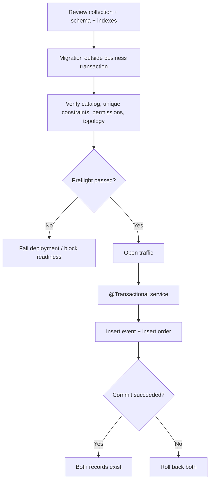
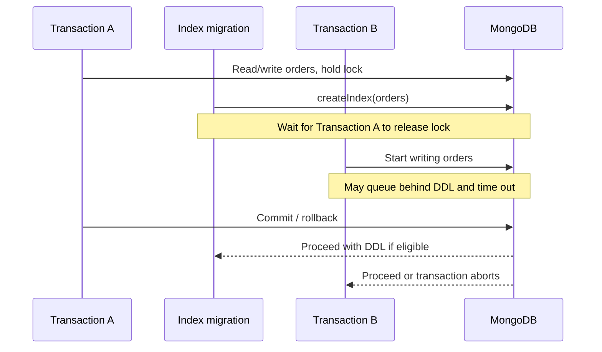

# Preparing Collections and Indexes Before Starting a Transaction

In **Spring Data MongoDB**, `@Transactional` can protect a business operation that writes across multiple documents or collections with a **MongoDB transaction**. However, a transaction should only start once the **collections**, **indexes**, **data constraints**, and **access permissions** that the operation depends on are ready. If the first write accidentally creates a collection, or index-initialization code runs inside a transaction, the system can encounter version/topology-dependent errors, metadata lock contention, or missing unique constraints before the index exists.

This topic belongs to the **Sessions and Transactions** chapter of the **SPRING_DATA_MONGODB** module. The module uses Spring Data MongoDB to connect and map documents, perform operations via `MongoTemplate` or repositories, and practice querying, aggregation, indexing, transactions, reactive access, testing, and performance diagnostics. The goal of this lesson is to distinguish:

- **What MongoDB Server allows**: certain collection/index creation operations are supported *inside a transaction* in current versions, but only under specific conditions.
- **What you should do when building systems**: prepare collections and indexes **outside business transactions**, verify them before accepting traffic, and manage changes as controlled **schema/index migrations**.
- **What must not be confused**: `@Document`, `@Indexed`, or calling `save` does not guarantee that all intended collections/indexes have already been created before the first transaction runs.

By the end of this lesson, you will build the `orders` and `order_events` collections with unique indexes, configure `MongoTransactionManager`, run a transaction with real rollback, know how to handle duplicate data before creating an index, and write integration tests confirming all prerequisites are prepared.

## 1. Why prepare data infrastructure before a transaction?

Suppose a business operation creates an order while also recording an audit event. The business steps are:

1. Write to `order_events` with `eventKey` representing a received request.
2. Write to `orders` with an `orderKey` unique per tenant.
3. Either both **commit** or both **rollback**.

Such a transaction requires these prerequisites in place beforehand:

| Component | Role in the business operation | Risk if not ready |
| --- | --- | --- |
| `orders` | Stores orders | The first insert may trigger unintended collection creation |
| `order_events` | Stores receipts/idempotency events | Without a unique index, duplicate events can be accepted |
| Unique index on `orders(tenant_id, order_key)` | Prevents duplicate `orderKey` within the same tenant | Two duplicate orders can be created under concurrent requests |
| Unique index on `order_events(tenant_id, event_key)` | Prevents re-processing the same event | Retrying an entire HTTP request may write twice |
| Read index on `tenant_id, status, created_at` | Improves business query efficiency | Slow on large collections, increasing transaction hold time |
| `MongoTransactionManager` sharing the same database factory | Binds `ClientSession` to Spring Data operations | `@Transactional` may not initiate the expected MongoDB transaction |
| Replica set/sharded deployment | Infrastructure supporting multi-document transactions | Standalone MongoDB does not support transactions |

**Not every application needs all of the indexes above.** Choose indexes based on actual queries and data invariants; the table merely illustrates the needs of a cross-collection operation.



The key point is **schema lifecycle ownership**. A transaction serves **a single business operation**, whereas migration prepares **the capability to execute all future business operations**. You should not combine them into one step just because MongoDB's API allows certain DDL operations inside a transaction.

## 2. Distinguishing namespace, collection, index, and transaction

MongoDB does not have relational tables/schemas, yet each collection still has operational structure:

- **Namespace**: the `database.collection` name, for example `shop.orders`.
- **Collection**: where documents are stored, with options such as validation, collation, clustered/time-series depending on type.
- **Index**: a structure used by MongoDB to locate/sort data or enforce constraints such as `unique`.
- **Catalog metadata**: the list of collections, index definitions, and options.
- **ClientSession**: the session context MongoDB uses for transactions.
- **Transaction**: a group of read/write operations that commit or roll back along a transaction boundary.

A transaction does not define the indexes of the collections it writes to. Nor does a unique index create a cross-collection transaction. These two mechanisms solve two separate problems:

```text
Unique index:
  "Within a single tenant, no two orders share the same orderKey."

Transaction:
  "Writing the receipt to order_events and the order to orders
   must either both succeed or both roll back."
```

Without a unique index, two different transactions can write **two orders with the same orderKey** and both commit; a transaction does not automatically turn this business condition into a uniqueness constraint.

## 3. MongoDB Server limits: do not claim "DDL is always forbidden"

Spring Data MongoDB transaction documentation emphasizes preparing all collections ahead of time so unexpected **collection operations** do not occur inside transactions. This is a sound operational principle, but **it should not be interpreted as an absolute ban across all MongoDB versions**.

According to current **MongoDB Server documentation**, inside a transaction that is **not a cross-shard write transaction**, the server permits certain cases:

- **Creating a collection** via the `create` command or implicitly via `insert`/`upsert`.
- **Creating an index** on a collection that **does not yet exist**, or on a **new, empty collection created earlier in the same transaction**.
- Calling `createIndex` to verify an **already existing index** may succeed without creating a new index.

However, the accompanying restrictions are critical:

1. **You cannot create a new collection in a cross-shard write transaction.**
2. **Explicit DDL creating a collection/index inside a transaction requires `readConcern: "local"`**.
3. **You cannot treat creating a new index on an existing collection that already contains data as an arbitrary allowed DDL operation inside a transaction**.
4. Metadata listing commands such as `listCollections` and `listIndexes` **cannot be executed inside a transaction**.
5. Older MongoDB versions, framework layers, or deployment mechanisms may impose stricter limitations.

Clarification table:

| Scenario | Current MongoDB Server | Recommended practice |
| --- | --- | --- |
| Create a new collection in a single-shard transaction | Possible under supported conditions | **Create beforehand externally** |
| First insert triggers implicit collection creation | Possible under supported conditions | **Do not rely on implicit creation** |
| Create an index on a new, empty collection just created in the same transaction | Possible under supported conditions | **Create beforehand externally** |
| Create a new index on an existing production collection with data | Not among the allowed in-transaction index DDL cases above | Migrate outside transactions |
| Create a collection when a transaction writes across multiple shards | Not supported | Provision namespaces beforehand |
| Explicit DDL in a transaction using `readConcern:"snapshot"` | Not supported | Separate DDL from transactions |
| `getIndexes()`/`listIndexes` inside a transaction | Not supported | Preflight outside transactions |

**Bottom line:** this lesson chooses a **pattern that runs reliably across environments**: provision first, start transactions afterward. If you need to leverage an in-transaction collection/index creation exception for a special requirement, you must verify **MongoDB Server version, topology, read concern, Spring Data/driver behavior, and integration tests**. Do not rely on that exception by default in core business flows.

## 4. Building sample data for the order placement operation

Source/target collections are designed with stable BSON field names:

```javascript
// orders
{
  _id: ObjectId("674000000000000000007001"),
  tenant_id: "T1",
  order_key: "ORD-1001",
  status: "NEW",
  amount_vnd: NumberLong("250000"),
  created_at: ISODate("2026-11-20T02:00:00Z")
}

// order_events
{
  _id: ObjectId("674000000000000000007101"),
  tenant_id: "T1",
  event_key: "place-order-1001",
  order_key: "ORD-1001",
  event_type: "ORDER_CREATED",
  occurred_at: ISODate("2026-11-20T02:00:00Z")
}
```

Two data invariants:

- In `orders`: a `(tenant_id, order_key)` pair appears only once.
- In `order_events`: a `(tenant_id, event_key)` pair appears only once.

Date fields are stored as BSON Date; `amount_vnd` uses BSON Int64 for integer VND amounts in this lesson. For multi-currency systems, add currency codes and appropriate calculation/comparison policies.

**Tenant authorization must come from the principal/authentication context**, never trusting an arbitrary tenant string sent by an HTTP client in the request body.

## 5. @Document and @CompoundIndex entities: intent is not reality

Using Spring Data MongoDB mapping metadata:

```java
import java.time.Instant;
import org.bson.types.ObjectId;
import org.springframework.data.annotation.Id;
import org.springframework.data.mongodb.core.index.CompoundIndex;
import org.springframework.data.mongodb.core.mapping.Document;
import org.springframework.data.mongodb.core.mapping.Field;

@Document(collection = "orders")
@CompoundIndex(
    name = "ux_orders_tenant_order_key",
    def = "{'tenant_id': 1, 'order_key': 1}",
    unique = true
)
@CompoundIndex(
    name = "ix_orders_tenant_status_created",
    def = "{'tenant_id': 1, 'status': 1, 'created_at': -1}"
)
public class Order {
    @Id
    private ObjectId id;

    @Field("tenant_id")
    private String tenantId;

    @Field("order_key")
    private String orderKey;

    private String status;

    @Field("amount_vnd")
    private long amountVnd;

    @Field("created_at")
    private Instant createdAt;

    public Order() {}

    public Order(
            ObjectId id, String tenantId, String orderKey,
            String status, long amountVnd, Instant createdAt) {
        this.id = id;
        this.tenantId = tenantId;
        this.orderKey = orderKey;
        this.status = status;
        this.amountVnd = amountVnd;
        this.createdAt = createdAt;
    }

    public ObjectId getId() { return id; }
    public String getTenantId() { return tenantId; }
    public String getOrderKey() { return orderKey; }
    public String getStatus() { return status; }
    public long getAmountVnd() { return amountVnd; }
    public Instant getCreatedAt() { return createdAt; }
}
```

An entity for event receipts:

```java
import java.time.Instant;
import org.bson.types.ObjectId;
import org.springframework.data.annotation.Id;
import org.springframework.data.mongodb.core.index.CompoundIndex;
import org.springframework.data.mongodb.core.mapping.Document;
import org.springframework.data.mongodb.core.mapping.Field;

@Document(collection = "order_events")
@CompoundIndex(
    name = "ux_order_events_tenant_event_key",
    def = "{'tenant_id': 1, 'event_key': 1}",
    unique = true
)
public class OrderEvent {
    @Id
    private ObjectId id;

    @Field("tenant_id")
    private String tenantId;

    @Field("event_key")
    private String eventKey;

    @Field("order_key")
    private String orderKey;

    @Field("event_type")
    private String eventType;

    @Field("occurred_at")
    private Instant occurredAt;

    public OrderEvent() {}

    public OrderEvent(
            ObjectId id, String tenantId, String eventKey,
            String orderKey, String eventType, Instant occurredAt) {
        this.id = id;
        this.tenantId = tenantId;
        this.eventKey = eventKey;
        this.orderKey = orderKey;
        this.eventType = eventType;
        this.occurredAt = occurredAt;
    }

    public ObjectId getId() { return id; }
    public String getTenantId() { return tenantId; }
    public String getEventKey() { return eventKey; }
    public String getOrderKey() { return orderKey; }
    public String getEventType() { return eventType; }
    public Instant getOccurredAt() { return occurredAt; }
}
```

**Important warning:** since Spring Data MongoDB **3.0**, automatic index creation is **disabled by default**. `@CompoundIndex` is metadata used to create indexes **if you enable auto-creation or run provisioning**; it does not prove that MongoDB Server already has the index.

Using explicit BSON field names `tenant_id` and `order_key` in `def` helps readers cross-check against `mongosh` commands. With the typed Java DSL, Spring Data can map property names from the entity to BSON keys; do not mix the two naming styles without checking the raw output.

## 6. Creating collections via migration before running the service

In `mongosh`, on the **test database or confirmed deployment target database**:

```javascript
use shop;

// Run in a migration job, NOT in a business transaction.
if (!db.getCollectionNames().includes("orders")) {
  db.createCollection("orders");
}

if (!db.getCollectionNames().includes("order_events")) {
  db.createCollection("order_events");
}

// Verify the newly prepared namespaces.
printjson(db.getCollectionNames().filter(
  name => ["orders", "order_events"].includes(name)
));
```

This snippet is suitable for illustrating **a coordinated single-run migration job**. Checking `getCollectionNames` and then creating is not a CAS operation: two concurrent jobs could both observe the collection missing and race to create it. In production, use a migration coordinator/leader or a deployment system that manages migration history.

A new collection normally has the default `_id_` index, but **lacks** the two unique compound indexes or search index needed by this lesson. Collection existence alone solves only **part** of preflight.

### When created immediately before a transaction

MongoDB recommends: if you **create or drop a collection right before opening a transaction**, and that transaction will access the collection, execute the DDL operation with **write concern `"majority"`** to ensure metadata is properly acknowledged and reduce failures to acquire locks.

An explicit command pattern (used when the collection does not yet exist):

```javascript
db.runCommand({
  create: "orders",
  writeConcern: { w: "majority" }
});
```

Do not blindly re-run `create` on an existing collection that has different options. Preflight checks, error-code handling, and deployment controls are required. `majority` here applies to **the DDL operation that just occurred**; it does not automatically make subsequent transactions use write concern majority unless configured.

## 7. Creating unique indexes and query-serving indexes outside transactions

For the schema above:

```javascript
db.orders.createIndex(
  { tenant_id: 1, order_key: 1 },
  { unique: true, name: "ux_orders_tenant_order_key" }
);

db.order_events.createIndex(
  { tenant_id: 1, event_key: 1 },
  { unique: true, name: "ux_order_events_tenant_event_key" }
);

db.orders.createIndex(
  { tenant_id: 1, status: 1, created_at: -1 },
  { name: "ix_orders_tenant_status_created" }
);
```

The first unique index prevents two orders with the same order key **within T1**, while still allowing T2 to use the same `ORD-1001`. The second index serves the same purpose for event keys.

The list index matches the query:

```javascript
db.orders.find({
  tenant_id: "T1",
  status: "NEW"
})
.sort({ created_at: -1 })
.limit(30);
```

This filter/sort pattern can leverage the equality prefix `tenant_id, status` and then scan in `created_at DESC` order. If the product needs deterministic sorting among documents with identical timestamps or keyset pagination, consider adding `_id` to the sort/index and verify with `explain`.

There is no rule that "transactions require an index on every field." An atomic transaction still works on a collection that only has `_id_`; indexes depend on **queries and invariants**, while transactions concern **commit/rollback**. However, a transaction containing slow queries risks holding locks/resources longer and encountering more conflicts.

## 8. Unique indexes must build successfully before accepting traffic

Suppose the `orders` collection already exists and contains two documents:

```javascript
{ tenant_id: "T1", order_key: "ORD-1001", status: "NEW" }
{ tenant_id: "T1", order_key: "ORD-1001", status: "NEW" }
```

At that point:

```javascript
db.orders.createIndex(
  { tenant_id: 1, order_key: 1 },
  { unique: true, name: "ux_orders_tenant_order_key" }
);
```

will **fail** because duplicate data already exists. MongoDB does not delete duplicate documents for you.

Before migrating, inspect:

```javascript
db.orders.aggregate([
  {
    $group: {
      _id: { tenantId: "$tenant_id", orderKey: "$order_key" },
      n: { $sum: 1 },
      ids: { $push: "$_id" }
    }
  },
  { $match: { n: { $gt: 1 } } },
  { $limit: 50 }
]);
```

`$push` on all IDs can consume significant memory if a duplicate group is huge; on large datasets, use `$first`, a bounded `$addToSet`, or a separate audit job. Also check for `null` or missing fields:

```javascript
db.orders.find({
  $or: [
    { tenant_id: null },
    { order_key: null }
  ]
}).limit(50);
```

`{field:null}` also matches documents **missing that field**. With a unique compound index, null/missing combinations can cause collisions. Choose an explicit schema policy — do not assume a unique index over optional fields will behave the way you expect.

**Process:** scan for duplicates → perform controlled repair → prevent new writers from producing duplicates → create index → verify the actual index → open business flows that rely on the index. Do not simply catch a startup exception and swallow it to keep running.

## 9. Index uniqueness, idempotency, and transactions solve different problems

A `place order` request may be resent after a timeout. A transaction ensures `orders` and `order_events` commit together, but a transaction **does not automatically know** whether two separate requests represent the same business operation.

With a unique index:

```javascript
db.order_events.createIndex(
  { tenant_id: 1, event_key: 1 },
  { unique: true }
);
```

duplicate `eventKey` values within the same tenant will be rejected even if the two requests hit two different service replicas. This forms the foundation for building **idempotent processing**.

However, a duplicate key exception alone is not enough to conclude that a retry **succeeded completely**. The API layer must:

1. Look up the receipt with matching `tenant + eventKey`.
2. Verify that `orderKey` and key payload attributes match the original request.
3. Verify the committed business state.
4. Return the stored result for a valid replay; report a conflict when the same key is reused with a different payload.
5. Never re-run the entire flow with external side effects before reconciling.

Transactions, unique indexes, and idempotency must work together, not replace one another.

## 10. Configuring synchronous MongoTransactionManager

In synchronous Spring Data MongoDB:

```java
import org.springframework.context.annotation.Bean;
import org.springframework.context.annotation.Configuration;
import org.springframework.data.mongodb.MongoDatabaseFactory;
import org.springframework.data.mongodb.MongoTransactionManager;

@Configuration
public class MongoTxConfiguration {

    @Bean("mongoTransactionManager")
    MongoTransactionManager mongoTransactionManager(
            MongoDatabaseFactory factory) {
        return new MongoTransactionManager(factory);
    }
}
```

Requirements:

- The application runs against a MongoDB **replica set or sharded cluster** supporting transactions; **standalone** is not sufficient.
- `MongoTransactionManager` must manage **the same `MongoDatabaseFactory`/MongoClient infrastructure** used by `MongoTemplate` and repositories.
- `@Transactional` methods must be invoked **through the Spring proxy** under standard AOP mode; self-invocation within the same object may fail to initiate a transaction.
- When multiple transaction managers exist (such as JDBC and MongoDB), specify the exact bean via `transactionManager`.
- Every operation expected to participate in the transaction must go through compatible synchronous Spring Data infrastructure; native driver calls using a different session can bypass the transaction.

**Do not add `MongoTransactionManager` by instantiating a separate client/database factory inside a helper snippet.** Two distinct clients do not automatically share a `ClientSession` even when their URIs point to the same cluster.

## 11. Writing a business service that performs only CRUD writes once the transaction starts

Assuming unique indexes and collections are already in place, the service creates the receipt first and then the order:

```java
import java.time.Instant;
import org.bson.types.ObjectId;
import org.springframework.data.mongodb.core.MongoOperations;
import org.springframework.stereotype.Service;
import org.springframework.transaction.annotation.Transactional;

@Service
public class PlaceOrderService {
    private final MongoOperations operations;

    public PlaceOrderService(MongoOperations operations) {
        this.operations = operations;
    }

    @Transactional(transactionManager = "mongoTransactionManager")
    public ObjectId placeOrder(
            String authorizedTenant, String orderKey,
            String eventKey, long amountVnd) {

        if (authorizedTenant == null || authorizedTenant.isBlank()
                || orderKey == null || orderKey.isBlank()
                || eventKey == null || eventKey.isBlank()
                || amountVnd <= 0) {
            throw new IllegalArgumentException("Invalid data");
        }

        Instant now = Instant.now();
        ObjectId orderId = new ObjectId();

        operations.insert(new OrderEvent(
            new ObjectId(), authorizedTenant, eventKey,
            orderKey, "ORDER_CREATED", now
        ));

        operations.insert(new Order(
            orderId, authorizedTenant, orderKey,
            "NEW", amountVnd, now
        ));

        return orderId;
    }
}
```

Inside the transaction:

- If both inserts succeed and the commit succeeds, both the receipt and the order exist.
- If inserting the order fails with a **duplicate key** error because `orderKey` already exists, the runtime exception causes the previously inserted receipt to roll back.
- If inserting the receipt fails because `eventKey` already exists, the order is not inserted.
- If a transaction conflict occurs or the commit outcome is uncertain, handle it according to error labels and retry/idempotency policies — **do not blindly retry the whole flow**.

Do not send emails or Kafka events directly inside a transaction expecting those side effects to roll back if the database aborts. When external events must stay consistent with DB writes, use an outbox in the same transaction and have a worker publish to an idempotent consumer.

## 12. "Create collection if missing" inside @Transactional is an anti-pattern

A pattern that looks convenient at first glance:

```java
@Transactional(transactionManager = "mongoTransactionManager")
public void createOrderWrongly() {
    if (!mongoTemplate.collectionExists(Order.class)) {
        mongoTemplate.createCollection(Order.class);
    }

    mongoTemplate.insert(order);
}
```

This snippet is **not complete runnable code** because variables are undeclared, and more importantly it **should not be used**:

- `collectionExists(...)` typically relies on metadata listing (`listCollections`), which cannot be executed inside a transaction.
- `createCollection(...)` is DDL; on current MongoDB it is allowed only under specific conditions, while many other versions/framework configurations do not support it.
- Races between concurrent requests/instances can cause both to attempt creating the collection simultaneously.
- A newly created collection may lack unique indexes, leaving a window during which **constraints are not enforced**.
- If the transaction read concern is `snapshot`, explicit collection creation inside the transaction will be rejected.

**How to fix:** run `collectionExists`, `createCollection`, and `indexOps(...).createIndex(...)` in **a coordinated migration/init step outside business transactions**, and keep the service focused strictly on `insert/find/update/delete`.

## 13. Do not inspect the catalog inside a transaction

The following metadata operations must be executed **outside** transactions:

```java
boolean ordersPresent = mongoTemplate.collectionExists(Order.class);

var orderIndexes =
    mongoTemplate.indexOps(Order.class).getIndexInfo();

var eventIndexes =
    mongoTemplate.indexOps(OrderEvent.class).getIndexInfo();
```

These APIs may execute `listCollections` or `listIndexes`; MongoDB Server lists these listing commands as **disallowed inside transactions**.

**Good practice:** run preflight checks once in the migration or readiness/diagnostic layer rather than running catalog listings per transaction. Repeatedly reading catalog metadata also adds latency and introduces races: metadata observed at time A is not locked immutable until time B.

In production environments, **the principal authorized** to create indexes and the runtime application identity performing reads/writes should have distinct roles; the application may only need `listIndexes` privileges in a controlled readiness checker, without `dropIndex` permissions.

## 14. Programmatic index provisioning with MongoTemplate

In a migration runner **without `@Transactional`**, Spring Data provides `IndexOperations`:

```java
import org.springframework.data.domain.Sort;
import org.springframework.data.mongodb.core.MongoTemplate;
import org.springframework.data.mongodb.core.index.Index;

public class OrderSchemaProvisioner {
    private final MongoTemplate template;

    public OrderSchemaProvisioner(MongoTemplate template) {
        this.template = template;
    }

    public void provisionIndexes() {
        // Collections must be prepared beforehand by a migration step.
        template.indexOps(Order.class).createIndex(
            new Index()
                .on("tenantId", Sort.Direction.ASC)
                .on("orderKey", Sort.Direction.ASC)
                .unique()
                .named("ux_orders_tenant_order_key")
        );

        template.indexOps(OrderEvent.class).createIndex(
            new Index()
                .on("tenantId", Sort.Direction.ASC)
                .on("eventKey", Sort.Direction.ASC)
                .unique()
                .named("ux_order_events_tenant_event_key")
        );

        template.indexOps(Order.class).createIndex(
            new Index()
                .on("tenantId", Sort.Direction.ASC)
                .on("status", Sort.Direction.ASC)
                .on("createdAt", Sort.Direction.DESC)
                .named("ix_orders_tenant_status_created")
        );
    }
}
```

`createIndex(IndexDefinition)` is the Spring Data MongoDB **4.5+** API. In older versions, `IndexOperations.ensureIndex(...)` is the corresponding API, though it has been deprecated in newer releases. Always verify the application's **Spring Data version** before copying code.

`indexOps(Order.class)` uses the entity's mapping metadata; Java fields `tenantId`, `orderKey`, and `createdAt` must map to BSON `tenant_id`, `order_key`, and `created_at`. Verify through the index catalog rather than only reading property names in code.

This class is only a **migration component invoked by a deployment step**, not a bean meant to run automatically on every application instance. Do not place `provisionIndexes()` calls inside controllers, repository methods, or per-request business services.

## 15. IndexResolver and annotations can assist migration

If you prefer keeping index definitions on annotations, use `MongoPersistentEntityIndexResolver`:

```java
import org.springframework.data.mongodb.core.index.IndexDefinition;
import org.springframework.data.mongodb.core.index.IndexResolver;
import org.springframework.data.mongodb.core.index.MongoPersistentEntityIndexResolver;

IndexResolver resolver = new MongoPersistentEntityIndexResolver(
    mongoTemplate.getConverter().getMappingContext()
);

for (IndexDefinition definition :
        resolver.resolveIndexFor(Order.class)) {
    mongoTemplate.indexOps(Order.class).createIndex(definition);
}

for (IndexDefinition definition :
        resolver.resolveIndexFor(OrderEvent.class)) {
    mongoTemplate.indexOps(OrderEvent.class).createIndex(definition);
}
```

The resolver reads `@CompoundIndex`; **it does not contact MongoDB to create indexes by itself**. The `createIndex` call is what performs index creation.

Spring Data MongoDB **disables auto-index by default since 3.0**. You can opt in via configuration, but production should follow a clear policy:

- **Development/test**: auto-index may be enabled on isolated databases to reduce manual setup.
- **Production**: prefer dedicated migrations so you know exactly who created an index, when, how long it took, and whether conflicts occurred.
- **Multiple replicas**: avoid having every replica boot concurrently and compete to execute index migrations.
- **Runtime drop/recreate**: auto-index does not guarantee recreating indexes for collections dropped and recreated while the application is running.

**When provisioning is mandatory for business correctness**, do not rely solely on `@Indexed` as a "schema guarantee" in a go-live checklist.

## 16. Explicit auto-index configuration: know when not to use it

On Spring Boot versions supporting the property:

```yaml
  # Example development profile.
spring:
  data:
    mongodb:
      auto-index-creation: true
```

In configurations extending `AbstractMongoClientConfiguration`, you can override:

```java
@Override
public boolean autoIndexCreation() {
    return true;
}
```

These are **two configuration approaches for two different application models**; there is no need to add both unconditionally. Verify which auto-configuration or beans Spring actually uses, especially if the application declares a custom `MongoMappingContext` or multiple `MongoTemplate` beans.

For transaction-sensitive production workloads, auto-index is typically kept **disabled** and provisioned through a migration. If you deliberately enable auto-index, ensure **index creation finishes before marking readiness**, the account has appropriate privileges, index builds do not disrupt critical traffic, and replicas do not race against each other.

## 17. Preflight inspection of the index catalog, not just names

Using `mongosh`:

```javascript
db.orders.getIndexes();
db.order_events.getIndexes();
```

Verify specifically:

| Index | Expected key pattern | Unique? |
| --- | --- | --- |
| `ux_orders_tenant_order_key` | `{tenant_id:1, order_key:1}` | Yes |
| `ux_order_events_tenant_event_key` | `{tenant_id:1, event_key:1}` | Yes |
| `ix_orders_tenant_status_created` | `{tenant_id:1, status:1, created_at:-1}` | No |
| `_id_` | `{_id:1}` | Yes (default) |

Inspect raw BSON specifications:

```javascript
db.orders.getIndexes().forEach(ix => {
  printjson({
    name: ix.name,
    key: ix.key,
    unique: ix.unique,
    collation: ix.collation,
    partialFilterExpression: ix.partialFilterExpression,
    expireAfterSeconds: ix.expireAfterSeconds
  });
});
```

Seeing **matching names** alone is not enough: keys or options can drift. For example:

- `unique:true` was omitted, leaving an invariant unenforced.
- Java field `orderKey` was mistakenly indexed instead of BSON `order_key`.
- `partialFilterExpression` indexes only a subset while the business rule requires global uniqueness.
- A different `collation` changes whether `"ABC"` and `"abc"` are treated identically.
- A TTL index deletes documents over time even though the service expects retention.

`createIndex` is not a "schema migration engine" that reconciles every difference automatically. If an index with the same name has different options or keys, MongoDB can fail with a conflict error; never blindly call `dropIndex` during app startup to hide conflicts.

## 18. Warnings about TTL, partial indexes, and collection validation

Collections do not rely only on unique indexes. They may also need:

- **Schema validation** enforcing proper types for `tenant_id`, `order_key`, and `amount_vnd`.
- **TTL indexes** for temporary collections or receipts with retention policies.
- **Partial indexes** for specific status subsets.
- **Collation** for string comparison/uniqueness rules.
- **Time-series** or clustered collections with dedicated options.

Yet each feature has caveats:

- The TTL monitor deletes documents via a background pass, **not millisecond-exact**, which can affect state observed by transactions.
- A **partial** unique index prevents duplicates only among documents matching its filter; it does not replace unconditional global/per-tenant uniqueness if required.
- Collection validation can reject a transaction when a new entity violates the schema; that is working as designed, not a bug to silence by disabling validation.
- Changing collation, validation, or TTL in production is a **risky schema migration**, not merely a "query speedup."

Prepare and verify all required options **before** allowing transactions to write, backed by proper data migration and rollback plans.

## 19. What if transactions already ran before the index existed?

If the first transactions run before the unique index is created:

```text
Request A: insert (tenant=T1, orderKey=ORD-1001) → commit
Request B: insert (tenant=T1, orderKey=ORD-1001) → commit
```

MongoDB can accept both because no unique constraint exists on that pair yet, even though each individual transaction is atomic. Creating the unique index afterward will then fail due to existing duplicates.

There is no simple retroactive fix by merely flipping an annotation. You must:

1. Block or throttle writes that produce duplicates.
2. Audit data and classify duplicates sharing the same tenant/orderKey.
3. Clean up data according to business rules, including references and external events.
4. Build the unique index successfully.
5. Re-verify duplicate counts and retry behavior.
6. Reopen traffic once readiness passes.

**If a unique constraint is a correctness requirement, a missing index must fail deployment/readiness rather than serve as a mere performance warning.**

## 20. Access control: migration user vs. runtime user

A production system can separate permissions as follows:

| Component | Required permissions | Should not be granted by default |
| --- | --- | --- |
| Runtime service | `find`/`insert`/`update`/`remove` on permitted collections | `dropCollection`, `dropIndex`, and database-wide admin |
| Migration job | `createCollection`, `createIndex`, `listIndexes`, depending on schema change | Broader privileges than necessary |
| Readiness checker | Read metadata on managed namespaces | Self-repairing indexes when checks fail |
| DBA/operator | DDL, index build diagnostics, policy-based recovery | Shared credentials across all service instances |

Exact MongoDB privileges depend on commands and RBAC roles; no single role name fits every system. When an app lacks `createIndex` permission while auto-index is enabled, startup or entity initialization can fail; **never assume indexes exist merely because the app did not crash**.

**Manage migration credentials and runtime credentials separately**, and log `migrationId`/index specs rather than full connection URIs containing secrets.

## 21. Index builds competing with transactions: locks and latency

Building an index on a collection containing data is a DDL operation that may require locks and heavy CPU/I/O/disk resources. When transactions and DDL target the same namespace:

- An active transaction can hold a lock, forcing DDL to wait.
- A queued DDL operation can prevent new transactions targeting the same namespace from **acquiring locks**.
- Transactions may abort after waiting past `maxTransactionLockRequestTimeoutMillis` per server configuration.
- Clients outside transactions can also suffer from lock waits.
- Index builds on replica sets/sharded clusters also depend on commit quorum and node states.



Therefore, "creating indexes before transactions" also means **avoiding scheduling index migrations right when critical business transactions are actively running**, whenever possible. Use change windows, metrics, coordinated single-runner migration jobs, and capacity planning.

Do not arbitrarily raise `maxTransactionLockRequestTimeoutMillis` to "fix" every abort: it may merely prolong wait times and worsen deadlocks or tail latency.

## 22. Sharded clusters: avoid implicit creation in cross-shard transactions

In a sharded cluster, a transaction writing across multiple shards has additional limits. Per MongoDB Server:

> Do not create a new collection in a cross-shard write transaction.

For example, if an operation writes to `orders` on shard A while `order_events` does not yet exist, inserting into `order_events` may trigger implicit creation on a different shard. A flow that looks like two simple `insert` calls can fail due to metadata/shard restrictions.

**Safe approach:** pre-create collections, indexes, and sharding configuration before running business transactions. Unique indexes on sharded collections also carry constraints related to the **shard key prefix**, so tenant + business key designs must be reviewed alongside the sharding strategy.

Running a migration only against a different local/staging database is insufficient; verify it on the **actual deployment topology** used by production transactions.

## 23. Read concern and write concern right after preparing collections

Two distinct concerns apply:

- **Schema/metadata visibility**: are the newly created collection/index acknowledged and consistently visible across the required nodes?
- **Transaction data consistency**: what semantics apply to business reads/writes inside the transaction?

MongoDB recommends **`writeConcern:"majority"` for create/drop collection operations immediately preceding a transaction** if the transaction accesses that namespace.

Inside the transaction:

- `readConcern:"local"`, `"majority"`, and `"snapshot"` have distinct semantics.
- Explicit collection/index DDL **inside a transaction** (when allowed) only supports `readConcern:"local"`.
- Transactions using `snapshot` may be appropriate when a consistent snapshot is needed, especially on sharded clusters.
- **Commit write concern** must match durability requirements; `w:"majority"` is commonly needed to guarantee majority/snapshot reads observe committed data.

Do not set write concern per individual write **inside a transaction**; configure it at the **transaction level**. And do not treat `majority` as a substitute for a missing index: durability does not enforce uniqueness for you.

## 24. Preflight and readiness: block traffic when the schema is unready

A well-behaved startup flow verifies critical business prerequisites before serving traffic:

```text
Deployment pipeline:
  1. Migrate collections
  2. Migrate indexes/validation
  3. Verify metadata + duplicate constraints
  4. Deploy application
  5. Readiness checks
  6. Open traffic
```

A minimal verifier using Spring Data MongoDB:

```java
import java.util.List;
import org.springframework.data.mongodb.core.MongoTemplate;
import org.springframework.data.mongodb.core.index.IndexInfo;

public class OrderSchemaVerifier {
    private final MongoTemplate template;

    public OrderSchemaVerifier(MongoTemplate template) {
        this.template = template;
    }

    public void verify() {
        if (!template.collectionExists(Order.class)
                || !template.collectionExists(OrderEvent.class)) {
            throw new IllegalStateException(
                "Missing collection for order placement transaction"
            );
        }

        List<IndexInfo> order = template.indexOps(Order.class)
            .getIndexInfo();
        List<IndexInfo> events = template.indexOps(OrderEvent.class)
            .getIndexInfo();

        if (order.stream().noneMatch(
                i -> "ux_orders_tenant_order_key".equals(i.getName()))
                || events.stream().noneMatch(
                i -> "ux_order_events_tenant_event_key".equals(i.getName()))) {
            throw new IllegalStateException(
                "Missing required unique index"
            );
        }
    }
}
```

This is a **minimal verifier** checking only **presence by name**. For production, also compare **key pattern, unique option, collation, and partial filter**; do not treat the snippet above as complete validation. Run it outside transactions in an appropriate readiness/lifecycle hook, and fail deployment if invariants are missing.

**Readiness is not a lock.** If a DBA drops an index after the app passes readiness, a one-time pre-check cannot prevent that. You also need RBAC, change management, and schema drift monitoring.

## 25. Distinguishing migration readiness from business liveness

An operational question: **what happens if MongoDB is unreachable at startup?**

- **Liveness** indicates whether the app process is still alive; you should not force constant container restarts when the database blips transiently.
- **Readiness** indicates whether the app can serve business traffic correctly; if required collections/indexes are missing, it must report **not ready**.
- **Migration jobs** indicate whether schema/indexes are ready for the new code version.

A safe operational pattern runs migrations **before** rollout, with Spring Boot Actuator health/readiness probes extended to check essential preconditions. Do not let readiness checkers **create indexes** on every probe call, since probes run repeatedly across many replicas.

If a migration fails due to duplicate keys, halt the rollout and fix the data; never fake a "ready" state by temporarily disabling uniqueness.

## 26. Multi-step deployment scenario when changing a unique index

Suppose `orders.orderKey` was previously unique across the entire collection, but the new model requires uniqueness **per tenant** — or the old index used a different collation.

Do not do this:

```javascript
// Dangerous if run automatically at startup:
// db.orders.dropIndex("old_unique_index");
// db.orders.createIndex({tenant_id:1, order_key:1},{unique:true});
```

Instead:

1. Review queries, data models, and desired uniqueness policy.
2. Audit duplicate records under the new key definition.
3. Clean/migrate data and prevent writers from introducing duplicates during the transition.
4. Build the new index in a monitored migration.
5. Verify the new index is committed and enforcing constraints.
6. Deploy the new app version using the new semantics.
7. Only in a later release consider dropping the old index, with a rollback plan.

**Specifically:** keeping both the old and new unique indexes simultaneously can leave the **stricter old policy active** during the transition window; account for that in the rollout plan. Do not assume creating the new index invalidates the old one.

## 27. Wrong patterns vs. right patterns

### Wrong: placing index creation inside a @Transactional method

```java
@Transactional(transactionManager = "mongoTransactionManager")
public void createOrderWithDdlInside() {
    // Do not do this:
    // template.indexOps(Order.class).createIndex(...);
    // template.insert(order);
}
```

Server exceptions for in-transaction DDL are **not** a license to create production indexes on existing collections on every invocation. It can fail due to read concern, non-new/non-empty collections, or cross-shard restrictions — alongside added latency and lock contention.

### Wrong: assuming @CompoundIndex enforces uniqueness by itself

```java
@CompoundIndex(
    name = "ux_orders_tenant_order_key",
    def = "{'tenant_id':1,'order_key':1}",
    unique = true
)
class OrderMarker {}
```

Annotations alone are insufficient if the real index does not exist. This sample only illustrates metadata; do not substitute `OrderMarker` for the full `Order` entity shown earlier.

### Right: provision first, then execute transactions

```text
Migration (one-time, outside transactions):
  - create orders
  - create order_events
  - create compound unique indexes
  - verify schema/catalog/duplicates
  - publish migration success

Runtime:
  - @Transactional:
      insert event
      insert order
      commit / rollback
```

This option minimizes dependence on server-version exceptions and is much simpler to monitor.

## 28. Unit tests alone do not prove schema readiness

A mock such as:

```java
when(mongoTemplate.collectionExists(Order.class))
    .thenReturn(true);
```

only proves the Java code receives `true`; it **does not prove** the real collection exists, has the right unique indexes, runs against the intended MongoDB database, or that transactions are supported by the server.

To verify properly:

- Run against a dedicated real MongoDB test instance.
- Use a replica set (single-node is fine) to test multi-document transactions.
- Run provisioning code only **before** transactional service methods.
- Read the catalog to verify index keys and unique options.
- Trigger a duplicate key error inside a transaction and prove the previously inserted document rolls back.
- Test missing collections/indexes on a fresh test database and confirm readiness blocks the business path.

Never intentionally drop collections/indexes or enable failpoints in production.

## 29. Integration test: verify the catalog before transactions

Example JUnit 5/Spring Boot test class, assuming a MongoDB test replica set and that migrations ran on the test database:

```java
import static org.assertj.core.api.Assertions.assertThat;

import java.util.List;
import org.bson.Document;
import org.junit.jupiter.api.Test;
import org.springframework.beans.factory.annotation.Autowired;
import org.springframework.boot.test.context.SpringBootTest;
import org.springframework.data.mongodb.core.MongoTemplate;
import org.springframework.data.mongodb.core.index.IndexInfo;

@SpringBootTest
class SchemaPreflightIntegrationTest {
    @Autowired MongoTemplate template;

    @Test
    void bothCollectionsAndUniqueIndexesExist() {
        assertThat(template.collectionExists(Order.class)).isTrue();
        assertThat(template.collectionExists(OrderEvent.class)).isTrue();

        List<IndexInfo> orderIndexes =
            template.indexOps(Order.class).getIndexInfo();

        List<IndexInfo> eventIndexes =
            template.indexOps(OrderEvent.class).getIndexInfo();

        assertThat(orderIndexes)
            .extracting(IndexInfo::getName)
            .contains("ux_orders_tenant_order_key");

        assertThat(eventIndexes)
            .extracting(IndexInfo::getName)
            .contains("ux_order_events_tenant_event_key");
    }

    @Test
    void rawIndexSpecIsActuallyUnique() {
        List<Document> indexes = template.getCollection("orders")
            .listIndexes(Document.class)
            .into(new java.util.ArrayList<>());

        assertThat(indexes).anySatisfy(ix -> {
            assertThat(ix.getString("name"))
                .isEqualTo("ux_orders_tenant_order_key");
            assertThat(ix.getBoolean("unique")).isTrue();

            Document keys = ix.get("key", Document.class);
            assertThat(keys).containsEntry("tenant_id", 1)
                            .containsEntry("order_key", 1);
        });
    }
}
```

In this code, `@SpringBootTest` must load the test MongoDB URI, `MongoTransactionManager`, and proper entity scanning; tools like Testcontainers can spin up the test deployment. **Assertions read metadata outside transactions**.

Do not test only index names: `rawIndexSpecIsActuallyUnique` verifies both `unique` and the raw BSON keys. On sharded clusters, add shard-key checks as well.

## 30. Integration test: a second unique error must roll back the first receipt

We intentionally trigger an error **after** inserting the event inside the transaction:

```java
import static org.assertj.core.api.Assertions.assertThat;
import static org.assertj.core.api.Assertions.assertThatThrownBy;

import java.time.Instant;
import org.bson.types.ObjectId;
import org.junit.jupiter.api.Test;
import org.springframework.beans.factory.annotation.Autowired;
import org.springframework.boot.test.context.SpringBootTest;
import org.springframework.data.mongodb.core.MongoTemplate;
import org.springframework.data.mongodb.core.query.Criteria;
import org.springframework.data.mongodb.core.query.Query;

@SpringBootTest
class PlaceOrderTransactionIntegrationTest {
    @Autowired MongoTemplate template;
    @Autowired PlaceOrderService service;

    @Test
    void duplicateOrderKeyRollsBackNewEvent() {
        String tenant = "test-" + new ObjectId().toHexString();
        String duplicateOrderKey = "ORD-1001";
        String newEventKey = "new-event-" + new ObjectId();

        // Set up data before the business transaction.
        template.insert(new Order(
            new ObjectId(), tenant, duplicateOrderKey,
            "NEW", 100_000L, Instant.now()
        ));

        // In the service: the event is inserted first, then
        // the order insert fails because (tenant_id, order_key) is duplicated.
        assertThatThrownBy(() -> service.placeOrder(
            tenant, duplicateOrderKey, newEventKey, 200_000L
        )).isInstanceOf(RuntimeException.class);

        Query eventQuery = Query.query(
            Criteria.where("tenantId").is(tenant)
                .and("eventKey").is(newEventKey)
        );

        assertThat(template.exists(
            eventQuery, OrderEvent.class
        )).isFalse();

        Query orderQuery = Query.query(
            Criteria.where("tenantId").is(tenant)
                .and("orderKey").is(duplicateOrderKey)
        );

        assertThat(template.count(orderQuery, Order.class))
            .isEqualTo(1L);
    }
}
```

**This test is valid only when:**

1. The test MongoDB is a transaction-capable replica set/sharded deployment.
2. `MongoTransactionManager` is configured with the same factory as `MongoTemplate`.
3. `PlaceOrderService.placeOrder(...)` is invoked **through the Spring proxy**.
4. Index `ux_orders_tenant_order_key` was created **before** the test.
5. The test method **does not open another wrapping transaction** that alters the post-service state observed compared to production.

If the index is missing, inserting the duplicate order might **not fail**, and the test must fail — proving that provisioning is a prerequisite for consistency.

## 31. Testing missing collections and implicit creation: only on an isolated database

To verify exact MongoDB version/server conditions:

```text
Test A: Do not create collections before the transaction.
  - Try inserting inside a transaction under the test readConcern/topology.
  - Record server version, error/result, and actual namespace.
  - Do not extrapolate this result to other production topologies.

Test B: Create a new/empty collection in a transaction with readConcern local.
  - If the server version permits, test rule-compliant createIndex.
  - Try the same operation with readConcern snapshot:
    explicit DDL must be rejected.

Test C: Sharded cross-shard write transaction.
  - Attempt implicit namespace creation on another shard.
  - Verify the command is rejected as documented by MongoDB.

Test D: Call getIndexes/listIndexes inside a transaction.
  - Verify the restricted operation is rejected.
```

Do not mix these tests into production `PlaceOrderService`. They verify the **version capability matrix**; production systems should still pre-provision.

## 32. Differences between synchronous and reactive transactions

In synchronous Spring Data MongoDB:

- `MongoTransactionManager` binds the session/transaction to the Spring transaction context along the execution thread.
- `MongoTemplate`/repositories using the same factory can participate in the transaction.
- Run catalog preflight checks **outside** `@Transactional` methods.

In reactive applications:

- `ReactiveMongoTransactionManager` propagates the transaction context via **Reactor Context**.
- `ReactiveMongoTemplate`/reactive repositories must stay within the same publisher chain; do not call `subscribe()` independently inside a fragment and expect it to participate in the transaction.
- MongoDB Server rules regarding **DDL, metadata listing, collections/indexes, and sharding** still apply; reactive APIs do not bypass restricted operations.

Reactive transaction manager bean:

```java
import org.springframework.context.annotation.Bean;
import org.springframework.context.annotation.Configuration;
import org.springframework.data.mongodb.ReactiveMongoDatabaseFactory;
import org.springframework.data.mongodb.ReactiveMongoTransactionManager;

@Configuration
public class ReactiveMongoTxConfig {

    @Bean("reactiveMongoTransactionManager")
    ReactiveMongoTransactionManager reactiveMongoTransactionManager(
            ReactiveMongoDatabaseFactory factory) {
        return new ReactiveMongoTransactionManager(factory);
    }
}
```

With reactive provisioning, complete the migration `Mono` and verify success **before opening traffic**; do not create a publisher without subscribing to it. Nor should you enable both sync and reactive transaction managers if the app uses only one model.

## 33. Troubleshooting when transactions encounter unprepared collections/indexes

| Symptom | Likely cause to check | Action |
| --- | --- | --- |
| First transaction fails while subsequent ones succeed | Implicit collection creation or late index initialization | Pre-provision, inspect logs and server version |
| Duplicate `orderKey` despite `@CompoundIndex(unique=true)` | Auto-index disabled, missing/wrong index | Run `getIndexes()`, migrate unique index, audit duplicates |
| `createIndex` fails due to duplicate keys | Existing data has duplicate key pairs | Perform audited data cleanup/migration |
| `collectionExists`/`getIndexInfo` fails in transaction | Metadata listing is restricted | Move preflight outside transactions |
| Explicit DDL in transaction fails with snapshot read concern | Unsupported read concern | Keep DDL out of business transactions |
| Implicit namespace creation in cross-shard write | Cross-shard creation disallowed | Pre-create namespaces |
| `Transaction aborted` while index build runs | DDL/transaction lock contention or write conflict | Inspect `currentOp`, lock waits, schedule migrations properly |
| Index exists yet writes still fail validation | Schema/business constraint mismatch | Fix entity or migrate data; do not ignore |
| Works on replica set, fails on standalone test | Different topologies | Run transaction tests on a replica set |
| Index exists on wrong database | Wrong `MongoClient` URI/DatabaseFactory target | Verify effective config and namespace |
| Runtime app lacks `createIndex` permission | Auto-index/migration running under wrong credentials | Separate migration and runtime credentials |
| Transaction retries duplicate emails/external events | Side effects outside the transaction | Use outbox and idempotency |
| Index created post-transaction spikes latency | Build consumes resources and holds locks | Plan capacity, stagger rollouts |

Do not log merely "transaction failed." Record **transaction ID/correlation ID, logical business key, namespace, phase (preflight/write/commit), MongoDB error code/labels, server topology, and deployment version** in accordance with security policies.

## 34. Deployment checklist before enabling transactions

- [ ] Verified MongoDB deployment is a **replica set or sharded cluster**, not standalone.
- [ ] `MongoTransactionManager` or `ReactiveMongoTransactionManager` uses the application's **exact database factory/client**.
- [ ] Listed every collection that may be touched, including `orders`, `order_events`, outbox, counters, and audit/receipt collections.
- [ ] Pre-created collections with required options, validation, and collation.
- [ ] Pre-created unique indexes for invariants and idempotency keys.
- [ ] Cleaned duplicates/null/missing values before creating unique indexes.
- [ ] Verified index **keys + unique + options**, not merely annotation names.
- [ ] Executed migrations **outside business transactions**, by an authorized job/actor.
- [ ] Considered `writeConcern:"majority"` per MongoDB docs when creating/dropping collections right before transactions.
- [ ] Configured readiness to fail if correctness-critical collections/indexes are absent.
- [ ] Verified raw BSON `@Field`/`@Id` mapping matches index definitions.
- [ ] Ensured `listCollections`/`listIndexes` are never called inside transactions.
- [ ] Avoided relying on implicit collection creation or auto-index on first request.
- [ ] Measured index build cost, disk/CPU/I/O, lock contention, and transaction latency.
- [ ] Tested successful commit, duplicate-key rollback, races, and idempotent replay on real test MongoDB.
- [ ] Prepared rollback plans, schema drift detection, and post-rollout monitoring.

## 35. Self-assessment questions

**1.** Does `@Document("orders")` prove MongoDB has created the `orders` collection?  
**Answer:** No. It primarily supplies mapping metadata; actual existence must be verified on the server.

**2.** Does `@CompoundIndex(unique=true)` guarantee the index exists if Spring Data MongoDB uses 3.0+ defaults?  
**Answer:** No. Auto-index is disabled by default; separate provisioning or verified opt-in is required.

**3.** Does current MongoDB Server strictly forbid every collection creation inside a transaction?  
**Answer:** No. Exceptions exist in non-cross-shard write transactions under specific conditions; however, production should still pre-provision.

**4.** Should you create a new index inside a transaction on a production collection that already holds millions of documents?  
**Answer:** No, that is not among the server-supported in-transaction index DDL cases. Create it externally via migration.

**5.** Why should `listIndexes`/`listCollections` not be placed inside a `@Transactional` method?  
**Answer:** MongoDB classifies them as restricted operations inside transactions.

**6.** When explicit collection/index creation inside a transaction is supported, which read concern is required?  
**Answer:** `local`.

**7.** When a transaction writes across multiple shards, can a new collection be created mid-transaction?  
**Answer:** No, not inside a cross-shard write transaction.

**8.** Why must unique indexes be created before the first request arrives?  
**Answer:** So the server enforces the invariant and prevents two transactions from both committing duplicate data.

**9.** Does a transaction automatically roll back Kafka/email sends?  
**Answer:** No. Side effects outside MongoDB require outbox/idempotency patterns.

**10.** Should `createIndex` run inside the readiness probe of every application replica?  
**Answer:** No. Provision via coordinated migrations; readiness should only verify.

**11.** If an index exists, will every query definitely use it?  
**Answer:** No; the query planner may select a different plan, so verify with `explain("executionStats")` under real workloads.

**12.** What does MongoDB recommend when creating or dropping a collection right before a transaction accesses it?  
**Answer:** Use write concern `majority` for the metadata operation to ensure proper lock/visibility conditions.

**13.** Why do MongoDB transactions and unique indexes not replace each other?  
**Answer:** Transactions protect atomic commit across a group of operations, whereas unique indexes enforce uniqueness across stored data.

**14.** What are the risks if two service replicas boot simultaneously with auto-index enabled?  
**Answer:** Unplanned index creation, concurrent DDL submissions, load spikes, startup delays, and conflict errors if specs differ.

## 36. Hands-on exercise and references

**Hands-on exercise:** Create a dedicated MongoDB replica set for development/testing. Starting from a fresh database, run an out-of-transaction `mongosh` migration to create `orders`, `order_events`, and the three indexes. Inspect `getIndexes()`; insert an order, test a duplicate `(tenant_id,order_key)`, and clean up test data. Configure `MongoTransactionManager` and `PlaceOrderService`, and write a test verifying successful commit. Next, insert an order with a colliding key, invoke the service with a new `eventKey`, and confirm the previously inserted receipt rolls back. Try disabling the migration step on a fresh test database to verify that readiness catches the missing index. Finally, in an isolated test environment, test the in-transaction collection/index creation exception under `readConcern:"local"` and the `listIndexes` restriction. Measure `explain("executionStats")` for the tenant/status/createdAt query and discuss a rollout plan for large production indexes.

**Official documentation:**

- [MongoDB Manual — Transactions](https://www.mongodb.com/docs/manual/core/transactions/).
- [MongoDB Manual — Transactions and Operations](https://www.mongodb.com/docs/manual/core/transactions-operations/).
- [MongoDB Manual — Production Considerations for Transactions](https://www.mongodb.com/docs/manual/core/transactions-production-consideration/).
- [MongoDB Manual — createIndexes](https://www.mongodb.com/docs/manual/reference/command/createindexes/).
- [MongoDB Manual — Unique Indexes](https://www.mongodb.com/docs/manual/core/index-unique/).
- [Spring Data MongoDB — Sessions & Transactions](https://docs.spring.io/spring-data/mongodb/reference/mongodb/client-session-transactions.html).
- [Spring Data MongoDB — Index Creation](https://docs.spring.io/spring-data/mongodb/reference/mongodb/mapping/mapping-index-management.html).
- [Spring Data MongoDB — IndexOperations API](https://docs.spring.io/spring-data/mongodb/reference/api/java/org/springframework/data/mongodb/core/index/IndexOperations.html).

**Conclusion:** Before starting any business MongoDB transaction, ensure **all required collections and indexes are provisioned and verified**. Current MongoDB Server allows certain exceptions for in-transaction collection/index creation, but they are constrained by read concern, collection state, and cross-shard writes; they are **no substitute for a migration process**. In Spring Data MongoDB, annotations do not prove an index exists, auto-index is disabled by default since 3.0, and metadata queries like `listIndexes` should not run inside transactions. Separate **schema/index migration → preflight/readiness → @Transactional business operations**, combine unique indexes for data invariants, and test real rollback on a replica set. This keeps transactions predictable, queries optimizable, and production deployments observable, rollback-safe, and auditable.
