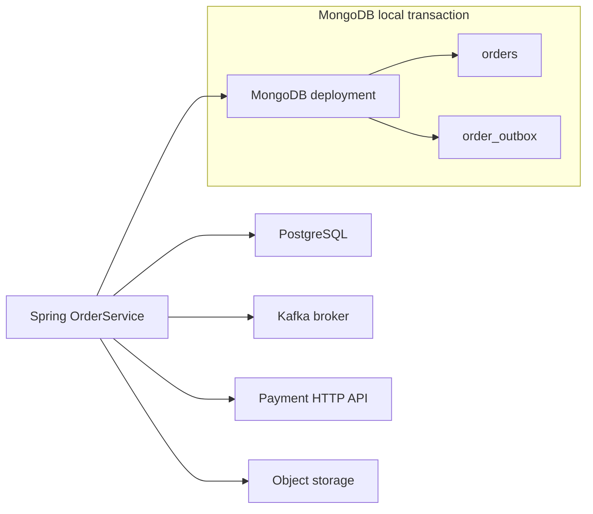
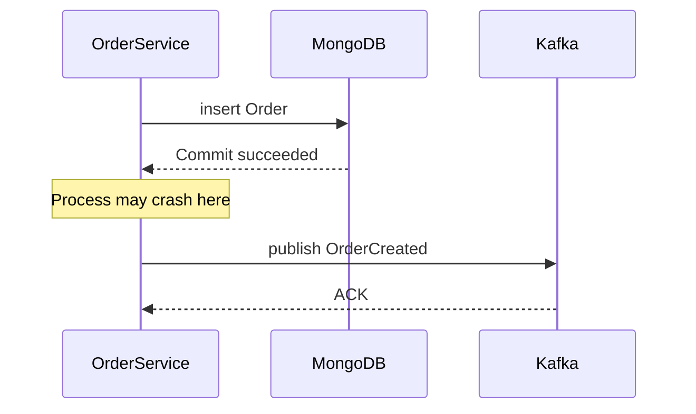
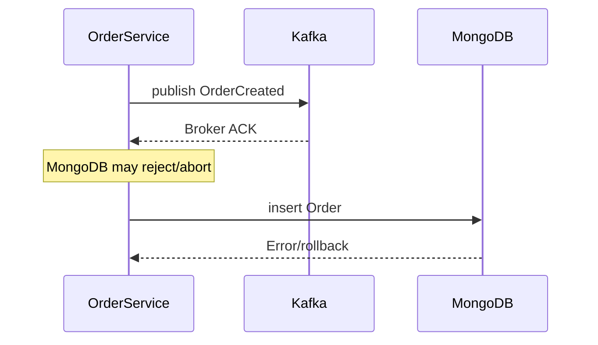
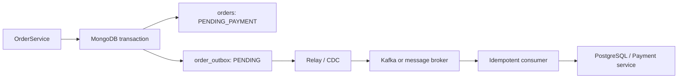
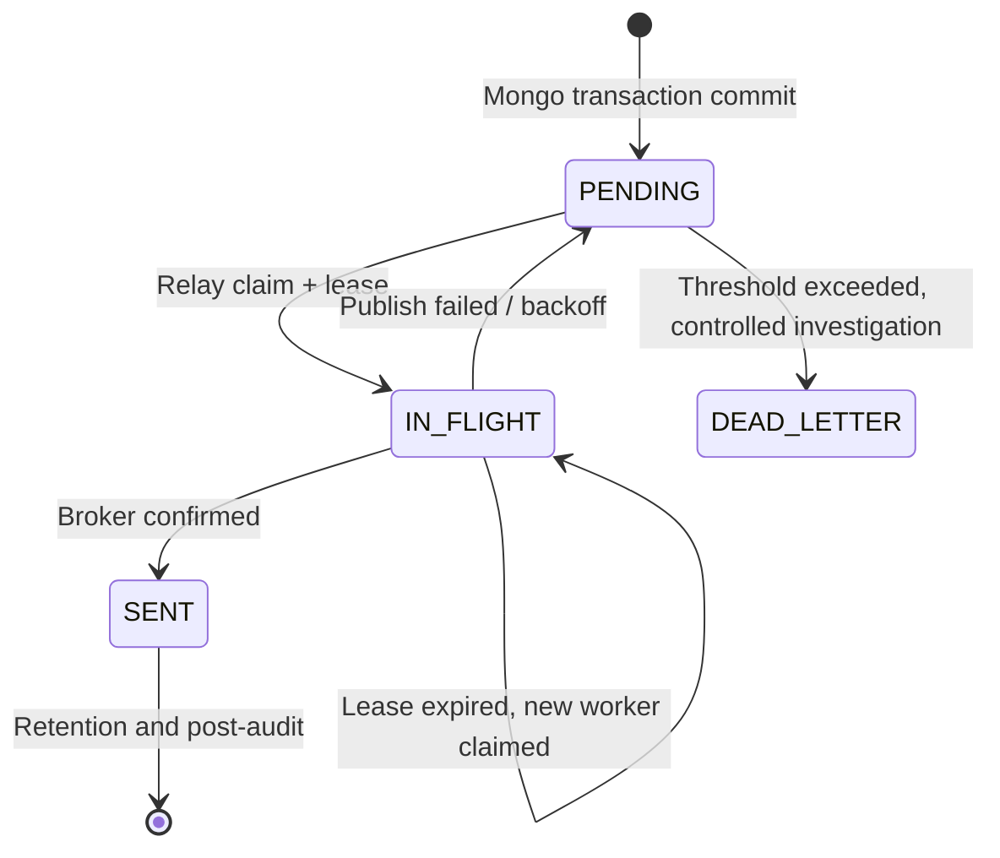
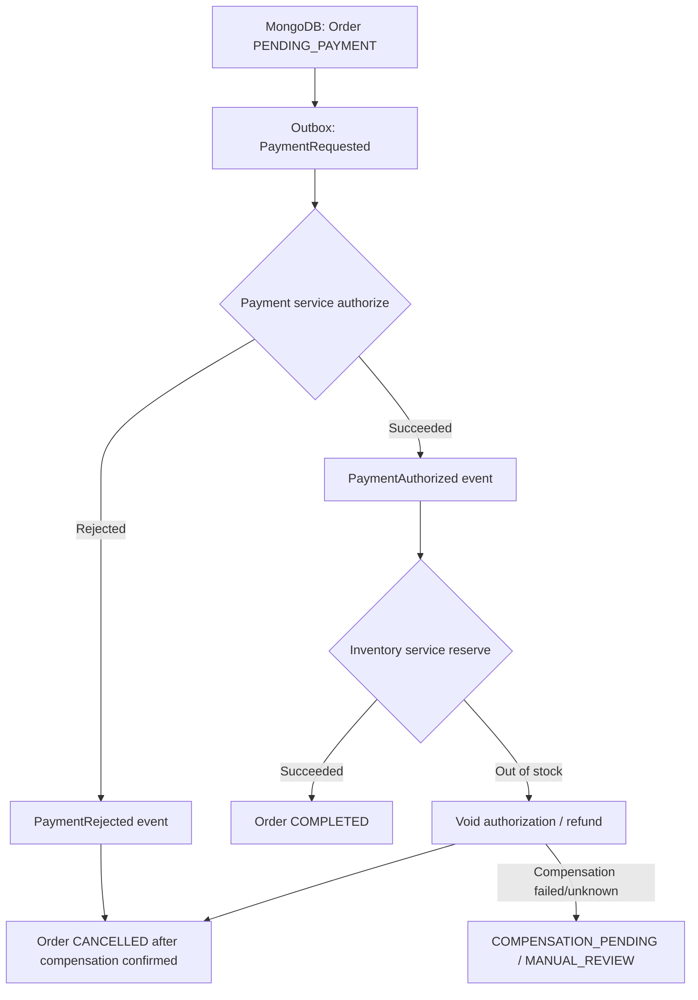
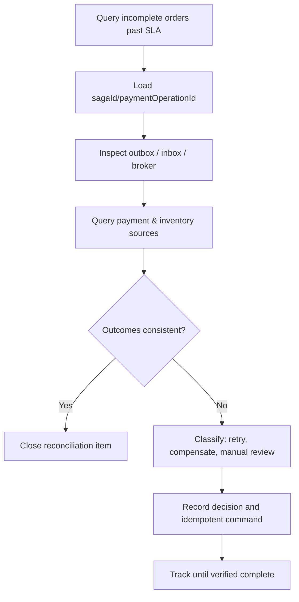
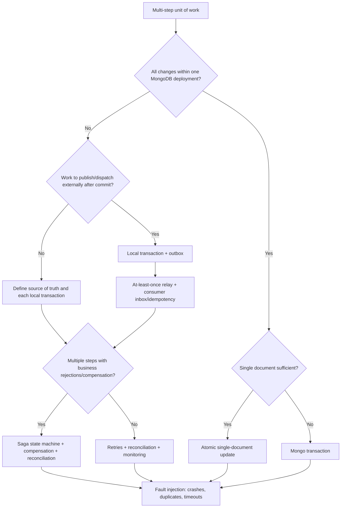

# Limits of Coordinating MongoDB with Other Data Systems in a Single Unit of Work

## 1. The problem: one business request, multiple storage systems

A **Spring Data MongoDB** application may use `MongoTemplate` or repositories for document operations, `MongoTransactionManager` to manage MongoDB transactions, and `ReactiveMongoTransactionManager` in reactive pipelines. Yet a single business request frequently extends beyond MongoDB:

- Save an order in MongoDB.
- Deduct inventory in PostgreSQL.
- Send a payment request to a service over HTTP.
- Publish an `OrderCreated` event to Kafka.
- Invalidate a Redis cache and store a receipt in object storage.

People may refer to the entire sequence as **"a single unit of work"** and expect "either every step succeeds, or none takes effect." In reality, each system has different **commit boundaries, rollback capabilities, retry semantics, and response timings**. Simply placing `@Transactional` on a Java method **does not turn independent systems into a single global ACID transaction**.

For example:

```text
POST /orders
     |
     v
Spring OrderService
     |---- MongoDB: save order
     |---- PostgreSQL: reserve inventory
     |---- Kafka: publish OrderCreated
     |---- Payment API: authorize money
     \---- S3: save receipt
```

If the Kafka broker stops responding after MongoDB has already committed, the MongoDB transaction **does not automatically retract** events already published elsewhere; conversely, if funds have already been authorized in an external payment system, MongoDB's `abortTransaction()` **does not automatically refund the money**.

This topic in the **Sessions and Transactions** chapter examines the exact **scope MongoDB guarantees**, pinpoints failure windows, and designs safer coordination using **transactional outbox, idempotent consumers, sagas, compensation, and reconciliation**.

### 1.1. Learning objectives

After this lesson, learners should be able to:

1. Distinguish a **business unit of work** from a **MongoDB transaction**, **SQL transaction**, **Kafka transaction**, and **remote HTTP request**.
2. Understand why a MongoDB transaction can span multiple collections/databases/shards **within the same deployment**, yet never encompass PostgreSQL/Kafka/Redis/S3 automatically.
3. Analyze dual-write failures when reordering DB persistence and message publishing.
4. Use `MongoTransactionManager` within its proper scope; avoid mistaking `@Transactional` for a distributed XA transaction.
5. Build a MongoDB transactional outbox and a relay with retries, leases, and idempotency.
6. Distinguish at-most-once, at-least-once, and exactly-once **by scope**; design idempotent consumers.
7. Design sagas for multi-step workflows with states, timeouts, compensation, and unknown outcomes.
8. Test via failure injection, protect tenant isolation, handle partial failures, and monitor data convergence lag.

### 1.2. Core terminology

| Term | Meaning |
|---|---|
| **Local transaction** | An ACID transaction executed by a single resource manager, such as MongoDB or a PostgreSQL database |
| **Business unit of work** | A business goal that may require multiple local transactions |
| **Dual write** | A service writing to two independent systems without a shared atomic commit |
| **Transactional outbox** | Storing business state and intended outgoing messages within the same source transaction |
| **Inbox/deduplication** | A consumer recording processed message/event IDs to prevent duplicate effects |
| **Saga** | A sequence of local transactions connected by events/commands and compensating actions |
| **Compensation** | A business action that reverses or adjusts an effect, rather than a physical ACID rollback |
| **Reconciliation** | Periodic cross-checking to detect and repair inconsistencies across systems |
| **Idempotency key** | A key ensuring repeated requests do not cause additional side effects |
| **Commit ambiguity** | After a timeout/network error, the caller is unsure whether the resource committed |

## 2. What does a MongoDB transaction guarantee — and what does it not?

### 2.1. The real scope of a MongoDB multi-document transaction

MongoDB supports ACID transactions across multiple operations, documents, collections, databases, and shards **within a single compatible MongoDB deployment** (replica set or sharded cluster). Operations must participate in **the same `ClientSession` and transaction context**.

Example within a single MongoDB deployment:

```text
MongoDB deployment "shop-rs"
   |
   |-- database shop
   |       |-- orders
   |       \-- order_outbox
   |
   \-- database audit
           \-- order_audit

One ClientSession + transaction:
   can write to supported collections/databases in this deployment
   and commit/abort as one MongoDB transaction.
```

This is **not** limited to single-collection transactions. Within MongoDB's supported bounds, a transaction can span different collections and multiple shards; resource limits, operation restrictions, commit cost, and topology must still be verified.

### 2.2. Boundaries MongoDB does not cover automatically



A MongoDB transaction **does not manage**:

- A PostgreSQL or other RDBMS `Connection`/`DataSource`.
- Kafka producer/broker transactions or RabbitMQ publish acknowledgments.
- HTTP payment gateways, email/SMS providers, or any external API.
- Redis commands/cache mutations, S3/object storage PUTs, and filesystem writes.
- A **different** MongoDB deployment with a separate client/factory and transaction coordinator.

Executing all operations inside the **same Java method**, same Spring bean, or same HTTP request **does not change** those boundaries.

### 2.3. Single-document atomicity remains useful

A write on **a single MongoDB document** is already atomic at the document level. When an operation can be modeled cleanly inside one document, embedding related fields and using conditional updates is often simpler and cheaper than a multi-document transaction:

```javascript
db.orders.updateOne(
  { _id: "O-101", state: "DRAFT", version: NumberLong(1) },
  {
    $set: { state: "PENDING_PAYMENT" },
    $inc: { version: NumberLong(1) }
  }
);
```

Even so, an atomic single-document write still **cannot** make an external HTTP payment call atomic with that update.

### 2.4. Transaction ACID behavior also depends on durability settings

MongoDB provides `readConcern` and `writeConcern` for transactions. When business logic requires majority-durable commits, configure `WriteConcern.MAJORITY` for transaction commits; `ReadConcern.SNAPSHOT` provides a consistent read view inside the transaction under MongoDB's documented rules.

That still governs only data **inside the MongoDB deployment**. It does not add majority acknowledgment to PostgreSQL or Kafka.

### 2.5. Do not equate a distributed MongoDB transaction with a heterogeneous distributed transaction

The phrase **distributed transaction** in MongoDB documentation refers to transactions running across **shards inside a MongoDB cluster**. That term **does not** imply a global commit coordinator spanning external systems. Be explicit about scope:

```text
Correct:
  MongoDB transaction across multiple shards in the same deployment.

Wrong:
  MongoDB transaction automatically rolls back PostgreSQL or Kafka messages.
```

## 3. Dual writes: why reordering operations still fails to achieve atomicity

### 3.1. Option A — commit MongoDB, then emit event



If the process crashes after MongoDB commits but before sending to Kafka, **the order exists while no event is published**. Consumers never learn that the order was created. No MongoDB transaction can execute an unreached line of Java code after the process dies.

### 3.2. Option B — emit event, then commit MongoDB



In this case, consumers receive `OrderCreated` even though **the order was never committed**. Kafka transactions wrap Kafka operations within Kafka's boundary, but do not automatically enlist a MongoDB write into a shared XA commit.

### 3.3. Failure windows table

| Failure point | MongoDB | Kafka/remote | Consequence |
|---|---|---|---|
| Before writing MongoDB | Not written | Not sent | Relatively straightforward retry |
| After MongoDB commits, before publish | Committed | Not sent | **Lost notification** without recovery |
| Broker ACKs publish, then MongoDB rolls back | No order | Sent | **Orphan event** |
| Broker receives message, client times out before ACK | Committed | Unknown | Retry may emit duplicates |
| Payment authorized, MongoDB commit fails | Unconfirmed locally | Funds held | Requires lookup/void/refund; DB rollback cannot undo payment |
| MongoDB commits, process crashes before HTTP response | Committed | Client unaware | Request retry may create duplicate orders without idempotency |

**Key takeaway:** swapping the order of two operations only **changes the failure mode**; it does not eliminate the atomicity gap.

### 3.4. A network timeout does not prove an operation failed

A request to a broker or payment provider may **already have succeeded at the receiver**, with only the response/ACK lost on the network. If an application assumes timeout = "nothing happened" and re-executes a non-idempotent action, it can:

- Create two payment charges.
- Send two emails or two shipments.
- Credit points or deduct inventory twice.
- Emit a duplicate event with a brand-new event ID that cannot be deduplicated.

Therefore, you must distinguish **definite failure**, **success**, and **unknown outcome**. Unknown outcomes require **status lookup by operation ID/idempotency key**, safe retries, or reconciliation — not imaginary rollbacks.

## 4. Spring @Transactional and transaction managers

### 4.1. MongoTransactionManager manages one MongoDatabaseFactory

In Spring Data MongoDB, `MongoTransactionManager` manages the `ClientSession` and MongoDB transaction bound to the thread (imperative). `MongoTemplate` participates when it uses the same `MongoDatabaseFactory`/resource context.

Configuration example:

```java
import com.mongodb.ReadConcern;
import com.mongodb.ReadPreference;
import com.mongodb.TransactionOptions;
import com.mongodb.WriteConcern;
import org.springframework.context.annotation.Bean;
import org.springframework.context.annotation.Configuration;
import org.springframework.data.mongodb.MongoDatabaseFactory;
import org.springframework.data.mongodb.MongoTransactionManager;

@Configuration
public class MongoTxConfig {
    @Bean("mongoTransactionManager")
    MongoTransactionManager mongoTransactionManager(
            MongoDatabaseFactory factory) {
        TransactionOptions options = TransactionOptions.builder()
            .readConcern(ReadConcern.SNAPSHOT)
            .readPreference(ReadPreference.primary())
            .writeConcern(WriteConcern.MAJORITY)
            .build();
        return new MongoTransactionManager(factory, options);
    }
}
```

Requirements: a transaction-capable MongoDB deployment, shared client/factory, properly prepared collections/indexes, and tested duration and commit semantics. Avoid mutating `MongoTemplate.setSessionSynchronization(...)` dynamically across requests because it is shared state that can cause thread-safety/visibility issues.

### 4.2. An application can have two transaction managers

```java
import org.springframework.data.mongodb.MongoTransactionManager;
import org.springframework.jdbc.datasource.DataSourceTransactionManager;

// Common beans:
// mongoTransactionManager : manages MongoDB ClientSession.
// sqlTransactionManager   : manages JDBC Connection/DataSource.
```

Declaring:

```java
@Transactional(transactionManager = "mongoTransactionManager")
public void writeMongo() { /* MongoDB writes */ }

@Transactional(transactionManager = "sqlTransactionManager")
public void writeSql() { /* JDBC writes */ }
```

only selects **which transaction manager governs the declared transaction boundary**. Having two beans or two annotations **does not** create a global transaction coordinator. If a `@Transactional("sqlTransactionManager")` method is called from inside a MongoDB transaction, each resource maintains its own commit lifecycle; a failure in the second resource **has no mechanism guaranteed** to roll back a resource that already committed.

### 4.3. @Transactional pitfalls not unique to MongoDB

- `@Transactional` takes effect only when Spring transaction infrastructure is enabled and the method executes through its proxy/AspectJ mode.
- Self-invocation such as `this.innerTransactionalMethod()` normally **bypasses the proxy** in default proxy mode.
- By default, `RuntimeException`/`Error` triggers rollback; checked exceptions require explicit rollback rules aligned with your Spring version and business contract.
- `@Transactional(readOnly = true)` does not make remote HTTP APIs read-only or atomic.
- The `transactionManager`/qualifier parameter must select the right manager; omitting it in a multi-resource app can pick the wrong manager or cause ambiguity.

### 4.4. MongoDB does not default to XA/2PC support in Spring

A global XA transaction typically requires resource managers participating in a standard commit protocol, a transaction coordinator, recovery logs, and prepare/commit support. Spring Data's `MongoTransactionManager` is a local transaction manager for MongoDB, **not an `XAResource`** that automatically joins two-phase commit with JDBC/Kafka.

Do not infer from MongoDB's multi-shard transaction support that a JTA/Narayana/Atomikos coordinator can "enlist" MongoDB as a standard XA resource without verified product, driver, protocol, and recovery semantics.

### 4.5. Why chained/best-effort commits still leave gaps

Some systems try "committing two transaction managers sequentially" or legacy custom `ChainedTransactionManager` patterns. These approaches can **reduce boilerplate coordination code**, yet **do not guarantee all-or-nothing**: resource A may commit and resource B may fail to commit.

For example:

```text
SQL transaction commit: SUCCESS
Mongo transaction commit: FAILURE

No SQL rollback command can erase an already completed commit.
```

Do not treat best-effort multi-resource commit as a financial/audit "all-or-nothing" guarantee unless your contract allows partial commits and includes recovery mechanisms.

## 5. Wrong pattern: calling external systems inside a MongoDB transaction

Suppose a service does this:

```java
import org.springframework.stereotype.Service;
import org.springframework.transaction.annotation.Transactional;

@Service
public class UnsafeOrderService {
    private final OrderRepository orders;
    private final PaymentGateway paymentGateway;

    public UnsafeOrderService(
            OrderRepository orders,
            PaymentGateway paymentGateway) {
        this.orders = orders;
        this.paymentGateway = paymentGateway;
    }

    @Transactional(transactionManager = "mongoTransactionManager")
    public void placeOrder(OrderDocument order) {
        orders.save(order);
        paymentGateway.charge(order.id(), order.totalCents());
    }
}
```

`PaymentGateway` here is a placeholder interface representing an external HTTP system; the snippet demonstrates an **anti-pattern**, not production-ready code.

### 5.1. Scenarios that produce wrong outcomes

1. **Gateway charges successfully, then MongoDB transaction aborts:** funds are captured/held externally while the order is rolled back.
2. **MongoDB commits successfully, gateway times out with an unknown outcome:** caller cannot tell whether the charge happened, and retrying may double-charge.
3. **Gateway is slow:** the MongoDB transaction holds resources, snapshots, and locks far longer than necessary, raising timeout/write-conflict risks.
4. **Gateway HTTP client retries automatically:** side effects can multiply while the MongoDB transaction has not yet decided to commit.
5. **A transaction callback retries:** if a network call runs inside the callback, it can execute a second side effect.

### 5.2. Does moving the HTTP call after commit completely solve it?

A straightforward improvement:

```text
Mongo transaction commit
     ↓
Payment API called after commit
```

prevents the payment from executing **before** the MongoDB transaction commits. However, the process can still crash **between commit and the HTTP call**, meaning payment is **never invoked**. Or if the post-commit call succeeds and the process crashes before saving the result, a retry may call it twice.

Thus "calling external systems after commit" is **best-effort**, not a durable delivery guarantee. To keep pending work durable even across crashes, persist a **durable intent** inside the transaction — which is the role of the transactional outbox.

### 5.3. Why prolonging transactions is risky

MongoDB transactions carry operational limits, snapshot storage overhead, write-conflict risks, and commit costs. An external API call can take seconds or minutes, far exceeding how long a database transaction should stay open. HTTP retries inside a transaction make duration even less predictable.

**Principle:** keep transactions strictly to MongoDB operations requiring atomicity; represent remote work as state/events processed afterward with proper idempotency and compensation.

## 6. Common coordination strategies

| Strategy | Actual guarantee | Advantages | Limits / scenarios |
|---|---|---|---|
| Keep all business state in a single MongoDB document | Single-document atomicity | Simple, minimal coordination | Unsuitable when independent external stores must update |
| Multi-collection MongoDB transaction | MongoDB-scoped atomicity | Covers order and outbox in same deployment | Does not cover SQL/Kafka/HTTP |
| Direct dual write | No shared atomic commit | Minimal initial code | Event loss, duplicates, partial commits |
| `@TransactionalEventListener(AFTER_COMMIT)` | Runs listener post-commit while process lives | Simple for best-effort | Crash window, no durable delivery |
| Transactional outbox + relay | Durable intent in DB; delivery typically **at-least-once** | Crash recovery, retries | Needs relay, dedup, lag monitoring |
| Change Streams/CDC | Streams MongoDB changes post-commit | Reduces polling, fast reaction | Resume tokens, oplog/history limits, consumer recovery |
| Saga (orchestration/choreography) | Eventual coordination with compensations | Supports multiple resources | No global ACID; complex state design |
| Periodic reconciliation | Detects/repairs residual drift | Recovers from partial failures | Adds latency, requires clear source of truth |
| True XA/2PC if every resource supports it | Can achieve atomic distributed commit in fitting architectures | Tight contract for supported resources | Not out-of-the-box for MongoDB+Kafka+HTTP; heavy operations |

For an order system backed by MongoDB that publishes events to a broker, **transactional outbox + idempotent consumer** is usually the right starting point. When multiple services perform business steps that may reject or need reversal, add **saga** and **reconciliation**.

## 7. Transactional outbox: storing order and publishing intent in one transaction

### 7.1. Concept

Do not publish to Kafka directly inside `createOrder`. Instead, save two documents **in the same MongoDB transaction**:

1. `orders`: business state, for example `PENDING_PAYMENT`.
2. `order_outbox`: an outgoing event/command with a unique `eventId` and enough payload data for consumers.



If the transaction commits, **both the order and the outbox event exist**. If it aborts, **neither exists**. The relay can then read the outbox and resend whenever the broker is reachable.

### 7.2. What is guaranteed and what is not

| Question | Answer |
|---|---|
| Can the order commit without the outbox being inserted in this transaction? | No, provided **both operations genuinely run in the same MongoDB transaction** and commit atomically |
| Is broker publishing atomic with the MongoDB commit? | **No** |
| Can an outbox event be republished after a crash? | **Yes**, because the intent is durably stored |
| Can a consumer receive duplicate events? | **Yes**, relays are typically at-least-once |
| Are business effects automatically applied exactly once across all systems? | **Not automatically**; receivers need inbox/idempotency |
| Does a successful relay run mean payment is completed? | **No**; you need ACK/outcome events from the payment workflow |

**An outbox solves "losing publishing intent after DB commit"; it does not by itself solve "consumer executes business effects exactly once."**

### 7.3. Two-collection schema

In Java 17+ examples using records for illustrative entities:

```java
import java.time.Instant;
import org.springframework.data.annotation.Id;
import org.springframework.data.mongodb.core.mapping.Document;

@Document(collection = "orders")
public record OrderDocument(
    @Id String id,
    String tenantId,
    String requestId,
    long totalCents,
    String state,
    Instant createdAt
) {}
```

```java
import java.time.Instant;
import org.springframework.data.annotation.Id;
import org.springframework.data.mongodb.core.mapping.Document;

@Document(collection = "order_outbox")
public record OutboxEvent(
    @Id String id,
    String aggregateId,
    String tenantId,
    long totalCents,
    String eventType,
    int schemaVersion,
    String state,
    Instant createdAt,
    Instant nextAttemptAt,
    int attempts,
    String leaseToken,
    Instant leaseUntil
) {}
```

Explanation:

- `OrderDocument.id`: the order ID, not reused for a separate payment if retried.
- `requestId`: the idempotency key for the order-creation request, scoped by tenant/client.
- `OutboxEvent.id`: **stable event ID**; the relay republishes the same ID instead of generating a new ID per retry.
- `aggregateId`: the source order ID for tracing/correlation.
- `eventType` + `schemaVersion`: versioned message contract.
- `state`: `PENDING`, `IN_FLIGHT`, `SENT`, or a defined failure state.
- `nextAttemptAt`, `attempts`, `leaseToken`, `leaseUntil`: used for retries/claiming; managed via `MongoTemplate.update...` without rewriting the whole event payload.

These examples use CamelCase field names in the Spring Data domain model; if an application uses `@Field` to rename BSON fields, all indexes, raw queries, and CDC pipelines must use the actual physical names.

### 7.4. Indexes protecting idempotency and polling

In the test/deployment database, create dedicated indexes separately:

```javascript
db.orders.createIndex(
  { tenantId: 1, requestId: 1 },
  { unique: true, name: "ux_order_tenant_request" }
);

db.order_outbox.createIndex(
  { state: 1, nextAttemptAt: 1, createdAt: 1 },
  { name: "ix_outbox_pending_schedule" }
);

db.order_outbox.createIndex(
  { state: 1, leaseUntil: 1 },
  { name: "ix_outbox_expired_leases" }
);
```

The `(tenantId, requestId)` unique index prevents repeated requests from the same tenant from creating two orders. **Indexes must be created beforehand** before relying on them, and existing duplicates must be resolved during migration. Never place arbitrary client-supplied `requestId` values in a single namespace shared across all tenants without tenant scoping.

### 7.5. Transactional service: write order and outbox, no remote calls

```java
import java.time.Instant;
import java.util.UUID;
import org.springframework.data.mongodb.core.MongoTemplate;
import org.springframework.stereotype.Service;
import org.springframework.transaction.annotation.Transactional;

public record CreateOrderCommand(
    String requestId,
    long totalCents
) {}

@Service
public class OrderCreationService {
    private final MongoTemplate template;

    public OrderCreationService(MongoTemplate template) {
        this.template = template;
    }

    @Transactional(transactionManager = "mongoTransactionManager")
    public OrderDocument create(
            String authenticatedTenantId,
            CreateOrderCommand command) {

        if (authenticatedTenantId == null
                || authenticatedTenantId.isBlank()
                || command == null
                || command.requestId() == null
                || command.requestId().isBlank()
                || command.totalCents() < 0) {
            throw new IllegalArgumentException("Invalid order command");
        }

        Instant now = Instant.now();
        String orderId = UUID.randomUUID().toString();
        String eventId = UUID.randomUUID().toString();

        OrderDocument order = new OrderDocument(
            orderId,
            authenticatedTenantId,
            command.requestId(),
            command.totalCents(),
            "PENDING_PAYMENT",
            now
        );

        OutboxEvent event = new OutboxEvent(
            eventId,
            orderId,
            authenticatedTenantId,
            command.totalCents(),
            "OrderCreated",
            1,
            "PENDING",
            now,
            now,
            0,
            null,
            null
        );

        template.insert(order);
        template.insert(event);
        return order;
    }
}
```

Key points:

- Both `template.insert(...)` calls use the same `MongoTemplate`/`MongoDatabaseFactory` managed by the Spring transaction manager.
- The method must be invoked through the transaction proxy/boundary, not bypassed via internal `this.create(...)`.
- The MongoDB deployment must support transactions. `@Transactional` alone is insufficient without a configured manager.
- Do not send payment HTTP requests, Kafka messages, or emails **inside this transaction**.
- `state=PENDING_PAYMENT` indicates **payment has not completed**; never return `PAID` to the user merely because the order+event committed.
- When consumers need additional details (currency, sku, quantity), include a versioned payload contract and omit unnecessary sensitive data.

### 7.6. Retrying order creation: a unique index is necessary, not sufficient

If the commit succeeds yet the HTTP response is lost, the client may call `create(...)` again with the same `requestId`. The unique index will block a second record and may throw `DuplicateKeyException`.

A proper handler must **look up the existing order** by `tenantId + requestId` and return the **same result**, while checking payload compatibility (amount, currency, items). Never treat every duplicate key as a success: if the same key carries a different payload, return a conflict.

A clean, reviewable implementation flow:

1. Outside any transaction, look up the order by tenant/requestId.
2. If found, compare payload/hash and either return it or return a conflict.
3. If not found, invoke transactional `create(...)`.
4. If a duplicate key occurs due to a race, **after the transaction ends/rolls back**, query again by key, verify compatibility, and return the result.

Do not catch `DuplicateKeyException` **inside an aborted transaction** and keep querying/saving as if the transaction were still valid. In MongoDB, many write errors mark the transaction non-committable; let the framework roll back and handle recovery in an outer scope.

### 7.7. Outbox events are not temporary cache entries to delete immediately

`order_outbox` needs a retention policy long enough to handle broker downtime, retries, DLQs, investigations, and recovery. Do not add a TTL index that deletes `PENDING`/`IN_FLIGHT` records by `createdAt` regardless of state — that would silently discard unsent events.

If you want to purge `SENT` events after some period, record a completion timestamp and use an appropriate TTL/filter while still accounting for audit needs, CDC retention, and reconciliation.

## 8. Outbox relay: delivers after crashes, but must allow duplicates

### 8.1. Event lifecycle



`SENT` status **only** means the relay received acknowledgment under the publisher/broker contract. It does not prove another consumer has updated PostgreSQL or completed payment.

### 8.2. Why leases are needed

With multiple relay instances, if all of them run `find({state:"PENDING"})` and publish, the same event can be processed concurrently without arbitration. Using `findAndModify` with a state predicate and lease update lets a single worker **atomically claim** a document.

If a worker crashes while `IN_FLIGHT`, lease expiration lets another worker retry. That preserves liveness, though **duplicate sends can still occur** if the old worker merely paused rather than died and continues publishing. Hence consumers need deduplication/idempotency.

### 8.3. Claim example using MongoTemplate.findAndModify

Illustrative synchronous relay code with required imports:

```java
import java.time.Instant;
import java.util.UUID;

import org.springframework.data.domain.Sort;
import org.springframework.data.mongodb.core.MongoTemplate;
import org.springframework.data.mongodb.core.FindAndModifyOptions;
import org.springframework.data.mongodb.core.query.Criteria;
import org.springframework.data.mongodb.core.query.Query;
import org.springframework.data.mongodb.core.query.Update;
import org.springframework.stereotype.Component;

@Component
public class OutboxStore {
    private final MongoTemplate template;

    public OutboxStore(MongoTemplate template) {
        this.template = template;
    }

    public OutboxEvent claimNext(Instant now) {
        Criteria pending = Criteria.where("state").is("PENDING")
            .and("nextAttemptAt").lte(now);
        Criteria expired = Criteria.where("state").is("IN_FLIGHT")
            .and("leaseUntil").lt(now);

        Query query = Query.query(
            new Criteria().orOperator(pending, expired));
        query.with(Sort.by(
            Sort.Order.asc("createdAt"),
            Sort.Order.asc("id")));

        String token = UUID.randomUUID().toString();
        Update update = new Update()
            .set("state", "IN_FLIGHT")
            .set("leaseToken", token)
            .set("leaseUntil", now.plusSeconds(60))
            .inc("attempts", 1);

        return template.findAndModify(
            query,
            update,
            FindAndModifyOptions.options().returnNew(true),
            OutboxEvent.class);
    }

    public boolean markSent(OutboxEvent event) {
        Query owner = ownedClaim(event);
        Update update = new Update()
            .set("state", "SENT")
            .unset("leaseToken")
            .unset("leaseUntil");

        return template.updateFirst(
            owner, update, OutboxEvent.class
        ).getModifiedCount() == 1;
    }

    public boolean scheduleRetry(
            OutboxEvent event, Instant retryAt) {
        Query owner = ownedClaim(event);
        Update update = new Update()
            .set("state", "PENDING")
            .set("nextAttemptAt", retryAt)
            .unset("leaseToken")
            .unset("leaseUntil");

        return template.updateFirst(
            owner, update, OutboxEvent.class
        ).getModifiedCount() == 1;
    }

    private static Query ownedClaim(OutboxEvent event) {
        return Query.query(
            Criteria.where("id").is(event.id())
                .and("state").is("IN_FLIGHT")
                .and("leaseToken").is(event.leaseToken()));
    }
}
```

Significance:

- `claimNext` is an **atomic single-document update**, not a distributed lock.
- `leaseToken` prevents a stale worker from overwriting state after a new worker reclaims the event.
- `leaseUntil` should use a reliable system clock with enough margin for network latency; production relays should enforce clock policies or lease renewal if publishing can take long.
- Queries, sorts, and indexes on `state`/`nextAttemptAt`/`leaseUntil` must be benchmarked.
- `attempts` increments on claim and can drive policy-based exponential backoff/DLQ routing.

This example omits full operational policies such as poison-event handling, lease renewal, rate limiting, tracing, completion timestamps, or batch sizing. It demonstrates the **minimum mechanism** so the relay recovers when a worker crashes.

### 8.4. Mark SENT only after genuine broker acknowledgment

```java
public interface DurablePublisher {
    // Returns only after the broker has sent an ACK per the delivery policy.
    // If the outcome is unknown, throw an exception for controlled retry.
    void publishAndAwaitAck(OutboxEvent event);
}
```

```java
import java.time.Instant;
import org.springframework.stereotype.Component;

@Component
public class OutboxRelay {
    private final OutboxStore store;
    private final DurablePublisher publisher;

    public OutboxRelay(
            OutboxStore store,
            DurablePublisher publisher) {
        this.store = store;
        this.publisher = publisher;
    }

    public void runOne() {
        OutboxEvent event = store.claimNext(Instant.now());
        if (event == null) {
            return;
        }

        try {
            publisher.publishAndAwaitAck(event);
            store.markSent(event);
        } catch (RuntimeException e) {
            Instant retryAt = Instant.now().plusSeconds(30);
            store.scheduleRetry(event, retryAt);
            // Alert/metrics/sanitized log: event.id(), attempt, error class.
        }
    }
}
```

`publishAndAwaitAck` is implemented by your application using Kafka/RabbitMQ or the chosen transport. For Kafka, treat only the Future/send callback succeeding under the configured producer delivery policy as broker acknowledgment; an immediately returning `send(...)` call does **not** prove the message was persisted by the broker.

In production, emit logs/metrics even if `markSent` fails due to database errors or lease takeover by another worker, and handle `scheduleRetry` failures when MongoDB itself is unavailable.

### 8.5. Both update orders have failure windows

If you mark `SENT` **before publishing**, and the worker crashes right after marking ⇒ the event is **lost**.

If you publish **before marking `SENT`**, the broker receives it and the worker crashes ⇒ the event is **republished**, potentially creating duplicates.

Transactional outbox chooses **avoiding lost events** by accepting duplicates and requiring idempotent consumers. Do not call this end-to-end exactly-once.

### 8.6. Retries, backoff, and poison events

A retry strategy should include:

- Exponential backoff + jitter for transient network/broker errors.
- Concurrency caps per partition/topic/provider.
- Distinguishing **transient** errors (timeouts, unavailable) from **permanent** ones (invalid event schema, unknown `eventType`).
- Dead-letter queues or a `FAILED_NEEDS_REVIEW` state after exceeding attempt thresholds.
- Alerts on `oldest pending age` and pending queue depth, not merely final failure counts.
- Controlled replay after fixing consumer/schema defects.

Do not delete failed events after three retries just to "keep the queue clean." Losing business intent can make proper recovery difficult or impossible.

### 8.7. Forwarding events to Kafka: partition keys and ordering

If events for the same order must preserve ordering, use a **stable key** such as `aggregateId/orderId` so all events for that order route to the same Kafka partition (under the proper producer partitioner/config). However:

- Ordering within one partition does not preserve ordering **across multiple topics/partitions**.
- Two relays can still publish a newer version before an older one without claim/ordering guards.
- Broker ordering alone does not protect consumers from duplicates or stale updates.

Combine **aggregate version/sequence** with conditional state transitions at the consumer. Never rely solely on client timestamps.

## 9. Change Streams/CDC: replaces polling, does not replace idempotency

### 9.1. What are Change Streams?

MongoDB Change Streams let applications subscribe to data changes on replica sets/sharded clusters. A relay can watch the `order_outbox` collection to receive committed inserts/updates rather than polling continuously.

```text
MongoDB transaction commit
      |
      v
Outbox insert in collection
      |
      v
Change Stream event
      |
      v
Relay/connector reads outbox document
      |
      v
Broker / Kafka
```

Change Streams often reduce latency well, yet still require **resume token management, reconnect/restart handling, backpressure, and retention planning**.

### 9.2. What Change Streams do not provide automatically

- They do not create a global transaction with Kafka.
- They do not guarantee consumers execute business effects exactly once.
- They do not guarantee a resume token stays valid across very long downtime; oplog history is bounded.
- They cannot recover an event deleted from the outbox before the connector catches up.
- They do not tell you which event schema versions consumers support.

Resume tokens must be durably checkpointed according to connector rules, and when a token expires you need a **pending outbox rescan/reconciliation** fallback rather than silently skipping events.

### 9.3. Polling and CDC are not mutually exclusive

| Relay approach | Strengths | Operational risks/considerations |
|---|---|---|
| Polling `PENDING` | Simple implementation, visible backlog, no token dependency | Latency, extra queries, leases/races |
| Change Streams | Low post-commit latency, minimal idle polling | Resume tokens, oplog window, reconnects, state recovery |
| Hybrid | CDC delivers fast, periodic scan rescues missed events | Requires consistent deduplication and lease/state handling |

If CDC reads a `PENDING` outbox event and publishes it, you still face the published-but-uncheckpointed crash window. Event IDs and idempotency do not become unnecessary just because delivery flows through Change Streams.

### 9.4. Event schemas and outbox read permissions

Outbox records carry data across system boundaries. Do not dump entire order documents, card details, access tokens, or unnecessary PII into events. Define:

- `eventId`, `eventType`, `schemaVersion`, `occurredAt`.
- `aggregateId`, `aggregateVersion`, and permissible tenant/context fields.
- Minimal payload sufficient for consumers.
- Policies for encryption, access control, retention, and PII redaction.

The relay needs only least-privilege access to read/claim events within its scope; never grant full database admin privileges just to publish events.

## 10. Idempotent consumers and inboxes: preventing double business effects

### 10.1. At-least-once means events can arrive twice

Suppose a consumer receives `OrderCreated` and writes a billing job to PostgreSQL. After the SQL commit, the consumer crashes before committing its offset/ACK to the broker. The broker may redeliver **the same event**.

```text
Kafka --> Consumer --> PostgreSQL COMMIT
                       |
                       +-- Process crashes before ACK
Kafka --> Consumer (same eventId arrives again)
```

A consumer without deduplication can create two billing jobs or deduct inventory twice. Never trust a relay to "publish only once," because both relay and consumer have failure windows between side effects and ACKs.

### 10.2. Inbox tables and unique constraints

In PostgreSQL, create a keyed deduplication table:

```sql
CREATE TABLE processed_messages (
    consumer_name text NOT NULL,
    event_id text NOT NULL,
    processed_at timestamptz NOT NULL DEFAULT now(),
    PRIMARY KEY (consumer_name, event_id)
);

CREATE TABLE billing_requests (
    order_id text PRIMARY KEY,
    tenant_id text NOT NULL,
    amount_cents bigint NOT NULL,
    status text NOT NULL,
    created_at timestamptz NOT NULL DEFAULT now()
);
```

`processed_messages` ensures a given consumer does not apply the same event ID multiple times. `billing_requests` holds the **SQL-side billing intent**, not an already executed HTTP charge. A unique `order_id` adds business-identity protection.

### 10.3. Same SQL transaction: inbox + local action

```java
import org.springframework.jdbc.core.JdbcTemplate;
import org.springframework.stereotype.Service;
import org.springframework.transaction.annotation.Transactional;

public record OrderCreatedMessage(
    String eventId,
    String orderId,
    String tenantId,
    long totalCents
) {}

@Service
public class BillingInboxService {
    private final JdbcTemplate jdbc;

    public BillingInboxService(JdbcTemplate jdbc) {
        this.jdbc = jdbc;
    }

    @Transactional(transactionManager = "sqlTransactionManager")
    public void accept(OrderCreatedMessage message) {
        int inserted = jdbc.update("""
            INSERT INTO processed_messages(consumer_name, event_id)
            VALUES (?, ?)
            ON CONFLICT (consumer_name, event_id) DO NOTHING
            """, "billing", message.eventId());

        if (inserted == 0) {
            return; // Already processed the same eventId in the local SQL transaction.
        }

        jdbc.update("""
            INSERT INTO billing_requests(
                order_id, tenant_id, amount_cents, status)
            VALUES (?, ?, ?, 'PENDING')
            ON CONFLICT (order_id) DO NOTHING
            """,
            message.orderId(),
            message.tenantId(),
            message.totalCents()
        );
    }
}
```

In this example, **the inbox marker and the billing job commit/roll back together in PostgreSQL**. If inserting the billing job fails and rolls back the transaction, the marker rolls back too; the broker can redeliver the event and the consumer can reprocess it.

**Important:** `ON CONFLICT (order_id) DO NOTHING` guards against duplicate rows by order ID, but if the same order ID reappears with a different `amount_cents`, the application must **detect the mismatch and flag it for review** instead of silently skipping it as valid. Likewise, distinct `eventId` values carrying duplicate business commands require an explicit idempotency policy.

### 10.4. Broker ACK must happen after the SQL transaction commits

The flow should be:

```text
Receive event
    |
    v
Begin SQL transaction
    |
    +-- INSERT inbox marker (unique)
    +-- INSERT billing_request
    |
    v
COMMIT PostgreSQL
    |
    v
Broker offset/ACK succeeded
```

Never ACK the broker **before** the SQL commit. Even in the order above, an ACK can still be lost post-commit, which is why **an inbox is still mandatory**.

With Kafka, offset commit settings, consumer retries, dead-letter routing, partition concurrency, and Spring Kafka listener containers must be tested for your exact versions. Completing `accept(...)` alone does not prove the broker offset was committed.

### 10.5. An inbox does not make external payments idempotent automatically

If immediately after `INSERT inbox`, the consumer calls the payment API directly and then the SQL transaction rolls back, the inbox marker disappears while funds may already have been held. That is another **dual write**.

Hence the consumer in this example writes only **billing intent** to PostgreSQL. A separate payment worker must use:

- A stable idempotency key (often tied to order/payment attempt ID).
- A status query API to verify outcomes on timeout.
- Durable persistence of payment state.
- Retries with backoff.
- Compensation and reconciliation when needed.

Transactional outbox/inbox solves database–message-broker boundaries step by step; it does not make HTTP payments atomic with SQL.

### 10.6. Not all duplicate events carry identical contents

Consumers should check more than event ID alone. A buggy producer could emit:

```text
eventId = E-123, orderId = O-101, amount = 25000
eventId = E-123, orderId = O-101, amount = 90000
```

Same `eventId` with differing payloads indicates a **data conflict**, not a harmless replay. Storing a payload hash/schema version in the inbox lets you compare and raise an alert. Idempotency should ensure identical keys yield **identical outcomes or a conflict**, never silently accepting arbitrary differing data.

## 11. Sagas: coordinating local transactions via business state

### 11.1. How a saga differs from an ACID transaction

A saga consists of multiple **local transactions** across distinct services/resources. Each step commits independently; when a step fails, the system executes **compensating actions** to reach an acceptable business state.

Order placement example:



Between steps, the system exists in an **intermediate state**. This is **controlled eventual consistency**, not an illusion pretending everything committed all at once.

### 11.2. A clear state machine

| Order state | Meaning | Illustrative valid transitions |
|---|---|---|
| `PENDING_PAYMENT` | Order persisted, no trusted payment outcome yet | `PAYMENT_AUTHORIZED` or `PAYMENT_REJECTED` |
| `PAYMENT_AUTHORIZED` | Payment authorized, inventory not finished | `RESERVATION_PENDING` |
| `RESERVATION_PENDING` | Waiting to reserve stock | `COMPLETED` or `COMPENSATION_PENDING` |
| `COMPENSATION_PENDING` | Needs void/refund/resource release | `CANCELLED` or `MANUAL_REVIEW` |
| `COMPLETED` | Order finalized per contract | Must not regress to `PENDING_PAYMENT` |
| `CANCELLED` | Order canceled per business policy | May initiate a separate new flow |
| `MANUAL_REVIEW` | Compensation unverified | Investigate/repair per runbook |

States should not be unchecked free-form strings. Align **transition rules** across APIs, event consumers, retries, and reconciliation.

### 11.3. Orchestration vs. choreography

**Orchestration:** a saga coordinator tracks overall state, dispatches commands to payment/inventory, collects outcomes, and decides the next step. Advantage: explicit flow and clear timeout/compensation handling, though the coordinator itself must be durable and idempotent.

**Choreography:** services react to each other's events without a central coordinator. Advantage: lower coupling to an orchestrator, though many services can form loops or hard-to-observe distributed logic unless event contracts and state rules are tightly governed.

Neither is universally superior. For multi-step payments and fulfillment, orchestration usually keeps compensation clearer; for simple notification chains, choreography may suffice.

### 11.4. Compensation is not a physical rollback

For example:

```text
Payment authorize 25000 cents succeeded
Inventory reserve failed
    ↓
Invoke payment void or refund
    ↓
Payment service confirms compensation succeeded
    ↓
Order CANCELLED
```

"Compensation" may generate **a brand-new financial transaction** rather than erasing prior history. Processing fees, settlement timing, legal regulations, rounding, and delays mean the ending state may not look as if "nothing ever happened." Sent emails, shipped parcels, or physical tasks are not always reversible.

### 11.5. Compensation can also fail

If the payment gateway fails to respond during an authorization void:

- **Do not** immediately mark `CANCELLED` as completed.
- Record `COMPENSATION_PENDING` along with an operation ID/key and retry schedule.
- Query payment status using the stable idempotency key.
- Retry with appropriate exponential backoff/jitter and circuit breaking.
- Alert and escalate to `MANUAL_REVIEW` when SLA thresholds are breached.

Business policy determines when you can tell the customer "refunded," never merely firing an HTTP request without a verified response.

### 11.6. Idempotency at every saga step

Each command should carry:

```json
{
  "commandId": "CMD-RESERVE-O-101-v1",
  "sagaId": "SAGA-O-101",
  "orderId": "O-101",
  "step": "RESERVE_INVENTORY",
  "attempt": 3,
  "schemaVersion": 1
}
```

`commandId` is the stable business operation identity; `attempt` merely tracks the **retry count**. When retrying the same operation, **do not** generate a fresh command ID if the target system relies on command IDs to prevent duplicate execution. Payment providers specify their own rules on idempotency key scope and TTL; follow the real contract.

### 11.7. Out-of-order events and versions

In distributed systems, `PaymentRejected` or older events can arrive after newer events due to retries, topic partitions, or network delays. Consumers must verify:

- `aggregateId` and `aggregateVersion`.
- Current state.
- Whether the transition is allowed.
- Whether the event ID has already been processed.
- Whether an expired/out-of-order event should be retried, ignored, or routed as a conflict.

**Never** overwrite documents using `mongoTemplate.save(orderWithStateFromEvent)` without a version/state predicate; an older event could clobber a newer state.

## 12. Conditional updates and local inboxes in MongoDB

### 12.1. Preventing state regression

A transition valid only while the order is `PENDING_PAYMENT`:

```java
import org.springframework.data.mongodb.core.MongoTemplate;
import org.springframework.data.mongodb.core.query.Criteria;
import org.springframework.data.mongodb.core.query.Query;
import org.springframework.data.mongodb.core.query.Update;

Query condition = Query.query(
    Criteria.where("id").is(orderId)
        .and("tenantId").is(trustedTenantId)
        .and("state").is("PENDING_PAYMENT")
);

Update change = new Update()
    .set("state", "PAYMENT_AUTHORIZED");

long matched = mongoTemplate.updateFirst(
    condition,
    change,
    OrderDocument.class
).getMatchedCount();
```

This is an **illustrative service snippet** assuming `orderId`, `trustedTenantId`, and `mongoTemplate` are provided; not a standalone runnable Java file. A conditional MongoDB update on a single document is atomic. If `matched = 0`, distinguish among:

- Duplicate event where the order already transitioned cleanly.
- Stale/out-of-order event.
- Non-existent order or mismatched tenant.
- Invariant violation in the workflow.

Do not blindly assume `matched = 0` always means "already handled successfully"; inspect current state.

### 12.2. Combining inbox, state transition, and outbox in a single MongoDB transaction

Inside a MongoDB consumer, you can:

1. Insert a `processed_messages` record keyed by `consumer + eventId`.
2. Conditionally update the order.
3. Insert `PaymentAcceptedByOrder` or the next step command into `order_outbox`.
4. Commit within the same MongoDB transaction.

If the inbox insert hits a duplicate-key error because the event was already processed, exit the transaction and ACK per policy; **do not** re-update the order. If the state transition fails due to an unexplained state conflict, abort the transaction so the inbox is not marked processed, or intentionally record a reconciliation/conflict state.

To guard against races, create a unique index on `processed_messages.consumerName,eventId`, enforce version checks on orders, and test with two concurrent consumer instances.

### 12.3. A MongoDB local inbox avoids 2PC with PostgreSQL

When a MongoDB consumer processes events from a SQL service, the inbox document and MongoDB update share one Mongo transaction. The PostgreSQL producer uses a **SQL transaction + SQL outbox**. The two sides connect asynchronously over broker events:

```text
PostgreSQL local tx: SQL state + SQL outbox
             |
             v
Broker (at-least-once)
             |
             v
MongoDB local tx: Mongo inbox + Mongo state + Mongo outbox
```

You do not need to treat the two resources as a single global XA transaction. However, the business domain must **tolerate intermediate states**, retries, and reconciliation.

## 13. @TransactionalEventListener(AFTER_COMMIT): useful, but not durable enough

### 13.1. Where after-commit listeners help

Spring supports publishing Spring application events handled across transaction phases:

```java
import org.springframework.context.event.EventListener;
import org.springframework.stereotype.Component;
import org.springframework.transaction.event.TransactionPhase;
import org.springframework.transaction.event.TransactionalEventListener;

public record OrderCommittedEvent(String orderId) {}

@Component
public class OrderAfterCommitListener {
    @TransactionalEventListener(
        phase = TransactionPhase.AFTER_COMMIT)
    public void onCommitted(OrderCommittedEvent event) {
        // Example: wake up a polling outbox relay.
        // This action is best-effort, not durable message delivery.
    }
}
```

When an event is published inside an active Spring-managed transaction, the listener runs after the transaction successfully commits by default. This suits **lightweight notifications or latency optimization**.

### 13.2. Why it does not replace a transactional outbox

```text
Mongo transaction COMMIT
       |
       +-- Process crashes before AFTER_COMMIT listener
       |
       \-- Listener never gets to send to Kafka

No durable record exists for this work if the event lives only in RAM.
```

`ApplicationEventPublisher.publishEvent(...)` provides no message-broker durability guarantee. Listener execution can be lost on process death, exceptions/timeouts, deployments, or instance shutdowns.

A solid design does:

1. Write the outbox **inside the MongoDB transaction**.
2. After commit, optionally publish a Spring event to **wake the relay** earlier.
3. If the listener drops, periodic polling/CDC recovery still finds the pending outbox entry.

The listener becomes a **latency optimization signal**, never the source of truth.

### 13.3. Be careful when writing to the DB inside AFTER_COMMIT

Per Spring's contract, when an `AFTER_COMMIT` listener runs, the transaction has already committed yet transactional resources may still remain bound in scope. A database operation executed there might look like it joins the prior resource, **but further changes will not commit as expected**.

If you genuinely need a post-commit DB write, start a **new transaction** through another bean/method via Spring proxy with appropriate propagation such as `REQUIRES_NEW`, accepting that it is a **separate commit**:

```java
import org.springframework.stereotype.Service;
import org.springframework.transaction.annotation.Propagation;
import org.springframework.transaction.annotation.Transactional;

@Service
public class AuditWriter {
    @Transactional(
        transactionManager = "mongoTransactionManager",
        propagation = Propagation.REQUIRES_NEW)
    public void writeSeparateAudit(String orderId) {
        // MongoDB audit operation with its own separate commit.
    }
}
```

Starting a new transaction **does not eliminate the crash window**: if the process dies before calling that method, the audit write is still lost. For work that must survive crashes, use a durable outbox/job record.

### 13.4. Reactive transaction events follow different rules

Imperative `MongoTransactionManager` typically binds sessions to threads, whereas `ReactiveMongoTransactionManager` uses **Reactor Context**. Since Spring Framework 6.1, reactive transactional event listeners are supported when the transaction context is wired into the event publisher via the corresponding API, such as `TransactionalEventPublisher`.

Never take a listener pattern proven with ThreadLocal transactions and assume it participates in a reactive transaction when calling `subscribe()` or switching schedulers. Reactive transaction boundaries must encompass the whole publisher chain in Reactor Context.

### 13.5. Event phases are not delivery guarantees

| Event phase | When it runs | What it does not guarantee |
|---|---|---|
| `BEFORE_COMMIT` | Before commit | Does not guarantee the transaction will commit successfully |
| `AFTER_COMMIT` | After successful commit | Does not guarantee the listener runs if the process crashes |
| `AFTER_ROLLBACK` | After rollback | Does not undo HTTP side effects already executed |
| `AFTER_COMPLETION` | After commit or rollback | Does not create a distributed transaction |

Place resource-specific cleanup or metrics in the right phase, never advertising them as exactly-once broker delivery.

## 14. Limits by external data system

### 14.1. MongoDB + PostgreSQL

`MongoTransactionManager` manages a MongoDB session; `JdbcTransactionManager`/`DataSourceTransactionManager` manages a JDBC connection. Even if a service configures both, there is no **shared atomic commit** from `@Transactional` alone.

Example:

```text
SQL local transaction:
  INSERT payment_authorizations
  COMMIT

MongoDB local transaction:
  UPDATE orders.status
  COMMIT
```

If the second commit fails, the first does not roll back automatically. Coordination options:

- Designate an explicit **source of truth** per aggregate.
- Use SQL outbox + Mongo inbox or Mongo outbox + SQL inbox.
- Allow a `PENDING` state during synchronization.
- Run reconciliation jobs comparing business IDs and fixing discrepancies.
- If certain records truly require a shared ACID transaction, consider **placing them inside the same resource transaction boundary** via data-model design rather than splitting them across two databases and expecting Spring to merge them.

### 14.2. MongoDB + Kafka

Kafka transactions and exactly-once processing carry **Kafka-specific guarantees**, such as atomically committing Kafka records and consumer offsets within supported Kafka flows. They **do not automatically enlist MongoDB writes** into that commit.

In a MongoDB → Kafka flow:

1. MongoDB order + outbox commit together in one Mongo transaction.
2. Relay publishes to Kafka and awaits broker ACK.
3. Consumers handle events idempotently.
4. Expect **at-least-once delivery** across failure windows; measure duplicates and block duplicate effects.

Even if a consumer uses Kafka Streams with Kafka EOS for Kafka state/outputs, external PostgreSQL/HTTP side effects still require verification. "Kafka exactly-once" **does not equal end-to-end financial exactly-once**.

### 14.3. MongoDB + Redis cache

Redis cache invalidation does not atomically commit with MongoDB. Both orderings fail differently:

```text
Mongo update -> Redis DEL:
   Could crash before DEL => stale cache.

Redis DEL -> Mongo update:
   Cache may be reloaded from old Mongo state
   before Mongo commits => stale cache.
```

Practical mitigations typically combine:

- An `OrderChanged` outbox event to invalidate/refresh cache after commit.
- Reasonable cache TTLs and versioned cache keys.
- Consumers ignoring stale events whose `version` is lower than the already applied version.
- For data requiring strong consistency, **bypass the cache** or read from the source of truth per policy.

Plain Redis Pub/Sub should not be treated as durable delivery if subscribers go offline; pick a stream/queue/transport aligned with your durability needs.

### 14.4. MongoDB + S3/object storage

Uploading files to S3/object storage and committing a MongoDB transaction have no shared commit. A **staging + finalize** flow helps:

```text
Upload object to staging key (idempotent)
       ↓
Mongo transaction stores FILE_PENDING + outbox
       ↓
Worker verifies object existence/checksum
       ↓
Transition state to FILE_READY inside a Mongo transaction
       ↓
Clean up staging/orphan objects per retention policy
```

Notes:

- Never mark `FILE_READY` before verifying the object exists.
- Never delete an object purely on Mongo transaction rollback if objects may be deduplicated/shared; apply an ownership/reference policy.
- Orphan cleanup must be idempotent and enforce a safety window/audit trail.
- If an S3 operation times out, check object existence/checksum before re-uploading.
- Protect pre-signed URLs, object keys, and permissions; outbox events should not carry secrets.

### 14.5. MongoDB + HTTP Payment Gateway

Payment providers define their own idempotency contracts; use a **stable payment operation ID** rather than generating a fresh key per retry. When a timeout leaves the outcome unclear:

1. Record `PAYMENT_UNKNOWN` or `PAYMENT_PENDING_CONFIRMATION` in the source of truth.
2. Poll payment status or await a verified webhook.
3. Deduplicate webhooks using provider event IDs and a local inbox.
4. Transition the order to `PAID` only after valid confirmation.
5. If compensation is needed, issue void/refund commands with their own idempotency keys.

Do not say "MongoDB rolls back the payment," because payment state lives in an external system.

### 14.6. MongoDB + email/SMS

Sending emails/SMS is usually an **irreversible** side effect. Sending twice causes poor UX, and you cannot "roll back" an email already delivered to an inbox.

Usually you should:

- Wait until business state is confirmed before creating notification intent.
- Use an outbox and a notification consumer with a deduplication key.
- Accept realistic provider callback/ACK semantics.
- Keep notification delivery state decoupled from core business state; notification failure alone must not dictate whether an order is paid.

### 14.7. MongoDB deployment A + MongoDB deployment B

Even when **both sides are MongoDB**, if they are **two independent deployments/connection coordination domains**, they do not share a multi-document transaction:

```text
MongoClient A ── MongoDB cluster A (local tx A)
MongoClient B ── MongoDB cluster B (local tx B)
```

A `ClientSession` belongs to its originating client/deployment and cannot act as an arbitrary global coordinator across two independent clusters. Use outbox/inbox/saga or adjust your storage architecture if true atomicity is required.

## 15. Reactive flows, context, and side effects

### 15.1. ReactiveMongoTransactionManager uses Reactor Context

In reactive Spring Data MongoDB, `ReactiveMongoTransactionManager` attaches the MongoDB session to the **Reactor Context** rather than an imperative thread-local. Wrap the relevant MongoDB pipeline using `TransactionalOperator` or reactive `@Transactional`.

```java
import org.springframework.stereotype.Service;
import org.springframework.transaction.reactive.TransactionalOperator;
import org.springframework.data.mongodb.core.ReactiveMongoTemplate;
import reactor.core.publisher.Mono;

@Service
public class ReactiveOrderCreationService {
    private final ReactiveMongoTemplate template;
    private final TransactionalOperator mongoTx;

    public ReactiveOrderCreationService(
            ReactiveMongoTemplate template,
            TransactionalOperator mongoTx) {
        this.template = template;
        this.mongoTx = mongoTx;
    }

    public Mono<OrderDocument> create(
            OrderDocument order,
            OutboxEvent event) {
        return template.insert(order)
            .flatMap(saved ->
                template.insert(event).thenReturn(saved))
            .as(mongoTx::transactional);
    }
}
```

In this example, `mongoTx` must be backed by the right **`ReactiveMongoTransactionManager`**, and both inserts must execute within the **same MongoDB database factory/reactive context**. Do not pass a `TransactionalOperator` created from an R2DBC transaction manager assuming MongoDB is automatically covered.

### 15.2. Invoking a remote HTTP Mono inside a transaction is still a dual write

```java
// ANTI-PATTERN: remote HTTP call is still inside the business transaction.
return template.insert(order)
    .flatMap(saved ->
        paymentClient.charge(saved.id())
            .thenReturn(saved))
    .as(mongoTx::transactional);
```

Switching from synchronous to reactive **does not alter ACID boundaries**. The HTTP call can still succeed while the MongoDB commit fails, and timeouts still leave unknown outcomes.

### 15.3. Do not arbitrarily call block/subscribe inside a transaction flow

If a service calls `subscribe()` independently for a MongoDB write or remote command:

```text
outer reactive pipeline under Mongo tx
    |
    +-- innerPublisher.subscribe()  (detached from transaction composition)
```

the inner publisher can run outside the expected transaction scope/context. **Compose** operations with `flatMap`/`then` and wrap only the atomic MongoDB segment with `TransactionalOperator`. Never call `block()` on an event loop waiting on side effects in an attempt to hold a transaction open.

### 15.4. Contexts from two resource managers do not merge automatically

Reactor Context can propagate multiple metadata entries, yet coexisting in one reactive chain does not turn `ReactiveMongoTransactionManager` and `R2dbcTransactionManager` into a 2PC coordinator. The two transactions still have separate commit boundaries and need saga/outbox coordination.

### 15.5. Retrying a reactive pipeline can re-execute all side effects

`retryWhen(...)` **resubscribes** to the pipeline. If the pipeline includes an HTTP charge, resubscribing can trigger another payment attempt. You therefore need:

- A stable idempotency key preserved across subscriptions/retries.
- Remote commands decoupled from Mongo transactions.
- Durable checkpoints recording which operations ran.
- Retry caps and separation between transient errors and business rejections.

## 16. Commit ambiguity, retries, and uncertain outcomes

### 16.1. "No response received" differs from "did not commit"

Even with a single MongoDB transaction, the caller can lose connectivity after sending `commitTransaction` but before receiving the reply. That yields an **unknown commit outcome**: the transaction might already have committed or remain uncertain.

```text
Client                  MongoDB
  |                       |
  |---- commitTransaction →|
  |                  COMMIT? (server processes)
  |<---- response lost --X
  |
  \---- Caller does not know final outcome
```

MongoDB drivers expose retry labels and commit error handling such as `UnknownTransactionCommitResult` and `TransientTransactionError`. Use transaction callbacks/driver helpers or Spring's transaction manager according to **your version's semantics**; do not blindly retry the entire business method.

**Distinguish two kinds of retries:**

| Retry type | Meaning | Risk |
|---|---|---|
| Retry commit per driver guidance | Attempt to confirm outcome of an already executed transaction | Requires intact session/transaction state |
| Retry entire business request | Start a new unit of work | Can duplicate orders/payments without idempotency |

If a client times out after creating an order, the safe path is querying by `(tenantId, requestId)` to see whether the earlier transaction succeeded, and then gating any retry. Never generate a new ID and charge payment again simply because the HTTP response vanished.

### 16.2. Idempotency is needed across three layers

1. **API request:** `requestId`/`Idempotency-Key`, unique within scope plus payload hash.
2. **Message/event:** `eventId`, deduplicated via consumer inbox.
3. **External operation:** `paymentAttemptId` or provider idempotency key kept invariant across retries.

An idempotency key at the API gateway alone **does not automatically protect** against duplicate consumer processing or duplicate external provider calls.

### 16.3. Persist outcomes so they can be queried later

For an operation that may time out:

```text
operationId: PAY-O-101-1
state: PENDING | UNKNOWN | SUCCEEDED | FAILED | COMPENSATING
lastKnownProviderReference: ...
updatedAt: ...
nextCheckAt: ...
```

When an outcome is uncertain, use provider status APIs/webhooks and reconciliation to resolve `UNKNOWN` into a verified state. Never treat `UNKNOWN` as `FAILED` and trigger a brand-new charge.

### 16.4. Retry policies must distinguish business rejections

| Outcome category | Examples | Action |
|---|---|---|
| Transient infrastructure | Timeout, broker unavailable | Retry with exponential backoff + jitter |
| Permanent input/schema error | Missing required event field, unsupported `schemaVersion` | Route to DLQ/quarantine and fix |
| Business rejection | Payment declined, out of stock | Emit business outcome, advance saga state |
| Unknown outcome | Provider processed request but ACK was lost | Query status via stable operation ID |
| Stale event conflict | Event version older than aggregate | Skip with evidence or reconcile |
| Authorization failure | Forged message / wrong tenant | Do not retry indefinitely; raise security alert |

**Never** feed a business rejection such as "insufficient funds" into an infinite retry queue as if the gateway were experiencing a network outage.

## 17. Reconciliation: the last line of defense across multiple sources of truth

### 17.1. Why outbox and saga still need reconciliation

Even when components implement retries and deduplication:

- Relays may stay offline long enough for CDC tokens to expire.
- An event may sit in a DLQ due to consumer schema incompatibility.
- Provider webhooks may be lost or arrive past SLA deadlines.
- An outbox entry may be `SENT` while the consumer could not process it due to a business error.
- A saga may stall in `COMPENSATION_PENDING`.
- Operators may manually patch records outside normal workflows.

Reconciliation is an intentional process comparing **business outcomes** across systems and converging them to consistent states according to defined rules.

### 17.2. Never treat "SENT" as the source of truth for payment

`order_outbox.state = SENT` proves only that the event reached the broker per the ACK contract. It does not establish that the payment provider charged funds, the SQL consumer created a billing job, inventory was reserved, or goods shipped.

The source of truth for payment is the payment service/provider under its governing contract. The source of truth for order state is the MongoDB order state, updated upon receiving **verified payment outcomes**.

### 17.3. Sample reconciliation workflow



Reconciliation should record **why** a state changed: source references, event IDs, operator/reason codes, timestamps, and correlation IDs. Never arbitrarily "overwrite SQL with Mongo" or vice versa without defined source-of-truth precedence and business rules.

### 17.4. Cross-store reporting does not automatically share a single snapshot

Suppose a report queries simultaneously:

```text
MongoDB orders at T1
PostgreSQL payments at T2
```

MongoDB's `ReadConcern.SNAPSHOT` guarantees snapshot isolation **within that MongoDB transaction**. It does not force PostgreSQL to read from **the exact same global snapshot**. SQL `REPEATABLE READ` does not synchronize snapshots with MongoDB either.

For meaningful cross-store reporting, options include:

- A **materialized projection** in a single read store (SQL or Mongo) updated from event streams.
- Recording a **business watermark/cutoff** and including only events confirmed up to that boundary.
- Periodic snapshots generated post-reconciliation.
- Displaying an explicit **as-of timestamp**, sync lag, and in-progress states.

Never claim a report reflects "an identical instant in time" merely because two queries started milliseconds apart on two databases.

### 17.5. Reconciliation must be idempotent

If a reconciliation job runs twice or a worker crashes after issuing compensation:

- The same `reconciliationId` must never issue duplicate refunds.
- Every repair/compensation command needs a stable operation key.
- Subsequent decisions should re-check current state/version.
- Jobs must be safe to replay without corrupting data further.

This becomes critical with millions of records processed in checkpointed, retryable chunks.

## 18. Operations: metrics, SLAs, security, and lifecycle

### 18.1. Metrics to monitor

| Metric | Meaning | Alert when |
|---|---|---|
| `outbox_pending_count` | Number of waiting events | Grows continuously |
| `outbox_oldest_pending_age` | Age of oldest pending event | Exceeds delivery SLA |
| `outbox_inflight_expired_count` | Leases expired due to dead/slow workers | Spikes abnormally |
| `publish_error_rate` | Broker/transport failures | Elevated per topic/partition |
| `consumer_duplicate_count` | Duplicate events received | Spikes due to relay loops/offset issues |
| `consumer_dlq_count` | Events unprocessable automatically | Critical events untriaged |
| `saga_pending_duration` | Time an order remains incomplete | Exceeds payment/inventory SLA |
| `compensation_pending_count` | Unverified compensations | Grows continuously |
| `reconciliation_mismatch_count` | Cross-source discrepancies | Fails to converge |
| `payment_unknown_outcomes` | Transactions lacking confirmed results | Financial ambiguity risk |
| `mongo_transaction_abort_count` | Transaction aborts/conflicts | Higher than baseline |
| `end_to_end_event_lag` | Mongo commit to consumer apply time | Exceeds freshness target |

Tracking only `Kafka send success` is insufficient. An order can remain stuck waiting on payment for hours even when every event published cleanly.

### 18.2. Runbook when the broker loses connectivity

1. Confirm MongoDB order + outbox transactions still commit properly; do not advance orders to COMPLETED.
2. Monitor pending backlog size and oldest pending age.
3. Throttle write throughput if backlog threatens recovery/retention limits.
4. Never purge pending events just to "free space."
5. Restore broker connectivity; let relays retry with backoff/rate limits.
6. Watch duplicate delivery rates and consumer inbox behavior.
7. Run reconciliation on orders exceeding SLAs.
8. Close the incident only once business outcomes settle, not merely when the broker comes online.

### 18.3. Security and tenant isolation

In multi-tenant systems:

- `tenantId` in order-creation commands must derive from **authenticated context**.
- Producer outboxes must never emit data across unauthorized tenant scopes.
- Consumers must verify message origin/ACLs/schemas rather than blindly trusting arbitrary `tenantId` strings off the wire.
- All conditional updates, idempotency keys, and reconciliation queries must be tenant-scoped.
- Grant least privilege to relays, payment workers, CDC connectors, and SQL consumers.
- Never place card data, API tokens, or unnecessary PII in event payloads or logs.
- Never use a single global idempotency namespace where Tenant A can guess or block keys belonging to Tenant B.

### 18.4. Event schema evolution

When adding fields or changing event formats:

1. Maintain explicit `schemaVersion`.
2. Deploy consumers able to read the new version before producers start emitting it when backward compatibility is required.
3. Keep legacy version support until old events drain from outboxes and DLQs.
4. Test deserialization/schema validation and define dead-letter handling for unknown versions.
5. Preserve event IDs/versions/order IDs across replays; never accidentally mint fresh IDs when "fixing" old events.

Deploying an event schema is itself a **unit of change** spanning multiple service releases. Do not mistake it for atomic because MongoDB transactions are atomic.

### 18.5. Transaction timeouts and resource usage

MongoDB multi-document transactions retain resources for snapshots/commit coordination and enforce timeouts/limits. For outboxes:

- Write only documents **requiring atomicity**.
- Avoid network calls or queue waits inside transactions.
- Pre-create collections and indexes rather than relying on metadata creation mid-transaction.
- Keep batch sizes and transaction durations bounded.
- Pick read/write concerns aligned with durability requirements; monitor failover/commit errors.

An oversized outbox event risks hitting the BSON document limit or inflating write/CDC overhead. Keep event payloads lean and store large blobs in object storage via managed references/operation IDs.

## 19. Testing transactions and failure windows

### 19.1. Why mocking MongoTemplate alone is insufficient

Mocking `template.insert(order)` and `template.insert(event)` proves only that two methods were invoked. It **does not prove** shared MongoDB `ClientSession`, shared transaction boundaries, atomic commit, error rollback, unique index enforcement, or crash recovery.

To prove correctness:

- Test against a transaction-capable MongoDB replica set/sharded test deployment.
- Use test broker/SQL instances (Testcontainers or isolated environments) for cross-system integration tests.
- Separate tests for "atomic MongoDB local transaction" from tests for "end-to-end eventual consistency."
- Never test against production databases or live payment gateways.

### 19.2. Integration test rolling back both order and outbox

Example JUnit 5 + Spring Boot test, assuming a configured test MongoDB replica set, `MongoTemplate`, and `MongoTransactionManager`:

```java
import java.time.Instant;
import org.junit.jupiter.api.Test;
import org.springframework.beans.factory.annotation.Autowired;
import org.springframework.beans.factory.annotation.Qualifier;
import org.springframework.boot.test.context.SpringBootTest;
import org.springframework.data.mongodb.core.MongoTemplate;
import org.springframework.transaction.PlatformTransactionManager;
import org.springframework.transaction.support.TransactionTemplate;

import static org.assertj.core.api.Assertions.assertThat;
import static org.assertj.core.api.Assertions.assertThatThrownBy;

@SpringBootTest
class OutboxAtomicityIntegrationTest {
    @Autowired
    MongoTemplate mongo;

    @Autowired
    @Qualifier("mongoTransactionManager")
    PlatformTransactionManager txManager;

    @Test
    void abortRemovesBothOrderAndOutboxDocument() {
        String orderId = "test-O-101";
        String eventId = "test-E-101";
        Instant now = Instant.now();

        OrderDocument order = new OrderDocument(
            orderId, "T-TEST", "R-TEST-101",
            25000L, "PENDING_PAYMENT", now);
        OutboxEvent event = new OutboxEvent(
            eventId, orderId, "T-TEST", 25000L,
            "OrderCreated", 1, "PENDING",
            now, now, 0, null, null);

        TransactionTemplate tx = new TransactionTemplate(txManager);
        assertThatThrownBy(() -> tx.execute(status -> {
            mongo.insert(order);
            mongo.insert(event);
            throw new IllegalStateException("Injected fault");
        })).isInstanceOf(IllegalStateException.class);

        assertThat(mongo.findById(
            orderId, OrderDocument.class)).isNull();
        assertThat(mongo.findById(
            eventId, OutboxEvent.class)).isNull();
    }
}
```

Before testing, use an isolated test database/schema and **unique IDs** per run; avoid hardcoded IDs like `test-O-101` in shared collections, or leftover data from earlier runs can cause false failures. The example uses human-readable IDs purely for clarity.

Do not annotate the test method itself with `@Transactional` and mistake Spring's post-test rollback for proof that your service transaction works: also test **real commits** of your service in separate tests.

### 19.3. Testing a successful commit creates both documents

After provisioning the unique index and invoking `OrderCreationService.create(...)` **through the Spring proxy**, read outside the transaction:

```java
OrderDocument created = creationService.create(
    "T-TEST",
    new CreateOrderCommand("REQ-2026-001", 25000L));

OrderDocument saved = mongo.findById(
    created.id(), OrderDocument.class);

long eventCount = mongo.count(
    org.springframework.data.mongodb.core.query.Query.query(
        org.springframework.data.mongodb.core.query.Criteria
            .where("aggregateId").is(created.id())),
    OutboxEvent.class);

assertThat(saved).isNotNull();
assertThat(saved.state()).isEqualTo("PENDING_PAYMENT");
assertThat(eventCount).isEqualTo(1);
```

This snippet represents **part of an integration test** with `creationService` and `mongo` injected, not a standalone Java file. Also test `requestId` uniqueness under repeated and concurrent requests.

### 19.4. Crash/fault injection between publish and mark SENT

Test the relay with a simulated publisher:

1. Outbox is committed with `state=PENDING`.
2. Relay claims the event into `IN_FLIGHT`.
3. Publisher receives the event and records delivery; immediately simulate a process crash **before `markSent`**.
4. Advance lease expiry using a test clock/controlled time so another worker reclaims the event.
5. Publisher receives **the same `eventId`** a second time.
6. Consumer applies the business effect once via its inbox unique key.
7. Relay marks `SENT` and verifies the event is not claimed again.

Avoid testing failures using `Thread.sleep(60_000)` or real wall-clock waiting whenever you can inject a clock/fake time; wall-clock sleeps make tests slow and flaky.

### 19.5. Testing SQL consumer after commit but before offset ACK

1. Feed a message with `eventId = E-101` into the handler.
2. `BillingInboxService.accept(...)` commits the local SQL transaction, creating one billing job.
3. Simulate a consumer crash before the broker offset commits.
4. Broker redelivers `E-101`.
5. Handler runs again and sees the inbox marker already exists.
6. Assert `billing_requests` still contains only one job for that order.

This scenario matters far more than simply calling the handler twice sequentially, because it exercises the actual failure window.

### 19.6. Testing commit ambiguity and request retries

Simulate:

```text
OrderCreationService already committed in Mongo
HTTP response lost
Client retries with the same Idempotency-Key
```

Expected behavior:

- No second order created for `(tenantId, requestId)`.
- No extra initial outbox event carrying conflicting business meaning.
- API locates the committed order and returns the same ID/state.
- If the second request payload differs from the first, return a conflict instead of overwriting.

The unique index is the final backstop, yet the service must still **handle the outcome** cleanly per contract.

### 19.7. Testing payment unknown outcomes

A mock provider accepts `PaymentAttempt=P-101` and then times out after recording success. The service:

1. Records `PAYMENT_UNKNOWN`/pending confirmation.
2. Does not allocate a new payment attempt ID.
3. Queries the provider using `P-101` or awaits webhook confirmation.
4. Upon confirmation, advances the order via a conditional state transition.
5. On duplicate webhooks, inbox deduplication and state guards prevent repeated effects.

If a real provider **does not support** idempotency or status lookup, document that limitation explicitly in the architecture/contract and route unclear cases to manual reconciliation. Never assume an API exists.

### 19.8. Testing saga compensation

1. Payment authorization succeeds.
2. Inventory reservation reports out of stock.
3. Coordinator records `COMPENSATION_PENDING` and issues a stable void/refund command.
4. First compensation call times out.
5. Retry using the **same operation key**, verifying the mock provider voids/refunds only once.
6. Order moves to `CANCELLED` only after a verified compensation outcome.
7. If SLA expires, transition to `MANUAL_REVIEW` and trigger an alert.

Do not merely assert "HTTP 200 returned" at the end of the test; assert exact side-effect counts at the mock provider, audit trails, and state transition history.

### 19.9. Boundary test matrix

| Boundary | Critical test | What it proves |
|---|---|---|
| Two Mongo collections in same tx | Fault after second insert | Both roll back |
| Mongo → broker | Crash before publish | Outbox stays pending |
| Broker → Mongo | ACK lost before `markSent` | Replay occurs with same `eventId` |
| Broker → SQL | SQL commits then offset ACK lost | Inbox prevents duplicate billing job |
| SQL → payment HTTP | HTTP timeout after provider success | Stable idempotency key and status lookup |
| Payment → Mongo order | Outcome event delivered twice | Conditional state update and inbox |
| Payment → inventory | Inventory rejects | Durable compensation and retries |
| Mongo → Redis | Crash before cache invalidation | Cache TTL/event replay resolves stale entry |
| Mongo → S3 | Upload finishes, Mongo commit fails | Staging/orphan cleanup |
| Read Mongo + SQL | Concurrent divergence across stores | As-of/watermark and reconciliation |
| Two tenants with same `requestId` | Independent requests | Tenant-scoped uniqueness, no cross-blocking |

### 19.10. Safety rules for tests

- Never run `dropCollection`, `deleteMany({})`, or fault injection against production or shared dev environments.
- Use Testcontainers or isolated test databases/brokers.
- Test MongoDB transactions against a real replica set, not merely mocks or standalone instances.
- Clean up by namespace/test IDs to avoid races across parallel tests.
- Verify broker consumer ACK semantics for your exact broker/driver versions.
- Use bounded timeouts and controlled test clocks.
- Never use real payment credentials or send real notifications in tests.

## 20. Troubleshooting when a unit of work spans multiple systems

| Symptom | Possible cause | Investigation / fix |
|---|---|---|
| Order exists in MongoDB, no event in Kafka | Post-commit publish crashed | Switch to durable outbox, inspect pending backlog |
| Kafka has event, MongoDB lacks order | Published before Mongo commit | Move to order + outbox in same Mongo transaction |
| Broker ACKed yet event resent | Relay crashed before `markSent` | Expected in at-least-once; deduplicate in consumer inbox |
| SQL billing job has two rows | Consumer not idempotent | Unique event ID and business key in local SQL tx |
| Payment charged twice | Retried with new key, or ambiguous provider timeout | Stable payment attempt ID, status lookup, reconciliation |
| Mongo `@Transactional` fails to roll back SQL | Two independent transaction managers | Do not assume XA; use outbox/saga |
| Annotated method writes to Mongo without rollback | Missing manager, wrong bean/factory, self-invocation | Verify proxy, manager, session, and rollback tests |
| Mongo tx aborts yet HTTP call already executed | Remote call placed inside Mongo tx | Extract into durable command/compensation |
| Outbox stuck `IN_FLIGHT` | Relay crashed, lease unreclaimed | Lease expiration, reclaim, liveness metrics |
| Two relays publish the same event | Lease timeout/race/replay | Lease token + consumer idempotency; tolerate duplicates |
| Events lost after prolonged downtime | TTL deleted pending events, CDC resume token expired, missing rescan | Preserve pending entries, checkpoint tokens, rescan/reconcile |
| New event schema breaks consumers | Producer deployed ahead of consumer/version mismatch | Schema versioning, compatibility checks, DLQ/replay |
| Payment authorized, inventory failed | Saga lacks compensation | Issue void/refund command with `COMPENSATION_PENDING` |
| Order `CANCELLED` yet funds still held | Marked canceled before confirming compensation | Intermediate state and provider status lookup |
| Stale event reverts order from `PAID` to `PENDING` | `save` lacked state/version predicate | Conditional updates and event ordering |
| Cache serves stale order after Mongo write | Lost Redis invalidation or refill race | Outbox invalidation, TTL, version guard |
| S3 receipt exists without Mongo reference | Uploaded prior to DB commit | Staging cleanup and reconciliation |
| Mongo + SQL reports diverge across timestamps | No shared cross-store snapshot | Materialized projection/watermark |
| Mongo commit timeout causes duplicate orders on retry | Missing request idempotency | Unique tenant/`requestId` + lookup-after-unknown |
| Kafka "exactly once" still double-charges payments | Kafka EOS scope excludes HTTP | Idempotency at provider/consumer, saga |
| `@TransactionalEventListener` occasionally skips | Crash, published outside tx, or broken reactive context | Never use as durable delivery; use durable outbox |

### 20.1. Seven-step diagnostic workflow

1. **Identify the business invariant:** what state must the order be in, and what pending states are valid?
2. **Map resource boundaries:** which operations ran in MongoDB, SQL, broker, payment, Redis, or S3?
3. **Reconstruct the commit timeline:** which resources committed/ACKed, and which have unknown outcomes?
4. **Gather durable evidence:** order state, outbox ID, inbox ID, provider operation ID, saga state.
5. **Inspect retries/dedup:** did `eventId` change across retries, and do unique indexes exist?
6. **Classify the root cause:** transient infrastructure, permanent schema error, business rejection, unknown outcome, or stale event.
7. **Converge to a valid state:** replay events, retry, compensate, or escalate to manual review per runbook, then add a regression test.

Never read just the stack trace of the final API and assume the entire workflow rolled back. Gather evidence from **each individual resource**.

### 20.2. "Roll back MongoDB" is not a valid recovery for every error

Suppose:

```text
MongoDB order commit: OK
Payment provider charge: OK
SQL billing record: ERROR
```

A committed MongoDB transaction **cannot automatically rewind** simply because SQL failed afterward. Appropriate recovery depends on business rules:

- Retry the SQL write if idempotent and allowed by contract.
- Hold the order in `PENDING_RECONCILIATION`.
- If SQL cannot complete, issue compensation to the payment provider.
- Log an audit trail and alert operations when recovery fails.

Never delete an already committed order while an active payment charge exists, as doing so erases reconciliation evidence and provider lookup references.

### 20.3. "Event published" differs from "business completed"

Even if outbox state is `SENT` and the consumer inbox recorded the event, that proves only **receipt/application of one step**. It does not confirm `PaymentAuthorized`, `InventoryReserved`, or `OrderCompleted`.

Expose metrics and APIs reading final business state from the source of truth, and prevent UIs from displaying an order as completed merely upon a Kafka publish ACK.

### 20.4. Never paper over errors with infinite retries

An event at `schemaVersion=9` consumed by a service supporting only up to version 2 will not become valid after 100 retries. It needs a compatibility fix, a DLQ, and controlled replay post-fix. Likewise, a payment declined for insufficient funds is a **business outcome**, not a transient network glitch to keep retrying forever.

## 21. Hands-on lab: building a MongoDB → Kafka → PostgreSQL → Payment workflow

### 21.1. Assignment

Build a simulated ordering system using:

- MongoDB `orders` and `order_outbox`.
- A Kafka topic `orders.events` or an equivalent test broker.
- PostgreSQL `processed_messages` and `billing_requests`.
- A **mock payment provider supporting idempotency keys and status lookup**.
- A reconciliation job scanning orders lingering in pending states past SLA.

The goal is not to force every step into **one** global ACID transaction, but to guarantee **zero lost intent**, **zero duplicate external side effects**, and **clean recovery when any component fails**.

### 21.2. Part A — Demonstrate transaction boundaries

1. Write an anti-pattern service calling Mongo save and payment HTTP inside the same `@Transactional("mongoTransactionManager")`.
2. Diagram cases where Mongo fails to commit after HTTP already succeeded.
3. Reorder publishing before vs. after Mongo commit and document both failure windows.
4. Explain the difference between a multi-collection/shard MongoDB transaction and a heterogeneous distributed transaction.
5. Configure two Spring transaction managers and prove the `transactionManager` qualifier picks a local manager rather than creating 2PC.

### 21.3. Part B — MongoDB local outbox transaction

1. Create `OrderDocument` and `OutboxEvent` with stable IDs and states.
2. Create the unique index `(tenantId, requestId)` on `orders`.
3. Create polling indexes on outbox `state`, `nextAttemptAt`, and `leaseUntil`.
4. Configure `MongoTransactionManager` against a test replica set.
5. Write `OrderCreationService.create(...)` persisting order and outbox inside one transaction without calling Kafka/payment.
6. Inject an exception after the second insert and verify **neither order nor outbox exists** post-rollback.
7. Test a successful commit and verify **both exist**.
8. Retry the same request key and verify no duplicate is created; verify differing payloads return a conflict.

### 21.4. Part C — At-least-once relay

1. Implement `OutboxStore.claimNext(...)` using `findAndModify` and lease tokens.
2. Create a mock `DurablePublisher` simulating broker ACKs.
3. Mark `SENT` only after ACK, keeping `eventId` constant across retries.
4. Inject a crash after broker ACK but before `markSent`.
5. Expire the lease using a test clock; let another worker republish.
6. Assert the consumer may see the same `eventId` twice while the local business effect applies only once.
7. Simulate broker unavailability, exponential backoff, poison events, and DLQ routing.
8. Measure `oldest pending age`, backlog size, and end-to-end lag.

### 21.5. Part D — PostgreSQL inbox

1. Create table `processed_messages` with primary key `(consumer_name,event_id)`.
2. Create `billing_requests` with unique `order_id`.
3. Implement `BillingInboxService.accept(...)` with `@Transactional("sqlTransactionManager")`.
4. Invoke twice with the same `eventId` and verify only one billing job exists.
5. Inject an error between inbox insert and billing insert, verifying **both SQL changes roll back**.
6. Inject a crash post-SQL-commit before Kafka offset ACK, let the broker redeliver, and confirm deduplication.
7. Send the same event ID with a modified payload and escalate the conflict for review instead of silently skipping.

### 21.6. Part E — Saga and compensation

1. Design the order state machine: `PENDING_PAYMENT`, `PAYMENT_AUTHORIZED`, `RESERVATION_PENDING`, `COMPENSATION_PENDING`, `COMPLETED`, `CANCELLED`, `MANUAL_REVIEW`.
2. Mock payment uses stable `paymentAttemptId`, status lookup, and webhook event IDs.
3. Build a happy path through payment and inventory.
4. Build a payment-rejected path transitioning order state cleanly without infinite retries.
5. Build an inventory rejection after payment authorization triggering void/refund compensation.
6. Inject a timeout during compensation, keep `COMPENSATION_PENDING`, and retry with the same operation ID.
7. Upon verified compensation, move to `CANCELLED`; upon SLA expiration, escalate to `MANUAL_REVIEW`.
8. Deliver duplicate/out-of-order events and confirm conditional updates/version guards prevent state regression.

### 21.7. Part F — Reconciliation and observability

1. Put an order into `PAYMENT_UNKNOWN`.
2. Have reconciliation query the provider by stable operation ID and decide retry/close/manual review.
3. Simulate an outbox `SENT` event missing from SQL consumer storage and verify the job catches the mismatch.
4. Simulate a stale Redis cache or orphan S3 staging object and fix via events/reconciliation.
5. Build a dashboard tracking pending age, DLQ count, unknown payments, compensation backlog, and mismatch counts.
6. Author runbooks for Kafka offline, payment provider outages, and unknown MongoDB commit outcomes.
7. Test changing event `schemaVersion` while older outbox entries are still pending.

### 21.8. Completion criteria

Learners meet the criteria when they can:

- Draw and explain exact **transaction boundaries** across MongoDB, SQL, brokers, and external APIs.
- Demonstrate that `@Transactional` does not establish a heterogeneous global transaction.
- Use a single MongoDB transaction to store **order + outbox**.
- Maintain stable unique request keys, event IDs, and provider operation IDs across retries.
- Implement an at-least-once relay with leases, retries, and properly ordered ACKs.
- Implement idempotent consumers using inbox unique constraints inside local transactions.
- Model saga states, compensations, and unknown outcomes via an explicit state machine.
- Test crash/failure windows beyond mere "happy path" executions.
- Implement reconciliation, DLQ/replay, and metrics measuring business outcomes rather than transport ACKs alone.
- Never mark orders `PAID`/`COMPLETED` without verified outcomes from downstream steps.

## 22. Cheat sheet and architectural decision table

| Requirement | Suitable solution | Avoid |
|---|---|---|
| Commit two Mongo documents together in one deployment | `MongoTransactionManager` / Mongo transaction | HTTP calls inside transactions |
| Update a single MongoDB document | Atomic conditional update/`@Version` when sufficient | Unnecessary multi-document transactions |
| Commit MongoDB and emit a Kafka event | MongoDB transactional outbox | Direct dual writes |
| Broker delivers duplicate events | Inbox unique key + local consumer transaction | Assuming events arrive once |
| Coordinate MongoDB and SQL in one unit of work | Outbox/inbox, saga, or co-locating data | Treating two `@Transactional` annotations as XA |
| Payment API times out with unknown outcome | Stable idempotency key + status lookup + reconciliation | Retrying with a new key |
| Payment succeeded, inventory failed | Saga compensation | Expecting MongoDB rollback to refund money |
| Non-critical post-commit notifications | `@TransactionalEventListener` best effort | Treating it as a durable broker |
| Invalidate Redis cache after Mongo commit | Outbox invalidation + TTL/version | Letting cache dictate business truth |
| Upload S3 objects alongside an order | Staging/finalization + cleanup | Expecting S3 PUT to roll back with Mongo |
| Report across Mongo + SQL | Projections with watermarks/as-of/reconciliation | Claiming a shared global snapshot |
| Multi-day event backlog | Durable retention, DLQ/recovery/rescan | TTL deleting pending records |
| Reactive transactions | `ReactiveMongoTransactionManager`/`TransactionalOperator` with intact context | Calling detached `subscribe()` or remote IO in Mongo tx |

### 22.1. Decision flowchart



### 22.2. Five most important principles

1. **MongoDB transactions protect MongoDB scope**, never committing or rolling back PostgreSQL, Kafka, Redis, S3, or HTTP automatically.
2. **No dual-write ordering is perfect**; a failure gap always exists between two resources lacking a shared atomic protocol.
3. **Outboxes durably persist publishing intent**, relays are usually at-least-once, and inbox/idempotency blocks duplicate business effects.
4. **Sagas restore the system to valid business states**; compensation is not physical ACID rollback and may itself need retries/reconciliation.
5. **"Published" does not mean "paid"**; business states must reflect verified outcomes from each step.

**Conclusion:** When a Spring Data MongoDB workflow coordinates multiple data systems, never try to hide distributed boundaries behind a single `@Transactional` annotation. Define explicit **sources of truth and atomic scopes for each local transaction**, use a **transactional outbox** to protect publishing intent, build **idempotent consumers** to absorb duplicates, and apply **sagas/reconciliation** for external actions that cannot be rolled back by a database. Testing failure windows, unknown outcomes, and compensation is the real proof that a system is resilient.

**Official references (verify against your deployed versions):**

- [MongoDB — Transactions](https://www.mongodb.com/docs/manual/core/transactions/): ACID guarantees and limits of MongoDB transactions across collections, databases, and shards.
- [MongoDB — Change Streams](https://www.mongodb.com/docs/manual/changestreams/): watching changes, resume tokens, and oplog history.
- [MongoDB — Retryable Writes](https://www.mongodb.com/docs/manual/core/retryable-writes/): retries and failure semantics.
- [MongoDB Java Sync Driver — Transactions](https://www.mongodb.com/docs/drivers/java/sync/current/crud/transactions/): sessions, transaction options, and commit/abort.
- [Spring Data MongoDB — Sessions and Transactions](https://docs.spring.io/spring-data/mongodb/reference/mongodb/client-session-transactions.html): `MongoTransactionManager`, reactive transactions, and session propagation.
- [Spring Framework — Multiple Transaction Managers with @Transactional](https://docs.spring.io/spring-framework/reference/data-access/transaction/declarative/annotations.html): selecting transaction managers via qualifiers and boundaries.
- [Spring Framework — Transaction-bound Events](https://docs.spring.io/spring-framework/reference/data-access/transaction/event.html): `@TransactionalEventListener` and listener lifecycle limits.
- [Spring Framework — TransactionalEventListener Javadoc](https://docs.spring.io/spring-framework/docs/current/javadoc-api/org/springframework/transaction/event/TransactionalEventListener.html): after-commit phases and notes on active bound resources.

**Scope note:** Code snippets in this lesson illustrate APIs and coordination patterns rather than a pre-tested turnkey application bundling a live broker, PostgreSQL, MongoDB replica set, and payment gateway. Adjust package/API details, transaction managers, error handling, message schemas, and versions to match your stack, and validate thoroughly with isolated integration and fault-injection tests before production rollout.
