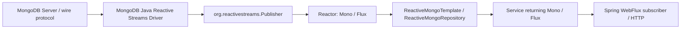
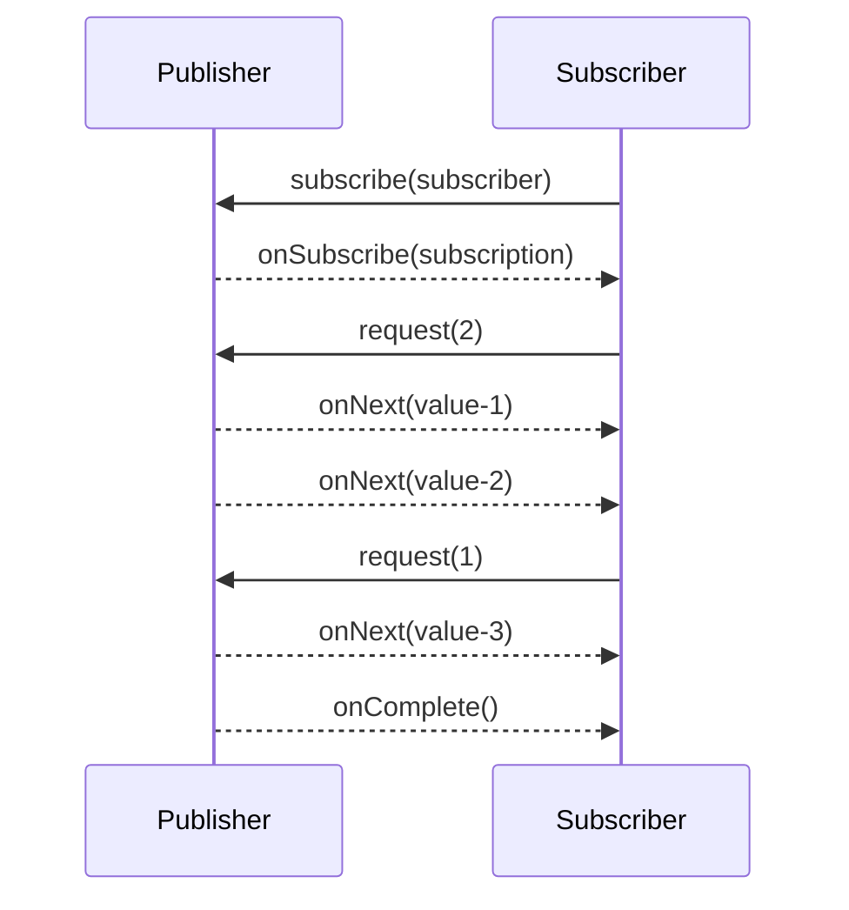

# MongoDB Reactive Streams Driver, Mono, Flux, and Subscription

In a Java application that needs to serve many concurrent I/O requests, **Spring Data MongoDB reactive** lets you describe MongoDB operations as a chain of Publishers rather than blocking a thread while waiting for results. The MongoDB Java Reactive Streams Driver provides Publishers conforming to the **Reactive Streams** specification; Project Reactor wraps those Publishers into an operator-rich API as **`Mono<T>`** and **`Flux<T>`**; `ReactiveMongoTemplate` and `ReactiveMongoRepository` add entity mapping, querying, and resource management in the Spring Data style.

The most important point: creating a `Mono` or `Flux` **does not mean MongoDB has already been called successfully**. With the **cold** Publishers provided by the MongoDB Reactive Streams Driver, the database command is triggered by a **subscription**. If nobody subscribes, the operation has not run yet. If you subscribe twice, the operation may be executed twice, causing an `insert` to raise a duplicate key error or a balance-mutating command to be applied repeatedly.

This lesson belongs to the **Reactive access** chapter of the `SPRING_DATA_MONGODB` module, which covers connecting, mapping documents, and operating on MongoDB through templates or repositories, as well as queries, aggregation, indexes, transactions, testing, and data performance diagnostics. This is the foundational lesson for distinguishing **Driver `Publisher`**, **Reactor `Mono`/`Flux`**, **subscription**, and **backpressure** before building a real WebFlux application or reactive service.

> **Remember:** Reactive does not mean MongoDB executes queries instantaneously, for free, or with automatic transaction guarantees. Reactive helps **avoid holding an application thread while waiting for I/O** and supports orchestrating asynchronous streams. You still need proper queries/indexes, tenant authorization, write error handling, transactions when required, and protection against duplicate subscriptions.

## 1. Learning Objectives

After this lesson, you will be able to:

1. Describe the four concepts in Reactive Streams: `Publisher`, `Subscriber`, `Subscription`, and `Processor`.
2. Explain the `onSubscribe`, `onNext`, `onError`, and `onComplete` signals and the rule against emitting `null`.
3. Distinguish `request(n)` from `cancel()`, and explain why `request(Long.MAX_VALUE)` represents unbounded demand.
4. Distinguish **cold** and **hot** Publishers, especially when a MongoDB command is subscribed to multiple times.
5. Use the MongoDB Java Reactive Streams Driver with `com.mongodb.reactivestreams.client.MongoClients`, `MongoCollection`, and `Publisher`.
6. Convert a Driver Publisher into `Flux.from(...)` or `Mono.from(...)` without turning a reactive API into a blocking one.
7. Choose the right `Mono<T>`, `Mono<Void>`, `Mono<Boolean>`, and `Flux<T>` according to the expected number of signals.
8. Understand the difference between **assembly time**, **subscription time**, and **signal time**.
9. Create entities with `@Document`/`@Field` and query them using `ReactiveMongoTemplate` and `ReactiveMongoRepository`.
10. Use `map`, `flatMap`, `concatMap`, `filter`, `switchIfEmpty`, `collectList`, and `then` according to their exact semantics.
11. Write a Spring WebFlux controller that **returns a Publisher** for the framework to subscribe to, without calling `subscribe()` manually in a service.
12. Understand that backpressure affects demand/cursors/batches, but does **not** replace indexes or limit server-side execution cost.
13. Handle errors with `onErrorResume`/`onErrorMap`/`retryWhen` without duplicating non-idempotent writes.
14. Explain cancellation, timeouts, `doFinally`, and why cancelling a subscription does not undo a write already accepted by the server.
15. Distinguish reactive I/O from offloading blocking work to `boundedElastic`.
16. Use `StepVerifier` and a dedicated test MongoDB instance to verify cold subscriptions, errors, empty results, and reactive CRUD.
17. Understand an overview of reactive transactions/context, observability, `Page<T>` limitations, and evaluate reactive versus imperative approaches.

## 2. Three-Layer Picture: MongoDB Driver → Reactor → Spring Data



The diagram illustrates **conceptual layers**: in the implementation, Spring Data works directly with the Driver and uses Reactor to expose the `Mono`/`Flux` API, not necessarily wrapping every object into an isolated single layer.

| Layer | Typical API | Role |
| --- | --- | --- |
| Reactive Streams Driver | `com.mongodb.reactivestreams.client.MongoCollection` | Sends MongoDB commands as Publishers without blocking the caller thread waiting for results |
| Reactive Streams | `Publisher<T>`, `Subscriber<T>`, `Subscription` | Contract for interaction, signals, and demand |
| Project Reactor | `Mono<T>`, `Flux<T>` | Composition operators, lifecycle, timeout/error/cancellation |
| Spring Data | `ReactiveMongoTemplate`, `ReactiveMongoRepository` | Java ↔ BSON mapping, query DSL, converters, exception translation |
| WebFlux | `Mono<ResponseEntity<T>>`, `Flux<T>` | HTTP integration, request lifecycle, and subscription |
| MongoDB Server | `find`, `aggregate`, `update`, index, transaction | Executes queries, stores data, and enforces server-side consistency guarantees |

**Do not confuse with the synchronous Driver:** `com.mongodb.client.MongoClients` returns a synchronous `MongoClient`, whereas `com.mongodb.reactivestreams.client.MongoClients` returns a reactive `MongoClient`. These are two different APIs despite nearly identical class names. Use the reactive client for reactive Spring Data; do not merely wrap the synchronous driver in a `Mono.just(...)` and call it non-blocking I/O.

## 3. Reactive Streams: The Publisher, Subscriber, Subscription Contract

The Reactive Streams specification defines how a source and a consumer exchange data asynchronously under **backpressure**.

```java
import org.reactivestreams.Publisher;
import org.reactivestreams.Subscriber;
import org.reactivestreams.Subscription;
```

Relationship:



Key signals:

| Signal | Direction | Meaning |
| --- | --- | --- |
| `subscribe(Subscriber)` | Consumer → Publisher | Registers the consumer |
| `onSubscribe(Subscription)` | Publisher → Subscriber | Provides the handle to request/cancel |
| `Subscription.request(n)` | Subscriber → Subscription | Allows emitting up to n new elements based on demand |
| `onNext(item)` | Publisher → Subscriber | A non-`null` element |
| `onError(Throwable)` | Publisher → Subscriber | Terminal failure |
| `onComplete()` | Publisher → Subscriber | Terminal success |
| `Subscription.cancel()` | Subscriber → Subscription | Requests stopping further delivery and cancelling processing as feasible |

**There is only one terminal signal:** `onComplete` **or** `onError`. After a terminal signal, no further `onNext` may be emitted. `request(n)` must pass a **positive** value; `request(0)`/`request(-1)` violates the protocol.

### 3.1. Backpressure Is Not Network Rate

Backpressure lets the consumer say “I can receive n more elements.” It does not guarantee that each `request(1)` corresponds to exactly **one MongoDB round trip**; the Driver/server have **cursor batching**, prefetching, and their own internal mechanisms. The rate at which signals are emitted is not the completion rate of every stage on the server.

### 3.2. No Null Emissions

Reactive Streams forbids `onNext(null)`. If a MongoDB query finds no matching document:

- `Mono<Product>` typically **completes empty**.
- `Flux<Product>` typically **completes with no items**.
- `Mono<Boolean>` from `exists` can emit `false` — this is a **value**, not empty.
- Do not use `Mono.just(null)`; Reactor's API rejects null. If a value may be null in imperative code, use `Mono.justOrEmpty(value)` to represent empty.

## 4. Mono and Flux: Different Signal Cardinalities

Project Reactor provides two primary abstractions:

| Type | Max `onNext` count | Example |
| --- | ---: | --- |
| `Mono<Product>` | 0 or 1 | `findById`, `findOne`, `insert` |
| `Mono<Long>` | 0 or 1 | `count` |
| `Mono<Boolean>` | 0 or 1 | `exists` |
| `Mono<Void>` | 0 | Operations that only signal complete/error |
| `Flux<Product>` | 0, 1, or many | `find`, `findAll`, `aggregate` |
| `Flux<ChangeStreamEvent<T>>` | Many, potentially long-lived | Change stream |

`Mono<Void>` does **not** emit a `Void` instance; it completes with no value. To know whether an operation succeeded, observe the terminal signal or map it to an outcome type in the service layer.

### 4.1. Reactor Example Without Database Access

```java
import reactor.core.publisher.Flux;
import reactor.core.publisher.Mono;

Flux<String> skus = Flux.just("BOOK", "PEN", "NOTE")
    .filter(sku -> !sku.equals("PEN"));

Mono<String> first = skus.next();
Mono<Long> numberOfMatches = skus.count();
Mono<java.util.List<String>> all = skus.collectList();
```

The operators above **describe** the pipeline. `first`, `numberOfMatches`, and `all` are **three separate Publishers**; when each is subscribed to individually, the upstream `skus` may run separately for each.

### 4.2. Mono Is Not a Future

`Mono` differs from `CompletableFuture`: a Mono is typically **lazy/cold** and supports error/cancel/backpressure per Reactive Streams. A `CompletableFuture` may start computing before any consumer registers. Do not convert every `Mono` into a `Future` and assume they share the same lifecycle.

## 5. Three Milestones: Assembly, Subscription, and Signals

```java
Mono<Product> findLater = repository.findById("P-100");
```

Explanation:

1. **Assembly time:** Java constructs the Publisher objects and operator chain.
2. **Subscription time:** a consumer registers; a cold source begins executing the command.
3. **Signal time:** the Publisher emits `onNext`/`onComplete` or `onError` when results arrive.

With the MongoDB Reactive Streams Driver, Publishers returned from Driver methods are **cold**; the corresponding command does not run unless subscribed to. Typical Spring Data reactive CRUD also has lazy/cold semantics via its underlying publisher. However, an operator or expression with a side effect evaluated at assembly time (for example, calling a Java method before constructing the Mono) still runs **immediately when Java executes that line** — so do not generalize that “everything on a line containing a Mono is lazy.”

Example:

```java
System.out.println("A: creating publisher");

Mono<String> pipeline = Mono.defer(() -> {
    System.out.println("B: starting subscription");
    return Mono.just("MongoDB");
}).map(value -> {
    System.out.println("C: processing signal");
    return value.toUpperCase();
});

System.out.println("D: not subscribed yet");
// A and D have already appeared; B/C have not run yet.

pipeline.subscribe(System.out::println);
// On subscribe: B, C, then MONGODB.
```

`Mono.defer` creates the inner publisher **on each subscription**, which is essential when you need a fresh timestamp, request state, random ID, or new input at execution time.

## 6. MongoDB Reactive Streams Driver: An Example from Scratch

You do not need `ReactiveMongoTemplate` to use the Driver directly. The Driver returns Reactive Streams `Publisher` instances.

```java
package dev.learning.reactive;

import com.mongodb.reactivestreams.client.MongoClient;
import com.mongodb.reactivestreams.client.MongoClients;
import com.mongodb.reactivestreams.client.MongoCollection;
import com.mongodb.client.model.Filters;
import org.bson.Document;
import reactor.core.publisher.Flux;
import reactor.core.publisher.Mono;

public class DriverReactiveExample {

    public static void main(String[] args) {
        String uri = System.getenv("MONGODB_URI");
        if (uri == null || uri.isBlank()) {
            throw new IllegalArgumentException(
                "MONGODB_URI is not configured");
        }

        try (MongoClient client = MongoClients.create(uri)) {
            MongoCollection<Document> collection = client
                .getDatabase("learning_reactive")
                .getCollection("training_products");

            Flux<Document> books = Flux.from(
                collection.find(Filters.eq("category", "BOOK"))
                    .limit(10)
            );

            // In a production reactive application, return/compose the Publisher;
            // main() only illustrates that a subscription is required.
            books.doOnNext(System.out::println)
                .then()
                .block();
        }
    }
}
```

**Warning about `block()`:** only use it in **CLI/main examples or tests running on normal threads** when you intentionally want to wait for completion. **Never** copy `.block()` into a WebFlux controller, event loop, or reactive request handler. Blocking does not turn the Driver into a synchronous driver, but it forces the caller thread to wait.

### 6.1. Package Names Matter

```java
// MongoDB Java Reactive Streams Driver:
com.mongodb.reactivestreams.client.MongoClient
com.mongodb.reactivestreams.client.MongoClients
com.mongodb.reactivestreams.client.MongoCollection

// MongoDB Java synchronous driver, different API:
com.mongodb.client.MongoClient
com.mongodb.client.MongoClients
com.mongodb.client.MongoCollection
```

When integrating the Spring Boot reactive starter, Spring Data manages `ReactiveMongoDatabaseFactory`/`ReactiveMongoTemplate` backed by the reactive driver. Do not create a new client **per request**; the client is a resource holding a connection pool and should be closed with the application lifecycle.

### 6.2. Driver Publisher → Reactor Adapters

```java
import org.bson.Document;
import com.mongodb.client.model.Filters;
import reactor.core.publisher.Flux;
import reactor.core.publisher.Mono;
import com.mongodb.client.result.InsertOneResult;

Flux<Document> found = Flux.from(
    collection.find(Filters.eq("tenant_id", "tenant-a"))
);

Mono<InsertOneResult> written = Mono.from(
    collection.insertOne(new Document("_id", "P-101")
        .append("tenant_id", "tenant-a")
        .append("category", "BOOK"))
);
```

`collection` is the MongoDB reactive `MongoCollection<Document>` from section 6. `Flux.from(...)` preserves multiple elements, while `Mono.from(...)` takes at most one element. With `find`, if you truly only want one document, **limit it server-side** using the Driver's `.first()` or `.limit(1)` when appropriate; do not use `Mono.from(collection.find(...))` and assume the Driver automatically optimizes every query into a server-side limit.

### 6.3. Driver Publishers Can Be Re-Subscribed

The MongoDB Driver documentation notes that returned Publishers are **cold** and recommends against subscribing repeatedly to a Publisher unintentionally. For reads, each subscription may query fresh data again. For writes, it can repeat the write and cause errors or mutate data twice.

```java
Mono<InsertOneResult> write = Mono.from(
    collection.insertOne(new Document("_id", "P-102"))
);

// Each subscription is an intent to execute the command:
// write.subscribe();
// write.subscribe(); // May cause a duplicate _id on the second attempt.
```

**Do not use `cache()` as a general mechanism to “guarantee exactly once” for writes**: caching is a signal-sharing policy within **a single process** and does not guarantee idempotency across process restarts, network retries, multiple pods, or duplicate client requests.

## 7. Subscription: Who Calls subscribe?

A reactive pipeline only actually runs when there is a **subscriber**:

```java
Mono<Product> pending = repository.findById("P-100");
// No subscriber yet: no results are consumed.
```

In a WebFlux application:

```java
@GetMapping("/products/{id}")
public Mono<Product> get(@PathVariable String id) {
    return repository.findById(id);
}
```

The controller **returns the Publisher** to Spring WebFlux; the framework manages subscription when serving the HTTP request. Services should only **compose/return** Publishers, not call `subscribe()` to “trigger” them.

### 7.1. Ways to Subscribe in Reactor

```java
// For illustrating the lifecycle in a CLI or test:
var disposable = pending.subscribe(
    product -> System.out.println("Found: " + product.id()),
    error -> System.err.println("Query failed: " + error),
    () -> System.out.println("Completed")
);

// If still running and you want to request cancellation:
disposable.dispose();
```

Default lambda `subscribe` overloads in Reactor typically request **unbounded demand**. In real applications, use framework-managed subscriptions so cancellation/error propagation and the HTTP lifecycle stay synchronized. Where manual subscription is unavoidable at an imperative boundary, manage the `Disposable` and provide an error consumer.

### 7.2. Fire-and-Forget Is a Common Anti-Pattern

```java
// NOT recommended in a reactive service:
public Mono<Void> saveBad(Product p) {
    repository.save(p).subscribe();
    return Mono.empty();
}
```

Flaw: the write Publisher runs on a detached branch with no link to the caller. The handler can return HTTP success **before the write completes**, and errors, cancellation, transactions, and retries cannot be managed.

Fix:

```java
public Mono<Void> saveGood(Product p) {
    return repository.save(p).then();
}
```

`then()` produces a `Mono<Void>` that completes **after upstream completes successfully**; if upstream errors, the error still propagates to the caller. It neither swallows errors nor emits the `Product` value.

### 7.3. Multiple Subscribers on One Publisher

```java
Mono<Product> lookup = repository.findById("P-100");

// Conceptual example:
// subscriber A -> find
// subscriber B -> find again
```

With a cold Publisher, two subscriptions are not guaranteed to see the same data because writes may occur in between. If code uses `.cache()` to reuse results, it may cache either a **stale value or a terminal error**, depending on the operator/options. Evaluate TTL and cache invalidation explicitly before caching database results.

## 8. Backpressure: request(n) and cancel()

```java
import org.reactivestreams.Subscription;
import reactor.core.publisher.BaseSubscriber;
import reactor.core.publisher.Flux;

Flux.range(1, 5).subscribe(new BaseSubscriber<Integer>() {

    @Override
    protected void hookOnSubscribe(Subscription subscription) {
        request(1);
    }

    @Override
    protected void hookOnNext(Integer value) {
        System.out.println("Received: " + value);
        request(1); // Only request the next element after processing.
    }

    @Override
    protected void hookOnError(Throwable throwable) {
        System.err.println("Error: " + throwable);
    }

    @Override
    protected void hookOnComplete() {
        System.out.println("Completed");
    }
});
```

`BaseSubscriber` is a Reactor helper for controlling demand. Each instance should be used for **a single subscription**. In the example, the subscription starts with `request(1)`, and after each `onNext`, increments demand by one.

### 8.1. Demand Does Not Mean “One Request = One Network Packet”

MongoDB has `batchSize`, network buffers, cursor fetching, and operator prefetching. `request(1)` may correspond to data already fetched in an underlying batch; demand limits the number of emitted signals per the contract, without promising that the server only reads one document or that the query only spends resources for a single item.

```java
Flux<Document> stream = Flux.from(
    collection.find(Filters.eq("tenant_id", "tenant-a"))
        .batchSize(100)
);
```

`batchSize(100)` suggests the server/cursor batch size—it is not `Flux.limitRate(100)` and not a total query limit. If you only need 20 documents, use `.limit(20)` **on the find publisher** or `Query.limit(20)` in Spring Data rather than relying solely on cancellation.

### 8.2. Unbounded Demand

```java
stream.subscribe(this::handleDocument);
```

In most lambda-based `subscribe` overloads, downstream requests `Long.MAX_VALUE`. That allows downstream to receive signals as fast as the producer/driver can emit them; avoid this in heavy batch processing without concurrency/memory bounds. Choose `concatMap`/`flatMap(concurrency)` and pagination/limits appropriate to the workload.

### 8.3. Backpressure Does Not Change the MongoDB Query Plan

Even with `request(1)`:

- MongoDB may still run `$sort` or `$group` across many documents before emitting the first row.
- An unselective filter can still scan a large amount of data.
- A missing index still causes `COLLSCAN`.
- `collectList()` still gathers all signals into RAM if unbounded.
- Some operators like `publishOn`/`flatMap` have prefetch queues that must be accounted for.

To optimize performance, use proper queries, server-side limits, indexes, projections, bounded concurrency, and inspect `explain`—do not treat backpressure as automatic server-side optimization.

## 9. Cancellation: Cancel Signal Is Not Data Rollback

```java
Flux<Product> requestScoped = repository.findAll()
    .doOnCancel(() -> System.out.println("Cancelled"))
    .doFinally(signal -> System.out.println("Done: " + signal));
```

When an HTTP client closes its connection or a consumer cancels the subscription, cancellation can **propagate up to the driver** to terminate the stream/cursor where supported. However:

- If an `insert` command has already been accepted by MongoDB, cancelling does not undo it.
- If an update has already executed but the response has not arrived yet, the outcome may be **uncertain** for the caller.
- `doOnCancel` runs only on a cancel signal, not on normal completion.
- `doFinally` runs on complete, error, or cancel with the corresponding `SignalType`.
- Do not use cancellation as a substitute for a transaction manager rollback; transaction behavior depends on boundaries and session management policies.

### 9.1. Timeout on a Publisher

```java
import java.time.Duration;

Mono<Product> guarded = repository.findById("P-100")
    .timeout(Duration.ofSeconds(2));
```

`timeout` enforces a time limit at the Reactor layer and can send cancellation upstream when exceeded. **It does not prove that the DB command was aborted on the server**, especially for writes. For long-running server-side queries, consider `maxTimeMS`/supported query timeout options and evaluate both deadlines and resource cleanup.

## 10. Spring Data: Entities, ReactiveMongoTemplate, and Repositories

From here on, we use a dedicated domain for the Spring Data examples:

```java
package dev.learning.reactive;

import org.springframework.data.annotation.Id;
import org.springframework.data.mongodb.core.mapping.Document;
import org.springframework.data.mongodb.core.mapping.Field;

@Document("training_products")
public record Product(
    @Id String id,
    @Field("tenant_id") String tenantId,
    String sku,
    String category,
    boolean active,
    int stock) {
}
```

`@Field("tenant_id")` maps the Java property `tenantId` to the BSON field `tenant_id`; `@Id` typically maps `id` to `_id`. The Spring Data examples will query using **Java property names**, except where raw BSON Driver calls are used.

### 10.1. ReactiveMongoTemplate

```java
import org.springframework.data.mongodb.core.ReactiveMongoTemplate;
import org.springframework.data.mongodb.core.query.Criteria;
import org.springframework.data.mongodb.core.query.Query;
import reactor.core.publisher.Flux;
import reactor.core.publisher.Mono;

Query query = Query.query(
    Criteria.where("tenantId").is("tenant-a")
        .and("category").is("BOOK")
);

Flux<Product> books =
    reactiveMongoTemplate.find(query, Product.class);

Mono<Product> one =
    reactiveMongoTemplate.findById("P-100", Product.class);

Mono<Boolean> exists =
    reactiveMongoTemplate.exists(query, Product.class);

Mono<Long> count =
    reactiveMongoTemplate.count(query, Product.class);
```

`reactiveMongoTemplate` is a Spring Data bean injected into the service; the snippet illustrates the call site. `find` returns `Flux<Product>`, while `findById` returns `Mono<Product>`. `count` executes a **MongoDB count query**, unlike `reactiveMongoTemplate.find(...).count()` which has to consume every row from the find Publisher.

### 10.2. ReactiveMongoRepository

```java
package dev.learning.reactive;

import org.springframework.data.domain.Sort;
import org.springframework.data.mongodb.repository.ReactiveMongoRepository;
import reactor.core.publisher.Flux;

public interface ProductRepository
        extends ReactiveMongoRepository<Product, String> {

    Flux<Product> findByTenantIdAndActiveTrue(
        String tenantId, Sort sort);

    Flux<Product> findByTenantIdAndCategory(
        String tenantId, String category);
}
```

`ReactiveMongoRepository` provides `findById`, `findAll`, `insert`, `save`, `deleteById`, `count`, `existsById`, and suitable derived queries. Methods accepting `Sort`/`Pageable` can limit results depending on the API, but **reactive repositories do not provide a `Page<T>` return type in the same way imperative repositories do**, because the count and page content are separate Publishers that must be coordinated explicitly.

### 10.3. Using Mono/Flux Appropriately by Meaning

```java
Mono<Product> idLookup = repository.findById("P-100");

Flux<Product> activeProducts = repository
    .findByTenantIdAndActiveTrue(
        "tenant-a",
        org.springframework.data.domain.Sort.by("sku", "id")
    );

Mono<Long> total = repository.count();
Mono<Boolean> present = repository.existsById("P-100");
```

`repository.count()` in the last example counts **the entire collection**, without automatically scoping by tenant. For multi-tenant APIs, declare `countByTenantId` or use `ReactiveMongoTemplate.count(Query, Product.class)` with a tenant filter. Likewise, `findById(id)` does not automatically enforce tenant scoping in the query.

### 10.4. Queries with Paging and Field Mapping

```java
import org.springframework.data.domain.Sort;
import org.springframework.data.mongodb.core.query.Query;

Query limited = Query.query(
    Criteria.where("tenantId").is("tenant-a")
        .and("active").is(true)
).with(Sort.by(Sort.Order.asc("sku"), Sort.Order.asc("id")))
 .limit(20);

Flux<Product> firstTwenty =
    reactiveMongoTemplate.find(limited, Product.class);
```

`limit(20)` lets the server avoid returning more than 20 documents for the query result. Sorting by `sku,id` creates a more stable ordering than `sku` alone, though you still need an appropriate index/query plan and consistency strategy if data changes between pages.

## 11. Composition: map, flatMap, concatMap, and then

### 11.1. map: Synchronous Transformation of a Value

```java
Mono<String> sku = repository.findById("P-100")
    .map(Product::sku);
```

`map` is suitable when the function returns a **plain value**; if you need to call another reactive DB/API and return a `Mono`/`Flux`, use `flatMap`.

### 11.2. flatMap: Asynchronous Chaining

```java
Mono<Product> savedAndReloaded =
    repository.insert(
        new Product("P-201", "tenant-a", "BK-201",
            "BOOK", true, 10))
    .flatMap(inserted ->
        repository.findById(inserted.id())
    );
```

The reload command is only subscribed after the insert emits `Product`. If the insert fails with a duplicate ID, `flatMap` does not run. However, the overall publisher is still **cold**: subscribing twice can run the insert twice.

### 11.3. concatMap and flatMap Over Multiple Items

```java
Flux<Product> stored = Flux.fromIterable(incomingProducts)
    .concatMap(repository::insert);
```

`concatMap` processes inner Publishers sequentially and avoids overlapping inserts in this example. `flatMap` can run multiple inner Publishers concurrently and finish out of input order:

```java
Flux<Product> concurrent = Flux.fromIterable(incomingProducts)
    .flatMap(repository::insert, 4); // At most 4 inner subscriptions.
```

`incomingProducts` is a validated input collection. **Do not treat `concatMap` as a transaction**: if the third insert fails, the first two inserts may already be committed; if you need multi-document atomicity, use a proper reactive transaction.

### 11.4. then, thenReturn, and collectList

```java
Mono<Void> done = repository.save(product).then();

Mono<String> successMessage =
    repository.save(product).thenReturn("Written");

Mono<java.util.List<Product>> list =
    repository.findByTenantIdAndCategory(
        "tenant-a", "BOOK").collectList();
```

- `then()` discards upstream values and preserves completion/error.
- `thenReturn(...)` emits the new value only if upstream completes successfully.
- `collectList()` collects **all** elements into memory; only use it when the dataset is already bounded or has a clear business limit.
- Do not replace `repository.count()` with `repository.findAll().collectList().map(List::size)` on a large collection.

## 12. Distinguishing Empty, Success, and Error

A `Mono<Product>` returned from an ID lookup can terminate in three ways:

| Scenario | Signals | Meaning |
| --- | --- | --- |
| Document found | `onNext(product) → onComplete` | Success, with result |
| Document missing | `onComplete`, no `onNext` | Empty result, not a DB error |
| MongoDB error | `onError(exception)` | Failure; must not be arbitrarily converted to empty |

Use `switchIfEmpty` to convert an empty result into a business error:

```java
import org.springframework.web.server.ResponseStatusException;
import org.springframework.http.HttpStatus;

Mono<Product> response = repository.findById("P-100")
    .switchIfEmpty(Mono.error(
        new ResponseStatusException(
            HttpStatus.NOT_FOUND, "Product not found")));
```

For multi-tenant APIs, the `findById` example is illustrative only; add a tenant predicate matching the authenticated identity.

`Mono.just(null)` is invalid because Reactive Streams forbids emitting null. You can use `Mono.justOrEmpty(nullableValue)` to represent an optional result, though for standard MongoDB queries the framework already emits empty when nothing is found.

### 12.1. onErrorResume Is Not for Handling Empty

```java
Mono<Product> unsafe = repository.findById("P-100")
    .onErrorResume(error -> Mono.empty());
```

This is an anti-pattern: connection losses or authorization failures are turned into “document not found,” making the API return false 404s. If you only want to handle empty, use `switchIfEmpty`; if recovering from an error, filter for **specific recoverable exceptions**. `doOnError` only observes, `onErrorMap` transforms the error, and `onErrorResume` substitutes another Publisher.

### 12.2. defaultIfEmpty

```java
Mono<String> category = repository.findById("P-100")
    .map(Product::category)
    .defaultIfEmpty("UNKNOWN");
```

Use a fallback value only when business rules allow it, never to hide query failures.

## 13. Repeated Subscriptions on a Write Publisher

With the MongoDB Reactive Streams Driver, Publishers are **cold**. Each subscription can send a new DB command.

```java
Product p = new Product(
    "P-UNIQUE", "tenant-a", "BK-UNIQUE", "BOOK", true, 10);

Mono<Product> write = repository.insert(p);

// First subscription: insert succeeds.
// Second subscription: the same _id is inserted again -> duplicate key.
```

A second insert with the same ID usually emits `DuplicateKeyException` via Spring Data exception translation. The error occurs **as a Publisher signal**, not necessarily thrown when `repository.insert(p)` is called.

With an update using `$inc`, the issue is even more serious:

```java
import org.springframework.data.mongodb.core.query.Update;

Mono<?> decrement = reactiveMongoTemplate.updateFirst(
    Query.query(Criteria.where("id").is("P-100")),
    new Update().inc("stock", -1),
    Product.class
);
```

If two valid subscriptions occur and the filter still matches, stock can be decremented **twice**. Do not treat the variable name `decrement` or `Mono` as an exactly-once guarantee.

### 13.1. Do Not Solve Exactly-Once with cache()

`cache()` shares and replays signals of a Publisher within **the scope of an object/process** depending on the operator. It does not handle client retries, restarts, multiple service instances, or cases where the server applied a write whose response was lost. For writes, design an **idempotency key**, unique constraint, CAS/version check, or transaction according to business rules.

## 14. Retry and Timeout: What Does Resubscription Do?

`retryWhen` re-subscribes to upstream according to a policy:

```java
import java.time.Duration;
import reactor.util.retry.Retry;

// isRetryableReadFailure is the application's error classification function.
Mono<Product> readWithRetry = repository.findById("P-100")
    .retryWhen(
        Retry.backoff(2, Duration.ofMillis(100))
             .filter(this::isRetryableReadFailure)
    );
```

This pattern is suited for **reads**, where retrying is safe to allow. Do not retry every exception: bad queries, unauthorized errors, validation errors, or duplicate keys usually will not resolve on retry.

### 14.1. Timeout Does Not Prove a Write Did Not Execute

```java
Mono<Product> limited = repository.findById("P-100")
    .timeout(Duration.ofSeconds(2));
```

At the Reactor layer, `timeout` terminates the Publisher with an error and cancels upstream as feasible. However, for a **write**, MongoDB may have already applied the change before the caller saw the timeout. Retrying an `$inc` or non-idempotent payment write can duplicate the outcome.

**Driver retryable writes** are a separate protocol/server feature and do not mean the application can blindly apply `retryWhen` to an entire workflow. Design `requestId` and reconciliation for commands with business side effects.

### 14.2. Retrying a Chain Containing Side Effects

```java
Mono<Void> process = repository.insert(order)
    .then(emailService.sendConfirmation(order))
    .then();
```

This is an **illustration**, where `order` and `emailService` are application-defined. Retrying the entire chain can send the email twice or fail the insert with a duplicate ID. Consider transactional outbox, idempotent consumers, and explicit retry boundaries.

## 15. flatMap Concurrency, Ordering, and Memory

| Operator | Meaning | Warning |
| --- | --- | --- |
| `map` | Synchronous transformation | Do not call blocking APIs inside `map` |
| `flatMap` | Merges inner Publishers, may run concurrently | Output order is not guaranteed to match source order |
| `flatMap(fn, 4)` | Limits to 4 concurrent inner subscriptions | Does not limit total load across multiple requests |
| `concatMap` | Executes inner Publishers sequentially | Slower when tasks are independent |
| `flatMapSequential` | Concurrent execution with ordered output | May buffer to preserve order |
| `buffer(100)` | Groups up to 100 elements per batch | Increases memory proportional to batch size |
| `collectList` | Collects all items | Dangerous with an unbounded Flux |
| `take(20)` | Takes 20 signals on the client | Does not replace a server-side limit |
| `limitRate(100)` | Shapes demand sent upstream | Does not make the MongoDB query cheaper |

```java
Flux<Product> inserted = Flux.fromIterable(incomingProducts)
    .flatMap(repository::insert, 4);
```

`incomingProducts` is a validated list. For order-dependent business logic, use `concatMap` instead of `flatMap`. Within a transaction on **the same MongoDB ClientSession**, do not launch concurrent operations arbitrarily; sessions/transactions have their own concurrency restrictions.

### 15.1. Flux Does Not Make $group/$sort Memory-Free

`$group`/`$sort` may need to process a huge number of documents **on the MongoDB Server** before emitting the first row. Client-side backpressure is no substitute for `explain`, indexes, `$match`, projections, server-side limits, and monitoring.

## 16. WebFlux: Return a Publisher for the Framework to Subscribe

An interface providing the tenant from the **authenticated principal**:

```java
package dev.learning.reactive;

import reactor.core.publisher.Mono;

public interface AuthorizedTenantProvider {
    Mono<String> currentTenant();
}
```

Add to `ProductRepository` from section 10:

```java
import reactor.core.publisher.Mono;

Mono<Product> findByTenantIdAndId(String tenantId, String id);
```

WebFlux Controller:

```java
package dev.learning.reactive;

import org.springframework.data.domain.Sort;
import org.springframework.http.HttpStatus;
import org.springframework.web.bind.annotation.GetMapping;
import org.springframework.web.bind.annotation.PathVariable;
import org.springframework.web.bind.annotation.RequestMapping;
import org.springframework.web.bind.annotation.RestController;
import org.springframework.web.server.ResponseStatusException;
import reactor.core.publisher.Flux;
import reactor.core.publisher.Mono;

@RestController
@RequestMapping("/products")
public class ProductController {

    private final ProductRepository repository;
    private final AuthorizedTenantProvider tenants;

    public ProductController(
            ProductRepository repository,
            AuthorizedTenantProvider tenants) {
        this.repository = repository;
        this.tenants = tenants;
    }

    @GetMapping
    public Flux<Product> active() {
        return tenants.currentTenant()
            .flatMapMany(tenant ->
                repository.findByTenantIdAndActiveTrue(
                    tenant, Sort.by("sku", "id")));
    }

    @GetMapping("/{id}")
    public Mono<Product> one(@PathVariable String id) {
        return tenants.currentTenant()
            .flatMap(tenant ->
                repository.findByTenantIdAndId(tenant, id))
            .switchIfEmpty(Mono.error(
                new ResponseStatusException(
                    HttpStatus.NOT_FOUND,
                    "Product not found")));
    }
}
```

Spring WebFlux acts as the **subscriber** at the HTTP boundary; the controller/service returns the Publisher and does not call `subscribe()` internally. `AuthorizedTenantProvider` is an illustrative application abstraction, not a built-in Spring class.

### 16.1. JSON Arrays and Streaming

Returning a `Flux<Product>` with `application/json` does not automatically let a browser receive each document immediately: the encoder or client may buffer it to construct a JSON array.

When you need to stream records one by one, use NDJSON/SSE with the corresponding protocol, for example a method in the same controller:

```java
@GetMapping(
    value = "/stream",
    produces = org.springframework.http
        .MediaType.APPLICATION_NDJSON_VALUE)
public Flux<Product> streamActive() {
    return tenants.currentTenant()
        .flatMapMany(tenant ->
            repository.findByTenantIdAndActiveTrue(
                tenant, Sort.by("sku", "id")));
}
```

Do not expose unbounded streams over sensitive collections: enforce resource limits, tenant checks, and cancellation handling. A WebFlux client disconnect can cancel upstream, but does not roll back writes already accepted by the server.

## 17. Do Not block() on the Event Loop

Wrong:

```java
@GetMapping("/blocking/{id}")
public Product blocking(@PathVariable String id) {
    return repository.findById(id).block();
}
```

`block()` waits for the result on the caller thread. In a reactive handler, this breaks non-blocking I/O and Reactor may throw an error when blocking on threads marked non-blocking. Return a Publisher instead:

```java
@GetMapping("/nonblocking/{id}")
public Mono<Product> nonblocking(@PathVariable String id) {
    return repository.findById(id);
}
```

### 17.1. When a Blocking SDK Is Unavoidable

```java
import reactor.core.scheduler.Schedulers;

Mono<String> legacy = Mono.fromCallable(
    () -> legacyClient.fetchValue())
    .subscribeOn(Schedulers.boundedElastic());
```

`legacyClient` is an application-provided blocking SDK. `boundedElastic` merely shifts the blocking work to a bounded scheduler; it **does not make the SDK non-blocking**. Do not wrap `reactiveMongoTemplate.find` with `boundedElastic` thinking it becomes “more reactive”: the Driver already provides non-blocking I/O.

### 17.2. Schedulers and Context

`publishOn` changes the execution scheduler for downstream operators, while `subscribeOn` affects scheduling at the source/upstream. Do not try to fix slow MongoDB queries by adding arbitrary schedulers; use `explain` and indexes.

A reactive request can hop across threads, so a custom `ThreadLocal` is not a reliable way to propagate tenant, tracing, or transaction state. Use Reactor Context and the appropriate Spring Security / transaction manager integrations.

## 18. Tenant Security and Reactive Context

Even if a repository returns a `Flux`, a method such as:

```java
repository.findById(requestedId)
```

does not automatically enforce tenant authorization. For multi-tenant data, use:

```java
repository.findByTenantIdAndId(
    authorizedTenant, requestedId)
```

and ensure `authorizedTenant` comes from a server-side identity. The reactive security context must be propagated/read along the chain appropriately; never trust unauthenticated client-supplied headers or query parameters.

**Reactor Context does not automatically create a MongoDB ClientSession.** For transactions, you need `ReactiveMongoTransactionManager`, `ReactiveMongoTemplate.withSession`, or an equivalent transaction boundary.

## 19. Reactive Transactions: Compose Within the Same Publisher Chain

MongoDB supports multi-document transactions on a compatible topology. With reactive Spring Data:

```java
package dev.learning.reactive;

import org.springframework.context.annotation.Bean;
import org.springframework.context.annotation.Configuration;
import org.springframework.data.mongodb.ReactiveMongoDatabaseFactory;
import org.springframework.data.mongodb.ReactiveMongoTransactionManager;

@Configuration
class ReactiveTransactionConfiguration {

    @Bean
    ReactiveMongoTransactionManager mongoReactiveTx(
            ReactiveMongoDatabaseFactory factory) {
        return new ReactiveMongoTransactionManager(factory);
    }
}
```

Using `TransactionalOperator`:

```java
import org.springframework.transaction.reactive.TransactionalOperator;

TransactionalOperator tx =
    TransactionalOperator.create(mongoReactiveTxManager);

// AuditEvent and mongoReactiveTxManager are objects
// the application must declare/configure.
Mono<Void> operation = reactiveMongoTemplate
    .insert(new AuditEvent("EV-1", "STARTED"))
    .then(reactiveMongoTemplate
        .insert(new AuditEvent("EV-2", "FINISHED")))
    .then()
    .as(tx::transactional);
```

This example illustrates the transaction concept, not production payment-processing code. `AuditEvent` is an application-defined domain type; use random IDs/idempotency in real systems. `.as(tx::transactional)` wraps both operations without calling `subscribe()` mid-chain. The Publisher must be subscribed to for the transaction to run.

### 19.1. Concurrent Operations Are Not Automatically Transactional

`Mono.when(insertA, insertB)` can subscribe concurrently; `when` itself does **not** create a transaction. Once inside a transaction sharing a `ClientSession`, avoid executing operations on the same session concurrently if the driver/server do not support it; chain sequentially with `then`/`flatMap` as required.

### 19.2. @Transactional and Reactor Context

In reactive applications, transaction state is stored and propagated through **Reactor Context**, unlike the imperative `ThreadLocal` commonly seen in Servlet apps. Reactive methods must return a Publisher and be invoked through the appropriate Spring proxy mechanism; an inner manual `subscribe` can escape the caller's transaction. Use the same `ReactiveMongoDatabaseFactory` across both the template and the transaction manager.

## 20. Reactive Aggregation and Count

`ReactiveMongoTemplate.aggregate` returns `Flux<T>`:

```java
import org.springframework.data.mongodb.core.aggregation.Aggregation;

Aggregation pipeline = Aggregation.newAggregation(
    Aggregation.match(
        Criteria.where("tenantId").is(authorizedTenant)),
    Aggregation.group("category")
        .count().as("productCount")
);

Flux<org.bson.Document> grouped =
    reactiveMongoTemplate.aggregate(
        pipeline, Product.class, org.bson.Document.class);
```

Even though it returns a `Flux`, `$group` on the server can still be a blocking stage consuming significant memory. Never judge query performance solely from the Java return type.

### 20.1. Server-Side Count vs Flux.count

```java
Mono<Long> efficient = reactiveMongoTemplate.count(
    Query.query(
        Criteria.where("tenantId").is(authorizedTenant)),
    Product.class
);

Mono<Long> streamingCount = reactiveMongoTemplate.find(
    Query.query(
        Criteria.where("tenantId").is(authorizedTenant)),
    Product.class
).count();
```

The first approach sends a count query to MongoDB; the second consumes every document from `find` and counts signals in Reactor, wasting bandwidth and object mapping. When you only need the total count, choose server-side count.

## 21. StepVerifier: A Subscriber for Testing

`reactor-test` provides `StepVerifier` to trigger subscription and assert each signal.

```java
package dev.learning.reactive;

import org.junit.jupiter.api.Test;
import reactor.core.publisher.Flux;
import reactor.core.publisher.Mono;
import reactor.test.StepVerifier;

class ReactiveBasicsTest {

    @Test
    void oneValue() {
        StepVerifier.create(Mono.just("BOOK"))
            .expectNext("BOOK")
            .verifyComplete();
    }

    @Test
    void emptyValue() {
        StepVerifier.create(Mono.<String>empty())
            .verifyComplete();
    }

    @Test
    void errorSignal() {
        StepVerifier.create(
            Mono.error(new IllegalStateException("failure")))
            .expectError(IllegalStateException.class)
            .verify();
    }

    @Test
    void manyValues() {
        StepVerifier.create(Flux.just("BOOK", "PEN"))
            .expectNext("BOOK", "PEN")
            .verifyComplete();
    }
}
```

`StepVerifier.create` is a test subscriber. Do not write `assertThat(publisher).isNotNull()` and conclude the database query ran; a Publisher can be valid without ever having been subscribed to.

### 21.1. Testing Demand

```java
@Test
void requestsOneByOne() {
    StepVerifier.create(Flux.just("BOOK", "PEN"), 0)
        .thenRequest(1)
        .expectNext("BOOK")
        .thenRequest(1)
        .expectNext("PEN")
        .verifyComplete();
}
```

Initial request = 0; two `thenRequest(1)` calls allow receiving two items. This tests the protocol, **not** the number of MongoDB network round trips.

### 21.2. Testing Cancellation

```java
@Test
void cancels() {
    StepVerifier.create(Flux.range(1, 100), 0)
        .thenRequest(2)
        .expectNext(1, 2)
        .thenCancel()
        .verify();
}
```

Cancellation does not equate to rolling back writes already committed to the database.

## 22. Integration Testing with Real MongoDB

Use a **dedicated test MongoDB** instance (a test URI or Testcontainers matching your dependencies) and UUID-based IDs/tenants. Never call `deleteAll` on a collection that might belong to another environment.

```java
package dev.learning.reactive;

import static org.assertj.core.api.Assertions.assertThat;

import java.util.UUID;
import org.junit.jupiter.api.Test;
import org.springframework.beans.factory.annotation.Autowired;
import org.springframework.boot.test.context.SpringBootTest;
import org.springframework.dao.DuplicateKeyException;
import org.springframework.data.domain.Sort;
import reactor.core.publisher.Mono;
import reactor.test.StepVerifier;

@SpringBootTest
class ReactiveProductIntegrationTest {

    @Autowired ProductRepository repository;

    Product sample() {
        String suffix = UUID.randomUUID().toString();
        return new Product(
            "P-" + suffix, "tenant-test-" + suffix,
            "SKU-" + suffix, "BOOK", true, 10);
    }

    @Test
    void insertAndQueryAreLazyUntilSubscribed() {
        Product product = sample();
        Mono<Product> insert = repository.insert(product);

        StepVerifier.create(insert.flatMap(saved ->
            repository.findByTenantIdAndId(
                saved.tenantId(), saved.id())))
            .assertNext(found -> {
                assertThat(found.id()).isEqualTo(product.id());
                assertThat(found.sku()).isEqualTo(product.sku());
            })
            .verifyComplete();
    }

    @Test
    void secondSubscriptionToInsertHasDifferentOutcome() {
        Product product = sample();
        Mono<Product> insert = repository.insert(product);

        StepVerifier.create(insert)
            .expectNextMatches(p -> p.id().equals(product.id()))
            .verifyComplete();

        StepVerifier.create(insert)
            .expectError(DuplicateKeyException.class)
            .verify();
    }

    @Test
    void notFoundIsEmpty() {
        StepVerifier.create(
            repository.findById("missing-" + UUID.randomUUID()))
            .verifyComplete();
    }

    @Test
    void findManyPreservesRequestedSort() {
        String suffix = UUID.randomUUID().toString();
        String tenant = "tenant-test-" + suffix;

        Product a = new Product(
            "P-A-" + suffix, tenant, "A", "BOOK", true, 2);
        Product b = new Product(
            "P-B-" + suffix, tenant, "B", "BOOK", true, 4);

        var rows = repository.insert(a)
            .then(repository.insert(b))
            .thenMany(repository.findByTenantIdAndActiveTrue(
                tenant, Sort.by("sku", "id")));

        StepVerifier.create(rows)
            .assertNext(p -> assertThat(p.sku()).isEqualTo("A"))
            .assertNext(p -> assertThat(p.sku()).isEqualTo("B"))
            .verifyComplete();
    }
}
```

### 22.1. Why Testing Two Subscriptions Is Essential

With a fixed UUID `_id` in the test, the first insert succeeds while the second raises a duplicate key error from MongoDB. Through `ReactiveMongoRepository`, Spring Data normally translates this to `DuplicateKeyException`. If a specific version uses a different subtype, check the actual exception hierarchy.

This test proves there is **no exactly-once guarantee just because a variable is a `Mono`**; it is not a production retry pattern.

### 22.2. Testing Mapping and Tenant Scope

Tests filtering by tenant ensure the repository only emits documents belonging to that tenant. A dedicated test should assert that `@Field("tenant_id")` maps properly to raw BSON via `ReactiveMongoTemplate`/Driver monitoring. A Reactor test over `Flux.just(...)` does not verify MongoDB field mapping.

## 23. Testing Cancellation Without Sleeping

You can use `doFinally` and `StepVerifier` on a simple `Flux`:

```java
import java.util.concurrent.atomic.AtomicReference;
import reactor.core.publisher.SignalType;

@Test
void cancellationIsObservable() {
    AtomicReference<SignalType> terminal =
        new AtomicReference<>();

    Flux<Integer> stream = Flux.range(1, 100)
        .doFinally(terminal::set);

    StepVerifier.create(stream, 0)
        .thenRequest(1)
        .expectNext(1)
        .thenCancel()
        .verify();

    assertThat(terminal.get()).isEqualTo(SignalType.CANCEL);
}
```

This method goes **inside a test class with `assertThat`/`StepVerifier` and `Test` imported**. The test does not prove that the MongoDB server immediately aborts an in-flight write; it only verifies the `Flux` lifecycle.

Avoid `Thread.sleep(100)` followed by asserting DB completion: timing-based tests are flaky in CI. Use `StepVerifier`, deterministic fixtures, and command monitoring when you need to confirm a command was sent.

## 24. Observability and Performance Optimization

Metrics worth tracking:

- Subscription rate, completion/error/cancel rate.
- MongoDB latency for `find`/`insert`/`aggregate`/`update` at p50/p95/p99.
- Driver connection pool usage, requests waiting for a connection, server selection timeouts.
- Query plans (`IXSCAN`/`COLLSCAN`), keys/docs examined, index hit rate.
- Server CPU, blocking `$group`/`$sort`, memory spill, and replication lag.
- Reactor concurrency/prefetch queues and `collectList` allocations.
- Rate of retries, duplicate-key errors, uncertain writes, and timeouts.
- HTTP client disconnects, cancellations, and response streaming payload.
- Tenant scope and tracing/correlation IDs across reactive context.

`CommandListener` can help verify when `find`/`insert` commands actually start, but never log raw production BSON containing PII or secrets. `StepVerifier` verifies the **signal contract**; `CommandListener` and `explain` verify the **commands/query plan**.

### 24.1. Reactive Does Not Replace Indexing

`Flux<Product>` does not make an unindexed query fast. Use `Query.limit`, sorting/field projections, compound indexes matching tenant/query predicates, and suitable pagination strategies. When using `$sort`/`$group`, backpressure does not reduce blocking work on the server.

## 25. Choosing Reactive or Imperative?

| Criterion | Reactive | Imperative |
| --- | --- | --- |
| Result API | `Mono`/`Flux` | Object/`List`/`Optional` |
| I/O wait handling | Application threads can be released | Caller thread typically waits |
| Typical web stack | WebFlux | Spring MVC |
| Code structure | Operator chains, context, subscription | Sequential control flow |
| Cancellation/backpressure | Reactive Streams protocol | Custom cursor/iterator/timeouts |
| Transactions | Reactive manager/Context | `MongoTransactionManager` |
| Query work on MongoDB | Still MongoDB server | Still MongoDB server |
| Indexes/schema/authorization | Still required | Still required |
| Testing | `StepVerifier` + integration | JUnit + integration |
| Benefit | High concurrent I/O, end-to-end non-blocking | Simpler for traditional blocking code |

Reactive is not inherently faster for **CPU-bound** tasks or when everything downstream is still a blocking SDK. If a system already has a synchronous repository and merely creates `Mono.just(blockingRepository.find(...))`, the blocking call already happened **before the Mono was created**. For temporary integration, wrap it in controlled `Mono.fromCallable(...).subscribeOn(boundedElastic())`; when architecture allows, migrate to the real reactive Driver.

## 26. Common Pitfalls and Fixes

| Pitfall | Cause | Fix |
| --- | --- | --- |
| Publisher created but DB unchanged | No subscription | Return/compose for the framework |
| Double subscription causes duplicate key | Cold write publisher executed twice | Enforce a single execution path and idempotency |
| `subscribe()` inside service returning empty | Fire-and-forget, lost errors/cancel | Return the publisher |
| `block()` in WebFlux | Blocks event loop | Return `Mono`/`Flux` |
| `Mono.just(syncDao.find())` still blocks | Sync call runs at assembly time | Use reactive driver or `boundedElastic` boundary |
| `Mono.just(null)` throws | Null signals are illegal | `justOrEmpty`/`Mono.empty` |
| Empty Mono treated as DB error | Confusing empty with error | `switchIfEmpty` |
| `onErrorResume` turning all errors into empty | Swallows system errors | Catch specific error types |
| `retryWhen` on `$inc` decrements twice | Write resubscription | Idempotency key |
| `collectList` on unbounded Flux | Out of memory | Limit/paging/streaming |
| `request(1)` yet query is still slow | Server scan/group, cursor batches | `explain`/index/projection |
| Treating `take(20)` as query limit | Client cancels after 20 signals | `Query.limit(20)` |
| Missing tenant predicate | Repository does not enforce authorization automatically | `findByTenantIdAndId` |
| `Mono.when` in multi-write transaction | Inner operations run concurrently | Chain sequentially |
| Separate `subscribe` inside transaction | Loses Reactor Context | Compose into a single Publisher |
| JSON Flux gets buffered | HTTP format/codec | NDJSON/SSE |
| Treating timeout as rollback | Write may already be applied | Transaction/idempotency |
| Creating `MongoClient` per request | Connection pool overhead/leak | Singleton bean, close on shutdown |
| Test only asserts `Publisher != null` | No subscription | `StepVerifier` |
| Reactive query missing index | Non-blocking does not optimize queries | Index/`explain` |

### 26.1. Debugging Checklist

1. Is there a subscriber yet, and who is subscribing?
2. How many times is the Publisher subscribed to?
3. Is the Reactive Streams Driver imported from the right package rather than the sync driver?
4. Is the Mono succeeding, completing empty, or erroring?
5. Are there any `subscribe()` calls in services or `block()` calls on the event loop?
6. Do tenant predicates and field mappings match the actual BSON names?
7. Does the query have server-side limit/sort/index?
8. Could a retry or timeout duplicate a write?
9. Do the reactive transaction/context cover the entire operation?
10. Have you verified with `StepVerifier` and `CommandListener`?

## 27. Practice Exercises

**Exercise 1.** Explain the sequence `Publisher.subscribe → onSubscribe → request → onNext → onComplete`. When is `onError` emitted?

**Exercise 2.** Create `Flux.just("BOOK","PEN")` and `Mono.just("BOOK")`; use `StepVerifier` to assert the signal counts.

**Exercise 3.** Create a Driver `insertOne` Mono without subscribing. Is any write guaranteed to have executed?

**Exercise 4.** Subscribe twice to a cold insert Publisher with a fixed `_id`; predict the outcome on the second subscription.

**Exercise 5.** Use `BaseSubscriber` with `request(1)` to process elements one by one. Why does this not mean one network round trip per document?

**Exercise 6.** Fix `repository.save(p).subscribe(); return Mono.empty()` so completion/error propagates properly to the caller.

**Exercise 7.** Distinguish `switchIfEmpty` and `onErrorResume` when a GET returns 404 or MongoDB times out.

**Exercise 8.** Create a repository method that finds products by tenant and category, returning a `Flux` sorted by `sku,id`.

**Exercise 9.** With 100 inserts, compare `concatMap` and `flatMap(...,4)` regarding ordering and the risk of partial writes.

**Exercise 10.** Replace `Mono.just(blockingDao.find())` with the reactive driver, or isolate the blocking call on `boundedElastic`.

**Exercise 11.** Given an `$inc` that times out, analyze why retrying the Publisher can decrement stock twice; propose an idempotency key.

**Exercise 12.** Explain the difference between returning a `Flux` with `application/json` versus NDJSON.

**Exercise 13.** Compose two reactive inserts into a `TransactionalOperator` without calling an inner `subscribe`.

**Exercise 14.** Write `StepVerifier` tests for Mono success, empty, error; and a Flux with two values, initial demand 0 followed by `request(1)`.

**Exercise 15.** Using a dedicated test MongoDB instance, UUID IDs, and Spring Data mapping, verify `tenant_id`, insert, and query behavior.

**Exercise 16.** Use `explain` to compare a query with and without an index; why does `Flux` not automatically avoid `COLLSCAN`?

## 28. Checklist and Official Documentation

- [ ] Use `com.mongodb.reactivestreams.client` when needing the MongoDB Reactive Streams Driver.
- [ ] Understand Reactive Streams `Publisher` and Reactor `Mono`/`Flux`.
- [ ] Distinguish `Mono`'s 0..1 from `Flux`'s 0..N, and never emit `null`.
- [ ] Know that cold Publishers only execute upon subscription.
- [ ] Do not subscribe multiple times to a write Publisher without idempotency.
- [ ] Return Publishers in WebFlux instead of calling inner `subscribe()`.
- [ ] Do not call `block()` on the event loop.
- [ ] Use `map` for synchronous mapping, `flatMap` for async, and `concatMap` when ordering is required.
- [ ] Bound concurrency, buffering, and `collectList`.
- [ ] Use MongoDB query limit/sort/index, not just `take` or `request(n)`.
- [ ] Remember `request(n)` is a demand signal, not a cap on round trips or server work.
- [ ] Distinguish empty from error; do not swallow errors into 404.
- [ ] `retryWhen` can resubscribe; control side effects and duplicate writes.
- [ ] Cancellation/timeout does not automatically undo a write.
- [ ] Enforce tenant authorization on every query.
- [ ] Reactive transactions use the same factory, manager, and Reactor Context.
- [ ] Test signals with `StepVerifier`, and data/mapping with a real test MongoDB instance.
- [ ] Monitor driver commands, connection pools, latency, and errors.
- [ ] Do not treat `WRITTEN` status as already QA'd or published.

### Official Documentation

1. [MongoDB Java Reactive Streams Driver — Overview](https://www.mongodb.com/docs/languages/java/reactive-streams-driver/current/): Driver and Publisher API.
2. [MongoDB Java Reactive Streams Driver — Connect](https://www.mongodb.com/docs/languages/java/reactive-streams-driver/current/connect/): `MongoClients` and Reactor.
3. [MongoDB Java Reactive Streams Driver — Indexes](https://www.mongodb.com/docs/languages/java/reactive-streams-driver/current/indexes/): cold publishers and MongoDB indexes.
4. [Reactive Streams Specification](https://www.reactive-streams.org/): `Publisher`/`Subscriber`/`Subscription` and backpressure.
5. [Project Reactor — Mono, Flux](https://projectreactor.io/docs/core/release/reference/coreFeatures/mono-flux.html): cardinality and signals.
6. [Project Reactor — Subscribe and Backpressure](https://projectreactor.io/docs/core/release/reference/coreFeatures/simple-ways-to-create-a-flux-or-mono-and-subscribe-to-it.html): subscribe, BaseSubscriber, demand.
7. [Project Reactor — Hot versus Cold](https://projectreactor.io/docs/core/release/reference/advancedFeatures/reactor-hotCold.html): subscription sharing.
8. [Project Reactor — Testing with StepVerifier](https://projectreactor.io/docs/core/release/reference/testing.html): testing Publishers.
9. [Spring Data MongoDB — Reactive Repositories](https://docs.spring.io/spring-data/mongodb/reference/mongodb/repositories/repositories.html): ReactiveCrudRepository/ReactiveMongoRepository.
10. [Spring Data MongoDB — Reactive Template](https://docs.spring.io/spring-data/mongodb/reference/mongodb/template-api.html): ReactiveMongoTemplate/ReactiveMongoOperations.
11. [Spring Data MongoDB — ReactiveMongoRepository API](https://docs.spring.io/spring-data/mongodb/docs/current/api/org/springframework/data/mongodb/repository/ReactiveMongoRepository.html): insert/find/save.
12. [Spring Data MongoDB — Sessions and Transactions](https://docs.spring.io/spring-data/mongodb/reference/mongodb/client-session-transactions.html): reactive transaction manager/TransactionalOperator.
13. [Spring WebFlux Reference](https://docs.spring.io/spring-framework/reference/web/webflux.html): reactive HTTP lifecycle.
14. [MongoDB Manual — Explain Results](https://www.mongodb.com/docs/manual/reference/explain-results/): query plans and indexes.

**Conclusion:** The MongoDB Reactive Streams Driver provides **cold Publishers** conforming to signal, subscription, and backpressure rules. Project Reactor uses `Mono` for 0–1 results and `Flux` for many results; Spring Data MongoDB provides `ReactiveMongoTemplate` and `ReactiveMongoRepository` for domain mapping and query composition. **Subscription triggers execution**, so re-subscribing can re-execute a query or write. In WebFlux, **return the Publisher instead of subscribing manually**, avoid blocking the event loop, bound queries/indexes/buffering, handle empty/error/cancellation accurately, and design retries, idempotency, and transactions deliberately. Verify everything with `StepVerifier` and MongoDB integration tests before running under real load.
