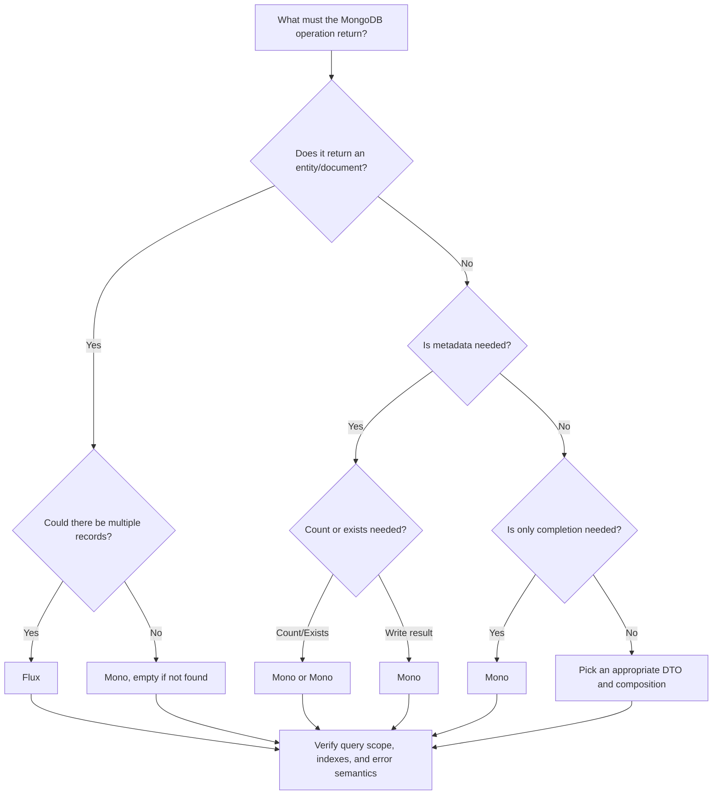

# ReactiveMongoRepository and Choosing the Right Return Types

A MongoDB query API may need **one document**, **many documents**, **a count**, **an existence check**, or simply confirmation that **a delete completed**. When using **Spring Data MongoDB Reactive**, choosing a return type is not just swapping `List<T>` for `Flux<T>`: reactive types also describe **how many items can be emitted, when execution happens, and how errors or completion are signaled**.

For example:

```java
Mono<OrderDocument> findByTenantIdAndExternalId(
    String tenantId, String externalId);

Flux<OrderDocument> findByTenantIdAndStatus(
    String tenantId, String status);

Mono<Long> countByTenantIdAndStatus(
    String tenantId, String status);

Mono<Boolean> existsByTenantIdAndExternalId(
    String tenantId, String externalId);
```

From the signatures alone, a reader knows the first method expects **0–1 order**, the second emits **0–N orders**, the third produces **one count value**, and the fourth returns **one boolean result**. They are not interchangeable, even though all four query the same collection.

This lesson belongs to the **Reactive access** chapter of the **SPRING_DATA_MONGODB** module, focusing on how Spring Data MongoDB connects, maps documents, and queries via repositories/`ReactiveMongoTemplate`, alongside query design, indexing, testing, and error handling. The direct focus is **`ReactiveMongoRepository` and picking return types matching the method contract**; transactions, performance, and backpressure are covered insofar as needed to use these types accurately.

After this lesson, you will be able to:

1. Distinguish `ReactiveMongoRepository` from `MongoRepository` and know when to use `Mono<T>` vs `Flux<T>`.
2. Choose `Mono<Boolean>`, `Mono<Long>`, `Mono<Void>`, `Mono<T>`, and `Flux<T>` accurately per operation.
3. Understand the **`onNext`, `onComplete`, and `onError`** signals, especially `Mono.empty()` versus `Mono.error(...)`.
4. Declare **derived query methods**, `@Query`, and `Sort`/`Pageable` parameters in reactive repositories.
5. Paginate with accurate semantics when a repository returns `Flux<T>`: `Pageable` does **not** automatically produce `Page<T>` or run a count query.
6. Compose streams using Reactor's `map`, `flatMap`, `flatMapMany`, `collectList`, `switchIfEmpty`, and `then` without accidentally subscribing twice.
7. Use repositories in WebFlux controllers and services while preserving **tenant scoping**, indexes, data bounds, and safe side-effect handling.
8. Test empty results, single/multiple items, DB errors, and multi-tenant isolation with `StepVerifier` and a real test MongoDB.

## 1. How Do Reactive Repositories Differ from Imperative Repositories?

### 1.1. Same Data Goal, Different Execution Contract

An imperative repository might declare:

```java
public interface OrderRepository
        extends MongoRepository<OrderDocument, ObjectId> {

    Optional<OrderDocument> findByTenantIdAndExternalId(
        String tenantId, String externalId);

    List<OrderDocument> findByTenantIdAndStatus(
        String tenantId, String status);
}
```

A reactive repository:

```java
public interface ReactiveOrderRepository
        extends ReactiveMongoRepository<OrderDocument, ObjectId> {

    Mono<OrderDocument> findByTenantIdAndExternalId(
        String tenantId, String externalId);

    Flux<OrderDocument> findByTenantIdAndStatus(
        String tenantId, String status);
}
```

In the imperative model, `Optional`/`List` already holds the fetched result when the call returns. In the reactive model, `Mono`/`Flux` is a **Publisher** representing a signal stream whose work executes when properly subscribed to; the repository has not necessarily finished querying MongoDB just because the method returned a `Mono`.

Typical flow:

```text
HTTP request
    │
    ▼
Reactive controller
    │ returns Mono/Flux
    ▼
Service composes pipeline
    │
    ▼
ReactiveMongoRepository
    │ Publisher
    ▼
WebFlux/Reactor subscribes, requests data
    │
    ▼
Reactive MongoDB Java Driver → MongoDB → signals
```

**Reactive does not mean “spawning a dedicated thread per query.”** The reactive driver uses non-blocking I/O within supported operations; Reactor composes and manages signals. A heavy query missing an index still loads MongoDB heavily, and any blocking call in the service still destroys non-blocking benefits.

### 1.2. Do Not Mix Imperative and Reactive Repositories via Casting

These types **cannot be bridged by casting**:

```java
// MODELING INVALID:
Mono<OrderDocument> reactive =
    (Mono<OrderDocument>) imperativeRepository.findById(id);
```

`Optional<OrderDocument>` is not a Publisher. If a WebFlux service calls an imperative repository directly, the call remains **blocking I/O** even if the controller wraps the result in `Mono.just(...)`.

If you must integrate a blocking library, design an explicit boundary and isolate it on an appropriate scheduler; that **does not convert a blocking driver into a reactive MongoDB driver**. For primary reactive MongoDB reads/writes, use `ReactiveMongoRepository` or `ReactiveMongoTemplate` with the reactive driver and configuration.

## 2. Two Core Types: `Mono<T>` and `Flux<T>`

### 2.1. `Mono<T>`: Zero or One Value

A `Mono<OrderDocument>` has three valid outcomes:

```text
onNext(order) → onComplete()      // one order found
onComplete()                      // no order found
onError(error)                    // query failed
```

Under the Reactor contract, a `Mono<T>` can never emit **two** orders.

Example:

```java
Mono<OrderDocument> selected =
    repository.findByTenantIdAndExternalId(
        trustedTenantId, "EXT-100"
    );
```

If the order does not exist, the repository returns a publisher that completes **empty**. Empty is not a MongoDB error; the service decides whether to turn it into **404 Not Found**, 204, or another status per the API contract.

### 2.2. `Flux<T>`: Zero or Many Values

A `Flux<OrderDocument>` can emit:

```text
onComplete()                                      // 0 orders
onNext(A) → onComplete()                          // 1 order
onNext(A) → onNext(B) → ... → onComplete()         // N orders
onNext(A) → onError(error)                        // failed after partial emissions
```

The ability to **emit partial items before failing** matters in streaming HTTP and batch processing. An HTTP streaming response that has already flushed a few items cannot always revert to a standard 500 error response; clients need explicit error/reconciliation contracts.

### 2.3. Reactor Never Emits Java `null` as an `onNext` Value

Reactive Streams forbids `null` as an emitted item. To represent “no document,” use an **empty** publisher (`Mono.empty()`), never `Mono.just(null)`:

```java
Mono<OrderDocument> none = Mono.empty();

// Wrong: throws NullPointerException.
Mono<OrderDocument> wrong = Mono.just(null);
```

For possibly absent in-memory values, `Mono.justOrEmpty(optional)` can turn an **already computed** `Optional` into an appropriate publisher; never use it to disguise a blocking query.

### 2.4. Error Is Not Empty

```java
Mono<OrderDocument> empty = Mono.empty();

Mono<OrderDocument> failed =
    Mono.error(new IllegalStateException("MongoDB unavailable"));
```

| Publisher | Meaning | Handling |
| --- | --- | --- |
| `Mono.just(order)` | One order present | Map to DTO, return result |
| `Mono.empty()` | No order present | Convert to 404 or default |
| `Mono.error(error)` | Error stream | Error handling, targeted retry, monitoring |
| `Flux.empty()` | List query matched nothing | Empty list / completed stream |
| `Flux.error(error)` | Error in list stream | Never treat silently as an empty list |

**Never write `onErrorResume(e -> Mono.empty())` across all database errors**, turning an outage into “no data”; this returns misleading responses and hides failures.

## 3. Choosing Return Types by Operation Semantics

| Need | Typical Reactive Type | Why |
| --- | --- | --- |
| Lookup by `_id` or unique business key | `Mono<OrderDocument>` | 0–1 document |
| Lookup many orders by status | `Flux<OrderDocument>` | 0–N documents |
| Find first matching record with intentional sort | `Mono<OrderDocument>` | Query bounded to one result |
| Create/update and return saved entity | `Mono<OrderDocument>` | One entity or error |
| Check existence | `Mono<Boolean>` | Distinguishes `false` from empty `Mono` |
| Count documents | `Mono<Long>` | One count value, including 0 |
| Delete by ID when only completion matters | `Mono<Void>` | Emits no entity/result |
| Conditional delete needing deleted count | `Mono<Long>` or `Mono<DeleteResult>` depending on API | Provides count/metadata |
| Update needing matched/modified counts | `Mono<UpdateResult>` with `ReactiveMongoTemplate` | Avoids confusing “completed” with “modified a record” |
| Fetch one **content** page without total | `Flux<T>` with `Pageable`/limit, or `Mono<List<T>>` at boundary | Data flow and response shape differ |
| API needing content + total pages | `Mono<PaginatedResponse<T>>` assembled from content/count | Two queries/or tailored pipeline; no automatic `Page<T>` |

In this table, `Mono<Void>` emits **completion/error only**, not a `Void` object. By contrast, `Mono<Boolean>` from `exists...` explicitly emits `false`; returning `Mono<Void>` there would lose critical information.

### 3.1. Do Not Use `Mono<T>` for Queries Returning Multiple Results

A method like:

```java
Mono<OrderDocument> findByTenantIdAndStatus(
    String tenantId, String status);
```

carries a **potential design contradiction**: a tenant can have many orders in the same status. Depending on how Spring Data builds single-result queries and how many documents match, this may raise an error or behave unexpectedly. Never rely on “MongoDB will pick one order arbitrarily.”

If all matches are wanted, return `Flux<OrderDocument>`. If “the newest single order” is wanted, express it explicitly:

```java
Mono<OrderDocument> findFirstByTenantIdAndStatusOrderByCreatedAtDescIdDesc(
    String tenantId, String status);
```

This is a derived query with a **single-element limit and deterministic sort** (using unique `_id` as tie-breaker). It **does not replace a unique constraint**: the collection can still contain many orders with that status; the API simply asks for the first one.

### 3.2. Do Not Use `Flux<T>` Merely to Represent “One Record by ID”

You *can* turn a `Mono<T>` into a `Flux<T>` when composition truly needs it, yet a signature like:

```java
Flux<OrderDocument> findByIdAndTenantId(
    ObjectId id, String tenantId);
```

obscures the **0–1** cardinality even though `_id` is unique. When business logic expects a single record, `Mono<OrderDocument>` communicates cardinality clearly.

### 3.3. `Mono<Long>` vs `Flux<Long>` When Counting

Repository `count()` returns a single count as `Mono<Long>`. Never write:

```java
Flux<Long> counts = repository.findAll()
    .map(x -> 1L);
```

to simulate a count, because it emits **a `1L` for every order** rather than a total. `Flux.count()` can count *emitted* elements, yet scanning the whole collection just to count is typically far more expensive than a dedicated database count.

### 3.4. `Mono<Boolean>` Is Not `Mono.empty()` When Absent

```java
Mono<Boolean> exists =
    repository.existsByTenantIdAndExternalId(
        tenantId, externalId);
```

Normally this stream emits `false` when absent—**not** `Mono.empty()`. That matters with:

```java
exists.defaultIfEmpty(true)
```

`defaultIfEmpty` is a fallback **for a publisher emitting no value**, not a way to flip `false` to `true`. Do not use `defaultIfEmpty` to alter a boolean `false`.

## 4. Complete Entity and `ReactiveMongoRepository` Design

### 4.1. Order Model for Practice

A multi-tenant system tracks orders with business key `externalId`. To look up one order per tenant and `externalId`, we want a **unique index** on that key pair—not merely a repository method returning `Mono<T>`.

```java
package com.example.reactivemongo;

import java.math.BigDecimal;
import java.time.Instant;
import org.bson.types.ObjectId;
import org.springframework.data.annotation.Id;
import org.springframework.data.mongodb.core.index.CompoundIndex;
import org.springframework.data.mongodb.core.mapping.Document;
import org.springframework.data.mongodb.core.mapping.Field;
import org.springframework.data.mongodb.core.mapping.FieldType;

@Document(collection = "orders_reactive_lab")
@CompoundIndex(
    name = "uniq_tenant_external",
    def = "{ 'tenantId': 1, 'externalId': 1 }",
    unique = true
)
public class OrderDocument {
    @Id
    private ObjectId id;

    private String tenantId;
    private String externalId;
    private String status;
    private Instant createdAt;

    @Field(targetType = FieldType.DECIMAL128)
    private BigDecimal totalAmount;

    protected OrderDocument() {
        // Spring Data may use this constructor when materializing.
    }

    public OrderDocument(
            String tenantId,
            String externalId,
            String status,
            Instant createdAt,
            BigDecimal totalAmount) {
        this.tenantId = tenantId;
        this.externalId = externalId;
        this.status = status;
        this.createdAt = createdAt;
        this.totalAmount = totalAmount;
    }

    public ObjectId getId() { return id; }
    public String getTenantId() { return tenantId; }
    public String getExternalId() { return externalId; }
    public String getStatus() { return status; }
    public Instant getCreatedAt() { return createdAt; }
    public BigDecimal getTotalAmount() { return totalAmount; }
}
```

Notes:

- `@Id ObjectId id` maps to BSON `_id`; `externalId` is a separate business key.
- `@Field(targetType = FieldType.DECIMAL128)` instructs storing `BigDecimal` as BSON Decimal128 for accurate monetary comparison.
- `@CompoundIndex` declares index **intent**. Depending on configuration/version, the index may **not be created automatically**; ensure migrations/`indexOps` create it and verify on the server.
- This class is kept concise for learning return types. Production code needs validation, auditing, business state transitions, optimistic locking, and proper authorization policies.

### 4.2. Repository with Diverse Return Shapes

```java
package com.example.reactivemongo;

import org.bson.types.ObjectId;
import org.springframework.data.domain.Pageable;
import org.springframework.data.domain.Sort;
import org.springframework.data.mongodb.repository.ReactiveMongoRepository;
import reactor.core.publisher.Flux;
import reactor.core.publisher.Mono;

public interface ReactiveOrderRepository
        extends ReactiveMongoRepository<OrderDocument, ObjectId> {

    // Backed by unique index on (tenantId, externalId).
    Mono<OrderDocument> findByTenantIdAndExternalId(
        String tenantId, String externalId);

    // Emits all matching orders when subscribed, in Sort order.
    Flux<OrderDocument> findByTenantIdAndStatus(
        String tenantId, String status, Sort sort);

    // Fetches only the slice defined by Pageable limit/offset.
    Flux<OrderDocument> findByTenantIdAndStatus(
        String tenantId, String status, Pageable pageable);

    // Queries only the single newest order.
    Mono<OrderDocument>
        findFirstByTenantIdAndStatusOrderByCreatedAtDescIdDesc(
            String tenantId, String status);

    // Scalar results, not documents.
    Mono<Long> countByTenantIdAndStatus(
        String tenantId, String status);

    Mono<Boolean> existsByTenantIdAndExternalId(
        String tenantId, String externalId);
}
```

Because every method takes `tenantId` **explicitly**, data-access paths are easy to review for scoping. Still, declaring a tenant parameter **does not enforce authorization**: the service must obtain the tenant from a trusted source and ensure no code path bypasses the scope filter.

### 4.3. Inherited CRUD Operations and Return Types

`ReactiveMongoRepository` inherits reactive operations from its parent reactive interfaces. Common examples:

```java
Mono<OrderDocument> byId = repository.findById(orderId);

Flux<OrderDocument> all = repository.findAll();

Mono<Long> count = repository.count();

Mono<Boolean> exists = repository.existsById(orderId);

Mono<OrderDocument> saved = repository.save(order);

Mono<OrderDocument> inserted = repository.insert(order);

Mono<Void> deleteCompleted = repository.deleteById(orderId);
```

**Never expose unpaged/unbounded `findAll()` in production APIs** simply because it is convenient. Moreover, `findById`/`deleteById` include no tenant predicate by default. In multi-tenant apps, services must never read or delete another tenant's document solely by a client-supplied ID.

Notable distinctions:

- `save` can insert or replace/update an entity depending on ID state and mapping; understand versioning/optimistic locking to avoid blind overwrites.
- `insert` targets creation; duplicate keys raise errors, making it suitable when enforcing creation semantics.
- `deleteById` returns `Mono<Void>` indicating only completion. It **does not return the deleted count**; if you need to distinguish not-found from deleted, run a delete query returning a count via `ReactiveMongoTemplate`.
- `existsById` returns `Mono<Boolean>` with `true/false`; it does not replace authorization or uniqueness enforcement.
- `count` returns a count via `Mono<Long>`, without streaming individual documents to count client-side.

### 4.4. Why Must Indexes and Cardinality Go Together?

```java
Mono<OrderDocument> found =
    repository.findByTenantIdAndExternalId(
        tenantId, externalId);
```

The `Mono` return type describes the **method contract**; it does not create a unique constraint on the data. Without a unique index, two documents can share `(tenantId, externalId)`, corrupting the data model. Single-result queries may then error on multiple matches or violate uniqueness assumptions; never use `findFirst...` to paper over duplicate records.

A unique compound index can be created in `mongosh`:

```javascript
db.orders_reactive_lab.createIndex(
  { tenantId: 1, externalId: 1 },
  { unique: true, name: "uniq_tenant_external" }
);
```

**Operational note:** indexes are collection-level resources that must be managed via migrations, checked against legacy duplicates, and reviewed for sharding or collation rules if applicable. Never assume an annotation alone means the index exists on the server.

## 5. Signal Flow: Subscription, Lazy Execution, Cancellation

### 5.1. Creating a Publisher Does Not Mean Written/Deleted

```java
Mono<OrderDocument> publisher = repository.insert(order);

// No guarantee the write has happened yet here.
// Execution occurs when the Publisher is subscribed to.
```

Publishers are typically **cold**: each subscription triggers the source logic anew. For a side-effecting operation like `insert`, two subscriptions can trigger **two write attempts**. Therefore, never treat a publisher as an already-started `CompletableFuture` to be reused casually.

```java
Mono<OrderDocument> insertPublisher =
    repository.insert(new OrderDocument(
        tenantId, externalId, "NEW",
        Instant.now(), amount
    ));

// Do not do this "just to be sure" on a write Publisher:
insertPublisher.subscribe();
return insertPublisher;
```

This creates a manual subscription and then returns the publisher to the framework, causing Spring WebFlux to subscribe a second time. On inserts, a unique constraint triggers a duplicate key error; on non-idempotent updates, it causes **double side effects**.

**Rule:** let WebFlux or the outer Reactor consumer own subscription at the boundary. In services and controllers, **return the publisher** instead of calling `subscribe()` to “kick it off.”

### 5.2. Completion, Error, and Cancellation

A subscription terminates via:

- `onComplete`: source finished normally.
- `onError`: source encountered an error and terminated with failure.
- `cancel`: subscriber actively stopped requesting items; this is not `onComplete`.

**Cancellation is not a MongoDB transaction rollback.** When an HTTP subscriber disconnects/cancels, a write already sent to the server may already have completed or still be in progress. Never use `doOnCancel` to log “database rolled back write.” When write outcomes matter, enforce idempotency and reconciliation by business command ID.

### 5.3. Ordering Logs Around Signals

```java
Flux<OrderDocument> orders = repository
    .findByTenantIdAndStatus(tenantId, "PAID", sort)
    .doOnSubscribe(s -> log.debug("query subscribed"))
    .doOnNext(o -> log.debug("received order id={}", o.getId()))
    .doOnError(e -> log.warn("query failed", e))
    .doOnComplete(() -> log.debug("query completed"));
```

This assumes **placement inside a class with an initialized `log`**. The `doOn...` hooks provide observability without triggering subscription. Never log raw documents containing PII, monetary details, or sensitive tenant data without masking and authorization controls.

## 6. Key Reactor Operators When Calling Repositories

### 6.1. `map` Transforms an Existing Value

```java
Mono<OrderView> view = repository
    .findByTenantIdAndExternalId(tenantId, externalId)
    .map(OrderView::from);
```

`OrderView::from` is a **synchronous function** converting the entity to a DTO. `map` does not issue another MongoDB query. If no order exists, the mapping function is skipped and the `Mono` stays empty.

### 6.2. `flatMap` When the Next Step Returns a `Mono`

```java
Mono<OrderView> view = repository
    .findByTenantIdAndExternalId(tenantId, externalId)
    .flatMap(order -> pricingService.enrich(order));
```

Here `pricingService.enrich(order)` is assumed to be a **non-blocking** method returning `Mono<OrderView>`. Using `map` instead:

```java
Mono<Mono<OrderView>> nested = repository
    .findByTenantIdAndExternalId(tenantId, externalId)
    .map(order -> pricingService.enrich(order));
```

produces a **nested publisher**, not a flattened `Mono<OrderView>`.

### 6.3. `flatMapMany` When One Order Expands to Many Items

```java
Flux<OrderLine> lines = repository
    .findByTenantIdAndExternalId(tenantId, externalId)
    .flatMapMany(orderLineRepository::findByOrder);
```

`orderLineRepository.findByOrder(...)` is an illustrative method returning `Flux<OrderLine>`. In production, pass tenant/ID predicates if the child collection is tenant-scoped; this snippet demonstrates the operator shape, not full authorization.

### 6.4. `collectList` Converts `Flux<T>` to `Mono<List<T>>`

```java
Mono<List<OrderDocument>> listMono = repository
    .findByTenantIdAndStatus(tenantId, "PAID", pageable)
    .collectList();
```

This **accumulates all emitted elements** into an in-memory `List`. It is reasonable when the repository query is bounded by `Pageable`, e.g., size 20. Calling `collectList()` after `findAll()` across millions of documents causes severe memory pressure.

### 6.5. `then` Discards Values, Preserving Completion/Error

```java
Mono<Void> completed = repository
    .save(order)
    .then();
```

`then()` converts a value-emitting publisher into `Mono<Void>`, discarding the entity. Use it when the contract only needs “done,” **not** when callers need the saved ID or metadata.

### 6.6. `switchIfEmpty` for Missing Documents

```java
Mono<OrderDocument> required = repository
    .findByTenantIdAndExternalId(tenantId, externalId)
    .switchIfEmpty(Mono.error(
        new OrderNotFoundException(externalId)
    ));
```

The fallback is subscribed **only when the source completes empty**. `OrderNotFoundException` is a custom application exception, not built into Spring Data. `switchIfEmpty` **does not catch MongoDB errors**; errors still propagate via `onError`.

If the fallback has side effects or builds a complex publisher, wrap it in `Mono.defer(...)` to defer **creation** until needed:

```java
.switchIfEmpty(Mono.defer(() ->
    auditService.recordMissingOrder(tenantId, externalId)
        .then(Mono.error(new OrderNotFoundException(externalId)))
))
```

Here, `auditService.recordMissingOrder(...)` must return a non-blocking `Mono<?>`. If auditing only needs logging, prefer observability hooks over issuing extra writes on every miss.

### 6.7. `defaultIfEmpty` vs `switchIfEmpty`

`defaultIfEmpty(fallbackValue)` takes an **already instantiated `T` value**, whereas `switchIfEmpty(otherPublisher)` takes a fallback publisher.

```java
Mono<Boolean> found =
    repository.findByTenantIdAndExternalId(tenantId, externalId)
        .hasElement();

Mono<Boolean> expected = found.defaultIfEmpty(false);
```

`hasElement()` already emits `true` or `false` on normal completion, so `defaultIfEmpty(false)` here is normally **redundant**. It neither handles `onError` nor turns DB errors into `false`.

## 7. Reactive Services: Enforcing Cardinality and Tenant Scope

### 7.1. Service Supporting Single, Multiple, Count, and Exists Queries

```java
package com.example.reactivemongo;

import java.math.BigDecimal;
import java.time.Instant;
import org.springframework.data.domain.PageRequest;
import org.springframework.data.domain.Pageable;
import org.springframework.data.domain.Sort;
import org.springframework.stereotype.Service;
import reactor.core.publisher.Flux;
import reactor.core.publisher.Mono;

@Service
public class ReactiveOrderService {

    private final ReactiveOrderRepository repository;

    public ReactiveOrderService(ReactiveOrderRepository repository) {
        this.repository = repository;
    }

    public Mono<OrderDocument> findOne(
            String trustedTenantId, String externalId) {
        requireText(trustedTenantId, "tenantId");
        requireText(externalId, "externalId");

        return repository.findByTenantIdAndExternalId(
            trustedTenantId, externalId);
    }

    public Mono<OrderDocument> requireOne(
            String trustedTenantId, String externalId) {
        return findOne(trustedTenantId, externalId)
            .switchIfEmpty(Mono.error(
                new OrderNotFoundException(externalId)
            ));
    }

    public Flux<OrderDocument> listByStatus(
            String trustedTenantId, String status,
            int pageNumber, int pageSize) {
        requireText(trustedTenantId, "tenantId");
        requireText(status, "status");

        if (pageNumber < 0 || pageSize < 1 || pageSize > 100) {
            return Flux.error(new IllegalArgumentException(
                "Invalid page number or size"
            ));
        }

        Pageable pageable = PageRequest.of(
            pageNumber, pageSize,
            Sort.by(
                Sort.Order.desc("createdAt"),
                Sort.Order.desc("id")
            )
        );

        return repository.findByTenantIdAndStatus(
            trustedTenantId, status, pageable);
    }

    public Mono<Long> countByStatus(
            String trustedTenantId, String status) {
        requireText(trustedTenantId, "tenantId");
        requireText(status, "status");
        return repository.countByTenantIdAndStatus(
            trustedTenantId, status);
    }

    public Mono<Boolean> exists(
            String trustedTenantId, String externalId) {
        requireText(trustedTenantId, "tenantId");
        requireText(externalId, "externalId");
        return repository.existsByTenantIdAndExternalId(
            trustedTenantId, externalId);
    }

    public Mono<OrderDocument> create(
            String trustedTenantId, String externalId,
            BigDecimal totalAmount) {
        requireText(trustedTenantId, "tenantId");
        requireText(externalId, "externalId");

        if (totalAmount == null || totalAmount.signum() < 0) {
            return Mono.error(new IllegalArgumentException(
                "Invalid amount"
            ));
        }

        return Mono.defer(() -> repository.insert(
            new OrderDocument(
                trustedTenantId,
                externalId,
                "NEW",
                Instant.now(),
                totalAmount
            )
        ));
    }

    private void requireText(String value, String field) {
        if (value == null || value.isBlank()) {
            throw new IllegalArgumentException(
                "Missing " + field
            );
        }
    }
}
```

`OrderNotFoundException` is a **custom application class**, for example:

```java
package com.example.reactivemongo;

public class OrderNotFoundException extends RuntimeException {
    public OrderNotFoundException(String externalId) {
        super("Order not found for externalId");
    }
}
```

**Notable design decisions:**

- `findOne` preserves `Mono.empty` when missing, suitable when callers decide how to respond.
- `requireOne` converts empty into an intentional domain error. It **does not catch DB errors and treat them as not-found**.
- `listByStatus` uses `Pageable` to **limit content**, returning `Flux` without promising total page metadata.
- `countByStatus` runs a dedicated count instead of `findAll().collectList().size()`.
- `create` wraps creation in `Mono.defer` so the entity and timestamp are evaluated at subscription. Re-subscribing still sends a **new attempt**, so the unique index on `(tenantId, externalId)` and idempotency remain essential.
- `requireText` in this example throws synchronously before returning a publisher; if an API requires all validation errors inside reactive signals, convert those checks consistently into `Mono.error`/`Flux.error` without altering business semantics.

Never create a `ReactiveOrderService` and then call `.block()` on `findOne` to turn it imperative inside WebFlux. If a caller is genuinely blocking, build an explicit boundary adapter instead of sprinkling `block()` across reactive chains.

### 7.2. Deleting by Tenant While Distinguishing “Not Found”

`repository.deleteById(orderId)` returns `Mono<Void>` and carries no tenant predicate. If an API must **verify tenant ownership** and confirm whether a record was deleted, use `ReactiveMongoTemplate`:

```java
import org.bson.types.ObjectId;
import org.springframework.data.mongodb.core.ReactiveMongoTemplate;
import org.springframework.data.mongodb.core.query.Criteria;
import org.springframework.data.mongodb.core.query.Query;
import reactor.core.publisher.Mono;

public Mono<Void> deleteScoped(
        ReactiveMongoTemplate template,
        String trustedTenantId,
        ObjectId orderId) {

    if (trustedTenantId == null || trustedTenantId.isBlank()
            || orderId == null) {
        return Mono.error(new IllegalArgumentException(
            "Missing tenant or orderId"
        ));
    }

    Query query = Query.query(
        Criteria.where("_id").is(orderId)
            .and("tenantId").is(trustedTenantId)
    );

    return template.remove(query, OrderDocument.class)
        .flatMap(result -> {
            if (result.getDeletedCount() == 0) {
                return Mono.<Void>error(
                    new OrderNotFoundException(orderId.toHexString())
                );
            }
            return Mono.<Void>empty();
        });
}
```

This is an illustrative method placed in a class with `template` available; `remove` returns a publisher carrying the delete result so `deletedCount` can be checked. On a wrong tenant, the API can return 404 without leaking whether the document exists under another tenant. Never turn MongoDB errors into a count of 0.

### 7.3. Updates with Matched/Modified Metadata

```java
import com.mongodb.client.result.UpdateResult;
import org.springframework.data.mongodb.core.query.Update;

Query scope = Query.query(
    Criteria.where("_id").is(orderId)
        .and("tenantId").is(trustedTenantId)
        .and("status").is("NEW")
);

Mono<UpdateResult> result = template.updateFirst(
    scope,
    new Update().set("status", "PAID"),
    OrderDocument.class
);
```

This is a **conditional update**: only orders owned by the tenant and currently `NEW` transition to `PAID`. `Mono<UpdateResult>` helps the service distinguish:

- `matchedCount = 1, modifiedCount = 1`: record matched and was updated.
- `matchedCount = 1, modifiedCount = 0`: record matched, but the update made no net change per update semantics.
- `matchedCount = 0`: no match; could be wrong tenant, wrong ID, or status already changed.
- `onError`: operation failed or write outcome is uncertain depending on the exception; do not treat as `matchedCount=0`.

**Do not discard metadata into `Mono<Void>` if callers need to know whether the transition actually occurred.** Pick the return type according to what business logic must confirm.

## 8. Spring WebFlux: Returning Publishers to the HTTP Boundary

A reactive controller never calls `subscribe()`. Spring WebFlux subscribes and serializes emitted values into the HTTP response.

### 8.1. Read DTOs Should Not Expose the Full Entity

```java
package com.example.reactivemongo;

import java.math.BigDecimal;
import java.time.Instant;

public record OrderView(
    String id,
    String externalId,
    String status,
    BigDecimal totalAmount,
    Instant createdAt
) {
    public static OrderView from(OrderDocument source) {
        return new OrderView(
            source.getId().toHexString(),
            source.getExternalId(),
            source.getStatus(),
            source.getTotalAmount(),
            source.getCreatedAt()
        );
    }
}
```

Do not leak `tenantId` or internal metadata if the response does not need them. Redaction and authorization rules remain part of the boundary and domain design.

### 8.2. Controller Example with Trusted Tenant Resolution

```java
package com.example.reactivemongo;

import java.security.Principal;
import org.springframework.http.ResponseEntity;
import org.springframework.web.bind.annotation.GetMapping;
import org.springframework.web.bind.annotation.PathVariable;
import org.springframework.web.bind.annotation.RequestMapping;
import org.springframework.web.bind.annotation.RequestParam;
import org.springframework.web.bind.annotation.RestController;
import reactor.core.publisher.Flux;
import reactor.core.publisher.Mono;

@RestController
@RequestMapping("/api/orders")
public class ReactiveOrderController {

    private final ReactiveOrderService service;
    private final TrustedTenantResolver tenantResolver;

    public ReactiveOrderController(
            ReactiveOrderService service,
            TrustedTenantResolver tenantResolver) {
        this.service = service;
        this.tenantResolver = tenantResolver;
    }

    @GetMapping("/{externalId}")
    public Mono<ResponseEntity<OrderView>> getOne(
            @PathVariable String externalId,
            Principal principal) {

        String trustedTenantId =
            tenantResolver.requireTenant(principal);

        return service.findOne(trustedTenantId, externalId)
            .map(OrderView::from)
            .map(ResponseEntity::ok)
            .defaultIfEmpty(ResponseEntity.notFound().build());
    }

    @GetMapping
    public Flux<OrderView> list(
            @RequestParam(defaultValue = "PAID") String status,
            @RequestParam(defaultValue = "0") int page,
            @RequestParam(defaultValue = "20") int size,
            Principal principal) {

        String trustedTenantId =
            tenantResolver.requireTenant(principal);

        return service
            .listByStatus(trustedTenantId, status, page, size)
            .map(OrderView::from);
    }
}
```

`TrustedTenantResolver` is an **application-supplied interface/service**, not built into Spring Data:

```java
package com.example.reactivemongo;

import java.security.Principal;

public interface TrustedTenantResolver {
    String requireTenant(Principal authenticatedPrincipal);
}
```

It must resolve the tenant from the **authentication/authorization context** and reject unauthenticated callers. This example assumes `requireTenant` only reads in-memory `Principal` state without blocking I/O. If permission lookups are async, return `Mono<String>` and compose via `flatMap`/`flatMapMany` rather than blocking in the controller.

**Key takeaways in the controller:**

1. `getOne` returns `Mono<ResponseEntity<OrderView>>`; order present → 200, empty Mono → 404.
2. `list` returns `Flux<OrderView>`; no orders → empty list encoded by Spring WebFlux; DB errors remain errors.
3. Never call `.block()`, `.toIterable()`, or `.subscribe()`.
4. Validate and cap `page`/`size`; the service rejects `size > 100`.
5. `tenantId` is not an arbitrary query parameter letting clients read other tenants' data.

### 8.3. When to Use `Mono<ResponseEntity<List<T>>>` Instead of `Flux<T>`?

If an API wants a **complete JSON array** with status/headers decided after the query finishes:

```java
Mono<ResponseEntity<List<OrderView>>> response = service
    .listByStatus(tenantId, "PAID", 0, 20)
    .map(OrderView::from)
    .collectList()
    .map(ResponseEntity::ok);
```

For a bounded page, this is clean and lets you decide the response after loading all items. However, it buffers the page in memory. For SSE/NDJSON or long streams, `Flux<T>` may fit better depending on media type and HTTP client.

**Never claim `Flux<T>` always flushes documents one by one immediately over the network**: serialization, JSON array formatting, HTTP buffering, proxies, and clients all affect delivery. True streaming requires streaming content types and transport support such as NDJSON or SSE per API contract.

## 9. `Pageable` in Reactive Repositories: Returns Content, Not `Page<T>`

### 9.1. The Cardinality Issue with `Page<T>`

In imperative repositories, developers are used to:

```java
Page<OrderDocument> findByTenantIdAndStatus(
    String tenantId, String status, Pageable pageable);
```

`Page<T>` holds both **content** and **total elements/pages**. In reactive repositories, multi-item queries are represented by `Flux<T>`. Do not declare a reactive derived method returning `Mono<Page<OrderDocument>>` expecting Spring Data MongoDB to run content query, count query, and assemble a `Page`.

Proper signature:

```java
Flux<OrderDocument> findByTenantIdAndStatus(
    String tenantId, String status, Pageable pageable);
```

The `Pageable` parameter applies **limit/offset/sort to the content query**. It does not make `Flux` emit a `Page` object, nor does it compute `totalElements`.

### 9.2. API Needing Only a Bounded List

```java
Pageable pageable = PageRequest.of(
    0,
    20,
    Sort.by(
        Sort.Order.desc("createdAt"),
        Sort.Order.desc("id")
    )
);

Flux<OrderDocument> firstTwenty = repository
    .findByTenantIdAndStatus("T1", "PAID", pageable);
```

If no orders match, the publisher **completes with zero elements**. If 7 exist, it emits 7. If more than 20 exist, it emits at most 20 in sorted order—with no `totalElements` wrapper.

### 9.3. When the Client Genuinely Needs Total Elements

Create a DTO matching the response contract:

```java
package com.example.reactivemongo;

import java.util.List;

public record OrderPageResponse(
    List<OrderView> items,
    long totalElements,
    int pageNumber,
    int pageSize
) {}
```

Then combine **two publishers**:

```java
public Mono<OrderPageResponse> loadPage(
        ReactiveOrderService service,
        String tenantId,
        String status,
        int pageNumber,
        int pageSize) {

    Mono<List<OrderView>> content = service
        .listByStatus(tenantId, status, pageNumber, pageSize)
        .map(OrderView::from)
        .collectList();

    Mono<Long> total = service.countByStatus(tenantId, status);

    return Mono.zip(content, total)
        .map(tuple -> new OrderPageResponse(
            tuple.getT1(),
            tuple.getT2(),
            pageNumber,
            pageSize
        ));
}
```

**These are two independent queries**: content and count may observe different states under concurrent writes. `Mono.zip` combines results; it **does not turn two queries into a snapshot transaction**. If stats and content must reflect a single point in time, use appropriate snapshot/read concern/transactions or a suitable aggregation pipeline on a supporting deployment—changing return types alone cannot solve this.

`Mono.zip` emits only when both sources emit values. Here `collectList` always emits a `List` (possibly empty) on success and `count` emits a number, so zip works properly. Zipping with a `Mono.empty()` completes empty instead of invoking the mapper.

### 9.4. Skip `totalElements` If Not Needed

If the UI only needs to know whether a next page exists, the “**fetch size + 1**” pattern avoids counting the whole collection. Fetch up to 21 records for page size 20, return 20, and compute `hasNext = result has a 21st element`.

**Important note:** do not use `PageRequest.of(pageNumber, pageSize + 1)` across pages, because that sets the offset to `pageNumber × (pageSize + 1)` instead of `pageNumber × pageSize`. Keep the offset based on the original page size and limit to `size + 1` using `ReactiveMongoTemplate` as shown in section 9.5.

Output DTO:

```java
public record OrderWindow(
    List<OrderView> items,
    boolean hasNext
) {}
```

**Note on offset:** using `PageRequest.of(pageNumber, pageSize + 1)` does **not** preserve fixed page offsets across page numbers (offset becomes `pageNumber * (pageSize + 1)`). Thus it is only valid for **pageNumber = 0**, or you must **compute `skip = pageNumber * pageSize` explicitly** and limit to `size + 1` with `ReactiveMongoTemplate`. For multi-page APIs, use the correct version below.

### 9.5. Window with Accurate Offset via `ReactiveMongoTemplate`

```java
import java.util.List;
import org.springframework.data.domain.Sort;
import org.springframework.data.mongodb.core.ReactiveMongoTemplate;
import org.springframework.data.mongodb.core.query.Criteria;
import org.springframework.data.mongodb.core.query.Query;
import reactor.core.publisher.Mono;

public Mono<OrderWindow> loadWindowWithCorrectOffset(
        ReactiveMongoTemplate template,
        String trustedTenantId,
        String status,
        int pageNumber,
        int pageSize) {

    if (trustedTenantId == null || trustedTenantId.isBlank()
            || status == null || status.isBlank()
            || pageNumber < 0 || pageSize < 1 || pageSize > 100) {
        return Mono.error(
            new IllegalArgumentException("Invalid pagination")
        );
    }

    long offset = (long) pageNumber * pageSize;

    Query query = Query.query(
        Criteria.where("tenantId").is(trustedTenantId)
            .and("status").is(status)
    );
    query.with(Sort.by(
        Sort.Order.desc("createdAt"),
        Sort.Order.desc("id")
    ));
    query.skip(offset);
    query.limit(pageSize + 1);

    return template.find(query, OrderDocument.class)
        .collectList()
        .map(items -> {
            boolean hasNext = items.size() > pageSize;
            List<OrderView> visible = items
                .subList(0, Math.min(pageSize, items.size()))
                .stream()
                .map(OrderView::from)
                .toList();
            return new OrderWindow(visible, hasNext);
        });
}
```

This uses the exact `offset = pageNumber × pageSize` and fetches at most `pageSize + 1` records to determine `hasNext` without running a count. Still, deep `skip` offsets grow expensive even with indexes; for long feeds, consider **keyset/cursor pagination**.

### 9.6. Cursor Pagination with a Deterministic Sort Order

With descending sort `(createdAt, _id)`, the next page after the last item satisfies:

```text
createdAt < lastCreatedAt
OR
(createdAt = lastCreatedAt AND _id < lastId)
```

Example with `ReactiveMongoTemplate`:

```java
import java.time.Instant;
import org.bson.types.ObjectId;
import org.springframework.data.domain.Sort;
import org.springframework.data.mongodb.core.ReactiveMongoTemplate;
import org.springframework.data.mongodb.core.query.Criteria;
import org.springframework.data.mongodb.core.query.Query;
import reactor.core.publisher.Flux;

public Flux<OrderDocument> afterCursor(
        ReactiveMongoTemplate template,
        String trustedTenantId,
        String status,
        Instant lastCreatedAt,
        ObjectId lastId,
        int size) {

    if (trustedTenantId == null || trustedTenantId.isBlank()
            || status == null || status.isBlank()
            || lastCreatedAt == null || lastId == null
            || size < 1 || size > 100) {
        return Flux.error(
            new IllegalArgumentException("Invalid cursor")
        );
    }

    Criteria after = new Criteria().orOperator(
        Criteria.where("createdAt").lt(lastCreatedAt),
        new Criteria().andOperator(
            Criteria.where("createdAt").is(lastCreatedAt),
            Criteria.where("_id").lt(lastId)
        )
    );

    Criteria scoped = new Criteria().andOperator(
        Criteria.where("tenantId").is(trustedTenantId),
        Criteria.where("status").is(status),
        after
    );

    Query query = Query.query(scoped)
        .with(Sort.by(
            Sort.Order.desc("createdAt"),
            Sort.Order.desc("id")
        ))
        .limit(size);

    return template.find(query, OrderDocument.class);
}
```

Tenant and status sit **outside both OR branches** so neither branch leaks outside scope. Candidate index:

```javascript
db.orders_reactive_lab.createIndex(
  { tenantId: 1, status: 1, createdAt: -1, _id: -1 },
  { name: "idx_tenant_status_created_id" }
);
```

Adding `_id` gives a unique tie-breaker. Still, cursors do not create an immutable snapshot: if `createdAt`/status changes or documents are inserted between HTTP requests, results can shift per consistency contract. Choose proper cursor encoding, integrity validation, and tenant enforcement.

## 10. Operators That Alter Return-Type Semantics

### 10.1. `next()` Turns `Flux<T>` into `Mono<T>` and Discards the Rest

```java
Mono<OrderDocument> first = repository
    .findByTenantIdAndStatus(tenantId, "PAID", sort)
    .next();
```

`next()` takes the first element from `Flux` and cancels the rest of the subscription. Use it only when you **genuinely** want the first element in a defined order. Never use `next()` to paper over a method with the wrong cardinality when business logic requires uniqueness.

Express the intent directly in the repository:

```java
Mono<OrderDocument>
    findFirstByTenantIdAndStatusOrderByCreatedAtDescIdDesc(
        String tenantId, String status);
```

### 10.2. `single()` vs `next()`

```java
Mono<OrderDocument> exactlyOne = repository
    .findByTenantIdAndStatus(tenantId, "PAID", sort)
    .single();
```

`single()` requires **exactly one element**. It errors on empty or more than one element. Comparison:

| Operator | 0 elements | 1 element | More than 1 element |
| --- | --- | --- | --- |
| `next()` | Empty Mono | Emits first element | Takes first, ignores total count |
| `single()` | Error | Emits that element | Error |
| `singleOrEmpty()` | Empty Mono | Emits that element | Error |
| `collectList()` | Mono emitting `[]` | Mono emitting 1-element list | Mono emitting multi-element list |
| `count()` | Mono emitting `0L` | Mono emitting `1L` | Mono emitting count |

If `Flux` returns a large list, `single()` is not an efficient way to enforce business-key uniqueness. Add a unique index and use a single-result repository method.

### 10.3. `Mono<Void>` and the `switchIfEmpty` Trap

A `Mono<Void>` completing successfully emits **no `onNext`**. Thus:

```java
Mono<Void> deleted = repository.deleteById(orderId);

Mono<Void> confusing = deleted.switchIfEmpty(
    auditService.recordNoMatch(orderId)
);
```

The fallback runs whenever `deleted` completes **without emitting a value**, even when deletion succeeded. It does **not** mean “no document was deleted.”

To check whether a document was deleted, retrieve `Mono<DeleteResult>` from `ReactiveMongoTemplate` and inspect `deletedCount` as in section 7.2. `Mono<Void>` carries only completion/error; never treat empty as “not found” on a value-less operation.

### 10.4. `Mono.zip` Cannot Extract a Value from `Mono<Void>`

```java
Mono<Void> saveAudit = auditService.writeAudit(orderId);
Mono<OrderDocument> load = repository.findById(orderId);

// Do not expect zip to deliver a (Void, OrderDocument) value pair.
Mono<?> wrong = Mono.zip(saveAudit, load);
```

Because `saveAudit` emits no value, `zip` completes empty without running the combiner. To **wait for audit completion before loading the order**:

```java
Mono<OrderDocument> combined =
    saveAudit.then(repository.findById(orderId));
```

This illustrates sequencing only; if “audit + order read” requires consistency or atomicity, `then` does not create a transaction. Design audit side effects and error handling deliberately.

### 10.5. `flatMap` Can Reorder Results

With:

```java
Flux<OrderView> enriched = repository
    .findByTenantIdAndStatus(tenantId, "PAID", sort)
    .flatMap(order -> otherService.enrich(order));
```

`flatMap` can subscribe to inner publishers concurrently, so emitted enriched results are **not guaranteed to preserve the input order**.

When order must be preserved:

```java
Flux<OrderView> ordered = repository
    .findByTenantIdAndStatus(tenantId, "PAID", sort)
    .concatMap(order -> otherService.enrich(order));
```

`concatMap` serializes inner publishers, preserving order at the cost of concurrency. Another choice is `flatMapSequential` to run concurrently while emitting in source order. Each comes with its own memory/latency trade-offs.

### 10.6. N+1 Queries Do Not Vanish with `Flux`

```java
Flux<OrderWithLines> summaries = repository
    .findByTenantIdAndStatus(tenantId, "PAID", pageable)
    .flatMap(order -> linesRepository
        .findByTenantIdAndOrderId(tenantId, order.getId())
        .collectList()
        .map(lines -> new OrderWithLines(order, lines))
    );
```

With 100 orders on a page, this pipeline issues 100 separate line queries. That is still an **N+1 query pattern**, merely executed asynchronously.

Depending on the data model:

- Batch-fetch lines with `orderId IN (...)` and join by ID in memory, with bounded page sizes.
- Use `$lookup` aggregation when conditions and fan-out suit server-side joining.
- Embed lines inside the order if aggregate boundaries and update patterns permit.
- When using `flatMap`, cap concurrency so you do not overwhelm connection pools or the server:

```java
.flatMap(order -> linesService.load(order), 8)
```

Never call `subscribe()` inside `flatMap` and discard the result: always **return the Publisher** to keep error/completion/cancellation connected.

## 11. Errors and Retries in `Mono`/`Flux`

### 11.1. Use `onErrorResume` Only for Intentional Fallbacks

```java
Mono<OrderView> response = repository
    .findByTenantIdAndExternalId(tenantId, externalId)
    .map(OrderView::from)
    .switchIfEmpty(Mono.error(
        new OrderNotFoundException(externalId)
    ));
```

Not-found is handled with `switchIfEmpty`. MongoDB errors propagate to the API error handler to return appropriate HTTP status codes. If there truly is a **safe fallback** for a specific error class:

```java
.onErrorResume(SpecificTemporaryFailure.class, error ->
    cachedReadService.findPreviouslyVerified(tenantId, externalId)
)
```

`SpecificTemporaryFailure` and `cachedReadService` are **application-provided components**. Only fall back when the cache has an explicit consistency/staleness contract, enforces tenant scoping, and never leaks cached data across authorization failures.

### 11.2. `onErrorReturn` Is Usually Wrong for Writes

```java
// DANGEROUS:
Mono<Boolean> created = repository.insert(order)
    .map(saved -> true)
    .onErrorReturn(false);
```

This turns **every failure** (duplicate key, MongoDB outage, write concern unknown, timeout) into `false`, even though some failures represent **ambiguous write outcomes**, not definite failures. API contracts must distinguish confirmed failure from unknown outcome.

### 11.3. `retryWhen` Is Not Safe for All Writes

```java
// Do not blindly apply to every INSERT/UPDATE.
Mono<OrderDocument> dangerous = repository
    .insert(order)
    .retry(3);
```

Reactor-level retries create a **new subscription**, unlike the **MongoDB driver's retryable writes**, which attach logical session/transaction identifiers for eligible operations. If the first attempt succeeded on the server but the ACK was lost, retrying as a new operation can produce duplicate effects or duplicate-key errors.

For **idempotent reads** and specific transient errors, bounded retry can make sense:

```java
import java.time.Duration;
import reactor.util.retry.Retry;

Mono<OrderDocument> read = repository
    .findByTenantIdAndExternalId(tenantId, externalId)
    .retryWhen(
        Retry.backoff(2, Duration.ofMillis(150))
            .filter(errorClassifier::isTransientReadFailure)
    );
```

`errorClassifier` is an application component classifying real exceptions/context. Never retry authentication failures, invalid input, schema errors, or business conflicts. For writes, establish idempotency keys, unique guards, and reconciliation before enabling retries.

### 11.4. Reactor `timeout` Does Not Mean MongoDB Rolled Back

```java
Mono<OrderDocument> bounded = repository
    .insert(order)
    .timeout(Duration.ofSeconds(3));
```

After 3 seconds, Reactor emits a timeout error and cancels the subscription. That **does not guarantee the write never reached MongoDB or was rolled back**. For writes with important side effects, never treat `TimeoutException` as proof of “not written.”

Use stable command IDs, reconciliation policies, and appropriate write concerns. Distinguish HTTP request deadlines, Reactor timeouts, driver timeouts, and write concern timeouts.

### 11.5. Reactor Context Is Not a Global Variable

In reactive flows, cross-cutting state such as tracing or transactions propagates via **Reactor Context**. Never assume `ThreadLocal` values from imperative code survive across async boundaries. With Spring Security reactive, use the framework's reactive security context rather than reading `ThreadLocal`.

Even so, passing a tenant in Context does not enforce authorization automatically: every repository query must be scoped properly and services must authorize callers regardless of how the tenant ID arrives.

## 12. Backpressure, Cursors, and Performance: `Flux<T>` Is Not “Free Memory”

### 12.1. What Is Backpressure?

Reactive Streams allows a subscriber to request items based on **demand** instead of forcing the Publisher to emit everything immediately. A subscriber can request 10 items, process them, and then ask for more.

```text
Subscriber                    Publisher (Flux)
    │ ── request(3) ─────────────> │
    │ <──────── onNext(A) ──────── │
    │ <──────── onNext(B) ──────── │
    │ <──────── onNext(C) ──────── │
    │ ── request(2) ─────────────> │
    │ <──────── onNext(D) ──────── │
    │ <──────── onComplete ─────── │
```

This reduces buffering pressure along the pipeline. Actual efficiency still depends on how the reactive MongoDB driver batches from the cursor, the query source, operators like `flatMap`, and how HTTP/serialization consume items. **Never treat `Flux` as proof that MongoDB only reads one document per network hop**.

### 12.2. `collectList` Defeats Streaming If Unbounded

```java
// Risky on collections with millions of documents.
Mono<List<OrderDocument>> allInMemory =
    repository.findAll().collectList();
```

Every emitted element must accumulate before `collectList` emits a single `List`. Even with upstream backpressure, the resulting list can consume huge memory. Instead:

```java
Flux<OrderDocument> limited = repository
    .findByTenantIdAndStatus(
        tenantId, "PAID",
        PageRequest.of(
            0, 50,
            Sort.by(
                Sort.Order.desc("createdAt"),
                Sort.Order.desc("id")
            )
        )
    );
```

Only call `collectList` when a bound like 50 records is guaranteed by contract. For large exports, design chunking/batching, streaming media types, cancellation, and timeouts rather than pushing a massive `List` over HTTP.

### 12.3. `limitRate` Does Not Replace a MongoDB Query Limit

```java
Flux<OrderDocument> adjustedDemand = repository
    .findAll()
    .limitRate(32);
```

`limitRate` reshapes demand between Reactor operators, **not the number of documents MongoDB returns**. If an API only needs 32 records, limit at the **MongoDB query** via `Pageable`, `limit`, or query criteria.

Similarly, `Flux.take(20)` cancels the subscription after 20 elements, but is often less efficient than a database `limit(20)`, especially with heavy sorting or filtering. Prefer shrinking the result set on the server.

### 12.4. `onBackpressureBuffer` Is Not a Universal Fix

`onBackpressureBuffer` accumulates elements when upstream outpaces downstream. Unbounded buffers drive up memory—especially when a fast MongoDB query meets a slow HTTP client. Evaluate:

- Page size and batch size bounds.
- Whether both source and consumer genuinely honor backpressure.
- Schedulers and concurrency limits.
- Timeouts, cancellation, and cursor cleanup.
- Buffer capacity and drop/error policies if used.

Never “fix” backpressure issues by inserting an unbounded buffer.

### 12.5. Cursors and Cancellation

MongoDB normally serves multi-result queries via cursors and batches. When a subscriber cancels, the driver cleans up resources where supported; however, never assume:

1. MongoDB stops all server work at the exact instant the HTTP client disconnects.
2. An already-sent write automatically rolls back.
3. External side effects outside MongoDB stop automatically.

When using `ReactiveMongoTemplate` for aggregation or streaming, monitor query duration, long-lived cursors, batch sizes, and server resource limits; clean up properly and test cancellation under realistic stream workloads.

### 12.6. Reactive Does Not Replace Index/Query Design

A query like:

```javascript
db.orders_reactive_lab.find({
  tenantId: "T1",
  status: "PAID"
})
.sort({ createdAt: -1, _id: -1 })
.limit(50);
```

can benefit from a compound index:

```javascript
{
  tenantId: 1,
  status: 1,
  createdAt: -1,
  _id: -1
}
```

`ReactiveMongoRepository` does not automatically create optimal indexes for derived queries. Run `explain("executionStats")` to inspect index selection, `keysExamined`/`docsExamined`, and sort stages on representative data. For deep pagination, consider keyset pagination; do not expect non-blocking Java to make `skip(100000)` cheap on the MongoDB server.

## 13. When to Move from Repository to `ReactiveMongoTemplate`?

Repository methods fit CRUD and clear derived queries well:

```java
Flux<OrderDocument> findByTenantIdAndStatus(
    String tenantId, String status, Pageable pageable);
```

When you need aggregation pipelines, conditional updates returning metadata, complex dynamic queries, keyset cursors, or update operators, `ReactiveMongoTemplate` is usually clearer.

### 13.1. Template Queries Still Return Corresponding Reactor Types

```java
import org.springframework.data.mongodb.core.ReactiveMongoTemplate;
import org.springframework.data.mongodb.core.query.Criteria;
import org.springframework.data.mongodb.core.query.Query;
import reactor.core.publisher.Flux;
import reactor.core.publisher.Mono;

public Flux<OrderDocument> listForTenant(
        ReactiveMongoTemplate template, String tenantId) {

    Query query = Query.query(
        Criteria.where("tenantId").is(tenantId)
    );
    return template.find(query, OrderDocument.class);
}

public Mono<OrderDocument> oneByExternalId(
        ReactiveMongoTemplate template,
        String tenantId, String externalId) {

    Query query = Query.query(
        Criteria.where("tenantId").is(tenantId)
            .and("externalId").is(externalId)
    );
    return template.findOne(query, OrderDocument.class);
}

public Mono<Boolean> existsByExternalId(
        ReactiveMongoTemplate template,
        String tenantId, String externalId) {

    Query query = Query.query(
        Criteria.where("tenantId").is(tenantId)
            .and("externalId").is(externalId)
    );
    return template.exists(query, OrderDocument.class);
}

public Mono<Long> countPaid(
        ReactiveMongoTemplate template, String tenantId) {

    Query query = Query.query(
        Criteria.where("tenantId").is(tenantId)
            .and("status").is("PAID")
    );
    return template.count(query, OrderDocument.class);
}
```

These methods **illustrate API signatures**, assuming callers validate `tenantId`/`externalId` and authorize access. Corresponding template return types:

| API | Reactive Result |
| --- | --- |
| `find(Query, Class)` | `Flux<T>` |
| `findOne(Query, Class)` | `Mono<T>` |
| `findById(ID, Class)` | `Mono<T>` |
| `count(Query, Class)` | `Mono<Long>` |
| `exists(Query, Class)` | `Mono<Boolean>` |
| `insert(entity)` | `Mono<T>` |
| `save(entity)` | `Mono<T>` |
| `remove(Query, Class)` | `Mono<DeleteResult>` |
| `updateFirst(Query, Update, Class)` | `Mono<UpdateResult>` |
| `aggregate(Aggregation, Class, Class)` | `Flux<OutputType>` |

### 13.2. Aggregation with Multiple Groups vs Single Summary

Example aggregation summing amounts per status:

```java
import java.math.BigDecimal;
import org.springframework.data.mongodb.core.aggregation.Aggregation;
import reactor.core.publisher.Flux;

public record StatusTotal(
    String status,
    BigDecimal totalAmount
) {}

Aggregation pipeline = Aggregation.newAggregation(
    Aggregation.match(
        Criteria.where("tenantId").is(trustedTenantId)
    ),
    Aggregation.group("status")
        .sum("totalAmount").as("totalAmount"),
    Aggregation.project("totalAmount")
        .and("_id").as("status")
);

Flux<StatusTotal> totals = template.aggregate(
    pipeline,
    OrderDocument.class,
    StatusTotal.class
);
```

This pipeline can emit **multiple status groups**, so the result is `Flux<StatusTotal>`. If you want a single dashboard DTO, you can `collectList` over the bounded number of groups and map to `Mono<Dashboard>`. For reactive MongoDB aggregation, never use the imperative `AggregationResults<T>` type as a substitute for `Flux<T>`.

In Java, `StatusTotal` must be placed appropriately (in its own file or as a nested type); the snippet illustrates pipeline structure and return types.

### 13.3. `@Query` Does Not Automatically Create Indexes

`@Query` lets you write JSON queries on a repository interface:

```java
import org.springframework.data.mongodb.repository.Query;

@Query("{ 'tenantId': ?0, 'status': ?1 }")
Flux<OrderDocument> queryByTenantAndStatus(
    String tenantId, String status);
```

This method belongs **inside `ReactiveOrderRepository`**, not as a standalone function. Parameters bind via Spring Data's query binding; never concatenate user input directly into query JSON:

```java
// DANGEROUS: user input controls query structure directly.
String query = "{ 'tenantId': '" + userProvided + "' }";
```

Even with `@Query`, design indexes for `tenantId/status/sort` and inspect `explain`. `@Query` neither creates indexes nor injects tenant filters automatically if you omit the predicate.

## 14. Transactions, Side Effects, and Reactive Context

### 14.1. Reactive Transactions Require Reactive Infrastructure

Reactive operations do not become transactional merely because a Java method is named `saveAll`. When business rules require committing or rolling back multiple MongoDB writes together, use the reactive transaction manager on a transaction-capable MongoDB deployment (typically a replica set or suitably configured sharded cluster).

Example using `TransactionalOperator`:

```java
import org.springframework.transaction.reactive.TransactionalOperator;
import reactor.core.publisher.Mono;

public Mono<OrderDocument> createWithAudit(
        ReactiveOrderRepository repository,
        ReactiveAuditRepository auditRepository,
        TransactionalOperator tx,
        OrderDocument order) {

    Mono<OrderDocument> work = repository.insert(order)
        .flatMap(saved -> auditRepository
            .insert(new AuditDocument(
                saved.getTenantId(),
                saved.getId(),
                "ORDER_CREATED"
            ))
            .thenReturn(saved)
        );

    return work.as(tx::transactional);
}
```

`ReactiveAuditRepository` and `AuditDocument` are **illustrative components** defined by your application; the code shows composition, not a standalone runnable production snippet. `TransactionalOperator` wraps a transaction only when configured with a compatible `ReactiveMongoTransactionManager`, reactive MongoDB infrastructure, and a subscription carrying the context.

**Do not treat `Mono.when(insertOrder, insertAudit)` as a transaction just because both run concurrently**. One Publisher can complete and write to the DB before the other errors; for all-or-nothing, use a real transaction or a suitable workflow pattern.

### 14.2. `@Transactional` and Publisher Flow

In Spring versions supporting reactive transactions, `@Transactional` can wrap methods returning `Mono`/`Flux` when a **ReactiveTransactionManager** is properly configured. Transaction context propagates via Reactor Context, **unlike** imperative thread-bound transaction assumptions.

Never call `block()` or manual `subscribe()` inside a reactive transaction: doing so can spawn detached subscriptions outside the context, breaking consistency or causing deadlocks/performance issues.

### 14.3. Retry Callbacks and External Side Effects

A reactive transaction or request may be retried by policy. Therefore:

```java
// AVOID placing non-idempotent external side effects
// inside a reactive chain that may be re-subscribed or retried.
return repository.insert(order)
    .flatMap(saved -> externalPaymentProvider.charge(saved));
```

MongoDB transactions cannot roll back charges made to an external payment gateway. Use idempotency keys, outbox patterns, and reconcilable processing states. Nor should you assume Reactor cancellation or timeouts rolled back server-side transactions/commands.

### 14.4. Return Semantics and Transactions

If a reactive transaction returns `Mono<Void>`, subscribers receive only completion/error; to expose committed IDs or metadata, return an appropriate DTO/result after the confirmed write steps. If a transaction callback can retry, ensure its output corresponds to **the same business command**, without generating a brand-new command on each retry that duplicates side effects.

## 15. `mongosh` Practice: Data to Verify Mono and Flux

`mongosh` does not create `Mono` or `Flux`; it is a tool for **inspecting BSON and MongoDB results** as reference data when practicing reactive repositories in Java. Each run creates an **isolated collection with a random name** to avoid colliding with application data or other exercises.

**Run only against a learning database**, never in production. Requires privileges to create/drop collections in the test environment.

### 15.1. Seeding Data with Multiple Cardinalities

```javascript
use spring_data_training

const labCollectionName = "orders_reactive_lab_" +
  new ObjectId().toHexString();
const orders = db.getCollection(labCollectionName);
const tenant1 = "T1-" + new ObjectId().toHexString();
const tenant2 = "T2-" + new ObjectId().toHexString();

db.createCollection(labCollectionName);

orders.createIndex(
  { tenantId: 1, externalId: 1 },
  { unique: true, name: "uniq_tenant_external" }
);

orders.createIndex(
  { tenantId: 1, status: 1, createdAt: -1, _id: -1 },
  { name: "idx_tenant_status_time" }
);

function makeOrder(
    externalId, tenantId, status, createdAt, totalAmount) {
  return {
    _id: new ObjectId(),
    tenantId: tenantId,
    externalId: externalId,
    status: status,
    createdAt: ISODate(createdAt),
    totalAmount: NumberDecimal(totalAmount)
  };
}

orders.insertMany([
  makeOrder("A", tenant1, "NEW",
            "2026-11-20T09:00:00Z", "40.00"),
  makeOrder("B", tenant1, "PAID",
            "2026-11-20T10:00:00Z", "120.00"),
  makeOrder("C", tenant1, "PAID",
            "2026-11-20T11:00:00Z", "250.00"),
  makeOrder("D", tenant1, "PAID",
            "2026-11-20T12:00:00Z", "90.00"),
  makeOrder("E", tenant1, "PAID",
            "2026-11-20T12:00:00Z", "180.00"),
  makeOrder("F", tenant1, "CANCELLED",
            "2026-11-20T13:00:00Z", "70.00"),
  makeOrder("G", tenant1, "PAID",
            "2026-11-20T08:00:00Z", "110.00"),
  makeOrder("H", tenant2, "PAID",
            "2026-11-20T14:00:00Z", "500.00"),
  makeOrder("I", tenant2, "NEW",
            "2026-11-20T07:00:00Z", "50.00"),
  makeOrder("J", tenant1, "PAID",
            "2026-11-20T06:00:00Z", "130.00")
]);

printjson({
  labCollectionName: labCollectionName,
  tenant1: tenant1,
  tenant2: tenant2,
  count: orders.countDocuments({})
});
// Expected count = 10.
```

Keep these variables in the same `mongosh` session for the next steps.

### 15.2. One Document → `Mono<T>`

```javascript
printjson(orders.findOne({
  tenantId: tenant1,
  externalId: "B"
}));
// Exactly one document, externalId B.
```

Java counterpart:

```java
Mono<OrderDocument> b =
    repository.findByTenantIdAndExternalId(tenant1, "B");
```

When missing:

```javascript
printjson(orders.findOne({
  tenantId: tenant1,
  externalId: "NOT-FOUND"
}));
// null in mongosh.
```

In Reactor, the corresponding query completes as an **empty Mono**, without emitting Java `null`. `mongosh` and Publishers represent absence differently, though both mean no document exists.

### 15.3. Many Documents → `Flux<T>`

```javascript
const paidT1 = orders.find({
  tenantId: tenant1,
  status: "PAID"
})
.sort({ createdAt: -1, _id: -1 })
.toArray();

printjson(paidT1.map(o => o.externalId));
// Expects 6 labels: B, C, D, E, G, J.
// D and E share createdAt; their relative order is decided by _id.
```

Reactive counterpart:

```java
Flux<OrderDocument> paid = repository
    .findByTenantIdAndStatus(
        tenant1, "PAID",
        Sort.by(
            Sort.Order.desc("createdAt"),
            Sort.Order.desc("id")
        )
    );
```

The Publisher emits **6 values** if not cancelled or limited and the query succeeds. The tenant and status predicates ensure record H belonging to T2 is excluded.

### 15.4. Count and Exists Without Returning Documents

```javascript
print(orders.countDocuments({
  tenantId: tenant1,
  status: "PAID"
}));
// 6.

print(orders.countDocuments({
  tenantId: tenant1,
  externalId: "B"
}) > 0);
// true.

print(orders.countDocuments({
  tenantId: tenant1,
  externalId: "NO-SUCH-ORDER"
}) > 0);
// false.
```

In Java, `countByTenantIdAndStatus` returns `Mono<Long>` emitting `6L`, while `existsByTenantIdAndExternalId` returns `Mono<Boolean>` emitting `true`/`false`. **Never return `Mono.empty` just because `exists` is false**.

### 15.5. A Content Page Is Not a `Page<T>`

```javascript
const firstPage = orders.find({
  tenantId: tenant1,
  status: "PAID"
})
.sort({ createdAt: -1, _id: -1 })
.skip(0)
.limit(2)
.toArray();

printjson(firstPage.map(o => o.externalId));
// Expects 2 orders: D/E ordered by _id.
```

This query returns only **2 documents**, not the total count of 6. To include `totalElements=6` in an HTTP response, run a separate count query or dedicated aggregation strategy:

```javascript
print(orders.countDocuments({
  tenantId: tenant1,
  status: "PAID"
})); // 6
```

Do not confuse the page item count (`2`) with the total matching item count (`6`).

### 15.6. Testing Duplicate Business Keys

```javascript
try {
  orders.insertOne(makeOrder(
    "B", tenant1, "NEW",
    "2026-11-20T16:00:00Z", "100.00"
  ));
  print("UNEXPECTED: duplicate accepted");
} catch (error) {
  printjson({
    duplicateErrorCode: error.code,
    message: String(error.message).slice(0, 200)
  });
  // Typically code 11000 if the unique index exists.
}
```

Although `ReactiveMongoRepository` has `Mono<OrderDocument> findByTenantIdAndExternalId(...)`, it is **MongoDB's unique index** that enforces uniqueness under concurrent requests. A `Mono` return type is not a database constraint.

### 15.7. Testing Empty Data vs Error Notifications

```javascript
print(orders.countDocuments({
  tenantId: tenant1,
  status: "ARCHIVED"
}));
// 0.
```

`Flux<OrderDocument> findByTenantIdAndStatus(...,"ARCHIVED",...)` completes with zero items emitted. That is a **valid result**, distinct from a MongoDB connection error causing the Publisher to emit `onError`.

### 15.8. Clean Up Only the Session-Created Collection

```javascript
printjson({
  labCollectionName: labCollectionName,
  beforeCleanup: orders.countDocuments({})
});

// Run only after confirming this collection uses the random
// name created by the current session.
orders.drop();
```

`drop()` removes both the collection and its indexes; it is safe here only because the collection was created specifically for this session. **Never** run `drop()` or `deleteMany({})` on production or shared collections.

## 16. Testing with `StepVerifier` and Real MongoDB

Reactive return types must not be checked only by whether the code **compiles**. Assertions must verify **element counts, ordering, completion, errors, tenant scoping**, and that unique indexes actually work.

### 16.1. Minimum Test Matrix

| Use Case | Publisher | Assertion |
| --- | --- | --- |
| Valid business key lookup | `Mono<OrderDocument>` | Emits one entity, then completes |
| Missing key | `Mono<OrderDocument>` | Completes with no value |
| List of 3 orders | `Flux<OrderDocument>` | Emits exact 3 items in order |
| No matching orders | `Flux<OrderDocument>` | Completes with no values |
| Existence check | `Mono<Boolean>` | Emits `true`/`false`, then completes |
| Count | `Mono<Long>` | Emits exact `0L`, `1L`, `3L`... |
| Bounded content page | `Flux<OrderDocument>` with `Pageable` | Item count matches size; no auto `Page` metadata |
| Lookup in wrong tenant | `Mono.empty` or `Flux.empty` | Zero cross-tenant leakage |
| Insert duplicate business key | `Mono<OrderDocument>` terminates with error | Unique constraint active |
| Completion-only delete | `Mono<Void>` | Completes with no value |
| MongoDB unreachable | `Mono`/`Flux.error` | Never turned into empty or `false` |
| Client cancel | Publisher cancelled | Never assumed to roll back DB writes |

### 16.2. `@DataMongoTest` Integration Test

This test assumes a Spring Boot/Spring Data MongoDB project configured with a **reactive MongoDB connection** to a dedicated test database plus Reactor Test. Depending on Spring Boot version, test-slice auto-configuration and imports can vary; verify against your project's dependencies.

```java
package com.example.reactivemongo;

import static org.junit.jupiter.api.Assertions.*;

import java.math.BigDecimal;
import java.time.Instant;
import java.util.List;
import java.util.UUID;
import org.bson.types.ObjectId;
import org.junit.jupiter.api.AfterEach;
import org.junit.jupiter.api.BeforeEach;
import org.junit.jupiter.api.Test;
import org.springframework.beans.factory.annotation.Autowired;
import org.springframework.boot.test.autoconfigure.data.mongo.DataMongoTest;
import org.springframework.data.domain.PageRequest;
import org.springframework.data.domain.Sort;
import org.springframework.data.mongodb.core.ReactiveMongoTemplate;
import org.springframework.data.mongodb.core.index.Index;
import org.springframework.data.mongodb.core.query.Criteria;
import org.springframework.data.mongodb.core.query.Query;
import reactor.core.publisher.Flux;
import reactor.test.StepVerifier;

@DataMongoTest
class ReactiveOrderRepositoryIntegrationTest {

    @Autowired
    ReactiveOrderRepository repository;

    @Autowired
    ReactiveMongoTemplate template;

    private String tenant1;
    private String tenant2;

    private OrderDocument order(
            String tenant, String externalId, String status,
            String timestamp, String amount) {
        return new OrderDocument(
            tenant, externalId, status,
            Instant.parse(timestamp),
            new BigDecimal(amount)
        );
    }

    @BeforeEach
    void setup() {
        tenant1 = "reactive-004-" + UUID.randomUUID();
        tenant2 = tenant1 + "-T2";

        // Index must actually exist on the test MongoDB.
        StepVerifier.create(
            template.indexOps(OrderDocument.class).ensureIndex(
                new Index()
                    .on("tenantId", Sort.Direction.ASC)
                    .on("externalId", Sort.Direction.ASC)
                    .unique()
                    .named("uniq_tenant_external")
            )
        )
        .expectNextCount(1)
        .verifyComplete();
    }

    @AfterEach
    void cleanup() {
        Query scope = Query.query(
            Criteria.where("tenantId")
                .in(List.of(tenant1, tenant2))
        );
        StepVerifier.create(
            template.remove(scope, OrderDocument.class)
        )
        .assertNext(result ->
            assertTrue(result.wasAcknowledged())
        )
        .verifyComplete();
    }

    @Test
    void monoIsOneOrEmptyAndExistenceIsBoolean() {
        OrderDocument created = order(
            tenant1, "EXT-A", "PAID",
            "2026-11-20T10:00:00Z", "100.00"
        );

        StepVerifier.create(repository.insert(created))
            .assertNext(saved -> assertNotNull(saved.getId()))
            .verifyComplete();

        StepVerifier.create(
            repository.findByTenantIdAndExternalId(
                tenant1, "EXT-A"
            )
        )
        .assertNext(found ->
            assertEquals("EXT-A", found.getExternalId())
        )
        .verifyComplete();

        StepVerifier.create(
            repository.findByTenantIdAndExternalId(
                tenant2, "EXT-A"
            )
        )
        .verifyComplete(); // Empty Mono.

        StepVerifier.create(
            repository.existsByTenantIdAndExternalId(
                tenant1, "EXT-A"
            )
        )
        .expectNext(true)
        .verifyComplete();

        StepVerifier.create(
            repository.existsByTenantIdAndExternalId(
                tenant2, "EXT-A"
            )
        )
        .expectNext(false)
        .verifyComplete();

        StepVerifier.create(
            repository.countByTenantIdAndStatus(
                tenant1, "PAID"
            )
        )
        .expectNext(1L)
        .verifyComplete();
    }

    @Test
    void fluxPageRespectsTenantAndStableSort() {
        Flux<OrderDocument> seed = Flux.concat(
            repository.insert(order(
                tenant1, "OLDER", "PAID",
                "2026-11-20T09:00:00Z", "50.00"
            )),
            repository.insert(order(
                tenant1, "MIDDLE", "PAID",
                "2026-11-20T10:00:00Z", "100.00"
            )),
            repository.insert(order(
                tenant1, "NEWEST", "PAID",
                "2026-11-20T11:00:00Z", "150.00"
            )),
            repository.insert(order(
                tenant2, "OTHER-TENANT", "PAID",
                "2026-11-20T12:00:00Z", "1000.00"
            ))
        );

        StepVerifier.create(seed)
            .expectNextCount(4)
            .verifyComplete();

        PageRequest firstTwo = PageRequest.of(
            0, 2,
            Sort.by(
                Sort.Order.desc("createdAt"),
                Sort.Order.desc("id")
            )
        );

        StepVerifier.create(
            repository.findByTenantIdAndStatus(
                tenant1, "PAID", firstTwo
            ).collectList()
        )
        .assertNext(items -> {
            assertEquals(2, items.size());
            assertEquals("NEWEST", items.get(0).getExternalId());
            assertEquals("MIDDLE", items.get(1).getExternalId());
            assertTrue(items.stream().allMatch(
                item -> tenant1.equals(item.getTenantId())
            ));
        })
        .verifyComplete();

        StepVerifier.create(
            repository.countByTenantIdAndStatus(
                tenant1, "PAID"
            )
        )
        .expectNext(3L)
        .verifyComplete();

        StepVerifier.create(
            repository.findByTenantIdAndStatus(
                tenant1, "CANCELLED", firstTwo
            )
        )
        .verifyComplete(); // Empty Flux.
    }

    @Test
    void uniqueBusinessKeyIsEnforcedByMongoDB() {
        StepVerifier.create(
            repository.insert(order(
                tenant1, "SAME", "NEW",
                "2026-11-20T09:00:00Z", "10.00"
            ))
        )
        .expectNextCount(1)
        .verifyComplete();

        StepVerifier.create(
            repository.insert(order(
                tenant1, "SAME", "PAID",
                "2026-11-20T10:00:00Z", "50.00"
            ))
        )
        .expectError(
            org.springframework.dao.DuplicateKeyException.class
        )
        .verify();

        StepVerifier.create(
            repository.countByTenantIdAndStatus(tenant1, "NEW")
        )
        .expectNext(1L)
        .verifyComplete();
    }

    @Test
    void deleteByIdCompletesWithoutReturningCount() {
        OrderDocument doc = order(
            tenant1, "DELETE-ME", "NEW",
            "2026-11-20T09:00:00Z", "10.00"
        );

        StepVerifier.create(
            repository.insert(doc)
                .flatMap(saved ->
                    repository.deleteById(saved.getId())
                )
        )
        .verifyComplete(); // Mono<Void> emits no value.

        StepVerifier.create(
            repository.findByTenantIdAndExternalId(
                tenant1, "DELETE-ME"
            )
        )
        .verifyComplete();
    }
}
```

**Test limitations:** because this uses a dedicated test database, the example calls `repository.deleteById` on a test-owned record. In a multi-tenant API, **never call unscoped `deleteById` directly from user input**. Also, this `@DataMongoTest` snippet was written for learning and **not executed during authoring**; verify imports, MongoDB version/replica set, auto-configuration, and test dependencies in your project.

### 16.3. Unit-Testing Reactor Signals Without MongoDB

`StepVerifier` also lets you test abstract `Mono`/`Flux` semantics:

```java
import static org.junit.jupiter.api.Assertions.*;

import java.util.List;
import java.util.concurrent.atomic.AtomicInteger;
import org.junit.jupiter.api.Test;
import reactor.core.publisher.Flux;
import reactor.core.publisher.Mono;
import reactor.test.StepVerifier;

class ReactiveResultContractTest {

    @Test
    void emptyMonoDiffersFromFalseBoolean() {
        StepVerifier.create(Mono.<String>empty())
            .verifyComplete();

        StepVerifier.create(Mono.just(false))
            .expectNext(false)
            .verifyComplete();
    }

    @Test
    void emptyFluxCollectsToAnEmptyListValue() {
        StepVerifier.create(
            Flux.<String>empty().collectList()
        )
        .expectNext(List.of())
        .verifyComplete();
    }

    @Test
    void monoVoidCompletesWithoutOnNext() {
        AtomicInteger fallbackCount = new AtomicInteger();

        Mono<Void> completed = Mono.empty();
        Mono<Void> withFallback = completed.switchIfEmpty(
            Mono.defer(() -> {
                fallbackCount.incrementAndGet();
                return Mono.empty();
            })
        );

        StepVerifier.create(withFallback).verifyComplete();
        assertEquals(1, fallbackCount.get());
        // switchIfEmpty cannot measure deleteCount on Mono<Void>.
    }

    @Test
    void errorIsNotTheSameAsEmpty() {
        StepVerifier.create(
            Mono.<String>error(
                new IllegalStateException("DB error")
            )
        )
        .expectError(IllegalStateException.class)
        .verify();
    }
}
```

### 16.4. Never Use `Thread.sleep` to Wait for a Publisher

Wrong code:

```java
repository.insert(order).subscribe();
Thread.sleep(1000);
assertEquals(1, repository.count().block());
```

This relies on timing, creates two detached subscriptions, and blocks uncontrollably. In tests, use `StepVerifier` to **subscribe and wait for exact completion signals**. While `block()` has a place in isolated test setup or imperative adapters, never carry that habit into WebFlux services.

### 16.5. Testing Timeouts and Cancellation

A simulated timeout publisher test:

```java
import java.time.Duration;

StepVerifier.create(
    Mono.<String>never().timeout(
        Duration.ofMillis(50)
    )
)
.expectError(java.util.concurrent.TimeoutException.class)
.verify();
```

This only tests **Reactor timeout signals**, not whether MongoDB rolled back a write. Testing real ambiguous writes requires an isolated MongoDB test topology, authorized fault injection, stable command IDs, and outcome reconciliation.

## 17. Common Mistakes When Choosing Reactive Return Types

| Symptom | Common Cause | Resolution |
| --- | --- | --- |
| Query returns `Mono.empty` yet controller treats it as a MongoDB error | No matching document | Distinguish empty from `onError`; map to 404 per contract |
| `exists(...)` returns `false` yet `defaultIfEmpty` misbehaves | `false` is a **value**, not an empty publisher | Use `map`/`filter` to handle booleans |
| `Mono<Void>` delete completion triggers `switchIfEmpty` | `Mono<Void>` completes without emitting values | Use `DeleteResult` when you need to know whether a record was deleted |
| `Mono.zip` emits nothing | One source is `Mono.empty`/`Mono<Void>` | Use `then` for sequencing, or switch the source to emit a value |
| Repository declares `Mono<T>` but query matches multiple records | Wrong signature cardinality, missing unique constraint | Use `Flux<T>` or a bounded single-result query; add unique index |
| `findFirst...` hides duplicate data | Taking the first match without enforcing uniqueness | Add a unique index on the business key |
| Calling `.block()` in a WebFlux service causes hangs/slowness | Converts reactive chain into blocking on the event loop | Return `Mono`/`Flux` and compose with operators |
| Calling `.subscribe()` and returning the same publisher | Can trigger **two subscriptions** | Let the boundary consumer subscribe; don't manually subscribe in services |
| Using `Mono.just(blockingRepository.findById(...))` | Blocking I/O executes before creating the publisher | Use reactive repository/driver or an isolated blocking adapter |
| Using `Pageable` expecting automatic `Page<T>` | Reactive repositories support `Flux` content, not auto `Page` metadata | Run count separately and build a DTO when needed |
| `collectList` after `findAll` causes OOM | Loads the entire collection into memory | Query limits/pages/batches and controlled streaming |
| Treating `Flux.take(20)` as MongoDB `limit(20)` | Reactor operator does not necessarily push down to DB limit | Bound the query itself |
| `limitRate(32)` yet MongoDB still scans many records | Controls Reactor demand, not result set size | Apply criteria/limit/aggregation on the server |
| Sorting by `createdAt` duplicates items across pages | Multiple documents share timestamps with no tie-breaker | Add `_id`, consider cursor pagination |
| `pageSize + 1` shifts page offsets | Using `PageRequest.of(page, size+1)` on later pages | Keep `offset = page × size`; query `limit = size + 1` |
| `flatMap` returns results out of order | Multiple inner publishers run concurrently | Use `concatMap` or `flatMapSequential` when order matters |
| One line query per order | N+1 queries inside reactive chain | Batch/aggregate/embed, bound concurrency |
| `retry(3)` duplicates inserts/`$inc` | Retrying creates a new subscription without shared business ID | Unique guards, idempotency, reconciliation |
| Treating Reactor timeout as MongoDB rollback | Cancellation does not guarantee cancelling in-flight server writes | Track unknown status if needed and reconcile |
| `onErrorReturn(false)` hides outages | DB failures look like “does not exist / cannot create” | Classify errors; never swallow unknown errors |
| Transaction context lost across inner `subscribe()` | Subscription leaves the reactive context | Keep one publisher chain under the reactive transaction operator |
| Cross-tenant document returned | Unscoped `findById` from client input | Apply tenant filter in repository/template queries and authenticate callers |
| `@CompoundIndex` present yet duplicates slip in | Auto-index creation off; index not deployed | Verify `getIndexes`, migrations/`ensureIndex` |
| Test never executes DB queries | Created `Mono`/`Flux` without subscribing via verifier/consumer | Use `StepVerifier` and verify completion |
| Flaky tests passing via `Thread.sleep` | Race conditions with async execution | Use `StepVerifier`, virtual time appropriately, isolated test DB |
| Raw BSON differs from Java entity | Inconsistent converters/BSON types | Verify `ObjectId`, Decimal128, Date, `@Field` |

### 17.1. Debugging Workflow for Empty Results

When `Mono<OrderDocument>` completes empty:

1. Verify the trusted **tenantId** and ID/filters passed from the service.
2. Check the generated repository query (derived field names, `@Query`, `@Field` mapping).
3. Verify BSON types of IDs, foreign keys, statuses, and dates/decimals.
4. Run the equivalent query in `mongosh` with **controlled, real values**.
5. Check whether the document was excluded by status, soft delete, permission filter, or page limit.
6. If the query is valid and no record exists, return 404 or empty per API contract.
7. If the query emits `onError`, handle the error properly; **never return an empty fallback** just to dodge HTTP 500.

### 17.2. Debugging Workflow for Slow or Incomplete Streams

When `Flux` returns fewer items than expected:

- Check for `take`, `next`, `limit`, `Pageable`, or `$match` restricting the set.
- Verify `status`/`tenant` filters and `Sort` binding.
- Check whether the subscriber cancelled or timed out mid-stream.
- Check for inner errors in `flatMap` or `onErrorResume` swallowing failures.
- Check batch size limits, server query plans, and MongoDB load.
- If `Flux` emitted some items before erroring, never treat it as a complete list.

When `Flux` is slow:

- Inspect MongoDB `explain`, compound indexes, and pagination strategy.
- Check `flatMap` concurrency/N+1, blocking calls, and schedulers.
- Check slow downstream HTTP clients, proxy buffering, or backpressure stalls.
- Check whether `collectList`, Reactor `sort`, or `onBackpressureBuffer` is accumulating too much memory.
- Monitor timeouts, connection pools, and cursor metrics—never diagnose from the reactive API name alone.

## 18. Quick Guide to Choosing Return Types in a Few Questions



### 18.1. Quick Imperative vs Reactive Comparison Table

| Need | Typical Imperative | Typical Reactive |
| --- | --- | --- |
| Single optional document | `Optional<T>` or `T`/`null` depending on API | `Mono<T>` |
| Multiple documents | `List<T>`, `Iterable<T>` | `Flux<T>` |
| Existence check | `boolean` | `Mono<Boolean>` |
| Count | `long` | `Mono<Long>` |
| Delete, completion only | `void` | `Mono<Void>` |
| Update with result metadata | `UpdateResult` | `Mono<UpdateResult>` |
| Count and content page | `Page<T>` where supported | `Flux<T>` for content + `Mono<Long>` count, assembled manually |
| Large multi-result reads | Managed cursor/stream | `Flux<T>` with backpressure; manage limits/cursors |

### 18.2. Checklist for Reviewing a Reactive Repository Method

1. **Cardinality:** can 0, 1, or many documents match? Is `Mono`/`Flux` right?
2. **Uniqueness:** if 0–1 by business key, does a unique index actually exist?
3. **Tenant:** do all queries—including deletes and updates—enforce tenant/permissions?
4. **Sort:** do multi-record queries define deterministic sorting with a tie-breaker?
5. **Pageable:** is page size capped? Are you confusing `Flux` content with `Page` metadata?
6. **Empty:** what should the client/service do when no item is returned?
7. **Error:** is `onError` kept separate from empty and `false`?
8. **Subscription:** is the method free of `subscribe`/`block` inside service boundaries?
9. **Repeat:** if the Publisher is re-subscribed, could writes duplicate side effects?
10. **Operators:** do `map`/`flatMap`/`concatMap` match desired results and ordering?
11. **Memory:** are `collectList`/buffers/local sorts bounded?
12. **Concurrency:** are there N+1 queries or unbounded `flatMap` calls?
13. **Transactions:** do all participating Publishers share the reactive transaction context?
14. **Indexes:** have you verified query plans and BSON mappings?
15. **Testing:** do `StepVerifier` tests cover 0/1/N, errors, counts, completion, tenants, and duplicates?
16. **API:** do 404/200/202 responses accurately reflect business evidence?

## 19. Self-Study Exercises

**Exercise 1 — Choosing `Mono` or `Flux`.** For finding one order by unique `externalId`, fetching all PAID orders for T1, counting orders, and checking whether an `externalId` exists, choose the right return types. Explain cardinality and signals when no data exists.

**Exercise 2 — Distinguishing empty/error/false.** Given `Mono.empty()`, `Mono.just(false)`, and `Mono.error(new IllegalStateException())`, write `StepVerifier` assertions demonstrating the difference. Why does `defaultIfEmpty(true)` not turn boolean `false` into `true`?

**Exercise 3 — Derived Queries.** Write `ReactiveMongoRepository<OrderDocument,ObjectId>` with `findByTenantIdAndExternalId`, `findByTenantIdAndStatus`, `countByTenantIdAndStatus`, and `existsByTenantIdAndExternalId`. When is a unique index required so `Mono` matches data constraints?

**Exercise 4 — Finding “One Newest Order”.** Starting from `Flux<OrderDocument> findByTenantIdAndStatus(...)`, write a derived query limited to the single newest order by `createdAt DESC,_id DESC`. Compare it with `Flux.next()` and explain why neither enforces uniqueness.

**Exercise 5 — Bugs from `Mono<Void>`.** Delete an order using `repository.deleteById` and attach `switchIfEmpty` to report “not found.” Explain why this is wrong even when deletion succeeds. Fix it using `ReactiveMongoTemplate.remove` and `DeleteResult.deletedCount`.

**Exercise 6 — Nested Mono.** A method `enrich(order)` returns `Mono<OrderView>`. Compare `map(order -> enrich(order))` with `flatMap(order -> enrich(order))`. What are the resulting return types?

**Exercise 7 — One Order, Many Lines.** `findOrder` returns `Mono<OrderDocument>` and `findLinesByOrder` returns `Flux<OrderLine>`. Use `flatMapMany` to fetch lines. Add tenant scoping and explain the N+1 issue if repeated across 100 orders.

**Exercise 8 — Altered Order.** `Flux<OrderDocument>` comes sorted by `createdAt` from MongoDB, yet `flatMap(order -> enrich(order))` returns items out of order. Write two ways to preserve order and analyze throughput/concurrency.

**Exercise 9 — No Blocking.** Fix `OrderDocument o = repository.findById(id).block();` in a WebFlux controller. Rewrite the controller to return `Mono<ResponseEntity<OrderView>>` returning 200 if present and 404 when empty.

**Exercise 10 — Subscribing Twice.** A service calls `repository.insert(order).subscribe()` and returns the same `Mono` to WebFlux. What can happen? Fix the service to return only the publisher and add proper idempotency and unique indexing.

**Exercise 11 — `Pageable`.** A repository method returns `Flux<OrderDocument>` with `PageRequest.of(2,20)`. Does it automatically return `Page<T>` and `totalElements`? If `totalElements` is required, show how to combine content and count, and explain snapshot inconsistency risks.

**Exercise 12 — Window size+1.** An API needs `pageNumber=3`, `pageSize=20`, and `hasNext`. Compute the exact offset and limit to fetch 21 records. Why does `PageRequest.of(3,21)` yield the wrong offset for page 3 at size 20?

**Exercise 13 — Keyset.** For sort `createdAt DESC,_id DESC`, write the seek condition after cursor `(lastCreatedAt,lastId)`. Scope tenant and status so neither `$or` branch can return out-of-scope data.

**Exercise 14 — Boolean and Count.** Write `StepVerifier` assertions verifying `existsBy...` emits `false` when absent, `countBy...` emits `0L`, and `findBy...` returns an empty `Mono`. Explain why these three responses are not interchangeable.

**Exercise 15 — MongoTemplate Update.** Write a conditional update `NEW → PAID` scoped by tenant and ID returning `Mono<UpdateResult>`. Show why `matchedCount=0` must be handled differently from `onError` and from `Mono<Void>` completion.

**Exercise 16 — `Mono.zip` with Empty.** Given `Mono<Void> writeAudit` and `Mono<OrderDocument> readOrder`, write `Mono.zip(writeAudit,readOrder)` and predict the signal. Fix it with `writeAudit.then(readOrder)` when sequencing is desired.

**Exercise 17 — Backpressure.** With 1 million orders, why is `findAll().collectList()` dangerous? Compare `limitRate(32)`, `take(32)`, and MongoDB query `limit(32)` regarding how much server data is processed.

**Exercise 18 — Error Handling.** Examine `repository.insert(order).onErrorReturn(null)` or `onErrorResume(ex -> Mono.empty())`. Analyze syntax/semantic bugs and why this masks ambiguous writes. Design error handling with an idempotency key and `UNKNOWN` status.

**Exercise 19 — Timeout/Cancel.** `repository.insert(order).timeout(Duration.ofSeconds(1))` emits `TimeoutException`. Can you conclude the server did not write? Design a reconciliation plan using `(tenantId, externalId)` / command ID.

**Exercise 20 — Creating Indexes.** Design an index for `tenantId=T1,status=PAID` sorted by `createdAt DESC,_id DESC`. Add a unique index on `tenantId+externalId`. Verify `getIndexes` on test MongoDB before running duplicate tests.

**Exercise 21 — Repository Testing.** Using `@DataMongoTest` and `StepVerifier`, seed three PAID orders for T1 and one PAID order for T2. Assert `Flux` returns only T1, `Mono<Long>` count is 3, `Mono<Boolean>` works properly, and `Pageable` size 2 returns only two orders.

**Exercise 22 — Legacy Imperative.** A project uses `MongoRepository` in a WebFlux controller and wraps results in `Mono.just(...)`. Explain where I/O still blocks, propose migrating to `ReactiveMongoRepository`/`ReactiveMongoTemplate`, and explain how to isolate remaining blocking libraries.

**Exercise 23 — Transactions.** A workflow creates an order and writes an audit across two collections. Configure `TransactionalOperator` with reactive MongoDB infrastructure, explain Reactor-based transaction context, and explain why `Mono.when` does not create a transaction.

**Exercise 24 — API Design Review.** Given three endpoints—GET one order, GET up to 20 orders, POST create order—propose return types across repository, service, and controller; detail handling for empty, errors, duplicate keys, tenants, and response DTOs.

### Hints for Checking Solutions

- **Exercise 1:** one record → `Mono<T>`, many records → `Flux<T>`, count → `Mono<Long>`, existence → `Mono<Boolean>`.
- **Exercise 2:** `false` is an `onNext(false)`, not empty; error emits `onError`.
- **Exercise 5:** successful `Mono<Void>` emits no value either, so `switchIfEmpty` cannot detect `deleteCount`.
- **Exercise 8:** `concatMap` preserves inner order; `flatMap` may reorder; `flatMapSequential` is another option with memory trade-offs.
- **Exercise 11:** `Pageable` limits content only and does not build `Page<T>`; count requires its own query/composition.
- **Exercise 12:** offset = `3 × 20 = 60`, fetch limit = `21`, not offset 63.
- **Exercise 16:** zipping with `Mono<Void>` yields no `Void` tuple element; use `then` when only sequencing is needed.
- **Exercise 19:** timeout does not prove write rollback; preserve business identity and reconcile.
- **Exercise 23:** reactive transactions require a reactive manager/topology and shared subscription context.

## 20. Summary

**`ReactiveMongoRepository` uses Publishers to express both data cardinality and execution lifecycle.** When a method finds **0–1 document**, return `Mono<T>`; when it can emit **0–N documents**, return `Flux<T>`. When the result is a **count**, **existence check**, or **completion**, pick `Mono<Long>`, `Mono<Boolean>`, or `Mono<Void>` respectively—never substitute one for another because each carries distinct semantics.

Key rules to remember:

1. **Empty is not an error:** `Mono.empty()`/`Flux.empty()` indicates absence of items, not a MongoDB failure; `Mono<Boolean>` validly emits `false`.
2. **Completion is not a count:** `Mono<Void>` does not tell you whether a delete/update touched any documents; use `DeleteResult`/`UpdateResult` when metadata is needed.
3. **Cardinality is not uniqueness:** a `Mono<T>` return type does not enforce a unique constraint; you need unique indexes and data hygiene.
4. **Lazy Publishers are not completed results:** never call `subscribe()` and return the same publisher; never call `block()` inside WebFlux services.
5. **`Pageable` is not `Page<T>`:** in reactive repositories, `Flux<T>` carries content; query and assemble total counts explicitly when genuinely needed, recognizing that two queries do not automatically form a consistent snapshot.
6. **Reactive does not erase MongoDB costs:** indexes, query limits, stable sorting, cursors, BSON mapping, tenant scoping, and avoiding N+1 still determine correctness and performance.
7. **Retries and cancellation do not protect side effects automatically:** maintain business command identity, handle errors/cancellation accurately, and use transactions, outbox, or idempotency where required.

When designing a method, ask: **“How many values can this path return, and what does the caller need to know about completion?”** Answering that clearly before choosing `Mono<T>`, `Flux<T>`, or a scalar/completion publisher keeps reactive APIs predictable, testable, and free of subtle concurrency bugs.
