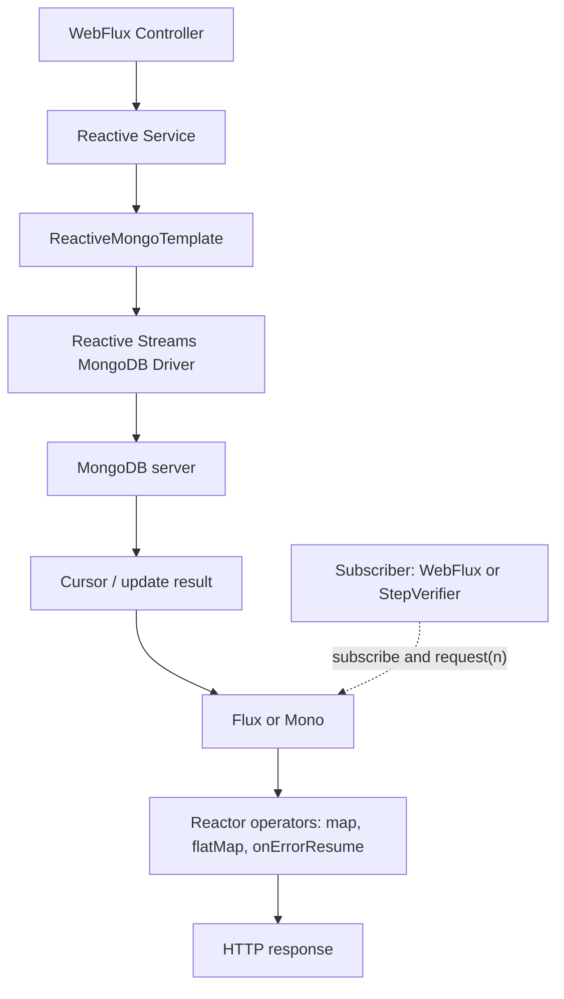

# ReactiveMongoTemplate for Queries, Updates, and Aggregation

## 1. Why Do You Need `ReactiveMongoTemplate`?

In a commerce service built with Spring WebFlux, a request may need to read orders, update status, or aggregate revenue from MongoDB. Calling `MongoTemplate`'s blocking API directly inside the event loop can hold a thread serving many connections until I/O completes.

**`ReactiveMongoTemplate`** is **Spring Data MongoDB**'s reactive MongoDB access API. It works with the MongoDB Reactive Streams Driver and Reactor, returning publishers such as:

- `Mono<OrderDocument>`: at most one document, or an empty completion.
- `Flux<OrderDocument>`: zero to many documents.
- `Mono<UpdateResult>`: the result of an update operation.
- `Flux<RevenueByStatus>`: multiple documents emitted from an aggregation.
- `Mono<Boolean>`, `Mono<Long>`: results of `exists`, `count`, or scalar predicates.

The core idea is not “wrapping MongoDB results in `Mono.just(...)`,” but using a **non-blocking driver** to perform database I/O upon subscription and emit `onNext` / `onError` / `onComplete` signals.

This lesson belongs to the **Reactive access** chapter of the **SPRING_DATA_MONGODB** module. It covers querying and document mapping with `ReactiveMongoTemplate`, conditional updates, aggregation, indexes, transactions, testing, and performance diagnostics. We also compare when reactive repositories are sufficient versus when the template gives more flexible query control.

**Goal:** build a complete reactive flow without calling `subscribe()` in services or `block()` on the event loop, combine `Query`/`Criteria`/`Update`/`Aggregation`, and understand the boundary between client-side backpressure and MongoDB server-side execution cost.

## 2. Diagram from Request to MongoDB



A publisher is normally a **description of work to execute**, not results already loaded when the variable is assigned.

```java
Flux<OrderDocument> pipeline =
    template.find(query, OrderDocument.class);

// Results are not consumed upon assigning pipeline.
// WebFlux, StepVerifier, or an outer subscriber will subscribe.
```

For most publishers returned by `ReactiveMongoTemplate`, the database operation starts upon subscription. Still, **never** assume a publisher caches its results: subscribing again can trigger a fresh database command.

### 2.1. Three Misconceptions to Drop Immediately

| Claim | Reality |
| --- | --- |
| “A `Mono` already holds the data” | It describes a signal source; it may be empty, errored, or unsubscribed |
| “`Flux` means MongoDB finished the query before Java receives anything” | The driver can fetch cursor batches incrementally; blocking stages like `$sort`/`$group` may still consume many inputs first |
| “Reactive makes every query faster” | Reactive manages I/O and threads under concurrency; indexes, scans, sorts, and server resources still dominate cost |

## 3. Spring Boot Project Setup Prerequisites

With Spring Boot, use the reactive MongoDB starter and Reactor from a compatible BOM. Maven example:

```xml
<dependency>
  <groupId>org.springframework.boot</groupId>
  <artifactId>spring-boot-starter-data-mongodb-reactive</artifactId>
</dependency>

<dependency>
  <groupId>org.springframework.boot</groupId>
  <artifactId>spring-boot-starter-webflux</artifactId>
</dependency>
```

If the app is purely a reactive worker without HTTP endpoints, WebFlux is not mandatory; `ReactiveMongoTemplate` only needs the reactive MongoDB dependencies.

Development configuration example:

```properties
spring.data.mongodb.uri=mongodb://localhost:27017/orderlab
```

Configure secrets, TLS, and auth appropriately in production. A valid connection URI does not guarantee the server has indexes, a replica set for transactions, or schema validation; verify those separately.

### 3.1. Auto-Configuration and Bean Injection

In compatible Spring Boot setups, auto-configuration creates `ReactiveMongoTemplate` when the reactive driver and MongoDB properties are present.

```java
import org.springframework.stereotype.Service;
import org.springframework.data.mongodb.core.ReactiveMongoTemplate;

@Service
public class ReactiveOrderService {
    private final ReactiveMongoTemplate template;

    public ReactiveOrderService(ReactiveMongoTemplate template) {
        this.template = template;
    }
}
```

If using multiple MongoDB clients/databases or custom converters, verify the injected bean uses the intended `ReactiveMongoDatabaseFactory`, mapping, and connection. Never create a new `MongoClient` per request.

### 3.2. Never Mix In the Imperative Driver to “Work Around” Missing Methods

Wrong inside a WebFlux event loop:

```java
// Modeling error: blocking operation runs before Mono.just.
Mono<OrderDocument> result = Mono.just(
    imperativeMongoTemplate.findById(
        id, OrderDocument.class
    )
);
```

`Mono.just(...)` does not make the blocking call inside it non-blocking. If you must call a blocking library lacking a reactive API, isolate it on a dedicated blocking scheduler and bound concurrency; that is a workaround, not a replacement for `ReactiveMongoTemplate`.

## 4. Dataset and Entity Used Throughout

We use the `orders` collection. Stored fields:

| Java property | BSON field | Expected BSON type |
| --- | --- | --- |
| `id` | `_id` | string |
| `tenantId` | `tenant_id` | string |
| `status` | `status` | string |
| `amountCents` | `amount_cents` | long |
| `placedAt` | `placed_at` | date |
| `version` | `version` | long, managed by Spring Data |

### 4.1. Entity

```java
import java.time.Instant;

import org.springframework.data.annotation.Version;
import org.springframework.data.mongodb.core.mapping.Document;
import org.springframework.data.mongodb.core.mapping.Field;
import org.springframework.data.mongodb.core.mapping.FieldType;
import org.springframework.data.mongodb.core.mapping.MongoId;

@Document(collection = "orders")
public record OrderDocument(
    @MongoId(FieldType.STRING)
    String id,

    @Field("tenant_id")
    String tenantId,

    String status,

    @Field("amount_cents")
    long amountCents,

    @Field("placed_at")
    Instant placedAt,

    @Version
    Long version
) {}
```

`@MongoId(FieldType.STRING)` clarifies that `_id` is stored as a string rather than relying implicitly on String-to-ObjectId conversion rules. `@Field` maps Java properties to snake_case BSON field names.

`@Version` enables optimistic locking. Through supported `save(...)` paths, Spring Data checks the version; for direct updates using `Update`, we will **add an explicit `expectedVersion` filter** to guard against stale writes.

### 4.2. Sample `mongosh` Data

Run only on a test database:

```javascript
db.orders.insertMany([
  {
    _id: "ord-1",
    tenant_id: "tenant-A",
    status: "PAID",
    amount_cents: NumberLong("120000"),
    placed_at: ISODate("2026-11-18T08:00:00Z"),
    version: NumberLong("1")
  },
  {
    _id: "ord-2",
    tenant_id: "tenant-A",
    status: "PAID",
    amount_cents: NumberLong("80000"),
    placed_at: ISODate("2026-11-18T09:00:00Z"),
    version: NumberLong("2")
  },
  {
    _id: "ord-3",
    tenant_id: "tenant-A",
    status: "PENDING",
    amount_cents: NumberLong("50000"),
    placed_at: ISODate("2026-11-18T10:00:00Z"),
    version: NumberLong("1")
  },
  {
    _id: "ord-4",
    tenant_id: "tenant-A",
    status: "PAID",
    amount_cents: NumberLong("250000"),
    placed_at: ISODate("2026-11-18T11:00:00Z"),
    version: NumberLong("1")
  },
  {
    _id: "ord-5",
    tenant_id: "tenant-B",
    status: "PAID",
    amount_cents: NumberLong("900000"),
    placed_at: ISODate("2026-11-18T12:00:00Z"),
    version: NumberLong("1")
  }
]);
```

Filtering by `tenant_id="tenant-A"` and `status="PAID"` yields **3 orders**: `ord-1`, `ord-2`, `ord-4`, totaling **450000 cents**. `ord-3` is unpaid, and `ord-5` belongs to another tenant.

### 4.3. Tenant Scoping Is Mandatory

In these examples, `trustedTenantId` must originate from a trusted authentication/authorization context. Never treat a client-supplied query parameter as proof of tenant authorization.

Omitting the tenant filter in the service—even if the controller filters the response afterward—risks leaking data in queries, logs, metrics, or aggregations.

## 5. Basic Queries: `find`, `findOne`, `findById`, `exists`, `count`

A read service:

```java
import org.springframework.data.mongodb.core.ReactiveMongoTemplate;
import org.springframework.data.mongodb.core.query.Criteria;
import org.springframework.data.mongodb.core.query.Query;
import reactor.core.publisher.Flux;
import reactor.core.publisher.Mono;

public final class OrderQueryReader {

    private final ReactiveMongoTemplate template;

    public OrderQueryReader(ReactiveMongoTemplate template) {
        this.template = template;
    }

    public Flux<OrderDocument> allPaid(
        String trustedTenantId
    ) {
        Query query = Query.query(
            Criteria.where("tenantId").is(trustedTenantId)
                .and("status").is("PAID")
        );
        return template.find(query, OrderDocument.class);
    }

    public Mono<OrderDocument> oneForTenant(
        String trustedTenantId,
        String id
    ) {
        Query query = Query.query(
            Criteria.where("tenantId").is(trustedTenantId)
                .and("id").is(id)
        );
        return template.findOne(query, OrderDocument.class);
    }

    public Mono<Boolean> anyPending(
        String trustedTenantId
    ) {
        Query query = Query.query(
            Criteria.where("tenantId").is(trustedTenantId)
                .and("status").is("PENDING")
        );
        return template.exists(query, OrderDocument.class);
    }

    public Mono<Long> paidCount(
        String trustedTenantId
    ) {
        Query query = Query.query(
            Criteria.where("tenantId").is(trustedTenantId)
                .and("status").is("PAID")
        );
        return template.count(query, OrderDocument.class);
    }
}
```

Expectations:

- `allPaid("tenant-A")` emits 3 entities, though **order should not be assumed** without a `sort`.
- `oneForTenant(...)` emits at most one entity; if absent, it completes empty rather than returning `null`.
- `anyPending(...)` emits `true` when any pending order exists.
- `paidCount(...)` emits `3L` from the server for the sample dataset.

### 5.1. `findById` Does Not Replace a Tenant Filter

`template.findById("ord-5", OrderDocument.class)` searches by ID only. For multi-tenant APIs, use `findOne` with both `id` and `tenantId` as shown above, or enforce equivalent authorization inside the database query.

### 5.2. When to Use `switchIfEmpty`?

```java
public Mono<OrderDocument> requireOrder(
    ReactiveMongoTemplate template,
    String trustedTenantId,
    String orderId
) {
    Query q = Query.query(
        Criteria.where("tenantId").is(trustedTenantId)
            .and("id").is(orderId)
    );

    return template.findOne(q, OrderDocument.class)
        .switchIfEmpty(Mono.error(
            new OrderNotFoundException("Order not found")
        ));
}
```

For illustration, `OrderNotFoundException` is a custom domain exception:

```java
public final class OrderNotFoundException
        extends RuntimeException {
    public OrderNotFoundException(String message) {
        super(message);
    }
}
```

Never call `defaultIfEmpty(null)`: Reactive Streams **forbids emitting `null`**. Choose empty completion, a domain error, or an explicit result DTO.

## 6. `Criteria` for Flexible Conditions

`Criteria` works identically with both `MongoTemplate` and `ReactiveMongoTemplate`; the difference is **how execution works**.

```java
import org.springframework.data.mongodb.core.query.Criteria;
import org.springframework.data.mongodb.core.query.Query;

Criteria filter = Criteria.where("tenantId").is("tenant-A")
    .and("status").in("PAID", "SHIPPED")
    .and("amountCents").gte(100000L);

Query query = Query.query(filter);
```

When combining multiple OR conditions:

```java
Criteria priority = new Criteria().orOperator(
    Criteria.where("amountCents").gte(200000L),
    Criteria.where("status").is("PENDING")
);

Criteria all = new Criteria().andOperator(
    Criteria.where("tenantId").is("tenant-A"),
    priority
);

Query q = Query.query(all);
```

Always keep the tenant/ACL predicate outside user-supplied OR logic. Placing the tenant check inside **one OR branch** while another branch omits it can leak cross-tenant data.

### 6.1. With Arrays

```java
Criteria sameLine = Criteria.where("items").elemMatch(
    Criteria.where("sku").is("KB-1")
        .and("quantity").gte(2)
);
```

`$elemMatch` ensures all constraints match **the same array element**. Reactivity does not alter this semantics. Java-to-BSON field mapping still depends on the domain type passed to the query.

### 6.2. Never Splice Raw Query JSON from Clients

Never accept arbitrary client JSON like `{"$where": ...}` or raw BSON pipelines and pass them straight to the database. Build queries from whitelisted fields and operators, bound input sizes, and validate values before hitting MongoDB.

## 7. Sorting and Pagination: Limit in MongoDB, Not Only on `Flux`

`Flux.take(20)` stops the subscriber after 20 elements, yet MongoDB and the driver may already have read many documents or sorted/aggregated them first. When you only need a page, place `sort`, `skip`, and `limit` **inside the MongoDB query**.

```java
import org.springframework.data.domain.Sort;
import org.springframework.data.mongodb.core.query.Query;
import org.springframework.data.mongodb.core.query.Criteria;

public Flux<OrderDocument> paidPage(
    ReactiveMongoTemplate template,
    String trustedTenantId,
    int page,
    int size
) {
    if (page < 0 || size < 1 || size > 100) {
        return Flux.error(
            new IllegalArgumentException("Page/size invalid")
        );
    }

    long offset = Math.multiplyExact(
        (long) page, (long) size
    );

    Query q = Query.query(
        Criteria.where("tenantId").is(trustedTenantId)
            .and("status").is("PAID")
    );

    q.with(Sort.by(
        Sort.Order.desc("placedAt"),
        Sort.Order.asc("id")
    ));
    q.skip(offset);
    q.limit(size);

    return template.find(q, OrderDocument.class);
}
```

Adding `id` as a tie-breaker keeps ordering deterministic when orders share the same timestamp.

### 7.1. Offset Pagination Still Has Limits

Large `$skip` offsets remain expensive because MongoDB must walk past matching entries before returning the page. When documents change between requests, offset pagination can duplicate or skip items.

For very deep lists, consider keyset/scrolling pagination over a unique sort key and matching index—never assume `Flux` makes offset pagination cheap.

### 7.2. Count and Items Are Two Operations

`template.count(q, OrderDocument.class)` and `template.find(q, OrderDocument.class)` are two independent database commands when invoked separately. Data can change between them.

When you need items + count in **a single aggregation**, you can use `$facet`, provided you account for its costs and limits. A `$facet` does not create a snapshot across multiple HTTP requests; consistency still depends on read concern/sessions/transactions as required.

## 8. Projections: Not Every Query Needs the Whole Entity

Real order documents often contain many line items, internal notes, or customer payloads. A list screen might only need ID, status, amount, and timestamp.

You can use field projection:

```java
Query q = Query.query(
    Criteria.where("tenantId").is(trustedTenantId)
        .and("status").is("PAID")
);

q.fields()
    .include("id")
    .include("status")
    .include("amountCents")
    .include("placedAt");
q.limit(20);

Flux<OrderDocument> partial =
    template.find(q, OrderDocument.class);
```

This snippet **only illustrates field projection**. The returned `OrderDocument` will miss `tenantId`, `version`, and other excluded fields. **Never pass this partial object to `save(...)`**, or you risk wiping fields or resetting defaults.

### 8.1. Use DTOs for Read Results

```java
public record OrderListItem(
    String id,
    String status,
    long amountCents,
    java.time.Instant placedAt
) {}
```

A semantically safe approach is loading the full entity and mapping, though it does not shrink network payload without projection:

```java
Flux<OrderListItem> cards =
    template.find(qWithoutPartialProjection, OrderDocument.class)
        .map(o -> new OrderListItem(
            o.id(), o.status(),
            o.amountCents(), o.placedAt()
        ));
```

`qWithoutPartialProjection` here is a `Query` with filter/sort/limit configured but **without** `fields().include(...)`. To reduce network payload too, use `ReactiveMongoTemplate`'s **fluent projection API** (in supported Spring Data releases), e.g.:

```java
Flux<OrderListItem> cards =
    template.query(OrderDocument.class)
        .as(OrderListItem.class)
        .matching(q)
        .all();
```

With `.as(...)`, Spring Data relies on **mapping between the source domain type and target projection**. Verify your library version, record constructors, `@Field`, and actual BSON field names. Automatic projection is not always as optimal as hand-crafted projections for custom expressions or converters; test the response and `explain` if payload size is a bottleneck.

### 8.2. Read DTOs Differ from Persisted Entities

Because `OrderListItem` lacks `tenantId` and `version`, it is a **view model**, not an object meant to overwrite the full document. To change status, use a conditional `Update.set(...)` instead of rebuilding a partial entity and calling `save`.

## 9. Direct Updates with `ReactiveMongoTemplate.updateFirst`

A direct update returns **`Mono<UpdateResult>`**.

```java
import com.mongodb.client.result.UpdateResult;

import org.springframework.data.mongodb.core.ReactiveMongoTemplate;
import org.springframework.data.mongodb.core.query.Criteria;
import org.springframework.data.mongodb.core.query.Query;
import org.springframework.data.mongodb.core.query.Update;
import reactor.core.publisher.Mono;

public Mono<Boolean> markPaid(
    ReactiveMongoTemplate template,
    String trustedTenantId,
    String orderId
) {
    Query filter = Query.query(
        Criteria.where("id").is(orderId)
            .and("tenantId").is(trustedTenantId)
            .and("status").is("PENDING")
    );

    Update update = new Update()
        .set("status", "PAID");

    return template.updateFirst(
        filter, update, OrderDocument.class
    ).map(result -> {
        if (!result.wasAcknowledged()) {
            throw new IllegalStateException(
                "No MongoDB write acknowledgment"
            );
        }
        return result.getMatchedCount() == 1L;
    });
}
```

This command enforces `status=PENDING` as a precondition, though it does **not** yet check a previously read `version`. For workflows needing optimistic concurrency across competing writers, see CAS in the next section.

### 9.1. `matchedCount` and `modifiedCount`

- `matchedCount=1`: a document matched all query criteria.
- `matchedCount=0`: no match; could be ID, tenant, status, or version—do not assume a single cause.
- `modifiedCount=0` is not necessarily a conflict: the filter matched, yet the update made no net change per update semantics.
- Never use an unacknowledged write concern if your logic inspects counters.

### 9.2. `updateMulti` and `remove`

```java
Mono<UpdateResult> updated = template.updateMulti(
    Query.query(Criteria.where("tenantId").is(tenantId)
        .and("status").is("PENDING")),
    new Update().set("status", "EXPIRED"),
    OrderDocument.class
);

Mono<com.mongodb.client.result.DeleteResult> deleted =
    template.remove(
        Query.query(Criteria.where("tenantId").is(tenantId)
            .and("id").is(orderId)),
        OrderDocument.class
    );
```

These are **two separate publishers**. If you declare both and return only `updated`, `deleted` stays unsubscribed and will not run. To execute sequentially, chain them with `then(...)`, while verifying correctness if the two operations are related.

`updateMulti` across multiple documents is not an **all-or-nothing transaction**. Each single-document update is individually atomic; for multi-document invariants, use transactions on a replica set or compatible sharded cluster.

## 10. CAS with `expectedVersion`: Atomic Updates Under Contention

A common mistake is relying on `@Version` and assuming every direct update prevents lost updates. With `save(entity)`, Spring Data enforces optimistic locking; with direct `Update` calls, **include the expected version in the filter** when stale writes must be rejected.

```java
public record ConfirmCommand(
    String orderId,
    long expectedVersion
) {}
```

Service:

```java
public Mono<Boolean> confirmOrder(
    ReactiveMongoTemplate template,
    String trustedTenantId,
    ConfirmCommand c
) {
    if (c.expectedVersion() < 0) {
        return Mono.error(
            new IllegalArgumentException("Negative version")
        );
    }

    Query filter = Query.query(
        Criteria.where("id").is(c.orderId())
            .and("tenantId").is(trustedTenantId)
            .and("version").is(c.expectedVersion())
            .and("status").is("PENDING")
    );

    Update update = new Update()
        .set("status", "CONFIRMED")
        .inc("version", 1L);

    return template.updateFirst(
        filter, update, OrderDocument.class
    ).map(r -> {
        if (!r.wasAcknowledged()) {
            throw new IllegalStateException(
                "Unacknowledged CAS write"
            );
        }
        return r.getMatchedCount() == 1L;
    });
}
```

This is **compare-and-set**: when MongoDB matches ID, tenant, version, and status, it atomically updates status and increments version. If another worker already bumped the version, the old-version query no longer matches.

**Warning about `@Version`:** in modern Spring Data MongoDB releases, certain update operations may auto-increment the version property if it is **not already specified in `Update`**. That **does not automatically add `expectedVersion` to the filter**. The example above explicitly calls `Update.inc("version", 1L)`; do not increment the version a second time in application code.

### 10.1. `matchedCount=0` Can Mean Several States

Never unconditionally report “version conflict” when the match count is 0: the order might not exist, belong to a different tenant, already be confirmed/cancelled, or a prior request may have succeeded while its response was lost.

When strict idempotency is required, use an `operationId` or ledger to reconcile instead of blindly retrying with a newly read version.

## 11. `findAndModify`: Receiving the Updated Document

When you need the updated entity immediately after a successful CAS update, use `findAndModify`:

```java
import org.springframework.data.mongodb.core.FindAndModifyOptions;

public Mono<OrderDocument> confirmAndReturn(
    ReactiveMongoTemplate template,
    String tenantId,
    String orderId,
    long expectedVersion
) {
    Query filter = Query.query(
        Criteria.where("id").is(orderId)
            .and("tenantId").is(tenantId)
            .and("version").is(expectedVersion)
            .and("status").is("PENDING")
    );

    Update update = new Update()
        .set("status", "CONFIRMED")
        .inc("version", 1L);

    return template.findAndModify(
        filter,
        update,
        FindAndModifyOptions.options().returnNew(true),
        OrderDocument.class
    ).switchIfEmpty(
        Mono.error(new OrderNotFoundException(
            "No order matched update preconditions"
        ))
    );
}
```

Here, a distinct domain exception name like `OrderPreconditionFailedException` may fit better because empty can result from a version/status mismatch rather than a missing ID. Depending on API contract, you can return `Mono.empty()` and let callers classify via readback.

**Never add `upsert(true)` to CAS just to “avoid empty”**: on a version mismatch, an upsert may try to insert a brand-new document and fail with a duplicate key or corrupt data.

### 11.1. When to Use `findAndModify` vs `updateFirst`?

| Need | Typically Suitable Choice |
| --- | --- |
| Only need to know if update matched | `updateFirst(...) → Mono<UpdateResult>` |
| Need the new entity / new version in one operation | `findAndModify(...returnNew(true))` |
| Need multiple matching documents | `find(...) → Flux<T>` |
| Need to update many documents on a condition | `updateMulti`, though not a transaction |
| Saving a full entity with optimistic locking | Reactive repository `save(entity)` / matching API, honoring version contract |

`findAndModify` does not prevent stale writes if the filter omits `expectedVersion`.

## 12. Inserts and Ordered Write Streams

`ReactiveMongoTemplate.insert(...)` returns a publisher for the saved entity. You can chain validation and writes:

```java
public Mono<OrderDocument> createOrder(
    ReactiveMongoTemplate template,
    OrderDocument input
) {
    if (input.amountCents() <= 0) {
        return Mono.error(
            new IllegalArgumentException("Invalid amount")
        );
    }
    return template.insert(input);
}
```

With `@Version Long` initially null, Spring Data may initialize the version during insert per mapping rules; verify the returned object and test on your exact version.

### 12.1. Running Many Inserts, Controlling Order and Concurrency

```java
Flux<OrderDocument> input = Flux.fromIterable(commands)
    .map(this::toOrderDocument);

// When preserving emission order and executing sequentially:
Flux<OrderDocument> persisted =
    input.concatMap(template::insert);

// When orders are independent and concurrent writes are acceptable:
Flux<OrderDocument> concurrent =
    input.flatMap(template::insert, 8);
```

`commands` is an assumed source and `toOrderDocument` converts DTOs to entities; the snippet focuses on choosing Reactor operators.

- `concatMap` waits for one operation to complete before starting the next in order.
- `flatMap(..., 8)` allows up to 8 concurrent inner publishers per operator settings, **without** guaranteeing output order.
- These are **separate individual inserts**, not a transaction and not all-or-nothing.
- Bounding concurrency limits pipeline load, not an absolute cap on driver connections across the JVM.

**Never call `subscribe()` manually inside a service to “start a job” and return success immediately.** Write errors will not reach the caller, requests can finish before the DB does, and transaction context is lost.

## 13. Aggregation with `ReactiveMongoTemplate.aggregate(...)`

Aggregation combines filtering, grouping, sorting, and projection to transform documents into reports. Using the entity from section 4, we want total revenue by status for tenant A.

### 13.1. Equivalent MongoDB Command

```javascript
db.orders.aggregate([
  { $match: { tenant_id: "tenant-A" } },
  {
    $group: {
      _id: "$status",
      orders: { $sum: 1 },
      grossCents: { $sum: "$amount_cents" }
    }
  },
  {
    $project: {
      _id: 0,
      status: "$_id",
      orders: 1,
      grossCents: 1
    }
  },
  { $sort: { status: 1 } }
]);
```

Based on the dataset:

| status | orders | grossCents |
| --- | ---: | ---: |
| PAID | 3 | 450000 |
| PENDING | 1 | 50000 |

Document `ord-5` of tenant B is excluded. This is a per-status summary report, not an order list.

### 13.2. Target DTO

```java
public record RevenueByStatus(
    String status,
    long orders,
    long grossCents
) {}
```

### 13.3. Typed Spring Data Aggregation

```java
import org.springframework.data.domain.Sort;
import org.springframework.data.mongodb.core.ReactiveMongoTemplate;
import org.springframework.data.mongodb.core.aggregation.Aggregation;
import org.springframework.data.mongodb.core.aggregation.AggregationOptions;
import org.springframework.data.mongodb.core.query.Criteria;
import reactor.core.publisher.Flux;

import java.time.Duration;

public Flux<RevenueByStatus> revenueByStatus(
    ReactiveMongoTemplate template,
    String trustedTenantId
) {
    Aggregation agg = Aggregation.newAggregation(
        Aggregation.match(
            Criteria.where("tenantId").is(trustedTenantId)
        ),
        Aggregation.group("status")
            .count().as("orders")
            .sum("amountCents").as("grossCents"),
        Aggregation.project("orders", "grossCents")
            .and("_id").as("status")
            .andExclude("_id"),
        Aggregation.sort(Sort.by("status"))
    ).withOptions(
        AggregationOptions.builder()
            .cursorBatchSize(100)
            .maxTime(Duration.ofSeconds(5))
            .build()
    );

    return template.aggregate(
        agg,
        OrderDocument.class,
        RevenueByStatus.class
    );
}
```

**Important:** `OrderDocument.class` is the **input domain type**: in typed stages, Spring Data uses entity metadata to translate `tenantId` to BSON `tenant_id` and `amountCents` to `amount_cents`. The return type is `Flux<RevenueByStatus>` because after grouping and projection, the output **is no longer the source entity**.

`Aggregation.project(...).and("_id").as("status")` renames `_id` to match the DTO. Never assume `$group`'s `_id` will automatically map to arbitrary record component names.

### 13.4. `allowDiskUse` and Batch Size Do Not Change Aggregation Logic

`AggregationOptions.cursorBatchSize(100)` adjusts the result cursor batch size per server/driver rules; it **does not cap** the number of groups or scanned input documents. `allowDiskUse(true)`, when set, merely permits supported stages to spill to temporary disk when needed; it does not fix missing indexes, raise the 16 MiB BSON document limit, or exempt `$facet` from its own memory limits.

**Reactive still hits blocking server stages**: `$sort`/`$group` may process huge numbers of inputs before emitting any result. `Flux` does not make server execution cheaper.

## 14. `$facet`, Totals, and Pagination in a Single Aggregation

An endpoint may need:

- The first page of PAID orders.
- The total count of PAID orders.
- The total PAID revenue.

`mongosh` example:

```javascript
db.orders.aggregate([
  {
    $match: {
      tenant_id: "tenant-A",
      status: "PAID"
    }
  },
  {
    $facet: {
      items: [
        { $sort: { placed_at: -1, _id: 1 } },
        { $limit: 20 },
        {
          $project: {
            _id: 1,
            status: 1,
            amount_cents: 1,
            placed_at: 1
          }
        }
      ],
      totals: [
        {
          $group: {
            _id: null,
            total: { $sum: 1 },
            grossCents: { $sum: "$amount_cents" }
          }
        }
      ]
    }
  }
]);
```

Output shape:

```json
{
  "items": [
    { "_id": "ord-4", "status": "PAID", "amount_cents": 250000 },
    { "_id": "ord-2", "status": "PAID", "amount_cents": 80000 },
    { "_id": "ord-1", "status": "PAID", "amount_cents": 120000 }
  ],
  "totals": [
    { "_id": null, "total": 3, "grossCents": 450000 }
  ]
}
```

The abbreviated JSON omits `placed_at` even though the pipeline projects it. On the server, the output is **one document containing arrays**—not three separate `Flux` items.

### 14.1. Reading Facet Results Reactively

```java
import org.bson.Document;

Aggregation aggregation = Aggregation.newAggregation(
    Aggregation.match(
        Criteria.where("tenantId").is(tenantId)
            .and("status").is("PAID")
    ),
    Aggregation.facet(
        Aggregation.sort(Sort.by(
            Sort.Order.desc("placedAt"),
            Sort.Order.asc("id")
        )),
        Aggregation.limit(20)
    ).as("items")
     .and(
         Aggregation.group()
             .count().as("total")
             .sum("amountCents").as("grossCents")
     ).as("totals")
);

Mono<Document> oneFacetDocument =
    template.aggregate(
        aggregation, OrderDocument.class, Document.class
    ).next();
```

With `$facet` as the final stage, output normally consists of one document holding the `items` and `totals` arrays. `next()` makes sense when the contract expects one document; if you append `$unwind` after `$facet`, output shape changes and `next()` would drop items.

**Warning:** `totals` will be an empty array when zero orders match; calling `totals.get(0)` blindly will fail. Normalize missing totals to `total=0`/`grossCents=0` when constructing API DTOs.

### 14.2. Memory and Output Limits

`$facet` has roughly a **100 MB** internal stage limit and cannot spill via `allowDiskUse`; the final BSON result is still bounded by the **16 MiB** document limit. Keep `$limit` inside the `items` branch. Never move `limit` before `$facet` if `totals` must reflect all matching documents.

For large lists, many branches, or true per-document streaming, separate cursor-backed queries usually fit better than packing everything into one huge facet document.

## 15. When to Use `Mono` vs `Flux`?

| Operation | Typical Return Type | Notes |
| --- | --- | --- |
| `findOne`, `findById` | `Mono<T>` | 0 or 1 item |
| `find` | `Flux<T>` | 0 to many items |
| `exists` | `Mono<Boolean>` | Emits `true`/`false` |
| `count` | `Mono<Long>` | Single count |
| `insert(entity)` | `Mono<T>` | Saved entity |
| `updateFirst` / `updateMulti` | `Mono<UpdateResult>` | Matched/modified counts |
| `remove` | `Mono<DeleteResult>` | Deleted count |
| `findAndModify` | `Mono<T>` | May complete empty if no match |
| `aggregate` | `Flux<O>` | Pipeline output documents |
| Final `$facet` aggregation | Usually `Flux<Document>.next()` | One document containing arrays |
| `indexOps(...).ensureIndex` | `Mono<String>` where supported | Never invoke index creation per HTTP request |

An **empty** `Mono<T>` is a valid empty completion, not an error. Distinguish `switchIfEmpty` from `onErrorResume`: one handles missing results, the other handles exceptions.

## 16. Reactor Operators: Choices That Affect Business Semantics

### 16.1. `map`: Synchronous Transformation, No Secondary DB Call

```java
Flux<OrderListItem> rows =
    template.find(query, OrderDocument.class)
        .map(o -> new OrderListItem(
            o.id(), o.status(),
            o.amountCents(), o.placedAt()
        ));
```

`map` transforms each item synchronously. Never return a `Mono` from `map` when intending to run a follow-up reactive query; that produces a nested publisher.

### 16.2. `flatMap`: Composing Additional Reactive I/O

```java
Mono<OrderDocument> requested =
    template.findOne(query, OrderDocument.class)
        .flatMap(order ->
            otherReactiveService.enrich(order)
        );
```

`otherReactiveService.enrich(...)` is an assumed method returning `Mono<OrderDocument>`. `flatMap` chains I/O without calling `block()`.

### 16.3. `concatMap` for Order-Preserving Sequences

When commands in a list depend on order, use `concatMap` or a per-key queue:

```java
Flux<WriteReceipt> receipts =
    Flux.fromIterable(commands)
        .concatMap(command ->
            writeCommand(command)
        );
```

`WriteReceipt` and `writeCommand` are illustrative types/methods. `concatMap` preserves emission order and waits for each prior step to finish; it does not make multiple commands a transaction.

### 16.4. `flatMap` with Bounded Concurrency

```java
Flux<WriteReceipt> receipts =
    Flux.fromIterable(commands)
        .flatMap(
            command -> writeCommand(command),
            8
        );
```

This increases throughput for independent operations, though output order is not guaranteed. When multiple commands update the same order, use version guards, transactions, or per-aggregate serialization; Reactor concurrency does not protect against lost updates.

### 16.5. `zip` and `when` Do Not Create Transactions

```java
Mono<Dashboard> dashboard = Mono.zip(
    reader.paidCount(tenantId),
    reader.revenueTotal(tenantId)
).map(tuple -> new Dashboard(
    tuple.getT1(), tuple.getT2()
));
```

This assumes application-defined `reader.revenueTotal` and `Dashboard`. `zip` combines two publishers; they may run concurrently, yet they **do not** share a snapshot or all-or-nothing guarantee. If either branch writes, analyze transactions and idempotency explicitly.

## 17. Cold Publishers, Re-Subscription, and Double-Write Risks

A service builds a publisher:

```java
Mono<OrderDocument> created =
    template.insert(order);
```

If two independent subscribers subscribe to this publisher, the insert can execute **twice**. Never treat a `Mono` like an already-completed future that can be shared freely.

Wrong example:

```java
Mono<OrderDocument> created = template.insert(order);

created.subscribe();  // First write; errors may be lost.
return created;        // WebFlux subscribes a second time.
```

This can trigger a duplicate key error or double writes if different IDs are generated each time. **Never call `subscribe()` inside a service** when the caller owns subscription.

### 17.1. `retryWhen` Must Distinguish Reads from Writes

For pure read queries, bounded retries on transient failures can help:

```java
Mono<OrderDocument> one =
    template.findOne(query, OrderDocument.class)
        .retryWhen(
            reactor.util.retry.Retry.backoff(
                2, java.time.Duration.ofMillis(100)
            ).filter(this::isTransientMongoFailure)
        );
```

`isTransientMongoFailure` is an application error classifier; never retry all exceptions, especially validation or authorization errors.

With `insert`, `updateFirst`, or `$inc`, the server may have executed the command before the client lost the response. Blind `retryWhen` can repeat business effects. Use operation IDs, `expectedVersion`, idempotency ledgers, and readback checks for ambiguous outcomes.

### 17.2. `cache()` Is Not Database Idempotency

`mono.cache()` can share results and terminal signals across subscribers for one publisher instance's lifetime, yet it **does not** guarantee system-wide exactly-once execution across restarts, multiple JVMs, timeouts, or redeployments.

Data idempotency must rely on MongoDB constraints and business rules.

## 18. Backpressure, Cursor Batches, and Server-Side Blocking Stages

Reactive Streams lets subscribers pull items by demand, expressed as `request(n)`. The MongoDB Reactive Streams Driver manages cursors and batches accordingly, though one requested item does not mean **exactly one network call**.

### 18.1. Batch Size

```java
Query query = Query.query(
    Criteria.where("tenantId").is(tenantId)
);

query.cursorBatchSize(100);

Flux<OrderDocument> rows =
    template.find(query, OrderDocument.class);
```

`cursorBatchSize(100)` hints the cursor batch size, **not the total result limit**. A query matching 50,000 documents will still emit 50,000 items across multiple batches. On large collections, set `limit`, projections, timeouts, and bounding criteria.

Batch/cursor APIs can vary across Spring Data lines; check your dependency version's methods and verify via command monitoring.

### 18.2. `limitRate` Does Not Equal a Query Limit

```java
Flux<OrderDocument> rows =
    template.find(query, OrderDocument.class)
        .limitRate(50);
```

`limitRate` shapes how Reactor requests elements upstream; it does not modify the MongoDB filter, sort, or limit. The driver/server may already have fetched a larger batch; never use `limitRate` in place of `Query.limit(...)` to enforce pagination or quotas.

### 18.3. Stages That Accumulate Data

An unindexed `$sort` or high-cardinality `$group` can consume substantial server RAM; `$facet` can build huge arrays. Even if the consumer only requests 1 item, the server must still complete the prerequisite work to produce that first item.

Never promote backpressure as a way to bypass the **16 MiB/document** BSON limit or `$facet`'s memory cap.

### 18.4. `collectList()` and Java Memory

```java
Mono<java.util.List<OrderDocument>> all =
    template.find(query, OrderDocument.class)
        .collectList();
```

`collectList()` materializes **all** emitted results into a single `List`. On large result sets it can cause OOM even though the driver fetches in batches. Use it only when the result set is strictly bounded.

## 19. Indexes and Diagnosing Reactive Queries

The same filter on tenant, status, and `placedAt` has the exact same indexing needs as imperative MongoDB:

```javascript
db.orders.createIndex(
  {
    tenant_id: 1,
    status: 1,
    placed_at: -1,
    _id: 1
  },
  {
    name: "idx_orders_tenant_status_time_id"
  }
);
```

For `tenant_id + status` filtering and `placed_at desc, _id asc` sorting, this index is a strong candidate; always inspect the planner on real data, especially as projections, limits, and cardinality vary.

### 19.1. `explain` in MongoDB

```javascript
db.orders.find({
  tenant_id: "tenant-A",
  status: "PAID"
}).sort({
  placed_at: -1,
  _id: 1
}).limit(20).explain("executionStats");
```

Inspect:

| Field | Question |
| --- | --- |
| `IXSCAN`, `COLLSCAN` | Did MongoDB use an index? |
| `totalKeysExamined` | How many index entries were scanned? |
| `totalDocsExamined` | How many source documents were fetched? |
| `SORT` / sort stage | Was an in-memory sort needed? |
| `nReturned` | Does it match expected results? |
| `executionTimeMillis` | Server-side query cost? |
| Command/`getMore` metrics | Is the cursor causing excessive batches/round trips? |
| p95/p99 | Actual latency under high concurrency? |

Do not confuse server execution time in `explain` with **end-to-end HTTP latency**, which also includes network hops, mapping, application logic, slow consumers, and backpressure.

### 19.2. Index Creation Is a Publisher

In supported `ReactiveMongoTemplate` versions:

```java
import org.springframework.data.domain.Sort;
import org.springframework.data.mongodb.core.index.Index;

Mono<String> indexName = template
    .indexOps(OrderDocument.class)
    .ensureIndex(
        new Index()
            .on("tenantId", Sort.Direction.ASC)
            .on("status", Sort.Direction.ASC)
            .on("placedAt", Sort.Direction.DESC)
            .on("id", Sort.Direction.ASC)
            .named("idx_orders_tenant_status_time_id")
    );
```

Declaring `indexName` without subscribing does not create the index. **Never run `ensureIndex` on every HTTP request**; manage indexes in migrations/bootstrap with proper privileges and verify BSON keys after `@Field` mapping.

`@Indexed` and `@CompoundIndex` are metadata; auto-index creation may be **disabled by default** in modern Spring Data MongoDB versions. Establish an explicit provisioning workflow rather than assuming annotations guarantee indexes exist.

## 20. Reactive Transactions: Keep the Same Subscriber Context

MongoDB supports multi-document transactions on replica sets or sharded clusters meeting version requirements; a standalone `mongod` does not support multi-document transactions.

Spring Data provides `ReactiveMongoTransactionManager`:

```java
import org.springframework.context.annotation.Bean;
import org.springframework.context.annotation.Configuration;
import org.springframework.data.mongodb.ReactiveMongoDatabaseFactory;
import org.springframework.data.mongodb.ReactiveMongoTransactionManager;
import org.springframework.transaction.reactive.TransactionalOperator;

@Configuration
public class ReactiveTransactionConfig {

    @Bean
    public ReactiveMongoTransactionManager txManager(
        ReactiveMongoDatabaseFactory factory
    ) {
        return new ReactiveMongoTransactionManager(factory);
    }

    @Bean
    public TransactionalOperator txOperator(
        ReactiveMongoTransactionManager manager
    ) {
        return TransactionalOperator.create(manager);
    }
}
```

### 20.1. Two Updates in One Transaction

```java
import org.springframework.transaction.reactive.TransactionalOperator;

public Mono<Void> transferUnits(
    ReactiveMongoTemplate template,
    TransactionalOperator tx,
    String trustedTenant,
    String sourceId,
    String targetId,
    long units
) {
    if (units <= 0 || sourceId.equals(targetId)) {
        return Mono.error(
            new IllegalArgumentException("Transfer invalid")
        );
    }

    Query from = Query.query(
        Criteria.where("id").is(sourceId)
            .and("tenantId").is(trustedTenant)
            .and("availableUnits").gte(units)
    );

    Query to = Query.query(
        Criteria.where("id").is(targetId)
            .and("tenantId").is(trustedTenant)
    );

    Mono<Void> changes = template.updateFirst(
        from,
        new Update().inc("availableUnits", -units),
        InventoryAccount.class
    ).flatMap(debit -> {
        if (debit.getMatchedCount() != 1) {
            return Mono.error(
                new IllegalStateException(
                    "Insufficient units at source"
                )
            );
        }

        return template.updateFirst(
            to,
            new Update().inc("availableUnits", units),
            InventoryAccount.class
        );
    }).flatMap(credit -> {
        if (credit.getMatchedCount() != 1) {
            return Mono.error(
                new IllegalStateException(
                    "Target not found"
                )
            );
        }
        return Mono.<Void>empty();
    });

    return tx.transactional(changes);
}
```

`InventoryAccount` is an assumed entity with `id`, `tenantId`, and `availableUnits` properly mapped. The example highlights the **transaction boundary**: two sequential updates chained inside a single publisher managed by `TransactionalOperator`. It is not a full production workflow because it omits operation IDs, an audit ledger, overflow checks, and ambiguous commit reconciliation.

### 20.2. Why Not Call `subscribe()` in the Middle?

Wrong:

```java
template.updateFirst(from, debit, InventoryAccount.class)
    .subscribe();  // Detached from the transaction chain!

return tx.transactional(
    template.updateFirst(to, credit, InventoryAccount.class)
);
```

The first command runs under an independent subscription outside the transaction context/subscriber. If the second fails, the first is not guaranteed to roll back.

The right pattern returns one single chain so `tx.transactional(...)` controls the entire sequence and the caller subscribes.

### 20.3. Transactions Do Not Solve Retrying Business Side Effects

If the commit response is lost, the transaction may have already committed. Retrying with a new operation ID can apply the effect a second time. Use idempotency tokens/ledgers and handle driver/framework error labels such as `TransientTransactionError` and `UnknownTransactionCommitResult`.

Never attach unbounded `retryWhen` around an entire transaction without accounting for side effects outside MongoDB.

## 21. Error Handling: Separating Empty, Validation, Timeouts, and Network Errors

A well-designed reactive API distinguishes:

- **Document not found**: `Mono.empty()` or empty result.
- **CAS precondition mismatch**: acknowledged `UpdateResult.matchedCount=0`.
- **Duplicate key**: write rejected by a unique index.
- **Schema validation**: MongoDB rejects an invalid document.
- **Timeout / server selection**: MongoDB did not respond within deadline.
- **Network error after write**: outcome may be uncertain.
- **Subscription cancelled**: consumer stopped needing data; never assume writes rolled back.

### 21.1. Selective Error Handling

```java
Mono<OrderDocument> found = template.findOne(
    query, OrderDocument.class
)
    .switchIfEmpty(Mono.error(
        new OrderNotFoundException("Order not found")
    ));

Mono<OrderDocument> created = template.insert(order)
    .onErrorMap(
        org.springframework.dao.DuplicateKeyException.class,
        e -> new OrderConflictException(
            "Duplicate business key", e
        )
    );
```

`OrderConflictException` is an application-defined domain class, and `order` is the entity to write. This example separates the **read path** (`found` handles empty with `switchIfEmpty`) from the **write path** (`created` maps unique index errors via `onErrorMap`). Do not attach duplicate-key mappers to pure `findOne` reads or treat empty as a network error.

### 21.2. Timeouts Exist at Multiple Layers

```java
return template.find(query, OrderDocument.class)
    .timeout(java.time.Duration.ofSeconds(3));
```

Reactor `timeout` bounds signal waiting on the client; it is not `maxTimeMS` on the MongoDB Server. For aggregations, `AggregationOptions.maxTime(...)` can be set where supported alongside coordinated driver and HTTP timeouts.

A client timeout after a write does not prove the server skipped the write. Never blindly re-issue non-idempotent updates.

### 21.3. Do Not Swallow Errors

Wrong:

```java
return template.insert(order)
    .onErrorResume(error -> Mono.empty());
```

If the controller treats empty completion as success, duplicate-key or validation errors are silently hidden. Classify errors eligible for fallback and propagate domain/system errors accurately.

## 22. WebFlux Controller: Return the Publisher, Don't Block

A minimal controller:

```java
import org.springframework.http.ResponseEntity;
import org.springframework.web.bind.annotation.GetMapping;
import org.springframework.web.bind.annotation.PathVariable;
import org.springframework.web.bind.annotation.RequestMapping;
import org.springframework.web.bind.annotation.RestController;
import reactor.core.publisher.Mono;

@RestController
@RequestMapping("/api/orders")
public class OrderController {

    private final OrderQueryReader reader;

    public OrderController(OrderQueryReader reader) {
        this.reader = reader;
    }

    @GetMapping("/{id}")
    public Mono<ResponseEntity<OrderDocument>> one(
        @PathVariable String id
    ) {
        // Example: in production, obtain from the authenticated security context,
        // NEVER hardcode or trust a tenant from the path.
        String trustedTenantId = "tenant-A";

        return reader.oneForTenant(trustedTenantId, id)
            .map(ResponseEntity::ok)
            .defaultIfEmpty(
                ResponseEntity.notFound().build()
            );
    }
}
```

Here `OrderQueryReader` should be registered as a Spring bean (`@Service` or `@Bean`), not instantiated casually with `new` inside the controller.

**Never ship a hardcoded tenant to production.** Real apps must extract the tenant from the authenticated principal/reactive security context and enforce ACL checks before querying. Response DTOs should omit internal fields such as version, audit metadata, or internal notes unless needed.

### 22.1. Why Return the Publisher?

WebFlux manages subscription, demand, serialization, cancellation, and error mapping. If the controller calls `subscribe()` itself, callers receive a response before work finishes, error propagation breaks, and database work detaches from the transaction context.

## 23. Testing with `StepVerifier` and Real MongoDB

Unit tests using `Flux.just(...)` only verify Reactor operators—not MongoDB server filtering, `@Field` mapping, indexes, aggregations, or atomic updates. Add integration tests against a real test MongoDB.

### 23.1. Testing Query and Aggregation Results

Example using Spring Boot 3.x, JUnit 5, AssertJ, Reactor Test, Spring Data MongoDB, and a MongoDB test instance. `@DataMongoTest` and reactive driver configuration must align with your project's Boot version.

```java
import static org.assertj.core.api.Assertions.assertThat;

import java.time.Instant;
import java.util.UUID;

import org.junit.jupiter.api.Test;
import org.springframework.beans.factory.annotation.Autowired;
import org.springframework.boot.test.autoconfigure.data.mongo.DataMongoTest;
import org.springframework.context.annotation.Import;
import org.springframework.data.mongodb.core.ReactiveMongoTemplate;
import reactor.test.StepVerifier;

@DataMongoTest
@Import(OrderQueryReader.class)
class ReactiveOrderTemplateIntegrationTest {

    @Autowired ReactiveMongoTemplate template;
    @Autowired OrderQueryReader reader;

    @Test
    void findPaidFiltersTenantAndUsesReactivePublisher() {
        String tenant = "rx-" + UUID.randomUUID();

        OrderDocument paid = new OrderDocument(
            "rx-paid-" + UUID.randomUUID(),
            tenant,
            "PAID",
            120000L,
            Instant.parse("2026-11-18T08:00:00Z"),
            null
        );
        OrderDocument pending = new OrderDocument(
            "rx-pending-" + UUID.randomUUID(),
            tenant,
            "PENDING",
            30000L,
            Instant.parse("2026-11-18T09:00:00Z"),
            null
        );

        StepVerifier.create(
            template.insert(paid)
                .then(template.insert(pending))
                .thenMany(reader.allPaid(tenant))
        )
            .assertNext(found -> {
                assertThat(found.id()).isEqualTo(paid.id());
                assertThat(found.amountCents())
                    .isEqualTo(120000L);
            })
            .verifyComplete();
    }
}
```

`@Import(OrderQueryReader.class)` registers the reader class from section 5 as a test bean even though it lacks `@Service`. Testcontainers or connection URI setup is omitted here; the project must supply an isolated test MongoDB database.

### 23.2. Testing Reactive CAS

```java
@Test
void versionGuardRejectsSecondWriter() {
    String tenant = "rx-cas-" + UUID.randomUUID();

    OrderDocument input = new OrderDocument(
        "rx-cas-order-" + UUID.randomUUID(),
        tenant,
        "PENDING",
        99000L,
        Instant.parse("2026-11-18T08:00:00Z"),
        null
    );

    Mono<Boolean> scenario = template.insert(input)
        .flatMap(saved ->
            confirmOrder(
                template,
                tenant,
                new ConfirmCommand(saved.id(), saved.version())
            ).flatMap(first ->
                confirmOrder(
                    template,
                    tenant,
                    new ConfirmCommand(saved.id(), saved.version())
                ).map(second -> first && !second)
            )
        );

    StepVerifier.create(scenario)
        .expectNext(true)
        .verifyComplete();
}
```

This illustrative test method belongs in a test class with `template`/imports available and calls `confirmOrder` from section 10 (placed in a helper/service bean). It verifies that a stale version cannot succeed twice—though it is **not** a concurrent multi-threaded stress test.

### 23.3. Testing Aggregation

```java
@Test
void aggregationGroupsAmountsByStatus() {
    String tenant = "rx-report-" + UUID.randomUUID();

    OrderDocument a = new OrderDocument(
        "rx-ag-1-" + UUID.randomUUID(),
        tenant, "PAID", 100L, Instant.EPOCH, null
    );

    OrderDocument b = new OrderDocument(
        "rx-ag-2-" + UUID.randomUUID(),
        tenant, "PAID", 200L, Instant.EPOCH, null
    );

    StepVerifier.create(
        template.insert(a)
            .then(template.insert(b))
            .thenMany(revenueByStatus(template, tenant))
    )
        .assertNext(result -> {
            assertThat(result.status()).isEqualTo("PAID");
            assertThat(result.orders()).isEqualTo(2L);
            assertThat(result.grossCents()).isEqualTo(300L);
        })
        .verifyComplete();
}
```

`revenueByStatus` from section 13 is assumed to live in a test helper or service callable from the test. A random tenant isolates it from other fixtures; in CI, still use a dedicated test database and clean up test records properly.

### 23.4. `StepVerifier` vs `block()` in Production Code

`StepVerifier` subscribes to a publisher, asserts item sequence/completion/errors, and supports test timeouts. It is strictly for tests. Never copy `block()` from tests into WebFlux controllers or services.

## 24. Additional Test Scenarios

| Case | Expectation |
| --- | --- |
| `Mono.empty()` when `findOne` misses | API returns 404 or explicit status |
| Two tenants sharing the same status | No cross-tenant document leaks |
| `sort`/`skip`/`limit` | Deterministic ordering and page bounds |
| Projection DTO | Sensitive fields excluded, BSON mapping accurate |
| `updateFirst` CAS | Only the request with current version updates |
| `findAndModify` | Returns updated entity with incremented version |
| `updateMulti` | Accurate `matchedCount`; not treated as a multi-doc transaction |
| Duplicate `_id` on `insert` | Raises duplicate key error; never swallowed |
| Reactive transaction | Rolls back when a chained step fails on a replica set |
| Publisher subscribed twice | Understand risk of re-running inserts/updates |
| Bounded `flatMap` | Stable driver/DB load without thread-per-query |
| `take(n)` vs MongoDB `limit` | Server query enforces the bound |
| Typed aggregation | `@Field("amount_cents")` maps accurately |
| Empty `$facet` results | Metadata code never calls `get(0)` unconditionally |
| Cursor cancellation | Never assumes guaranteed rollback of writes |
| `maxTime` vs Reactor timeout | Distinguishes server and client errors |
| Indexes and `explain` | Tenant + status + sort query uses an optimal plan |
| Ambiguous write retry | Idempotency prevents double charges/stock deductions |

### 24.1. Large Datasets and Performance

A 5-document test does not prove an index works well or backpressure holds at 1 million documents. Use a dedicated benchmark environment to measure:

- Document read rate and `getMore` counts.
- Server query execution time vs end-to-end HTTP latency.
- Heap and GC behavior when using `collectList()`.
- Throughput across different `flatMap` concurrency values.
- Queries queued waiting on the connection pool.
- Server CPU/memory, sort/group disk spills, and documents scanned.
- Timeout/cancellation rates and retries.

Set realistic concurrency and volume limits instead of scaling concurrency indefinitely just because the service is reactive.

## 25. Troubleshooting Errors and Common Anti-Patterns

**Mistake 1 — “Wrapping `template.find...` in `Mono.just` makes it non-blocking.”** If `find` is imperative, it blocks immediately at call time.

**Mistake 2 — “Having `Flux` means we don't need indexes.”** Reactive does not eliminate `COLLSCAN`, in-memory sorts, or index design.

**Mistake 3 — “`Flux.take(20)` is identical to `Query.limit(20)`.”** No; query limit restricts data on MongoDB, whereas `take` is a downstream operator.

**Mistake 4 — “`query.cursorBatchSize(100)` caps the query at 100 documents.”** No, it only sizes cursor batches.

**Mistake 5 — “`collectList()` always saves RAM thanks to backpressure.”** No; it accumulates every item into a list.

**Mistake 6 — “Services should call `subscribe()` to run faster.”** No; doing so breaks composition, error handling, and transaction context.

**Mistake 7 — “`switchIfEmpty` handles network errors.”** No; it handles empty completion. Use `onError...` to handle exceptions.

**Mistake 8 — “`Mono.empty()` emits a null value.”** No; Reactive Streams forbids `null` and empty emits no `onNext`.

**Mistake 9 — “`@Version` on an entity automatically guards every direct update.”** Not if the query omits `expectedVersion`. Incrementing version and checking version are separate.

**Mistake 10 — “`flatMap` preserves input order for updates.”** No. Use `concatMap` when order matters.

**Mistake 11 — “Two publishers inside `Mono.zip` share a transaction.”** No. Use `TransactionalOperator`/a reactive transaction manager for multi-document atomicity.

**Mistake 12 — “Calling `subscribe()` separately and returning a transactional chain still rolls back both.”** No. Those are two separate subscriptions/contexts.

**Mistake 13 — “`retryWhen` is safe for any `$inc`.”** No. Network errors after a write leave an ambiguous outcome.

**Mistake 14 — “`Flux<DTO>` from `$facet` emits individual elements from each branch array.”** No. `$facet` returns a single document containing arrays.

**Mistake 15 — “Reactive automatically streams aggregations even when the server must `$group` everything.”** No. Server-side stage costs remain.

**Mistake 16 — “Passing `@DataMongoTest` proves transactions work.”** Not if the test DB is standalone. Transaction tests require a replica set or compatible sharded topology.

**Mistake 17 — “Projecting a subset of fields and then calling `save` on that partial entity is safe.”** No. Use direct updates or read the full entity with optimistic concurrency.

## 26. Comprehensive Practice Lab

1. Create the `orders` collection and seed the five sample documents on a test MongoDB.
2. Build `OrderDocument` with `@MongoId`, `@Field`, and `@Version`.
3. Configure `spring-boot-starter-data-mongodb-reactive` and `ReactiveMongoTemplate`.
4. Implement `allPaid` and `oneForTenant` using `Query`/`Criteria`.
5. Use `StepVerifier` to prove tenant A's PAID query returns three documents without leaking tenant B.
6. Add sorting by `placedAt desc, id asc` with a size limit; compare `limit` against `take`.
7. Build the `OrderListItem` DTO and verify projections and field mapping.
8. Write a conditional `updateFirst` transitioning status from `PENDING` to `PAID`.
9. Implement `confirmOrder` CAS matching `id+tenant+version+status` while incrementing version.
10. Send two requests with the same `expectedVersion`; verify the second does not match.
11. Use `findAndModify(...returnNew(true))` to return the `newVersion`.
12. Run the revenue-by-status aggregation and verify PAID=450000 and PENDING=50000.
13. Test `$facet` for `items` + `totals`; verify the output is one document holding arrays.
14. Set `cursorBatchSize` and observe `getMore` via driver monitoring across many results.
15. Compare `concatMap` and `flatMap(..., 8)` across multiple independent inserts.
16. Create the `tenant_id+status+placed_at+_id` index and run `explain("executionStats")`.
17. Test `retryWhen` strictly on a pure read source with a transient-error filter.
18. Spin up a test replica set and test `ReactiveMongoTransactionManager`/`TransactionalOperator`.
19. Simulate a failure on the second update in a transaction and verify the first update rolls back.
20. Measure latency, heap, and batch counts on a realistic dataset; never infer performance from five documents.

## 27. Pre-Deployment Checklist

| Check | Question |
| --- | --- |
| Right driver? | Using `ReactiveMongoTemplate`/Reactive Streams driver without wrapping blocking I/O? |
| Subscription | Do services return publishers rather than calling `subscribe()`? |
| Empty/errors | Are `Mono.empty` and exceptions clearly separated? |
| Tenant & ACL | Are filters sourced from a trusted context and applied in the DB query? |
| Mapping | Do `@Field`/`@MongoId` and DTOs match physical BSON fields? |
| Query size | Are sorting, `limit`/keyset, and projections appropriately configured? |
| Batches | Are you avoiding confusing `cursorBatchSize` with total result limits? |
| Heap | Is `collectList` restricted to strictly bounded outputs? |
| Updates | Are preconditions inside the query and is `UpdateResult` checked? |
| CAS | Where needed, are `expectedVersion` and atomic version increments applied? |
| FindAndModify | Is empty handled cleanly without accidental upserts? |
| Concurrency | Is `flatMap` bounded, with `concatMap` used when order is required? |
| Aggregation | Are input domain types, field aliases, and output DTOs accurate? |
| `$facet` | Does `items` have a limit, `totals` handle empty, and BSON stay small? |
| Indexes | Did `explain` and p95/p99 verify query performance? |
| Transactions | Replica set/sharded cluster, reactive manager, and context configured properly? |
| Retries | Are reads separated from ambiguous writes with idempotency? |
| Monitoring | Are errors/timeouts, cancellations, pools, batches, and heap tracked? |
| Integration tests | Do `StepVerifier` + real MongoDB tests cover queries, updates, and aggregations? |
| Security | Are sensitive raw BSON logs suppressed and raw client queries blocked? |

## 28. Official Documentation and Version Notes

Examples target modern Spring Data MongoDB, Reactor, and Spring Boot on Java 17+. Exact API signatures, auto-configuration, test annotations, and feature support can change across Spring Data MongoDB/Boot versions. When working within a project BOM, rely on the Javadoc and reference matching **your exact runtime version**.

- [Spring Data MongoDB — Reactive MongoDB support](https://docs.spring.io/spring-data/mongodb/reference/mongodb/reactive-mongodb.html)
- [Spring Data MongoDB — ReactiveMongoTemplate Javadoc](https://docs.spring.io/spring-data/mongodb/reference/api/java/org/springframework/data/mongodb/core/ReactiveMongoTemplate.html)
- [Spring Data MongoDB — Template CRUD operations](https://docs.spring.io/spring-data/mongodb/reference/mongodb/template-crud-operations.html)
- [Spring Data MongoDB — Aggregation Framework](https://docs.spring.io/spring-data/mongodb/reference/mongodb/aggregation-framework.html)
- [Spring Data MongoDB — Client Sessions and Transactions](https://docs.spring.io/spring-data/mongodb/reference/mongodb/client-session-transactions.html)
- [Spring Data MongoDB — Index Management](https://docs.spring.io/spring-data/mongodb/reference/mongodb/mapping/mapping-index-management.html)
- [Project Reactor — Reactor Reference](https://projectreactor.io/docs/core/release/reference/)
- [Project Reactor — StepVerifier](https://projectreactor.io/docs/test/release/api/reactor/test/StepVerifier.html)
- [MongoDB Manual — Query Optimization](https://www.mongodb.com/docs/manual/core/query-optimization/)
- [MongoDB Manual — Aggregation Pipeline Limits](https://www.mongodb.com/docs/manual/core/aggregation-pipeline-limits/)

**Conclusion:** `ReactiveMongoTemplate` is the Reactive Streams-based MongoDB access API, allowing you to compose **`Mono`/`Flux`**, `Query`/`Criteria`, `Update` operations, `findAndModify`, and `Aggregation` in a non-blocking chain. Reactive coordinates I/O and consumption demand—it **does not automatically optimize MongoDB queries**, eliminate indexes or server memory limits, or replace result bounds. Place tenant/ACL filters inside queries, apply `limit` and projections appropriately, check `UpdateResult` and `expectedVersion` under contention, and keep multi-document transactions inside **a single reactive transaction context** on a supporting replica set or sharded cluster. Verify all contracts with `StepVerifier`, real MongoDB integration tests, `explain`, and operational metrics.
