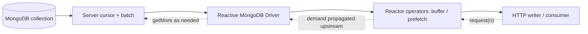
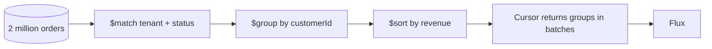

# Backpressure, Batch Size, and Cursor Consumption

> **Chapter:** Reactive access  
> **Module:** `SPRING_DATA_MONGODB` — connecting, mapping documents, and operating on MongoDB through `MongoTemplate` or repositories; practicing query design, aggregation, indexes, transactions, reactive access, testing, and data performance diagnostics. This lesson focuses on **Reactive Streams backpressure**, **MongoDB cursor `batchSize`**, and **consuming a `Flux`** without accidentally loading the entire dataset into memory.

## 1. Problem: Exporting Many Orders While Keeping RAM Bounded

Suppose a reporting service exports orders for tenant A. The `orders` collection holds **2 million documents**, each ranging from a few hundred bytes to tens of KB. An HTTP client requests all paid orders and downloads them incrementally as NDJSON. Some clients read very slowly; occasionally the network drops mid-stream.

A risky solution:

```java
List<Order> all = reactiveMongoTemplate
    .find(query, Order.class)
    .collectList()
    .block();
// Every item is accumulated into a List inside the JVM.
```

`collectList()` holds every emitted element before returning the list, and `block()` turns the process into synchronous waiting unsuitable for the event loop. Even though the driver reads from MongoDB in cursor batches, **application memory still balloons with the total result count**.

The right direction:

```java
Flux<Order> orders = reactiveMongoTemplate
    .find(query, Order.class);

// Return Flux to the HTTP/reactive subscriber; never collectList().
```

The driver fetches cursor **batches** as needed, the publisher emits items incrementally, and the subscriber uses **demand signals** (`request(n)`) to pace consumption. Keep this distinction clear: **Reactive Streams backpressure does not mean MongoDB sends exactly `n` documents over the network each time downstream calls `request(n)`**.



**Lesson goals:** distinguish `request(n)` from `batchSize`, `limit`, and `prefetch`; build queries with indexes and projections; manage cursors across complete/error/cancel; avoid unbounded buffers; test demand; and monitor `getMore`/memory in realistic environments.

## 2. From Publisher to MongoDB Cursor: Distinct Layers

A Reactive MongoDB stream has at least four places where data can sit in flight:

| Layer | Role | What Data Can Be Held? |
| --- | --- | --- |
| **MongoDB server** | Executes query/aggregation, manages cursor and returns batches | Query state, result batches, and state of stages like `$sort`/`$group` |
| **Java reactive driver** | Drives the cursor and decodes BSON into emitted items | Byte buffers, decoded documents, fetched batches awaiting emission |
| **Reactor operators** | `map`, `flatMap`, `publishOn`, `buffer`... | Operator-specific queues, prefetch, and buffers |
| **Subscriber / HTTP layer** | Consumes data and writes to the client | Network/serialization buffers, in-flight items, serialization state |

Key takeaway: **a pipeline without `collectList()` can still consume huge RAM** if it uses unbounded `buffer()`, high `flatMap` concurrency, large serialization queues, or huge individual documents.

### 2.1. Backpressure Operates at the Element Signal Level

Reactive Streams defines:

- `Publisher<T>` as the signal source.
- `Subscriber<T>` as the consumer receiving signals.
- `Subscription` linking subscriber and publisher via `request(long n)` and `cancel()`.
- `onNext(T)` emitted strictly within positive demand; `onError`/`onComplete` terminating the stream.

A subscriber calling `request(10)` means **it permits receiving up to 10 more elements before requesting again** at that subscription boundary. It is **not** a `find().limit(10)` command to MongoDB, nor a promise that one network packet carries exactly 10 BSON documents.

### 2.2. MongoDB Cursors Batch Data at the Storage/Wire Level

A MongoDB query returns an initial batch and issues `getMore` for subsequent batches while the cursor has more data. How many documents fit in one batch depends on `batchSize`, document size, BSON message/batch limits, execution state, and server behavior.

Example:

```javascript
db.orders.find({
  tenantId: "TENANT-A",
  status: "PAID"
}).batchSize(128);
```

`batchSize(128)` is a **per-batch document count target** as supported by the server, not a total result cap of 128. The server can return **fewer than 128**, keeping the cursor open for later batches.

### 2.3. Reactor Operators Can Reshape Demand Patterns

Between driver and subscriber, `publishOn` or `flatMap` may **prefetch** items. Downstream may request only a few elements while upstream receives a larger request to keep internal queues filled. `limitRate` splits upstream requests into smaller replenishing batches, yet it neither caps total records nor caps network bytes.

### 2.4. Different Quantities Not to Confuse

| Quantity | Unit | Meaning | Related API |
| --- | --- | --- | --- |
| **Demand** | `n` items on a Subscription | How many items downstream accepts next | `request(n)`, `limitRate` |
| **Cursor batch size** | Documents requested per batch | Tunes how many documents cursor fetches at once | `Query.cursorBatchSize`, driver `batchSize` |
| **Total result limit** | Total documents returned by query | Truncates result set in the database | `Query.limit` / MongoDB `limit` |
| **Operator prefetch** | Items an operator requests ahead | Reduces cross-operator overhead using a queue | `publishOn`, `flatMap`, `concatMap` depending on operator |
| **Concurrency** | Active in-flight tasks | Parallelism downstream, affecting I/O and queues | `flatMap(..., concurrency, prefetch)` |
| **Application buffer** | Items or bytes | Items held for group processing | `buffer(n)`, `collectList()` |

Never use one knob to fix a different layer's problem. If heap grows because of `collectList()`, lowering `batchSize` fixes nothing: the list still grows until the cursor finishes.

## 3. Flux and `request(n)` Signals: The Right Mental Model

### 3.1. A Flux Is Typically Lazy

```java
Flux<Order> source = reactiveMongoTemplate
    .find(query, Order.class);

// Before subscribing, never assume find has already fetched all data.
```

Once a subscriber subscribes, the publisher/driver runs the necessary commands. In typical `ReactiveMongoTemplate.find` usage, each subscription triggers **a separate query and cursor**. Never assume a `Flux` variable caches results by default.

**Do not mistake a cold Flux for materialized data.** If a controller, metric collector, and worker each subscribe independently to the same cold `Flux`, it can trigger **multiple queries**; design sharing/caching explicitly and understand the memory trade-offs.

### 3.2. Requesting One by One with BaseSubscriber

This learning example requests one element at a time:

```java
import org.reactivestreams.Subscription;
import reactor.core.publisher.BaseSubscriber;

BaseSubscriber<Order> subscriber = new BaseSubscriber<>() {
    @Override
    protected void hookOnSubscribe(Subscription subscription) {
        request(1);
    }

    @Override
    protected void hookOnNext(Order value) {
        System.out.println(value.getId());
        request(1);
    }

    @Override
    protected void hookOnError(Throwable throwable) {
        System.err.println("Streaming failed: " + throwable);
    }

    @Override
    protected void hookFinally(
        reactor.core.publisher.SignalType type
    ) {
        System.out.println("Stream ended: " + type);
    }
};

source.subscribe(subscriber);
```

This is a **demand illustration**, not how to write an HTTP controller. `System.out.println` can block threads and undermine reactive behavior. In WebFlux, **return the `Flux` to the framework** so the HTTP server manages subscription and cancellation, instead of subscribing manually and writing responses yourself.

### 3.3. Reading One Item Does Not Guarantee One `getMore`

When downstream calls `request(1)`, the item may already sit in an **earlier fetched batch**; the driver emits it with zero network round trips. Once the internal buffer drains and the cursor remains open, the driver issues `getMore`. Exact behavior depends on driver, server, and operator chain.

Never deduce “one `request(1)` = one `getMore`” by guesswork; observe MongoDB driver command monitoring when exact network behavior matters.

### 3.4. `request(0)` Is Not How You Pause a Cursor

Per Reactive Streams, `request(n)` requires a strictly **positive** number; `request(0)` or negative values violate the spec and trigger terminal errors. To pause, the subscriber simply **refrains from requesting more**. To stop permanently, call `cancel()`.

## 4. Domain Model and Test Dataset

Java 17+, `Spring Data MongoDB`, and a clean dataset for export scenarios:

```java
package demo.orders;

import java.time.Instant;
import org.springframework.data.annotation.Id;
import org.springframework.data.mongodb.core.mapping.Document;

@Document(collection = "orders")
public class Order {
    @Id
    private String id;
    private String tenantId;
    private String status;
    private long amountCents;
    private Instant createdAt;

    protected Order() {}

    public Order(
        String id, String tenantId, String status,
        long amountCents, Instant createdAt
    ) {
        this.id = id;
        this.tenantId = tenantId;
        this.status = status;
        this.amountCents = amountCents;
        this.createdAt = createdAt;
    }

    public String getId() { return id; }
    public String getTenantId() { return tenantId; }
    public String getStatus() { return status; }
    public long getAmountCents() { return amountCents; }
    public Instant getCreatedAt() { return createdAt; }
}
```

`mongosh` script **for an isolated test database only**:

```javascript
db.orders.drop();

db.orders.insertMany([
  { _id: "O-001", tenantId: "TENANT-A", status: "PAID",
    amountCents: NumberLong(12000),
    createdAt: ISODate("2026-11-01T01:00:00Z") },
  { _id: "O-002", tenantId: "TENANT-A", status: "PAID",
    amountCents: NumberLong(8000),
    createdAt: ISODate("2026-11-02T02:00:00Z") },
  { _id: "O-003", tenantId: "TENANT-A", status: "PAID",
    amountCents: NumberLong(20000),
    createdAt: ISODate("2026-11-03T03:00:00Z") },
  { _id: "O-004", tenantId: "TENANT-A", status: "PENDING",
    amountCents: NumberLong(7000),
    createdAt: ISODate("2026-11-04T04:00:00Z") },
  { _id: "O-005", tenantId: "TENANT-B", status: "PAID",
    amountCents: NumberLong(999000),
    createdAt: ISODate("2026-11-05T05:00:00Z") }
]);

db.orders.createIndex(
  { tenantId: 1, status: 1, createdAt: 1, _id: 1 },
  { name: "ix_export_tenant_status_created_id" }
);
```

For `tenantId:"TENANT-A"` and `status:"PAID"`, the expected output is the three documents `O-001`, `O-002`, `O-003` in ascending chronological order. PENDING documents and tenant B's document are **excluded**.

**Candidate index:** this key pattern supports equality filters on `tenantId`/`status` and sorting on `createdAt`/`_id` across many workloads. It is not guaranteed optimal everywhere; evaluate `explain`, write overhead, index size, and planner behavior on real data. Neither does this index eliminate cursors or JVM buffering risks.

## 5. Querying with ReactiveMongoTemplate and cursorBatchSize

### 5.1. Building the Query Explicitly

```java
package demo.orders;

import org.springframework.data.domain.Sort;
import org.springframework.data.mongodb.core.ReactiveMongoTemplate;
import org.springframework.data.mongodb.core.query.Criteria;
import org.springframework.data.mongodb.core.query.Query;
import org.springframework.stereotype.Service;
import reactor.core.publisher.Flux;

@Service
public class OrderStreamingService {
    private final ReactiveMongoTemplate template;

    public OrderStreamingService(ReactiveMongoTemplate template) {
        this.template = template;
    }

    public Flux<Order> streamPaidOrders(String tenantId) {
        if (tenantId == null || tenantId.isBlank()) {
            return Flux.error(new IllegalArgumentException(
                "Tenant ID is required"
            ));
        }

        Query query = Query.query(
            Criteria.where("tenantId").is(tenantId)
                .and("status").is("PAID")
        );
        query.with(Sort.by(
            Sort.Order.asc("createdAt"),
            Sort.Order.asc("id")
        ));
        query.cursorBatchSize(128);

        return template.find(query, Order.class);
    }
}
```

`ReactiveMongoTemplate` returns `Flux<Order>`. `@Service` allows Spring to inject it into controllers and integration tests. Here:

1. `Query` filters tenant and status on the server.
2. `Sort` orders deterministically by timestamp then ID; `id` is the `@Id` property mapped to BSON `_id`.
3. `cursorBatchSize(128)` requests 128 documents per cursor batch.
4. Neither `collectList()` nor `block()` is called, so results emit as consumed.

**Version note:** `Query.cursorBatchSize(int)` is part of current Spring Data MongoDB releases; verify against your project version before copying. Exact driver translation and batch counts should be observed via integration tests and command monitoring if SLAs depend on them.

### 5.2. `batchSize` Is a Batch Hint, Not a Memory Cap

`cursorBatchSize(128)` does **not** guarantee:

- Only 128 documents returned **for the entire query**.
- At most 128 documents buffered across **all** Reactor operator queues.
- Every batch contains **exactly** 128 documents.
- Each batch consumes a fixed `128 × average document size` bytes.
- Each `request(1)` from a subscriber fetches one document on the server.

MongoDB imposes batch/message byte caps; large documents cause actual batches to hold **fewer items than requested**. Oversized `batchSize` increases memory bursts and network payloads, while tiny batches increase round trips.

### 5.3. Projections Shrink Network Payloads

If an export only needs ID, status, amount, and timestamp:

```java
Query query = Query.query(
    Criteria.where("tenantId").is("TENANT-A")
        .and("status").is("PAID")
);
query.fields()
    .include("id")
    .include("status")
    .include("amountCents")
    .include("createdAt");
query.with(Sort.by("createdAt", "id").ascending());
query.cursorBatchSize(128);

Flux<Order> projected = template.find(query, Order.class);
```

A partially projected entity lacks fields (such as `tenantId`) and is incomplete. Use a **read-only projection DTO** so you never accidentally `save` a partial entity back to the collection. `Query.fields().include("id")` maps to BSON `_id` in typed queries; verify raw query/driver behavior on your exact version if needed.

### 5.4. Server-Side Limit Differs Completely from Batch Size

```java
Query first100 = Query.query(
    Criteria.where("tenantId").is("TENANT-A")
        .and("status").is("PAID")
);
first100.with(Sort.by("createdAt", "id").ascending());
first100.limit(100);          // Caps total query results at 100 documents.
first100.cursorBatchSize(32); // Requests around 32 documents per batch.
```

`limit(100)` alters the **valid result set** on the server. `cursorBatchSize(32)` only tunes **transport batching** for that result set. Never use `limit` as a memory fix when the business truly requires exporting all 2 million documents.

## 6. ReactiveMongoRepository, Return Types, and Batch Control

### 6.1. Repository Returning Flux

```java
package demo.orders;

import org.springframework.data.mongodb.repository.ReactiveMongoRepository;
import reactor.core.publisher.Flux;

public interface OrderRepository
        extends ReactiveMongoRepository<Order, String> {

    Flux<Order> findByTenantIdAndStatusOrderByCreatedAtAscIdAsc(
        String tenantId, String status
    );
}
```

Derived queries support streaming/reactive results:

```java
Flux<Order> paid = repository
    .findByTenantIdAndStatusOrderByCreatedAtAscIdAsc(
        "TENANT-A", "PAID"
    );
```

However, derived method names **do not express per-request custom cursor batch sizes**. When you need fine-grained control over batch sizes, projections, or options per call, `ReactiveMongoTemplate` offers a clearer API. Never confuse repository `Pageable`/`Limit` with driver `batchSize`.

### 6.2. Pageable Is Not Always as Efficient as a Streaming Cursor

A repository method taking `Pageable` typically translates to `skip`/`limit`/`sort` per query. Fetching many pages sequentially **re-runs the query repeatedly**, and deep offsets grow costly. Streaming from one cursor executes a single query and iterates through batches, though it carries its own lifecycle, timeout, and consistency considerations.

Still, do not default to streaming everywhere: a UI showing 20 items per page suits `Page`/`Slice` better than a long-lived cursor. Large exports, sync jobs, or ETL pipelines suit streaming or **keyset pagination with checkpoints** for failure recovery.

## 7. `limitRate`, Prefetch, and Propagating Demand Through Reactor

### 7.1. `limitRate` Is Not `Query.limit`

Example:

```java
Flux<Order> source = template.find(query, Order.class);

Flux<Order> shaped = source.limitRate(32);
```

`limitRate(32)` splits downstream demand **into smaller chunks sent upstream**, preventing huge single requests across operator boundaries while allowing replenishment tuning.

**`limitRate(32)` does not mean the result stops at 32 documents**: the full stream can still emit all 2 million documents over time. Nor does it **hard-cap how many documents the driver fetched in a cursor batch**, since network batching operates at a lower layer.

By contrast:

```java
query.limit(32); // Server query caps total documents at 32.
```

These two operate at different layers and are not substitutes.

### 7.2. `publishOn` Introduces a Queue and Prefetch

```java
import reactor.core.scheduler.Schedulers;

Flux<Order> shifted = template.find(query, Order.class)
    .publishOn(Schedulers.boundedElastic(), 16);
```

`publishOn(scheduler, 16)` dispatches downstream `onNext` signals on the given scheduler with a **prefetch of 16** per Reactor semantics, buffering items in an internal queue. Actual queue residency depends on scheduling, replenishment, and the rest of the chain.

**Do not tack `publishOn(boundedElastic())` onto every pipeline by habit.** The MongoDB Reactive Streams Driver already uses non-blocking I/O. Only switch schedulers when downstream genuinely requires it, such as calling a legacy blocking library—and prefer reactive APIs wherever available.

### 7.3. `flatMap` Has Independent Concurrency and Prefetch

```java
import reactor.core.publisher.Mono;

Mono<ExportRow> enrich(Order order) {
    // Illustrates a non-blocking mapping function.
    return Mono.just(new ExportRow(
        order.getId(),
        order.getStatus(),
        order.getAmountCents(),
        order.getCreatedAt()
    ));
}

Flux<ExportRow> enriched = template.find(query, Order.class)
    .flatMap(this::enrich, 8, 1);
```

With `flatMap(mapper, 8, 1)`:

- `8` caps **how many inner publishers can be active concurrently**.
- `1` sets **prefetch per inner publisher** per Reactor semantics.
- Output of `flatMap` may **not preserve input order**.

Thus `concurrency=8` does **not** mean `batchSize=8` or that only 8 documents sit in memory across the app. If `enrich` performs complex I/O, queues and state exist for every active inner publisher.

If exports require **preserving creation order**, use `concatMap` or `flatMapSequential` according to latency/concurrency needs and test ordering explicitly. Purely synchronous mapping never needs `flatMap`:

```java
Flux<ExportRow> rows = template.find(query, Order.class)
    .map(order -> new ExportRow(
        order.getId(),
        order.getStatus(),
        order.getAmountCents(),
        order.getCreatedAt()
    ));
```

### 7.4. Never Infer Total Memory from One Prefetch Number

Across operators, upstream demand, internal queues, active inner publishers, wire batches, and deserialized object sizes all contribute to heap usage. `prefetch * concurrency` is at best a **single-layer estimate**, never a hard upper bound on JVM heap.

To truly cap memory, combine **projections, document sizes, bounded operator concurrency, buffer limits, cursor batch sizes, network/serialization buffer tuning, and memory profiling**.

## 8. Operators That Defeat Streaming Benefits

### 8.1. `collectList`: Accumulates Everything

```java
Mono<List<Order>> all = template.find(query, Order.class)
    .collectList();
```

This is fine when you **know the result count is small and bounded**. On a query matching 2 million documents, however, the list still holds 2 million objects regardless of whether `cursorBatchSize` is 16 or 1024.

Never use `collectList()` just to return a JSON array for huge exports. Prefer NDJSON, backpressure-aware CSV streaming, or asynchronous export jobs writing to object storage with checkpoints.

### 8.2. Unbounded `buffer()`

```java
// ANTI-PATTERN: zero-arg buffer() can collect
// the entire stream into one List before emitting.
Flux<List<Order>> oneHugeBatch = template
    .find(query, Order.class)
    .buffer();
```

Zero-argument `buffer()` accumulates all items until upstream completes. It does not save heap, despite its name suggesting batching.

Replace with a size-bounded buffer:

```java
Flux<List<Order>> batches = template
    .find(query, Order.class)
    .buffer(100);
```

Each `List` emits when 100 items arrive or the stream ends. Remember that `buffer(100)` at the Reactor layer **does not equal** `cursorBatchSize(100)` on MongoDB; a single list may span multiple server batches or come from one larger batch.

**Warning:** if a single document is several MB, buffering 100 documents still uses hundreds of MB. Account for BSON and deserialized object sizes.

### 8.3. Reactor's `sort()` Buffers Everything

```java
// VERY RISKY on large result sets:
Flux<Order> sorted = template.find(query, Order.class)
    .sort(java.util.Comparator.comparing(Order::getCreatedAt));
```

`Flux.sort()` must retain all elements to sort them via the comparator, destroying incremental streaming on large datasets. Push sorting into the **MongoDB query** so the server can apply an index:

```java
query.with(Sort.by("createdAt", "id").ascending());
Flux<Order> ordered = template.find(query, Order.class);
```

Server-side sorting still consumes memory or disk if unindexed; it is not free. Run `explain` to inspect the plan.

### 8.4. `groupBy()` Risks Memory Pressure on High Cardinality

`Flux.groupBy` spawns a `GroupedFlux` per distinct key, retaining state and queues per group and requiring downstream to drain groups consistently. With high key cardinality and partial consumption, pipelines can stall or exhaust memory.

For revenue reports by customer or status, prefer MongoDB `$group` (server-side aggregation) or bounded batch aggregation jobs—**do not** `groupBy` millions of documents in JVM memory by default.

### 8.5. `onBackpressureBuffer` Is Not a Cure-All

```java
// Not recommended as default:
Flux<Order> risky = source.onBackpressureBuffer();
```

An unbounded buffer queues items whenever the producer outpaces the consumer. With a **backpressure-compliant** reactive MongoDB source, wrapping in `onBackpressureBuffer()` blindly is rarely needed.

When integrating a **hot non-backpressured source**, you may need a bounded overflow policy, yet note:

- `onBackpressureDrop` can **lose orders**.
- `onBackpressureLatest` discards older items, unsuitable for exports or auditing.
- Bounded buffer overflow throws errors that must be handled.
- A larger queue never makes an infinite mismatch safe.

For financial reports, **never drop silently**. Enforce ingress rate limits, durable queues, checkpoints, or true end-to-end backpressure.

## 9. Item-by-Item vs Batch Processing: Choosing Consumption Patterns

### 9.1. Never Block the Event Loop

```java
// ANTI-PATTERN:
template.find(query, Order.class)
    .map(order -> {
        Thread.sleep(100); // Blocking inside a non-blocking pipeline.
        return order;
    });
```

In real Java this snippet would also need to handle `InterruptedException`, yet the core bug is performing blocking sleep inside `map` on a reactive event loop.

Use Reactor operators and reactive APIs for non-blocking processing. If calling a legacy blocking API is unavoidable, isolate it on a dedicated scheduler, cap concurrency, and monitor thread pool saturation.

### 9.2. Processing Each Order with Non-Blocking I/O

```java
Flux<ExportRow> exported = template
    .find(query, Order.class)
    .flatMap(order -> externalReactiveService.lookup(order.getId())
        .map(extra -> new ExportRow(
            order.getId(),
            order.getStatus(),
            order.getAmountCents(),
            order.getCreatedAt()
        )), 8, 1);
```

`externalReactiveService` is an application reactive dependency, not a Spring Data MongoDB API. This snippet highlights **`concurrency=8`** rather than firing tens of thousands of simultaneous I/O calls. If `extra` must appear in the export, include its fields in `ExportRow` instead of discarding it in this minimal illustration.

If output order is part of the API contract, `flatMap` can reorder items; switch to `concatMap` or `flatMapSequential` with suitable bounds.

### 9.3. Application-Level Batch Processing

```java
Flux<List<Order>> chunks = template
    .find(query, Order.class)
    .buffer(200);

Mono<Void> completed = chunks
    .concatMap(batch -> writeBatchAsync(batch))
    .then();
```

`writeBatchAsync(List<Order>)` is application-defined, returns `Mono<Void>`, and must be genuinely non-blocking or isolated off the event loop. `concatMap` writes batches sequentially, preventing out-of-order races at the destination.

**The numbers 200, 128, and 8 are not universal constants:** cursor `batchSize=128`, application `buffer(200)`, and downstream `concurrency=8` tune different layers. Only measurement determines the right combination for throughput and memory.

### 9.4. Slow Downstream HTTP Clients

Never write:

```java
source.subscribe(order -> outputStream.write(toBytes(order)));
```

Besides ignoring `IOException`/serialization details, subscribing manually breaks HTTP reactive response lifecycles, risks blocking the event loop on `outputStream`, and drops cancellation propagation. Let the web framework's streaming response handle backpressure and avoid managing cursors manually unless required.

## 10. Cursor Lifecycle: Complete, Error, Cancel

A cursor terminates for three main reasons:

| Scenario | Reactive Signal | Expected Behavior |
| --- | --- | --- |
| All documents read | `onComplete` | Subscriber finishes; driver cleans up cursor as needed |
| Query/network/decode failure | `onError` | Record metrics, clean resources, propagate error per contract |
| Client disconnects / `take(n)` / cancel | `cancel()` | Cancels subscription; driver cleans up cursor per lifecycle |

### 10.1. `take(n)` Cuts Off Only Downstream

```java
Flux<Order> first10 = template.find(query, Order.class)
    .take(10);
```

After emitting 10 items, `take(10)` terminates downstream and **cancels upstream**. The driver cleans up the cursor as supported, yet the query may already have fetched a batch larger than 10 beforehand. If business rules only ever need 10 documents, **set `query.limit(10)` on the server** to avoid wasted reads and server work.

### 10.2. `doFinally` to Observe Every Termination Path

```java
import reactor.core.publisher.SignalType;

Flux<Order> monitored = template.find(query, Order.class)
    .doOnSubscribe(s -> metrics.queryStarted())
    .doOnNext(o -> metrics.documentEmitted())
    .doOnError(e -> metrics.queryFailed(e))
    .doFinally(signal -> {
        if (signal == SignalType.CANCEL) {
            metrics.queryCancelled();
        }
        metrics.queryTerminated();
    });
```

`metrics` is an application-defined abstraction. `doFinally` executes on complete, error, or cancel, making it ideal for lifecycle metrics. **Never write code to manually close a cursor you do not own**: `ReactiveMongoTemplate.find` lets the driver/framework manage the cursor internally. Only close cursors/sessions you explicitly created.

### 10.3. HTTP Disconnects Should Propagate Cancellation

In WebFlux, when an HTTP connection closes mid-stream, the HTTP response subscriber cancels upstream. The pipeline must not keep running detached inside a separate `subscribe()`. Verify cancellation timing in real tests, as proxies, serialization, and socket buffers can delay when cancellation is observed.

### 10.4. Cursor Timeouts and Session Lifetimes

MongoDB enforces inactivity timeouts on idle cursors, and logical sessions have their own lifetimes. Never treat `noCursorTimeout` (where available in driver/query APIs) as a default fix for slow clients:

- Long-lived cursors tie up server resources.
- Logical session expiration can still invalidate cursors.
- Transactional cursors are bound by transaction limits.
- Network, connection, and proxy timeouts still apply.

For exports lasting minutes or hours, prefer **an async job off the HTTP request using checkpoints/keyset** rather than holding an interactive cursor open.

## 11. Streaming via Spring WebFlux: NDJSON Instead of One Huge JSON Array

### 11.1. Export DTO

```java
package demo.orders;

import java.time.Instant;

public record ExportRow(
    String id,
    String status,
    long amountCents,
    Instant createdAt
) {}
```

### 11.2. Controller Returning Flux

```java
package demo.orders;

import org.springframework.http.MediaType;
import org.springframework.security.core.Authentication;
import org.springframework.web.bind.annotation.GetMapping;
import org.springframework.web.bind.annotation.RequestMapping;
import org.springframework.web.bind.annotation.RestController;
import reactor.core.publisher.Flux;

@RestController
@RequestMapping("/api/reports")
public class OrderExportController {
    private final OrderStreamingService service;
    private final TenantAccess tenantAccess;

    public OrderExportController(
        OrderStreamingService service,
        TenantAccess tenantAccess
    ) {
        this.service = service;
        this.tenantAccess = tenantAccess;
    }

    @GetMapping(
        value = "/paid-orders",
        produces = MediaType.APPLICATION_NDJSON_VALUE
    )
    public Flux<ExportRow> export(Authentication auth) {
        String tenantId = tenantAccess.tenantIdFor(auth);

        return service.streamPaidOrders(tenantId)
            .map(order -> new ExportRow(
                order.getId(),
                order.getStatus(),
                order.getAmountCents(),
                order.getCreatedAt()
            ));
    }
}
```

`TenantAccess` is an application-defined service reading the tenant from the authenticated principal and checking permissions. It is **not a built-in Spring Security class**; your app must implement it.

**Why NDJSON?** Each record can serialize independently as one JSON line and flush incrementally, avoiding materializing a massive JSON array before sending. This works only when **the web server, HTTP client, and any proxies truly support streaming** without buffering the full body.

### 11.3. Practical Limits of HTTP Streaming

- Frameworks and reactive servers prefetch/buffer at network boundaries; never assume one MongoDB document equals one TCP packet.
- Reverse proxies, load balancers, or HTTP client libraries may **buffer the entire response**. Test end-to-end.
- If an error happens after response headers/body start flushing, the server cannot change the HTTP status code to 500; agree on an error/recovery protocol.
- Verify upstream cancellation and cursor cleanup when clients disconnect.
- Even with streaming responses, a `Query` lacking good indexes or projections still places heavy load on MongoDB.

If an API needs **byte-offset download resumption** after network drops, simple NDJSON streaming is insufficient. Consider background export jobs producing immutable files with IDs/checksums, or keyset cursors with business checkpoints.

### 11.4. Returning Flux Does Not Guarantee End-to-End Non-Blocking

A Spring MVC controller returning `Flux` behaves and streams differently from a pure Reactor Netty WebFlux controller. Never assume changing a return type to `Flux` makes the whole stack non-blocking. Verify you are actually running **WebFlux**, the reactive MongoDB driver, and non-blocking downstream I/O.

## 12. Aggregation: Reactive Output Does Not Make `$group`/`$sort` Streaming

### 12.1. Server-Side Blocking Stages

`ReactiveMongoTemplate.aggregate` returns `Flux<DTO>`, yet several aggregation stages must **consume many documents before emitting any result**:

- An unindexed `$sort` must sort a potentially large input set.
- `$group` maintains state across grouping keys.
- `$bucket`, `$facet`, `$lookup`, and similar stages incur memory/input costs depending on pipeline shape.



Even if the final subscriber calls `request(1)`, the server may still scan almost every matching document to compute `$group`/`$sort`. **Backpressure paces output consumption**, not the upstream server cost of blocking stages.

### 12.2. Spring Data Aggregation Options and Batch Size

Example grouping by status:

```java
import static org.springframework.data.mongodb.core.aggregation.Aggregation.*;

import org.springframework.data.mongodb.core.aggregation.Aggregation;
import org.springframework.data.mongodb.core.aggregation.AggregationOptions;
import org.springframework.data.mongodb.core.query.Criteria;
import reactor.core.publisher.Flux;
import org.bson.Document;

Aggregation aggregation = newAggregation(
    match(Criteria.where("tenantId").is("TENANT-A")),
    group("status")
        .count().as("orderCount")
        .sum("amountCents").as("grossCents"),
    sort(org.springframework.data.domain.Sort.Direction.ASC, "_id")
).withOptions(
    AggregationOptions.builder()
        .cursorBatchSize(64)
        .allowDiskUse(true)
        .build()
);

Flux<Document> grouped = reactiveMongoTemplate.aggregate(
    aggregation, Order.class, Document.class
);
```

Modern Spring Data MongoDB releases expose `cursorBatchSize` on `AggregationOptions`. Check the exact API on your project version; older versions may require configuring options via the driver or alternate hooks.

`allowDiskUse(true)` only lets supported stages spill to disk when needed and allowed by server config; it **does not make the query lighter**, does not bypass the 16 MiB output document limit, and does not make `Flux` memory-free.

### 12.3. Where `$limit` Appears Changes KPI Meaning

```javascript
// CORRECT when the requirement is "top 20 groups after aggregating all data".
[
  { $match: { tenantId: "TENANT-A" } },
  { $group: { _id: "$status", revenue: { $sum: "$amountCents" } } },
  { $sort: { revenue: -1, _id: 1 } },
  { $limit: 20 }
]
```

Moving `$limit: 20` **before `$group`** aggregates only the first 20 source orders, distorting the KPI. Never push `$limit` earlier just to cut cost if it changes the business question.

### 12.4. Project and Filter Early When Semantics Match

`$match` on tenant/status before `$group` shrinks input volume, and a matching index cuts I/O. `$project` dropping unused fields can reduce inter-stage payloads depending on pipeline optimizer rules. Always measure with `explain("executionStats")` instead of assuming cost solely from stage order.

## 13. Long-Running Queries, Deadlines, Cancellation, and Retries

### 13.1. Server and Client Deadlines Are Two Separate Layers

```java
import java.time.Duration;

Query query = Query.query(
    Criteria.where("tenantId").is("TENANT-A")
);
query.maxTime(Duration.ofSeconds(20));
query.cursorBatchSize(128);

Flux<Order> stream = template.find(query, Order.class)
    .timeout(Duration.ofSeconds(30));
```

`Query.maxTime(...)` sends an operation execution time limit to MongoDB where supported. `Flux.timeout(Duration)` is a **Reactor timeout**, measured from subscription and between emitted items; it fails/cancels upstream if no signal arrives within the window. One does not replace the other.

Crucially, a stream emitting one item per second will **not** trip `timeout(30s)` even if it runs for hours, because signals keep arriving. If you need a **total export wall-clock cap**, implement an explicit request/deadline policy and cancellation cleanup. Never assume `Flux.timeout` enforces a total runtime ceiling.

### 13.2. Retrying After a Cursor Has Emitted Partial Data

Suppose a client received `O-001` and `O-002` before a network error struck prior to `O-003`. Writing:

```java
Flux<Order> risky = template.find(query, Order.class)
    .retry(3);
```

causes `retry` to re-subscribe **from the start of the query**. Downstream receives `O-001` and `O-002` again, causing **duplicates**. When sending emails, generating invoices, charging payments, or appending to files, blind retries are dangerous.

Ask:

- Can items emitted before the error safely be reprocessed?
- Is there an idempotency key per item?
- Is there a deterministic sort key and tie-breaker?
- Is there a checkpoint to resume strictly **after the last confirmed item**?
- Could source data mutate while resuming?

For high-accuracy exports, a **checkpointed job with keyset pagination** or a snapshot/materialized report is safer than retrying a full cursor.

### 13.3. Never Retry All Errors

`DuplicateKeyException` from duplicate business keys, invalid queries, authorization failures, BSON mapping errors, and bad schemas will not disappear on immediate retry. Filter strictly for transient errors and cap retries/backoff. Never let failing exports trigger retry storms against MongoDB.

### 13.4. Client Disconnection

WebFlux subscribes to `Flux` to serialize the response. When the client disconnects, cancellation normally propagates upstream, though cleanup timing depends on buffering and the driver. Monitor `doFinally(SignalType.CANCEL)`, driver command events, cursor metrics, and integration tests—never rely solely on a log written by the controller before returning `Flux`.

## 14. Keyset Pagination When You Need Resume Instead of Long-Lived Cursors

A long cursor suits continuous consumption **within a single connection**. If a job must survive restarts, network drops, or client cancellations, a cursor is not a durable business checkpoint.

### 14.1. Keyset on `createdAt` and `_id`

With stable sort `{createdAt: 1, _id: 1}`, fetching orders **after** the last document `(lastCreatedAt, lastId)`:

```javascript
db.orders.find({
  tenantId: "TENANT-A",
  status: "PAID",
  $or: [
    { createdAt: { $gt: ISODate("2026-11-02T02:00:00Z") } },
    {
      createdAt: ISODate("2026-11-02T02:00:00Z"),
      _id: { $gt: "O-002" }
    }
  ]
}).sort({ createdAt: 1, _id: 1 }).limit(100);
```

The next match in the sample dataset is `O-003`. Including `_id` in the second branch handles **multiple orders sharing the same `createdAt`**; without a tie-breaker, resuming can skip or duplicate items.

### 14.2. Using Spring Data Query

```java
import java.time.Instant;
import org.springframework.data.mongodb.core.query.Criteria;
import org.springframework.data.mongodb.core.query.Query;
import org.springframework.data.domain.Sort;

Instant lastCreatedAt = Instant.parse("2026-11-02T02:00:00Z");
String lastId = "O-002";

Criteria after = new Criteria().orOperator(
    Criteria.where("createdAt").gt(lastCreatedAt),
    new Criteria().andOperator(
        Criteria.where("createdAt").is(lastCreatedAt),
        Criteria.where("id").gt(lastId)
    )
);

Query nextPage = Query.query(
    new Criteria().andOperator(
        Criteria.where("tenantId").is("TENANT-A"),
        Criteria.where("status").is("PAID"),
        after
    )
);
nextPage.with(Sort.by("createdAt", "id").ascending());
nextPage.limit(100);
nextPage.cursorBatchSize(64);

Flux<Order> page = template.find(nextPage, Order.class);
```

In typed queries, Spring Data maps `id` to BSON `_id`. With raw BSON/driver queries, use `_id` explicitly. This snippet fetches one page; production code must persist the **checkpoint only after downstream confirms processing/writing**, never merely after MongoDB emits the item.

### 14.3. Keyset Does Not Automatically Create a Snapshot

If a document's `createdAt` changes, or records are inserted/deleted or change status during the scan, sequential keyset queries observe data at different points in time. For exact snapshot exports, use cutoff timestamps, immutable sort keys, versioning/materialized views, or explicit snapshot strategies.

Never treat keyset pagination as a substitute for transactions or read concerns. It solves **resume offsets and skip cost**, not source mutability.

## 15. Tailable Cursors and Change Streams: Long-Lived Sources Without an “End”

### 15.1. Finite Query Cursors vs Event Streams

A standard `find` over a finite set emits `onComplete` once exhausted. Tailable cursors on **capped collections** and MongoDB **change streams** stay open waiting for new events.

| Source | When Current Data Is Exhausted | How It Stops |
| --- | --- | --- |
| Regular `find` | Completes once cursor drains | `onComplete` or cancel |
| Tailable cursor | Waits for new documents on a capped collection | Cancel or source/connection close |
| Change stream | Waits for new change stream events | Cancel; persist resume tokens for durable resume |

Never call `collectList()` on an unbounded stream: it may never complete, and the list grows without bound.

### 15.2. `batchSize` Is Not a Polling Interval

On change streams and tailable cursors, `batchSize` only caps events/documents requested per batch. How quickly the server responds also depends on `maxAwaitTime`, server wait mechanics, replica set/sharded setup, and the driver. Never set `batchSize=1` and claim “every event arrives instantaneously.”

Change streams require a supported MongoDB topology and privileges; tailable cursors require capped collections. Never confuse event streams with a finite `Flux<Order>` from `find`.

### 15.3. Backpressure and Event Loss

Backpressure paces the subscriber/driver; it is **not an exactly-once event delivery system across restarts**. For change streams, store resume tokens reliably, handle invalidation/restarts/oplog retention, make consumers idempotent, and monitor lag. Never use `onBackpressureDrop` to “shed load” on audit/change events without a replay path.

## 16. Reactive Transactions and Cursors: No Arbitrary Parallelism

Inside a `ReactiveMongoTransactionManager` transaction, MongoDB operations share the same session managed by Spring via Reactor Context.

### 16.1. Never Use High `flatMap` Concurrency Inside a Transaction

```java
// ANTI-PATTERN: concurrent writes within the same transaction.
return orders.flatMap(
    order -> reactiveMongoTemplate.save(order),
    32
);
```

The MongoDB Java reactive driver does not support executing concurrent operations on the same session inside one transaction to speed things up. Chain operations sequentially when sharing a transaction session:

```java
return orders
    .concatMap(order -> reactiveMongoTemplate.save(order))
    .then();
```

**Caution:** even sequentially, a single transaction spanning millions of items is a bad design: transactions hit lifetime/cache limits, hold locks/snapshot resources, and increase write conflicts. Split work into small transactional units with checkpoints/idempotency or use bulk writes where domain rules allow.

### 16.2. Never Open One Transaction for an Entire HTTP Export

An NDJSON export to a slow client can run for minutes or hours. Never wrap the entire export in `@Transactional` just for “consistency,” because the transaction pins resources for the stream's entire duration. For consistent exports, use snapshot/materialization mechanisms or batch jobs with cutoff/version rules instead of tying transactions to client network speed.

### 16.3. Causal Consistency Does Not Make Cursors Resumable

A causally consistent session orders causally related operations; it does not provide **durable restart checkpoints** or exactly-once external delivery. Backpressure, causal consistency, transactions, and idempotency address separate concerns.

## 17. Testing Backpressure with Reactor StepVerifier

### 17.1. Why Test `request(n)` Without Sleeping?

Timing assertions with `Thread.sleep(100)` produce flaky tests across CI machines, driver schedules, and network speeds. `StepVerifier` verifies **demand signals** deterministically:

```java
import reactor.core.publisher.Flux;
import reactor.test.StepVerifier;

Flux<Integer> numbers = Flux.range(1, 5);

StepVerifier.create(numbers, 0)
    .expectSubscription()
    .thenRequest(2)
    .expectNext(1, 2)
    .thenRequest(2)
    .expectNext(3, 4)
    .thenRequest(1)
    .expectNext(5)
    .verifyComplete();
```

The `0` in `StepVerifier.create(publisher, 0)` sets the test harness's **initial request to 0** upon subscription—**completely different** from illegally invoking `Subscription.request(0)`.

This verifies the publisher emits strictly within subscriber demand. It says nothing about how many network `getMore` calls or prefetched documents occurred at the MongoDB driver layer.

### 17.2. Observing Demand Propagated Upstream by Operators

```java
import java.util.List;
import java.util.concurrent.CopyOnWriteArrayList;

List<Long> observedRequests = new CopyOnWriteArrayList<>();
Flux<Integer> source = Flux.range(1, 20)
    .doOnRequest(observedRequests::add);

StepVerifier.create(source.limitRate(4), 0)
    .expectSubscription()
    .thenRequest(2)
    .expectNext(1, 2)
    .thenRequest(2)
    .expectNext(3, 4)
    .thenCancel()
    .verify();

System.out.println(observedRequests);
```

Placing `doOnRequest` **upstream of `limitRate`** lets you inspect how the operator chunks demand sent upstream. **Never hardcode brittle exact request sequences** that can break across Reactor versions or operator changes; use diagnostics to understand behavior and assert meaningful contract invariants.

### 17.3. Testing Cancellation

```java
import java.util.concurrent.atomic.AtomicBoolean;
import reactor.core.publisher.Flux;
import reactor.test.StepVerifier;

AtomicBoolean cancelled = new AtomicBoolean();

Flux<Integer> source = Flux.range(1, 1000)
    .doOnCancel(() -> cancelled.set(true));

StepVerifier.create(source, 0)
    .expectSubscription()
    .thenRequest(1)
    .expectNext(1)
    .thenCancel()
    .verify();

assert cancelled.get();
```

This is a **Reactor-level test** verifying upstream receives the cancel signal. It **does not prove the MongoDB driver sent `killCursors`** in all scenarios—a cursor might not have been opened yet, might already have drained, or might clean up differently; testing true cursor lifecycles requires driver/server instrumentation.

## 18. Integration Testing with ReactiveMongoTemplate and Test MongoDB

### 18.1. Seeding Data on an Isolated MongoDB

`@SpringBootTest` with `ReactiveMongoTemplate` verifies real streaming results and BSON mapping. **You must supply a dedicated test MongoDB server/URI** (such as Testcontainers); annotations do not provision the database on their own.

JUnit 5 example:

```java
package demo.orders;

import static org.assertj.core.api.Assertions.assertThat;

import java.time.Duration;
import java.time.Instant;
import java.util.List;
import java.util.concurrent.atomic.AtomicBoolean;
import org.junit.jupiter.api.BeforeEach;
import org.junit.jupiter.api.Test;
import org.springframework.beans.factory.annotation.Autowired;
import org.springframework.boot.test.context.SpringBootTest;
import org.springframework.data.mongodb.core.ReactiveMongoTemplate;
import reactor.core.publisher.Flux;
import reactor.test.StepVerifier;

@SpringBootTest
class OrderStreamingIntegrationTest {

    @Autowired ReactiveMongoTemplate template;
    @Autowired OrderStreamingService service;

    @BeforeEach
    void seed() {
        // Use an isolated TEST database ONLY; dropCollection deletes data.
        List<Order> orders = List.of(
            new Order("O-001", "TENANT-A", "PAID", 12000,
                Instant.parse("2026-11-01T01:00:00Z")),
            new Order("O-002", "TENANT-A", "PAID", 8000,
                Instant.parse("2026-11-02T02:00:00Z")),
            new Order("O-003", "TENANT-A", "PAID", 20000,
                Instant.parse("2026-11-03T03:00:00Z")),
            new Order("O-004", "TENANT-A", "PENDING", 7000,
                Instant.parse("2026-11-04T04:00:00Z")),
            new Order("O-005", "TENANT-B", "PAID", 999000,
                Instant.parse("2026-11-05T05:00:00Z"))
        );

        template.dropCollection(Order.class)
            .thenMany(template.insertAll(orders))
            .then()
            .block(Duration.ofSeconds(20));
    }

    @Test
    void honorsSubscriberDemandAndKeepsOrdering() {
        Flux<Order> stream = service.streamPaidOrders("TENANT-A");

        StepVerifier.create(stream, 0)
            .expectSubscription()
            .thenRequest(2)
            .assertNext(o -> assertThat(o.getId())
                .isEqualTo("O-001"))
            .assertNext(o -> assertThat(o.getId())
                .isEqualTo("O-002"))
            .thenRequest(1)
            .assertNext(o -> assertThat(o.getId())
                .isEqualTo("O-003"))
            .verifyComplete();
    }

    @Test
    void excludesOtherTenantsAndOtherStatuses() {
        StepVerifier.create(
                service.streamPaidOrders("TENANT-A")
                    .map(Order::getId)
            )
            .expectNext("O-001", "O-002", "O-003")
            .verifyComplete();
    }

    @Test
    void propagatesCancel() {
        AtomicBoolean cancelled = new AtomicBoolean(false);

        Flux<Order> source = service.streamPaidOrders("TENANT-A")
            .doOnCancel(() -> cancelled.set(true));

        StepVerifier.create(source, 0)
            .expectSubscription()
            .thenRequest(1)
            .expectNextMatches(o -> "O-001".equals(o.getId()))
            .thenCancel()
            .verify();

        assertThat(cancelled).isTrue();
    }
}
```

**Scope of this test suite:** `block` appears **only in synchronous test setup**, never in production WebFlux code. Five test documents verify filtering, ordering, and demand, yet are **insufficient** for reliably measuring throughput, memory, or `getMore` counts.

`OrderStreamingService` in section 5 has `@Service` so Spring injects it into tests and controllers. When porting to another project, verify package scanning and the `ReactiveMongoTemplate` bean. Never run this test against production or shared databases because `dropCollection` destroys data.

### 18.2. Verifying Cursor Batch Size Against Many Documents

To observe how `cursorBatchSize(2)` affects driver commands:

1. Seed several hundred or thousand small documents in a **test** MongoDB.
2. Query with `cursorBatchSize(2)` and deterministic sorting.
3. Attach a `CommandListener` to the MongoDB Java Driver when creating the client and observe `find` and `getMore` commands.
4. Compare against `cursorBatchSize(100)` under identical conditions.
5. Record command counts, network bytes, latency, and memory across repeated runs on a sizable dataset.

Do not insist on seeing exactly `N/2` `getMore` commands: the server may return smaller batches based on byte limits, cursor exhaustion, driver optimizations, or version/topology details.

### 18.3. Verifying Cleanup Beyond `doFinally`

A Reactor cancellation test can pass even while server cleanup lags. To verify end-to-end:

- Observe `killCursors` commands when an active server-side cursor has unread items, **if** the driver/server issues it.
- Read MongoDB active cursor metrics before and after workloads instead of sampling a single instant.
- Simulate controlled HTTP disconnects and watch cursor/leak trends.
- Monitor connection pool utilization and active subscriptions.

Never assert that `killCursors` must appear **in every test**: if a query already drained its last batch or never opened a cursor, there is no live cursor left to kill.

### 18.4. Testing Blocking Aggregation Stages

For `$match → $group → $sort` pipelines on large datasets, run `explain("executionStats")` to measure server-side stages. Compare against `find + projection + indexed sort` on the same workload to see why an aggregation `Flux` can still stall before emitting **its very first item**.

Never extrapolate total server memory from timing a few sample rows; inspect profiler output, metrics, spills, and execution plans for your MongoDB version.

## 19. Observing Performance: From Explain to Backpressure Metrics

### 19.1. Using Explain on the Source Query

```javascript
db.orders.find({
  tenantId: "TENANT-A",
  status: "PAID"
}).sort({
  createdAt: 1,
  _id: 1
}).explain("executionStats");
```

Check:

- `winningPlan`, `IXSCAN`/`COLLSCAN`.
- `totalKeysExamined` and `totalDocsExamined`.
- Whether server-side sorting uses an index or spills significantly.
- `nReturned` and whether tenant/status predicates match.

`explain` describes **query plan and server execution**; it **does not directly measure** HTTP client demand on `Flux` or Reactor operator heap usage.

### 19.2. MongoDB Java Driver Command Monitoring

The driver provides `CommandListener` for start/succeeded/failed command events. Watch command names:

```text
find
getMore
killCursors  (when needed; not every stream emits it)
aggregate
```

Register the listener when building `MongoClientSettings`/reactive client, redacting sensitive fields and never logging full query payloads or credentials. Track latency, counts, and correlation IDs. **The number of `getMore` commands does not equal the number of downstream `request(n)` calls**.

### 19.3. Application Metrics

Useful metrics:

| Metric | What It Signals |
| --- | --- |
| `documentsEmitted`/sec | Actual downstream throughput |
| `bytesSerialized`/sec | HTTP load and payload size |
| `timeToFirstItem` | Delay from query/index/aggregation or downstream |
| `totalStreamDuration` | Stream and cursor lifetime |
| `subscriptionCancelled` | Client aborts or timeouts |
| `activeStreams` | Concurrent exports consuming resources |
| `process heap / GC pauses` | Impact of operator queues and buffering |
| `driver getMore count/latency` | Cursor round trips |
| `server cursor metrics` | Open cursor trends and timeouts |
| `MongoDB docsExamined/keysExamined` | Index and source query efficiency |
| `event loop latency` | Blocking inside reactive pipelines |

Watching only Java CPU/RAM while ignoring MongoDB server memory, network, and cursor metrics hides the full picture.

### 19.4. Choosing Batch Size Empirically

A controlled benchmark should vary **one variable per run**:

| Requested `batchSize` | Expected Effect | Risks to Monitor |
| ---: | --- | --- |
| 16 | Small batches, fewer items per fetch | Many `getMore` round trips, lower throughput |
| 128 | Moderate empirical starting point | Tune against document size and concurrency |
| 512 | Fewer round trips for small docs | Larger network and driver buffer bursts |
| 2,048 | May fit tiny documents on fast links | High memory/latency bursts, server byte-size caps |

**This table is not a benchmark and does not claim 128 is optimal.** A batch of 512 documents of a few hundred bytes differs completely from 512 multi-megabyte documents. Measure memory and latency on representative workloads, realistic client concurrency, and real pool settings.

### 19.5. Cautionary Memory Estimation Formula

If a queue holds `q` documents averaging `b` bytes per deserialized object, minimum data memory is roughly:

\[
M_{\text{queue}} \approx q \times b
\]

Total heap usage can be far higher due to JVM object overhead, BSON buffers, multiple operator queues, serialization buffers, and concurrent streams. Never treat `batchSize × avgBSONSize` as an exact RAM ceiling.

## 20. Common Pitfalls and How to Fix Them

| Symptom | Common Cause | Fix |
| --- | --- | --- |
| Heap grows linearly with documents | `collectList()`, zero-arg `buffer()`, or caching everything | Consume item-by-item or use bounded buffers; profile memory |
| `batchSize=16` set yet heap still OOMs | Batch size does not bound `collectList`/operator queues | Remove `collectList`, bound queues/concurrency, shrink payloads |
| `limitRate(32)` set yet query still yields 2M items | `limitRate` shapes demand, not result count | Use `query.limit` when business rules only want 32 items |
| `request(1)` yet many docs fetched over network | Driver/cursor batching and prefetch | Separate demand metrics from command monitoring |
| Excessive `getMore` calls | `batchSize` too small for doc/network size | Test larger `batchSize` while tracking latency/RAM |
| Slow first emission despite non-blocking Flux | MongoDB scans/sorts/groups before returning first batch | Add indexes, early `$match`, inspect `explain`/stage cost |
| One streaming client triggers multiple queries | Cold `Flux` subscribed multiple times | Track subscriber count; share/cache intentionally |
| `flatMap` scrambles order | Inner publishers complete out of source order | `concatMap` / `flatMapSequential` per throughput needs |
| Too many concurrent HTTP requests | Missing concurrency/admission control | Cap active exports, enforce timeouts and quotas |
| Event loop stalls | Blocking API inside `map`/`doOnNext` | Use reactive I/O or isolate blocking work on a proper scheduler |
| Cursors stay open after client disconnect | Detached `subscribe`, broken cancel propagation, or slow cleanup | Return `Flux` directly; inspect `doFinally` + driver/server metrics |
| `take(10)` yet server reads >10 docs | Upstream batch/prefetch fetched ahead before cancel | Use `query.limit(10)` when only 10 are needed |
| `timeout(30s)` fails to stop a stream after 30s total | Reactor timeout resets between signals | Implement a separate total wall-clock deadline policy |
| `retry(3)` duplicates orders in export file | Retry re-subscribes from query start | Checkpoints, idempotency, keyset pagination, or snapshots |
| `buffer(100)` still heavy | Large documents; 100 items consume many MB | Projections, file-size limits, byte-aware buffering |
| NDJSON fails to stream incrementally | Proxy/client/framework buffering response | Test end-to-end and configure streaming at every hop |
| Change stream never completes | Long-lived event stream by design | Use cancel/timeouts per contract; never `collectList` |
| Client sees another tenant's data | Tenant filter read from unverified input | Derive tenant from principal, authorize, verify server query |
| Deep offset pages are slow | `skip` walks past large index ranges on server | Use keyset pagination + index for deep traversal |
| Demand test passes yet server cursor misbehaves | `StepVerifier` only tests Reactor layer | Run integration tests checking `getMore`/`killCursors`/metrics |
| Reactive transaction errors on parallel writes | Concurrent operations on one session in a transaction | Compose sequentially, keep transactions short, retry safely |

### Step-by-Step Diagnostic Checklist

1. Clarify the goal: **export all** or **fetch one page**? Max items, bytes, and duration?
2. Verify query filters (`tenantId`/status), stable sorting, and projections.
3. Run `explain("executionStats")`: check scans, sorts, aggregation memory, and indexes.
4. Audit accumulating operators: `collectList`, `buffer`, `sort`, `groupBy`, `cache`.
5. Check `flatMap` concurrency/prefetch, `publishOn` queues, and serialization buffers.
6. Add `doOnRequest`/`doOnNext`/`doFinally` to observe demand and cancellation.
7. Attach a driver `CommandListener` to inspect `find`/`getMore`/`killCursors` and actual batch sizes.
8. Measure heap/GC, active streams, response throughput, and database CPU/network.
9. Review exception/timeout handling, retry policies, checkpoints, and idempotency.
10. Test against real test MongoDB with slow clients and disconnects rather than extrapolating from tiny unit tests.

## 21. Hands-On Lab: Exporting Orders Safely with Cursor batchSize

**Goal:** build a WebFlux endpoint returning a tenant's PAID orders as NDJSON. The database holds many documents; the app must avoid buffering everything in memory, handle slow clients, and support cursor monitoring.

1. Create the `Order` entity (`id`, `tenantId`, `status`, `amountCents`, `createdAt`) and seed section 4's dataset in a test MongoDB.
2. Create `OrderStreamingService` using `ReactiveMongoTemplate` and `Query.cursorBatchSize(128)`, sorted `createdAt ASC, id ASC`.
3. Verify the query emits only `O-001, O-002, O-003` for `TENANT-A`/`PAID`, excluding `O-004` and `O-005`.
4. Use `StepVerifier.create(flux, 0)` with `thenRequest(2)` then `thenRequest(1)` to assert all three records in order.
5. Add `doOnRequest` and `doFinally` to compare subscriber demand with upstream requests.
6. Test `cursorBatchSize` values of 2, 16, 128, and 512 over hundreds/thousands of test documents; measure `find`/`getMore` commands and latency.
7. Compare `query.limit(10)` with `flux.take(10)` and `flux.limitRate(10)`, explaining why all three differ.
8. Add a projection returning only ID/status/amount/timestamp; measure payload bytes and GC compared to the full entity.
9. Write a controller returning `Flux<ExportRow>` with `MediaType.APPLICATION_NDJSON_VALUE`, deriving `tenantId` from a trusted principal.
10. Consume the endpoint line-by-line with a real HTTP client to verify no intermediary buffers the whole response.
11. Cap request concurrency and simulate a slow reader; inspect active subscriptions, heap, and driver command metrics.
12. Test `collectList()` and zero-arg `buffer()` **only on a tiny test dataset** to observe behavior; keep these anti-patterns out of production.
13. Switch to `buffer(100)` paired with a non-blocking writer and explain why this is an **application buffer**, not a MongoDB cursor batch.
14. Test `flatMap` with concurrency=8, observe output ordering, and switch to `concatMap` when order must be preserved.
15. Test `take(1)` and `thenCancel()`; inspect `SignalType.CANCEL` and cursor cleanup via command/server metrics.
16. Set both `query.maxTime` and `Flux.timeout`, simulate a slow query, and distinguish operation deadlines from inactivity timeouts.
17. Simulate a mid-stream failure and try `retry(1)` against a mock sink; explain why previously emitted IDs get re-emitted.
18. Design keyset resume using `(createdAt, _id)`, persisting checkpoints strictly after the sink confirms processing.
19. Build a `$match → $group → $sort` aggregation, measure time-to-first-item and `explain`, and explain why `Flux` backpressure does not eliminate MongoDB server memory usage.
20. Test a change stream or tailable cursor on a suitable topology and explain why `collectList()` fails on unbounded sources.
21. Audit tenant scoping, exported PII, access controls, and per-client concurrency/size limits.
22. Write a report covering throughput, p95 latency, peak heap, `getMore` count, and cancellation rate—justifying your chosen `batchSize` with data rather than intuition.

### Self-Check Questions

- How does `request(n)` differ from `cursorBatchSize(n)` and `Query.limit(n)`?
- Why is `StepVerifier.create(source, 0)` valid while `Subscription.request(0)` violates the spec?
- Does a MongoDB cursor batch always return exactly `batchSize` documents?
- Why doesn't `request(1)` correspond 1-to-1 with a network `getMore`?
- When does `ReactiveMongoTemplate.find` begin executing the query?
- What happens if two subscribers independently subscribe to the same cold `Flux` from `find`?
- Does `limitRate` bound the total result count or chunk upstream demand?
- Can `flatMap` scramble output order? When should you use `concatMap`?
- Why are `buffer(100)` and `cursorBatchSize(100)` not the same?
- Which operators can pull an entire stream into heap?
- Why is `Flux.sort()` over millions of documents a common anti-pattern?
- Does `take(10)` guarantee the database only fetched 10 documents?
- Through which layers does cancellation propagate from HTTP client to MongoDB cursor?
- Why is `doFinally(CANCEL)` not proof the driver sent `killCursors`?
- Why can the first `onNext` still be slow even when using Reactor?
- In an aggregation containing `$group`, does backpressure eliminate server memory pressure?
- When a cursor fails after emitting 10,000 records, what does `retry()` do?
- Why does keyset resumption on `createdAt` also need `_id`?
- Do tailable cursors and change streams behave like a finite `find` when current data runs out?
- Why shouldn't concurrent operations run on the same reactive transaction session?
- Is an NDJSON API guaranteed to stream if an intermediate proxy buffers the whole response?

## 22. Key Takeaways and Reference Documentation

### Core Principles

- **Reactive Streams backpressure uses `request(n)`/`cancel()`** to pace signal delivery—not to transmit exactly `n` BSON documents per network round trip.
- **MongoDB `batchSize` is a per-batch request hint**, not a total result `limit`; actual batches can contain fewer documents.
- **`ReactiveMongoTemplate.find` returns a `Flux`**, yet still requires valid queries, indexes, projections, stable sorting, authorization, and lifecycle management.
- **`limitRate`/prefetch/concurrency/buffering live at the Reactor layer**, separate from cursor `batchSize`, meaning fetched items can differ from downstream demand at any instant.
- **`collectList()`, unbounded `buffer()`, and `Flux.sort()` can buffer the entire stream**, forfeiting streaming benefits.
- **`take`/cancel/HTTP disconnect** can cancel upstream; use `doFinally` to observe, but verify cursor cleanup with integration tests and command monitoring.
- **Backpressure does not make server-side `$group`/`$sort` cheap**, nor does it replace query optimization or `explain`.
- **Reactive transactions must compose sequentially on one session**—never use arbitrary parallel writes or stretch a transaction across an entire HTTP export.
- **A long-lived cursor is not a durable checkpoint**; use keyset pagination, idempotency, cutoff/snapshots, or async export jobs when resuming after failure.
- **Use `StepVerifier` to test signals and real MongoDB to test batches/`getMore`/cancellation** rather than inferring network semantics from unit tests.
- **Optimal `batchSize` depends on BSON size, stream count, network latency, downstream throughput, and memory**—measure on representative workloads.

### Official Documentation

Verify exact APIs and behaviors against the versions of Reactor, Spring Data MongoDB, MongoDB Java Driver, and MongoDB Server in use:

- [Reactive Streams Specification](https://www.reactive-streams.org/)
- [Project Reactor — Reference Guide (demand, backpressure, prefetch, threading)](https://projectreactor.io/docs/core/release/reference/)
- [Project Reactor — Testing with StepVerifier](https://projectreactor.io/docs/core/release/reference/testing.html)
- [Spring Data MongoDB — Reactive MongoDB Support](https://docs.spring.io/spring-data/mongodb/reference/mongodb/reactive-mongodb.html)
- [Spring Data MongoDB — ReactiveMongoTemplate API](https://docs.spring.io/spring-data/mongodb/docs/current/api/org/springframework/data/mongodb/core/ReactiveMongoTemplate.html)
- [Spring Data MongoDB — Query API](https://docs.spring.io/spring-data/mongodb/docs/current/api/org/springframework/data/mongodb/core/query/Query.html)
- [Spring Data MongoDB — Aggregation Framework](https://docs.spring.io/spring-data/mongodb/reference/mongodb/aggregation-framework.html)
- [MongoDB — Cursor Handling](https://www.mongodb.com/docs/manual/tutorial/iterate-a-cursor/)
- [MongoDB — Cursor batchSize](https://www.mongodb.com/docs/manual/reference/method/cursor.batchSize/)
- [MongoDB — Aggregation Pipeline Limits](https://www.mongodb.com/docs/manual/core/aggregation-pipeline-limits/)
- [MongoDB — Explain Results](https://www.mongodb.com/docs/manual/reference/explain-results/)
- [MongoDB — Change Streams](https://www.mongodb.com/docs/manual/changeStreams/)
- [MongoDB — Causal Consistency and Transactions](https://www.mongodb.com/docs/manual/core/transactions/)
