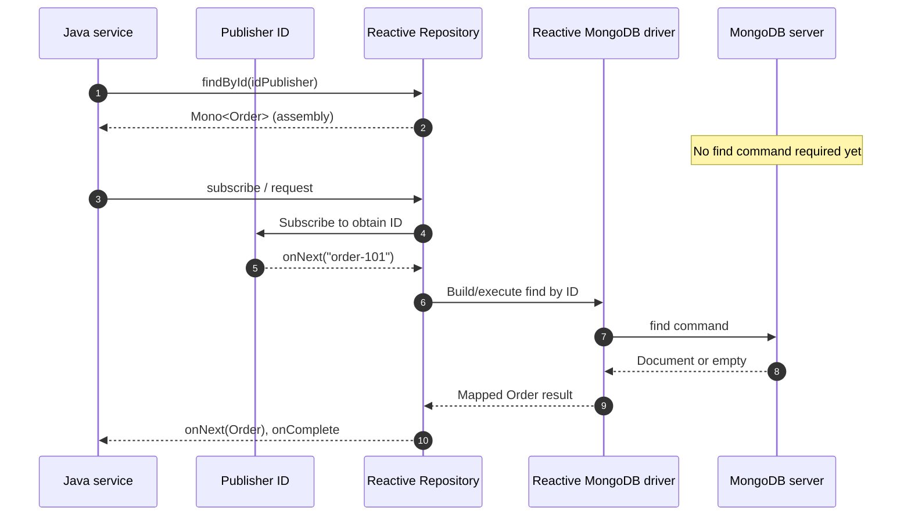

# Publisher Arguments and When Queries Execute

## 1. Calling a Repository Method Does Not Mean the Query Has Run

When programming **Spring Data MongoDB** reactively, a repository method can return a `Mono<T>` or `Flux<T>` without sending a query to MongoDB on the Java line that calls the method. The operation is **described as a Publisher**; only when a subscriber registers and signals demand does the pipeline activate.

Example:

```java
Mono<Order> lookup = repository.findById("order-101");

// This only creates a Mono; do not assume MongoDB has executed find yet.

lookup.subscribe(order -> {
    System.out.println(order.state());
});
```

In WebFlux, in almost all cases **you do not call `subscribe()` inside services or controllers**. The framework subscribes to the Publisher when building the HTTP response. Calling `subscribe()` manually makes it easy to return the HTTP response before the query finishes, lose error handling, or detach the operation from transaction and request scopes.

This lesson in the **Reactive access** chapter also covers an often-overlooked angle: besides returning a **result Publisher**, certain reactive Spring Data APIs accept a **Publisher as an input argument**. For instance, `ReactiveCrudRepository` provides the overload:

```java
Mono<Order> findById(Publisher<String> id);
```

When `id` is supplied asynchronously, the repository must obtain the value from that input Publisher **before executing the ID-dependent query**. If the parameter only becomes available after another reactive call, the query cannot behave as if the ID existed when the method was called.

This lesson belongs to the **SPRING_DATA_MONGODB** module: using Spring Data MongoDB to connect and map documents via `ReactiveMongoTemplate` or repositories, write queries, handle transactions, reactive access, testing, and performance diagnostics. Specific goals:

1. Distinguish a `Publisher` as an **input argument** from a `Publisher` as a **result**.
2. Trace **assembly → subscription → demand → parameter resolution → MongoDB command → result**.
3. Understand cold/hot sources, `Mono.just`, `Mono.defer`, `Mono.fromSupplier`, multiple subscribers, `cache`, and `retry`.
4. Write repositories, templates, and WebFlux code that **neither block nor subscribe prematurely**.
5. Test parameter resolution timing, empty/error/cancellation cases, tenant isolation, and actual MongoDB command counts.

## 2. Core Reactive Streams Terminology

A **Publisher** is a signal source adhering to the Reactive Streams contract. It does not guarantee immediate emission or exactly one value.

| Concept | Meaning | Example |
| --- | --- | --- |
| `Publisher<T>` | Source interface emitting elements of type `T` | `Mono<String>`, `Flux<String>` |
| `Subscriber<T>` | Consumer receiving `onSubscribe`, `onNext`, `onError`, `onComplete` | WebFlux, `StepVerifier` |
| `Subscription` | Link between source and subscriber controlling `request(n)` and `cancel()` | Backpressure |
| `Mono<T>` | Reactor Publisher emitting **0 or 1 value**, then completing or erroring | One order by ID |
| `Flux<T>` | Reactor Publisher emitting **0..N values**, completing or erroring | List of orders |
| **Assembly** | Constructing pipeline objects and chaining operators | Calling `findById(...)`, `map`, `flatMap` |
| **Subscription** | Subscribing to consume the pipeline | WebFlux, `StepVerifier.create(...)` |
| **Demand** | Subscriber requesting items via `request` | `request(1)`, `request(Long.MAX_VALUE)` |
| **Termination** | Publisher finishing normally or with an error | `onComplete`, `onError` |
| **Cancellation** | Subscriber stopping further consumption | Client disconnect, `take(1)` |

Not every Publisher is **cold** or completely lazy. A Publisher can be hot, producing data externally before you subscribe. Whenever reasoning about query execution timing, always ask: **Which API created this Publisher, and what kind of source supplies its arguments?**

### 2.1. Illustrating Two Distinct Publishers

```java
Mono<String> idPublisher = Mono.just("order-101");
Mono<Order> resultPublisher =
    repository.findById(idPublisher);
```

`idPublisher` provides the **query argument**. `resultPublisher` provides the **resulting document**. Both are Publishers participating in the same chain, yet they serve distinct roles.

### 2.2. Execution Timeline



The diagram shows **logical order**. Exact command dispatch timing also depends on the driver, subscription, demand, and internal optimizations. Avoid saying “`subscribe()` always sends a TCP packet immediately”—downstream might not have requested yet, or upstream may still be resolving arguments or delayed.

## 3. Sample Data and ReactiveMongoRepository

### 3.1. MongoDB Documents

Assume a `shop_orders` collection:

```javascript
db.shop_orders.insertMany([
  {
    _id: "order-101",
    tenantId: "shop-a",
    state: "PAID",
    totalCents: NumberLong("25000")
  },
  {
    _id: "order-102",
    tenantId: "shop-a",
    state: "PENDING",
    totalCents: NumberLong("8000")
  },
  {
    _id: "order-201",
    tenantId: "shop-b",
    state: "PAID",
    totalCents: NumberLong("50000")
  }
]);
```

### 3.2. Entity

```java
package example.orders;

import org.springframework.data.mongodb.core.mapping.Document;
import org.springframework.data.mongodb.core.mapping.FieldType;
import org.springframework.data.mongodb.core.mapping.MongoId;

@Document(collection = "shop_orders")
public record ShopOrder(
    @MongoId(FieldType.STRING) String id,
    String tenantId,
    String state,
    long totalCents
) {}
```

`@MongoId(FieldType.STRING)` stores IDs as BSON Strings. The reactive repository uses this mapping metadata when reading documents.

### 3.3. Repository

```java
package example.orders;

import org.springframework.data.mongodb.repository.ReactiveMongoRepository;
import reactor.core.publisher.Mono;

public interface ShopOrderRepository
        extends ReactiveMongoRepository<ShopOrder, String> {

    Mono<ShopOrder> findByIdAndTenantId(
        String id, String tenantId
    );
}
```

`ReactiveMongoRepository` inherits reactive CRUD operations, including `findById(String)` and `findById(Publisher<String>)` from its super-interfaces. They differ in **how the ID is supplied**, not “synchronous vs reactive”: **both return `Mono<ShopOrder>`**.

In Java:

```java
import org.reactivestreams.Publisher;
import reactor.core.publisher.Mono;

Publisher<String> id = Mono.just("order-101");

Mono<ShopOrder> byValue =
    repository.findById("order-101");

Mono<ShopOrder> byPublisher =
    repository.findById(id);
```

Both calls can return `order-101` when subscribed. The difference is that `byPublisher` depends on the input Publisher to resolve the ID. **Passing a `Publisher` argument does not make a MongoDB query run any sooner.**

## 4. Two Lazy Stages: Building Input Publishers vs Result Publishers

### 4.1. `Mono.just` Wraps an Already-Computed Value

```java
String id = "order-101";
Mono<String> idMono = Mono.just(id);
Mono<ShopOrder> query = repository.findById(idMono);
```

The `id` value already exists when `Mono.just` is called. The Publisher emits that value upon subscription, but **computing the String ID** is not deferred by `Mono.just`.

Compare:

```java
Mono<String> eager =
    Mono.just(loadIdFromLocalComputation());
```

Here `loadIdFromLocalComputation()` runs **immediately at assembly time**, before anyone subscribes to `eager`. Never use `Mono.just(blockingDatabaseOrHttpCall())` trying to turn a blocking operation reactive.

### 4.2. `Mono.fromSupplier` Defers Value Computation

```java
Mono<String> lazyId = Mono.fromSupplier(
    () -> deriveIdFromImmutableInput()
);

Mono<ShopOrder> query =
    repository.findById(lazyId);
```

The supplier runs **at subscription time**, not during pipeline assembly. This computes the value lazily and repeats per subscription.

**Never place slow blocking work** inside `Supplier` just because it runs later. For HTTP/DB I/O, prefer genuinely reactive APIs or isolate blocking tasks explicitly on an appropriate scheduler.

### 4.3. `Mono.defer` Defers Pipeline Construction Itself

```java
Mono<ShopOrder> query = Mono.defer(() -> {
    String id = deriveIdFromImmutableInput();
    return repository.findById(id);
});
```

`Mono.defer` invokes the supplier to build **a fresh Publisher on every subscription**. Contrast with:

```java
Mono<ShopOrder> query =
    repository.findById(deriveIdFromImmutableInput());
```

In the second snippet, `deriveIdFromImmutableInput()` runs eagerly while constructing `query`, even though the MongoDB query itself has not run yet.

### 4.4. Exact Summary of When Things Happen

| Pattern | When ID Is Computed | When MongoDB Query Executes |
| --- | --- | --- |
| `findById("order-101")` | ID already exists at assembly | When result Publisher is subscribed/requested |
| `findById(Mono.just(id))` | `id` already exists; Mono emits on subscribe | After ID Publisher is consumed in result subscription |
| `findById(Mono.fromSupplier(...))` | Supplier runs on subscription | After ID resolves |
| `Mono.defer(() -> findById(makeId()))` | `makeId()` runs on subscription | When inner query Publisher is subscribed |
| `Mono.just(findIdBlocking())` | Blocking call executes immediately | Not a valid reactive pattern for deferring blocking work |

**Do not equate “repository returns `Mono`” with “every Java expression on that call line is lazy.”** Reactor only defers computation placed *inside* a Publisher or operator.

## 5. Publisher Arguments: Single Value vs Multiple Values

### 5.1. One ID: Use `Mono`

`findById(Publisher<ID>)` means finding **one entity by ID**. Even though the parameter type is general `Publisher<ID>`, the clearest type when you expect one ID is `Mono<ID>`.

```java
Mono<String> id = getOrderIdAsynchronously();

Mono<ShopOrder> order = repository.findById(id);
```

`getOrderIdAsynchronously()` represents an application-provided Publisher; in real code, define it from an actual source such as another service call or Reactor Context.

Never pass an unbounded `Flux` or multi-ID source into an API designed to return **one entity** and rely on implementation quirks regarding which element gets picked. Convert it explicitly to a `Mono` with clear semantics, e.g.:

```java
Mono<String> exactlyOneId =
    candidateIds.single();
```

`single()` requires strictly one element, failing on empty or multiple elements. This works well when wrong input cardinality is a **contract violation**.

### 5.2. Multiple IDs: `findAllById(Publisher<ID>)`

`ReactiveCrudRepository` also supports finding multiple records from an ID Publisher:

```java
Flux<String> ids = Flux.just(
    "order-101", "order-102", "order-201"
);

Flux<ShopOrder> orders =
    repository.findAllById(ids);
```

`findAllById(Publisher<ID>)` does not guarantee “one result per input ID”: some IDs may not exist, the input may contain duplicates, and output order **should not be assumed** to match input order. Check your Spring Data version's contract and sort or reconcile by ID if callers expect a fixed order.

Also do not infer from the word `Publisher` that the repository always runs **one separate MongoDB command per ID** or always merges into **a single `$in` command**. Query execution details depend on implementation and version; measure under large workloads.

### 5.3. When Receiving Thousands of IDs

```java
Flux<String> ids = incomingIds
    .distinct()
    .take(1000);

Flux<ShopOrder> orders =
    repository.findAllById(ids);
```

This bounds the ID count proactively, though `take(1000)` is an **input cap**, not full protection against an unbounded stream producing errors or oversized payloads. Public APIs accepting ID lists must limit request sizes, enforce tenant permissions, chunk/paginate cleanly, and validate indexes.

### 5.4. Empty and Errored Input Publishers

Example:

```java
Mono<String> emptyId = Mono.empty();
Mono<String> brokenId = Mono.error(
    new IllegalArgumentException("Unable to resolve ID")
);

Mono<ShopOrder> fromEmpty =
    repository.findById(emptyId);

Mono<ShopOrder> fromError =
    repository.findById(brokenId);
```

An upstream failing to emit an ID supplies no parameter to `findById`; an upstream error fails the chain. **Exact signal behavior when the ID Publisher is empty depends on the API/version contract**, so test explicitly rather than guessing a query runs with `_id=null`.

When business rules require an ID, normalize it at the application boundary:

```java
Mono<String> requiredId =
    idPublisher.switchIfEmpty(Mono.error(
        new IllegalArgumentException("Missing orderId")
    ));

Mono<ShopOrder> lookup =
    repository.findById(requiredId);
```

That way, the **error path** for missing input is governed by application code rather than repository internals.

## 6. Subscription: Queries Can Execute Multiple Times

### 6.1. Cold Query Publisher and Two Subscribers

```java
Mono<ShopOrder> lookup =
    repository.findById("order-101");

lookup.subscribe(order ->
    log.info("Subscriber A: {}", order.state())
);
lookup.subscribe(order ->
    log.info("Subscriber B: {}", order.state())
);
```

A standard cold reactive query Publisher **re-executes the query path for each subscription**. Two subscriptions trigger two MongoDB commands—not one shared query cached forever across subscribers.

Manual `subscribe` calls here **only illustrate the mechanism**, not how to write WebFlux endpoints. Nor should you assume two subscribers observe the same snapshot; the document may change between subscriptions.

### 6.2. ID Re-Evaluated on Every Subscription

```java
AtomicInteger calls = new AtomicInteger();

Mono<String> idPublisher = Mono.fromSupplier(() -> {
    calls.incrementAndGet();
    return "order-101";
});

Mono<ShopOrder> lookup =
    repository.findById(idPublisher);

// calls.get() == 0 before subscription.

lookup.block();  // For isolated sample / main programs only.
// calls.get() == 1.

lookup.block();  // Second subscription.
// calls.get() == 2.
```

This illustrates **cold/re-subscription** semantics of `fromSupplier`. `block()` is a **blocking** terminal operator—never use it on WebFlux request threads. In real tests, prefer `StepVerifier` over `block()`.

### 6.3. A Result Publisher Is Not an “Already-Completed Future”

`Mono<ShopOrder>` does not mean “MongoDB already read the document and stored it inside the Mono.” Until subscribed, typically no query has run. Subscribing multiple times can run independent reads.

For example:

```java
Mono<ShopOrder> result =
    repository.findById("order-101")
        .doOnNext(order -> metrics.recordRead());
```

does not record metrics at assembly. `doOnNext` runs only when the Publisher actually emits an order; if the query completes empty, the callback is skipped.

## 7. Hot, Cold, Cache, and Observation Timing

### 7.1. Cold Sources

```java
Mono<String> id = Mono.fromSupplier(() -> {
    System.out.println("ID evaluated");
    return "order-101";
});
```

Each new subscription typically re-runs the `Supplier`. Combined with a cold repository Publisher, every subscription resolves the argument and re-queries MongoDB.

### 7.2. Hot / Shared Sources

A `Sinks.Many`, an externally subscribed event stream, or a `cache`/`share` Publisher may **not replay emissions to late subscribers**. If the parameter source emits the ID **before the repository subscribes**, a late subscriber can miss the ID.

Therefore, never pass a hot event stream as an argument to `findById` without a clear protocol ensuring **each request receives its exact one ID**.

### 7.3. Caching Query Results

```java
Mono<ShopOrder> cached =
    repository.findById("order-101")
        .cache();
```

With `Mono.cache()`, the first subscriber triggers the query; subsequent subscribers can replay the cached signals without issuing new queries. **This is a Reactor Publisher cache**, not a MongoDB cache.

Risks:

- The document can change while `cached` keeps serving stale data.
- Retaining the Publisher in a singleton can keep stale data alive far longer than a request's lifetime.
- Errors or empty results may also be cached depending on the operator semantics.
- Caching tenant- or user-specific data risks data leaks if reused outside the proper scope.

Never slap `cache()` on everywhere to “optimize queries.” Define TTLs, cache keys, access scope, invalidation strategy, and consistency requirements explicitly.

### 7.4. Caching the ID vs Caching the Result

```java
Mono<String> cachedId = fetchCurrentId().cache();
Mono<ShopOrder> lookup = repository.findById(cachedId);
```

Here the **ID value** may be cached, yet `lookup` still re-executes the query on every subscription. **Caching the argument** does not equal **caching the document**. Keep cache scopes explicit to avoid lifecycle confusion.

## 8. Execution at Subscription: Assembly-Time Side Effects Are a Trap

### 8.1. Side Effects Before the Publisher

```java
public Mono<ShopOrder> loadOrder(String id) {
    auditAttempt(id); // Called IMMEDIATELY when the method runs.
    return repository.findById(id);
}
```

If a controller calls `loadOrder` to build a `Mono` without anyone subscribing, `auditAttempt` still runs while the MongoDB query never runs—logging “order read” when no query ever executed.

If you need a side effect **per subscription**:

```java
public Mono<ShopOrder> loadOrder(String id) {
    return Mono.defer(() -> {
        auditAttempt(id); // Called upon subscription.
        return repository.findById(id);
    });
}
```

Never place financial or non-idempotent side effects inside `defer` without accounting for **re-subscriptions and retries**, which can invoke it multiple times.

### 8.2. `doOnSubscribe` and `doOnNext` Differ

```java
Mono<ShopOrder> lookup = repository.findById(id)
    .doOnSubscribe(s -> log.debug("Subscribed"))
    .doOnNext(order -> log.debug("Found {}", order.id()))
    .doOnSuccess(order -> log.debug("Completed lookup"))
    .doOnError(error -> log.warn("Lookup failed", error))
    .doFinally(signal -> log.debug("Terminated: {}", signal));
```

| Hook | When Invoked | Key Note |
| --- | --- | --- |
| `doOnSubscribe` | When subscription is established | **Does not** prove a command reached the server |
| `doOnNext` | When a document is emitted | Skipped when Mono is empty |
| `doOnSuccess` | When Mono succeeds, including empty (passing `null`) | Never assume a document was found |
| `doOnError` | When Publisher errors | Errors never become empty unless explicitly handled |
| `doFinally` | After complete/error/cancel | Useful for cleanup and summary metrics |

To verify **whether MongoDB actually received a command**, use driver command monitoring in tests—never treat `doOnSubscribe` alone as proof.

## 9. Passing Publisher Arguments to ReactiveMongoTemplate

`ReactiveMongoTemplate` supports reactive operations, yet not every template method provides a `Publisher<ID>` overload. Never assume you can pass `Mono<String>` wherever a method takes `String` or `Query`.

For `ReactiveMongoTemplate.findById(id, ShopOrder.class)`, when the ID comes from a Publisher, **compose** with `flatMap`:

```java
package example.orders;

import org.springframework.data.mongodb.core.ReactiveMongoTemplate;
import org.springframework.stereotype.Service;
import reactor.core.publisher.Mono;

@Service
public class OrderLookupTemplateService {

    private final ReactiveMongoTemplate template;

    public OrderLookupTemplateService(
            ReactiveMongoTemplate template) {
        this.template = template;
    }

    public Mono<ShopOrder> load(Mono<String> orderId) {
        return orderId
            .switchIfEmpty(Mono.error(
                new IllegalArgumentException("Missing orderId")
            ))
            .flatMap(id ->
                template.findById(id, ShopOrder.class)
            );
    }
}
```

Explanation:

1. `load` accepts `Mono<String>` without calling `block()` to extract the ID.
2. `switchIfEmpty` handles a missing parameter explicitly.
3. `flatMap` awaits the ID and calls the reactive template query.
4. Subscribing to the final result triggers the upstream ID Publisher and then the MongoDB query.
5. If upstream errors, `flatMap` never calls the database.

`flatMap` composes dependent Publishers; `map` is only for lambdas returning a **plain value**, not `Mono<ShopOrder>`:

```java
Mono<Mono<ShopOrder>> nested = orderId.map(
    id -> template.findById(id, ShopOrder.class)
);
```

`nested` above is a **Mono of a Mono**. Without flattening, the inner query stays unsubscribed, and callers receive a **Publisher object** instead of a document.

## 10. Dynamic Queries: Arguments Must Never Drop the Tenant Filter

`repository.findById(idPublisher)` is handy for learning Publisher arguments. In multi-tenant systems, however, a client-supplied ID is **not enough** to authorize reading any document.

### 10.1. Tenant-Scoped Repository Method

```java
public interface ShopOrderRepository
        extends ReactiveMongoRepository<ShopOrder, String> {

    Mono<ShopOrder> findByIdAndTenantId(
        String id, String tenantId
    );
}
```

When the ID comes from a Publisher, resolve it first and call the tenant-scoped method:

```java
public Mono<ShopOrder> loadForTenant(
        Mono<String> orderId,
        String authorizedTenantId) {

    if (authorizedTenantId == null
            || authorizedTenantId.isBlank()) {
        return Mono.error(new IllegalArgumentException(
            "Invalid tenant"
        ));
    }

    return orderId
        .switchIfEmpty(Mono.error(
            new IllegalArgumentException("Missing ID")
        ))
        .flatMap(id ->
            repository.findByIdAndTenantId(
                id, authorizedTenantId
            )
        );
}
```

`authorizedTenantId` must come from server-side authentication and authorization. Never let clients pass an arbitrary tenant and treat it as authorized. Tenant-scoped queries make MongoDB **filter the data** rather than loading unauthorized documents and filtering in Java.

### 10.2. ReactiveMongoTemplate with Criteria

```java
public Mono<ShopOrder> loadForTenant(
        Mono<String> orderId,
        String authorizedTenantId) {

    return orderId.flatMap(id -> {
        Query query = Query.query(
            Criteria.where("id").is(id)
                .and("tenantId").is(authorizedTenantId)
        );
        return template.findOne(query, ShopOrder.class);
    });
}
```

In typed queries over `ShopOrder.class`, Spring Data maps the Java property `id` to BSON `_id`. On raw untyped `Document` queries, use actual stored field names.

### 10.3. Reactive Security Context

If the tenant arrives via **Reactor Context** instead of a method argument, read the context at subscription time:

```java
Mono<ShopOrder> loadWithContext(Mono<String> orderId) {
    return Mono.deferContextual(ctx -> {
        String tenant = ctx.get("authorizedTenantId");
        return orderId.flatMap(id ->
            repository.findByIdAndTenantId(id, tenant)
        );
    });
}
```

This assumes an **internal context key populated by your authentication layer**. In Spring Security WebFlux apps, use the official principal/authorization context APIs and never trust a client-controlled context key. `deferContextual` reads the context **at subscription**, avoiding capturing the wrong request's state at assembly.

## 11. Distinguishing “No Document” from “No ID”

Distinguish three cases:

1. The ID Publisher **emits no value**.
2. The ID Publisher **emits a valid ID**, yet MongoDB finds no document.
3. The ID Publisher **errors** before the query runs.

In both (1) and (2), the chain can end empty unless you enforce distinct contracts—yet their **business meanings differ**.

### 11.1. Validate Input Before Querying

```java
Mono<String> requiredId = sourceId
    .switchIfEmpty(Mono.error(
        new IllegalArgumentException("Missing orderId")
    ))
    .filter(id -> !id.isBlank())
    .switchIfEmpty(Mono.error(
        new IllegalArgumentException("Empty orderId")
    ));
```

Missing or blank IDs are classified cleanly as **bad input**.

### 11.2. Handle Missing Documents After the Query

```java
Mono<ShopOrder> requiredOrder =
    requiredId.flatMap(repository::findById)
        .switchIfEmpty(Mono.error(
            new OrderNotFoundException("Order not found")
        ));
```

`OrderNotFoundException` is an **application-defined business exception**, not a built-in Spring Data MongoDB class. Ensure the corresponding exception class exists in your app.

**Never map every exception to HTTP 404.** Network failures, access denied errors, mapping failures, and timeouts must be classified separately. In multi-tenant systems, use tenant-scoped queries and HTTP error contracts that do not leak whether documents exist under other tenants.

### 11.3. Never Return a Fake Entity via `defaultIfEmpty`

```java
// Do not do this when callers need to know "not found":
Mono<ShopOrder> result = repository.findById(id)
    .defaultIfEmpty(
        new ShopOrder("fake", "shop-a", "PAID", 0L)
    );
```

A fake entity might accidentally get saved or treated as real data downstream. To return a fallback response, use an explicit DTO or error contract rather than disguising absence as a valid entity.

## 12. WebFlux Controller: Return the Publisher, Don't Subscribe Manually

### 12.1. Service

```java
package example.orders;

import org.springframework.stereotype.Service;
import reactor.core.publisher.Mono;

@Service
public class OrderQueryService {

    private final ShopOrderRepository repository;

    public OrderQueryService(
            ShopOrderRepository repository) {
        this.repository = repository;
    }

    public Mono<OrderView> getOrder(
            String authorizedTenantId,
            Mono<String> orderId) {

        if (authorizedTenantId == null
                || authorizedTenantId.isBlank()) {
            return Mono.error(new IllegalArgumentException(
                "Invalid tenant"
            ));
        }

        return orderId
            .switchIfEmpty(Mono.error(
                new IllegalArgumentException("Missing orderId")
            ))
            .flatMap(id ->
                repository.findByIdAndTenantId(
                    id, authorizedTenantId
                )
            )
            .map(order -> new OrderView(
                order.id(), order.state(), order.totalCents()
            ));
    }
}
```

DTO:

```java
package example.orders;

public record OrderView(
    String id,
    String state,
    long totalCents
) {}
```

### 12.2. Controller Subscribed by WebFlux

```java
package example.orders;

import org.springframework.http.ResponseEntity;
import org.springframework.web.bind.annotation.GetMapping;
import org.springframework.web.bind.annotation.PathVariable;
import org.springframework.web.bind.annotation.RestController;
import reactor.core.publisher.Mono;

@RestController
public class OrderController {

    private final OrderQueryService service;
    private final AuthorizedTenantProvider tenants;

    public OrderController(
            OrderQueryService service,
            AuthorizedTenantProvider tenants) {
        this.service = service;
        this.tenants = tenants;
    }

    @GetMapping("/orders/{id}")
    public Mono<ResponseEntity<OrderView>> byId(
            @PathVariable String id) {

        return tenants.currentAuthorizedTenant()
            .flatMap(tenant ->
                service.getOrder(tenant, Mono.just(id))
            )
            .map(ResponseEntity::ok)
            .defaultIfEmpty(
                ResponseEntity.notFound().build()
            );
    }
}
```

`AuthorizedTenantProvider` is an **application-implemented abstraction** backed by Spring Security's principal/context, not a built-in Spring Data MongoDB API. The example intentionally avoids taking the tenant from query parameters. `defaultIfEmpty` returns 404 when the tenant is resolved yet no order matches; in real apps, separate missing authentication context from missing orders so auth failures do not turn into 404s.

Core point: the controller **returns `Mono<ResponseEntity<...>>`**. The framework subscribes, pulls data, and handles completion/errors across the HTTP lifecycle. Never write:

```java
// Do not use:
service.getOrder(tenant, Mono.just(id)).subscribe();
return Mono.just(ResponseEntity.accepted().build());
```

Doing so detaches the query from the response and exception pipeline; responses can return before the query completes.

## 13. Backpressure and When MongoDB Is Requested for Data

### 13.1. Mono vs Flux Output Cardinality

`Mono<Order>` emits at most one `Order`. With `Flux<Order>` from `findAll()`, subscribers regulate **demand** per Reactive Streams. The driver normally fetches batches via cursors, though `request(n)` in Reactor **does not equal one MongoDB command per `n` documents**.

```java
Flux<ShopOrder> orders =
    repository.findAll();

Flux<ShopOrder> firstTen =
    orders.take(10);
```

`take(10)` stops consuming after at most 10 items and cancels upstream; however, the server may still have read more than 10 documents or prefetched a larger batch. To cap total results directly on MongoDB, use a query with `limit(10)` or a matching repository method.

### 13.2. Testing Demand with StepVerifier

```java
StepVerifier.create(orders, 0)
    .thenRequest(1)
    .expectNextCount(1)
    .thenCancel()
    .verify();
```

This test requires `orders` to contain at least one document; it starts with **initial request=0**, requests 1, and cancels. Whether upstream prepares a command before `thenRequest(1)` depends on operators and the driver; **never use this demand test alone as proof no DB command was sent** without command monitoring.

### 13.3. Never Use `collectList` on Unbounded Datasets

```java
Mono<List<ShopOrder>> all =
    repository.findAll().collectList();
```

`collectList` buffers every emitted document into application RAM. Reactive I/O does not make unbounded lists safe. For large reports, use `limit`, pagination, cursor strategies, and DTO projections.

## 14. Retries: Every Re-Subscription Can Issue a New Query

Applying `retry(n)` to a cold query Publisher **re-subscribes** to upstream on error:

```java
Mono<ShopOrder> lookup =
    repository.findById(idPublisher)
        .retry(2);
```

On read failure, Reactor re-subscribes up to the configured retry limit. That can re-evaluate **`idPublisher`** and re-send the MongoDB query.

### 14.1. Retry Only Appropriate Failures

```java
Mono<ShopOrder> lookup =
    repository.findById(idPublisher)
        .retryWhen(
            Retry.backoff(2, Duration.ofMillis(100))
                .filter(this::isTransientReadFailure)
        );
```

`isTransientReadFailure` is an application policy checking exceptions, driver labels, and business impact; the snippet assumes that helper exists. Never retry blindly across all errors, especially validation errors, unauthorized access, or invalid IDs.

### 14.2. Read Queries vs Writes Carry Different Retry Risks

Re-reading may observe the document at a **later point in time**. For writes:

```java
Mono<ShopOrder> save =
    repository.save(newOrder).retry(3);
```

retrying can be unsafe if surrounding code emits events or updates multiple documents; enforce **idempotency**, retryable writes, and proper transactions. Never treat `Mono.retry` as an exactly-once guarantee.

### 14.3. Retry vs Cache Ordering

`cache()` can remember an error; placing `cache` before `retry` causes retries to replay **the same cached error** instead of issuing fresh commands. Operator order changes semantics:

```java
Mono<ShopOrder> a =
    repository.findById(id).retry(2).cache();

Mono<ShopOrder> b =
    repository.findById(id).cache().retry(2);
```

Do not treat these as equivalent. Choose deliberately and test subscription and source evaluation counts.

## 15. Cancellation: Losing the Subscriber Is Not a Transaction Rollback

If an HTTP client disconnects or downstream calls `cancel`, the reactive pipeline cancels:

```java
Flux<ShopOrder> limited =
    repository.findAll()
        .take(5)
        .doFinally(signal ->
            log.debug("Completed with {}", signal)
        );
```

Cancellation triggers cleanup in Reactor and the driver, yet **you cannot assume an in-flight MongoDB operation stops immediately on every topology**. Likewise, if a **write was already accepted by the server**, cancelling the client subscription does not roll it back.

### 15.1. An Input Publisher Can Be Cancelled Before Emitting an ID

```java
Mono<String> delayedId =
    Mono.delay(Duration.ofSeconds(5))
        .map(ignored -> "order-101");

Mono<ShopOrder> lookup =
    repository.findById(delayedId);
```

If the subscriber cancels after one second, the ID source has not emitted yet, so the repository never had a value to construct the ID query. Never write cleanup logic assuming a `find` command definitely ran.

### 15.2. Reactor Timeout Differs from `maxTimeMS`

```java
Mono<ShopOrder> bounded =
    lookup.timeout(Duration.ofSeconds(2));
```

Reactor's `timeout` caps waiting on the Publisher inside the application. It does not automatically set **MongoDB server `maxTimeMS`**. When both matter, configure server timeouts via appropriate Spring Data/driver APIs and align end-to-end deadlines.

## 16. Scheduling: Non-Blocking I/O Does Not Need `boundedElastic` by Default

A common misconception is that every reactive call needs:

```java
repository.findById(id)
    .subscribeOn(Schedulers.boundedElastic());
```

The reactive MongoDB driver already uses **non-blocking I/O**; routing every query through `boundedElastic` does not speed up the database. `subscribeOn`/`publishOn` control execution schedulers for Reactor pipeline stages—not indexes, query plans, or server CPU.

If you must call a **blocking** library lacking a reactive API, isolate only that blocking part:

```java
Mono<String> id = Mono.fromCallable(
        () -> legacyBlockingIdResolver.resolve()
    )
    .subscribeOn(Schedulers.boundedElastic());

Mono<ShopOrder> lookup =
    id.flatMap(repository::findById);
```

`legacyBlockingIdResolver` is an external dependency that must be defined; this shows **isolating blocking code**, not turning MongoDB queries blocking. Monitor thread pools, queues, and timeouts per service.

**Never call `block()` on the WebFlux event loop** just to grab an ID before calling the repository:

```java
// Anti-pattern:
String id = idMono.block();
Mono<ShopOrder> order = repository.findById(id);
```

It blocks the thread, breaks the reactive chain, and risks deadlocks or runtime exceptions.

## 17. Transactions and Reactor Context

Spring Data reactive MongoDB supports transactions via `ReactiveMongoTransactionManager` and Reactor/transaction context. Operations participating in the same transaction must be subscribed **within that transaction scope**, not merely invoked from methods with similar names.

### 17.1. TransactionalOperator

```java
import org.springframework.data.mongodb.ReactiveMongoTransactionManager;
import org.springframework.transaction.reactive.TransactionalOperator;

TransactionalOperator tx =
    TransactionalOperator.create(
        reactiveMongoTransactionManager
    );

Mono<ShopOrder> work = repository.findById(id)
    .flatMap(order ->
        repository.save(new ShopOrder(
            order.id(),
            order.tenantId(),
            "PAID",
            order.totalCents()
        ))
    );

Mono<ShopOrder> transactional =
    work.as(tx::transactional);
```

`reactiveMongoTransactionManager` is configured/injected in the Spring context; this snippet shows a minimal transaction wrapping a find and save. In real systems, use conditional updates/versioning or transactions carefully to prevent lost updates.

**Reactive transactions require a supporting MongoDB deployment (replica set or compatible sharded topology)**. Never create a sync `ClientSession` and pass it into reactive code; the Spring transaction manager must own session lifecycle.

### 17.2. Reactive Context Is Not a Simple `ThreadLocal`

In reactive pipelines, execution can hop threads, so `ThreadLocal` cannot reliably track security or transaction context across operators. Use Reactor Context and Spring Security/Spring Transaction reactive APIs for per-request state.

Never start a transaction and call `subscribe()` on another Publisher inside it:

```java
return tx.transactional(
    repository.findById(id)
        .doOnNext(order ->
            repository.save(order).subscribe() // Wrong.
        )
);
```

Manual `subscribe()` starts an **independent subscription** outside the outer chain's transaction and error handling. Compose with `flatMap`:

```java
return tx.transactional(
    repository.findById(id)
        .flatMap(order -> repository.save(order))
);
```

### 17.3. A Publisher Argument Does Not Create a Transaction

`repository.findById(idMono)` resolves the ID from a reactive source, yet passing a Publisher argument **does not open a session or transaction** for that source. To make multiple MongoDB operations atomic, wrap all participating DB operations inside one transaction scope.

## 18. Observing When MongoDB Queries Are Actually Sent

Reactor operators trace signal flow, but distinguishing **ID source subscribed** from **MongoDB command started** requires observing both layers.

### 18.1. Reactor-Side Instrumentation

```java
AtomicInteger idEvaluations = new AtomicInteger();

Mono<String> id = Mono.fromSupplier(() -> {
    idEvaluations.incrementAndGet();
    return "order-101";
});

Mono<ShopOrder> lookup =
    repository.findById(id)
        .doOnSubscribe(subscription ->
            log.debug("Result subscribed")
        )
        .doOnNext(order ->
            log.debug("Document emitted: {}", order.id())
        );
```

`idEvaluations` counts how many times the ID source ran. It is **not** a direct count of MongoDB commands.

### 18.2. MongoDB Command Monitoring

The MongoDB Java driver exposes `CommandListener`. When properly registered on the reactive client, you can observe `CommandStartedEvent` for `find` commands:

```java
import com.mongodb.event.CommandListener;
import com.mongodb.event.CommandStartedEvent;
import java.util.concurrent.atomic.AtomicInteger;

public final class FindCommandCounter
        implements CommandListener {

    private final AtomicInteger count =
        new AtomicInteger();

    @Override
    public void commandStarted(CommandStartedEvent event) {
        if ("find".equals(event.getCommandName())) {
            count.incrementAndGet();
        }
    }

    public int count() {
        return count.get();
    }
}
```

This class is **not automatically registered in `MongoClientSettings`**; attach the listener when building the client in tests or apps. In Spring Boot, registration varies by auto-configuration and driver version. Never log raw commands containing full user payloads in production without redaction.

### 18.3. Three Verification Checkpoints

| Checkpoint | What to Verify |
| --- | --- |
| After assembly, before subscribe | ID supplier has not run; zero `find` commands from the chain |
| On subscribe, before ID emits | Chain waits for the parameter Publisher |
| After ID emits and downstream requests | MongoDB `find` executes; assert results or command count |

To count **exact commands**, run tests in isolation, filter by collection/query, and exclude seed commands. A `doOnSubscribe` log alone never proves MongoDB executed a query.

## 19. Repository Integration Testing with StepVerifier

### 19.1. Test Configuration

Example using JUnit 5, Reactor Test, and Spring Boot `@DataMongoTest`:

```java
package example.orders;

import static org.junit.jupiter.api.Assertions.*;

import java.util.UUID;
import java.util.concurrent.atomic.AtomicInteger;
import org.junit.jupiter.api.Test;
import org.springframework.beans.factory.annotation.Autowired;
import org.springframework.boot.test.autoconfigure.data.mongo.DataMongoTest;
import reactor.core.publisher.Flux;
import reactor.core.publisher.Mono;
import reactor.test.StepVerifier;

@DataMongoTest
class PublisherArgumentRepositoryTest {

    @Autowired
    ShopOrderRepository repository;

    @Test
    void resolvesPublisherIdAtSubscriptionTime() {
        String id = "order-" + UUID.randomUUID();

        StepVerifier.create(
            repository.save(new ShopOrder(
                id, "shop-a", "PAID", 12500L
            ))
        )
            .assertNext(saved -> assertEquals(id, saved.id()))
            .verifyComplete();

        AtomicInteger evaluations =
            new AtomicInteger();

        Mono<String> idPublisher = Mono.fromSupplier(() -> {
            evaluations.incrementAndGet();
            return id;
        });

        Mono<ShopOrder> lookup =
            repository.findById(idPublisher);

        // Assembly has not subscribed to the ID source yet:
        assertEquals(0, evaluations.get());

        StepVerifier.create(lookup)
            .assertNext(order -> {
                assertEquals(id, order.id());
                assertEquals("PAID", order.state());
            })
            .verifyComplete();

        assertEquals(1, evaluations.get());

        // Re-subscribe to cold source:
        StepVerifier.create(lookup)
            .assertNext(order ->
                assertEquals(id, order.id())
            )
            .verifyComplete();

        assertEquals(2, evaluations.get());
    }

    @Test
    void findAllByIdAcceptsPublisherOfIds() {
        String prefix = UUID.randomUUID().toString();
        String firstId = "a-" + prefix;
        String secondId = "b-" + prefix;

        StepVerifier.create(
            repository.saveAll(Flux.just(
                new ShopOrder(
                    firstId, "shop-a", "PAID", 1000L
                ),
                new ShopOrder(
                    secondId, "shop-a", "PENDING", 2000L
                )
            ))
        )
            .expectNextCount(2)
            .verifyComplete();

        StepVerifier.create(
            repository.findAllById(
                Flux.just(firstId, secondId)
            ).map(ShopOrder::id).collectList()
        )
            .assertNext(ids -> {
                assertEquals(2, ids.size());
                assertTrue(ids.contains(firstId));
                assertTrue(ids.contains(secondId));
            })
            .verifyComplete();
    }
}
```

Explanation:

- `repository.save(...)` executes only when subscribed by **`StepVerifier`**.
- `AtomicInteger` measures **when the ID supplier runs**, not the MongoDB `find` command count.
- Running two `StepVerifier` assertions on the same `lookup` demonstrates that a cold `idPublisher` re-runs per subscription.
- `findAllById` avoids assuming result order matches input ID order, since that contract must be verified separately.

**Execution prerequisites:** `@DataMongoTest` does not start a MongoDB server by itself; supply a test MongoDB instance or Testcontainers setup matching your Spring Boot version. Never run integration tests against production databases. This lesson is documentation and did not execute Gradle/Testcontainers during authoring.

### 19.2. Testing an Errored/Missing ID Publisher

```java
@Test
void missingPublisherIdBecomesExplicitInputError() {
    Mono<String> idPublisher = Mono.empty();

    Mono<ShopOrder> lookup =
        repository.findById(
            idPublisher.switchIfEmpty(Mono.error(
                new IllegalArgumentException("Missing ID")
            ))
        );

    StepVerifier.create(lookup)
        .expectErrorMatches(error ->
            error instanceof IllegalArgumentException
                && error.getMessage().equals("Missing ID")
        )
        .verify();
}
```

Place this test inside the class from section 19.1 with appropriate imports. It verifies **an application-defined contract error**, independent of how the repository handles a raw empty Publisher parameter.

### 19.3. Testing That Unsubscribed Pipelines Do Not Evaluate Deferred Arguments

```java
@Test
void composingPipelineDoesNotEvaluateDeferredParameter() {
    AtomicInteger count = new AtomicInteger();

    Mono<String> id = Mono.fromSupplier(() -> {
        count.incrementAndGet();
        return "order-101";
    });

    Mono<ShopOrder> lookup = repository.findById(id);

    assertNotNull(lookup);
    assertEquals(0, count.get());
    // No subscription yet. ID has not been computed.
}
```

Do not spin up a MongoDB connection just to test `Mono.fromSupplier` semantics; pure Reactor unit tests can test the source directly. Keeping it here provides clear context for the repository pattern.

### 19.4. Testing Cancellation with a Delayed ID

```java
@Test
void cancellingBeforeIdArrivesStopsTheChain() {
    AtomicInteger produced = new AtomicInteger();

    Mono<String> delayedId =
        Mono.delay(Duration.ofSeconds(30))
            .map(ignored -> {
                produced.incrementAndGet();
                return "order-101";
            });

    Mono<ShopOrder> lookup =
        repository.findById(delayedId);

    StepVerifier.create(lookup)
        .thenCancel()
        .verify();

    assertEquals(0, produced.get());
}
```

This requires importing `java.time.Duration` inside the test class. It proves **the ID was never emitted before cancellation** in this test setup—though it **does not prove MongoDB issued zero commands** in all implementations. Verify command counts with a driver listener as in section 18.

To test delays without waiting 30 real seconds, consider `StepVerifier.withVirtualTime`, ensuring the lazy Publisher is constructed **inside** the supplier passed after the virtual scheduler is active, and only with Reactor operators supporting virtual time. Virtual time does not alter MongoDB server clocks.

## 20. Common Bugs and Troubleshooting

| Symptom / Anti-Pattern | Likely Cause | Fix |
| --- | --- | --- |
| Calling repository method sends no DB query | No subscription or zero demand | Return Publisher to WebFlux or subscribe with `StepVerifier` |
| Log says “query ran” even when unsubscribed | Side effect sits outside `Mono.defer` | Separate assembly-time from subscription-time |
| Query reuses stale ID | `Mono.just` captured value at assembly | Use `fromSupplier`/`defer` when a fresh ID is needed per subscription |
| Two subscribers trigger two MongoDB reads | Cold query subscribed twice | Define clear ownership, or cache safely where valid |
| Hot ID source emits before query subscribes | Late subscriber misses value | Use a one-shot/replay Mono contract |
| `findById(idMono)` returns nothing | Empty ID, missing document, or errored source | Separate input validation, 404, and system failures |
| MongoDB query fails yet HTTP returns 200 | Manual `subscribe()` returned early | Compose and return Publisher to framework |
| Code returns `Mono<Mono<Order>>` | Used `map` instead of `flatMap` | Flatten dependent Publishers |
| `findAllById` returns different order than input | No guaranteed order contract | Reconcile by ID or sort explicitly |
| Calling `block()` in WebFlux | Blocks event loop | Use `flatMap`/`then`/async APIs |
| `retry` causes duplicate processing | Upstream re-subscription | Filter transient errors, enforce idempotency |
| `cache` serves stale data | Cached Publisher signals | Define TTL, invalidation, and tenant security scope |
| `doOnSubscribe` logs yet no `find` command runs | ID/demand not ready or driver hasn't sent command | Use command monitoring, not just Reactor logs |
| `take(10)` still fetches large batches | Driver prefetch/cursor semantics | Apply query-side `limit` and measure on server |
| `collectList` spikes RAM | Collects all items into a `List` | Use limits, pagination, and controlled streaming |
| Another tenant's document can be read | Using `findById` without tenant filter | Query by `id + tenantId` on the server |
| Reactive transaction misses `save` | Nested `subscribe()` spawns an isolated chain | Compose with `flatMap` inside transaction scope |
| More schedulers don't speed up queries | Bottleneck is server/index/driver | Check `explain`, indexes, cardinality, pool metrics |
| Write still applied after cancel | Server already processed the write | Use idempotency and reconciliation |

### Step-by-Step Investigation Checklist

1. Does the final Publisher have a subscriber, and how much demand was requested?
2. Does the ID come from `Mono.just`, `fromSupplier`, `defer`, or a hot source?
3. Does any ID calculation or side effect run **outside** the Publisher?
4. Does the ID source emit **one**, **zero**, or **many** values? Does it error or cancel?
5. Do `cache` or `retry` alter the subscription count?
6. Does the query enforce tenant filtering and have a matching index?
7. Does a driver `CommandListener` observe `find`/`getMore`? How many commands run?
8. Did `map` accidentally produce a nested Publisher instead of `flatMap`?
9. Are there manual `subscribe()` or `block()` calls inside WebFlux services/controllers?
10. For transactions/sessions, do all steps share the same Reactor context and subscription scope?
11. Is a failure an input error, not-found, mapping bug, timeout, or authorization failure?
12. For many IDs or large datasets, are input bounds, query limits, and memory limits enforced?

## 21. Practice Exercises

### Exercise 1 — Eager vs Lazy IDs

Compare three ID sources: `Mono.just(makeId())`, `Mono.fromSupplier(this::makeId)`, and `Mono.defer(() -> Mono.just(makeId()))`. Use `AtomicInteger` to verify when `makeId` runs and how many times it executes across two subscriptions.

### Exercise 2 — Publisher as an Argument

Create `ReactiveMongoRepository<ShopOrder,String>`. Test `findById("order-101")` and `findById(Mono.just("order-101"))` with `StepVerifier`. Explain similarities and differences in return type, argument resolution timing, and MongoDB execution timing.

### Exercise 3 — `findAllById`

Pass `Flux.just("order-101","missing","order-102")` to `findAllById`. Assert the returned document count. Do not assume a placeholder exists for missing IDs or that output matches input order; if the UI requires order, implement explicit sorting/re-mapping.

### Exercise 4 — Empty and Error

Feed `Mono.empty()` and `Mono.error(...)` into the ID resolution flow. Design an application boundary separating “missing ID” from “valid ID, order not found.”

### Exercise 5 — WebFlux Without Manual Subscribe

Write a controller returning `Mono<ResponseEntity<OrderView>>`. Extract `tenantId` from the Spring Security context, query by `id + tenantId`, and return 404 when no authorized record exists. Explain why you must not call `subscribe()` in the controller.

### Exercise 6 — Command Monitoring

Register a `CommandListener` in a test. Compare command counts before subscription, after one subscription, and after two subscriptions on a cold `findById`. Add `cache()` and observe the difference. Do not substitute `doOnSubscribe` for a command listener.

### Exercise 7 — Cancellation Before ID Arrives

Use `Mono.delay` to emit an ID after a delay and cancel the subscription before the ID emits. Use `StepVerifier` and command monitoring to verify the chain stops before querying MongoDB. Avoid tests tied to replication lag or production timing.

### Exercise 8 — Retry and Idempotency

Simulate a transient read failure followed by success, and apply `retryWhen` with an error filter. Next, try retrying a write and explain why retries do not make side effects exactly-once.

### Exercise 9 — Reactor Context and Transactions

Write a flow reading the tenant from Reactor Context and querying by `id + tenantId`. Wrap related DB operations in a reactive transaction using `TransactionalOperator`, chaining with `flatMap` and zero nested `subscribe()` calls.

### Exercise 10 — Throughput and Batching

On a large collection, compare `repository.findAll().collectList()` against queries with `limit`/pagination. Measure memory, total documents, and `getMore` counts. Explain why Publishers and backpressure do not replace indexes or server-side limits.

### Self-Check Questions

- How does a `Publisher` argument differ from a `Publisher` return value?
- When calling `repository.findById(Mono.just(id))`, has MongoDB necessarily run on that Java line?
- Does `Mono.just(expensiveFunction())` run the function at assembly time or subscription time?
- How does `Mono.fromSupplier` differ from `Mono.defer`?
- Why is passing `Mono<String>` clearer than `Flux<String>` to `findById(Publisher<ID>)`?
- Does `findAllById(Publisher<ID>)` guarantee output order matches input order?
- How many queries can two subscriptions on a cold query execute?
- Why can `cache()` cause staleness or cross-tenant data leaks?
- Why is `doOnSubscribe` not proof that a MongoDB command was sent?
- How does `map(id -> template.findById(...))` differ from `flatMap(...)`?
- Do an empty ID Publisher and a valid ID missing from the database carry the same business meaning?
- Does `Mono.zip(write, read)` guarantee `read` executes after `write`?
- Should a WebFlux controller call `subscribe()` directly?
- Why is `block()` an anti-pattern on the event loop?
- If a client cancels after a write is acknowledged, does MongoDB automatically roll back?
- How do `retry` and `cache` affect query execution counts?
- Why is `subscribeOn(boundedElastic)` not the default way to optimize non-blocking MongoDB I/O?
- Do reactive transactions rely on subscription/Reactor Context or a simple `ThreadLocal`?

## Key Takeaways

In **Spring Data MongoDB reactive**, calling a repository or `ReactiveMongoTemplate` method returning `Mono`/`Flux` typically creates only a **work description**, not an already-executed MongoDB command. With **Publisher arguments** like `findById(Publisher<ID>)`, the query must also wait for the input Publisher to emit a value. Distinguish **assembly vs subscription**, `Mono.just` vs `fromSupplier`/`defer`, **cold vs hot Publishers**, **fresh queries on re-subscription** vs **stale results from `cache`**. Use `flatMap` to compose async arguments with queries, return Publishers to WebFlux, and never call `subscribe()` or `block()` on the event loop. Handle empty/errored inputs, tenant filters, retries, timeouts, cancellation, and resource scopes carefully; verify real execution timing and command counts using **`StepVerifier`** and **MongoDB command monitoring**. Reactive never fixes bad indexes, broken transaction boundaries, or non-idempotent business logic.

## Reference Documentation

- [Spring Data Commons Reference — Reactive Repositories](https://docs.spring.io/spring-data/commons/reference/repositories/core-concepts.html)
- [Spring Data Commons API — ReactiveCrudRepository](https://docs.spring.io/spring-data/commons/docs/current/api/org/springframework/data/repository/reactive/ReactiveCrudRepository.html)
- [Spring Data MongoDB Reference — Reactive MongoDB Support](https://docs.spring.io/spring-data/mongodb/reference/mongodb/template-api.html)
- [Spring Data MongoDB Reference — MongoDB Repositories](https://docs.spring.io/spring-data/mongodb/reference/mongodb/repositories/query-methods.html)
- [Spring Data MongoDB Reference — Reactive Transactions](https://docs.spring.io/spring-data/mongodb/reference/mongodb/client-session-transactions.html)
- [Project Reactor Reference — Mono and Flux](https://projectreactor.io/docs/core/release/reference/coreFeatures/simple-ways-to-create-a-flux-or-mono-and-subscribe-to-it.html)
- [Project Reactor Reference — Hot Versus Cold](https://projectreactor.io/docs/core/release/reference/advancedFeatures/reactor-hotCold.html)
- [Project Reactor Reference — Testing with StepVerifier](https://projectreactor.io/docs/core/release/reference/testing.html)
- [Reactive Streams Specification](https://www.reactive-streams.org/)
- [MongoDB Reactive Streams Driver Documentation](https://www.mongodb.com/docs/languages/java/reactive-streams-driver/current/)
