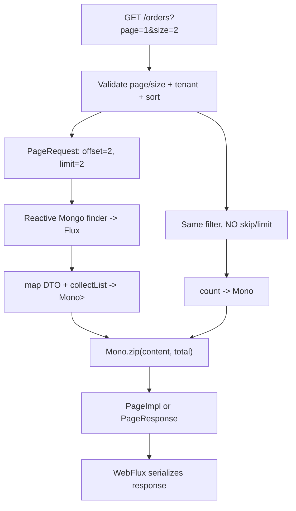

# Paging with Flux, Pageable, and Separate Count Queries

## 1. Why Does Reactive Pagination Require a Different Mindset?

In **Spring Data MongoDB**, synchronous apps commonly call `MongoRepository.findAll(Pageable)` and receive a `Page<Order>` containing the items, total element count, page count, and navigation flags. With **reactive MongoDB**, queries return `Flux<Order>`: elements emit to the subscriber as data arrives, while counting total elements is a separate operation.

A Mini Commerce screen needs to display **paid Orders for a Customer within a single tenant**, sorted newest first, 20 Orders per page. The backend must:

- Fetch at most **20 Orders for the requested page**, rather than calling `findAll()` and slicing a `List` in the JVM.
- Apply the exact same **tenant, customer, and status** predicates to both the content query and the count query.
- Sort deterministically even when multiple Orders share the same `placedAt`.
- Let the API return total Orders/pages when the UI requires them, while skipping expensive counts when only “is there a next page?” is needed.
- Never call `block()` in WebFlux handlers, never pass `Pageable` into the total count query, and never confuse backpressure with database pagination.

**Paging with Flux, Pageable, and Separate Count Queries** belongs to the **Reactive access** chapter of `SPRING_DATA_MONGODB`. It combines document connection/mapping, `ReactiveMongoRepository`, `ReactiveMongoTemplate`, queries, indexes, transactions, testing, and MongoDB performance diagnostics.

### Learning Objectives

After this lesson, you will be able to:

1. Explain the differences among `Flux<T>`, `Mono<List<T>>`, `Mono<Page<T>>`, and `Mono<Slice<T>>`.
2. Know that reactive repositories accept **`Pageable` as a parameter but do not directly return `Mono<Page<T>>`** as built-in repository Page support.
3. Build `PageRequest.of(page, size, sort)` and validate input bounds against abusive queries.
4. Define finder methods returning `Flux<Order>` and counter methods returning `Mono<Long>` in `ReactiveMongoRepository`.
5. Use `Mono.zip(content.collectList(), countMono)` to assemble `PageImpl` in the service layer.
6. Construct **two distinct Queries** in `ReactiveMongoTemplate`: one with skip/limit/sort for content, and one filter-only query for counting.
7. Build `SliceImpl` by **fetching up to `size + 1`** elements to determine `hasNext` without running a count.
8. Recognize deep-offset limitations, switch to cursor/keyset pagination when appropriate, and sort deterministically by `(placedAt, _id)`.
9. Understand data drift between content and count queries, and when reactive transactions apply.
10. Write WebFlux APIs, test with `StepVerifier`, and analyze indexes via `explain("executionStats")`.

**Prerequisites:** Java 17+, Spring Boot + `spring-boot-starter-data-mongodb-reactive`, running MongoDB, familiarity with `@Document`, `@Field`, `Flux`/`Mono`, and offset, sort, and total count concepts. Examples use Reactor and modern Spring Data MongoDB; exact APIs may vary slightly by version.

## 2. Three Questions of a Paginated API

A paginated endpoint usually answers three distinct questions:

| Question | Required Data | How It Executes |
| --- | --- | --- |
| “Which Orders are on this page?” | `content` | `Flux<Order>` with filter, sort, skip, limit |
| “How many Orders match the filter overall?” | `totalElements` | `Mono<Long>` from a **separate count query** |
| “Is there a next page?” | `hasNext` | From total count **or** by fetching `pageSize + 1` items |

`Page<T>` represents page items **plus total elements and total pages**. `Slice<T>` only needs items and whether another page follows. `Flux<T>` by itself is an element stream; it **contains no** `totalElements` or `totalPages` metadata.



**Important warning:** `Flux<T>` does not mean data is automatically paginated. Calling an unbounded finder and then `collectList()` can load the entire collection into memory. Only collect a `Flux` into a `List` after bounding it **at MongoDB**.

### 2.1. Why Don't Reactive Repositories Automatically Return Page?

Spring Data MongoDB documentation states that reactive repositories **do not support `Page` return types such as `Mono<Page<T>>`**. A reactive finder taking `Pageable` applies offset, limit, and sorting at the database and returns a **`Flux<T>` of the elements on that page**.

```java
// Correct: accepts Pageable, returns bounded Flux<Order>.
Flux<Order> findByTenantId(
    String tenantId, Pageable pageable);

// Do not define this method in a reactive repository:
// Mono<Page<Order>> findByTenantId(
//     String tenantId, Pageable pageable);
```

These illustrate the signatures; the second is an **anti-pattern**, not to be declared in a real interface. When `Page` is needed, the service fetches content and total count separately to build `PageImpl` or a page DTO.

### 2.2. When to Use Flux Directly?

If an endpoint only returns the Orders on the requested page (without totals), returning a server-bounded `Flux<OrderSummary>` works cleanly. In WebFlux, converting to `Mono<List<...>>` or a page DTO fits better when returning **one JSON object** carrying page metadata. Never embed fake `totalElements` or `PageRequest` fields inside every document.

## 3. PageRequest, Offsets, and Deterministic Sorting

Spring Data uses **zero-based page indexing**: the first page is `0`, not `1`.

```java
import org.springframework.data.domain.PageRequest;
import org.springframework.data.domain.Pageable;
import org.springframework.data.domain.Sort;

Sort sort = Sort.by(
    Sort.Order.desc("placedAt"),
    Sort.Order.desc("id"));

Pageable firstPage = PageRequest.of(0, 20, sort);
Pageable secondPage = PageRequest.of(1, 20, sort);

long firstOffset = firstPage.getOffset();  // 0
long secondOffset = secondPage.getOffset(); // 20
```

| `page` | `size` | Offset = page × size | Max documents |
| ---: | ---: | ---: | ---: |
| 0 | 2 | 0 | 2 |
| 1 | 2 | 2 | 2 |
| 2 | 2 | 4 | 2 |
| 3 | 20 | 60 | 20 |
| 10 | 50 | 500 | 50 |

MongoDB applies skip and limit after filtering and sorting. `Pageable` only configures a single request; it **does not keep an open pagination cursor across requests**.

### 3.1. Why Include the Tie-Breaker `id`?

If two Orders share the same `placedAt`, sorting solely by timestamp does not define a total order. Adjacent pages can duplicate or skip records if the query engine picks different orders for tied timestamps.

Use:

```java
Sort stableSort = Sort.by(
    Sort.Order.desc("placedAt"),
    Sort.Order.desc("id"));
```

When executed against `Order.class`, the Java property `id` maps to BSON `_id`, so MongoDB receives `{placed_at: -1, _id: -1}` assuming `placedAt` maps to `placed_at`.

**Note:** deterministic sorting guarantees consistent ordering only on an **unchanging dataset**. It does not prevent page shifts when Orders are inserted or deleted between requests; section 14 covers keyset/cursor pagination.

### 3.2. Never Accept Arbitrary Page/Size Inputs

```java
public static Pageable safePage(int page, int size) {
    if (page < 0) {
        throw new IllegalArgumentException(
            "page must be >= 0");
    }
    if (size < 1 || size > 100) {
        throw new IllegalArgumentException(
            "size must be between 1 and 100");
    }

    long offset = (long) page * size;
    if (offset > 100_000L) {
        throw new IllegalArgumentException(
            "Deep offset is not supported; use cursor");
    }

    return PageRequest.of(
        page, size,
        Sort.by(
            Sort.Order.desc("placedAt"),
            Sort.Order.desc("id")));
}
```

The caps of 100 documents/page and 100,000 skipped documents are **illustrative policies**, not fixed MongoDB rules. Your workload may demand lower caps. Using `long` multiplication avoids integer overflow when calculating `page × size`.

So services in later sections can invoke this helper, place it in its own utility class:

```java
package com.example.minicommerce.service;

import org.springframework.data.domain.PageRequest;
import org.springframework.data.domain.Pageable;
import org.springframework.data.domain.Sort;

public final class PagingPolicy {
    private PagingPolicy() {}

    public static Pageable safePage(int page, int size) {
        if (page < 0 || size < 1 || size > 100) {
            throw new IllegalArgumentException(
                "Invalid page or size");
        }
        if ((long) page * size > 100_000L) {
            throw new IllegalArgumentException(
                "Use cursor for deep pagination");
        }
        return PageRequest.of(page, size,
            Sort.by(Sort.Order.desc("placedAt"),
                    Sort.Order.desc("id")));
    }
}
```

The standalone method above and `PagingPolicy` are **two ways of showing the same policy**. In a real project, keep the utility class or validate directly inside the service—do not declare duplicate methods in one class.

## 4. Mini Commerce: Entity, BSON Mapping, and Fixture

### 4.1. Order Entity

```java
package com.example.minicommerce.domain;

import java.math.BigDecimal;
import java.time.Instant;

import org.springframework.data.annotation.Id;
import org.springframework.data.mongodb.core.mapping.Document;
import org.springframework.data.mongodb.core.mapping.Field;
import org.springframework.data.mongodb.core.mapping.FieldType;

@Document(collection = "orders")
public class Order {

    @Id
    private String id;

    @Field("tenant_id")
    private String tenantId;

    @Field("customer_id")
    private String customerId;

    private String status;

    @Field("placed_at")
    private Instant placedAt;

    @Field(name = "total_amount", targetType = FieldType.DECIMAL128)
    private BigDecimal totalAmount;

    public Order() {}

    public Order(String id, String tenantId,
                 String customerId, String status,
                 Instant placedAt, BigDecimal totalAmount) {
        this.id = id;
        this.tenantId = tenantId;
        this.customerId = customerId;
        this.status = status;
        this.placedAt = placedAt;
        this.totalAmount = totalAmount;
    }

    public String getId() { return id; }
    public String getTenantId() { return tenantId; }
    public String getCustomerId() { return customerId; }
    public String getStatus() { return status; }
    public Instant getPlacedAt() { return placedAt; }
    public BigDecimal getTotalAmount() { return totalAmount; }
}
```

| Java property | BSON key | Type / Meaning |
| --- | --- | --- |
| `id` | `_id` | Order key; BSON String in fixture |
| `tenantId` | `tenant_id` | Security scope |
| `customerId` | `customer_id` | Customer owning the Order |
| `status` | `status` | `PAID` or `PLACED` |
| `placedAt` | `placed_at` | BSON Date |
| `totalAmount` | `total_amount` | BSON Decimal128 |

This example uses IDs like `"order-a-101"` to avoid Spring Data converting 24-character hex Strings into BSON `ObjectId`. When using real `ObjectId` keys, keep types consistent across `_id` and keyset cursors.

### 4.2. Sample Test Data in mongosh

Run only against a **dedicated test database**:

```javascript
use mini_commerce

db.orders.insertMany([
  {
    _id: "order-a-101",
    tenant_id: "shop-a",
    customer_id: "customer-001",
    status: "PAID",
    placed_at: ISODate("2026-11-18T09:00:00Z"),
    total_amount: NumberDecimal("100.00")
  },
  {
    _id: "order-a-102",
    tenant_id: "shop-a",
    customer_id: "customer-001",
    status: "PAID",
    placed_at: ISODate("2026-11-19T10:00:00Z"),
    total_amount: NumberDecimal("200.00")
  },
  {
    _id: "order-a-103",
    tenant_id: "shop-a",
    customer_id: "customer-001",
    status: "PAID",
    placed_at: ISODate("2026-11-19T10:00:00Z"),
    total_amount: NumberDecimal("300.00")
  },
  {
    _id: "order-a-104",
    tenant_id: "shop-a",
    customer_id: "customer-001",
    status: "PAID",
    placed_at: ISODate("2026-11-20T11:00:00Z"),
    total_amount: NumberDecimal("400.00")
  },
  {
    _id: "order-a-105",
    tenant_id: "shop-a",
    customer_id: "customer-001",
    status: "PLACED",
    placed_at: ISODate("2026-11-20T12:00:00Z"),
    total_amount: NumberDecimal("500.00")
  },
  {
    _id: "order-b-201",
    tenant_id: "shop-b",
    customer_id: "customer-001",
    status: "PAID",
    placed_at: ISODate("2026-11-20T13:00:00Z"),
    total_amount: NumberDecimal("600.00")
  }
]);
```

`insertMany` is not idempotent if re-run with the same `_id`; isolate fixtures per test, clean up properly, and never run on production.

Filtering `tenantId = shop-a`, `customerId = customer-001`, `status = PAID` yields **4 Orders**. Sorting `placedAt DESC, id DESC` produces:

| Index | Order ID | Timestamp |
| ---: | --- | --- |
| 0 | `order-a-104` | Nov 20 11:00Z |
| 1 | `order-a-103` | Nov 19 10:00Z |
| 2 | `order-a-102` | Nov 19 10:00Z |
| 3 | `order-a-101` | Nov 18 09:00Z |

With `size=2`, page `0` holds `order-a-104` and `order-a-103`; page `1` holds `order-a-102` and `order-a-101`; page `2` is empty. Total remains **4** on static data.

## 5. Spring Data: ReactiveMongoRepository Returning Flux with Pageable

### 5.1. Declaring the Repository

```java
package com.example.minicommerce.repository;

import org.springframework.data.domain.Pageable;
import org.springframework.data.mongodb.repository.ReactiveMongoRepository;
import reactor.core.publisher.Flux;
import reactor.core.publisher.Mono;

import com.example.minicommerce.domain.Order;

public interface OrderRepository
        extends ReactiveMongoRepository<Order, String> {

    Flux<Order> findByTenantIdAndCustomerIdAndStatus(
        String tenantId,
        String customerId,
        String status,
        Pageable pageable);

    Mono<Long> countByTenantIdAndCustomerIdAndStatus(
        String tenantId,
        String customerId,
        String status);
}
```

Both methods share the **exact same three filter predicates**; the finder takes `Pageable` to slice content, while the counter **omits `Pageable`** to count every matching document.

Spring Data derived queries use Java property names (`tenantId`, `customerId`, `status`); `@Field` metadata maps them to BSON `tenant_id` and `customer_id`. Sorting inside `Pageable` also uses **Java property names**.

### 5.2. Invoking the Repository with matching Types

```java
Pageable pageable = PageRequest.of(
    0, 2,
    Sort.by(
        Sort.Order.desc("placedAt"),
        Sort.Order.desc("id")));

Flux<Order> content = repository
    .findByTenantIdAndCustomerIdAndStatus(
        "shop-a", "customer-001", "PAID", pageable);

Mono<Long> total = repository
    .countByTenantIdAndCustomerIdAndStatus(
        "shop-a", "customer-001", "PAID");
```

**Never add `Pageable` to the counter signature** just for “reuse”: total elements must count **all matching Orders**, not only the current page.

### 5.3. Never Declare `Mono<Page<Order>>` in a Reactive Repository

```java
// Do not use this return type in a reactive repository:
// Mono<Page<Order>> findByTenantId(
//     String tenantId, Pageable pageable);

// Correct: repository returns Flux<Order> and count Mono<Long>.
```

The service can assemble `Mono<Page<OrderSummary>>` by combining both publishers, yet that is **explicit service logic**—not Spring Data running an automatic count as synchronous `Page`-returning repositories do.

## 6. Service: Combining Flux Content and Mono Count into a Page

### 6.1. DTO Instead of Exposing the Full Entity

```java
package com.example.minicommerce.service;

import java.math.BigDecimal;
import java.time.Instant;
import com.example.minicommerce.domain.Order;

public record OrderSummary(
    String id,
    String status,
    Instant placedAt,
    BigDecimal totalAmount
) {
    public static OrderSummary from(Order order) {
        return new OrderSummary(
            order.getId(),
            order.getStatus(),
            order.getPlacedAt(),
            order.getTotalAmount());
    }
}
```

Never expose sensitive `Customer` info, shipping addresses, or internal metadata unnecessarily. Reading the entity and mapping to a DTO is clean, though loading every field costs network bandwidth; the `ReactiveMongoTemplate` section below shows server-side projection where helpful.

### 6.2. Mono.zip + PageImpl

```java
package com.example.minicommerce.service;

import java.util.List;

import org.springframework.data.domain.Page;
import org.springframework.data.domain.PageImpl;
import org.springframework.data.domain.Pageable;
import org.springframework.stereotype.Service;

import reactor.core.publisher.Flux;
import reactor.core.publisher.Mono;

import com.example.minicommerce.domain.Order;
import com.example.minicommerce.repository.OrderRepository;

@Service
public class ReactiveOrderPagingService {

    private final OrderRepository repository;

    public ReactiveOrderPagingService(OrderRepository repository) {
        this.repository = repository;
    }

    public Mono<Page<OrderSummary>> pageForCustomer(
            String verifiedTenantId,
            String customerId,
            String status,
            int page,
            int size) {

        if (verifiedTenantId == null ||
                verifiedTenantId.isBlank() ||
                customerId == null || customerId.isBlank()) {
            return Mono.error(new IllegalArgumentException(
                "Tenant and customer are required"));
        }
        if (!"PAID".equals(status) &&
                !"PLACED".equals(status)) {
            return Mono.error(new IllegalArgumentException(
                "Unsupported order status"));
        }

        final Pageable pageable;
        try {
            pageable = PagingPolicy.safePage(page, size);
        } catch (IllegalArgumentException ex) {
            return Mono.error(ex);
        }

        Flux<OrderSummary> content = repository
            .findByTenantIdAndCustomerIdAndStatus(
                verifiedTenantId, customerId, status, pageable)
            .map(OrderSummary::from);

        Mono<List<OrderSummary>> items = content.collectList();

        Mono<Long> count = repository
            .countByTenantIdAndCustomerIdAndStatus(
                verifiedTenantId, customerId, status);

        return Mono.zip(items, count)
            .map(tuple -> new PageImpl<OrderSummary>(
                tuple.getT1(), pageable, tuple.getT2()));
    }
}
```

`PagingPolicy` is the helper containing `safePage(...)` from section 3.2. Put it in its own Java file in real projects; code blocks across this lesson represent **separate files/classes**, not one monolithic source file.

### 6.3. What Happens on Subscription?

`Mono.zip(items, count)` subscribes to **both source publishers**: one runs the `Pageable`-bounded finder and collects up to `size` items, while the other executes the filtered count.

```text
repository.findBy...(Pageable) -> Flux<Order>
                              -> map(OrderSummary)
                              -> collectList()
                              -> Mono<List<OrderSummary>>

repository.countBy...()      -> Mono<Long>

Mono.zip(listMono, countMono) -> PageImpl<OrderSummary>
```

`collectList()` is safe for page sizing **because the finder enforces the limit on MongoDB**, with `pageSize` bounded to 1–100. Never call `collectList()` on an unbounded finder and slice with `subList()`.

### 6.4. What Metadata Does PageImpl Provide?

Once `Mono<Page<OrderSummary>>` emits, you can access:

```java
Page<OrderSummary> result = page;

int pageNumber = result.getNumber();
int pageSize = result.getSize();
int currentElements = result.getNumberOfElements();
long totalElements = result.getTotalElements();
int totalPages = result.getTotalPages();
boolean hasNext = result.hasNext();
boolean first = result.isFirst();
boolean last = result.isLast();
```

`page` here is the `Page` received inside a callback or test; never `block()` for it on the event loop. `PageImpl` may adjust total counts in certain last-page edge cases; **never rely on it for snapshot consistency**.

**Note:** `Mono.zip` typically issues two independent queries without a shared transaction or snapshot. Concurrent inserts, deletes, or updates between reading content and count can cause temporary metadata drift. See section 15.

## 7. Stable API Response DTO Instead of Serializing PageImpl Directly

When WebFlux returns JSON to a frontend, an explicit DTO avoids coupling to `PageImpl`'s serialization structure across Spring Data and Jackson versions.

```java
package com.example.minicommerce.api;

import java.util.List;
import org.springframework.data.domain.Page;
import com.example.minicommerce.service.OrderSummary;

public record OrderPageResponse(
    List<OrderSummary> items,
    int page,
    int size,
    long totalElements,
    int totalPages,
    boolean hasNext
) {
    public static OrderPageResponse from(
            Page<OrderSummary> result) {
        return new OrderPageResponse(
            result.getContent(),
            result.getNumber(),
            result.getSize(),
            result.getTotalElements(),
            result.getTotalPages(),
            result.hasNext());
    }
}
```

Service API:

```java
Mono<OrderPageResponse> response =
    pagingService.pageForCustomer(
        verifiedTenantId, "customer-001", "PAID", 0, 2)
    .map(OrderPageResponse::from);
```

`verifiedTenantId` must come from a security/authentication service using a trusted identity. Never trust a client-supplied `tenantId` to read another tenant's data.

First-page JSON example using the fixture:

```json
{
  "items": [
    {
      "id": "order-a-104",
      "status": "PAID",
      "placedAt": "2026-11-20T11:00:00Z",
      "totalAmount": 400.00
    },
    {
      "id": "order-a-103",
      "status": "PAID",
      "placedAt": "2026-11-19T10:00:00Z",
      "totalAmount": 300.00
    }
  ],
  "page": 0,
  "size": 2,
  "totalElements": 4,
  "totalPages": 2,
  "hasNext": true
}
```

This JSON illustrates the serialized DTO; exact formatting of `BigDecimal` and `Instant` depends on your application's Jackson configuration.

## 8. WebFlux Controller: Bounding Input and Protecting Tenant Scope

Illustrative endpoint when the application **uses Spring Security OAuth2 Resource Server**:

```java
package com.example.minicommerce.api;

import org.springframework.security.core.annotation.AuthenticationPrincipal;
import org.springframework.security.oauth2.jwt.Jwt;
import org.springframework.web.bind.annotation.GetMapping;
import org.springframework.web.bind.annotation.PathVariable;
import org.springframework.web.bind.annotation.RequestMapping;
import org.springframework.web.bind.annotation.RequestParam;
import org.springframework.web.bind.annotation.RestController;

import reactor.core.publisher.Mono;

import com.example.minicommerce.service.ReactiveOrderPagingService;

@RestController
@RequestMapping("/api/customers")
public class CustomerOrderController {

    private final ReactiveOrderPagingService pagingService;

    public CustomerOrderController(
            ReactiveOrderPagingService pagingService) {
        this.pagingService = pagingService;
    }

    @GetMapping("/{customerId}/orders")
    public Mono<OrderPageResponse> listOrders(
            @AuthenticationPrincipal Jwt jwt,
            @PathVariable String customerId,
            @RequestParam(defaultValue = "PAID") String status,
            @RequestParam(defaultValue = "0") int page,
            @RequestParam(defaultValue = "20") int size) {

        String tenantId = jwt.getClaimAsString("tenant_id");
        return pagingService.pageForCustomer(
                tenantId, customerId, status, page, size)
            .map(OrderPageResponse::from);
    }
}
```

This assumes a **JWT `tenant_id` claim issued by a trusted issuer and validated by the resource server**. Claim names, tenant resolution, and authorization to view a specific Customer must follow your real system rules—checking tenant alone is insufficient if a `shop-a` employee should not view every Customer in `shop-a`.

For endpoints without JWTs, use a dedicated security-context tenant resolver. **Never** change it to `@RequestParam String tenantId` and trust it unauthenticated.

If `page` is negative, `size` is out of bounds, or `status` is invalid, the service emits `IllegalArgumentException`. In production APIs, use `@RestControllerAdvice`/validation to map that to HTTP **400 Bad Request** with a stable error code rather than letting unhandled exceptions leak unclear responses.

## 9. ReactiveMongoTemplate: Separate Content Query and Count Query

For dynamic filters, projections, or complex queries, `ReactiveMongoTemplate` is often more flexible than derived repository finders.

### 9.1. The Most Critical Mistake

```java
Query query = Query.query(
    Criteria.where("tenantId").is(tenantId)
        .and("customerId").is(customerId)
        .and("status").is("PAID"));

query.with(pageable);

Flux<Order> content = template.find(query, Order.class);

// WRONG: the count query still carries the page's skip/limit.
Mono<Long> total = template.count(query, Order.class);
```

`ReactiveMongoTemplate.count(Query, Class)` API docs note that **offset and limit on the `Query` can directly affect the document count returned**. Thus the snippet above can count **only a page/slice** rather than all matching Orders.

### 9.2. Correct: Two Queries Sharing Criteria Without Sharing Pagination

```java
package com.example.minicommerce.service;

import java.util.List;

import org.springframework.data.domain.Page;
import org.springframework.data.domain.PageImpl;
import org.springframework.data.domain.Pageable;
import org.springframework.data.mongodb.core.ReactiveMongoTemplate;
import org.springframework.data.mongodb.core.query.Criteria;
import org.springframework.data.mongodb.core.query.Query;
import org.springframework.stereotype.Service;

import reactor.core.publisher.Mono;

import com.example.minicommerce.domain.Order;

@Service
public class OrderTemplatePagingService {

    private final ReactiveMongoTemplate template;

    public OrderTemplatePagingService(
            ReactiveMongoTemplate template) {
        this.template = template;
    }

    public Mono<Page<OrderSummary>> page(
            String tenantId, String customerId,
            String status, int page, int size) {

        final Pageable pageable;
        try {
            pageable = PagingPolicy.safePage(page, size);
        } catch (IllegalArgumentException ex) {
            return Mono.error(ex);
        }

        Query contentQuery = Query.query(
            criteria(tenantId, customerId, status))
            .with(pageable);

        // Count with a NEW Query: same filter,
        // NO with(pageable), NO skip/limit.
        Query countQuery = Query.query(
            criteria(tenantId, customerId, status));

        Mono<List<OrderSummary>> content =
            template.find(contentQuery, Order.class)
                .map(OrderSummary::from)
                .collectList();

        Mono<Long> total = template.count(
            countQuery, Order.class);

        return Mono.zip(content, total)
            .map(tuple -> new PageImpl<OrderSummary>(
                tuple.getT1(), pageable, tuple.getT2()));
    }

    private static Criteria criteria(
            String tenantId, String customerId, String status) {
        if (tenantId == null || tenantId.isBlank() ||
                customerId == null || customerId.isBlank() ||
                !("PAID".equals(status) ||
                  "PLACED".equals(status))) {
            throw new IllegalArgumentException(
                "Invalid order filters");
        }
        return Criteria.where("tenantId").is(tenantId)
            .and("customerId").is(customerId)
            .and("status").is(status);
    }
}
```

**Note on input errors:** `criteria(...)` can throw synchronously **before returning a publisher**. If a reactive API must deliver all validation errors as `Mono.error`, wrap query building in `Mono.defer(() -> { ... })` or validate inputs upfront.

### 9.3. Why Never Share One Mutable Query?

`Query` is mutable: `with(pageable)`, `skip`, `limit`, and `with(Sort)` mutate its state. Reusing one `Query` between content and count risks accidentally carrying pagination, projections, collations, or hints across.

Simple rule:

```java
Criteria base = Criteria.where("tenantId").is(tenantId)
    .and("status").is("PAID");

Query content = Query.query(base).with(pageable);
Query count = Query.query(base);  // No pagination.
```

In real code, use a **helper building fresh `Criteria` per `Query`** like `criteria(...)` above to prevent shared mutable state across queries or requests. Count must enforce the **same business filters**, not the content query's projection or sort.

### 9.4. Mapping and Physical BSON Field Names

When `template.find(query, Order.class)` / `template.count(query, Order.class)` take the entity class, Spring Data maps:

```text
tenantId -> tenant_id
customerId -> customer_id
placedAt -> placed_at
id -> _id
```

When using the native driver `getCollection("orders")` or raw `Document`, write the physical BSON keys. Using the right alias in content while getting it wrong in count creates a **silent metadata bug** that tests must catch.

## 10. Projections and Minimal Data Per Page

An Order list screen normally needs only ID, status, timestamp, and total amount. If an Order contains hundreds of `OrderLine`s, addresses, and audit payloads, loading full entities just to build a summary DTO wastes network and memory.

`ReactiveMongoTemplate` supports field projection:

```java
Query contentQuery = Query.query(
        Criteria.where("tenantId").is(tenantId)
            .and("customerId").is(customerId)
            .and("status").is("PAID"))
    .with(pageable);

contentQuery.fields()
    .include("id")
    .include("status")
    .include("placedAt")
    .include("totalAmount");

Flux<OrderSummary> summaries = template
    .find(contentQuery, Order.class)
    .map(OrderSummary::from);
```

Because the query targets `Order.class`, `placedAt` and `totalAmount` map to BSON `placed_at` and `total_amount`. Note that `Order` here is a **partial entity missing excluded fields**; never pass it to `save`, or you risk overwriting or clearing other fields.

Direct DTO projections or custom aggregations can skip constructing the full entity, though you should check constructor/field-alias mapping in your Spring Data version. **Verify raw BSON and mapped DTOs via integration tests**, especially `BigDecimal` ↔ Decimal128.

The **count** query needs no projection; it carries only the filter and semantically relevant options like collation if matching depends on it. Never copy `include(...)` or `sort` onto a count query thinking it makes counting faster.

## 11. When Total Is Unnecessary: Building a Slice with `size + 1`

If the UI only shows a “Load more” button and **does not need total pages**, you can skip the count query. Idea:

1. Keep API `page`/`size` and deterministic sorting.
2. Query MongoDB with **offset = `page × size`** and **limit = `size + 1`**.
3. Collect at most `size + 1` results.
4. If more than `size` items arrive, set `hasNext=true` and drop the extra item from returned content.
5. Return `SliceImpl<T>`.

### 11.1. Why Isn't `Pageable` with `pageSize` Enough?

`PageRequest.of(page, size)` limits to exactly `size` items; receiving 20 items **does not tell you whether a 21st exists**. To know without counting, ask MongoDB for **at most 21** items for `size=20`. Never substitute `PageRequest.of(page, size + 1)`, because page 1 would start at offset `size + 1` instead of `size`, skipping an item.

### 11.2. Service Returning `Mono<Slice<OrderSummary>>`

```java
package com.example.minicommerce.service;

import java.util.List;

import org.springframework.data.domain.Pageable;
import org.springframework.data.domain.Slice;
import org.springframework.data.domain.SliceImpl;
import org.springframework.data.mongodb.core.ReactiveMongoTemplate;
import org.springframework.data.mongodb.core.query.Criteria;
import org.springframework.data.mongodb.core.query.Query;
import org.springframework.stereotype.Service;

import reactor.core.publisher.Mono;

import com.example.minicommerce.domain.Order;

@Service
public class ReactiveOrderSliceService {

    private final ReactiveMongoTemplate template;

    public ReactiveOrderSliceService(
            ReactiveMongoTemplate template) {
        this.template = template;
    }

    public Mono<Slice<OrderSummary>> slice(
            String tenantId, String customerId,
            int page, int size) {

        Pageable pageable = PagingPolicy.safePage(page, size);

        Query query = Query.query(
                Criteria.where("tenantId").is(tenantId)
                    .and("customerId").is(customerId)
                    .and("status").is("PAID"))
            .with(pageable.getSort())
            .skip(pageable.getOffset())
            .limit(pageable.getPageSize() + 1);

        return template.find(query, Order.class)
            .map(OrderSummary::from)
            .collectList()
            .map(rows -> {
                boolean hasNext = rows.size() > pageable.getPageSize();
                List<OrderSummary> visible = hasNext
                    ? rows.subList(0, pageable.getPageSize())
                    : rows;

                return new SliceImpl<OrderSummary>(
                    List.copyOf(visible), pageable, hasNext);
            });
    }
}
```

This service avoids running `count(...)` while still enforcing tenant/customer/status in the **server filter**. Validate tenant/customer and authorization just like the Page service; this snippet focuses on the lookahead algorithm.

### 11.3. Page vs Slice vs Flux

| Approach | Content Query | Count Query | Metadata |
| --- | --- | --- | --- |
| `Flux<Order>` with `Pageable` | Yes, limit `size` | No | No automatic total or `hasNext` |
| Manually built `Mono<Page<OrderSummary>>` | Yes, limit `size` | **Yes** | `totalElements`, `totalPages`, `hasNext` |
| `Mono<Slice<OrderSummary>>` | Yes, limit `size+1` | No | `hasNext`, `isFirst`, `isLast`; no total |
| Cursor/keyset window | Yes, limit `size+1` and seek predicate | Usually no | `nextCursor`, `hasNext` |

`Slice` fits “Load more,” while `Page` fits UIs showing “Page 3 of 25” or total counts. Never run a count query just to compute a boolean `hasNext` on large workloads when totals aren't displayed.

## 12. Separate Count Queries: Semantics and Cost

MongoDB offers several counting APIs:

| API | Meaning | Suitable for Filtered Pages? |
| --- | --- | --- |
| `ReactiveMongoTemplate.count(query, Order.class)` | Counts documents matching the query and relevant options | **Yes**, provided query has no skip/limit |
| `ReactiveMongoRepository.countBy...(...)` | Counts using derived filter | **Yes**, when predicates match business scope |
| `ReactiveMongoRepository.count()` | Counts entire repository/collection | Only if page is **unfiltered** and authorized |
| `ReactiveMongoTemplate.estimatedCount(Order.class)` | Estimates total collection count from metadata | **No**, cannot substitute for tenant/customer/status count |
| `ReactiveMongoTemplate.exactCount(query, Order.class)` | Forces aggregation-based count per API contract | Useful for specific session/sharding needs; still needs exact filter |

### 12.1. Count Must Share the Exact Filter, Not Just the Collection

```javascript
// Finder:
db.orders.find({
  tenant_id: "shop-a",
  customer_id: "customer-001",
  status: "PAID"
})
.sort({ placed_at: -1, _id: -1 })
.skip(2)
.limit(2);

// Count: SAME filter, without skip or limit.
db.orders.countDocuments({
  tenant_id: "shop-a",
  customer_id: "customer-001",
  status: "PAID"
});
```

On the fixture, page 1's finder returns 2 Orders while count returns 4. Passing a Query carrying `skip(2).limit(2)` to count can restrict the count to the bounded slice.

### 12.2. Counting Can Be Expensive

Counting matching documents is not always “reading a cached integer.” Depending on filters, indexes, and selectivity, MongoDB may scan index entries or documents. On large datasets with dynamic filters, per-request counts can consume substantial CPU and I/O.

Ways to reduce cost:

- Only count when the UI truly needs totals; use `Slice` otherwise.
- Design compound indexes covering the primary filters and sorts.
- Avoid unindexed predicates or unselective `$regex` filters.
- Cache counts or maintain precomputed summaries where **eventual/slightly stale totals** are acceptable.
- Never use `estimatedCount` for tenant/status totals because it ignores filters.
- When you only need to know if another page follows, fetch `size + 1`.

### 12.3. Do Not Assume `PageableExecutionUtils` Runs Reactive Counts

`PageableExecutionUtils.getPage(...)` takes a synchronous `Supplier<Long>` to skip counting lazily in certain cases. **Never turn `Mono<Long>` into a `Supplier<Long>` by calling `block()` in WebFlux** just to use that helper.

In reactive services, `Mono.zip(...)` or `flatMap(...)` with the count publisher is the proper pattern. If you want to skip the count when the last page is obvious, express that branch reactively and test it carefully against concurrent writes.

## 13. Safe Sorting: Whitelist Instead of Raw Field Paths

An API like:

```text
GET /orders?sort=someUntrustedPath,desc
```

must never let client input select arbitrary field paths or JSON/BSON structures. Whitelist allowed sort modes and always include a unique tie-breaker.

```java
import org.springframework.data.domain.Sort;

public static Sort allowedSort(String requested) {
    if ("oldest".equals(requested)) {
        return Sort.by(
            Sort.Order.asc("placedAt"),
            Sort.Order.asc("id"));
    }
    if ("newest".equals(requested) ||
            requested == null) {
        return Sort.by(
            Sort.Order.desc("placedAt"),
            Sort.Order.desc("id"));
    }
    throw new IllegalArgumentException(
        "Unsupported sort mode");
}
```

Properties passed are **approved Java field names**, mapped by Spring Data to BSON when querying `Order.class`. Even using `Sort` without raw JSON, arbitrary sort fields can cause slow unindexed queries or leak information. Bound page numbers, page sizes, and filter fields as well.

**Never** declare both a `Sort` parameter and a `Pageable` parameter on the same repository method expecting the framework to merge them: `Pageable` already carries `Sort`, and invalid combinations of special parameters are disallowed.

## 14. Deep Offsets vs Keyset / Cursor Pagination

Offset:

```javascript
db.orders.find({
  tenant_id: "shop-a",
  status: "PAID"
})
.sort({ placed_at: -1, _id: -1 })
.skip(200000)
.limit(20);
```

MongoDB can use an index for filtering and sorting, yet it still must **walk past 200,000 index entries** before emitting page items. Beyond performance, inserting a new Order between requests shifts items from one page to the next.

### 14.1. Keyset Based on `(placedAt, _id)`

For descending sort `(placed_at DESC, _id DESC)`, the next page includes only Orders satisfying:

\[
\text{placedAt} < \text{lastPlacedAt}
\quad\text{or}\quad
(\text{placedAt} = \text{lastPlacedAt} \land \_id < \text{lastId})
\]

`mongosh` example:

```javascript
db.orders.find({
  tenant_id: "shop-a",
  customer_id: "customer-001",
  status: "PAID",
  $or: [
    { placed_at: { $lt: ISODate("2026-11-19T10:00:00Z") } },
    {
      placed_at: ISODate("2026-11-19T10:00:00Z"),
      _id: { $lt: "order-a-103" }
    }
  ]
})
.sort({ placed_at: -1, _id: -1 })
.limit(3);
```

Starting after `order-a-103` with `size=2`, the query fetches up to 3 items to detect `hasNext`, returning `order-a-102` and `order-a-101` without `$skip`.

### 14.2. Cursor and Result DTOs

```java
package com.example.minicommerce.service;

import java.time.Instant;
import java.util.List;

public record OrderCursor(
    Instant placedAt,
    String id
) {}

public record CursorSlice<T>(
    List<T> items,
    boolean hasNext,
    OrderCursor nextCursor
) {}
```

Place these two public records in **two separate Java files** matching their names rather than side by side in a single file.

### 14.3. Reactive Keyset Service

```java
import java.util.List;

import org.springframework.data.domain.Sort;
import org.springframework.data.mongodb.core.query.Criteria;
import org.springframework.data.mongodb.core.query.Query;

import reactor.core.publisher.Mono;

public Mono<CursorSlice<OrderSummary>> after(
        String tenantId, String customerId,
        OrderCursor cursor, int size) {

    if (size < 1 || size > 100) {
        return Mono.error(new IllegalArgumentException(
            "Invalid page size"));
    }

    Criteria scope = Criteria.where("tenantId").is(tenantId)
        .and("customerId").is(customerId)
        .and("status").is("PAID");

    Criteria filter = scope;
    if (cursor != null) {
        Criteria seek = new Criteria().orOperator(
            Criteria.where("placedAt").lt(cursor.placedAt()),
            new Criteria().andOperator(
                Criteria.where("placedAt").is(cursor.placedAt()),
                Criteria.where("id").lt(cursor.id())));

        filter = new Criteria().andOperator(scope, seek);
    }

    Query query = Query.query(filter)
        .with(Sort.by(
            Sort.Order.desc("placedAt"),
            Sort.Order.desc("id")))
        .limit(size + 1);

    return template.find(query, Order.class)
        .map(OrderSummary::from)
        .collectList()
        .map(rows -> {
            boolean hasNext = rows.size() > size;
            List<OrderSummary> visible = rows.subList(
                0, Math.min(size, rows.size()));

            OrderCursor next = null;
            if (hasNext && !visible.isEmpty()) {
                OrderSummary last = visible.get(
                    visible.size() - 1);
                next = new OrderCursor(
                    last.placedAt(), last.id());
            }
            return new CursorSlice<>(
                List.copyOf(visible), hasNext, next);
        });
}
```

This method belongs in a service with `ReactiveMongoTemplate template` injected and `Order`, `OrderSummary`, `OrderCursor`, and `CursorSlice` imported. In production, validate tenant/customer authorization and reject null `placedAt` or malformed cursors before constructing `Criteria`.

### 14.4. Protecting Cursor Tokens

Never accept raw client-supplied `placedAt`/`id` and treat them as authorization. When exposing cursor tokens in an API, encode the necessary state (timestamp, ID, sort, filter, tenant, expiry) and **sign or verify integrity**. Always apply the tenant filter from the security context. If `_id` is a BSON `ObjectId` instead of a String, keep comparator types consistent with the index.

**Keyset does not produce an immutable snapshot either**: if an Order's `placedAt` updates or it is deleted between requests, results can vary. Its primary benefits are avoiding deep `skip` cost and preventing head-of-list insertions from duplicating items across pages.

## 15. Consistency Between Content and Count

The two queries in `Mono.zip(content.collectList(), count())` are **two independent database operations**:

```text
T0: 4 PAID Orders match the filter.
T1: finder reads page 0 containing 2 Orders.
T2: another worker inserts a new PAID Order.
T3: count query sees 5 Orders.
T4: Page has 2 older Orders yet totalElements=5.
```

For normal list UIs this is usually acceptable: `totalElements` reflects the count timestamp and `content` reflects the finder timestamp. If business rules demand “content and total from one exact snapshot” (e.g., reconciliation reports), use a different approach.

### 15.1. Consistency Tiers

| Requirement | Approach |
| --- | --- |
| Standard Order list/feed | Two separate queries; accept drift between content and count |
| Load-more feed | `Slice` or keyset, avoiding total count |
| Higher-consistency summary report | Consider appropriate read concern, transaction, or snapshot |
| Finalized financial reporting | Period-closed dataset or snapshot/materialized report with explicit cutoff |

### 15.2. Using a Reactive Transaction When Truly Needed

On a transaction-capable MongoDB replica set or sharded deployment, `ReactiveMongoTransactionManager` and `TransactionalOperator` let both queries participate in **the same session/transaction**. For snapshot consistency, configure an appropriate `readConcern` (such as `snapshot`) and verify topology/version requirements.

**Note:** do not use `Mono.zip` to run multiple MongoDB operations concurrently on the same transaction/session without driver support; the MongoDB driver does not support arbitrary parallel operations on **a single session/transaction**. Inside a transaction, chain sequentially:

```java
Mono<Page<OrderSummary>> inTransaction =
    repository.findByTenantIdAndCustomerIdAndStatus(
            tenantId, customerId, "PAID", pageable)
        .map(OrderSummary::from)
        .collectList()
        .flatMap(items -> repository
            .countByTenantIdAndCustomerIdAndStatus(
                tenantId, customerId, "PAID")
            .map(total -> new PageImpl<OrderSummary>(
                items, pageable, total)));

return transactionalOperator.transactional(inTransaction);
```

This is a **method body** inside a service with the repository and `TransactionalOperator` injected, after validating inputs and building `Pageable`. Only enable transactions when consistency demands it—not on every list endpoint. Transactions add overhead, have time limits, and still do not freeze data **across separate HTTP page requests**.

When using reactive `@Transactional`, ensure the **reactive transaction manager** is configured; never mix imperative/thread-bound `MongoTransactionManager` or call `block()` inside WebFlux.

## 16. Backpressure Is Not Database Pagination

`Flux<Order>` honors backpressure: downstream requests items according to capacity. Still:

- `Flux` does not add skip/limit corresponding to a requested page.
- `buffer(20)` groups items **in Reactor**, not via `skip`/`limit` on MongoDB.
- `take(20)` on an unpaged query caps consumed items, yet **provides no offset**, gives no total count, and does not optimize the database query.
- `collectList()` on an unbounded or huge `Flux` can exhaust memory.
- Backpressure neither makes count scans cheaper nor solves deep `skip`.

**Rule:** enforce page size and limits in the database query first; then use `Flux` for async processing and `collectList` only on strictly bounded slices.

### 16.1. Cold Flux and Multiple Subscriptions

Publishers from `ReactiveMongoRepository` and `ReactiveMongoTemplate` are normally **cold**:

```java
Flux<Order> pageFlux =
    repository.findByTenantIdAndCustomerIdAndStatus(
        tenantId, customerId, "PAID", pageable);

// Two independent subscriptions can send two MongoDB queries.
Mono<List<Order>> first = pageFlux.collectList();
Mono<List<Order>> second = pageFlux.collectList();
```

Subscribing to both `first` and `second` issues two reads that can return different results if data changes. Never treat a cold publisher as an immutable cache across HTTP requests. `cache()` introduces memory, staleness, tenant isolation, and lifecycle trade-offs—never enable it blindly.

## 17. Paginating Aggregations and Joined Collection Filters

When page content comes from an aggregation (e.g., `$lookup` Customer or `$group` by Product), “counting with the same filter” must match **pipeline semantics**, not merely `countByTenantId(...)`:

- If `$lookup + $unwind` drops Orders missing a Customer, a pre-lookup count **disagrees** with post-unwind rows.
- If `$group` summarizes Orders per Customer, total elements is the **number of Customer groups**, not source Orders.
- If filtering on a joined field (like `Customer.active`), counting only on `orders` **misses that predicate**.
- If `$unwind` multiplies rows, one Order produces multiple post-join items.

To count aggregation outputs accurately, run a **dedicated count pipeline** sharing all transforming/filtering stages up to the pagination boundary, then `$count` the exact unit displayed by the API.

### 17.1. `$facet` Is an Option, Not Always the Default Best

```javascript
db.orders.aggregate([
  {
    $match: {
      tenant_id: "shop-a",
      customer_id: "customer-001",
      status: "PAID"
    }
  },
  {
    $facet: {
      content: [
        { $sort: { placed_at: -1, _id: -1 } },
        { $skip: 2 },
        { $limit: 2 }
      ],
      total: [
        { $count: "value" }
      ]
    }
  }
]);
```

`$facet` returns both `content` and `total` in **one aggregation command**, useful when branches share expensive upstream stages. However, it has BSON/memory limits, alters index usage compared to separate queries, and a single command does not automatically replace transactional snapshot isolation across all cases. Benchmark `$facet` against separate finder + count on real datasets.

In this lesson, the primary pattern remains **`Flux` + `Pageable` + separate `Mono<Long>` count**, because filters stay clear and easy to apply in reactive repositories and templates.

## 18. Indexes for Page Filters and Sorts

For the Order fixture, filter:

```javascript
{
  tenant_id: "shop-a",
  customer_id: "customer-001",
  status: "PAID"
}
```

and sort:

```javascript
{ placed_at: -1, _id: -1 }
```

Candidate index:

```javascript
db.orders.createIndex({
  tenant_id: 1,
  customer_id: 1,
  status: 1,
  placed_at: -1,
  _id: -1
});
```

The first three fields serve equality filters; the last two support deterministic sorting. This follows the **equality → sort** pattern, though it is not mandatory for every schema—evaluate optional filters, multiple sort orders, and write amplification on your workload.

### 18.1. Explaining the Finder

```javascript
db.orders.find({
  tenant_id: "shop-a",
  customer_id: "customer-001",
  status: "PAID"
})
.sort({ placed_at: -1, _id: -1 })
.skip(2)
.limit(2)
.explain("executionStats");
```

Check `winningPlan`, `IXSCAN`/`COLLSCAN`, `totalKeysExamined`, `totalDocsExamined`, `nReturned`, and whether any in-memory `SORT` stage appears.

### 18.2. Explaining the Corresponding Count

```javascript
db.orders.explain("executionStats").aggregate([
  {
    $match: {
      tenant_id: "shop-a",
      customer_id: "customer-001",
      status: "PAID"
    }
  },
  { $count: "total" }
]);
```

Count may examine many index entries even when the finder only returns a few top items. Never judge index quality from a 6-document fixture; measure on representative volumes, especially deep pages and varying tenant/Customer sizes.

### 18.3. Projections, Indexes, Hints, and Sorting

Projections reduce returned fields without automatically making a query **covered by index**. Covered queries require all projected and filtered fields to reside in the index; returning `total_amount` when absent from the index still fetches documents.

Avoid hardcoding `Query.withHint(...)` or repository hints by habit: indexes evolve across migrations, and stale hints can degrade or break queries. Read `explain` and monitor `p95`/`p99` latency, especially since each page issues **two database operations**.

## 19. Integration Testing with StepVerifier and Real MongoDB

Tests that only mock `OrderRepository` prove `Mono.zip(...)` constructs `PageImpl`, but fail to verify:

- `Pageable` translates into server-side skip, limit, and sort.
- `@Field` maps `tenantId`/`customerId`/`placedAt` to the right BSON keys.
- The count query shares the filter **without pagination**.
- The `id` tie-breaker produces deterministic order.
- Out-of-bounds pages and empty filters yield accurate metadata.
- Other tenants or statuses never leak into results.

Write **integration tests against real MongoDB or Testcontainers** using a dedicated test database and fixtures containing duplicate timestamps.

### 19.1. Test Dependencies

In a Gradle project, relevant dependencies:

```groovy
dependencies {
    implementation 'org.springframework.boot:spring-boot-starter-data-mongodb-reactive'
    implementation 'org.springframework.boot:spring-boot-starter-webflux'

    testImplementation 'org.springframework.boot:spring-boot-starter-test'
    testImplementation 'io.projectreactor:reactor-test'

    // If using Testcontainers, add the MongoDB module version
    // matching your project's Spring Boot BOM and Testcontainers BOM.
}
```

Do not pull in synchronous `spring-boot-starter-data-mongodb` purely for tests if your app is reactive. The test below uses `ReactiveMongoTemplate` for both seeding and cleanup. Never run tests against production MongoDB.

### 19.2. Test Class with Isolated Fixtures

```java
package com.example.minicommerce;

import static org.junit.jupiter.api.Assertions.*;

import java.math.BigDecimal;
import java.time.Instant;
import java.util.List;
import java.util.UUID;

import org.junit.jupiter.api.AfterEach;
import org.junit.jupiter.api.BeforeEach;
import org.junit.jupiter.api.Test;
import org.springframework.beans.factory.annotation.Autowired;
import org.springframework.boot.test.context.SpringBootTest;
import org.springframework.data.mongodb.core.ReactiveMongoTemplate;
import org.springframework.data.mongodb.core.query.Criteria;
import org.springframework.data.mongodb.core.query.Query;

import reactor.test.StepVerifier;

import com.example.minicommerce.domain.Order;
import com.example.minicommerce.service.OrderSummary;
import com.example.minicommerce.service.ReactiveOrderPagingService;
import com.example.minicommerce.service.ReactiveOrderSliceService;

@SpringBootTest
class ReactiveOrderPaginationIntegrationTest {

    @Autowired ReactiveMongoTemplate template;
    @Autowired ReactiveOrderPagingService pagingService;
    @Autowired ReactiveOrderSliceService sliceService;

    private String tenant;
    private List<String> ids;

    @BeforeEach
    void seed() {
        String suffix = UUID.randomUUID().toString();
        tenant = "paging-test-" + suffix;
        ids = List.of(
            "pg-101-" + suffix,
            "pg-102-" + suffix,
            "pg-103-" + suffix,
            "pg-104-" + suffix,
            "pg-105-" + suffix,
            "pg-201-" + suffix
        );

        Instant first = Instant.parse(
            "2026-11-18T09:00:00Z");
        Instant tied = Instant.parse(
            "2026-11-19T10:00:00Z");
        Instant newest = Instant.parse(
            "2026-11-20T11:00:00Z");

        List<Order> rows = List.of(
            order(0, tenant, "PAID", first, "100.00"),
            order(1, tenant, "PAID", tied, "200.00"),
            order(2, tenant, "PAID", tied, "300.00"),
            order(3, tenant, "PAID", newest, "400.00"),
            order(4, tenant, "PLACED", newest, "500.00"),
            order(5, tenant + "-other", "PAID",
                newest, "600.00")
        );

        StepVerifier.create(
                template.insertAll(rows).then())
            .verifyComplete();
    }

    @AfterEach
    void cleanup() {
        Query onlyFixture = Query.query(
            Criteria.where("id").in(ids));

        StepVerifier.create(
                template.remove(onlyFixture, Order.class).then())
            .verifyComplete();
    }

    private Order order(int index, String ownerTenant,
                        String status, Instant time,
                        String amount) {
        return new Order(
            ids.get(index),
            ownerTenant,
            "customer-fixture",
            status,
            time,
            new BigDecimal(amount));
    }

    @Test
    void firstPageHasTwoOrdersAndTotalFour() {
        StepVerifier.create(
                pagingService.pageForCustomer(
                    tenant, "customer-fixture", "PAID", 0, 2))
            .assertNext(page -> {
                assertEquals(0, page.getNumber());
                assertEquals(2, page.getNumberOfElements());
                assertEquals(4L, page.getTotalElements());
                assertEquals(2, page.getTotalPages());
                assertTrue(page.hasNext());
                assertEquals(
                    List.of(ids.get(3), ids.get(2)),
                    page.getContent().stream()
                        .map(OrderSummary::id)
                        .toList());
            })
            .verifyComplete();
    }

    @Test
    void secondPageKeepsStableTieBreaker() {
        StepVerifier.create(
                pagingService.pageForCustomer(
                    tenant, "customer-fixture", "PAID", 1, 2))
            .assertNext(page -> {
                assertEquals(4L, page.getTotalElements());
                assertEquals(2, page.getNumberOfElements());
                assertFalse(page.hasNext());
                assertEquals(
                    List.of(ids.get(1), ids.get(0)),
                    page.getContent().stream()
                        .map(OrderSummary::id)
                        .toList());
            })
            .verifyComplete();
    }

    @Test
    void beyondLastPageIsEmptyButTotalStillFour() {
        StepVerifier.create(
                pagingService.pageForCustomer(
                    tenant, "customer-fixture", "PAID", 2, 2))
            .assertNext(page -> {
                assertTrue(page.getContent().isEmpty());
                assertEquals(4L, page.getTotalElements());
                assertFalse(page.hasNext());
            })
            .verifyComplete();
    }

    @Test
    void sliceUsesLookaheadWithoutTotalCount() {
        StepVerifier.create(
                sliceService.slice(
                    tenant, "customer-fixture", 0, 2))
            .assertNext(slice -> {
                assertTrue(slice.hasNext());
                assertEquals(2, slice.getNumberOfElements());
                assertEquals(ids.get(3),
                    slice.getContent().get(0).id());
            })
            .verifyComplete();

        StepVerifier.create(
                sliceService.slice(
                    tenant, "customer-fixture", 1, 2))
            .assertNext(slice -> {
                assertFalse(slice.hasNext());
                assertEquals(
                    List.of(ids.get(1), ids.get(0)),
                    slice.getContent().stream()
                        .map(OrderSummary::id)
                        .toList());
            })
            .verifyComplete();
    }

    @Test
    void tenantAndStatusFilterAreAppliedToCountToo() {
        StepVerifier.create(
                pagingService.pageForCustomer(
                    tenant + "-other",
                    "customer-fixture", "PAID", 0, 10))
            .assertNext(page -> {
                assertEquals(1L, page.getTotalElements());
                assertEquals(ids.get(5),
                    page.getContent().get(0).id());
            })
            .verifyComplete();

        StepVerifier.create(
                pagingService.pageForCustomer(
                    tenant, "customer-fixture", "PLACED", 0, 10))
            .assertNext(page -> {
                assertEquals(1L, page.getTotalElements());
                assertEquals(ids.get(4),
                    page.getContent().get(0).id());
            })
            .verifyComplete();
    }
}
```

**Execution prerequisites:**

- Spring Boot scans your project's services, repositories, and entities.
- `orders` exists or the test user has permission to create collections; if schema validation requires additional fields, add them to the fixture **conforming to schema**, rather than weakening production validators.
- `@Field("total_amount", targetType=DECIMAL128)` stores monetary values as the right BSON type; if legacy data mixes Double and String, test conversion accordingly.
- Shared timestamp `tied` intentionally tests the `id` tie-breaker so tests never rely on MongoDB's natural storage order.
- A MongoDB replica set is **not required** for standard finder/count queries; it is needed only when testing reactive transactions.
- `@BeforeEach`/`@AfterEach` use `StepVerifier` to wait for publishers in tests—never introduce `block()` in WebFlux handlers.
- Tests generate random IDs for fixture isolation and clean up strictly those IDs.

### 19.3. Testing ReactiveMongoTemplate Content and Count

To catch reusing a `Query` carrying `skip`/`limit`, add a test for `OrderTemplatePagingService` from section 9:

```java
StepVerifier.create(
        templatePagingService.page(
            tenant, "customer-fixture", "PAID", 1, 2))
    .assertNext(page -> {
        assertEquals(2, page.getNumberOfElements());
        assertEquals(4L, page.getTotalElements());
        assertEquals(2, page.getTotalPages());
    })
    .verifyComplete();
```

This is a **test method body**: `templatePagingService` is an injected `OrderTemplatePagingService` bean using the integration test fixture. Accidentally passing `Query.with(pageable)` into count will cause `total` to fail the `4L` assertion on relevant configurations/server versions.

### 19.4. Verifying Accurate Count on Empty Pages

Two distinct cases:

1. 4 Orders match, request page 2 size 2 → empty content, yet **`totalElements=4`**.
2. Zero Orders match → empty content and **`totalElements=0`**.

Never derive total from `items.size()`; both cases have `items.size()=0` while carrying different metadata meanings.

## 20. Testing Concurrency and Data Changing Between Pages

The basic integration tests in section 19 use static fixtures. In production, however:

```text
Page 0 reads 20 Orders.
A new PAID Order is inserted with the newest placedAt.
Page 1 runs with offset=20.
=> Page 1 may repeat an Order already seen on page 0.
```

Never test races with `Thread.sleep(...)` expecting a specific random scheduler order. To test concurrent writes, use controlled synchronization hooks/fixtures or assert **invariants**:

- No cross-tenant documents ever appear.
- Each page respects the sort order.
- Cursor seek returns only keys strictly after the cursor under descending sort.
- Total counts can vary under concurrent inserts/deletes; never assert an absolute cross-request total without snapshot isolation.
- Zero large `$skip` commands run once an endpoint switches to keyset pagination.

If product requirements demand an export/report that never drifts during traversal, implement **snapshots/materialization** or an explicit cursor/transaction strategy with clear temporal semantics; `Pageable` alone is not enough.

## 21. Error Handling, Retries, and Cancellation

Reactive pipelines emit `onError` instead of throwing synchronously:

```java
Mono<Page<OrderSummary>> result =
    pagingService.pageForCustomer(
        tenantId, customerId, "PAID", 0, 20);

return result
    .doOnError(error -> log.warn(
        "Failed to fetch order page", error));
```

`log` is the service logger. Never log raw queries containing PII, tokens, emails, or full payment payloads unnecessarily. Common errors:

| Error | Meaning | Policy |
| --- | --- | --- |
| `IllegalArgumentException` (page/size/status) | Invalid input | HTTP 400; do not retry DB |
| MongoDB connectivity timeout | Temporary DB reachability failure | Bounded backoff/retry for reads; emit metrics |
| Query mapping error | Wrong field, BSON type, or DTO converter | Fix code/schema; never retry infinitely |
| Count timeout while content succeeded | Missing full metadata | Fail response or return **explicitly defined** fallback, never fabricate total |
| Subscription cancelled | Client closed connection or downstream cancelled | Clean up resources per driver/Reactor semantics |
| Deep offset rejected | Page exceeds offset policy | HTTP 400/422 or guide caller to cursor pagination |

### 21.1. Never “Fix” a Count Failure by Returning Zero

```java
// Dangerous: masks database outages and lies about totalElements.
Mono<Long> wrong = repository.countByTenantId(tenantId)
    .onErrorReturn(0L);
```

If a count query fails while content returned items, returning `totalElements=0` tricks the frontend into thinking nothing matched. Prefer letting the error propagate per contract, or return a response **without a total** using an explicit `totalKnown=false` flag if business rules allow.

### 21.2. Timeouts and Retries

```java
import java.time.Duration;

Mono<Page<OrderSummary>> guarded =
    pagingService.pageForCustomer(
            tenantId, customerId, "PAID", 0, 20)
        .timeout(Duration.ofSeconds(3));
```

The 3-second timeout is an **application policy**, not a universal MongoDB query timeout. Pair it with server `maxTime`, connection pool settings, and metrics; never merely bump timeouts when indexes are missing or counts are too heavy.

Read-only finders and counts can generally use bounded retries with backoff on transient connection errors, keeping total latency budgets in mind. Retrying can widen the time gap between content and count, so never rely on retries for data consistency.

## 22. Operations and Performance Measurement

Because a `Page` API triggers **two operations** (content + count), monitor them separately:

| Metric | Question Answered |
| --- | --- |
| `order_page_content_latency` | How long do finder sort/skip/limit take? |
| `order_page_count_latency` | How long does the filtered count take? |
| `page_size` | How many Orders per page do clients request? |
| `page_offset` or page bucket | Are callers hitting deep offsets? |
| `nReturned` | How many documents are actually returned? |
| `totalKeysExamined` | Are queries scanning too many index entries? |
| `totalDocsExamined` | Are queries fetching too many documents? |
| `count_timeout_rate` | Is counting becoming the bottleneck? |
| `slice_usage_rate` | How many screens avoid total counts? |
| `cursor_next_latency` | Is cursor pagination outperforming deep offset? |

Keep tenant and customer IDs as query data—**never** attach unbounded-cardinality IDs as metric labels. Bucket by endpoint, page size, or offset range to prevent time-series explosion.

### 22.1. Controlling Resources

- Cap `pageSize` so `collectList` never holds tens of thousands of entities in heap.
- Project only required fields and bound response sizes.
- Create indexes matching filters and sorts while watching write overhead.
- Reject deep offsets or migrate to keyset pagination.
- When counting grows expensive, revisit UI needs: do users really need `totalPages`, or just `hasNext`?
- Avoid aggressive client polling of counts on rapidly changing Order data.
- Stay reactive end-to-end; never wrap JDBC or blocking I/O in `Mono.just(blockingCall())` on the event loop.

## 23. Common Mistakes

| Symptom | Cause | Resolution |
| --- | --- | --- |
| Repository rejects `Mono<Page<Order>>` | Reactive repositories do not support direct `Page` return types | Combine finder `Flux<Order>` + count `Mono<Long>` in service |
| Total equals current page size | Counting via `content.collectList().size()` | Run a separate count query without skip/limit |
| Total on page 1 is 2 instead of 4 | Reused the `with(pageable)` Query for count | Create a fresh count Query without pagination |
| Count scans the whole collection | Called `repository.count()` on a tenant/status-filtered page | Use `countBy...` or `template.count(filteredQuery)` |
| Content and total use different predicates | Finder and counter filters diverged | Share filter-building helpers and test both |
| Duplicate Orders across pages | Missing sort tie-breaker, or concurrent inserts between requests | Sort by `placedAt + id`, consider keyset |
| Page 100,000 is slow | Large `skip` | Cap offsets and switch to cursors |
| Wrong order when Orders tie on timestamp | Sorted only by `placedAt` | Add consistent `id` tie-breaker |
| Last page detected inaccurately | Checking only `items.size() == size` | Use total count or fetch `size + 1` |
| Slice page 1 skips an item | Used `PageRequest.of(page, size+1)` | Compute `offset = page * size` separately from `limit = size + 1` |
| `Mono.zip` emits no Page | One source Mono completed empty | `collectList()` emits empty list; count must emit 0 |
| `PageImpl` JSON changes after upgrade | Serializing `PageImpl` couples to framework internals | Use a dedicated DTO like `OrderPageResponse` |
| WebFlux event loop blocked | Used `block()` or synchronous I/O | Compose reactively without blocking |
| DTO reads wrong monetary values | Mixing BSON Double/String with Decimal128 | Standardize BSON types and test conversions |
| Wrong tenant/customer field mapping | Used Java property names in raw BSON queries | Respect `@Field` or use typed `Query` |
| API leaks cross-tenant data | Accepted unverified tenant from request | Derive tenant from security context + verify customer access |
| Count query is slow | Missing index or poor selectivity | Explain count, add index, or switch to `Slice` |
| Keyset skips Orders on tied timestamps | Seek predicate checked only timestamp | Compare `(placedAt, _id)` lexicographically |
| Reactive transaction fails | Ran concurrent operations on one session | Chain sequentially in operators, test topology |
| Count failure becomes 0 | `onErrorReturn(0L)` hides errors | Propagate error or return `totalUnknown` per contract |
| Over-fetching fields | Finder loads huge full Order documents | Use server-side projections / DTOs |
| `Flux.buffer(size)` still loads everything | Buffer operates only in Reactor | Enforce server-side skip/limit/query bounds |
| Mock tests pass yet MongoDB fails | Real sorting/mapping untested | Add MongoDB integration tests with `StepVerifier` |

## 24. Practice Exercises

**Exercise 1 — Repository with `Pageable`.** Declare `Flux<Order> findByTenantIdAndCustomerIdAndStatus(..., Pageable)` and `Mono<Long> countBy...`. Using the 4-PAID-Order fixture, verify pages 0 and 1 each return two Orders.

**Exercise 2 — Manually Assembled `Mono<Page>`.** Use `Mono.zip(content.collectList(), countMono)` to build `PageImpl<OrderSummary>`. Assert `totalElements=4`, `totalPages=2`, and `hasNext` on pages 0 and 1.

**Exercise 3 — Broken Count Query.** Intentionally reuse `Query.with(PageRequest.of(1, 2))` for `ReactiveMongoTemplate.count(...)`. Observe the mismatch on MongoDB, then fix it with a separate count Query.

**Exercise 4 — Deterministic Sort.** Seed three Orders sharing the same timestamp. Compare sorting only by `placedAt` against `placedAt DESC, id DESC` across page boundaries.

**Exercise 5 — Slice.** Implement `Mono<Slice<OrderSummary>>` with `skip = page × size` and `limit = size + 1`; verify `hasNext` works without calling `count`.

**Exercise 6 — Empty Page.** Test requesting beyond the last page versus a filter matching zero Orders. Contrast `items=[]/total=4` with `items=[]/total=0`.

**Exercise 7 — API Security.** Extract the tenant from JWT/security context and attempt querying a Customer owned by another tenant. Verify filters apply to **both content and count** without leaking the other tenant's total count.

**Exercise 8 — Keyset.** Write the seek predicate for `placedAt DESC, id DESC` and return the page's final cursor. Use a tied-timestamp fixture to verify zero skipped or duplicated Orders.

**Exercise 9 — Count Cost.** On a large dataset, run `explain("executionStats")` on both finder and count separately. Compare `{tenant_id, customer_id, status, placed_at, _id}` before and after indexing.

**Exercise 10 — Projection.** Load only ID, status, timestamp, and `totalAmount` for the list view, omitting `OrderLine`s and addresses. Verify BSON Decimal128 and DTO mapping.

**Exercise 11 — Reactive Transaction.** If consistent content/count snapshot reads are required, test `TransactionalOperator` on a replica set with an appropriate `readConcern`, chaining both queries sequentially in one session; measure overhead and explain why most list endpoints do not need it.

**Exercise 12 — Cross-Page Consistency.** Insert a new Order after loading page 0. Compare page 1 under offset pagination versus keyset pagination; note remaining limitations of keyset pagination when documents are mutated.

**Exercise 13 — Error Handling.** Simulate a count timeout and ensure the API never returns `totalElements=0` as if it were real data; return an error response or an explicit unknown-total fallback.

**Extension Exercise — Aggregation.** Combine `$lookup` with a filter on Customer; write content and count pipelines preserving identical post-join semantics. Contrast with `$facet`, noting memory, index, and consistency limits.

### Self-Check Questions

1. Why doesn't `Flux<Order>` automatically include `totalElements`?
2. Do reactive repositories directly support methods returning `Mono<Page<Order>>`?
3. What is the offset of `PageRequest.of(1, 20)`?
4. How must a count query match and differ from a content query?
5. Why should `ReactiveMongoTemplate.count(Query, Class)` never receive a Query configured with `with(pageable)`?
6. Why doesn't `Mono.zip` provide snapshot consistency across two queries?
7. How do `PageImpl` and `SliceImpl` differ in metadata and database operation counts?
8. Why does `Slice` fetch `size+1` items instead of passing `pageSize=size+1` to compute offsets?
9. Why is sorting by `placedAt DESC` alone unstable?
10. How does `@Field("placed_at")` affect typed queries/sorts compared to raw BSON?
11. Why can calling `collectList` on an unbounded `Flux` pressure memory?
12. Is `estimatedCount` valid for totals scoped by tenant/customer/status?
13. When should keyset pagination replace offset pagination?
14. What seek condition do `(placedAt, _id)` require under descending sort?
15. Why can `$lookup`/`$unwind` make the initial Order count differ from post-aggregation item count?
16. When is `TransactionalOperator` appropriate to keep content and count consistent?
17. Should a reactive transaction execute two MongoDB operations concurrently on the same session?
18. Why must the tenant come from the security context?
19. Why should count failures never silently fall back to 0?
20. Which metrics indicate whether the count query or deep `skip` is the bottleneck?

**Expected outcome:** learners can implement reactive **`Flux + Pageable + separate count Mono`** pagination with proper semantics in `ReactiveMongoRepository` or `ReactiveMongoTemplate`, build `Page`/DTO responses when totals are needed, use `Slice` to avoid counts, adopt cursor/keyset pagination on large datasets, and manage mapping, stable sorting, tenant security, consistency, backpressure, indexing, and performance.

## Reference Documentation

- [Spring Data MongoDB — Repository Query Methods](https://docs.spring.io/spring-data/mongodb/reference/mongodb/repositories/query-methods.html): reactive finders support `Pageable`/`Flux`, not direct `Mono<Page>`.
- [Spring Data MongoDB — ReactiveMongoTemplate API](https://docs.spring.io/spring-data/mongodb/docs/current/api/org/springframework/data/mongodb/core/ReactiveMongoTemplate.html): `find`, `count`, `exactCount`, and how `skip`/`limit` affect count.
- [Spring Data MongoDB — Template Query Operations](https://docs.spring.io/spring-data/mongodb/reference/mongodb/template-query-operations.html): `Query`/`Criteria`, `Pageable`, sorting, projections, and BSON field mapping.
- [Spring Data Commons — Paging and Sorting](https://docs.spring.io/spring-data/commons/reference/repositories/query-methods-details.html): `Page`, `Slice`, `Pageable`, `Sort`, and special-parameter restrictions.
- [Spring Data Commons — PageImpl API](https://docs.spring.io/spring-data/commons/docs/current/api/org/springframework/data/domain/PageImpl.html): constructing a `Page` from content, `Pageable`, and total.
- [Spring Data Commons — SliceImpl API](https://docs.spring.io/spring-data/commons/docs/current/api/org/springframework/data/domain/SliceImpl.html): constructing a `Slice` from content, `Pageable`, and `hasNext`.
- [Project Reactor — Flux and Mono](https://projectreactor.io/docs/core/release/reference/coreFeatures/simple-ways-to-create-a-flux-or-mono-and-subscribe-to-it.html): reactive publishers, subscription, and data processing.
- [Project Reactor — Testing with StepVerifier](https://projectreactor.io/docs/core/release/reference/testing.html): testing `Flux`/`Mono` and async results.
- [Spring Data MongoDB — Client Sessions and Transactions](https://docs.spring.io/spring-data/mongodb/reference/mongodb/client-session-transactions.html): `ReactiveMongoTransactionManager` and `TransactionalOperator`.
- [MongoDB Manual — Sort Results](https://www.mongodb.com/docs/manual/reference/method/cursor.sort/): sorting, tied keys, and tie-breakers.
- [MongoDB Manual — Skip Results](https://www.mongodb.com/docs/manual/reference/method/cursor.skip/): offset cost and deterministic sort requirements.
- [MongoDB Manual — Explain Results](https://www.mongodb.com/docs/manual/reference/explain-results/): query planner, `executionStats`, and index performance.
