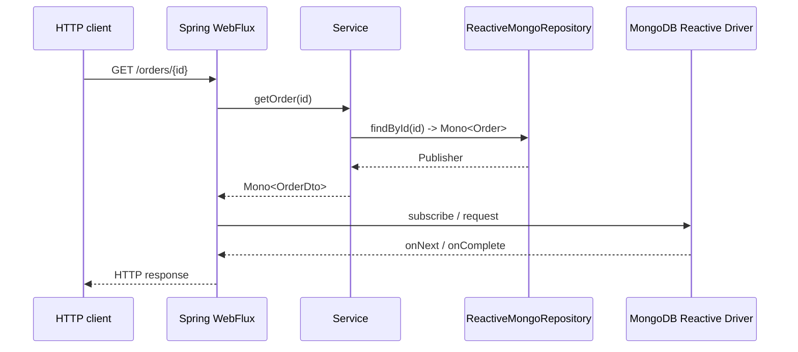

# Avoiding Blocking, Manual Subscribe, and Mixing Sync Clients in Reactive Chains

In **Spring Data MongoDB**, writing reactive code properly means more than swapping return types from `Order` to `Mono<Order>` or `List<Order>` to `Flux<Order>`. A genuinely non-blocking flow must use the **MongoDB Reactive Streams Driver** via `ReactiveMongoTemplate` or `ReactiveMongoRepository`, **never wait on results with `block()`** on the event loop, **never call `subscribe()`** inside services/controllers, and **never sneak synchronous `MongoTemplate` calls** onto reactive pipeline threads.

This lesson belongs to the **Reactive access** chapter of the **SPRING_DATA_MONGODB** module: using Spring Data MongoDB to connect, map documents, and operate via templates/repositories; practicing queries, aggregation, indexes, transactions, reactive access, testing, and data performance diagnostics. Its focus is maintaining a **consistent execution model** from WebFlux controllers down to MongoDB, especially when incrementally migrating off synchronous APIs.

After this lesson, you will be able to:

- Explain why a `Mono` is only a work description until subscribed.
- Spot three anti-patterns: `block()`, manual `subscribe()`, and synchronous I/O inside `map`/`flatMap`.
- Rewrite flows cleanly with `ReactiveMongoRepository`, `ReactiveMongoTemplate`, `flatMap`, `then`, and `switchIfEmpty`.
- Distinguish `subscribeOn`, `publishOn`, `boundedElastic`, and their limitations.
- Protect transaction context, handle timeouts/cancellation, retries, and backpressure, and verify with `StepVerifier` and integration tests.

## 1. Reactive Is an Execution Model, Not a Return-Type Wrapper

Compare these two signatures:

```java
Order findById(ObjectId id);              // Imperative, returns directly.
Mono<Order> findById(ObjectId id);        // Reactive, returns Publisher.
```

The second signature **only states a return contract**. If its body calls a blocking API and wraps the result in `Mono.just(...)`, it **blocks the calling thread immediately upon invocation**:

```java
// WRONG: synchronous query runs before the Mono is created.
Mono<Order> findWrong(ObjectId id) {
    Order order = mongoTemplate.findById(id, Order.class);
    return Mono.justOrEmpty(order);
}
```

Genuinely reactive version:

```java
// CORRECT: ReactiveMongoTemplate uses the reactive driver.
Mono<Order> findReactive(ObjectId id) {
    return reactiveMongoTemplate.findById(id, Order.class);
}
```

A `Mono<Order>` can emit **0 or 1 item**, error, or cancel. A `Flux<Order>` can emit multiple items without necessarily waiting for the whole list upfront. Reactor operators chain steps over `onNext`, `onError`, `onComplete`, and cancellation signals.

**Reactor does not automatically spin up a dedicated thread per `Mono`/`Flux`.** Execution threads depend on the source and schedulers; non-blocking means not holding threads idle waiting on I/O, not running every step in parallel.

## 2. When Does a Pipeline Actually Run?

In Reactor, most MongoDB sources are **cold publishers**: assembling an operator chain sends zero queries to MongoDB until a subscriber attaches.

```java
Mono<Order> query = reactiveMongoTemplate.findById(id, Order.class);

// At this point, do not assume MongoDB has received find yet.
Mono<OrderDto> response = query
    .map(order -> new OrderDto(
        order.getId().toHexString(),
        order.getDisplayName()
    ));

// WebFlux or StepVerifier will subscribe to response.
```



In a standard WebFlux request, **the framework is the subscriber at the HTTP boundary**. The service simply **returns the fully composed Publisher** without starting a separate subscription.

For non-HTTP jobs (schedulers, CLIs, message listeners), subscription ownership lives **at the job boundary** with explicit lifecycle, error handling, and shutdown management—never as a stray `subscribe()` buried inside a repository or service.

## 3. Anti-Pattern 1: `block()` in a WebFlux Controller

```java
import org.springframework.web.bind.annotation.GetMapping;
import org.springframework.web.bind.annotation.PathVariable;

// WRONG: blocks the request thread waiting for I/O.
@GetMapping("/orders/{id}")
public OrderDto getOrder(@PathVariable String id) {
    Order order = reactiveOrderRepository.findById(
        new ObjectId(id)
    ).block();

    return toDto(order);
}
```

Problems:

- `block()` turns async execution into **synchronous waiting**.
- On a Reactor Netty event loop or thread marked `NonBlocking`, Reactor may throw `IllegalStateException` forbidding blocking calls.
- Even where no exception throws, the thread stays **pinned** until the query finishes, starving request throughput.
- `block()` initiates **a new subscription**; if another subscription also occurs, work can run twice.
- `block(Duration)` with a timeout is still **blocking** during the wait, not non-blocking.

### Fix: Return `Mono` from the Controller

```java
import org.bson.types.ObjectId;
import org.springframework.web.bind.annotation.GetMapping;
import org.springframework.web.bind.annotation.PathVariable;
import org.springframework.web.bind.annotation.RequestMapping;
import org.springframework.web.bind.annotation.RestController;
import reactor.core.publisher.Mono;

@RestController
@RequestMapping("/orders")
class OrderController {
    private final ReactiveOrderService service;

    OrderController(ReactiveOrderService service) {
        this.service = service;
    }

    @GetMapping("/{id}")
    Mono<OrderDto> getOrder(@PathVariable String id) {
        return Mono.fromCallable(() -> new ObjectId(id))
            .flatMap(service::getOrder);
    }
}
```

`new ObjectId(id)` only parses/validates in memory, with no database I/O. In production, distinguish malformed IDs (HTTP 400) from missing documents (404) using explicit validation and exception mapping. Here the focus is **avoiding `block()`**.

**Key point:** the method returns `Mono<OrderDto>`; WebFlux subscribes and writes the HTTP response when the publisher signals.

## 4. Anti-Pattern 2: Manual `subscribe()` in Services

Another even sneakier bug occurs because **the HTTP response can be sent before the write finishes**:

```java
// WRONG: fire-and-forget.
public Mono<Void> markPaidWrong(ObjectId id) {
    repository.findById(id)
        .flatMap(order -> {
            order.setStatus("PAID");
            return repository.save(order);
        })
        .subscribe();

    return Mono.empty(); // HTTP may return OK immediately.
}
```

Calling `subscribe()` creates **an isolated execution branch** disconnected from the returned Publisher. It loses linkage to:

- HTTP request cancellation and timeouts.
- `onError` propagation for WebFlux error mapping.
- Reactive transaction context (if inside a transaction).
- Tracing and correlation context of the main subscription.
- Retry orchestration and operation lifecycle.

If the write fails with `DuplicateKeyException`, connection timeout, or validation error, the HTTP endpoint above may already have returned **204/200 OK**. Logging inside `subscribe(error -> log...)` never fixes correctness.

### Right Way: Return the Publisher Representing the Write Itself

```java
public Mono<Void> markPaid(ObjectId id) {
    return repository.findById(id)
        .switchIfEmpty(Mono.error(
            new IllegalArgumentException("Order not found")
        ))
        .flatMap(order -> {
            order.setStatus("PAID");
            return repository.save(order);
        })
        .then();
}
```

`then()` turns `Mono<Order>` from `save` into `Mono<Void>`, **completing only after upstream completes**, while forwarding errors. Controllers can return `Mono<Void>` directly for bodyless endpoints.

Concurrency note: concurrent `findById → save` flows can still lose updates. Add `@Version`/optimistic locking or atomic `updateFirst`; **reactive does not prevent lost updates automatically**.

## 5. Anti-Pattern 3: Mixing Synchronous `MongoTemplate` into Reactive Chains

`MongoTemplate` and `ReactiveMongoTemplate` are not merely syntactic variants:

| Component | Underlying Driver | Typical Return | Blocks Calling Thread on I/O? |
| --- | --- | --- | --- |
| `MongoTemplate` | MongoDB Java **Sync Driver** | `Order`, `List<Order>`, `UpdateResult` | **Can block** |
| `MongoRepository` | Sync Driver via imperative infrastructure | `Optional<Order>`, entity | **Can block** |
| `ReactiveMongoTemplate` | MongoDB **Reactive Streams Driver** | `Mono<T>`, `Flux<T>` | Reactive I/O on subscription |
| `ReactiveMongoRepository` | Reactive Streams Driver | `Mono<T>`, `Flux<T>` | Non-blocking reactive API |

Common mistake:

```java
// WRONG: map callback executes on a reactive pipeline thread.
return reactiveOrderRepository.findById(id)
    .map(order -> {
        // Blocking I/O inside map!
        Customer customer = mongoTemplate.findById(
            order.getCustomerId(), Customer.class
        );
        return merge(order, customer);
    });
```

Even though the outer return type is `Mono<OrderDto>`, the sync MongoDB query inside `map` **blocks the pipeline thread**. Under load, latency spikes, queues back up, and throughput collapses.

### Prefer Switching to `ReactiveMongoTemplate`

```java
return reactiveOrderRepository.findById(id)
    .flatMap(order ->
        reactiveMongoTemplate.findById(
                order.getCustomerId(), Customer.class
            )
            .map(customer -> merge(order, customer))
    );
```

`flatMap` chains **another Publisher** into the pipeline; `map` is reserved for transformations returning **plain values**, never Publishers.

## 6. Why `map(Mono)` Creates Nested Types and Fails to Run Logic

Suppose:

```java
Mono<Order> orderMono = reactiveOrderRepository.findById(id);
```

Wrong pattern:

```java
Mono<Mono<Customer>> nested = orderMono.map(
    order -> reactiveCustomerRepository.findById(
        order.getCustomerId()
    )
);
```

`map` preserves the callback's return value **as a plain object**: here that value is itself a `Mono<Customer>`, yielding `Mono<Mono<Customer>>`. It never subscribes to the inner publisher.

Right pattern:

```java
Mono<Customer> customerMono = orderMono.flatMap(
    order -> reactiveCustomerRepository.findById(
        order.getCustomerId()
    )
);
```

| Operator | Callback Returns | Result | When to Use |
| --- | --- | --- | --- |
| `map(f)` | `T → R` | `Mono<R>`/`Flux<R>` | DTO mapping, pure validation, lightweight transforms |
| `flatMap(f)` | `T → Publisher<R>` | Flattens publisher stream | Queries, saves, reactive HTTP clients |
| `concatMap(f)` | `T → Publisher<R>` | Preserves inner publisher order | When items must execute in sequence |
| `flatMap(f, concurrency)` | `T → Publisher<R>` | Bounded concurrent execution | Independent I/O batches with concurrency limit |
| `then(next)` | Next Publisher | Runs `next` after upstream completes | Write A then write B, propagating errors |
| `zipWith`/`Mono.zip` | Independent Publishers | Combines values once all emit | Reading independent sources in parallel |

**Never use `flatMap` just to trigger a side effect via `subscribe()` inside the callback.** Always return the inner Publisher.

## 7. Entity and Reactive Repository: End-to-End Example

Order entity:

```java
import java.time.Instant;
import org.bson.types.ObjectId;
import org.springframework.data.annotation.Id;
import org.springframework.data.annotation.Version;
import org.springframework.data.mongodb.core.mapping.Document;
import org.springframework.data.mongodb.core.mapping.Field;

@Document("orders")
public class Order {
    @Id
    private ObjectId id;

    @Field("tenant_id")
    private String tenantId;

    @Field("customer_id")
    private ObjectId customerId;

    private String status;

    @Field("created_at")
    private Instant createdAt;

    @Version
    private Long version;

    public Order() {}

    public ObjectId getId() { return id; }
    public String getTenantId() { return tenantId; }
    public ObjectId getCustomerId() { return customerId; }
    public String getStatus() { return status; }
    public Instant getCreatedAt() { return createdAt; }
    public Long getVersion() { return version; }
    public void setStatus(String status) { this.status = status; }
}
```

Repository:

```java
import org.bson.types.ObjectId;
import org.springframework.data.mongodb.repository.ReactiveMongoRepository;
import reactor.core.publisher.Flux;
import reactor.core.publisher.Mono;

public interface ReactiveOrderRepository
        extends ReactiveMongoRepository<Order, ObjectId> {

    Mono<Order> findByIdAndTenantId(
        ObjectId id, String tenantId
    );

    Flux<Order> findByTenantIdAndStatus(
        String tenantId, String status
    );
}
```

`tenantId` in derived queries maps to BSON `tenant_id` via Spring Data. `@Version` catches lost updates on supported save paths with acknowledged writes; it does not turn an entire reactive chain into a transaction.

**Multi-tenant design:** attach `tenantId` from the authentication context on every business query. Unscoped `findById(id)` creates an authorization hole if IDs come from users and services omit tenant checks.

## 8. Proper Reactive Service: One Pipeline, One Return Path

Service reading a tenant-scoped order and mapping to a DTO:

```java
import org.bson.types.ObjectId;
import org.springframework.stereotype.Service;
import reactor.core.publisher.Mono;

@Service
public class ReactiveOrderService {
    private final ReactiveOrderRepository repository;

    public ReactiveOrderService(ReactiveOrderRepository repository) {
        this.repository = repository;
    }

    public Mono<OrderDto> getOrder(ObjectId id) {
        // Example: tenantId comes from the server-side auth context.
        String tenantId = "T1";

        return repository.findByIdAndTenantId(id, tenantId)
            .switchIfEmpty(Mono.error(
                new OrderNotFoundException(id)
            ))
            .map(order -> new OrderDto(
                order.getId().toHexString(),
                order.getStatus()
            ));
    }

    public Mono<Void> markPaid(ObjectId id, String tenantId) {
        return repository.findByIdAndTenantId(id, tenantId)
            .switchIfEmpty(Mono.error(
                new OrderNotFoundException(id)
            ))
            .flatMap(order -> {
                order.setStatus("PAID");
                return repository.save(order);
            })
            .then();
    }
}
```

`OrderDto` can be a Java record:

```java
public record OrderDto(String id, String status) {}

public final class OrderNotFoundException
        extends RuntimeException {
    public OrderNotFoundException(Object id) {
        super("Order not found: " + id);
    }
}
```

`"T1"` is purely illustrative; **never hardcode real tenants** in production. Pass the tenant from the authenticated principal or reactive security context to keep requests strictly isolated.

All service methods **return Publishers** without `block()` or `subscribe()`. Read/write errors flow straight to the final subscriber.

## 9. Controller Returning `Mono`/`Flux`, Not a Blocked Value

```java
import org.bson.types.ObjectId;
import org.springframework.http.HttpStatus;
import org.springframework.web.bind.annotation.*;

@RestController
@RequestMapping("/api/orders")
public class OrderApi {
    private final ReactiveOrderService service;

    public OrderApi(ReactiveOrderService service) {
        this.service = service;
    }

    @GetMapping("/{id}")
    public Mono<OrderDto> get(@PathVariable String id) {
        return Mono.fromCallable(() -> new ObjectId(id))
            .flatMap(service::getOrder);
    }

    @PatchMapping("/{id}/paid")
    @ResponseStatus(HttpStatus.NO_CONTENT)
    public Mono<Void> markPaid(
            @PathVariable String id,
            @RequestHeader("X-Tenant-Demo") String tenantId) {
        // Header is for demo only; in production, derive tenant from auth.
        return Mono.fromCallable(() -> new ObjectId(id))
            .flatMap(parsed -> service.markPaid(
                parsed, tenantId
            ));
    }
}
```

`@ResponseStatus(NO_CONTENT)` paired with `Mono<Void>` ensures WebFlux waits for the pipeline to finish before completing the response. If the database throws, the framework error handler maps it to an HTTP error.

**Production hardening:** map malformed-`ObjectId` `IllegalArgumentException` to HTTP 400, `OrderNotFoundException` to 404, optimistic locking conflicts to 409, and scrub sensitive details from error bodies. Never trust a client-supplied tenant header as authorization proof.

## 10. When a Blocking Library Is Unavoidable: `boundedElastic` at the Boundary

Not every codebase can replace all sync dependencies overnight. For instance, a legacy reporting library might rely strictly on `MongoTemplate` or a synchronous SDK.

Official Reactor pattern to isolate **a blocking call**:

```java
import reactor.core.publisher.Mono;
import reactor.core.scheduler.Schedulers;

Mono<Customer> legacyCustomer(ObjectId id) {
    return Mono.fromCallable(
            () -> mongoTemplate.findById(id, Customer.class)
        )
        .subscribeOn(Schedulers.boundedElastic());
}
```

Here:

- `Mono.fromCallable` **defers** calling sync `MongoTemplate` until subscription.
- `subscribeOn(Schedulers.boundedElastic())` runs the blocking source on a scheduler designed for blocking tasks with **bounded threads and queues**.
- If `mongoTemplate.findById` returns `null`, `Mono.fromCallable` completes **empty** rather than emitting `null`.
- Offloading does not turn the sync driver reactive: a `boundedElastic` thread **still blocks while waiting**.
- `subscribeOn` does not initiate subscription; the outer framework/job subscriber still must subscribe.

Once wrapped, compose it cleanly into the chain:

```java
return reactiveOrderRepository.findById(id)
    .flatMap(order ->
        legacyCustomer(order.getCustomerId())
            .map(customer -> merge(order, customer))
    );
```

This is a **transitional workaround**, not a target architecture. Prefer migrating dependencies to `ReactiveMongoTemplate`/`ReactiveMongoRepository` or isolating legacy workloads in a separate quota-bounded service.

## 11. Two Patterns That Use `boundedElastic` Yet Are Still Wrong

### Wrong Because Blocking Runs Too Early

```java
// WRONG: findById executes IMMEDIATELY on the calling thread.
Mono<Customer> wrong = Mono.justOrEmpty(
    mongoTemplate.findById(id, Customer.class)
).subscribeOn(Schedulers.boundedElastic());
```

`subscribeOn` cannot travel back in time to offload a `findById` call that already executed when building the argument to `justOrEmpty`.

### Wrong Because `publishOn` Comes After the Blocking Step

```java
// WRONG: map already executed blocking work before publishOn.
return reactiveOrderRepository.findById(id)
    .map(order ->
        mongoTemplate.findById(
            order.getCustomerId(), Customer.class
        )
    )
    .publishOn(Schedulers.boundedElastic());
```

`publishOn` shifts operators **downstream** of its placement—it cannot retroactively offload callbacks upstream of it.

### Right: Wrap the Blocking Source Explicitly

```java
return reactiveOrderRepository.findById(id)
    .flatMap(order ->
        Mono.fromCallable(() ->
                mongoTemplate.findById(
                    order.getCustomerId(), Customer.class
                )
            )
            .subscribeOn(Schedulers.boundedElastic())
    );
```

**Never run blocking I/O on `Schedulers.parallel()`.** That scheduler is tuned for short CPU-bound tasks; Reactor forbids blocking calls on `parallel`/`single` threads by default. Blocking there risks exceptions or thread starvation.

## 12. How Do `subscribeOn` and `publishOn` Differ?

| Operator | Effect | Typical Usage |
| --- | --- | --- |
| `subscribeOn(scheduler)` | Sets where the source subscribes and upstream runs | Place right after `Mono.fromCallable(blockingCall)` |
| `publishOn(scheduler)` | Switches where downstream signals execute from that point | Isolate CPU work or explicit boundaries |
| `Schedulers.boundedElastic()` | Bounded scheduler built for blocking work | Isolate legacy I/O; never replaces reactive drivers |
| `Schedulers.parallel()` | Thread pool for CPU-bound tasks | Never execute blocking database calls here |
| No explicit scheduler | Inherits source/caller/library threads | Appropriate for end-to-end reactive pipelines |

Thread observation example:

```java
Mono.fromCallable(() -> blockingLegacyCall())
    .subscribeOn(Schedulers.boundedElastic())
    .doOnNext(value ->
        log.debug("Thread after blocking source: {}",
            Thread.currentThread().getName())
    )
    .publishOn(Schedulers.parallel())
    .map(this::cpuOnlyTransform);
```

`cpuOnlyTransform` must perform zero blocking I/O. Thread names serve **diagnostics only**—never tie business correctness to specific thread names.

**Caveat:** `boundedElastic` has finite thread and queue caps; flooding it with sync calls causes queue saturation and latency spikes. Limit concurrency, monitor pools, and migrate sync drivers instead of scaling thread pools indefinitely.

## 13. `Mono.defer` Defers Publisher Creation, Not Thread Offloading

`Mono.defer` postpones *building* a Publisher until subscription:

```java
Mono<Order> deferred = Mono.defer(() ->
    reactiveOrderRepository.findById(id)
);
```

This helps when recomputing arguments per subscription or building publishers after context arrives. However:

```java
// WRONG if called on the event loop: still blocks at subscribe time.
Mono<Customer> notNonBlocking = Mono.defer(() ->
    Mono.justOrEmpty(
        mongoTemplate.findById(id, Customer.class)
    )
);
```

`defer` only **delays when blocking occurs**; it does not switch threads. To call synchronous APIs off the event loop, use `Mono.fromCallable(...).subscribeOn(Schedulers.boundedElastic())` at a controlled boundary.

## 14. Why Never Self-Subscribe in Constructors, Getters, or Utilities?

Methods like this trigger hidden side effects:

```java
// WRONG: triggers a write without returning any completion signal.
void saveAudit(Audit audit) {
    reactiveAuditRepository.save(audit)
        .subscribe(saved -> log.info("saved={}", saved.getId()));
}
```

Drawbacks:

- Callers cannot wait for the save to finish.
- On DB errors, the caller may already have returned HTTP success.
- Request cancellation never propagates to the detached subscription.
- Tests struggle to prove the write executed once.
- Detached subscriptions **escape reactive transaction contexts**.
- On shutdown or scheduler termination, side effects can be dropped mid-flight.

Fix:

```java
Mono<Audit> saveAudit(Audit audit) {
    return reactiveAuditRepository.save(audit);
}
```

If callers don't need the saved object yet must **await completion**:

```java
Mono<Void> auditThenComplete(Audit audit) {
    return saveAudit(audit).then();
}
```

As a rule, **subscription belongs to the execution boundary**, never hidden inside a domain method behind the caller's back.

## 15. Chaining Two Writes: `then` and `flatMap` Instead of Two `subscribe` Calls

Suppose creating an `Order` requires writing a linked `Audit` using `orderId`.

Wrong:

```java
Mono<Order> createWrong(Order order) {
    reactiveOrderRepository.save(order)
        .subscribe();

    reactiveAuditRepository.save(new Audit(/* ... */))
        .subscribe();

    return Mono.just(order);
}
```

Two detached subscriptions give zero ordering guarantees and detach from the response. The ID might not even be generated when building the audit, and errors vanish.

Correct **Publisher sequencing**:

```java
Mono<Order> createAndAudit(Order order) {
    return reactiveOrderRepository.save(order)
        .flatMap(saved ->
            reactiveAuditRepository.save(
                    Audit.forCreatedOrder(saved.getId())
                )
                .thenReturn(saved)
        );
}
```

`Audit.forCreatedOrder(...)` is an illustrative factory defined on the real `Audit` entity. `flatMap` ensures the audit publisher subscribes only after `saved` arrives, and `thenReturn(saved)` emits the saved order **only after the audit save completes**.

**Crucial:** sequencing **does not make two writes atomic**. If the order saves and the audit fails, the order persists anyway. To commit or roll back both together, wrap them in a **reactive MongoDB transaction** on a supporting replica set or sharded cluster.

## 16. `Mono.when` / `Mono.zip` Are Not Transactions

`Mono.zip(a, b)` subscribes to two Publishers concurrently to combine their values:

```java
Mono<Customer> customer =
    reactiveCustomerRepository.findById(customerId);

Mono<Order> order =
    reactiveOrderRepository.findById(orderId);

Mono<Tuple2<Customer, Order>> together =
    Mono.zip(customer, order);
```

This fits **two independent read queries**. Still:

- `zip` emits nothing if either source completes empty; handle empty cases explicitly.
- If one source fails, the other may already have partially run.
- For **two writes**, `when`/`zip` do not roll back a succeeded write when the sibling fails.
- Inside a single MongoDB transaction, never run operations **concurrently on the same session**: drivers/servers restrict intra-transaction parallelism. Chain sequentially whenever order and consistency matter.
- For services enforcing tenant/permission checks, never start concurrent writes before validation passes.

## 17. Single-Document Atomic Writes with `ReactiveMongoTemplate`

Instead of `find → mutate → save`, update targeted fields in a single MongoDB command:

```java
import com.mongodb.client.result.UpdateResult;
import org.bson.types.ObjectId;
import org.springframework.data.mongodb.core.ReactiveMongoTemplate;
import org.springframework.data.mongodb.core.query.Criteria;
import org.springframework.data.mongodb.core.query.Query;
import org.springframework.data.mongodb.core.query.Update;
import reactor.core.publisher.Mono;

Mono<Boolean> markPaidAtomically(
        ReactiveMongoTemplate template,
        ObjectId orderId, String tenantId) {

    Query query = Query.query(
        Criteria.where("id").is(orderId)
            .and("tenantId").is(tenantId)
            .and("status").is("NEW")
    );

    Update patch = new Update().set("status", "PAID");

    return template.updateFirst(query, patch, Order.class)
        .map(result -> result.getMatchedCount() == 1);
}
```

`updateFirst` runs via the Reactive Streams driver and returns `Mono<UpdateResult>`. The command fires only upon subscription. Filtering on `status="NEW"` prevents overwriting `PAID` after another transition (with business rules handling conflicts).

**Never confuse atomicity with idempotency.** If a payment event arrives twice, you need a `requestId`/transaction reference and deduplication rules, not just a status check. Neither does reactivity replace MongoDB write concerns or multi-document transactions.

## 18. Reactive MongoDB Connections: Use the Right Client Type

A project can accidentally pull in both stacks:

```text
Blocking:
  com.mongodb.client.MongoClient
      → MongoTemplate
      → MongoRepository

Reactive:
  com.mongodb.reactivestreams.client.MongoClient
      → ReactiveMongoTemplate
      → ReactiveMongoRepository
```

Despite targeting the same MongoDB cluster, the two client interfaces **are not interchangeable**. Having `reactor-core` or `spring-boot-starter-webflux` on the classpath never turns `MongoTemplate` into non-blocking I/O.

Verify:

1. The app includes a compatible MongoDB Reactive Streams Driver.
2. `ReactiveMongoDatabaseFactory` and `ReactiveMongoTemplate` use the intended database, credentials, TLS, and pool settings.
3. Reactive repositories are enabled/scanned with the right package and beans.
4. Synchronous `MongoTemplate` is not injected into WebFlux services.
5. If both clients coexist during migration, each has separate pools and metrics without assuming shared sessions.

Track your exact **Spring Boot/Spring Data version**, as auto-configuration and property names vary across major releases. This lesson focuses on interfaces and principles rather than assuming one Boot version's exact property names.

## 19. Never Disguise a Synchronous Repository with `Mono.just`

Wrong:

```java
Mono<Order> getWrong(ObjectId id) {
    Optional<Order> result = mongoRepository.findById(id);
    return Mono.justOrEmpty(result);
}
```

Here `mongoRepository` is a **synchronous `MongoRepository`**. `findById` blocks the calling thread before constructing the Publisher, so `Mono.justOrEmpty(Optional<Order>)` merely wraps an already-fetched value—not a non-blocking query.

While migrating:

```java
Mono<Order> getTransitional(ObjectId id) {
    return Mono.fromCallable(() ->
            mongoRepository.findById(id).orElse(null)
        )
        .subscribeOn(Schedulers.boundedElastic());
}
```

Preferred target state:

```java
Mono<Order> getPreferred(ObjectId id) {
    return reactiveMongoRepository.findById(id);
}
```

Never mix up sync and reactive repositories just because both expose `findById`.

## 20. `ThreadLocal`, `SecurityContext`, and Reactor `Context`

Imperative Servlet code typically stores request metadata in `ThreadLocal`. In Reactor, execution hops across threads and operators; `ThreadLocal` cannot reliably serve as the sole source for tenant or correlation IDs.

Spring Security reactive provides context through the reactive pipeline:

```java
import org.springframework.security.core.context.ReactiveSecurityContextHolder;
import reactor.core.publisher.Mono;

Mono<String> authenticatedName() {
    return ReactiveSecurityContextHolder.getContext()
        .map(ctx -> ctx.getAuthentication().getName());
}
```

For application-managed metadata, use Reactor `Context`:

```java
Mono<String> tenantScopedMessage = Mono.deferContextual(ctx -> {
    String tenantId = ctx.get("tenantId");
    return Mono.just("Tenant=" + tenantId);
});

Mono<String> supplied = tenantScopedMessage
    .contextWrite(context -> context.put("tenantId", "T1"));
```

`"T1"` is a demo value. **Never let clients populate tenant permissions arbitrarily** from a header into `Context`; derive tenants from authentication and authorization.

Calling `subscribe()` manually inside a service creates a new subscription **lacking the caller's Reactor Context**. Switching threads via `boundedElastic` also affects logging/MDC, security context, and `ThreadLocal`-based libraries; rely on official context propagation rather than reading `ThreadLocal` directly.

## 21. Reactive Transactions: Do Not Split Subscriptions or Mix Sync Drivers

Reactive transactions require:

- A transaction-capable MongoDB replica set or sharded deployment.
- `ReactiveMongoTransactionManager` using the **same `ReactiveMongoDatabaseFactory`** as `ReactiveMongoTemplate`/repositories.
- Publishers **composed and subscribed within the same reactive transaction context**.
- Service `@Transactional` methods invoked through a Spring proxy (avoiding self-invocation).
- Zero synchronous `MongoTemplate` calls expected to join the reactive transaction.

Configuration:

```java
import org.springframework.context.annotation.Bean;
import org.springframework.context.annotation.Configuration;
import org.springframework.data.mongodb.ReactiveMongoDatabaseFactory;
import org.springframework.data.mongodb.ReactiveMongoTransactionManager;

@Configuration
class ReactiveTxConfig {
    @Bean("reactiveMongoTransactionManager")
    ReactiveMongoTransactionManager txManager(
            ReactiveMongoDatabaseFactory factory) {
        return new ReactiveMongoTransactionManager(factory);
    }
}
```

Service example assuming repositories/aggregates are declared:

```java
import org.springframework.stereotype.Service;
import org.springframework.transaction.annotation.Transactional;
import reactor.core.publisher.Mono;

@Service
public class OrderWriteService {
    private final ReactiveOrderRepository orders;
    private final ReactiveAuditRepository audits;

    public OrderWriteService(
            ReactiveOrderRepository orders,
            ReactiveAuditRepository audits) {
        this.orders = orders;
        this.audits = audits;
    }

    @Transactional(
        transactionManager = "reactiveMongoTransactionManager"
    )
    public Mono<Order> createAndAudit(Order order) {
        return orders.save(order)
            .flatMap(saved ->
                audits.save(Audit.forCreatedOrder(saved.getId()))
                    .thenReturn(saved)
            );
    }
}
```

If the audit save fails, the reactive transaction rolls back both MongoDB writes per config. However, emails, Kafka publishes, and external HTTP calls **are never rolled back** by a MongoDB transaction. Use transactional outbox or idempotent workflows for external events.

**Never do this inside that method**: `audits.save(...).subscribe()`. A detached subscription loses transaction context, letting the audit write **outside** the transaction or after commit.

## 22. `TransactionalOperator` for Explicit Transaction Boundaries

When not using `@Transactional`, create a `TransactionalOperator`:

```java
import org.springframework.transaction.ReactiveTransactionManager;
import org.springframework.transaction.reactive.TransactionalOperator;
import reactor.core.publisher.Mono;

TransactionalOperator tx =
    TransactionalOperator.create(reactiveTxManager);

Mono<Order> work = orders.save(order)
    .flatMap(saved ->
        audits.save(Audit.forCreatedOrder(saved.getId()))
            .thenReturn(saved)
    );

return work.as(tx::transactional);
```

`reactiveTxManager` is a compatible `ReactiveMongoTransactionManager` or `ReactiveTransactionManager`. The transaction boundary wraps the **upstream publisher passed to `transactional(...)`**.

**Creating the Publisher does not execute the transaction.** Subscription, cancellation, failures, and context all govern the outcome. Never mix an externally cached/shared `Mono` or side effect executed prior to the operator expecting rollback.

When a transaction performs multiple reads/writes, chain them sequentially instead of running concurrent `flatMap` operations on the same session.

## 23. Cancellation: Client Disconnect Does Not Roll Back Writes

Suppose an endpoint returns:

```java
Mono<Void> update = reactiveMongoTemplate
    .updateFirst(query, patch, Order.class)
    .then();
```

If the HTTP client disconnects or cancels, Reactor **propagates cancellation upstream**. Yet a MongoDB command already dispatched over the wire may **have executed** before cancellation arrives.

Never assume:

```text
HTTP cancelled → MongoDB definitely did not write.
```

Consider every outcome:

- Write did not reach the server: no change occurred.
- Write applied, yet response was lost: business outcome is **uncertain**.
- Write already committed in a transaction: client disconnect cannot “undo” the commit.
- Publisher cancelled mid-transaction: verify rollback behavior for your exact Spring Data/Reactor version and scenario.

For important side effects, track **`requestId`/idempotency keys**, receipts, and status lookup endpoints. Never use `doOnCancel` as a DIY transaction rollback handler.

## 24. `timeout(Duration)` Is No Substitute for Consistency

`Mono.timeout(...)` emits a timeout error when upstream fails to respond within the deadline, and cancels upstream:

```java
Mono<Order> result = reactiveOrderRepository.findById(id)
    .timeout(java.time.Duration.ofSeconds(2));
```

This timeout **does not make the query blocking**; yet neither does it guarantee the MongoDB server aborted processing.

For writes:

```java
Mono<Void> write = reactiveMongoTemplate
    .updateFirst(query, patch, Order.class)
    .then()
    .timeout(java.time.Duration.ofSeconds(2));
```

If a timeout fires after the server already applied the write, callers must never blindly retry the whole business command without reconciliation. Distinguish HTTP request timeouts, Reactor timeouts, driver/socket/server-selection timeouts, and MongoDB `maxTimeMS`—each operates at its own boundary.

**Timeouts enforce latency budgets; they do not replace idempotency or write acknowledgments.**

## 25. `retryWhen` Re-Runs the Whole Chain, Unlike Driver Command Retries

Dangerous example:

```java
Mono<Void> workflow = orders.save(order)
    .flatMap(saved ->
        audits.save(Audit.forCreatedOrder(saved.getId()))
    )
    .then()
    .retryWhen(
        reactor.util.retry.Retry.max(3)
    );
```

If `orders.save` succeeded and `audits.save` failed, `retryWhen` re-subscribes to the entire workflow, **re-executing `orders.save`**. This differs from the MongoDB driver's **retryable writes**, which use logical session/statement IDs for eligible single commands.

For **read-only** queries, bounded retries on transient failures within latency budgets make sense. Even then, never retry validation, duplicate key, or permission errors.

For writes:

1. Enforce unique business keys/`requestId` to prevent duplicates.
2. Structure multi-step side effects with transactions, outbox, or staging states.
3. Retry only classified transient errors with strict limits.
4. On uncertain outcomes, query the business receipt state first.
5. Never retry `$inc`/`sendEmail`/`publishEvent` blindly as an atomic step.

## 26. Backpressure: Never `collectList` Unbounded MongoDB Results

`ReactiveMongoRepository.findAll()` returns `Flux<Order>`. That alone does not make every consumer memory-safe.

Wrong for large collections:

```java
Mono<List<Order>> all = reactiveOrderRepository
    .findAll()
    .collectList(); // Pulls everything into the heap.
```

Across millions of documents, `collectList` exhausts memory. Prefer:

- `take(n)` when matching business contracts.
- Explicit filters, indexes, and `limit` directly on MongoDB.
- Keyset pagination or `Window`/`ScrollPosition` where supported.
- Returning `Flux` to stream responses when media type and clients support streaming.
- Bounded batching via `buffer(n)`/`concatMap` with controlled concurrency.
- Checkpoints/resumability for huge exports or snapshots, since disconnects and concurrent writes affect long streams.

Example capping at 500 documents:

```java
Flux<OrderDto> first500 = reactiveOrderRepository
    .findByTenantIdAndStatus("T1", "NEW")
    .take(500)
    .map(this::toDto);
```

`take(500)` caps emissions on the client, which is not always optimal for limiting server work. **Push `limit` into the MongoDB query** to bound work at the source.

## 27. `flatMap` Concurrency and Bounding Write Workloads

Suppose a batch updates multiple independent orders:

```java
Flux<Order> saved = Flux.fromIterable(orderIds)
    .flatMap(id ->
        reactiveOrderRepository.findById(id)
            .flatMap(order -> {
                order.setStatus("REVIEW");
                return reactiveOrderRepository.save(order);
            }),
        8 // max concurrent inner publishers
    );
```

`flatMap(..., 8)` caps active inner publishers without guaranteeing output order. Watch out:

- Duplicate IDs targeting the same document still require optimistic locking or deduplication.
- A batch of multiple `save` calls **is not a transaction**.
- Failures mid-batch leave prior writes committed.
- If the connection pool is small and many requests fan out concurrently, total concurrency multiplies across requests.
- When ordering matters, use `concatMap` or per-key partitioning.

Never crank concurrency to thousands merely because calls are non-blocking. Connection pools, MongoDB throughput, memory, backpressure, and downstream capacity remain real limits.

## 28. Read Preference, Read Concern, and Consistency Are Not Strengthened by Reactive

Both reactive and sync MongoDB drivers obey the same rules for:

- `readPreference`: primary, secondary, and other modes.
- `readConcern`: `local`, `majority`, `snapshot` in supporting contexts.
- `writeConcern`: write acknowledgment/durability levels.
- Retryable reads/writes: constrained by operation, topology, and driver settings.
- Causal consistency: requires proper `ClientSession`/context usage.
- Transactions: require replica sets/sharded deployments and transaction managers.

Returning `Mono<Order>` does not mean reads reflect every concurrent write or share a transaction with adjacent calls.

For optimistic locking, Spring Data still needs **acknowledged writes** to detect version mismatches. For multi-document consistency, use real reactive transactions instead of assuming `Mono.when(insertA, insertB)` makes composition atomic.

## 29. Using `ReactiveMongoTemplate` for Non-Blocking Aggregations

In Spring Data MongoDB, reactive aggregations return `Flux<T>`:

```java
import org.bson.Document;
import org.springframework.data.mongodb.core.aggregation.Aggregation;
import org.springframework.data.mongodb.core.query.Criteria;
import reactor.core.publisher.Flux;

Aggregation pipeline = Aggregation.newAggregation(
    Aggregation.match(
        Criteria.where("tenantId").is("T1")
            .and("status").is("PAID")
    ),
    Aggregation.group("tenantId").count().as("paidOrders")
);

Flux<Document> summaries =
    reactiveMongoTemplate.aggregate(
        pipeline, Order.class, Document.class
    );
```

Typed aggregations let Spring Data map `tenantId` to `tenant_id`. With raw `Aggregation.stage(...)`, write physical BSON field names explicitly.

**Never:**

```java
// WRONG in a reactive pipeline: blocks to collect results.
List<Document> summaries = reactiveMongoTemplate
    .aggregate(pipeline, Order.class, Document.class)
    .collectList()
    .block();
```

For `$merge` or `$out` write stages in aggregations, execution still awaits subscription. Calling `subscribe()` and returning HTTP 204 tells clients success **before MongoDB finishes writing**. Return `Flux<?>.then()` or a job result publisher, and never use `$merge`/`$out` inside MongoDB transactions since the server forbids them there.

## 30. Tailable Cursors and Change Streams: Subscriptions Need Explicit Lifecycles

Not every MongoDB `Flux` terminates. For capped-collection tailable cursors and change streams:

- The Publisher can stay open indefinitely.
- HTTP client cancels, reconnects, failovers, and app shutdowns must be handled.
- Change streams require persisted **resume tokens** and idempotent processing rather than blind replays.
- Consumer lag and backpressure can cause backlogs.
- A startup subscription needs a **dedicated lifecycle manager** handling errors and disposal—never an unmanaged `subscribe()` inside a constructor.

Sign of an unmanaged side-effect lifecycle:

```java
// Unsuitable if merely fire-and-forget:
changeStreamFlux.subscribe(event -> sendToQueue(event));
```

In a **dedicated managed worker**, explicit subscription is fine when the worker owns the `Disposable`, retry/resume strategy, backpressure, monitoring, shutdown, and non-blocking enqueue composition. What this lesson forbids is **unexpected manual `subscribe()` inside service/request pipelines**.

## 31. Observing Threads, Blocking, and Context with the Right Tools

Warning signs to monitor:

- Rising event-loop latency and anomalous HTTP p95/p99.
- Thread dumps showing Netty event-loop threads stuck in `MongoTemplate.find(...)`, JDBC, or sync SDKs.
- Reactor throwing `block()/blockFirst()/blockLast() are blocking` on non-blocking threads.
- Reactor `onErrorDropped` caused by inner `subscribe()` lacking an error consumer.
- Sync MongoDB connection pool activity in an app meant to be WebFlux reactive.
- `boundedElastic` thread count and queue growth.
- Reactive transactions losing sessions so some writes fail to roll back.
- Logs missing correlation IDs or tenants due to reading `ThreadLocal` across async boundaries.

**BlockHound** is a dev/test tool that flags blocking calls on non-blocking threads when compatible with your JDK/Reactor versions and initialized properly in tests. Never treat passing BlockHound as proof no SDK can ever block anywhere.

Use `doOnSubscribe`/`doOnError`/`doFinally` purely for lightweight observability, not business side effects:

```java
return reactiveOrderRepository.findById(id)
    .doOnSubscribe(s -> log.debug("query subscribed"))
    .doOnError(ex -> log.warn("order read failed", ex))
    .doFinally(signal -> log.debug("terminated by {}", signal));
```

`doOnNext` is fine for lightweight metrics/logging, **never for calling `mongoTemplate.save` or blocking event publishing**.

## 32. Unit Testing with `StepVerifier`: Proving Publishers Don't Run Early

`reactor-test` provides `StepVerifier` to assert:

1. No subscription → side effects have not run.
2. After subscription → publisher completes.
3. Errors propagate downstream rather than being swallowed by a detached `subscribe()`.

Basic test:

```java
import static org.assertj.core.api.Assertions.assertThat;

import java.util.concurrent.atomic.AtomicInteger;
import org.junit.jupiter.api.Test;
import reactor.core.publisher.Mono;
import reactor.test.StepVerifier;

class ReactiveSubscriptionTest {
    @Test
    void deferredWorkRunsOnlyWhenSubscribed() {
        AtomicInteger calls = new AtomicInteger();

        Mono<String> publisher = Mono.fromCallable(() -> {
            calls.incrementAndGet();
            return "OK";
        });

        assertThat(calls.get()).isZero();

        StepVerifier.create(publisher)
            .expectNext("OK")
            .verifyComplete();

        assertThat(calls.get()).isEqualTo(1);
    }

    @Test
    void errorIsVisibleToSubscriber() {
        Mono<Void> failure = Mono.<Void>error(
            new IllegalStateException("MongoDB unavailable")
        );

        StepVerifier.create(failure)
            .expectErrorMessage("MongoDB unavailable")
            .verify();
    }
}
```

This is a Reactor unit test and **does not verify reactive MongoDB driver queries**. It verifies subscription and error contracts so services do not detach side effects.

## 33. `PublisherProbe`: Verifying a Write Branch Was Truly Subscribed

`reactor-test` includes `PublisherProbe` to verify whether a publisher branch was wired into the returned chain:

```java
import static org.assertj.core.api.Assertions.assertThat;

import java.util.concurrent.atomic.AtomicInteger;
import org.junit.jupiter.api.Test;
import reactor.core.publisher.Mono;
import reactor.test.StepVerifier;
import reactor.test.publisher.PublisherProbe;

class ReactiveAuditFlowTest {

    @Test
    void writeIsNotDetachedFromReturnedMono() {
        AtomicInteger writes = new AtomicInteger();

        PublisherProbe<Void> write = PublisherProbe.of(
            Mono.<Void>fromRunnable(writes::incrementAndGet)
        );

        Mono<Void> serviceResult = write.mono().then();

        assertThat(writes.get()).isZero();
        write.assertWasNotSubscribed();

        StepVerifier.create(serviceResult)
            .verifyComplete();

        write.assertWasSubscribed();
        write.assertWasRequested();
        assertThat(writes.get()).isEqualTo(1);
    }
}
```

If a service wrote `write.mono().subscribe(); return Mono.empty();`, timing-aware assertions will catch the detached subscription. Best practice is **injecting a mock repository returning a `PublisherProbe`** and asserting the branch was subscribed **only when `serviceResult` is subscribed**, never beforehand.

## 34. Integration Testing with `ReactiveMongoTemplate` Against Real MongoDB

Unit tests cannot prove the application wired the reactive driver, connection pool, collection mappings, or write acknowledgments. Integration tests require a **dedicated test MongoDB** (e.g., Testcontainers), Spring WebFlux/reactive repositories, and an isolated database.

Spring Boot test context example:

```java
import static org.assertj.core.api.Assertions.assertThat;

import org.bson.types.ObjectId;
import org.junit.jupiter.api.Test;
import org.springframework.beans.factory.annotation.Autowired;
import org.springframework.boot.test.context.SpringBootTest;
import org.springframework.data.mongodb.core.ReactiveMongoTemplate;
import reactor.core.publisher.Mono;
import reactor.test.StepVerifier;

@SpringBootTest
class ReactiveMongoIntegrationTest {
    @Autowired ReactiveMongoTemplate template;

    @Test
    void insertDoesNotExecuteUntilSubscription() {
        ObjectId id = new ObjectId();
        String tenant = "test-" + new ObjectId().toHexString();

        Mono<Audit> save = template.insert(
            Audit.sample(id, tenant)
        );

        // Never use block() in reactive services/controllers. For tests,
        // use StepVerifier to subscribe and assert completion.
        StepVerifier.create(save)
            .assertNext(saved ->
                assertThat(saved.getId()).isEqualTo(id)
            )
            .verifyComplete();

        StepVerifier.create(
            template.findById(id, Audit.class)
        )
            .assertNext(stored ->
                assertThat(stored.getTenantId()).isEqualTo(tenant)
            )
            .verifyComplete();
    }
}
```

`Audit.sample(...)` is an illustrative test entity factory you define; run against a dedicated test database, never production. To prove **no insert happened before subscription**, run a read query (or probe) prior to `StepVerifier.create(save)` confirming the ID does not yet exist, using unique IDs across tests. `StepVerifier` subscribes **inside the test**, completely unlike calling `block()` in request handlers.

A production-grade test suite should verify:

- Reactive queries/saves execute with accurate BSON mapping.
- `Mono<Void>` writes finish before HTTP success responses.
- Write failures propagate error signals to callers.
- Reactive transaction rollbacks leave **zero partial writes**.
- HTTP cancellations/timeouts handle uncertain outcomes via business keys.
- Tenant isolation and bounded batching behave as expected.

## 35. `WebTestClient`: HTTP Responses Must Wait for Publisher Completion

An HTTP test (against mocked services or a test MongoDB) verifies the response finishes only after the reactive pipeline completes:

```java
import org.junit.jupiter.api.Test;
import org.springframework.test.web.reactive.server.WebTestClient;
import org.springframework.beans.factory.annotation.Autowired;
import org.springframework.boot.test.context.SpringBootTest;

@SpringBootTest(webEnvironment =
    SpringBootTest.WebEnvironment.RANDOM_PORT)
class OrderApiHttpTest {
    @Autowired WebTestClient client;

    @Test
    void getUsesReactiveResponse() {
        client.get()
            .uri("/api/orders/{id}", "674000000000000000003001")
            .exchange()
            .expectStatus().is2xxSuccessful();
    }
}
```

**This is just a test skeleton**: seed the matching document/tenant or mock the service in the Spring test context—otherwise a valid endpoint will return 404. To verify **HTTP waits on writes**, return a `Mono` backed by `Sinks.One` from a mock repository and assert the HTTP response stays pending until the test completes the sink, returning 204 afterward. Never use `Thread.sleep` to guess scheduler timing.

## 36. Reactive vs Blocking: Decision Table

| Scenario | Preferred Choice | Avoid |
| --- | --- | --- |
| WebFlux endpoint reading MongoDB | `ReactiveMongoRepository` or `ReactiveMongoTemplate` | Waiting synchronously on `MongoTemplate.find(...)` |
| Entity-to-DTO mapping | `map` with fast in-memory logic | Blocking network/DB calls inside `map` |
| Loading a related document | `flatMap` returning a reactive query | Calling `subscribe()` inside `map` |
| Return 204 only after write | `Mono<Void>` via `then()` | Fire-and-forget `subscribe()` |
| Two writes sharing an invariant | Reactive transaction + sequential composition | Treating `Mono.when` as a transaction |
| Unavoidable legacy blocking SDK | `Mono.fromCallable` + `subscribeOn(boundedElastic)` | `Mono.just(blockingCall())` |
| Heavy CPU work | Controlled CPU scheduler, load-tested | Running heavy CPU loops on event loop |
| Streaming many documents | Server filters/limits + backpressured `Flux` | Unbounded `collectList()` |
| Network error mid-write | Idempotency/receipt + outcome lookup | Blindly wrapping whole flow in `retryWhen` |
| Multi-tenant data | Tenant from auth + query filters | Unverified client headers/body tenants |
| CLI/test boundaries | `StepVerifier` or managed outer subscriber | `block()` in production controllers |

## 37. Common Implementation Mistakes

| Mistake | Consequence | Fix |
| --- | --- | --- |
| `block()` in WebFlux controller | Stalls event loop or throws non-blocking error | Return `Mono`/`Flux` |
| `block(Duration)` as a “non-blocking timeout” | Still blocks the thread | Use `timeout(Duration)` with state handling |
| `subscribe()` in a service | Detached write, premature HTTP OK, dropped errors | Compose and return Publisher |
| `Mono.just(syncMongoCall())` | Blocks immediately at assembly | Use `fromCallable` + `boundedElastic`, or migrate to reactive driver |
| `publishOn` after a blocking callback | Upstream callback already blocked | Wrap blocking source explicitly with `subscribeOn` |
| `Schedulers.parallel()` for sync `MongoTemplate` | Holds CPU threads; may throw blocking forbidden | Use reactive driver or legacy offload |
| Returning `Mono` inside `map` | Produces `Mono<Mono<T>>` | Use `flatMap` |
| Calling business save in `doOnNext` | Hidden write with detached errors/lifecycle | Use `flatMap`/`then` |
| Calling `Mono.when` over two writes a transaction | Partial writes when one fails | Use `ReactiveMongoTransactionManager` |
| Sync `MongoTemplate` inside reactive transaction | Does not join Reactor Context/session | Use reactive template/repositories |
| `retryWhen` around full order+audit flow | Duplicates writes on retry | Use idempotency + transaction/outbox |
| `collectList` on large `findAll` | Heap pressure and OOM | DB limits, streaming, batching |
| Unbounded `flatMap` concurrency | Saturates connection pool / MongoDB | `flatMap(f, concurrency)` |
| Assuming client disconnect rolls back MongoDB write | Write may already be applied | Use receipts and reconciliation |
| `ThreadLocal` tenant across thread-hopping pipeline | Missing or stale tenant/correlation context | Use Reactive `SecurityContext` / Reactor `Context` |
| Mockito-only tests without `StepVerifier` | Misses subscription/error bugs | Add `StepVerifier` + MongoDB integration tests |
| Subscribing to change stream and dropping `Disposable` | Leaked subscription, ungraceful shutdown | Managed worker lifecycle + resume/error handling |

## 38. Reactive MongoDB Code Review Checklist

- [ ] WebFlux controllers return `Mono`/`Flux`/supported reactive types; zero `block()`/`blockFirst()`/`blockLast()`.
- [ ] Services and repositories never call `subscribe()` on business Publishers.
- [ ] MongoDB paths use `ReactiveMongoTemplate` or `ReactiveMongoRepository`.
- [ ] Any remaining sync SDK is wrapped at the boundary with `fromCallable(...).subscribeOn(boundedElastic)` and bounded concurrency.
- [ ] Zero `Mono.just(syncCall())`, `map(syncDbCall)`, or blocking `doOnNext` calls.
- [ ] Async calls chain cleanly with `flatMap`, `then`, or `zip` matching exact semantics.
- [ ] HTTP success responds **only after** the write Publisher completes.
- [ ] Errors and cancellations propagate cleanly without detached subscriptions swallowing them.
- [ ] Reactor retries cannot replay non-idempotent side effects.
- [ ] Transactions use `ReactiveMongoTransactionManager` with the same `ReactiveMongoDatabaseFactory` and zero sync clients.
- [ ] Tenant and authorization flow through reactive context and query predicates.
- [ ] Queries use proper filters, indexes, and limits; no accidental large `collectList`.
- [ ] `flatMap` concurrency, MongoDB pools, event-loop latency, and `boundedElastic` queues are monitored.
- [ ] Critical paths have `StepVerifier` unit tests and real MongoDB integration tests.
- [ ] Background jobs that subscribe explicitly manage lifecycle, logging, retry/resume, and shutdown.

## 39. Self-Assessment Questions

**1.** Does a `Mono<Order>` return type guarantee the code inside is non-blocking?  
**Answer:** No. `Mono.just(mongoTemplate.findById(...))` still blocks before creating the Publisher.

**2.** Who should subscribe to a `Mono` returned by a WebFlux controller?  
**Answer:** The WebFlux runtime, never manual `subscribe()` in the controller or service.

**3.** Why does calling `subscribe()` in a service allow HTTP to return 200/204 even when MongoDB errors?  
**Answer:** The write runs on a detached subscription; the returned Publisher does not wait for it or receive its errors.

**4.** How do `map` and `flatMap` differ when the callback invokes a reactive repository?  
**Answer:** `map` yields a nested publisher; `flatMap` flattens the inner Publisher into the same chain.

**5.** Does `Mono.defer(() -> Mono.just(syncCall()))` make the call non-blocking?  
**Answer:** No. It only postpones the blocking call until subscribe time on whichever thread subscribes.

**6.** What is the recommended Reactor pattern for wrapping a blocking call?  
**Answer:** `Mono.fromCallable(() -> blockingCall()).subscribeOn(Schedulers.boundedElastic())`.

**7.** Should `Schedulers.parallel()` be used to run legacy `MongoTemplate` calls?  
**Answer:** No. That scheduler is for CPU-bound tasks, not blocking I/O.

**8.** Can placing `publishOn(boundedElastic)` **after** a blocking callback offload that callback?  
**Answer:** No, the upstream callback already ran.

**9.** Does `Mono.when(insertA, insertB)` guarantee a two-collection transaction?  
**Answer:** No. You need a reactive transaction manager/`TransactionalOperator` and a supporting MongoDB topology.

**10.** Why can `retryWhen` cause duplicate writes?  
**Answer:** It re-subscribes to the entire side-effecting Publisher chain rather than performing driver-level single-command retries.

**11.** When a client cancels an HTTP request, is MongoDB guaranteed not to have written?  
**Answer:** No. The server may already have applied the write before receiving cancellation.

**12.** Is calling `collectList` on `findAll` over millions of documents safe just because it's reactive?  
**Answer:** No. `collectList` buffers every item into memory.

**13.** Does reactive `@Transactional` include synchronous `MongoTemplate` calls placed mid-chain?  
**Answer:** No—synchronous `MongoTemplate` does not automatically join the Reactor transaction context.

**14.** Is there ever a valid place to call `subscribe()` explicitly?  
**Answer:** Yes—at **lifecycle-owning boundaries** like managed background workers or change-stream listeners, never inside HTTP-invoked services.

## 40. Hands-On Lab and Official Documentation

**Practice lab:** against a dedicated test MongoDB with the reactive driver, implement `Order` and `ReactiveOrderRepository`; write a WebFlux controller returning `Mono<OrderDto>` and a PATCH endpoint returning `Mono<Void>`. Build intentional anti-pattern variants—`block()`, `subscribe()` in a service, `MongoTemplate.findById` inside `map`, and `Mono.just(syncCall())`—and observe subscription/error behavior using `StepVerifier`/`PublisherProbe`. Refactor them using `flatMap`, `then`, and `ReactiveMongoTemplate`. Where a legacy sync snippet must remain, isolate it with `fromCallable` on `boundedElastic` and measure threads, queues, and latency. Finally, test two MongoDB writes inside a reactive transaction on a test replica set verifying rollback when the audit insert fails, and simulate client timeouts/cancellations with a `requestId` to inspect uncertain outcomes.

**Official reference documentation:**

- [Spring Data MongoDB — Reactive MongoDB Support](https://docs.spring.io/spring-data/mongodb/reference/mongodb/reactive-mongo.html).
- [Spring Data MongoDB — Repositories](https://docs.spring.io/spring-data/mongodb/reference/mongodb/repositories/repositories.html).
- [Spring Data MongoDB — Sessions & Transactions](https://docs.spring.io/spring-data/mongodb/reference/mongodb/client-session-transactions.html).
- [Spring Framework — WebFlux Controller Return Values](https://docs.spring.io/spring-framework/reference/web/webflux/controller/ann-methods/return-types.html).
- [Spring Framework — WebClient Synchronous Use](https://docs.spring.io/spring-framework/reference/web/webflux-webclient/client-synchronous.html).
- [Reactor Core — Threading and Schedulers](https://projectreactor.io/docs/core/release/reference/coreFeatures/schedulers.html).
- [Reactor Core — FAQ: Wrap a Blocking Call](https://projectreactor.io/docs/core/release/reference/faq.html).
- [Reactor Test — Testing](https://projectreactor.io/docs/core/release/reference/testing.html).
- [MongoDB Java Reactive Streams Driver](https://www.mongodb.com/docs/drivers/reactive-streams/).

**Conclusion:** a sound reactive application must **keep its entire pipeline non-blocking with one clear subscription path** from WebFlux to MongoDB. Avoid `block()` in controllers or event loops, avoid manual `subscribe()` inside services that decouple writes from request errors, transactions, and cancellation, and avoid synchronous `MongoTemplate`/`MongoRepository` calls inside operators. Prefer `ReactiveMongoTemplate` or `ReactiveMongoRepository`; for unmigrated legacy blocking APIs, isolate them with `Mono.fromCallable` + `Schedulers.boundedElastic` **at the boundary** with bounded resources. For multi-document writes, use real reactive transactions when atomicity is required, and design idempotency and reconciliation around retries and cancellation. Prove behavior with `StepVerifier`, integration tests, tracing, and metrics before deploying to production.
