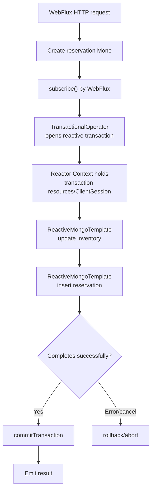

# ReactiveMongoTransactionManager and Reactor Context

## 1. Problem Statement: Two MongoDB Operations, One Transaction

Suppose a Spring WebFlux system receives a command to reserve two books. The business logic must:

1. Conditionally decrement inventory: only reserve stock when `available >= quantity`.
2. Create a `reservation` document with a stable request ID.
3. Return the result once **both operations have committed**.

If operation (1) succeeds but (2) fails, inventory must not remain permanently decremented. A **MongoDB multi-document transaction** is required so that both the `inventory` and `reservations` collections commit or roll back together.

In imperative Spring Data MongoDB, `MongoTransactionManager` binds `ClientSession` to a **thread**. However, in Reactive Streams, a `Mono`/`Flux` pipeline can switch threads, only executes upon subscription, and is composed of multiple publishers. Therefore, Spring provides **`ReactiveMongoTransactionManager`**, which binds transaction resources to the **subscriber's Reactor `Context`**.



**Lesson goal:** understand how to configure the transaction manager, distinguish Reactor Context from thread-local storage, keep all MongoDB operations within a single subscription/context, execute sequentially, handle rollback/retry, and test against a real MongoDB instance.

### 1.1. Session vs. Transaction

A MongoDB `ClientSession` is a context that associates operations with a client session; it can be used for **causal consistency** without opening a transaction. A **transaction** only exists when the session starts a transaction and commits or aborts it.

| Component | Role | What It Should Not Be Mistaken For |
| --- | --- | --- |
| `ClientSession` | Associates MongoDB commands with a session | A distributed lock or automatic transaction |
| MongoDB transaction | A group of operations committed/aborted on the server | Atomicity guarantee for HTTP providers/Kafka/email |
| `ReactiveMongoTransactionManager` | Opens/manages transactions, sessions, and resources for Spring reactive | A mechanism storing sessions in every Java thread |
| Reactor `Context` | Propagates metadata/resources per **subscriber** | `ThreadLocal`, global variables, or business payload |
| `TransactionalOperator` | Creates a transaction scope for a publisher | A MongoDB command or a "commit" when calling `as(...)` |
| `ReactiveMongoTemplate` | Executes MongoDB operations and acquires the bound session | Transaction guarantee without a manager/context |

### 1.2. Transactions Do Not Replace Idempotency Design

Two requests reserving stock may open **two different transactions**. If both are retries of the same request, you still need a `requestId`/unique index or a business identity mechanism to avoid deducting stock twice. A transaction makes each **execution** atomic, but it does not automatically deduplicate separate calls sharing the same intent.

## 2. The Reactor Context Model: Bound to the Subscriber, Not the Thread

Reactor `Context` is data attached to a **subscription** and propagated according to Reactor rules. With Spring reactive transactions, `ReactiveMongoTransactionManager` places transaction resource information into the context; `ReactiveMongoTemplate` looks up the session through Spring's integration mechanism and sends MongoDB commands over that session.

Conceptually:

```text
                 one subscription / subscriber
                           |
                 Reactor Context (immutable)
                           |
           Spring reactive transaction resources
                           |
               MongoDB ClientSession
                 /                  \\
         update inventory        insert reservation
                 \\                  /
                 commit or abort
```

`Context` is **immutable in usage**: `contextWrite(...)` creates a new context for the corresponding upstream publisher rather than mutating a global map shared across requests. Context data from subscriber A is not automatically shared with subscriber B. Distinguish carefully:

- **Payload:** `Mono<Reservation>`, `Flux<Document>` are data flowing through `onNext`.
- **Context:** transaction, security, tracing, or metadata for operators/callbacks.
- **Thread:** where a piece of code actually runs; can change via `publishOn`, `subscribeOn`, or other schedulers.

### 2.1. Why Is `ThreadLocal` Unsuitable?

Two publishers in the same subscription may execute on different threads. If a transaction relied solely on `ThreadLocal`, switching threads would risk losing the session reference. Reactor Context keeps resources bound to the **subscriber stream**, independent of any fixed thread.

```java
// Illustrative example of switching schedulers (not a recommendation
// to switch threads for every MongoDB transaction).
return template.findById(id, OrderDocument.class)
    .publishOn(reactor.core.scheduler.Schedulers.parallel())
    .flatMap(order -> template.save(order))
    .as(transactionalOperator::transactional);
```

Properly switching schedulers within the **same pipeline** does not by itself lose Reactor Context. However, a manual `subscribe()` call inside a callback creates a **new subscription**, and therefore cannot be assumed to share the active transaction. Similarly, calling a blocking API outside the context cannot be rescued merely by `publishOn`.

### 2.2. Context Is Read from the Subscriber Direction

Reactor Context is accessed via operators such as `Mono.deferContextual(...)`. Standalone example to understand propagation:

```java
import reactor.core.publisher.Mono;
import reactor.util.context.Context;

Mono<String> pipeline = Mono.deferContextual(context ->
    Mono.just(context.getOrDefault("traceId", "unknown")));

Mono<String> traced = pipeline
    .contextWrite(Context.of("traceId", "TRACE-101"));

// When subscribed: emits "TRACE-101".
```

This is an **illustrative traceId**, not a way to manually attach a Mongo transaction to the context. Do not put a `ClientSession` into `Context.of("mongoSession", ...)` expecting `ReactiveMongoTemplate` to recognize it; the Spring transaction manager has its own resource storage and lookup mechanism.

### 2.3. Multiple Subscribers Do Not Mean the Same Transaction

```java
Mono<ReservationResult> operation =
    reservationService.reserve("SHOP-A", "K1", "BOOK-101", 2);

// Two subscriptions can trigger two business executions:
operation.subscribe();
operation.subscribe();
```

If a service returns a **cold publisher**, each subscription can trigger a separate transaction. Even with the same `Mono` instance, never assume write operations run only once. Design idempotency using `requestId`/unique keys and avoid calling `subscribe()` manually inside services or controllers.

## 3. Prerequisites for MongoDB Reactive Transactions

### 3.1. Server and Topology

MongoDB multi-document transactions are supported on a suitable **replica set** (MongoDB 4.0+) and on a **sharded cluster** depending on version/topology requirements (MongoDB 4.2+). A regular standalone `mongod` is not an appropriate environment for testing multi-document transactions.

Example URI for a **pre-configured local replica set**:

```properties
spring.data.mongodb.uri=mongodb://localhost:27017/reactive_tx_demo?replicaSet=rs0
```

`rs0` must match the actual replica set name, and `mongod` must be configured/started as a replica set. **Merely appending the URI parameter does not turn a standalone server into a replica set.** Do not copy this URI into production.

### 3.2. Conceptual Dependencies

A Spring Boot WebFlux application uses:

```xml
<dependencies>
    <dependency>
        <groupId>org.springframework.boot</groupId>
        <artifactId>spring-boot-starter-webflux</artifactId>
    </dependency>
    <dependency>
        <groupId>org.springframework.boot</groupId>
        <artifactId>spring-boot-starter-data-mongodb-reactive</artifactId>
    </dependency>
    <dependency>
        <groupId>org.springframework.boot</groupId>
        <artifactId>spring-boot-starter-test</artifactId>
        <scope>test</scope>
    </dependency>
    <dependency>
        <groupId>io.projectreactor</groupId>
        <artifactId>reactor-test</artifactId>
        <scope>test</scope>
    </dependency>
</dependencies>
```

When using the Spring Boot BOM, versions are typically omitted for managed starters. With Gradle, use the equivalent dependencies. Do not assume Spring Boot will automatically create the exact `ReactiveMongoTransactionManager` in every configuration; explicitly configure and verify the actual bean.

### 3.3. Prepare Collections and Indexes **Before** Transactions

For MongoDB and Spring Data, creating collections or indexes directly inside a transaction has restrictions depending on version, read concern, and topology. Therefore, in this lesson:

- Migrations create `inventory`, `reservations`, and the required unique index beforehand.
- Business transactions only perform **update/insert/read/count** on existing collections.
- Avoid calling `listIndexes`/`createCollection` inside a transactional pipeline.

Run once on an isolated demo database:

```javascript
use reactive_tx_demo
db.createCollection("inventory")
db.createCollection("reservations")

db.reservations.createIndex(
  { tenant_id: 1, request_id: 1 },
  { unique: true, name: "reservations_tenant_request_unique" }
)

db.inventory.insertOne({
  _id: "SHOP-A:BOOK-101",
  tenant_id: "SHOP-A",
  sku: "BOOK-101",
  available: NumberLong("10"),
  reserved: NumberLong("0")
})
```

This is only a demo setup: `insertOne` with the same `_id` will fail if run repeatedly; real environments must use idempotent migrations/seeds and proper data controls. The unique index is created before handling requests so the database prevents two reservations with the same `tenant_id`/`request_id`.

## 4. Configuring `ReactiveMongoTransactionManager`

Spring Data MongoDB provides `ReactiveMongoTransactionManager` — an implementation of `ReactiveTransactionManager` — to begin, commit, and abort MongoDB transactions using a `ReactiveMongoDatabaseFactory`.

```java
package com.example.reactivetx;

import org.springframework.context.annotation.Bean;
import org.springframework.context.annotation.Configuration;
import org.springframework.data.mongodb.ReactiveMongoDatabaseFactory;
import org.springframework.data.mongodb.ReactiveMongoTransactionManager;
import org.springframework.transaction.reactive.TransactionalOperator;

@Configuration
public class ReactiveTxConfiguration {

    @Bean
    ReactiveMongoTransactionManager reactiveMongoTransactionManager(
            ReactiveMongoDatabaseFactory factory) {
        return new ReactiveMongoTransactionManager(factory);
    }

    @Bean
    TransactionalOperator mongoTransactionalOperator(
            ReactiveMongoTransactionManager manager) {
        return TransactionalOperator.create(manager);
    }
}
```

Explanation:

1. `ReactiveMongoDatabaseFactory` is provided by Spring Data/Boot matching the reactive MongoDB connection.
2. `ReactiveMongoTransactionManager` obtains a `ClientSession` from the factory when the transaction starts and manages commit/abort.
3. The session/transaction resource is bound to the **subscriber's `Context`**.
4. `ReactiveMongoTemplate` uses Spring Data's mechanism to retrieve the active database/session.
5. `TransactionalOperator` wraps a `Mono`/`Flux` within a transaction scope.

**Important prerequisite:** `ReactiveMongoTemplate` and the manager must operate against the **same appropriate factory/connection environment**. If an operation uses a different `ReactiveMongoTemplate` pointing to another cluster/database or a native client outside the context, that operation will not automatically join the transaction.

### 4.1. Do Not Mix Imperative and Reactive Managers

| Imperative | Reactive |
| --- | --- |
| `MongoTransactionManager` | `ReactiveMongoTransactionManager` |
| `MongoDatabaseFactory` | `ReactiveMongoDatabaseFactory` |
| `MongoTemplate` | `ReactiveMongoTemplate` |
| Thread-bound transaction resources | Subscriber `Reactor Context` |
| `TransactionTemplate` | `TransactionalOperator` |
| Method returns object directly | Method returns `Mono<T>`/`Flux<T>` |

A method returning `Mono<T>` in a reactive application must not use `MongoTransactionManager` as if it were the pipeline's transaction manager. Spring reactive transactions require a `ReactiveTransactionManager` and an actually subscribed pipeline.

### 4.2. Does `@Transactional(readOnly = true)` Open a Transaction?

There is a common misconception here: with `ReactiveMongoTransactionManager`, `@Transactional(readOnly = true)` can still **start a transaction and bind a `ClientSession`** for reactive operations. It does not mean "just use a lightweight read preference with no transaction."

Use `readOnly` for its intended semantics; it is not an off switch for transaction overhead. When only a single read query is needed, a multi-document transaction is usually unnecessary.

## 5. Entities and Data for the Inventory Reservation Transaction

To keep the focus on transactions and context, each reservation covers a single SKU. Multi-SKU orders require additional design around operation ordering, out-of-stock handling, and retries.

### 5.1. `InventoryDocument`

```java
package com.example.reactivetx;

import org.springframework.data.mongodb.core.mapping.Document;
import org.springframework.data.mongodb.core.mapping.Field;
import org.springframework.data.mongodb.core.mapping.FieldType;
import org.springframework.data.mongodb.core.mapping.MongoId;

@Document(collection = "inventory")
public class InventoryDocument {

    @MongoId(FieldType.STRING)
    private String id;

    @Field("tenant_id")
    private String tenantId;

    private String sku;
    private long available;
    private long reserved;

    protected InventoryDocument() {}

    public String getId() { return id; }
    public String getTenantId() { return tenantId; }
    public String getSku() { return sku; }
    public long getAvailable() { return available; }
    public long getReserved() { return reserved; }
}
```

### 5.2. `ReservationDocument`

```java
package com.example.reactivetx;

import java.time.Instant;
import org.springframework.data.mongodb.core.mapping.Document;
import org.springframework.data.mongodb.core.mapping.Field;
import org.springframework.data.mongodb.core.mapping.FieldType;
import org.springframework.data.mongodb.core.mapping.MongoId;

@Document(collection = "reservations")
public class ReservationDocument {

    @MongoId(FieldType.STRING)
    private String id;

    @Field("tenant_id")
    private String tenantId;

    @Field("request_id")
    private String requestId;

    private String sku;
    private long quantity;
    private String status;

    @Field("created_at")
    private Instant createdAt;

    protected ReservationDocument() {}

    public ReservationDocument(
            String id, String tenantId, String requestId,
            String sku, long quantity, String status,
            Instant createdAt) {
        this.id = id;
        this.tenantId = tenantId;
        this.requestId = requestId;
        this.sku = sku;
        this.quantity = quantity;
        this.status = status;
        this.createdAt = createdAt;
    }

    public String getId() { return id; }
    public String getTenantId() { return tenantId; }
    public String getRequestId() { return requestId; }
    public String getSku() { return sku; }
    public long getQuantity() { return quantity; }
    public String getStatus() { return status; }
    public Instant getCreatedAt() { return createdAt; }
}
```

`@MongoId(FieldType.STRING)` stores `_id` as a BSON String. Properties `tenantId`/`requestId` map to `tenant_id`/`request_id`; when using `Criteria`, write the **Java property names** and let Spring map them. For native BSON commands, use the **physical field names**.

### 5.3. Result and Exception

```java
package com.example.reactivetx;

public record ReservationResult(
    String reservationId,
    String tenantId,
    String requestId,
    String sku,
    long quantity
) {}
```

```java
package com.example.reactivetx;

public class InsufficientStockException extends RuntimeException {
    public InsufficientStockException(String message) {
        super(message);
    }
}
```

To keep the example concise, `inventory._id` is constructed as `tenantId + ":" + sku`. Production systems must normalize identifiers, avoid delimiter collisions, enforce tenant authorization, and reject zero or negative quantities. The following examples require `authorizedTenantId` supplied by the authentication layer, **not** an untrusted client-supplied field.

## 6. Service Using `TransactionalOperator`: Update Then Insert

This is the **programmatic reactive transaction** approach. `TransactionalOperator` manages the transaction for the upstream publisher wrapped by `transactional(...)` or `.as(tx::transactional)`.

### 6.1. Complete Service

```java
package com.example.reactivetx;

import java.time.Clock;
import java.util.UUID;
import org.springframework.data.mongodb.core.ReactiveMongoTemplate;
import org.springframework.data.mongodb.core.query.Criteria;
import org.springframework.data.mongodb.core.query.Query;
import org.springframework.data.mongodb.core.query.Update;
import org.springframework.stereotype.Service;
import org.springframework.transaction.reactive.TransactionalOperator;
import reactor.core.publisher.Mono;

@Service
public class ReactiveReservationService {

    private final ReactiveMongoTemplate template;
    private final TransactionalOperator tx;
    private final Clock clock;

    public ReactiveReservationService(
            ReactiveMongoTemplate template,
            TransactionalOperator tx,
            Clock clock) {
        this.template = template;
        this.tx = tx;
        this.clock = clock;
    }

    public Mono<ReservationResult> reserve(
            String authorizedTenantId,
            String requestId,
            String sku,
            long quantity) {

        if (authorizedTenantId == null
                || authorizedTenantId.isBlank()
                || requestId == null
                || requestId.isBlank()
                || requestId.length() > 128
                || sku == null
                || sku.isBlank()
                || sku.contains(":")
                || quantity <= 0) {
            return Mono.error(new IllegalArgumentException(
                "Invalid reservation request"));
        }

        return Mono.defer(() -> {
            String inventoryId = authorizedTenantId + ":" + sku;

            Query enoughStock = Query.query(
                Criteria.where("id").is(inventoryId)
                    .and("tenantId").is(authorizedTenantId)
                    .and("available").gte(quantity)
            );

            Update takeStock = new Update()
                .inc("available", -quantity)
                .inc("reserved", quantity);

            ReservationDocument candidate =
                new ReservationDocument(
                    UUID.randomUUID().toString(),
                    authorizedTenantId,
                    requestId,
                    sku,
                    quantity,
                    "PENDING",
                    clock.instant()
                );

            return template.updateFirst(
                    enoughStock, takeStock, InventoryDocument.class)
                .flatMap(result -> {
                    if (result.getModifiedCount() != 1) {
                        return Mono.error(
                            new InsufficientStockException(
                                "Insufficient stock or SKU does not exist"));
                    }

                    // Only insert after the inventory update succeeds.
                    return template.insert(candidate);
                })
                .map(saved -> new ReservationResult(
                    saved.getId(),
                    saved.getTenantId(),
                    saved.getRequestId(),
                    saved.getSku(),
                    saved.getQuantity()
                ));
        }).as(tx::transactional);
    }
}
```

Inside `Mono.defer(...)`, creating the candidate/ID is **deferred until subscription**. `updateFirst` and `insert` are chained sequentially via `flatMap` by dependency, **not executed in parallel**. If stock is insufficient or inserting the reservation triggers a unique index error, the publisher emits `onError` and the transaction rolls back. Only when both operations succeed and commit succeeds does the subscriber receive the result under the transaction manager contract.

### 6.2. Event Order

```text
subscribe(reserve)
  -> tx.begin(ClientSession in Reactor Context)
  -> update inventory (conditional)
  -> if updated=0: onError -> tx.abort
  -> if updated=1: insert reservation
  -> if insert errors: onError -> tx.abort
  -> if insert OK: complete business publisher
  -> tx.commit
  -> downstream receives ReservationResult
```

This illustrates the logical flow and does not reflect all internal driver signals or timeouts. If `commitTransaction` returns an error or an uncertain outcome, the transaction manager propagates an error or requires an explicit commit/reconciliation handling strategy.

### 6.3. Why `.as(tx::transactional)` Must Wrap Both Writes

Example of **incorrect scope**:

```java
return template.updateFirst(
        enoughStock, takeStock, InventoryDocument.class)
    .as(tx::transactional)
    .flatMap(result -> template.insert(reservation));
```

Here `tx` only wraps the upstream `updateFirst`; `insert` sits **after** the transactional operator and can run outside the transaction. If the insert fails, the update has already committed, leaving inventory incorrectly decremented.

Place `.as(tx::transactional)` **after assembling the entire business publisher**:

```java
Mono<ReservationDocument> business =
    template.updateFirst(
            enoughStock, takeStock, InventoryDocument.class)
        .flatMap(changed -> {
            if (changed.getModifiedCount() != 1) {
                return Mono.error(
                    new InsufficientStockException("Out of stock"));
            }
            return template.insert(reservation);
        });

return business.as(tx::transactional);
```

Likewise, if a `Mono` has **downstream** side effects after `as(...)`, those side effects are not part of the wrapped transaction. Always determine transaction boundaries on the publisher graph, not merely by looking at the Java method name.

### 6.4. `Mono.defer` Does Not Make Writes "Exactly Once"

If the same publisher is subscribed to twice, `defer` executes twice. A new transaction is opened for each subscription; generated IDs may differ per attempt. The **unique index on `(tenant_id, request_id)`** prevents two reservations for the same request, but the code must handle duplicate/replay errors at the business layer.

In this example, a duplicate reservation happens **after** the inventory update, yet because both writes are inside the same transaction, the duplicate error rolls back the losing transaction's inventory update. A facade outside the transaction can read the committed reservation to verify the payload; do not catch the duplicate error and keep sending commands inside a failed transaction.

### 6.5. Clock and Request Consistency

The example uses `Clock` to generate the reservation timestamp; the application should provide a `Clock.systemUTC()` bean or equivalent. Capturing the timestamp at subscription time reflects execution time rather than publisher assembly time. However, a timestamp is not an idempotency identifier: two requests with the same intent still need a **stable key and payload comparison**.

## 7. Using `@Transactional` on Methods Returning `Mono`

The **declarative** approach lets Spring AOP wrap the publisher returned by an annotated method:

```java
package com.example.reactivetx;

import org.springframework.data.mongodb.core.ReactiveMongoTemplate;
import org.springframework.data.mongodb.core.query.Criteria;
import org.springframework.data.mongodb.core.query.Query;
import org.springframework.data.mongodb.core.query.Update;
import org.springframework.stereotype.Service;
import org.springframework.transaction.annotation.Transactional;
import reactor.core.publisher.Mono;

@Service
public class ReactiveStockStatusService {

    private final ReactiveMongoTemplate template;

    public ReactiveStockStatusService(
            ReactiveMongoTemplate template) {
        this.template = template;
    }

    @Transactional(transactionManager =
        "reactiveMongoTransactionManager")
    public Mono<Long> reserveUnits(
            String inventoryId, long quantity) {

        if (inventoryId == null || inventoryId.isBlank()
                || quantity <= 0) {
            return Mono.error(
                new IllegalArgumentException("Invalid parameters"));
        }

        Query eligible = Query.query(
            Criteria.where("id").is(inventoryId)
                .and("available").gte(quantity)
        );

        Update change = new Update()
            .inc("available", -quantity)
            .inc("reserved", quantity);

        return template.updateFirst(
                eligible, change, InventoryDocument.class)
            .flatMap(result -> {
                if (result.getModifiedCount() != 1) {
                    return Mono.error(
                        new InsufficientStockException(
                            "Insufficient quantity available"));
                }
                return Mono.just(result.getModifiedCount());
            });
    }
}
```

This example modifies only **one document** to illustrate the annotation; single-document updates are already atomic in MongoDB, so a multi-document transaction is not strictly necessary in a real design. `@Transactional` is far more useful when combining multiple related writes.

### 7.1. When Does the Annotation Take Effect?

- The bean must be managed by Spring, with transaction AOP/proxying properly enabled.
- The method must be invoked **through the Spring proxy**, not via self-invocation (`this.reserveUnits(...)`) within the same class.
- The method must return a reactive publisher that the transaction interceptor can manage; **do not** call `subscribe()` inside the service.
- The correct `ReactiveMongoTransactionManager` must be selected (especially when the application has multiple transaction managers).
- MongoDB operations inside the publisher must use a `ReactiveMongoTemplate`/resource bound to the proper transaction context.

If a service has both R2DBC and Mongo transaction managers, do not leave `@Transactional` ambiguous. Explicitly specify `transactionManager = "reactiveMongoTransactionManager"` or inject a qualified operator.

### 7.2. `@Transactional` vs. `TransactionalOperator`

| Criterion | `@Transactional` | `TransactionalOperator` |
| --- | --- | --- |
| Boundary declaration | On Spring-proxied method/class | On `Mono`/`Flux` pipeline |
| Service-layer readability | High if all effects live in the same method | High when boundaries are placed explicitly in the chain |
| Self-invocation | Risk of bypassing the proxy | Not subject to proxy bypass in the same way |
| Sub-boundary within a pipeline | Less intuitive with multiple branches/hot publishers | Can wrap the exact publisher needing a transaction |
| Manager selection | Annotation attribute/qualifier | Operator constructed with the desired manager |
| Ease of testing chain in isolation | Requires AOP bean configuration | Can inject operator/test publisher directly |

**There is no need to use both at once** on the same segment without a clear reason; wrapping an already `@Transactional` publisher with another operator can create hard-to-follow propagation behavior or unexpected manager selection.

### 7.3. `void` Methods and Self-Subscription Do Not Share the Same Contract

```java
// AVOID: subscribe detaches from the reactive boundary.
@Transactional
public void unsafe() {
    template.insert(someDocument).subscribe();
}
```

Calling `subscribe()` launches an independent subscription; the method may return before the write finishes, and the transaction interceptor cannot properly manage a publisher that is never returned. Return `Mono<Void>`/`Mono<T>` and let **WebFlux or the caller** subscribe once at the application edge.

## 8. Reactor Context Across Operators and Subscription Boundaries

`Reactor Context` propagates by **subscriber** through standard operators. Within the same pipeline, changing schedulers via `publishOn`/`subscribeOn` **does not automatically erase** the transaction context; however, creating a new subscription or calling an API not integrated with the session can cause writes to run **outside the transaction**.

### 8.1. Dependent `flatMap` vs. Independent `subscribe()`

Wrong approach:

```java
return template.insert(reservation)
    .doOnNext(saved -> {
        // WRONG: fire-and-forget, independent subscription.
        template.insert(auditRecord).subscribe();
    })
    .as(tx::transactional);
```

Calling `subscribe()` inside the callback creates a separate subscriber. The audit write is not guaranteed to share the transaction session, and if it fails it will not signal an error to the outer pipeline. The right way is to **compose the publishers**:

```java
return template.insert(reservation)
    .flatMap(saved ->
        template.insert(auditRecord)
            .thenReturn(saved))
    .as(tx::transactional);
```

If an audit record must be written alongside the reservation, both must use pre-existing collections, the same reactive template/factory, and be wrapped in the same transaction. If publishing an event to a message broker, instead of assuming the transaction rolls back Kafka/email, you generally need an **outbox** or separate reconciliation process.

### 8.2. Thread Switching Does Not Mean Losing Context

```java
return template.findById(id, InventoryDocument.class)
    .publishOn(reactor.core.scheduler.Schedulers.parallel())
    .flatMap(item ->
        template.findById(item.getId(), InventoryDocument.class))
    .as(tx::transactional);
```

As long as it remains the **same subscription** and uses proper Reactor operators, context propagates even when threads change. However, the MongoDB reactive driver is already non-blocking; there is no need to move every query onto `Schedulers.boundedElastic()`. If a library uses callbacks/Futures outside the reactive chain, work inside that callback **does not automatically inherit** the transaction context.

`Mono.fromFuture(...)` can bring a Future's value back into the stream, but the work creating that Future may have already started **before** subscription and may use a native MongoDB client outside the session. Do not rely on `fromFuture` as proof that the Future's writes belong to the transaction.

### 8.3. `contextWrite` Is Not a Way to Manually Attach a MongoDB Session

```java
Mono<String> example = Mono.deferContextual(ctx ->
        Mono.just(ctx.getOrDefault("traceId", "UNKNOWN")))
    .contextWrite(context ->
        context.put("traceId", "TRACE-001"));
```

This is how Reactor Context passes a trace ID. **Do not** manually place `ClientSession` into `Context.of("session", session)` expecting Spring Data to pick it up. `ReactiveMongoTransactionManager` uses its own resource/context integration so the template resolves the right session.

### 8.4. `cache`/`share` Changes Execution Count

`Mono.cache()` can retain a single result for subsequent subscribers. `share()`/hot sources can also alter how multiple subscribers share an execution. Do not rely on these operators for write API idempotency:

```java
Mono<ReservationResult> cached =
    reservationService.reserve("SHOP-A", "K1", "BOOK-101", 2)
        .cache();
```

A cache only lives in-process and within the scope of the shared publisher; it does not protect across restarts or multiple instances. For business retries, a **unique key/request identity** in MongoDB remains the real safeguard.

## 9. Do Not Run MongoDB Commands in Parallel Within the Same Transaction

The MongoDB driver requires operations belonging to **one transaction/session** to execute sequentially. Never write:

```java
Mono<Void> unsafe = Mono.when(
    template.insert(reservation),
    template.insert(auditRecord)
).as(tx::transactional);
```

`Mono.when` can subscribe to both sources concurrently; this violates transactional session constraints. Likewise, `Mono.zip` or `Flux.flatMap` with concurrency can issue overlapping MongoDB commands.

### 9.1. Use `then` and Dependent `flatMap`

```java
Mono<ReservationDocument> safe = template.insert(reservation)
    .flatMap(saved ->
        template.insert(auditRecord).thenReturn(saved))
    .as(tx::transactional);
```

The second insert only runs after the first completes. `flatMap` on a **single `Mono`** with a dependency as shown is appropriate; do not assume every `Flux.flatMap` is sequential.

### 9.2. For Multiple `Flux` Elements, Use `concatMap`

```java
Flux<ReservationDocument> sequentialWrites =
    Flux.fromIterable(reservations)
        .concatMap(template::insert)
        .as(tx::transactional);
```

`concatMap` issues commands in order, waiting for one operation to complete before starting the next. Do not add `parallel()`/`runOn(...)` for **MongoDB writes in the same transaction**. **Independent** transactions using separate sessions can still run concurrently across requests when business rules allow.

### 9.3. Do Not Stream Long-Running Work Inside a Transaction

If you stream a `Flux` of tens of thousands of inserts directly to a client, the client may read slowly or cancel mid-stream, keeping the transaction open for a long time and obscuring commit boundaries at item emission time. For a write API, reduce the transaction to a `Mono<Summary>` so the client receives only the **final result** after commit, rather than treating streamed responses as confirmation of intermediate writes.

## 10. ClientSession, Native Driver, and Transaction Resources

`ReactiveMongoTemplate` acquires the session from the Spring transaction context when running inside `TransactionalOperator`/`@Transactional`, provided it uses the matching factory and data source. However, **native MongoDB driver gateways** obtained from the template are not session-proxied by default.

### 10.1. Template API in a Managed Transaction

```java
Mono<ReservationDocument> create =
    reactiveMongoTemplate.insert(reservation);

Mono<InventoryDocument> read =
    reactiveMongoTemplate.findById(
        inventoryId, InventoryDocument.class);
```

Operations subscribed inside a transactional publisher can acquire the `ClientSession` from the resource that `ReactiveMongoTransactionManager` bound to the subscriber context. They **do not create a transaction on their own** if no manager/boundary is present.

### 10.2. `getCollection` Is Not Automatically Session-Proxied

```java
// Risk of running outside the transaction: native overload without session.
return reactiveMongoTemplate.getCollection("reservations")
    .flatMap(collection ->
        Mono.from(collection.insertOne(nativeDocument)));
```

Spring Data documentation notes that `(Reactive)MongoOperations#getCollection(...)` and `getMongoDatabase(...)` return native driver gateways. To use the native API inside a transaction, you must pass the **exact `ClientSession`** to the driver overload that accepts a session. For standard use cases, prefer `ReactiveMongoTemplate` methods or session-integrated template callbacks.

An important integration test check: intentionally cause the transaction to error **after a native write**, then read the database outside the transaction. If the document persists, the native call bypassed the transaction boundary.

### 10.3. Manual Sessions with `withSession` vs. Managed Transactions

`ReactiveMongoTemplate.withSession(...)` supports callbacks running with a caller-supplied session. When managing sessions manually, the code must acquire the session at subscription time, start/commit/abort, and close the session on **complete, error, and cancel**. This is far more stateful than `TransactionalOperator`.

Do not open a new session/transaction **inside** a Spring-managed transaction without an explicit design. A session can only have one open transaction at a time.

### 10.4. Repositories, Templates, and Sessions Are Not All Identical

Spring Data documentation distinguishes **manual session callbacks** from repository integration. Do not assume a native collection method or a custom repository automatically uses the session merely because it was called from a `@Transactional` method. For transactions requiring strict proof, use `ReactiveMongoTemplate` and a real-server rollback integration test; if using repositories, verify the specific version and execution path.

## 11. Completion, Error, Cancellation, and Error Handler Placement

### 11.1. `Mono.empty()` Is Success Without a Value

A `Mono.empty()` terminates with `onComplete`, not `onError`. Spring may **commit** the transaction even with no emitted item. Dangerous example:

```java
return template.updateFirst(
        query, change, InventoryDocument.class)
    .flatMap(result -> {
        if (result.getModifiedCount() == 0) {
            return Mono.empty(); // emits no business error
        }
        return template.insert(reservation);
    })
    .as(tx::transactional);
```

If a MongoDB write already occurred before this branch, `Mono.empty()` could cause that write to commit even though the business operation failed. When rollback is needed, return `Mono.error(...)` or use the appropriate rollbackOnly API:

```java
if (result.getModifiedCount() == 0) {
    return Mono.error(
        new InsufficientStockException("Insufficient stock"));
}
```

### 11.2. Misplaced `onErrorResume` Can Cause Unintended Commits

Incorrect when **swallowing the error before the transaction manager sees it**:

```java
return businessWrites
    .onErrorResume(ex -> Mono.just(fallbackSuccess))
    .as(tx::transactional);
```

If a write succeeded before the error, the transaction manager may observe the publisher completing normally and commit. Let the error cross the boundary first, then map it to a business response:

```java
return businessWrites
    .as(tx::transactional)
    .onErrorResume(
        InsufficientStockException.class,
        ex -> Mono.just(failureResponse));
```

Here `failureResponse` is an application-defined DTO. `doOnError(...)` only observes/logs without turning an error into a success signal; it is suitable for controlled metrics recording.

### 11.3. Cancellation Is Not Commit

Client disconnects, `take(1)` on a multi-write `Flux`, or `timeout` can cancel the subscription before all writes complete. Spring reactive transactions normally abort/rollback on cancellation (exact details depend on version and timing). **Receiving one item** is not proof that the entire transaction committed.

For write APIs, construct a `Mono<Summary>` that emits a response **only after the entire business publisher and commit finish**, rather than returning individual intermediate insert results while the transaction is open.

### 11.4. Timeout and Unknown Commit Result

```java
return reservationService.reserve(
        tenantId, requestId, sku, quantity)
    .timeout(java.time.Duration.ofSeconds(5));
```

A subscriber timeout does not prove the database rolled back: if the `commitTransaction` ACK was lost after MongoDB committed, the outcome is **uncertain**. Keep the same `requestId`, reconcile via the unique index, and handle commit/transient retries per driver/framework semantics. Never retry an `$inc` command with a new key just because a timeout occurred.

## 12. Transaction Options, Read Concern, and Read-Only

`ReactiveMongoTransactionManager` can accept MongoDB `TransactionOptions` at creation time. Example selecting `SNAPSHOT` read concern and `MAJORITY` write concern:

```java
package com.example.reactivetx;

import com.mongodb.ReadConcern;
import com.mongodb.WriteConcern;
import com.mongodb.TransactionOptions;
import org.springframework.context.annotation.Bean;
import org.springframework.context.annotation.Configuration;
import org.springframework.data.mongodb.ReactiveMongoDatabaseFactory;
import org.springframework.data.mongodb.ReactiveMongoTransactionManager;

@Configuration
public class StrongMongoTxConfig {

    @Bean("strongMongoTxManager")
    ReactiveMongoTransactionManager strongMongoTxManager(
            ReactiveMongoDatabaseFactory factory) {

        TransactionOptions options = TransactionOptions.builder()
            .readConcern(ReadConcern.SNAPSHOT)
            .writeConcern(WriteConcern.MAJORITY)
            .build();

        return new ReactiveMongoTransactionManager(factory, options);
    }
}
```

This is an **alternative configuration** to the manager in section 4, not a requirement to declare two unqualified managers. With multiple managers, select the right one by bean name when creating `TransactionalOperator` or in `@Transactional(transactionManager = "strongMongoTxManager")`.

| Option | Meaning | Limitations |
| --- | --- | --- |
| `ReadConcern.LOCAL` | Local read under server transaction semantics | Does not guarantee a synchronized cross-shard snapshot in all configurations |
| `ReadConcern.SNAPSHOT` | Snapshot read suitable for transactions | History overhead, DDL operation restrictions |
| `WriteConcern.MAJORITY` | Commit acknowledged by a majority | Does not cover side effects outside MongoDB |
| `@Transactional(readOnly = true)` | Marks transaction as read-only | Reactive Mongo manager may still open a transaction/session |
| Max commit time | Limits commit wait duration | Timeout does not prove a guaranteed abort |

Some Spring Data versions support `@Transactional(label = {"mongo:readConcern=SNAPSHOT", "mongo:writeConcern=MAJORITY"})`. Check the exact Spring Framework/Spring Data release; options only apply when a **new** transaction is started and do not alter an already-started outer transaction.

Do not create collections/indexes inside business transactions; DDL is conditionally permitted depending on MongoDB server version, read concern, and topology, but Spring Data recommends creating **schemas/indexes via migrations before serving requests**. Long-running transactions also increase memory/history/lock contention, so avoid calling HTTP providers or waiting on users while holding a transaction open.

## 13. Retrying Transient Errors and Idempotency

### 13.1. Error Classification

| Situation | Handling |
| --- | --- |
| `DuplicateKeyException` on `tenant_id,request_id` | Losing transaction rolls back; read committed marker, compare payload to replay or conflict |
| `TransientTransactionError` or write conflict | Safely retry the **entire transaction** with limits/backoff |
| `UnknownTransactionCommitResult` | Do not assume rollback; retry commit per driver or reconcile by request key |
| Validation failure | Do not retry invalid input as-is |
| Forbidden DDL/`listIndexes`/`count` command | Fix architecture/commands; do not retry indefinitely |
| Client timeout/cancel | Commit state may be uncertain; inspect marker/ledger |

### 13.2. Why `retryWhen` Does Not Automatically Provide Exactly-Once

```java
// Sketch ONLY: requires error filtering and deduplication before retrying.
return reservationService.reserve(
        tenantId, requestId, sku, quantity)
    .retryWhen(
        reactor.util.retry.Retry.backoff(
            3, java.time.Duration.ofMillis(100)));
```

Without a filter, `retryWhen` in this snippet retries **all errors**, including out-of-stock and duplicate-key errors. This is **not production code**. If a previous commit succeeded but the client missed the ACK, a retry may hit a duplicate and should return the existing reservation instead of deducting stock again. Use `Retry.filter(...)` strictly for **precisely identified** transient errors, keep the same request ID, and handle unknown outcomes explicitly.

Do not catch every `DataAccessException` and blindly rerun the whole flow. MongoDB Driver retryable writes **differ** from HTTP/queue-level business retries; the driver can deduplicate certain retries of eligible commands, but it cannot recognize a brand-new HTTP request arriving minutes later.

### 13.3. Transactions Are Not Atomic With External Systems

If a transaction creates a reservation and then calls a payment gateway/Kafka/email, a MongoDB rollback cannot undo external side effects. The **transactional outbox** pattern stores the reservation and event to publish in the same MongoDB transaction; an out-of-band publisher dispatches outside the transaction, and consumers use unique event IDs to prevent duplicate processing. For payment providers, use provider-side idempotency keys and dedicated reconciliation.

## 14. Integration Testing on a MongoDB Replica Set

Mocking `ReactiveMongoTemplate` verifies which methods were invoked, but **does not prove** MongoDB commits/rolls back multiple documents, binds the session properly, or arbitrates races via unique indexes. Transaction tests require a real transaction-capable MongoDB instance (suitable replica set/sharded cluster), such as Testcontainers configured as a replica set.

### 14.1. Invariants to Prove

| Scenario | What to Verify After the Transaction |
| --- | --- |
| Reserve 2 when available=10 | Inventory has available=8/reserved=2 and exactly one reservation |
| Reserve 20 when available=10 | No reservation created; inventory remains 10/0 |
| Reservation with duplicate request ID | Insert throws duplicate; **earlier inventory update rolls back** |
| Two requests with the same key | Unique index prevents committing two reservations; retries replay/compare payload |
| Client timeout after sending request | Do not assume rollback; look up reservation by tenant/key |
| Native method without passing session | Test must catch if the write persists after rollback |

### 14.2. Spring Boot and StepVerifier Test

The following example uses `@SpringBootTest`, `ReactiveMongoTemplate`, `ReactiveReservationService`, `StepVerifier`, and the entities/methods from this lesson. **Spring Boot tests must be configured to point to an isolated test database running a MongoDB replica set**, along with the transaction manager from section 4. Never use a production URI.

```java
package com.example.reactivetx;

import java.time.Clock;
import java.time.Instant;
import java.time.ZoneOffset;
import org.bson.Document;
import org.junit.jupiter.api.BeforeEach;
import org.junit.jupiter.api.Test;
import org.springframework.beans.factory.annotation.Autowired;
import org.springframework.boot.test.context.SpringBootTest;
import org.springframework.boot.test.context.TestConfiguration;
import org.springframework.context.annotation.Bean;
import org.springframework.data.domain.Sort;
import org.springframework.data.mongodb.core.ReactiveMongoTemplate;
import org.springframework.data.mongodb.core.index.Index;
import org.springframework.data.mongodb.core.query.Query;
import reactor.core.publisher.Mono;
import reactor.test.StepVerifier;

import static org.assertj.core.api.Assertions.assertThat;

@SpringBootTest
class ReactiveReservationTransactionIntegrationTest {

    @Autowired
    ReactiveMongoTemplate template;

    @Autowired
    ReactiveReservationService service;

    @TestConfiguration
    static class ClockForTest {
        @Bean
        Clock clock() {
            return Clock.fixed(
                Instant.parse("2026-11-20T08:00:00Z"),
                ZoneOffset.UTC);
        }
    }

    @BeforeEach
    void seedOnlyIsolatedTestDatabase() {
        // Collection/index DDL always stays OUTSIDE transactions.
        template.collectionExists("inventory")
            .flatMap(exists -> exists
                ? Mono.empty()
                : template.createCollection("inventory").then())
            .block();

        template.collectionExists("reservations")
            .flatMap(exists -> exists
                ? Mono.empty()
                : template.createCollection("reservations").then())
            .block();

        template.indexOps(ReservationDocument.class)
            .ensureIndex(new Index()
                .on("tenantId", Sort.Direction.ASC)
                .on("requestId", Sort.Direction.ASC)
                .unique()
                .named("reservations_tenant_request_unique"))
            .block();

        // DANGER: deletes entire collections; only on an isolated test DB.
        template.remove(new Query(), InventoryDocument.class).block();
        template.remove(new Query(), ReservationDocument.class).block();

        // Raw driver used only for fixture setup OUTSIDE tx.
        template.getCollection("inventory")
            .flatMap(collection -> Mono.from(collection.insertOne(
                new Document("_id", "SHOP-A:BOOK-101")
                    .append("tenant_id", "SHOP-A")
                    .append("sku", "BOOK-101")
                    .append("available", 10L)
                    .append("reserved", 0L)
            )))
            .block();
    }

    @Test
    void successCommitsBothDocuments() {
        StepVerifier.create(
                service.reserve("SHOP-A", "K1", "BOOK-101", 2))
            .assertNext(result -> {
                assertThat(result.tenantId()).isEqualTo("SHOP-A");
                assertThat(result.requestId()).isEqualTo("K1");
                assertThat(result.quantity()).isEqualTo(2);
            })
            .verifyComplete();

        InventoryDocument stock = template.findById(
            "SHOP-A:BOOK-101", InventoryDocument.class).block();

        assertThat(stock).isNotNull();
        assertThat(stock.getAvailable()).isEqualTo(8);
        assertThat(stock.getReserved()).isEqualTo(2);

        Long count = template.count(
            new Query(), ReservationDocument.class).block();
        assertThat(count).isEqualTo(1L);
    }

    @Test
    void insufficientStockRollsBack() {
        StepVerifier.create(
                service.reserve("SHOP-A", "K2", "BOOK-101", 20))
            .expectError(InsufficientStockException.class)
            .verify();

        InventoryDocument stock = template.findById(
            "SHOP-A:BOOK-101", InventoryDocument.class).block();

        assertThat(stock).isNotNull();
        assertThat(stock.getAvailable()).isEqualTo(10);
        assertThat(stock.getReserved()).isZero();
        assertThat(template.count(
            new Query(), ReservationDocument.class).block())
            .isEqualTo(0L);
    }

    @Test
    void duplicateKeyAbortsEarlierInventoryUpdate() {
        // Pre-create reservation with the same key, OUTSIDE tx.
        template.insert(new ReservationDocument(
            "EXISTING", "SHOP-A", "K3", "BOOK-101",
            2, "PENDING", Instant.parse("2026-11-20T07:00:00Z")
        )).block();

        StepVerifier.create(
                service.reserve("SHOP-A", "K3", "BOOK-101", 2))
            .expectError()
            .verify();

        InventoryDocument stock = template.findById(
            "SHOP-A:BOOK-101", InventoryDocument.class).block();

        assertThat(stock).isNotNull();
        assertThat(stock.getAvailable()).isEqualTo(10);
        assertThat(stock.getReserved()).isZero();
        assertThat(template.count(
            new Query(), ReservationDocument.class).block())
            .isEqualTo(1L);
    }
}
```

**Warning:** `template.remove(new Query(), ...)` deletes all documents in the connected collection. Only use this in a completely isolated test database, never in production or shared environments. `block()` in `@BeforeEach` and **test assertions** is acceptable for setting up or inspecting data; never bring `block()` into a WebFlux request handler.

### 14.3. Testing Whether a Publisher Actually Has a Transaction Context

Spring provides `TransactionSynchronizationManager` for reactive transactions. While debugging or testing, you can inspect the active resource inside `TransactionalOperator`:

```java
import org.springframework.transaction.reactive.TransactionSynchronizationManager;
import reactor.core.publisher.Mono;
import reactor.test.StepVerifier;

Mono<Boolean> active = Mono.defer(() ->
    TransactionSynchronizationManager
        .forCurrentTransaction()
        .map(manager -> manager.isActualTransactionActive())
).as(transactionalOperator::transactional);

StepVerifier.create(active)
    .expectNext(true)
    .verifyComplete();
```

This example requires an injected `TransactionalOperator` from configuration. **Observing "transaction active" is not sufficient to prove that each native driver write uses the right MongoDB session**; the multi-collection rollback test above is the key behavioral proof.

### 14.4. Testing Cancellation/Timeout and Retries Beyond the Happy Path

An advanced integration suite should cover:

- Injecting an error after the stock update and before the insert, verifying rollback.
- Sending two concurrent requests with the same `requestId`, checking the unique index and ensuring stock is not decremented twice.
- Write conflict/transient errors: bounded transaction retry and verifying request identity.
- Canceling an in-flight write `Flux`; verifying rollback behavior on the active Spring version.
- Timeout/lost ACK on commit: using fault injection, checking key-based reconciliation.
- Trying native `getCollection().insertOne(...)` without passing a session inside a tx-wrapped flow, demonstrating the difference from template methods.
- Using `@Transactional` through a Spring proxy and testing self-invocation to observe proxy boundaries.

Never run fault-injection tests against a shared database. A mock returning `onError` cannot verify that MongoDB actually aborted the transaction.

## 15. Troubleshooting When Reactive Transactions Misbehave

| Symptom | Common Cause | Fix |
| --- | --- | --- |
| `Transaction numbers are only allowed on a replica set member or mongos` | Connected to standalone or wrong topology | Initialize a properly configured replica set/sharded cluster |
| `@Transactional` present but one write does not roll back | Bypassed Spring proxy, missing manager, or native call without session | Check manager, bean/proxy, and test rollback |
| Method calls `subscribe()` internally | Creates an independent subscription outside caller boundary | Return `Mono`/`Flux`, chain with `flatMap`/`then` |
| `Mono.zip`/`Mono.when` in tx throws driver error | MongoDB operations run concurrently on the same session | Chain sequentially with `then`/`flatMap` or `concatMap` |
| `Flux.flatMap(template::insert)` fails with concurrency error | Multiple inserts share one transactional session concurrently | Switch to `concatMap(template::insert)` |
| Data persists in collection despite transaction abort | Native `getCollection` did not pass the session | Use `ReactiveMongoTemplate` or driver overload taking session |
| Inventory update committed even though subsequent insert failed | `.as(tx::transactional)` only wrapped the update, insert was downstream | Wrap the **entire** business publisher |
| Data committed when business reported failure | `onErrorResume`/`onErrorReturn` swallowed error inside tx | Let `onError` cross the boundary, map response outside |
| API returns `Mono.empty()` when rollback is needed | `empty` is normal completion | Emit `Mono.error` when an invariant fails |
| `take(1)` receives one item but nothing committed | Subscription canceled before transaction finished | Do not emit intermediate results from a write transaction |
| Retries deduct stock multiple times | Transaction retry lacks business key/deduplication | Unique index, stable request ID, payload comparison/reconciliation |
| `DuplicateKeyException` turned into success | Missing scope/payload check and transaction rollback | Catch in facade outside tx, look up committed marker |
| `collectionExists/createIndex` fails inside tx | DDL/metadata operations are restricted | Run migrations outside transactions before serving requests |
| `@Transactional(readOnly=true)` still uses a session | Spring Mongo reactive still opens session/transaction | Use only when consistent transactional reads are truly needed |
| Publisher passes in tests but fails in app | Test calls method directly bypassing proxy, or test lacks replica set | Test real Spring beans connected to proper MongoDB topology |
| `cache()` prevents subsequent requests from executing | Publisher was shared/cached | Do not use caching instead of business idempotency |
| Works initially, fails after switching schedulers | Callback/native I/O runs outside reactive chain | Verify every operation stays in the same subscription |
| Commit timed out yet reservation exists | Unknown commit outcome | Do not assume rollback; look up by unique request key |
| Two MongoDB managers/factories exist | Wrong manager chosen or pointing to different clusters | Set clear bean names/qualifiers; verify shared factory |
| Data lost after a transient retry | Retry regenerated request ID or re-ran non-idempotent effects | Keep key stable and check marker/outcome |

### 15.1. Ordered Diagnostic Path

1. **Topology:** Does the replica set/sharded cluster actually support transactions?
2. **Manager:** Is there a `ReactiveMongoTransactionManager` bean; which manager is the service selecting?
3. **Boundary:** Does `.as(tx::transactional)` wrap the entire publisher?
4. **Subscription:** Who subscribes; are there detached `subscribe()` calls or hot/cached publishers?
5. **Resource:** Do all writes use the same `ReactiveMongoTemplate`/factory, or is a native client omitting the session?
6. **Operator:** Is there concurrent `zip`/`when`/`flatMap` on one session?
7. **Signals:** Are errors converted to `Mono.empty()` or fallback successes before reaching tx?
8. **Result:** What does reading documents after abort prove in the rollback test?
9. **Retry:** Could outcomes be uncertain; do you have an idempotency key and unique index?
10. **Observability:** Inspect commit/abort counts, write conflicts, transaction latency, and per-request traces (without logging personal tokens).

### 15.2. Measuring Transaction Duration

Avoid creating high-cardinality metric labels from unbounded `requestId`/`tenantId` values. Useful metrics include:

| Metric | Purpose |
| --- | --- |
| `reactive_tx_duration_ms` p50/p95/p99 | Track how long sessions/transactions stay open |
| `reactive_tx_commit_total` / `abort_total` | Completion vs. failure ratio |
| `reactive_tx_cancel_total` | Detect mid-flight client cancellations |
| `mongo_write_conflict_total` | Assess contention |
| `mongo_duplicate_request_total` | Distinguish valid retries from conflicts |
| `mongo_unknown_commit_total` | Measure reconciliation demand |
| `outbox_pending_events` | Detect events not yet dispatched after commit |
| `stock_reservations_created_total` | Committed business effects |
| `transaction_retry_total` | Detect retry storms |

Request tracing can use Reactor Context and Spring/Reactor observability APIs. However, a **trace ID does not replace a transaction session**: the two types of context data serve completely different roles.

## 16. Practice Exercises with Answers

### Exercise 1. Why Not Use `ThreadLocal`?

**Question:** In WebFlux, a service switches threads with `publishOn`. If the session were stored only in `ThreadLocal`, what could happen?

**Answer:** Another thread does not share the same thread-local value. `ReactiveMongoTransactionManager` uses the **subscriber Reactor Context** to propagate transaction resources across compatible reactive operators, avoiding dependence on any single Java thread.

### Exercise 2. Creating the Manager

**Question:** To use MongoDB reactive transactions with Spring Data, which factory and manager are required?

**Answer:** `ReactiveMongoDatabaseFactory` and `ReactiveMongoTransactionManager`; for programmatic boundaries, create `TransactionalOperator.create(manager)`. A transaction-capable MongoDB replica set or sharded topology is also required.

### Exercise 3. Where to Place `as(tx::transactional)`?

```java
Mono<?> flow = template.updateFirst(query, update, InventoryDocument.class)
    .as(tx::transactional)
    .flatMap(r -> template.insert(reservation));
```

**Question:** Why can inventory still be decremented without creating a reservation?

**Answer:** `insert` sits downstream **outside** the boundary created by `as(...)`. Wrap the entire pipeline after composing both operations, or return the full chain from a reactive `@Transactional` method.

### Exercise 4. Internal `subscribe()`

**Question:** Inside `doOnNext` of a transactional publisher, does calling `template.insert(audit).subscribe()` guarantee the audit rolls back with the reservation?

**Answer:** No. That creates an independent subscription. Use `flatMap(saved -> template.insert(audit).thenReturn(saved))` within the same transactional chain.

### Exercise 5. Ordering with `Flux`

**Question:** What problem can `Flux.fromIterable(reservations).flatMap(template::insert)` cause inside a transaction?

**Answer:** `Flux.flatMap` can run multiple inserts concurrently on the same session; use `concatMap(template::insert)` to serialize them.

### Exercise 6. Swallowed Errors

**Question:** Why is `businessWrites.onErrorResume(e -> Mono.just(fallback)).as(tx::transactional)` dangerous?

**Answer:** Because the error can be converted into a successful completion before the transaction manager sees it; earlier writes may commit. To ensure rollback, let the error pass through `as(...)` first, then map to a response outside.

### Exercise 7. No Value Does Not Mean Rollback

**Question:** A step returns `Mono.empty()` after a successful insert. Does the transaction automatically roll back?

**Answer:** No. `Mono.empty()` is normal completion. When business rules require a rollback, emit `Mono.error(...)` or mark rollback via the appropriate API.

### Exercise 8. Native `MongoCollection`

**Question:** Is a native `MongoCollection.insertOne(document)` obtained from `getCollection` inside a reactive `@Transactional` method guaranteed to use the same session?

**Answer:** No. You must use the overload taking the exact `ClientSession`, or use `ReactiveMongoTemplate.insert(...)` which integrates with the Spring context.

### Exercise 9. Two Subscriptions to One Mono

**Question:** Does subscribing twice to the same cold `Mono` containing stock reservation commands create a single transaction?

**Answer:** No. Each subscription can trigger a separate execution and transaction. Business idempotency requires a unique request key and replay policy.

### Exercise 10. Cancellation

**Question:** An API uses `Flux` to insert multiple documents and the client calls `take(1)`. Is receiving the first element proof that the commit succeeded?

**Answer:** No. Downstream can cancel upstream before completion; the transaction may be aborted. Write APIs should return a summary **after completion**.

### Exercise 11. Timeout After Commit

**Question:** `timeout` signals an error, yet MongoDB already created the reservation. Should you generate a new `requestId` and call again?

**Answer:** No. A timeout can represent an unknown commit. Keep the original `requestId`, look up/reconcile, handle duplicates, and only retry when safe.

### Exercise 12. Transactions and Systems Outside MongoDB

**Question:** `@Transactional` creates a reservation and then calls a payment provider. If the provider succeeds but MongoDB rolls back, is the payment automatically reversed?

**Answer:** No. The transaction only coordinates MongoDB effects participating in the session. Use provider idempotency keys, outbox/reconciliation, or a saga depending on business needs.

## 17. Checklist for Deploying Reactive MongoDB Transactions

1. **Define business boundaries:** which documents/collections must change together; can a single-document atomic update replace a transaction?
2. **Verify topology:** MongoDB replica set/sharded cluster supports transactions and the connection URI is valid.
3. **Migrate schemas/indexes before serving requests:** do not create collections/indexes ad hoc inside business transactions.
4. **Configure `ReactiveMongoTransactionManager` with the right factory:** do not accidentally mix in the imperative manager.
5. **Set clear boundaries:** `TransactionalOperator` wrapping the entire publisher, or `@Transactional` on a `Mono`/`Flux` method invoked through a Spring proxy.
6. **Never call `subscribe` inside services:** let the caller/WebFlux drive subscription.
7. **Keep resources in Reactor Context:** use template/session-aware APIs, not thread-locals or custom session context keys.
8. **Avoid concurrent MongoDB fan-out:** use dependent `then`/`flatMap` or `concatMap` for multiple documents.
9. **Use `Mono.defer` when per-subscription state is needed:** do not equate defer with idempotency.
10. **Do not inadvertently cache/hot-share write publishers:** control subscription counts and retries.
11. **Surface business failures as `onError` before tx:** avoid swallowing with `onErrorResume`/`Mono.empty()`.
12. **Treat cancellation/timeout carefully:** do not treat emitted items as commit confirmation.
13. **Never use the native driver outside the session:** pass `ClientSession` or use the template.
14. **Keep transactions short:** avoid calling HTTP providers, waiting on users, or long streams inside a transaction.
15. **Choose read/write concerns based on risk and topology:** verify options for your exact release.
16. **Protect against duplicate requests:** unique index on `tenantId+requestId`, payload comparison, status/ledger checks.
17. **Classify retries:** transient vs. duplicate vs. validation vs. unknown commit; enforce limits and backoff.
18. **Do not expect MongoDB transactions to cover external side effects:** use outbox/provider-side idempotency/reconciliation.
19. **Test commit/rollback against a real server:** especially after a write has executed and before a failing write.
20. **Monitor latency/aborts/unknown outcomes:** log/trace with redaction, avoiding raw keys as metric labels.

## 18. References

Official documentation should be cross-checked against your exact versions of Spring Data MongoDB, Reactor, Spring Framework, and MongoDB Server:

1. **Spring Data MongoDB — Sessions & Transactions:** https://docs.spring.io/spring-data/mongodb/reference/mongodb/client-session-transactions.html
2. **Spring Data — `ReactiveMongoTransactionManager` Javadoc:** https://docs.spring.io/spring-data/mongodb/docs/current/api/org/springframework/data/mongodb/ReactiveMongoTransactionManager.html
3. **Spring Framework — Programmatic Transaction Management:** https://docs.spring.io/spring-framework/reference/data-access/transaction/programmatic.html
4. **Spring Framework — Transaction Bound Event/Reactive Semantics:** https://docs.spring.io/spring-framework/reference/data-access/transaction/event.html
5. **Project Reactor — Context:** https://projectreactor.io/docs/core/release/reference/advancedFeatures/context.html
6. **MongoDB Manual — Transactions:** https://www.mongodb.com/docs/manual/core/transactions/
7. **MongoDB Manual — Transactions and Operations:** https://www.mongodb.com/docs/manual/core/transactions-operations/
8. **MongoDB Java Driver — Transactions:** https://www.mongodb.com/docs/drivers/java/sync/current/crud/transactions/

Note that the synchronous driver documentation in the final reference explains transaction and error concepts, but the **reactive streams driver** session API differs from blocking calls. For reactive applications, always check the reactive Javadoc and code samples rather than copying `block()` or synchronous session calls into WebFlux.

## 19. Conclusion

**`ReactiveMongoTransactionManager` binds MongoDB `ClientSession` to the subscriber's Reactor Context**, not to a fixed `ThreadLocal`. `TransactionalOperator` or reactive `@Transactional` establishes a commit/rollback boundary for a **publisher**; every `ReactiveMongoTemplate` operation must be subscribed within that boundary and use the proper resources. Misplacing `as(tx::transactional)`, calling `subscribe()` independently, using the native driver without passing a session, or running concurrent `zip`/`flatMap` operations can break atomicity even when code looks transactional.

To deploy safely, prepare collections and indexes beforehand, keep MongoDB operations **sequential and short**, let errors cross the boundary, understand cancellation/timeout semantics, choose appropriate read/write concerns, and test multi-collection rollback on a real MongoDB replica set. Transactions protect operations **inside the MongoDB session**, but they do not solve business idempotency or external side effects; unique request keys, outboxes, and reconciliation remain essential architectural layers.
