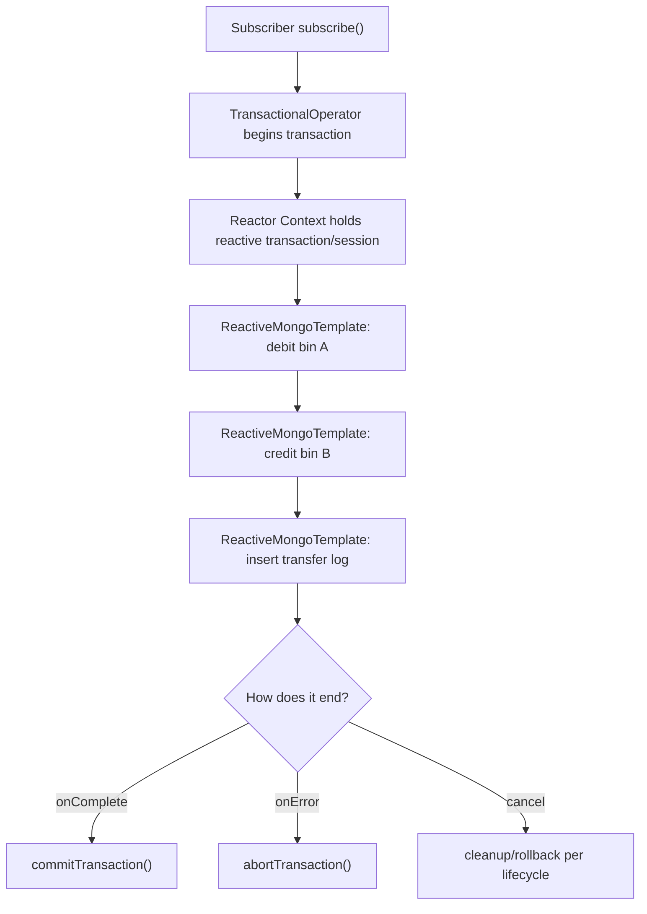

# `TransactionalOperator` and Programmatic Transaction Boundaries

A reactive service typically returns `Mono<T>` or `Flux<T>` rather than executing work immediately. When the service needs to deduct stock from one bin, add stock to another bin, and record the transfer history, the business requirement is **either all three MongoDB operations commit together, or none of them are persisted**. In reactive Spring Data MongoDB, the primary API for expressing this requirement programmatically is **`TransactionalOperator`**.

The tricky part is that **transaction boundaries in Reactive Streams do not behave like an ordinary `try/catch` block**. Publishers are typically *lazy* and can be subscribed to multiple times; the transaction is bound to the subscription's **Reactor Context**, not pinned to a thread. Placing `.as(operator::transactional)` in the wrong spot can leave the second update running **outside the transaction**, while a misplaced `onErrorResume` can turn an error that should trigger rollback into a normal completion. Beyond errors, **cancellation**, retries, and how multiple publishers are composed all affect transactions.

This lesson belongs to the **Reactive Transactions** chapter of the `SPRING_DATA_MONGODB` module. Within the module scope, learners use Spring Data MongoDB to connect, map documents, and access MongoDB through `MongoTemplate` or repositories; practice queries, aggregations, indexes, transactions, reactive access, testing, and performance diagnostics. Here the focus is on **`TransactionalOperator` and how to determine which operations actually belong to a reactive transaction**, rather than just adding annotations until code runs.

After this lesson, you will be able to:

1. Distinguish `ReactiveMongoTransactionManager`, `TransactionalOperator`, `ReactiveMongoTemplate`, and `ReactiveMongoRepository`.
2. Explain why a transaction starts **when subscription occurs**, how sessions propagate via **Reactor Context**, and why calling `block()` in a WebFlux flow is wrong.
3. Use `.as(operator::transactional)` or `operator.execute(...)` to establish the **correct transaction boundary** around a sequence of operations.
4. Execute multi-document/multi-collection transactions checking `matchedCount` and rolling back properly when business preconditions fail.
5. Spot anti-patterns such as wrapping only the last publisher, using `Mono.zip` on DB operations in the same transaction, `onErrorResume` hiding errors, mixing blocking APIs, or retrying side effects.
6. Design retries with fresh transactions, idempotency for duplicate requests, timeouts, and MongoDB resource protection.
7. Test with `StepVerifier` against a **real MongoDB replica set**, verifying commits, rollbacks, and transaction scope.

## 1. Defining Transaction Boundaries in Reactive Streams

A MongoDB transaction is a unit of read/write work associated with a **`ClientSession`**. When all operations finish, the transaction **commits**; if the pipeline terminates with a qualifying error, the transaction **rolls back/aborts** per transaction manager policy.



With a properly wrapped publisher, only MongoDB operations executed **within the same subscription, the same reactive transaction context, and compatible reactive infrastructure** can participate in that transaction.

### 1.1. Reactive Does Not Mean Automatic Transactions

```java
Mono<UpdateResult> debit = reactiveTemplate.updateFirst(...);
Mono<UpdateResult> credit = reactiveTemplate.updateFirst(...);
```

The snippet above **only builds two publishers**. It does not call MongoDB when the variables are declared, does not coordinate the two operations, and **does not create a transaction**.

If code subsequently subscribes separately:

```java
debit.subscribe();
credit.subscribe();
```

each subscription is an independent execution stream; **you cannot treat those two updates as one shared transaction**. In web applications, never call `subscribe()` manually inside a service to "kick off work"; return the Publisher so the framework subscribes at the proper edge.

### 1.2. How Imperative and Reactive Transactions Differ

| Aspect | Imperative | Reactive |
| --- | --- | --- |
| Manager | `MongoTransactionManager` | `ReactiveMongoTransactionManager` |
| Programmatic tx API | `TransactionTemplate.execute(...)` | `TransactionalOperator.transactional(...)` or `execute(...)` |
| Typical context | Thread-bound transaction resources | Subscription **Reactor Context** |
| MongoDB operations | Blocking `MongoTemplate`/repositories | `ReactiveMongoTemplate`/`ReactiveMongoRepository` |
| Execution time | Blocking method invocation | **When subscribed** to the Publisher |
| Termination | Return value / thrown exception | `onComplete` / `onError` / `cancel` |
| Common pitfalls | Swallowed exceptions, proxies, multi-threading | Lost context, wrong scope, unsubscribed publisher, cancellation |

Do not use `MongoTransactionManager` with `ReactiveMongoTemplate` simply because both class names contain MongoDB. The two transaction management paths use completely different context-binding mechanisms.

## 2. Prerequisites Before Using `TransactionalOperator`

### 2.1. MongoDB Topology

**Multi-document transactions** require a MongoDB replica set or a transaction-capable sharded cluster. A standalone MongoDB instance without replica set initialization **does not satisfy** this requirement.

Locally or in tests, a **single-node replica set** is straightforward to manage. In production, verify the URI, topology, server version, feature compatibility version, and permissions.

Example URI for a properly configured test replica set:

```properties
spring.data.mongodb.uri=mongodb://localhost:27017/stock_tx_test?replicaSet=rs0
```

Do not infer from this URI string that a standalone `mongod` automatically becomes a replica set. When using Docker/Testcontainers, hostnames and ports in the replica set configuration must actually be reachable from the Java Driver.

### 2.2. Dependencies and Reactive Stack

A Spring Boot application typically uses `spring-boot-starter-data-mongodb-reactive` for `ReactiveMongoTemplate` and reactive repositories; WebFlux is useful if the application exposes reactive HTTP endpoints. For testing, use `spring-boot-starter-test`, `reactor-test`, and an appropriate MongoDB test server.

Do not mix these examples with `spring-boot-starter-data-mongodb` and blocking `MongoTemplate` in the same transaction assuming every operation joins. An application may include both starters, but managers, factories, and transaction boundaries must remain strictly separated.

### 2.3. Create Collections and Indexes Before Transactions

For our example using `stockBins` and `stockMovements`, provision collections and indexes during migration or test setup **outside transactions**:

```javascript
db.createCollection("stockBins");
db.createCollection("stockMovements");

db.stockMovements.createIndex(
  { tenantId: 1, operationId: 1 },
  { unique: true, name: "ux_movement_tenant_operation" }
);
```

Creating collections or indexes inside a transaction can hit DDL limitations depending on server version and topology. Do not rely on object mapping lazily creating a collection for the first time **in the middle of a critical transaction**.

### 2.4. Single-Document Operations May Not Need a Transaction

For the requirement "deduct 3 units if `stock >= 3`" on **one document**, MongoDB supports atomic updates with a filter predicate:

```javascript
db.stockBins.updateOne(
  { _id: "BIN-A", tenantId: "T-A", available: { $gte: 3 } },
  { $inc: { available: -3 } }
);
```

Wrapping a single update like this in a transaction does not make it more accurate. Choose `TransactionalOperator` when business rules require **multiple documents or collections to commit/abort together**, or require a consistent snapshot read across operations.

## 3. Four Components and Their Distinct Roles

| Component | Role | Does It Start a Transaction Automatically? |
| --- | --- | --- |
| `ReactiveMongoDatabaseFactory` | Creates/coordinates reactive access to the MongoDB database | No |
| `ReactiveMongoTransactionManager` | Starts/commits/rolls back transactions; manages sessions via Reactor Context | When a transaction is requested |
| `TransactionalOperator` | Defines a **programmatic** boundary around a Publisher or callback | Yes, when the Publisher is subscribed to |
| `ReactiveMongoTemplate` or reactive repository | Executes MongoDB operations via the reactive driver; joins active sessions | No, when merely calling update/find |

### 3.1. Creating the Transaction Manager and Operator

```java
import com.mongodb.ReadConcern;
import com.mongodb.ReadPreference;
import com.mongodb.TransactionOptions;
import com.mongodb.WriteConcern;
import org.springframework.context.annotation.Bean;
import org.springframework.context.annotation.Configuration;
import org.springframework.data.mongodb.ReactiveMongoDatabaseFactory;
import org.springframework.data.mongodb.ReactiveMongoTransactionManager;
import org.springframework.transaction.reactive.TransactionalOperator;

@Configuration
public class ReactiveTransactionConfig {

    @Bean
    ReactiveMongoTransactionManager reactiveMongoTransactionManager(
            ReactiveMongoDatabaseFactory databaseFactory
    ) {
        TransactionOptions transactionOptions =
                TransactionOptions.builder()
                        .readConcern(ReadConcern.SNAPSHOT)
                        .writeConcern(WriteConcern.MAJORITY)
                        .readPreference(ReadPreference.primary())
                        .build();

        return new ReactiveMongoTransactionManager(
                databaseFactory, transactionOptions);
    }

    @Bean
    TransactionalOperator stockTransactionalOperator(
            ReactiveMongoTransactionManager transactionManager
    ) {
        return TransactionalOperator.create(transactionManager);
    }
}
```

This configuration illustrates **Spring Data MongoDB** and **Spring Framework 6.x** commonly used with Spring Boot 3.x. If the project has multiple transaction managers (e.g., R2DBC/JPA/Mongo), give beans distinct names and inject the matching `TransactionalOperator` to avoid picking the wrong manager.

### 3.2. Choosing `TransactionOptions` Intentionally

- `ReadConcern.SNAPSHOT`: requests a snapshot view inside multi-document transactions; paired with `majority` commit, MongoDB provides corresponding majority-committed snapshot guarantees.
- `WriteConcern.MAJORITY`: commit requires majority acknowledgment; does not automatically guarantee the HTTP response cannot be lost.
- `ReadPreference.primary()`: transactions performing read operations must target the primary.

Not every use case needs this strongest configuration. Lowering `write concern` to `w:1` **changes data durability guarantees**, not just latency tuning. With `w:1` commits, you cannot rely on the same majority-committed snapshot guarantees for `snapshot` reads as with `majority` commits.

### 3.3. The Operator Is a Reusable Configuration, Not a Long-Lived Transaction

A `TransactionalOperator` bean **does not hold a permanently open session**. It is a configuration object for subscriptions; each time a Publisher is subscribed to without an active transaction, the operator starts a new transaction.

This matters when someone writes:

```java
Mono<String> work = buildTransferPipeline()
        .as(stockTransactionalOperator::transactional);

// Not subscribed yet: no transaction has run.
```

Multiple subscriptions can execute the code multiple times. Therefore, **never arbitrarily cache or reuse non-idempotent Publishers**, and never store a `Mono` built from an old command in a field to serve multiple HTTP requests.

## 4. Approach 1: `.as(operator::transactional)`

`TransactionalOperator` exposes `transactional(Publisher<T>)`, and Reactor provides `.as(...)` to transform a Publisher through a function:

```java
import org.springframework.transaction.reactive.TransactionalOperator;
import reactor.core.publisher.Mono;

Mono<String> flow = stepOne()
        .then(stepTwo())
        .thenReturn("DONE")
        .as(operator::transactional);
```

This is a **service snippet** assuming three pre-defined methods/variables. Placing `.as(operator::transactional)` at the **end of the chain** brings all upstream steps into that subscription's transaction scope, provided the MongoDB operations share the reactive context.

### 4.1. Wrong Boundary: Wrapping Only the First Update

```java
Mono<Void> wrong = debitStock()
        .as(operator::transactional)
        .then(creditStock())
        .then(writeMovementLog());
```

Here **only `debitStock()`** is wrapped by the operator. `creditStock()` and `writeMovementLog()` execute **after the first transaction finishes**, so all three cannot roll back together. If `creditStock` fails, the debit may already be committed.

Correct:

```java
Mono<Void> correct = debitStock()
        .then(creditStock())
        .then(writeMovementLog())
        .as(operator::transactional);
```

If an error occurs in any of the three steps, the error propagates through the operator to roll back every MongoDB operation in the transaction.

### 4.2. Why `.then(...)` Matters

`then(nextPublisher)` subscribes to `nextPublisher` only after the source completes normally. For three sequential updates:

```text
debit succeeds
       ↓
credit succeeds
       ↓
insert movement
       ↓
commit
```

If debit reports `matchedCount=0` yet the code proceeds straight to `then(credit)`, the transaction can complete with invalid business state. You must **check each step's result** and emit `Mono.error(...)` when preconditions fail so the operator rolls back.

### 4.3. `Mono.zip` Is Not a Way to "Speed Up" a Single Transaction

```java
// DO NOT use for two DB writes sharing a transaction/session:
Mono.zip(debitStock(), creditStock())
        .as(operator::transactional);
```

`zip` subscribes to both publishers in a way that can execute them concurrently. MongoDB **does not support running arbitrary operations in parallel within the same transaction/session**; a transaction is not a connection pool for parallelizing commands.

Replace it with sequential ordering via `flatMap`/`then`. Shorten transactions by reducing round-trips and improving data design, **not by running parallel DB operations on the same session**.

## 5. Fixture: Transferring Stock Between Two Bins Within One Tenant

We use the `stockBins` and `stockMovements` collections. Transferring 3 units from `BIN-A` to `BIN-B` must maintain:

```text
Before transfer:
  BIN-A: available = 10
  BIN-B: available =  4
  Total:                14

After commit:
  BIN-A: available =  7
  BIN-B: available =  7
  Total:                14

If an error occurs after deducting BIN-A:
  Rollback -> BIN-A = 10, BIN-B = 4.
```

### 5.1. Seed Fixture for the Test Database

```javascript
// Run ONLY against an isolated test database.
db.stockBins.insertMany([
  {
    _id: "BIN-A",
    tenantId: "T-A",
    sku: "BOOK-001",
    available: NumberLong("10")
  },
  {
    _id: "BIN-B",
    tenantId: "T-A",
    sku: "BOOK-001",
    available: NumberLong("4")
  },
  {
    _id: "BIN-X",
    tenantId: "T-B",
    sku: "BOOK-001",
    available: NumberLong("99")
  }
]);
```

`BIN-X` intentionally shares the **same SKU under a different tenant**. The service must enforce `authorizedTenantId` in **every query**, including history lookups and retries. Checking the tenant only on the source bin while updating the destination bin by arbitrary `_id` opens a cross-tenant write vulnerability.

### 5.2. Separating Entities and Commands

```java
import java.time.Instant;
import org.springframework.data.mongodb.core.mapping.Document;
import org.springframework.data.mongodb.core.mapping.MongoId;

@Document(collection = "stockBins")
public record StockBin(
        @MongoId String id,
        String tenantId,
        String sku,
        long available
) {}

@Document(collection = "stockMovements")
public record StockMovement(
        @MongoId String id,
        String tenantId,
        String operationId,
        String fromBin,
        String toBin,
        String sku,
        long quantity,
        Instant createdAt
) {}

public record TransferStockCommand(
        String operationId,
        String fromBin,
        String toBin,
        String sku,
        long quantity
) {}
```

These records require Java 17+ and Spring Data's constructor/record mapping support. In a real Java project, **each public top-level record belongs in its own `.java` file**; all three declarations are shown together here to describe the schema, not because pasting all three into one file is valid.

The business intent is to **transfer a delta quantity**, not `set available=7` based on a stale snapshot. Hence we use atomic `$inc` on both documents, and `TransactionalOperator` ensures both increments/decrements commit together with the movement log.

## 6. Complete Service: Putting the Entire Workflow Inside the Operator

The example below uses `ReactiveMongoTemplate` and the `TransactionalOperator` configured in section 3. Workflow:

1. Validate the request and authenticated tenant.
2. Inside the transaction, check whether `operationId` was already committed.
3. If present with matching payload, return the existing result; if payload differs, signal conflict.
4. If new, debit source with filter `available >= quantity`.
5. Only when debit matches, credit destination belonging to the **same tenant and SKU**.
6. Insert `StockMovement` with an ID scoped to tenant/operation.
7. Commit only when all three steps succeed.

### 6.1. Defining Business Errors

```java
public class StockTransferRejectedException
        extends RuntimeException {
    public StockTransferRejectedException(String message) {
        super(message);
    }
}
```

When stock is insufficient or the destination is missing, throw/emit an exception so the pipeline signals **`onError`** and the transaction manager **rolls back**. Never replace a business error with `Mono.empty()` if doing so leads the operator to treat the transaction as normally completed.

### 6.2. Reactive Implementation Without Calling `subscribe()` or `block()`

```java
import java.time.Instant;
import org.springframework.data.mongodb.core.ReactiveMongoTemplate;
import org.springframework.data.mongodb.core.query.Criteria;
import org.springframework.data.mongodb.core.query.Query;
import org.springframework.data.mongodb.core.query.Update;
import org.springframework.stereotype.Service;
import org.springframework.transaction.reactive.TransactionalOperator;
import reactor.core.publisher.Mono;

@Service
public class StockTransferService {

    private final ReactiveMongoTemplate template;
    private final TransactionalOperator operator;

    public StockTransferService(
            ReactiveMongoTemplate template,
            TransactionalOperator stockTransactionalOperator
    ) {
        this.template = template;
        this.operator = stockTransactionalOperator;
    }

    public Mono<String> transfer(
            String authorizedTenantId,
            TransferStockCommand command
    ) {
        validate(authorizedTenantId, command);

        Mono<String> work = Mono.defer(() -> {
            Query existingQuery = Query.query(
                    Criteria.where("tenantId")
                            .is(authorizedTenantId)
                            .and("operationId")
                            .is(command.operationId()));

            return template.findOne(
                            existingQuery, StockMovement.class)
                    .flatMap(existing -> verifyExisting(
                            existing, command))
                    .switchIfEmpty(Mono.defer(() ->
                            applyTransfer(authorizedTenantId, command)));
        });

        // ALL queries and writes inside work belong to the transaction.
        return work.as(operator::transactional);
    }

    private Mono<String> verifyExisting(
            StockMovement existing,
            TransferStockCommand command
    ) {
        boolean same = existing.fromBin().equals(command.fromBin())
                && existing.toBin().equals(command.toBin())
                && existing.sku().equals(command.sku())
                && existing.quantity() == command.quantity();

        if (!same) {
            return Mono.error(new StockTransferRejectedException(
                    "operationId already used with a different payload"));
        }
        return Mono.just(existing.id());
    }

    private Mono<String> applyTransfer(
            String tenantId, TransferStockCommand command
    ) {
        Query debitQuery = Query.query(
                Criteria.where("_id").is(command.fromBin())
                        .and("tenantId").is(tenantId)
                        .and("sku").is(command.sku())
                        .and("available").gte(command.quantity()));

        Query creditQuery = Query.query(
                Criteria.where("_id").is(command.toBin())
                        .and("tenantId").is(tenantId)
                        .and("sku").is(command.sku()));

        Mono<Void> debit = template.updateFirst(
                        debitQuery,
                        new Update().inc(
                                "available", -command.quantity()),
                        StockBin.class)
                .flatMap(result -> {
                    if (result.getMatchedCount() != 1) {
                        return Mono.error(
                                new StockTransferRejectedException(
                                        "Source bin does not exist or has insufficient stock"));
                    }
                    return Mono.<Void>empty();
                });

        Mono<Void> credit = template.updateFirst(
                        creditQuery,
                        new Update().inc(
                                "available", command.quantity()),
                        StockBin.class)
                .flatMap(result -> {
                    if (result.getMatchedCount() != 1) {
                        return Mono.error(
                                new StockTransferRejectedException(
                                        "Destination bin does not exist"));
                    }
                    return Mono.<Void>empty();
                });

        StockMovement movement = new StockMovement(
                tenantId + ":" + command.operationId(),
                tenantId,
                command.operationId(),
                command.fromBin(),
                command.toBin(),
                command.sku(),
                command.quantity(),
                Instant.now());

        return debit.then(credit)
                .then(template.insert(movement))
                .map(StockMovement::id);
    }

    private void validate(
            String tenantId, TransferStockCommand command
    ) {
        if (tenantId == null || tenantId.isBlank()
                || command == null
                || command.operationId() == null
                || command.operationId().isBlank()
                || command.fromBin() == null
                || command.fromBin().isBlank()
                || command.toBin() == null
                || command.toBin().isBlank()
                || command.fromBin().equals(command.toBin())
                || command.sku() == null
                || command.sku().isBlank()
                || command.quantity() < 1
                || command.quantity() > 1000) {
            throw new IllegalArgumentException(
                    "Invalid stock transfer details");
        }
    }
}
```

**Note on `Mono<Void>` lambdas:** for each update, `flatMap` returns `Mono.<Void>empty()` after verifying `matchedCount`. No value needs to pass downstream, so `debit.then(credit)` sequences execution. If debit or credit signals an error, `then` never subscribes to the next step.

**The transaction scope is established on the line `return work.as(operator::transactional)`.** Constructing `Query`, `Update`, or the `movement` record does not touch the DB. Reactive updates execute only when a subscriber executes `work` inside the reactive transaction context.

### 6.3. Idempotent in Sequential Tests, Not Yet System-Wide "Exactly Once"

`operationId` and the unique index help prevent applying the same command multiple times. However:

- Two concurrent requests may both read "no movement yet"; MongoDB can raise a **write conflict** or duplicate key, requiring reconciliation against the earlier committed command.
- After a network error during commit, the client cannot tell by itself whether the transaction committed; **never blindly retry the whole command** without a commit-outcome/idempotency strategy.
- `operationId` must be generated by a trusted layer or validated with strict length/format constraints; tenant must come from the security context.
- Movement ID `tenantId + ":" + operationId` is illustrative only. In production, choose keys with normalization, length bounds, and collision avoidance.
- If there are external side effects such as publishing a transfer event, use an outbox/idempotent consumer or properly designed workflow; they do not join the MongoDB transaction merely by sitting in the same method.

To avoid `long` overflow in the destination bin, production systems must enforce **valid quantity bounds**, access control, maximum bin capacity, and any other domain invariants. `$inc` guarantees single-field atomicity inside one document, not full domain validation.

## 7. Approach 2: `operator.execute(...)` for Local Transaction Scopes

`TransactionalOperator.execute(...)` accepts a callback:

```java
<T> Flux<T> execute(TransactionCallback<T> action);
```

The callback receives a `ReactiveTransaction` and must return a Publisher. This option is useful when **only part** of a pipeline needs a transaction while other parts should run outside it.

### 7.1. Callback Example

```java
import org.springframework.transaction.reactive.TransactionalOperator;
import reactor.core.publisher.Mono;

public Mono<String> transactionWithCallback(
        TransactionalOperator operator
) {
    return operator.execute(status ->
            findAuthorizedStockBin()
                .flatMap(bin -> debitBin(bin)
                        .then(creditDestination()))
                .then(writeMovement())
                .thenReturn("DONE")
        ).single();
}
```

`execute` returns **`Flux<T>`**; because the callback above produces a single-element `Mono<String>`, `.single()` converts the Flux back to `Mono<String>` and errors if it does not emit exactly one element. If the workflow can complete **without emitting an item**, use a different terminal operator or `then()` instead of mechanically applying `single()`.

The methods `findAuthorizedStockBin`, `debitBin`, `creditDestination`, and `writeMovement` here are **hypothetical service helper methods**; the snippet shows callback structure, while the complete service in section 6 uses concrete MongoDB operations.

### 7.2. Using the Callback When Rollback Branches Are Explicit

`ReactiveTransaction` inside the callback supports marking **rollback-only** in framework-supported scenarios. However, the simplest and clearest way to signal a rejected business command is emitting `Mono.error(...)` so the operator receives `onError`. Calling `setRollbackOnly()` and still returning `"SUCCESS"` to the client risks misinterpreting the business outcome.

Example explicitly marking rollback-only:

```java
return operator.execute(status ->
        checkBusinessRule()
                .flatMap(ok -> {
                    if (!ok) {
                        status.setRollbackOnly();
                        return Mono.just("REJECTED");
                    }
                    return doMongoWrites().thenReturn("DONE");
                })
).single();
```

This illustrates **how `setRollbackOnly()` behaves**: normal completion of the inner Publisher does not imply DB commit if transaction status was marked rollback-only. Even so, the API must clearly distinguish `REJECTED` from a successful transfer. For ordinary business rejections, emitting a domain error and handling it **outside** the operator is usually cleaner.

### 7.3. When to Choose `execute` vs. `transactional`

| Purpose | Choice | Benefit |
| --- | --- | --- |
| Wrap an already-built pipeline | `publisher.as(operator::transactional)` | Scope is obvious at the end of the chain |
| Wrap a multi-branch callback | `operator.execute(callback)` | Scope is explicitly framed inside the callback |
| Transactional writes only, excluding HTTP/cache/output formatting | `execute` or wrapping a sub-pipeline | Shortens transaction duration |
| Need explicit `setRollbackOnly` control | `execute` | Exposes `ReactiveTransaction` status |
| Declarative transaction across a method | `@Transactional` with reactive manager | Less boilerplate, though requires proxy and return-type awareness |

**Do not combine both approaches on the same workflow** unless intentionally creating distinct boundaries: nesting `execute(...)` inside `as(operator::transactional)` can trigger nested transaction participation and complicate reasoning. Establish one clear boundary owner.

## 8. Choosing Where to Wrap: Transactions Only Live Inside the Wrapped Publisher

An application workflow might look like:

```text
HTTP authentication
  → validate payload
  → read external configuration outside DB
  → UPDATE source bin
  → UPDATE destination bin
  → INSERT movement
  → commit transaction
  → format HTTP response
  → emit metrics
```

Not every step belongs inside the transaction. The longer a transaction remains open, the higher the risk of contention, timeouts, and memory pressure.

### 8.1. Wrap Only the Writes That Must Be Atomic

```java
Mono<TransferResponse> result = loadPublicConfiguration()
        .flatMap(config -> {
            Mono<String> mongoWrites = validateWithConfig(config)
                    .then(transferMongoDocuments(config));

            return mongoWrites
                    .as(operator::transactional);
        })
        .map(operationId -> new TransferResponse(
                operationId, "ACCEPTED"));
```

`loadPublicConfiguration()` runs **outside** the transaction, while `validateWithConfig(config)` and `transferMongoDocuments(config)` run **inside** it. This is a structural snippet: the helper functions and DTO are assumed defined and must re-validate business invariants at write time.

If validation reads data that must remain consistent with the updates, **include that read inside the transaction**; do not "optimize" transactions by moving a critical precondition outside and ignoring race conditions.

### 8.2. Writing Outside First and Wrapping Later Will Not Roll Back the First Write

```java
Mono<UpdateResult> firstWrite = reactiveTemplate.updateFirst(...);
Mono<UpdateResult> secondWrite = reactiveTemplate.updateFirst(...);

Mono<UpdateResult> wrong = firstWrite
        .then(secondWrite.as(operator::transactional));
```

`firstWrite` is outside the transaction. If the second write fails, the first may already be committed. **Operator placement**, not adjacent lines of Java code, defines the scope.

### 8.3. A Publisher Completing After the Operator Has Committed

```java
return mongoWrite()
        .as(operator::transactional)
        .flatMap(id -> anotherMongoUpdate(id));
```

`anotherMongoUpdate` sits **after** the operator, outside the boundary. If it fails, the transaction for `mongoWrite` may have already committed. If both updates must be atomic, move `.as(operator::transactional)` to the **very end**:

```java
return mongoWrite()
        .flatMap(id -> anotherMongoUpdate(id))
        .as(operator::transactional);
```

### 8.4. Do Not Wrap External API Calls in a Transaction

```java
return requestBankApi()        // External side effect.
        .then(updateMongo())
        .as(operator::transactional);
```

Calling a bank API cannot be rolled back by MongoDB. If the MongoDB update fails, money may have already moved while the DB transaction aborts. For external systems, use **outbox/saga/compensation/idempotency** designs rather than trying to "wrap with an operator" to manufacture nonexistent atomicity.

## 9. `onError`, `onComplete`, and `onErrorResume`: Which Side of the Operator Is the Error On?

With `TransactionalOperator`, the terminal signals reaching the wrapped Publisher determine how the manager concludes the transaction.

| Terminal Signal Reaching Operator | Expected Behavior | Business Meaning |
| --- | --- | --- |
| `onComplete` | Commits if not rollback-only and commit succeeds | All transactional steps succeeded |
| `onError` | Rolls back/aborts transaction | A step failed; participating writes are discarded |
| `cancel` | Cleanup; in current Spring Framework cancellation triggers rollback | Subscriber stopped consuming the sequence |

### 9.1. Anti-Pattern: Swallowing Errors **Inside** the Transaction

```java
Mono<String> dangerous = debitStock()
        .then(creditStock())
        .onErrorResume(ex -> Mono.just("IGNORED"))
        .as(operator::transactional);
```

If debit succeeds and credit fails, `onErrorResume` turns the error into a success value. The operator receives `onComplete` and may **commit the debit** — breaking business invariants.

A safer version:

```java
Mono<String> safe = debitStock()
        .then(creditStock())
        .thenReturn("DONE")
        .as(operator::transactional)
        .onErrorMap(ex -> new TransferFailedException(ex));
```

`onErrorMap` sits **after the operator**, so the error crosses the boundary to trigger rollback first, and is then translated into a domain exception. `TransferFailedException` is a hypothetical domain exception in this example, not a built-in Spring Data class.

### 9.2. Returning an HTTP Fallback? Place It After the Transaction

```java
return performTransfer()
        .as(operator::transactional)
        .onErrorResume(StockTransferRejectedException.class,
                err -> Mono.just("REJECTED"));
```

Here the operator **sees the error**, rolls back, and only then does `onErrorResume` map it into a domain response. Still, distinguish returning "rejected" from "success": the HTTP contract must accurately indicate the request was not applied.

If `performTransfer()` **already wraps itself with the operator**, do not wrap it a second time; simply write:

```java
return stockTransferService.transfer(tenantId, command)
        .onErrorResume(StockTransferRejectedException.class,
                ex -> Mono.error(toHttpConflict(ex)));
```

Exception mapping must **preserve important metadata** without leaking MongoDB stack traces or secrets in responses.

### 9.3. `onErrorContinue` Is Not a Solution for Multi-Document Transactions

```java
// DO NOT use as a general transaction policy:
source.flatMap(this::writeOneDocument)
      .onErrorContinue((error, element) -> log(error))
      .as(operator::transactional);
```

`onErrorContinue` has operator-dependent semantics and can easily mask errors or skip records without rolling back as intended. If **all-or-nothing** is required, let errors halt the workflow and roll back. If records should be processed independently, give **each record its own transaction** and log outcomes explicitly instead of swallowing errors inside one giant transaction.

### 9.4. `doOnError` Is for Observation, Not Recovery

`doOnError` is appropriate for controlled metrics and logging:

```java
return work.as(operator::transactional)
        .doOnError(ex -> metrics.increment("stock_tx_failed"));
```

It does not retry, does not recover state, and does not make external logs/outboxes part of MongoDB rollback. Avoid logging full documents, tokens, or sensitive payloads.

## 10. Cancellation: The Subscriber Can Stop Before Commit

In Reactive Streams, downstream can cancel the subscription due to an HTTP client disconnect, timeout, `take(1)`, `next()` on a multi-element Flux, or any short-circuiting operator.

### 10.1. Transactions Are Not "Immune to the Subscriber"

Since Spring Framework 5.3, reactive transactions adopt a **rollback-on-cancellation** policy to avoid committing when there is no certainty the Publisher finished all work. However, if commit already finished **before** the client disconnected, canceling afterward cannot undo that commit.

Therefore, never treat an HTTP timeout or cancellation as proof that "MongoDB definitely rolled back." The client may lose the response **after commit**. For inventory or financial commands, use `operationId` to reconcile.

### 10.2. Anti-Pattern With `Flux.take(1)`

```java
Flux<StockMovement> movements = processManyMovements()
        .as(operator::transactional);

Mono<StockMovement> firstOnly = movements.next();
```

`next()` can **cancel** upstream after the first element. If `processManyMovements` is still executing subsequent writes, cancellation may roll back the transaction or produce unexpected client behavior. Never use `next()` or `take(1)` to "grab a result" from a multi-write transaction when later writes still matter.

If the business flow only needs one output after multiple writes complete, design carefully with `Mono.when(...)` **respecting parallelism limits**, or best of all chain sequentially with `then(...)` and `thenReturn(result)` so the terminal signal fires only once all work finishes.

### 10.3. Two Distinct Places for `timeout`

```java
// Timeout inside the operator:
return work.timeout(Duration.ofSeconds(5))
        .as(operator::transactional);
```

This timeout emits `onError` **inside** the transaction scope, giving the manager a chance to abort on expiration.

```java
// Timeout downstream of the operator:
return work.as(operator::transactional)
        .timeout(Duration.ofSeconds(5));
```

An outer timeout can **cancel the subscription to the operator**, triggering cleanup/rollback if the transaction has not completed. Yet in both cases, **the commit moment may remain ambiguous**, and an HTTP/Reactor timeout does not immediately cancel server-side MongoDB work.

Do not treat timeouts as substitutes for **MongoDB transaction lifetime limits**, driver/socket timeouts, cancellation policies, and idempotency. Measure against a real deployment.

### 10.4. Never Subscribe Manually and Return an Empty Response

```java
public Mono<Void> badEndpoint() {
    stockTransferService.transfer("T-A", command)
            .subscribe();
    return Mono.empty();
}
```

The HTTP request may return success **before commit**, exceptions are handled outside the request scope, and HTTP cancellation is disconnected from the database work. Always **return** the Publisher:

```java
public Mono<String> goodEndpoint() {
    return stockTransferService.transfer("T-A", command);
}
```

Of course `"T-A"` and `command` here are illustrative placeholders; real tenants must come from the security context, never hardcoded.

## 11. Subscriptions, `Mono.defer`, `cache`, and Repeatability

### 11.1. Each Subscription Can Be a New Transaction

```java
Mono<String> transfer = service.transfer("T-A", command);

// Without sharing/caching, two subscriptions can execute
// the body of a cold publisher twice.
StepVerifier.create(transfer).expectNextCount(1).verifyComplete();
StepVerifier.create(transfer).expectNextCount(1).verifyComplete();
```

In our example using `operationId`, the second subscription reads the committed movement and returns the ID; however, that is **domain-level idempotency**, not Reactor guaranteeing exactly-once execution.

### 11.2. `cache()` Changes Execution Timing and Scope

```java
Mono<String> shared = service.transfer("T-A", command).cache();
```

`cache()` stores the terminal signal so subsequent subscribers do not re-run the source. That can be useful **within a narrow scope**, but it is not a durable idempotency store: process restarts wipe the cache, memory grows, and cached errors can be problematic. **Never substitute Reactor `cache()` for unique operation IDs and ledgers in MongoDB**.

### 11.3. `Mono.defer` Rebuilds Work on Every Subscription

```java
Mono<String> deferred = Mono.defer(() ->
        buildAndExecuteMongoSteps()
).as(operator::transactional);
```

`Mono.defer` is useful when each subscription needs fresh state reads, timestamps, or queries constructed from current data. It does not start a transaction without an operator, and code inside `defer` must avoid generating a **new operation ID** on every retry if a single business command is being tracked.

### 11.4. Never Store `ReactiveTransaction`/`ClientSession` in a Field

```java
// Anti-pattern:
private ClientSession sessionForEveryRequest;
```

Sessions must live within a properly managed execution scope; never share one mutable session across requests or store it in a singleton field. The reactive transaction manager binds transactions to **Reactor Context**, and compatible MongoDB operations retrieve the session from there.

If you must invoke raw driver APIs outside `ReactiveMongoTemplate`, use driver overloads that accept a `ClientSession` and verify transaction participation. Never assume calling `ReactiveMongoTemplate.getCollection()` and running raw driver methods automatically binds the session the way template operations do.

## 12. Retries: Transaction Abort vs. Unknown Commit Outcome

When concurrent writers modify the same document, MongoDB can abort a transaction due to write conflicts or transient errors. Conversely, a client can **miss the commit response** even though the server committed successfully. These two scenarios require different handling.

| Scenario | What the Client Knows | Handling Strategy |
| --- | --- | --- |
| Business rejection: insufficient stock, wrong tenant | Request is invalid per business rules | Return error; **do not auto-retry** |
| `TransientTransactionError` from transaction abort | Transaction could not complete as executed | Can **retry the whole new transaction** when appropriate |
| `UnknownTransactionCommitResult` | Commit **might** have succeeded; outcome uncertain | Retry **commit** per protocol/driver or reconcile `operationId` |
| Network timeout after sending request | Uncertain whether server persisted writes | Do not blindly retry non-idempotent commands |
| `DuplicateKeyException` on movement ID | Operation may exist with matching or conflicting payload | Verify operation ledger and payload before deciding |

### 12.1. Wrong: Retrying a Business Command Without Error Classification

```java
// DO NOT DO THIS:
return service.transfer(tenant, command)
        .retry(10);
```

This retries **every error**, including out-of-stock, duplicate key, and unknown commit outcomes. It can overheat a "hot document," multiply latency, or repeat business intent uncontrollably.

### 12.2. Bounded Retry Strictly for Truly Transient Transaction Errors

Reactor offers `Retry.backoff(...)` with exception filtering:

```java
import java.time.Duration;
import reactor.util.retry.Retry;

Retry retryPolicy = Retry.backoff(
        2, Duration.ofMillis(30))
    .maxBackoff(Duration.ofMillis(200))
    .jitter(0.3)
    .filter(this::isRetryableAbortedTransaction);
```

In a real service, `isRetryableAbortedTransaction` must **inspect MongoDB error labels/causes** along the driver and Spring Data exception chain. This is a hypothetical domain predicate emphasizing that you must not catch every `Throwable`. For example, never parse `"transaction aborted"` strings since error messages vary by version.

Place retry **outside the transaction boundary** when the goal is starting a new transaction per attempt:

```java
Mono<String> result = Mono.defer(
        () -> buildTransferWork(tenant, command)
                .as(operator::transactional))
        .retryWhen(retryPolicy);
```

`buildTransferWork` is a hypothetical method constructing a fresh MongoDB pipeline; `Mono.defer` ensures work is rebuilt each retry. **Never place retry solely around the credit step** inside an already-aborted transaction.

### 12.3. `retryWhen` Does Not Solve Ambiguous Commits

`UnknownTransactionCommitResult` means **it is unknown whether the transaction committed**. Retrying the transaction body without idempotency risks double-writing. For stock transfers, ensure:

1. A stable `operationId` across all retries of the **same user action**.
2. A unique ledger/marker inserted inside the same transaction as debit/credit.
3. Post-error operation lookup with appropriate read consistency after an ambiguous commit error.
4. If commit retry is supported by the driver/framework, let **that mechanism** retry committing the existing transaction per rules.
5. Open a **new** transaction only after verifying the operation state and confirming the error is safely retryable.

Do not hide this logic inside a vague `onErrorResume` converting every exception into `"RETRY"`.

### 12.4. Transaction Retries and External Side Effects

```java
return callPaymentGateway() // May charge real money.
        .then(buildMongoTransaction())
        .as(operator::transactional)
        .retryWhen(retryPolicy);
```

If the publisher retries, `callPaymentGateway` can run repeatedly, and MongoDB cannot roll back the payment API. For financial workflows, use an outbox/saga and payment-gateway idempotency. Keep **only MongoDB operations that must be atomic** inside the transaction.

### 12.5. Why Keep Transactions Short?

Every transaction consumes snapshot, session, and server resources. Long transactions increase write conflicts and timeout risk. MongoDB enforces limits such as `transactionLifetimeLimitSeconds` (typically defaulting around 60 seconds depending on deployment/configuration). Never place large file processing, user interaction waits, or slow third-party calls **inside** a transaction.

## 13. Isolation, Read Concern, and Write Concern in Reactive Transactions

Reactive transactions **do not introduce a new MongoDB isolation model** compared to imperative ones. Guarantees are still governed by MongoDB Server and supplied via `TransactionOptions`.

### 13.1. Common Options

| Option | In Example | Why |
| --- | --- | --- |
| `readConcern` | `SNAPSHOT` | Reads observe a consistent snapshot within the transaction |
| `writeConcern` | `MAJORITY` | Commit durability acknowledged by a majority |
| `readPreference` | `primary` | Transactions containing reads must read from primary |

In multi-document transactions, supported read concerns typically include `local`, `majority`, and `snapshot`. Guarantees of reading from a **majority-committed snapshot** with `snapshot` depend on committing with **`w:"majority"`**. Do not set `SNAPSHOT` and assume all reads are majority-committed if you commit with `w:1`.

### 13.2. Snapshot Reads Do Not Lock Every Read Document

Timeline:

```text
t0: T1 starts snapshot and reads BIN-A.available=10
t1: T2 updates BIN-A and commits
t2: T1 may still read stale snapshot =10
t3: T1 attempts to write BIN-A -> may hit write conflict and abort
```

Never assume `SNAPSHOT` always reads the "latest committed value" or replaces the `available >= quantity` filter. Every transaction must encode invariants in its write predicates and handle conflicts.

### 13.3. Do Not Set Per-Operation Read/Write Concerns Inside a Transaction

Inside a transaction, reads and writes must follow transaction-level options; **write concern applies at commit time**, so do not attempt to set `WriteConcern.MAJORITY` on update A and `WriteConcern.W1` on update B.

With `ReactiveMongoTemplate`, configure `ReactiveMongoTransactionManager` for the transaction and let the template use the bound session. If using the driver directly, pass the exact `ClientSession` to reactive driver calls.

### 13.4. Multi-Shard Transactions Still Require Understanding Snapshot Visibility

MongoDB supports distributed transactions across sharded clusters on compatible versions, subject to query and DDL constraints. `readConcern: "snapshot"` with majority commit provides a synchronized cross-shard snapshot. `readConcern: "majority"` does not guarantee a synchronized snapshot across shards in all scenarios.

If the business rule only needs a single-document update, using a multi-shard transaction adds unnecessary complexity. Weigh network, lock, snapshot/commit costs against consistency goals.

## 14. `@Transactional` vs. `TransactionalOperator`: Pick One Boundary Owner

Spring also supports reactive transactions via annotations when methods are invoked through a proxy and **return a reactive Publisher**:

```java
import org.springframework.transaction.annotation.Transactional;
import reactor.core.publisher.Mono;

@Transactional(transactionManager = "reactiveMongoTransactionManager")
public Mono<String> transferAnnotated(
        String tenant, TransferStockCommand command
) {
    return buildTransferWork(tenant, command);
}
```

This is a schematic example inside a **Spring-managed service** with `buildTransferWork`. It does not start a transaction until subscribed; Spring reactive transaction advice takes effect when the Publisher returned through the proxy is subscribed to.

### 14.1. Comparing Both Approaches

| Criterion | `@Transactional` | `TransactionalOperator` |
| --- | --- | --- |
| Declaration style | Annotation on method | Explicit boundary in pipeline |
| Spring proxy dependency | Yes, in standard proxy mode | Not needed for direct operator use |
| Wrapping only an inner pipeline segment | Harder if method has extra I/O | **Explicit** via `as`/`execute` placement |
| Rollback-only status control | Requires separate transaction context API | `execute(status -> ...)` exposes status |
| Visibility of all tx operations | Must inspect return chain and proxy boundary | Scope is directly visible in code |
| Self-invocation risk | Yes | No, for direct operator calls |

Never annotate a method with `@Transactional` and also wrap its body with `.as(operator::transactional)` thinking "two layers are safer." If they join the same transaction, redundancy obscures intent. If intending a separate transaction, you must evaluate propagation, sessions, and rollback semantics.

### 14.2. Self-Invocation Is an Annotation Pitfall

```java
@Service
class SomeService {
    public Mono<String> outer() {
        // In proxy mode, direct calls via this can
        // bypass @Transactional on inner.
        return this.inner();
    }

    @Transactional(transactionManager = "reactiveMongoTransactionManager")
    public Mono<String> inner() {
        return doReactiveWrites();
    }
}
```

If `inner()` uses `TransactionalOperator` directly, self-invocation does not bypass the operator boundary like Spring AOP annotations do, provided the Publisher is properly returned and subscribed to.

### 14.3. Propagation and Nested Transactions

`TransactionalOperator.create(manager)` defaults to `PROPAGATION_REQUIRED`. If a compatible reactive transaction already exists in Reactor Context, `work` **joins the current transaction** rather than starting an independent nested transaction.

Therefore:

- Do not assume each operator call produces a **separate commit**.
- Do not treat `REQUIRES_NEW` as a free "savepoint" tool; suspend/resume and MongoDB/reactive manager support vary by version.
- Do not attempt to change `readConcern` or `writeConcern` of an **already started** transaction via an inner operator.
- Place boundaries at the service/application workflow **owning the invariant**, rather than having every repository open its own transaction.

### 14.4. Customizing `TransactionDefinition` for Specific Operators

Spring allows creating an operator with a `TransactionDefinition`:

```java
import org.springframework.transaction.TransactionDefinition;
import org.springframework.transaction.support.DefaultTransactionDefinition;
import org.springframework.transaction.reactive.TransactionalOperator;

DefaultTransactionDefinition definition =
        new DefaultTransactionDefinition();
definition.setPropagationBehavior(
        TransactionDefinition.PROPAGATION_REQUIRED);
definition.setName("stock-transfer");

TransactionalOperator custom = TransactionalOperator.create(
        reactiveMongoTransactionManager, definition);
```

Here `reactiveMongoTransactionManager` is an initialized bean. `TransactionDefinition` configures framework-level attributes like propagation, name, timeout, and read-only. **MongoDB read concern, write concern, and read preference** must be configured via `TransactionOptions` or per-transaction mechanisms supported by your **Spring Data version**; do not assume generic `TransactionDefinition` exposes setters for all three.

If multiple operators are needed for different workloads, assign clear bean names/`@Qualifier`s. Never let a single "default" operator serve JDBC, R2DBC, and MongoDB simultaneously, as they do not share transaction managers.

## 15. Integration Testing With `StepVerifier` and a MongoDB Replica Set

Mocking `ReactiveMongoTemplate` proves a method was called, but **does not prove** commit or rollback works on MongoDB. For transactions, integration tests against a real MongoDB Server **in a transaction-capable topology** are essential.

A thorough test suite should verify:

- No writes occur prior to subscription.
- Valid transfer commits **both balances and the movement**.
- Missing destination causes the earlier debit in the transaction to **roll back**.
- Insufficient source stock leaves state unchanged.
- Tenant mismatch never causes cross-tenant writes.
- Re-sending the same `operationId` after commit does not transfer twice.
- Reusing `operationId` with a different payload is rejected.
- Concurrent commit/unknown outcome scenarios are tested separately with dedicated coordination.

### 15.1. Test Configuration: Do Not Use Standalone MongoDB

The example below illustrates **Spring Boot 3.x + JUnit 5 + Reactor Test**. It requires a test MongoDB replica set configured via environment settings; you can use the Testcontainers MongoDB module with replica set support and reachable replica hostnames.

```properties
# Example when test replica set rs0 is ready on localhost.
spring.data.mongodb.uri=mongodb://localhost:27017/stock_tx_test?replicaSet=rs0
```

Never hardcode production URIs or real credentials into tests. Tests must only create/delete documents in an isolated test database. In CI, automate test replica set startup and verify primary election before running tests.

### 15.2. Fixture Setup Using the Reactive Template

```java
import static org.assertj.core.api.Assertions.assertThat;

import org.junit.jupiter.api.BeforeEach;
import org.junit.jupiter.api.Test;
import org.springframework.beans.factory.annotation.Autowired;
import org.springframework.boot.test.context.SpringBootTest;
import org.springframework.context.annotation.Import;
import org.springframework.data.domain.Sort;
import org.springframework.data.mongodb.core.ReactiveMongoTemplate;
import org.springframework.data.mongodb.core.index.Index;
import org.springframework.data.mongodb.core.query.Query;
import reactor.core.publisher.Mono;
import reactor.test.StepVerifier;

@SpringBootTest
@Import(ReactiveTransactionConfig.class)
class StockTransferTransactionIntegrationTest {

    @Autowired
    ReactiveMongoTemplate template;

    @Autowired
    StockTransferService service;

    private TransferStockCommand command(
            String operationId, String toBin, long quantity
    ) {
        return new TransferStockCommand(
                operationId, "BIN-A", toBin,
                "BOOK-001", quantity);
    }

    @BeforeEach
    void seed() {
        // Runs outside transaction, strictly on an isolated test DB.
        Mono<Void> prepare = template
                .remove(new Query(), StockMovement.class)
                .then(template.remove(
                        new Query(), StockBin.class))
                .then(template.indexOps(StockMovement.class)
                        .ensureIndex(new Index()
                                .on("tenantId", Sort.Direction.ASC)
                                .on("operationId", Sort.Direction.ASC)
                                .unique()
                                .named("ux_movement_tenant_operation")))
                .then(template.insert(
                        new StockBin("BIN-A", "T-A", "BOOK-001", 10)))
                .then(template.insert(
                        new StockBin("BIN-B", "T-A", "BOOK-001", 4)))
                .then(template.insert(
                        new StockBin("BIN-X", "T-B", "BOOK-001", 99)))
                .then();

        StepVerifier.create(prepare).verifyComplete();
    }

    private void assertAvailable(String id, long expected) {
        StepVerifier.create(
                template.findById(id, StockBin.class))
                .assertNext(bin ->
                        assertThat(bin.available()).isEqualTo(expected))
                .verifyComplete();
    }

    // Subsequent tests belong inside this same class.
}
```

**Note:** `@SpringBootTest` requires a `@SpringBootApplication` or suitable Spring Boot configuration. `@Import(ReactiveTransactionConfig.class)` illustrates ensuring the reactive manager/operator beans exist; if your project already component-scans that `@Configuration` class, avoid duplicate imports. Fixtures must also have collections/indexes created **before the first transaction begins**; `ensureIndex` in setup runs **outside any transaction**.

### 15.3. Test 1 — No Transaction Runs Until Subscribed

```java
@Test
void noSubscriptionMeansNoTransfer() {
    Mono<String> pending = service.transfer(
            "T-A", command("OP-LAZY", "BIN-B", 3));

    // Merely constructing Mono does not mutate the DB.
    assertAvailable("BIN-A", 10);
    assertAvailable("BIN-B", 4);

    StepVerifier.create(pending)
            .expectNext("T-A:OP-LAZY")
            .verifyComplete();

    assertAvailable("BIN-A", 7);
    assertAvailable("BIN-B", 7);
}
```

This test distinguishes Publisher **assembly** from **subscription**. If code calls `subscribe()` inside the service, execution runs uncontrolled and test timing/assertions become unreliable.

### 15.4. Test 2 — Commit All Three Operations as One Unit

```java
@Test
void successfulTransferCommitsBothBinsAndMovement() {
    StepVerifier.create(service.transfer(
            "T-A", command("OP-001", "BIN-B", 3)))
            .expectNext("T-A:OP-001")
            .verifyComplete();

    assertAvailable("BIN-A", 7);
    assertAvailable("BIN-B", 7);

    StepVerifier.create(template.findById(
                    "T-A:OP-001", StockMovement.class))
            .assertNext(movement -> {
                assertThat(movement.tenantId()).isEqualTo("T-A");
                assertThat(movement.quantity()).isEqualTo(3);
                assertThat(movement.fromBin()).isEqualTo("BIN-A");
                assertThat(movement.toBin()).isEqualTo("BIN-B");
            })
            .verifyComplete();
}
```

Checking `expectNext("T-A:OP-001")` alone is **insufficient**: a service could emit an ID even after transaction failure if errors were swallowed. The test must re-read **both bins and the movement** after the Publisher completes.

### 15.5. Test 3 — Destination Error Rolls Back Executed Debit

```java
@Test
void missingDestinationRollsBackDebit() {
    StepVerifier.create(service.transfer(
            "T-A", command("OP-NO-DEST", "MISSING", 3)))
            .expectError(StockTransferRejectedException.class)
            .verify();

    assertAvailable("BIN-A", 10);
    assertAvailable("BIN-B", 4);

    StepVerifier.create(template.findById(
                    "T-A:OP-NO-DEST", StockMovement.class))
            .verifyComplete(); // No movement exists.
}
```

This is the most critical test proving **the transaction boundary actually works**: debit matched the source, then credit failed to match destination, so if transactions are configured properly, debit must roll back. If the test observes `BIN-A = 7`, investigate operator placement, template session participation, or transaction manager/topology configuration.

### 15.6. Test 4 — Insufficient Stock and Wrong Tenant

```java
@Test
void insufficientStockChangesNothing() {
    StepVerifier.create(service.transfer(
            "T-A", command("OP-TOO-MUCH", "BIN-B", 100)))
            .expectError(StockTransferRejectedException.class)
            .verify();

    assertAvailable("BIN-A", 10);
    assertAvailable("BIN-B", 4);
}

@Test
void foreignTenantDestinationIsRejectedAndRolledBack() {
    StepVerifier.create(service.transfer(
            "T-A", command("OP-FOREIGN", "BIN-X", 3)))
            .expectError(StockTransferRejectedException.class)
            .verify();

    assertAvailable("BIN-A", 10);
    assertAvailable("BIN-X", 99);
}
```

`BIN-X` belongs to T-B. Because `creditQuery` requires `tenantId = T-A`, no valid destination bin matches; the transaction aborts without affecting source or destination. This tests **tenant isolation**, not merely quantity checks.

### 15.7. Test 5 — Idempotency on Sequential Replays

```java
@Test
void sameCommittedOperationReturnsWithoutApplyingAgain() {
    TransferStockCommand command = command(
            "OP-IDEMPOTENT", "BIN-B", 3);

    StepVerifier.create(service.transfer("T-A", command))
            .expectNext("T-A:OP-IDEMPOTENT")
            .verifyComplete();

    StepVerifier.create(service.transfer("T-A", command))
            .expectNext("T-A:OP-IDEMPOTENT")
            .verifyComplete();

    assertAvailable("BIN-A", 7);
    assertAvailable("BIN-B", 7);
}

@Test
void sameOperationIdWithDifferentPayloadIsRejected() {
    StepVerifier.create(service.transfer(
            "T-A", command("OP-SAME-ID", "BIN-B", 3)))
            .expectNext("T-A:OP-SAME-ID")
            .verifyComplete();

    StepVerifier.create(service.transfer(
            "T-A", command("OP-SAME-ID", "BIN-B", 2)))
            .expectError(StockTransferRejectedException.class)
            .verify();

    assertAvailable("BIN-A", 7);
    assertAvailable("BIN-B", 7);
}
```

These two tests prove **sequential idempotency after commit**, not absolute safety when **two concurrent requests share an `operationId`** or when commit outcomes are unknown. Those require dedicated tests using latches/fault injection and error-label reconciliation rather than blindly wrapping everything in `retry()`.

## 16. Testing Common Mistakes That Break Transaction Boundaries

### 16.1. Test to Catch "Operator Wraps Only Debit"

An adversarial test can compare two service variants:

```java
// WRONG variant: debit commits separately.
Mono<Void> wrong = debit()
        .as(operator::transactional)
        .then(creditThatFails());

// CORRECT variant: debit and credit share one transaction.
Mono<Void> correct = debit()
        .then(creditThatFails())
        .as(operator::transactional);
```

Against a real test MongoDB, after `wrong`, debit **may still persist**, whereas after `correct`, debit rolls back. This teaches **operator placement** through real outcomes; `debit`/`creditThatFails` are illustrative stubs backed by reactive template calls.

### 16.2. Testing `onErrorResume` Before vs. After the Operator

```java
// WRONG: error turns into onComplete before the operator sees it.
Mono<String> swallowed = debit().then(creditThatFails())
        .onErrorResume(error -> Mono.just("IGNORED"))
        .as(operator::transactional);

// CORRECT: operator rolls back before mapping to response.
Mono<String> preserved = debit().then(creditThatFails())
        .thenReturn("DONE")
        .as(operator::transactional)
        .onErrorResume(error -> Mono.just("REJECTED"));
```

In tests, do not merely assert both publishers emit a String. **Re-read balances and ledgers** to prove one version committed invalidly while the other rolled back properly.

### 16.3. Testing Cancellation and Timeouts Requires Source Control

A cancellation test needs a Publisher explicitly **still in flight**, such as a `TestPublisher` or a gate controlled via signals, ensuring cancel arrives **before commit**. Never use `Thread.sleep(100)` as proof that a transaction has not committed yet.

With real MongoDB transactions, inspect snapshots after cleanup and verify how your framework version handles rollback-on-cancel. If a client loses the response **after commit**, treat that case as an **ambiguous outcome** requiring reconciliation rather than equating every cancellation with "guaranteed not written."

### 16.4. Concurrency Tests Should Not Rely on Luck

To reproduce two transactions modifying one `StockBin`, use latches or `Sinks.One` to synchronize both transactions after reading/preparing and before writing. Never force **two parallel commands on one `ClientSession`**; spawn two **separate subscriptions**, each owning its own transaction.

Valid outcomes include one transaction succeeding while the other hits a conflict and retries per policy. Assert **final invariants** (total inventory, movements, non-negative balances), not a fixed scheduling winner without strict synchronization.

## 17. Troubleshooting Errors With `TransactionalOperator`

| Symptom | Likely Cause | How to Inspect |
| --- | --- | --- |
| No updates appear in MongoDB | Publisher was never subscribed, or pipeline filtered/`Mono.empty` | Verify HTTP/controller returns Publisher and subscriber reaches writes |
| `Transaction numbers are only allowed on a replica set member or mongos` | Connected to standalone MongoDB | Run a test replica set; check URI and primary |
| Debit persisted despite credit failure | Operator wrapped only debit, template left session, or error swallowed | Check `as(operator::transactional)` placement, `onErrorResume`, command monitoring |
| Data does not roll back on exception | Exception occurred **after commit**, not inside wrapped Publisher | Adjust boundary and inspect terminal signals |
| `onErrorResume` returns `"SUCCESS"` despite credit failure | Fallback sits **inside** transaction converting error to complete | Move recovery outside operator; propagate business errors |
| `subscribe()` called and HTTP returns 200 before DB commit | Fire-and-forget in controller/service | Return Publisher to WebFlux; never subscribe manually |
| `block()` slows down or fails event loop | Blocking call inside reactive chain | Use reactive driver and non-blocking composition |
| Operations do not share the same session | Blocking `MongoTemplate`, raw driver call, different factory, or lost Reactor Context | Use `ReactiveMongoTemplate`/repository on same reactive factory; monitor sessions |
| Error caused by `MongoTransactionManager` | Imperative manager used for reactive source | Switch to `ReactiveMongoTransactionManager` |
| Error running `Mono.zip` with multiple writes | Concurrent commands on one transaction session | Sequence via `flatMap`/`then` |
| `StepVerifier` passes yet DB state is wrong | Test only asserted emitted value without re-reading DB | Assert debit/credit/movement after terminal signal |
| Transaction commits twice when subscribed twice | Cold Publisher re-executes per subscription | Use stable operation ID/idempotency; avoid reusing non-idempotent Publishers |
| `cache()` prevents new requests from running | Reusing cached Publisher | Never use in-memory cache as a transaction ledger |
| `take(1)`/`next()` rolls back transaction | Downstream canceled Flux before completion | Use `thenReturn` or drain the Publisher properly |
| Timeout occurred yet movement exists later | Transaction likely committed before client lost response | Reconcile by operation ID; do not infer rollback from timeout |
| `TransientTransactionError` when two requests edit same bin | Write contention/snapshot conflict | Bounded retry of **a new whole transaction** after error classification |
| `UnknownTransactionCommitResult` | Client does not know commit outcome | Retry commit per protocol and check ledger; never blindly retry body |
| Duplicate movement ID | Two requests with same operationId or stale data | Compare against committed payload; never silently ignore conflict |
| Transaction fails when collection missing | Runtime DDL/auto-creation inside transaction | Migrate collections/indexes before serving traffic |
| Reactive `@Transactional` has no effect | Self-invocation, wrong manager, non-reactive return type | Use explicit operator or invoke through Spring proxy |
| Tests pass locally yet fail in CI | CI runs standalone or unreachable replica set URI | Provision test replica set and verify hostname/port/config |

### 17.1. Procedure for Investigating "Debit Did Not Roll Back"

If `missingDestinationRollsBackDebit` returns an error yet `BIN-A.available=7`:

1. Verify `operator` was created from **`ReactiveMongoTransactionManager`**, not a different manager.
2. Verify `work.as(operator::transactional)` wraps **both debit and credit**, not debit alone.
3. Verify `credit` is not caught by `onErrorResume(... Mono.empty())` inside the scope.
4. Verify all operations share the **same `ReactiveMongoTemplate`/database factory and Reactor Context**.
5. Check whether any raw driver call or blocking `MongoTemplate` escaped the transaction.
6. Verify the caller subscribes to the **complete Publisher**, not individual operations separately.
7. Verify MongoDB is running as a replica set and collections were created outside transactions.
8. Enable driver command monitoring in tests to check `lsid`/`txnNumber`, `startTransaction`, `commitTransaction`/`abortTransaction` actually sent.
9. Re-run commit and rollback tests against an isolated database; never "patch" missing atomicity with uncontrolled compensating writes in a catch block.

**Important closing point:** when a transaction was bypassed due to a broken boundary, adding an ad-hoc "undo" command can fail or collide with concurrent requests. Fix **atomicity** first instead of turning the system into uncoordinated compensating writes.

### 17.2. Why Synchronous `try/catch` Cannot Catch Reactive Errors

```java
try {
    return service.transfer(tenant, command);
} catch (Exception ex) {
    // Usually DOES NOT catch MongoDB errors occurring after subscribe.
}
```

The method merely **returns a Mono**; most I/O errors happen later when the Publisher is subscribed to. Handle errors using `onErrorMap`, `onErrorResume`, `doOnError`, or an appropriate controller error handler **placed after the transaction operator** when rollback is required.

Synchronous validation errors may throw immediately at method invocation (before returning the Mono) depending on implementation. In WebFlux, returning `Mono.error(...)` is often preferred for consistency, though the fundamental rule remains: handle async MongoDB I/O via reactive operators.

### 17.3. Observing Transactions via Command Monitoring

In authorized **test/staging** environments, a MongoDB Java Driver `CommandListener` can log command names and essential metadata:

```text
update / find / insert
lsid: same logical session across the transaction
txnNumber: same transaction number
startTransaction: present when the transaction starts
autocommit: false
commitTransaction or abortTransaction
```

Exact fields vary by command and driver version, and commit/abort may be sent as separate commands. Never log raw commands containing tenants, users, tokens, or transaction payloads in production. Use correlation IDs, command names, latencies, and error labels for diagnostics.

### 17.4. Monitoring

Examples of **application-defined metrics**:

```text
mongodb.reactive_tx.completed_total{outcome="committed"}
mongodb.reactive_tx.completed_total{outcome="aborted"}
mongodb.reactive_tx.error_total{kind="conflict|business|unknown_commit"}
mongodb.reactive_tx.commit_latency_ms{workflow="stock_transfer"}
mongodb.reactive_tx.retry_total{workflow="stock_transfer"}
mongodb.reactive_tx.retry_exhausted_total{workflow="stock_transfer"}
mongodb.reactive_tx.cancel_total{workflow="stock_transfer"}
```

These are **not** metrics automatically emitted by Spring Data. Avoid putting `operationId`, raw tenant IDs, or document IDs into high-cardinality labels. Track p95/p99 latency, replication lag, lock pressure, and active transaction counts to catch overly long transactions or rising contention.

## 18. Practice Exercise: Placing Transaction Boundaries in a Payment Flow

Suppose an order-processing API executes:

```text
1. Authenticate user / tenant.
2. Read service fee table from cache.
3. Debit wallet balance in MongoDB if sufficient.
4. Credit merchant wallet balance in MongoDB.
5. Insert paymentLedger in MongoDB.
6. Return HTTP response.
7. Send confirmation email.
```

Requirement: operations **3–5** must commit/roll back together. Not every step belongs inside the transaction.

### 18.1. Exercise 1 — Place the Operator Properly

Given pipeline:

```java
Mono<PaymentReceipt> pipeline = authenticateRequest()
        .flatMap(user -> loadPricingFromCache()
                .flatMap(price -> debitWallet(user, price)
                        .then(creditMerchant(price))
                        .then(writeLedger(user, price))
                        .map(this::toReceipt)))
        .as(operator::transactional)
        .flatMap(receipt -> sendEmail(receipt)
                .thenReturn(receipt));
```

**Question:** which parts are currently inside the transaction, and should the scope be narrowed?

Here the operator wraps `authenticateRequest` and `loadPricingFromCache` as well, which is unnecessary, while `sendEmail` is outside the transaction — the **right direction for side effects**, though it needs idempotency/outbox so emails are not lost if the process crashes.

A clearer structure:

```java
Mono<PaymentReceipt> improved = authenticateRequest()
        .flatMap(user -> loadPricingFromCache()
                .flatMap(price ->
                        debitWallet(user, price)
                            .then(creditMerchant(price))
                            .then(writeLedger(user, price))
                            .map(this::toReceipt)
                            .as(operator::transactional)))
        .flatMap(receipt -> enqueueNotificationFromOutbox(receipt)
                .thenReturn(receipt));
```

This is **boundary pseudocode**: `authenticateRequest`, `loadPricingFromCache`, `debitWallet`, etc. are assumed defined and must enforce security and invariants. If `enqueueNotificationFromOutbox` actually inserts an outbox document that must commit with the payment, **move that outbox insert inside the transaction**; keep only publishing/dispatching outside after commit. Do not confuse inserting a MongoDB outbox document with sending an email directly.

### 18.2. Exercise 2 — Spot the Bug in `onErrorResume`

```java
return debitWallet()
        .then(creditMerchant())
        .onErrorResume(ex -> Mono.empty())
        .as(operator::transactional);
```

If debit succeeds and credit fails, the transaction receives `onComplete` and commits the debit. **Fix:** let errors propagate to the operator; if an HTTP error or fallback is needed, place `onErrorResume` **after** `.as(operator::transactional)`.

### 18.3. Exercise 3 — Repeated Subscriptions

```java
Mono<String> payment = paymentService.process(command);
payment.subscribe();
payment.subscribe();
```

This is not a way to run a transaction "twice to make sure it succeeds." Two subscriptions execute **two separate workflows**. **Fix:** never subscribe manually; return the Publisher to the framework, store a stable `operationId`, and use a unique ledger to identify the same action.

### 18.4. Exercise 4 — How Should `UnknownTransactionCommitResult` Be Handled?

Suppose the payment ledger committed, then the TCP connection dropped before the response arrived. If the client resends the command with the same `operationId`, the service must check whether the operation already exists with a matching payload and return the committed result. **Never auto-retry `$inc` with a brand-new operation ID** or you risk applying the balance change twice.

### 18.5. Exercise 5 — Can `Mono.zip` Speed Up the System?

For multiple DB writes participating in **the same MongoDB transaction/session**, do not parallelize them with `zip`/`flatMap(concurrency > 1)`. Compose transactional workflows sequentially, or redesign the data model to reduce command count instead of parallelizing one session.

### 18.6. Exercise 6 — When Is a Transaction Unnecessary?

If the requirement is simply "increment an article's view count in **one document**," a single atomic `$inc` suffices. A multi-document transaction adds overhead and contention risk without making a simple increment safer.

## 19. Checklist for Implementing `TransactionalOperator`

1. **Does the use case actually require multiple documents/collections to commit together?** A single-document update may already be atomic.
2. **Is MongoDB running a transaction-capable replica set/sharded topology?** Never test on standalone and extrapolate to production.
3. **Were collections and indexes created before transactions?** Avoid runtime DDL inside critical workflows.
4. **Does `ReactiveMongoTransactionManager` use the right `ReactiveMongoDatabaseFactory`?** Do not confuse with the imperative manager.
5. **Do `TransactionOptions` match read/write guarantees?** Snapshot/majority/primary when the use case demands them.
6. **Is the right `TransactionalOperator` bean injected?** Use clear names/`@Qualifier` when multiple managers/operators exist.
7. **Are all MongoDB operations needing atomicity inside a single wrapped Publisher?** Do not leave credit/logs downstream of the operator.
8. **Do reactive operations run in the same Reactor Context?** Do not mix raw drivers or blocking templates outside the session.
9. **Is the pipeline lazy without manual `subscribe()` calls?** Let the framework drive subscriptions.
10. **Are DB commands inside a transaction sequential?** Avoid `zip`/parallelism on the same session.
11. **Are `matchedCount` and business invariants checked?** Failures must signal `onError` to roll back.
12. **Is `onErrorResume` swallowing errors inside the operator?** Place fallbacks after the boundary when needed.
13. **Are cancellation, timeouts, and unknown commit results handled?** Never assume client disconnect guarantees rollback.
14. **Are retries bounded and filtered by error labels?** Never retry every `Throwable` or business rejections.
15. **Does each retry open a fresh transaction and re-read state?** Never continue on an aborted session.
16. **Are stable operation IDs and unique ledgers used for duplicate requests?** Do not rely on caches or Reactor retries for exactly-once semantics.
17. **Is external I/O kept out of transactions?** Use outbox/saga for email, payments, and queues.
18. **Are `TransactionDefinition`/propagation settings used properly?** Never assume a nested operator creates an independent commit.
19. **Do `StepVerifier` tests run against a real MongoDB?** Assert commit and rollback via persisted database state.
20. **Are tenant isolation and insufficient stock tested?** Do not test only the happy path.
21. **Are failover and ambiguous commits tested in isolated environments?** Never inject faults in production just to measure.
22. **Do metrics/error taxonomy and logs avoid leaking sensitive data?** Track commit, abort, retry, and cancel counts.

**Rule of thumb:** `TransactionalOperator` defines **which part of a reactive Publisher participates in a transaction**, not "everything inside a Java method." Wrap **all MongoDB operations that must commit together** with `.as(operator::transactional)` or `execute(...)`; let errors reach the operator to trigger rollback; never run DB commands in parallel on the same session; never call `subscribe()`/`block()` in WebFlux; keep retries bounded and idempotent. Prove correctness with **a MongoDB replica set + `StepVerifier` + post-rollback database assertions**, not by eyeballing a reactive chain.

### Official References

- [Spring Framework — Programmatic Transaction Management](https://docs.spring.io/spring-framework/reference/data-access/transaction/programmatic.html): `TransactionalOperator`, using `transactional`/`execute`, transaction lifecycle, and cancellation.
- [Spring Framework — Reactive Transaction Management](https://docs.spring.io/spring-framework/reference/data-access/transaction/declarative/annotations.html): declarative approach and reactive method considerations.
- [Spring Data MongoDB — Client Sessions and Transactions](https://docs.spring.io/spring-data/mongodb/reference/mongodb/client-session-transactions.html): `ReactiveMongoTransactionManager`, `TransactionalOperator`, session propagation, and MongoDB examples.
- [Spring Data MongoDB — `ReactiveMongoTransactionManager` API](https://docs.spring.io/spring-data/mongodb/docs/current/api/org/springframework/data/mongodb/ReactiveMongoTransactionManager.html): reactive transaction management.
- [Spring Framework — `TransactionalOperator` API](https://docs.spring.io/spring-framework/docs/current/javadoc-api/org/springframework/transaction/reactive/TransactionalOperator.html): `transactional(Publisher)` and `execute(TransactionCallback)`.
- [Project Reactor — Reference Guide](https://projectreactor.io/docs/core/release/reference/): `Mono`, `Flux`, `defer`, error handling, context, retries, and cancellation.
- [Project Reactor Test — `StepVerifier`](https://projectreactor.io/docs/test/release/api/reactor/test/StepVerifier.html): testing Publisher terminal signals.
- [MongoDB Manual — Transactions](https://www.mongodb.com/docs/manual/core/transactions/): multi-document atomicity, topology, and read/write concerns.
- [MongoDB Manual — Transactions Production Considerations](https://www.mongodb.com/docs/manual/core/transactions-production-consideration/): write conflicts, lifetime, snapshots, and resources.
- [MongoDB Manual — Transactions in Applications](https://www.mongodb.com/docs/manual/core/transactions-in-applications/): retries, error labels, and commit outcomes.
- [MongoDB Manual — Read Concern](https://www.mongodb.com/docs/manual/reference/read-concern/): `snapshot` and `majority` limits/guarantees.
- [MongoDB Manual — Write Concern](https://www.mongodb.com/docs/manual/reference/write-concern/): `w:1`, majority, and durability.
