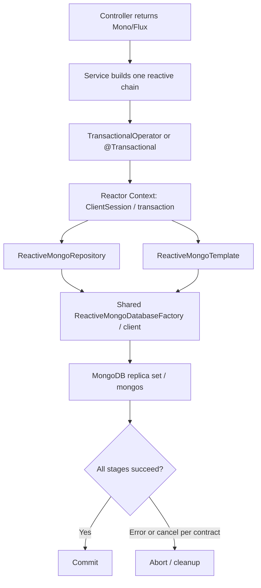

# Combining Repository and Template Operations in the Same Transaction

## 1. Problem Statement: One Business Operation Using Two MongoDB APIs

An e-wallet service built with **Spring WebFlux + Spring Data MongoDB** needs to transfer a balance between two wallets:

1. Read the source wallet using **`ReactiveMongoRepository`**.
2. Conditionally debit the source balance and credit the destination balance using **`ReactiveMongoTemplate`**.
3. Insert a transfer record using a **repository** for business history and duplicate-write prevention.

If step 2 succeeds in debiting funds but step 3 fails, the ledger is missing an entry; if only the credit succeeds, total money changes. These operations span **multiple documents**, so when business rules require *all-or-nothing* atomicity, a real **multi-document transaction** is needed.

This lesson is titled **"Combining Repository and Template Operations in the Same Transaction"**, part of the **Reactive Transactions** chapter of the **SPRING_DATA_MONGODB** module. In this module, we practice connecting, BSON/document mapping, queries, aggregations, indexes, transactions, reactive access, testing, and performance diagnostics. Specifically, this lesson focuses on:

> When a business flow calls both `ReactiveMongoRepository` and `ReactiveMongoTemplate`, what conditions ensure they share the **same transaction**, and how do we verify it?

**Core answer:** both must be configured on the **same MongoDB backend and transaction-aware reactive infrastructure** (typically the same `ReactiveMongoDatabaseFactory`), execute inside the **same Reactor subscriber context** managed by `ReactiveMongoTransactionManager`, and compose their publishers into **one chain** awaiting completion before commit.

`@Transactional` does not turn a standalone MongoDB server into one supporting multi-document transactions; `Mono.zip(...)` does not create a transaction; a separate `subscribe()` inside the service detaches work from the coordinated transaction.

## 2. Distinguishing Three Mechanisms: Atomic Update, Session, and Transaction

| Mechanism | Scope | Example | Can It Roll Back Multiple Documents? |
| --- | --- | --- | --- |
| Single-document atomic update | One document in one write operation | `$inc` two fields on the same wallet | No multi-document transaction needed |
| Client session | Logical context of a sequence of operations | `ClientSession` | Not necessarily; a session is not automatically a transaction |
| Multi-document transaction | Multiple writes/reads committed/aborted together | Debit wallet A, credit wallet B, insert ledger | Yes, when topology and session support it |

Example that does not require a multi-document transaction:

```javascript
db.inventory.updateOne(
  { _id: "sku-1", available: { $gte: 3 } },
  {
    $inc: {
      available: -3,
      reserved: 3
    }
  }
);
```

This is **one atomic operation on a single document**. By contrast, three writes across three wallet/ledger documents do not become atomic merely because they are invoked sequentially in Java.

### 2.1. Transaction-Capable Topologies

- **Replica set:** supports multi-document transactions starting in MongoDB **4.0**.
- **Sharded cluster:** supports transactions starting in MongoDB **4.2** via `mongos` routers and corresponding deployment conditions.
- **Standalone `mongod`:** does not support multi-document transactions.
- **Single-node replica set** started with `--replSet`, `rs.initiate()`, and having a PRIMARY: suitable for learning/testing transactions, though not a production HA topology.

Verify topology from the exact endpoint the application connects to:

```javascript
db.adminCommand({ hello: 1 });
```

Output containing `setName` and PRIMARY indicates a replica set; `msg: "isdbgrid"` indicates `mongos`. Do not look only at `isWritablePrimary:true` and conclude the server is not standalone.

### 2.2. Why Is This a *Reactive* Transaction?

In imperative programming, Spring typically manages transaction resources via a **thread-bound context**. In reactive execution, each database command runs **asynchronously upon subscription** and may switch threads. Therefore, `ReactiveMongoTransactionManager` binds the session/transaction to the **Reactor Context** rather than requiring every operator to stay on a single Java thread.

Switching threads via `publishOn`/`subscribeOn` within the **same subscriber context chain** does not inherently lose the transaction; conversely, calling a fresh `subscribe()`, detaching a publisher from the chain, or using a different Mongo client/factory can exclude operations from the intended transaction.

## 3. Diagram of Components That Must Align



Practical checklist:

1. `ReactiveMongoTransactionManager` receives the system's **`ReactiveMongoDatabaseFactory`**.
2. `ReactiveMongoTemplate` is built from that same factory or one truly compatible with the transaction manager.
3. `ReactiveMongoRepository` uses reactive Mongo infrastructure on the **same factory/session context**. With multiple databases or custom repository configurations, never assume this without checking.
4. The entire publisher chain stays inside the boundary of `TransactionalOperator` or a reactive `@Transactional` method invoked through the Spring proxy.
5. The flow awaits completion of all updates and inserts; no fire-and-forget calls.
6. Whenever any mandatory business invariant fails, emit **`Mono.error(...)`** so the transaction manager aborts.

Having a `ReactiveMongoTemplate` field and a repository field on a `@Service` class **does not automatically prove** they share a transaction; what matters is the runtime infrastructure and execution context.

## 4. Minimal Dependencies and Configuration

Example **Java 17, Spring Boot 3.x** project using a BOM for version management:

```xml
<dependencies>
  <dependency>
    <groupId>org.springframework.boot</groupId>
    <artifactId>spring-boot-starter-data-mongodb-reactive</artifactId>
  </dependency>
  <dependency>
    <groupId>org.springframework.boot</groupId>
    <artifactId>spring-boot-starter-webflux</artifactId>
  </dependency>
  <dependency>
    <groupId>org.springframework.boot</groupId>
    <artifactId>spring-boot-starter-test</artifactId>
    <scope>test</scope>
  </dependency>
  <dependency>
    <groupId>io.projectreactor</groupId>
    <artifactId>reactor-test</artifactId>
    <scope>test</scope>
  </dependency>
</dependencies>
```

In a worker or background service without HTTP endpoints, the WebFlux starter is optional; the reactive MongoDB library can be used standalone. Add the Testcontainers MongoDB test dependency if your project uses it.

Sample replica set connection:

```properties
spring.data.mongodb.uri=mongodb://db1:27017,db2:27017,db3:27017/walletdb?replicaSet=rs-wallet
```

For single-node test setups initialized as a replica set:

```properties
spring.data.mongodb.uri=mongodb://localhost:27017/walletdb?replicaSet=rs0
```

The URI does not turn a server into a replica set. When using Docker, hostnames advertised in `rs.conf()` must be resolvable from where the JVM runs.

### 4.1. Do Not Wrap a Blocking Template Inside `Mono.just`

Wrong:

```java
// Blocking I/O already ran before the Mono was constructed.
Mono<WalletAccount> one = Mono.just(
    imperativeMongoTemplate.findById(id, WalletAccount.class)
);
```

Correct: use the actual `ReactiveMongoTemplate`/reactive repository:

```java
Mono<WalletAccount> one =
    reactiveMongoTemplate.findById(id, WalletAccount.class);
```

Wrapping a blocking API in `Mono` neither turns it into a MongoDB Reactive Streams operation nor guarantees participation in the reactive transaction.

## 5. Creating `ReactiveMongoTransactionManager` and `TransactionalOperator`

Explicit configuration:

```java
import org.springframework.context.annotation.Bean;
import org.springframework.context.annotation.Configuration;
import org.springframework.data.mongodb.ReactiveMongoDatabaseFactory;
import org.springframework.data.mongodb.ReactiveMongoTransactionManager;
import org.springframework.transaction.reactive.TransactionalOperator;

@Configuration
public class MongoReactiveTxConfig {

    @Bean("reactiveMongoTransactionManager")
    public ReactiveMongoTransactionManager mongoTransactionManager(
        ReactiveMongoDatabaseFactory factory
    ) {
        return new ReactiveMongoTransactionManager(factory);
    }

    @Bean
    public TransactionalOperator mongoTransactionalOperator(
        ReactiveMongoTransactionManager manager
    ) {
        return TransactionalOperator.create(manager);
    }
}
```

Key points:

- `ReactiveMongoTransactionManager` is the manager for **Reactive Streams**; never use imperative `MongoTransactionManager` to manage `Mono`/`Flux`.
- `TransactionalOperator.create(...)` creates a programmatic API for wrapping a publisher in a transaction.
- The manager uses the factory to acquire databases/sessions; it **does not** initialize a replica set or guarantee collections exist.
- In applications with multiple managers, use `@Qualifier` or explicit bean references to avoid selecting the wrong one.
- If Spring Boot already auto-configures suitable infrastructure, inspect the active beans in the application context before declaring duplicates.

Example selecting a manager when multiple beans exist:

```java
import org.springframework.beans.factory.annotation.Qualifier;
import org.springframework.context.annotation.Bean;
import org.springframework.transaction.reactive.TransactionalOperator;

@Bean
TransactionalOperator walletTx(
    @Qualifier("reactiveMongoTransactionManager")
    ReactiveMongoTransactionManager manager
) {
    return TransactionalOperator.create(manager);
}
```

Declare **only one operator bean with your clearly defined name/scope** in a real application; the two snippets above show alternative configuration styles, not a requirement to register duplicate operators.

### 5.1. Transaction Options When Explicit Guarantees Are Needed

```java
import com.mongodb.ReadConcern;
import com.mongodb.ReadPreference;
import com.mongodb.TransactionOptions;
import com.mongodb.WriteConcern;

TransactionOptions options = TransactionOptions.builder()
    .readConcern(ReadConcern.SNAPSHOT)
    .writeConcern(WriteConcern.MAJORITY)
    .readPreference(ReadPreference.primary())
    .build();

ReactiveMongoTransactionManager manager =
    new ReactiveMongoTransactionManager(factory, options);
```

This pattern shows how to supply `TransactionOptions` to the manager; `factory` is an already-configured `ReactiveMongoDatabaseFactory`. Across driver and server versions, verify the driver Javadoc and actual read/write concern semantics. Never treat `snapshot` as a shared snapshot across two separate HTTP requests, nor `majority` as a guarantee that the HTTP response can never be lost.

## 6. Data Model: Wallets and Transfer Ledger

To tie the code examples together, we use two pre-provisioned collections:

- `wallet_accounts`: each document represents a wallet.
- `wallet_transfers`: each document is a transfer record whose `_id` is `transferId`.

### 6.1. `WalletAccount`

```java
import org.springframework.data.annotation.Version;
import org.springframework.data.mongodb.core.mapping.Document;
import org.springframework.data.mongodb.core.mapping.Field;
import org.springframework.data.mongodb.core.mapping.FieldType;
import org.springframework.data.mongodb.core.mapping.MongoId;

@Document(collection = "wallet_accounts")
public record WalletAccount(
    @MongoId(FieldType.STRING)
    String id,

    @Field("tenant_id")
    String tenantId,

    @Field("balance_cents")
    long balanceCents,

    @Version
    Long version
) {}
```

Amounts are stored in the **smallest integer unit** (`long`) to avoid floating-point errors when adding or subtracting; multi-currency systems must define explicit currency, scale, and overflow policies.

`@Version` supports optimistic locking in entity-save APIs. Because we use `ReactiveMongoTemplate.updateFirst(...)` directly, this lesson **explicitly increments version** and optionally filters on expected version.

### 6.2. `TransferRecord`

```java
import java.time.Instant;
import org.springframework.data.mongodb.core.mapping.Document;
import org.springframework.data.mongodb.core.mapping.Field;
import org.springframework.data.mongodb.core.mapping.FieldType;
import org.springframework.data.mongodb.core.mapping.MongoId;

@Document(collection = "wallet_transfers")
public record TransferRecord(
    @MongoId(FieldType.STRING)
    String id,

    @Field("tenant_id")
    String tenantId,

    @Field("from_wallet_id")
    String fromWalletId,

    @Field("to_wallet_id")
    String toWalletId,

    @Field("amount_cents")
    long amountCents,

    @Field("payload_hash")
    String payloadHash,

    Instant createdAt
) {}
```

Here `id` is the stable `transferId` of a business request. Use `insert` rather than `save` for new ledger records so an existing ID cannot be unintentionally upserted/overwritten.

### 6.3. Initial BSON Seed Data

```javascript
db.wallet_accounts.insertMany([
  {
    _id: "wallet-A",
    tenant_id: "tenant-A",
    balance_cents: NumberLong("200000"),
    version: NumberLong("0")
  },
  {
    _id: "wallet-B",
    tenant_id: "tenant-A",
    balance_cents: NumberLong("10000"),
    version: NumberLong("0")
  }
]);
```

Transferring `50000` cents from A to B successfully must produce:

| Document | Before | After Commit |
| --- | ---: | ---: |
| `wallet-A.balance_cents` | 200000 | 150000 |
| `wallet-B.balance_cents` | 10000 | 60000 |
| `wallet_transfers["transfer-001"]` | Absent | One record present |

If crediting fails because the destination wallet does not exist, both the debit and the ledger insert (if executed) must be absent after rollback.

## 7. Reactive Repositories Used Together in One Business Flow

Declare two repositories:

```java
import org.springframework.data.mongodb.repository
    .ReactiveMongoRepository;
import reactor.core.publisher.Mono;

public interface WalletRepository
        extends ReactiveMongoRepository<WalletAccount, String> {

    Mono<WalletAccount> findByIdAndTenantId(
        String id,
        String tenantId
    );
}

public interface TransferRecordRepository
        extends ReactiveMongoRepository<TransferRecord, String> {
}
```

`findByIdAndTenantId(...)` is a derived query; for `WalletAccount`, Spring Data uses the `@Field("tenant_id")` metadata to map Java properties to BSON fields.

### 7.1. Why Combine Repositories and Templates?

Repositories are convenient for:

- `findByIdAndTenantId(...)` and expressive derived queries.
- `insert(...)`/`save(...)` with entity mapping, lifecycle callbacks, and optimistic locking API contracts.
- Structuring domain operations as clean, testable, reusable interfaces.

Templates are convenient for:

- `Query`/`Criteria`/`Update` with complex conditions.
- Atomic `$inc` combined with balance, tenant, and version filters.
- `findAndModify`, bulk writes, aggregations, and flexible low-level operations.

A service can freely mix both **within the same transaction** when backed by the same reactive infrastructure; you are not forced to rewrite every query into a single API.

### 7.2. A Repository Does Not Open Its Own Transaction

`ReactiveMongoRepository` returns publishers. When configured with the shared reactive database factory, repository calls subscribed to inside a reactive transaction context participate in the session managed by the transaction manager.

There is no separate "repository transaction" automatically created simply by calling `repository.insert(...)`. For multiple operations to commit together, a boundary must wrap the entire flow.

## 8. Defining Request, Result, and Domain Errors

```java
public record TransferCommand(
    String transferId,
    String trustedTenantId,
    String fromWalletId,
    String toWalletId,
    long amountCents,
    String payloadHash
) {}

public record TransferReceipt(
    String transferId,
    String status
) {}

public final class TransferRejectedException
        extends RuntimeException {

    public TransferRejectedException(String message) {
        super(message);
    }
}
```

`trustedTenantId` must come from an authenticated security context, never blindly trusting a client-supplied tenant string. `payloadHash` is a fingerprint of the **canonical business payload** used to validate retries; never hash a random string per request.

For learning clarity, amounts use `long` with non-negative and overflow checks on updates. Production systems also define transfer limits, currency types, AML/authorization rules, auditing, and pending-transaction workflows; do not treat sample code as a complete financial product.

## 9. Service Combining Repository and Template Inside `TransactionalOperator`

The complete service below:

- Reads the source wallet via **`WalletRepository`**.
- Uses **`ReactiveMongoTemplate.updateFirst`** to debit the source wallet conditioned on balance and version.
- Uses **`ReactiveMongoTemplate.updateFirst`** to credit the destination wallet, checking ID/tenant and guarding against overflow.
- Uses **`TransferRecordRepository.insert`** to write the ledger with `transferId`.
- Wraps the **entire chain** with **`TransactionalOperator`**.

```java
import java.time.Instant;

import com.mongodb.client.result.UpdateResult;
import org.springframework.data.mongodb.core.ReactiveMongoTemplate;
import org.springframework.data.mongodb.core.query.Criteria;
import org.springframework.data.mongodb.core.query.Query;
import org.springframework.data.mongodb.core.query.Update;
import org.springframework.stereotype.Service;
import org.springframework.transaction.reactive.TransactionalOperator;
import reactor.core.publisher.Mono;

@Service
public final class WalletTransferService {

    private final WalletRepository wallets;
    private final TransferRecordRepository transfers;
    private final ReactiveMongoTemplate template;
    private final TransactionalOperator tx;

    public WalletTransferService(
        WalletRepository wallets,
        TransferRecordRepository transfers,
        ReactiveMongoTemplate template,
        TransactionalOperator tx
    ) {
        this.wallets = wallets;
        this.transfers = transfers;
        this.template = template;
        this.tx = tx;
    }

    public Mono<TransferReceipt> transfer(TransferCommand c) {
        return Mono.defer(() -> {
            validate(c);

            Mono<TransferReceipt> work =
                wallets.findByIdAndTenantId(
                    c.fromWalletId(), c.trustedTenantId()
                )
                .switchIfEmpty(Mono.error(
                    new TransferRejectedException(
                        "Source wallet does not exist or unauthorized"
                    )
                ))
                .flatMap(source -> debit(c, source))
                .flatMap(ignored -> credit(c))
                .flatMap(ignored -> transfers.insert(
                    new TransferRecord(
                        c.transferId(),
                        c.trustedTenantId(),
                        c.fromWalletId(),
                        c.toWalletId(),
                        c.amountCents(),
                        c.payloadHash(),
                        Instant.now()
                    )
                ))
                .map(ledger -> new TransferReceipt(
                    ledger.id(), "APPLIED"
                ));

            return tx.transactional(work);
        });
    }

    private Mono<UpdateResult> debit(
        TransferCommand c,
        WalletAccount source
    ) {
        if (source.version() == null) {
            return Mono.error(new TransferRejectedException(
                "Wallet lacks a valid version"
            ));
        }

        Query query = Query.query(
            Criteria.where("id").is(c.fromWalletId())
                .and("tenantId").is(c.trustedTenantId())
                .and("version").is(source.version())
                .and("balanceCents").gte(c.amountCents())
        );

        Update update = new Update()
            .inc("balanceCents", -c.amountCents())
            .inc("version", 1L);

        return template.updateFirst(
            query, update, WalletAccount.class
        ).flatMap(r -> matchedOnce(
            r, "Source wallet changed or insufficient balance"
        ));
    }

    private Mono<UpdateResult> credit(TransferCommand c) {
        Query query = Query.query(
            Criteria.where("id").is(c.toWalletId())
                .and("tenantId").is(c.trustedTenantId())
                .and("balanceCents").lte(
                    Long.MAX_VALUE - c.amountCents()
                )
        );

        Update update = new Update()
            .inc("balanceCents", c.amountCents())
            .inc("version", 1L);

        return template.updateFirst(
            query, update, WalletAccount.class
        ).flatMap(r -> matchedOnce(
            r, "Destination wallet does not exist or cannot be credited"
        ));
    }

    private Mono<UpdateResult> matchedOnce(
        UpdateResult result, String message
    ) {
        if (!result.wasAcknowledged()) {
            return Mono.error(
                new IllegalStateException(
                    "No acknowledgment from MongoDB"
                )
            );
        }
        if (result.getMatchedCount() != 1L) {
            return Mono.error(
                new TransferRejectedException(message)
            );
        }
        return Mono.just(result);
    }

    private void validate(TransferCommand c) {
        if (c == null
                || blank(c.transferId())
                || blank(c.trustedTenantId())
                || blank(c.fromWalletId())
                || blank(c.toWalletId())
                || blank(c.payloadHash())
                || c.fromWalletId().equals(c.toWalletId())
                || c.amountCents() <= 0) {
            throw new IllegalArgumentException(
                "Invalid TransferCommand"
            );
        }
    }

    private boolean blank(String value) {
        return value == null || value.isBlank();
    }
}
```

### 9.1. Why Wrap All Operations With `tx.transactional(work)`?

`work` contains a **repository read**, two **template updates**, and a **repository insert**. When the subscriber subscribes to `tx.transactional(work)`, the manager opens a transaction and binds the session into the Reactor Context used by **all three operation types**.

`Mono.defer(...)` defers validation and `work` assembly until subscription time, building a clean flow per subscription. However, **re-subscribing** can still attempt another transfer: `defer` is not idempotency.

### 9.2. Why Not Use `Mono.when(...)`?

Within the same MongoDB transaction/session, commands should be **executed sequentially** when dependent. Using `when`/`zip` or high-concurrency `flatMap` to execute multiple MongoDB operations **in parallel inside the same transaction** is not a pattern to rely on; the driver and server impose restrictions against concurrent operations on a single session.

In the code above, `flatMap` sequences the steps:

```text
wallets.findByIdAndTenantId
       |
       v
template.updateFirst(debit)
       |
       v
template.updateFirst(credit)
       |
       v
transfers.insert(ledger)
       |
       v
TransferReceipt
       |
       v
transaction commit / response
```

No extra subscriptions in between, no forked concurrent writes.

### 9.3. Why Does Every `updateFirst` Check `matchedCount`?

A conditional update that matches zero documents **does not fail automatically**. For instance, if the source wallet lacks funds, the query with `balanceCents >= amount` matches nothing, MongoDB returns `matchedCount=0`, and the publisher completes normally with an `UpdateResult`.

If you ignore the count and proceed to insert the ledger, the transaction would **commit an invalid business state**. We convert a zero match count into `Mono.error(...)` so the manager aborts.

### 9.4. Why Use `@Version` and Increment Version Manually?

`WalletAccount` carries `@Version Long version`. The repository `save(entity)` path implements version-based optimistic locking; however, direct `Update` statements do not inspect a previously read entity snapshot to build preconditions automatically.

In this example:

- The debit filter checks the source `version` retrieved via the repository.
- Debit and credit both apply `Update.inc("version", 1L)` inside the **same atomic update**.
- Because version is incremented explicitly in `Update`, Spring Data is not expected to add a second increment.

If other writers bypass the version policy or perform raw driver updates without incrementing version, optimistic locking is undermined at the business level. Keep all write paths consistent.

## 10. Outcome on Successful Commit

Initial data:

```javascript
{
  _id: "wallet-A",
  tenant_id: "tenant-A",
  balance_cents: NumberLong("200000"),
  version: NumberLong("0")
}
{
  _id: "wallet-B",
  tenant_id: "tenant-A",
  balance_cents: NumberLong("10000"),
  version: NumberLong("0")
}
```

Invocation:

```java
TransferCommand request = new TransferCommand(
    "transfer-001",
    "tenant-A",
    "wallet-A",
    "wallet-B",
    50000L,
    "fingerprint-v1"
);

Mono<TransferReceipt> result =
    walletTransferService.transfer(request);

// In a WebFlux controller, return Mono result to the framework.
// In tests, StepVerifier subscribes to it.
```

If all work and commit succeed:

- Wallet A has `balance_cents = 150000`, version incremented by 1.
- Wallet B has `balance_cents = 60000`, version incremented by 1.
- `wallet_transfers` contains one record with `_id = "transfer-001"`.
- The subscriber receives `TransferReceipt("transfer-001", "APPLIED")` and completion.

Never return HTTP 200 or a receipt to the caller before the transaction commits. By returning the Publisher wrapped in `TransactionalOperator`, normal completion aligns with completed commit under the reactive transaction contract. Even so, if the commit response is lost over the network, the caller may observe an error while the server committed — requiring reconciliation.

## 11. Outcome When Credit Fails: Rollback After a Valid Write

Suppose:

- Wallet A exists and has `50000` cents.
- Wallet B **does not exist** or belongs to a different tenant.

Flow:

```text
1. wallet repository finds wallet A         -> succeeds
2. template debits wallet A: matchedCount=1 -> executed inside transaction
3. template credits wallet B: matchedCount=0 -> no matching document
4. matchedOnce(...) emits Mono.error(...)   -> transaction manager aborts
5. No ledger insert completes
6. Readback after abort: wallet A remains 200000
```

**This is why rollback tests must trigger failure after at least one valid write inside the transaction.** If the error occurs before the debit step, unchanged balances do not prove rollback actually works.

### 11.1. Repository Insert With Duplicate `transferId` Must Also Roll Back

If ledger `transfer-001` already exists, `transfers.insert(...)` is rejected by MongoDB due to unique `_id`. The transaction must abort the earlier debit and credit updates.

Never catch duplicate-key errors **inside the transaction** and return a synthetic `TransferReceipt` without evaluating state: without an error signal, the manager may try to commit partially valid or inconsistent work.

To treat a duplicate request as `ALREADY_APPLIED`, reconcile the ledger after the transaction fails, comparing full payload and state — not merely seeing a duplicate ID.

## 12. Anti-Patterns That Prevent Repositories and Templates From Sharing a Transaction

### 12.1. Wrong: Calling `subscribe()` Inside the Service

```java
Mono<UpdateResult> debit =
    template.updateFirst(debitQuery, debitUpdate,
        WalletAccount.class);

debit.subscribe(); // RUNS INDEPENDENTLY, detached from the transaction chain!

return tx.transactional(
    transfers.insert(ledger)
);
```

The debit command is subscribed to by a **separate subscriber**, outside the ledger's transaction context. If inserting the ledger fails, the debit may have committed independently.

### 12.2. Wrong: Calling `block()` Inside a WebFlux Service

```java
WalletAccount source =
    wallets.findById(sourceId).block();

return tx.transactional(
    template.updateFirst(query, update,
        WalletAccount.class)
);
```

`block()` performs a separate blocking subscription. The read occurs outside the transaction, and calling it on the event loop blocks request-handling threads.

The proper pattern is chaining `wallets.find...flatMap(...)` inside the **same** work publisher.

### 12.3. Wrong: Using a Different `MongoClient` for Raw Driver Calls

```java
// Wrong architectural pattern: instantiating a separate ReactiveMongoClient,
// and running operations on a session isolated from the manager.
// Also creates extra connection pools and complicates lifecycle management.
```

If the repository uses factory A and the template uses factory B, the manager binds the session only to its matching infrastructure. There is no shared transaction spanning both without dedicated coordination.

### 12.4. Wrong: Returning Success When an Update Matches Nothing

```java
return template.updateFirst(query, update, WalletAccount.class)
    .then(transfers.insert(ledger));
```

`then(...)` only waits for the prior publisher to **complete normally**; it has no idea that `matchedCount=0` represents a business failure. The ledger can still be inserted even though the update found no wallet.

### 12.5. Wrong: Running Two Writes Concurrently on the Same Session

```java
return tx.transactional(Mono.when(
    template.updateFirst(debitQuery, debitUpdate,
        WalletAccount.class),
    template.updateFirst(creditQuery, creditUpdate,
        WalletAccount.class)
));
```

`Mono.when` subscribes to both operations virtually simultaneously. Inside a MongoDB transaction, never rely on concurrent operations on the same session to boost throughput; chain sequentially with `flatMap`/`then` and optimize by reducing round trips or simplifying workflows.

### 12.6. Wrong: `onErrorResume` Swallowing Errors Inside the Transaction

```java
Mono<TransferRecord> unsafe =
    transfers.insert(ledger)
        .onErrorResume(error -> Mono.empty());
```

Once an error is converted into an empty completion, the transaction infrastructure no longer observes the failure signal on that chain and risks committing earlier changes. For business rejections, **let errors cross the transaction boundary**; mapping to HTTP 409/404 belongs after the manager aborts or in the controller/advice.

## 13. Alternative: `@Transactional` on a Method Returning `Mono`

Beyond `TransactionalOperator`, Spring can manage reactive transactions when a method returns a publisher and is invoked through a Spring proxy:

```java
import org.springframework.stereotype.Service;
import org.springframework.transaction.annotation.Transactional;
import reactor.core.publisher.Mono;
import org.springframework.data.mongodb.core.ReactiveMongoTemplate;
import org.springframework.data.mongodb.core.query.Criteria;
import org.springframework.data.mongodb.core.query.Query;
import org.springframework.data.mongodb.core.query.Update;
import java.time.Instant;

@Service
public class AnnotatedTransferService {

    private final WalletRepository wallets;
    private final ReactiveMongoTemplate template;
    private final TransferRecordRepository transfers;

    public AnnotatedTransferService(
        WalletRepository wallets,
        ReactiveMongoTemplate template,
        TransferRecordRepository transfers
    ) {
        this.wallets = wallets;
        this.template = template;
        this.transfers = transfers;
    }

    @Transactional(
        transactionManager = "reactiveMongoTransactionManager"
    )
    public Mono<TransferReceipt> transfer(
        TransferCommand c
    ) {
        if (c == null || c.amountCents() <= 0
                || c.transferId() == null
                || c.trustedTenantId() == null
                || c.fromWalletId() == null
                || c.toWalletId() == null
                || c.fromWalletId().equals(c.toWalletId())
                || c.payloadHash() == null) {
            return Mono.error(new IllegalArgumentException(
                "Invalid TransferCommand"
            ));
        }

        return wallets.findByIdAndTenantId(
            c.fromWalletId(), c.trustedTenantId()
        ).switchIfEmpty(Mono.error(
            new TransferRejectedException("Source wallet does not exist")
        )).flatMap(source -> {
            if (source.version() == null) {
                return Mono.error(new TransferRejectedException(
                    "Invalid source version"
                ));
            }
            Query debit = Query.query(
                Criteria.where("id").is(c.fromWalletId())
                    .and("tenantId").is(c.trustedTenantId())
                    .and("version").is(source.version())
                    .and("balanceCents").gte(c.amountCents())
            );
            return template.updateFirst(
                debit,
                new Update()
                    .inc("balanceCents", -c.amountCents())
                    .inc("version", 1L),
                WalletAccount.class
            );
        }).flatMap(debit -> {
            if (!debit.wasAcknowledged()
                    || debit.getMatchedCount() != 1L) {
                return Mono.error(new TransferRejectedException(
                    "Unable to debit source wallet"
                ));
            }
            Query credit = Query.query(
                Criteria.where("id").is(c.toWalletId())
                    .and("tenantId").is(c.trustedTenantId())
                    .and("balanceCents").lte(
                        Long.MAX_VALUE - c.amountCents()
                    )
            );
            return template.updateFirst(
                credit,
                new Update()
                    .inc("balanceCents", c.amountCents())
                    .inc("version", 1L),
                WalletAccount.class
            );
        }).flatMap(credit -> {
            if (!credit.wasAcknowledged()
                    || credit.getMatchedCount() != 1L) {
                return Mono.error(new TransferRejectedException(
                    "Unable to credit destination wallet"
                ));
            }
            return transfers.insert(new TransferRecord(
                c.transferId(), c.trustedTenantId(),
                c.fromWalletId(), c.toWalletId(),
                c.amountCents(), c.payloadHash(), Instant.now()
            ));
        }).map(record -> new TransferReceipt(
            record.id(), "APPLIED"
        ));
    }
}
```

The example above is a **self-contained alternative of the same workflow**: repository reads source, template executes both updates, and repository inserts ledger. Spring applies the transaction to the returned publisher when invoked through the proxy. In real products, extract shared steps into a component so you do not maintain two copies of transfer logic, add complete validation/limits/overflow checks, and **do not wrap with `tx.transactional(work)` a second time**.

### 13.1. Choosing the Right Mechanism

| Criterion | Reactive `@Transactional` | `TransactionalOperator` |
| --- | --- | --- |
| Boundary declaration | Annotation on proxied method | Programmatic wrapping of a publisher |
| Easy to miss self-invocation? | Yes | Less dependent on method proxy |
| Selecting the right manager | `transactionManager="..."` | Inject exact operator/manager |
| Flow flexibility | Fits most service methods | Easy to scope to specific publishers |
| Requires chain without manual subscribe? | Yes | Yes |
| Guarantees standalone Mongo support? | No | No |

Reactive transaction annotations apply through Spring's transaction AOP/metadata infrastructure. Calling `this.transfer(...)` inside the same instance can bypass the proxy; always test the real invocation path.

### 13.2. Multiple Transaction Managers

A project using PostgreSQL R2DBC, JPA, and MongoDB may define multiple managers. Never assume `@Transactional` will guess the MongoDB manager; bean names/qualifiers and framework transaction configuration must be explicit.

A MongoDB manager **cannot enlist writes into a PostgreSQL transaction**. Across multiple databases or brokers, use outbox, saga, idempotency, or dedicated coordination; never promise cross-system ACID with one annotation.

## 14. The Transaction Boundary Must Cover the Entire Async Chain

An example of proper ordering:

```java
Mono<TransferReceipt> work =
    wallets.findByIdAndTenantId(fromId, tenantId)
        .flatMap(wallet -> debit(wallet))
        .flatMap(debitResult -> credit())
        .flatMap(creditResult -> transfers.insert(record))
        .map(saved -> toReceipt(saved));

return tx.transactional(work);
```

This is **structural pseudocode**; `debit`, `credit`, and `toReceipt` are hypothetical helpers. The full Java implementation was presented in section 9.

Principles:

- Never subscribe in the middle.
- Never detach critical publishers outside `tx.transactional(...)`.
- Calling another async client to send email **does not** inherit MongoDB rollback semantics.
- Never return success before ledger insertion and commit complete.
- Never put an unbounded `Flux` inside a transaction expecting it to end on its own.
- Avoid pausing for user input or slow remote HTTP calls while holding a transaction open.

### 14.1. Why `then` Can Be Appropriate

```java
Mono<Void> flow = template.updateFirst(
    query, update, WalletAccount.class
).flatMap(result -> {
    if (result.getMatchedCount() != 1L) {
        return Mono.error(
            new TransferRejectedException("No match")
        );
    }
    return Mono.<Void>empty();
}).then(
    transfers.insert(record).then()
);
```

Here `then(...)` runs only after the update **is checked** and completes normally. Using `then(...)` is fine; the mistake is ignoring `UpdateResult` before chaining the next command.

### 14.2. Cancellation and Resource Lifecycle

If an HTTP client cancels a request while a transaction is running, Reactor cancellation and transaction cleanup can abort the uncommitted transaction per manager contract. However, **never infer from cancellation** that the server definitely did not commit. If cancel/timeout hits right around the commit phase, the outcome can be ambiguous.

For critical business effects, uncertain responses must trigger reconciliation against the operation ID/ledger.

## 15. `Mono.defer`, Multiple Subscriptions, and Idempotency

A cold publisher can re-execute upon re-subscription:

```java
Mono<TransferReceipt> transfer =
    walletTransferService.transfer(command);

// Two distinct subscribers can trigger two separate transactions.
StepVerifier.create(transfer).expectNextCount(1).verifyComplete();
StepVerifier.create(transfer).expectError().verify();
```

This snippet illustrates the **two-subscription risk**; real tests should not assume the second run always emits a specific error without controlling data, error mapping, and commit state. `Mono.defer` does not guarantee at-most-once across requests.

### 15.1. Stable Operation ID

Foundational solution:

1. Caller provides a stable `transferId` for the **same business operation**.
2. Ledger has unique `_id = transferId`.
3. Ledger stores `tenantId`, both wallets, `amountCents`, and `payloadHash`.
4. On a duplicate ID, reconcile ledger and payload; return `ALREADY_APPLIED` **only if the data matches**.
5. If uncertain whether commit occurred, never generate a new transfer ID to retry.

Do not try to "lock" a transfer by calling `findById(transferId)` followed by `insert`: read-before-write **has a race condition**. The unique index remains mandatory.

### 15.2. What Is Not Enough?

`Mono.cache()` only caches signals inside **a single publisher instance in the current JVM**. It does not protect across pods, restarts, broker redeliveries, or client retries after HTTP timeouts.

`retryWhen(...)` is unsafe for write transactions if retries re-run the entire business flow after an **unknown commit result**. Separate transient transaction errors from unknown commit results and use the ledger to resolve uncertain states.

## 16. Post-Commit Outcome Handling: `APPLIED`, `ALREADY_APPLIED`, and `UNKNOWN`

A clear domain response model:

```java
public enum TransferState {
    APPLIED,
    ALREADY_APPLIED,
    REJECTED,
    UNKNOWN
}
```

Interpretation:

| State | When Can You Conclude It? |
| --- | --- |
| `APPLIED` | Transaction completed normally and was properly acknowledged |
| `ALREADY_APPLIED` | Ledger exists and payload hash/fields match the executed request |
| `REJECTED` | Business precondition failed: insufficient balance, missing wallet, etc. |
| `UNKNOWN` | Network error, timeout, or commit response lacked conclusive proof |

Never return `REJECTED` for every `MongoException`. If the server may have committed while the response was lost, telling the caller "definitely not written" risks them retrying under a brand-new ID.

### 16.1. Reconciling the Ledger Outside a Failed Transaction

A readback flow:

```java
public Mono<TransferState> reconcile(
    TransferRecordRepository transfers,
    TransferCommand c
) {
    return transfers.findById(c.transferId())
        .map(saved -> {
            boolean same =
                saved.tenantId().equals(c.trustedTenantId())
                && saved.fromWalletId().equals(c.fromWalletId())
                && saved.toWalletId().equals(c.toWalletId())
                && saved.amountCents() == c.amountCents()
                && saved.payloadHash().equals(c.payloadHash());

            return same
                ? TransferState.ALREADY_APPLIED
                : TransferState.REJECTED;
        })
        .defaultIfEmpty(TransferState.UNKNOWN);
}
```

`reconcile(...)` is a **post-failure verification check**, not a replacement for the primary transaction. On sharded clusters/replica sets, read preference and read concern matter greatly: reading from a lagging secondary can temporarily miss a committed ledger. If no ledger is found, return **UNKNOWN** rather than asserting nothing was written.

For in-flight transactions or ambiguous commits, build a reconciliation/retry process with deadlines and audit metadata. Never expose raw payloads or account secrets in error responses.

## 17. Why Are `$inc` and Optimistic Versioning Still Needed With Transactions?

A transaction ensures a **set of writes** commits or aborts together, yet business invariants still need explicit protection:

- Source balance must never go negative.
- Destination balance must not exceed numeric limits.
- Source and destination wallets must belong to the same authorized tenant.
- Currency units/types must match.
- Other writers must not overwrite stale snapshots bypassing preconditions.

`$inc` on a single document is atomic. `@Version`/`expectedVersion` catches stale data during read-modify-write flows. In our example, debit combines:

```javascript
{
  _id: "wallet-A",
  tenant_id: "tenant-A",
  version: NumberLong("0"),
  balance_cents: { $gte: NumberLong("50000") }
}
```

with:

```javascript
{
  $inc: {
    balance_cents: NumberLong("-50000"),
    version: NumberLong("1")
  }
}
```

This update can fail to match due to either a version bump or insufficient balance. `matchedCount=0` inside the transaction turns into an error, aborting all work.

**Never auto-retry by simply bumping `expectedVersion`** to force an update through; re-read current state, re-check business rules, and handle concurrent write conflicts properly.

## 18. Same Factory Is an Infrastructure Requirement, Not Just the Same Connection String

Example factory wiring:

```java
import com.mongodb.reactivestreams.client.MongoClient;
import org.springframework.data.mongodb.core.ReactiveMongoTemplate;
import org.springframework.data.mongodb.core.SimpleReactiveMongoDatabaseFactory;

SimpleReactiveMongoDatabaseFactory factory =
    new SimpleReactiveMongoDatabaseFactory(
        mongoClient, "walletdb"
    );

ReactiveMongoTemplate template =
    new ReactiveMongoTemplate(factory);

ReactiveMongoTransactionManager manager =
    new ReactiveMongoTransactionManager(factory);
```

This is an **illustrative wiring snippet** assuming `mongoClient` is configured properly; it is not a complete Spring Boot setup and does not configure repositories. With Spring Boot, prefer verified auto-configuration infrastructure, or declare explicit beans when managing multiple MongoDB factories.

### 18.1. Which Factory Is Your Repository Bound To?

In custom reactive repository setups, `@EnableReactiveMongoRepositories` can specify the `ReactiveMongoTemplate`/factory bean per API version. If an application connects to two Mongo databases, verify:

- Which database template/factory does reactive repository A use?
- Does the template injected into the service share that database/client/session infrastructure?
- Is the transaction manager bound to that factory or a different one?
- Did repository scanning accidentally assign a repository to the wrong MongoDB instance?

Do not compare two URI strings as text. Two separate clients pointing to the same endpoint still do not share **session objects or transaction contexts**. Managing a session on factory A does not create a distributed transaction for MongoDB B.

### 18.2. Multi-Database Writes vs. Multi-Resource Writes

MongoDB transactions on the same deployment can span multiple collections or databases subject to certain constraints, yet that **does not** mean one `ReactiveMongoTransactionManager` coordinates two distinct `MongoClient` instances or MongoDB alongside SQL.

If true cross-resource atomicity is required, design dedicated architecture and transaction coordination; never assume atomicity just because both repositories have "Reactive" in their names.

## 19. `@Transactional` and Self-Invocation / Proxies

A reactive method annotated for transactions:

```java
@Service
public class PaymentFacade {
    private final AnnotatedTransferService transfers;

    public PaymentFacade(AnnotatedTransferService transfers) {
        this.transfers = transfers;
    }

    public Mono<TransferReceipt> execute(TransferCommand c) {
        return transfers.transfer(c);
    }
}
```

Under standard Spring proxying, calling through the injected bean wraps the call with the transaction interceptor. Conversely:

```java
@Service
public class BrokenFacade {

    public Mono<Void> outer() {
        return this.inner(); // self-invocation bypasses the proxy.
    }

    @Transactional(
        transactionManager = "reactiveMongoTransactionManager"
    )
    public Mono<Void> inner() {
        return Mono.empty();
    }
}
```

The annotation on `inner` **is not applied via the proxy** when invoked as `this.inner()` within the same class. Always test the real production invocation path, not just unit tests calling methods directly on an object created via `new`.

### 19.1. Do Not Spawn Nested Transactions Just Because a Sub-Method Is Annotated

When method A already holds a transaction and method B is invoked through a proxy with `REQUIRED` propagation, B normally joins the existing transaction when sharing the manager/context. Switching propagation to `REQUIRES_NEW` can open a separate transaction and break shared rollback assumptions; in reactive MongoDB, also verify exact version support semantics.

Do not annotate every repository/service method treating propagation as automatic magic. Define the **transaction boundary** at the application service layer owning the business unit of work.

## 20. Aggregations and Queries Inside a Transaction

A transaction can include server-supported reads/aggregations alongside related writes. For example, reading the wallet balance back via template **in the same chain** after debiting:

```java
Mono<WalletAccount> afterDebit =
    template.findOne(
        Query.query(
            Criteria.where("id").is(fromId)
                .and("tenantId").is(tenantId)
        ),
        WalletAccount.class
    );
```

When subscribed within the transaction context, the query uses the active session. Keep track of **when the snapshot was read**, **when the transaction started**, and which read concern is active.

### 20.1. Typed Aggregation Example

```java
import org.springframework.data.mongodb.core.aggregation.Aggregation;

Aggregation agg = Aggregation.newAggregation(
    Aggregation.match(
        Criteria.where("tenantId").is(tenantId)
    ),
    Aggregation.group()
        .sum("balanceCents").as("totalBalanceCents")
);

Flux<org.bson.Document> totals = template.aggregate(
    agg,
    WalletAccount.class,
    org.bson.Document.class
);
```

When subscribed inside a transaction, the aggregation reads under the transaction context; **however, not all aggregation stages are permitted in transactions**. Writing stages such as `$out`/`$merge` carry explicit restrictions; do not use them inside a transaction expecting normal write rollback.

### 20.2. Do Not Run Heavy Analytical Queries Mid-Transfer Transaction

A `$group` scanning millions of wallets can stretch transaction duration, increase lock contention/conflicts, and risk timeouts. When an invariant only involves two wallets, read/write only those two documents and the ledger rather than running a large aggregate report inside the transaction.

Leverage `$match`, shard keys/indexes, and projections to minimize scanned data. `ReactiveMongoTemplate.aggregate(...)` still consumes server CPU and RAM; Reactor does not eliminate database cost.

## 21. Error Labels, Transient Errors, and Ambiguous Commits

MongoDB provides important error labels:

- **`TransientTransactionError`:** errors permitting a **whole-transaction** retry with fresh execution under policy/driver contract.
- **`UnknownTransactionCommitResult`:** uncertain whether commit was applied; requires **commit retry or reconciliation**, never blindly re-running the business transaction immediately.

`ReactiveMongoTransactionManager` does not provide complete business idempotency, especially alongside HTTP/broker side effects. Before retrying, inspect exceptions and scope around the transaction boundary.

### 21.1. Lost Response During Commit

```text
T1: Debit, credit, and insert ledger inside transaction.
T2: MongoDB commits all three documents.
T3: Network drops before client receives commit ACK.
T4: Reactive pipeline emits error/timeout.
T5: Client retries the same request.
```

At T4, rollback cannot be assumed. If T5 generates a fresh `transferId`, money can move twice. With a fixed ID, unique ledger, and `payloadHash`, the client can reconcile safely.

### 21.2. Should You Use `retryWhen`?

Use only with **bounded retries** and strict error filtering:

```java
// Pure read example, NOT a write transaction retry:
Mono<WalletAccount> one =
    wallets.findByIdAndTenantId(id, tenantId)
        .retryWhen(
            reactor.util.retry.Retry.backoff(
                2, java.time.Duration.ofMillis(150)
            ).filter(this::isTransientReadFailure)
        );
```

`isTransientReadFailure` is an application-implemented predicate appropriate for your driver/version. For transfer workflows, never blindly copy that `retryWhen` onto the whole transaction without handling `UnknownTransactionCommitResult` and idempotency.

### 21.3. Duplicate Ledger Is a Signal to Inspect, Not Automatic Success

`DuplicateKeyException` may arise because ledger `transferId` already exists. Yet the stored ledger may carry a **different payload** from the incoming request. Return `ALREADY_APPLIED` only after confirming tenant, source/destination wallets, amount/currency, and business hash match; otherwise return conflict.

## 22. Transaction Resource Limits and Cancellation

Transactions hold state on the server and carry overhead. MongoDB enforces `transactionLifetimeLimitSeconds`, along with lock duration, cache pressure, and write-conflict handling limits. A common default is around 60 seconds in many deployments, though you should check your actual server configuration.

A healthy transaction is typically:

- Short, touching few documents and collections.
- Free of waits on HTTP calls, payment gateways, or users between DB operations.
- Free of unbounded `Flux` streams inside the transaction.
- Free of long-lived cursors or moving millions of documents in one transaction.
- Free of ad-hoc collection/index creation inside the transaction when restricted by server/version/topology.
- Protected by sensible timeouts, commit/abort monitoring, and retry policies.

### 22.1. Cancellation vs. Confirmed Abort

If a browser cancels the request:

```java
Mono<TransferReceipt> result =
    service.transfer(command)
        .timeout(java.time.Duration.ofSeconds(4));
```

Reactor's `timeout` cancels the subscription and triggers transaction resource cleanup per contract. However, if the server committed right around cancellation and the client never received the response, the outcome may be **UNKNOWN**.

Never treat HTTP 504 as guaranteed proof that "no money moved." Always inspect the ledger/transaction status using the operation ID.

## 23. Initial Data and Collection Provisioning for Integration Tests

Tests verifying transactions **must not** run on standalone MongoDB. With Testcontainers, use a replica-set-capable image/driver, or point CI to a dedicated test MongoDB replica set.

Example using **Testcontainers 1.x** where that API is available:

```java
import org.testcontainers.containers.MongoDBContainer;
import org.testcontainers.junit.jupiter.Container;
import org.testcontainers.junit.jupiter.Testcontainers;
import org.testcontainers.utility.DockerImageName;
import org.springframework.test.context.DynamicPropertyRegistry;
import org.springframework.test.context.DynamicPropertySource;

@Testcontainers
class ReplicaSetContainerSupport {

    @Container
    static final MongoDBContainer mongo = new MongoDBContainer(
        DockerImageName.parse("mongo:7.0")
    );

    @DynamicPropertySource
    static void mongoProperties(
        DynamicPropertyRegistry registry
    ) {
        registry.add(
            "spring.data.mongodb.uri",
            mongo::getReplicaSetUrl
        );
    }
}
```

This is a **standalone setup snippet** explaining how to inject a replica set URI, not a complete service test class. It requires Testcontainers MongoDB and JUnit Jupiter dependencies matching your project. Newer Testcontainers releases may change class or package names; consult your dependency's Javadoc.

### 23.1. Provision Collections Before Running Transactions

In many environments and versions, implicitly creating collections or indexes inside a transaction has restrictions. Especially on sharded clusters, provision `wallet_accounts` and `wallet_transfers` upfront:

```java
Mono<Void> provision = template
    .collectionExists(WalletAccount.class)
    .flatMap(exists -> exists
        ? Mono.empty()
        : template.createCollection(WalletAccount.class).then()
    )
    .then(
        template.collectionExists(TransferRecord.class)
            .flatMap(exists -> exists
                ? Mono.empty()
                : template.createCollection(
                    TransferRecord.class
                ).then()
            )
    );
```

Run provisioning **outside business transactions**, inside a deployment or test initialization step with DDL privileges. When multiple tests run in parallel against the same DB, avoid races and use isolated database names.

### 23.2. Verify Beans Actually Share the Same Factory

Tests should verify the application context contains:

- `ReactiveMongoTemplate` targeting the right database.
- `WalletRepository` and `TransferRecordRepository` backed by compatible reactive infrastructure.
- `ReactiveMongoTransactionManager` initialized with the same factory.
- `TransactionalOperator` built from that manager.
- `@Document` and converters mapping `_id`, `tenant_id`, and `balance_cents` accurately.

Unit-testing `new WalletTransferService(mockRepo, mockTemplate, mockTx)` **cannot prove** the repository and template actually share a session.

## 24. Testing Commits With `StepVerifier`

JUnit 5/AssertJ/Spring Boot 3.x example running against a test MongoDB replica set configured via environment settings.

```java
import static org.assertj.core.api.Assertions.assertThat;

import org.junit.jupiter.api.BeforeEach;
import org.junit.jupiter.api.Test;
import org.springframework.beans.factory.annotation.Autowired;
import org.springframework.boot.test.autoconfigure.data.mongo.DataMongoTest;
import org.springframework.context.annotation.Import;
import org.springframework.data.mongodb.core.ReactiveMongoTemplate;
import reactor.core.publisher.Mono;
import reactor.test.StepVerifier;

@DataMongoTest
@Import({
    MongoReactiveTxConfig.class,
    WalletTransferService.class
})
class WalletTransferReactiveIntegrationTest {

    @Autowired ReactiveMongoTemplate template;
    @Autowired WalletRepository wallets;
    @Autowired TransferRecordRepository transfers;
    @Autowired WalletTransferService service;

    @BeforeEach
    void ensureCollections() {
        Mono<Void> provision = template
            .collectionExists(WalletAccount.class)
            .flatMap(exists -> exists
                ? Mono.empty()
                : template.createCollection(
                    WalletAccount.class
                ).then()
            )
            .then(template
                .collectionExists(TransferRecord.class)
                .flatMap(exists -> exists
                    ? Mono.empty()
                    : template.createCollection(
                        TransferRecord.class
                    ).then()
                )
            );

        StepVerifier.create(provision).verifyComplete();
    }

    @Test
    void repositoryAndTemplateCommitTogether() {
        String suffix = java.util.UUID.randomUUID()
            .toString();
        String tenant = "test-" + suffix;
        String from = "from-" + suffix;
        String to = "to-" + suffix;
        String transferId = "transfer-" + suffix;

        Mono<Void> setup = wallets.insert(
            new WalletAccount(from, tenant, 200000L, null)
        ).then(wallets.insert(
            new WalletAccount(to, tenant, 10000L, null)
        )).then();

        TransferCommand command = new TransferCommand(
            transferId, tenant, from, to,
            50000L, "hash-for-test"
        );

        Mono<Void> scenario = setup
            .then(service.transfer(command))
            .flatMap(receipt -> {
                assertThat(receipt.status())
                    .isEqualTo("APPLIED");
                return wallets.findByIdAndTenantId(
                    from, tenant
                );
            })
            .flatMap(source -> {
                assertThat(source.balanceCents())
                    .isEqualTo(150000L);
                return wallets.findByIdAndTenantId(
                    to, tenant
                );
            })
            .flatMap(target -> {
                assertThat(target.balanceCents())
                    .isEqualTo(60000L);
                return transfers.findById(transferId);
            })
            .doOnNext(ledger -> {
                assertThat(ledger.amountCents())
                    .isEqualTo(50000L);
            })
            .then();

        StepVerifier.create(scenario)
            .verifyComplete();
    }
}
```

In Spring Boot test slices, whether reactive repositories auto-configure depends on starter/version; if `WalletRepository` is not registered, check `@EnableReactiveMongoRepositories` or test configuration rather than switching to a blocking repository.

**Important:** this test is valid only if the URI points to a real replica set and the transaction manager is active. If standalone MongoDB fails on the first command, this commit test fails rather than falsely reporting "transactions verified."

## 25. Testing Rollback After a Template Debit and Subsequent Failure

Another scenario: source debit succeeds, destination credit matches nothing, service signals an error; the transaction must roll back the debit.

Add this method to the **same test class** from section 24:

```java
@Test
void abortsDebitWhenTargetWalletMissing() {
    String suffix = java.util.UUID.randomUUID()
        .toString();
    String tenant = "test-" + suffix;
    String from = "from-" + suffix;
    String missingTarget = "missing-" + suffix;
    String transferId = "transfer-" + suffix;

    WalletAccount source = new WalletAccount(
        from, tenant, 200000L, null
    );

    TransferCommand command = new TransferCommand(
        transferId, tenant, from, missingTarget,
        50000L, "rollback-hash"
    );

    Mono<Void> setup = wallets.insert(source).then();

    StepVerifier.create(
        setup.then(service.transfer(command))
    )
        .expectError(TransferRejectedException.class)
        .verify();

    StepVerifier.create(
        wallets.findByIdAndTenantId(from, tenant)
    )
        .assertNext(after -> {
            assertThat(after.balanceCents())
                .isEqualTo(200000L);
        })
        .verifyComplete();

    StepVerifier.create(transfers.findById(transferId))
        .verifyComplete();
}
```

This scenario proves:

1. Source wallet was inserted with sufficient balance.
2. Debit query matched and executed inside the transaction.
3. Credit query matched nothing because the destination wallet does not exist.
4. `Mono.error` caused the transaction to abort.
5. Source readback still holds **200000**, and no ledger exists.

If no transaction was actually opened, the debit would persist after the error; the rollback test catches that bug. If standalone DB rejects the transaction before debit, the test also errors, which is why the commit test in section 24 is needed to confirm a transaction-capable environment.

### 25.1. Testing Repository Ledger Insert Failure

An additional test should:

1. Pre-insert a ledger with a fixed `transferId` **outside the transaction**.
2. Create two eligible wallets.
3. Submit a command with the **same `transferId`**.
4. Both debit and credit match inside the transaction, yet `transfers.insert(...)` throws a duplicate-key error.
5. Assert both wallet balances **remain unchanged** and the existing ledger was not overwritten.

This test directly demonstrates that **an error from the repository also rolls back writes performed by the template**. It proves "combining repository and template in the same transaction" far better than mocking repositories in a unit test.

## 26. Negative Testing: Proving Misconfigurations Fail to Share a Transaction

Beyond happy path and rollback, include controlled tests for failure modes:

| Scenario | Expectation |
| --- | --- |
| Repository and template share factory/context | Commit/abort together as demonstrated |
| Template uses a different factory/client | Never assume shared transaction; test/config catches mismatch |
| Calling separate `subscribe()` inside service | Out-of-chain command can commit independently |
| Using `Mono.when(debit,credit)` on one session | Do not rely on concurrent operations; fix to sequential |
| Skipping `matchedCount` checks | Test catches ledger inserted despite invalid source/target |
| `onErrorResume(Mono.empty())` swallowing errors | Test catches workflow completing invalidly |
| `@Transactional` self-invocation | Method bypasses proxy; may not open tx |
| Standalone MongoDB | Transactions do not work |
| Invalid replica set URI / missing PRIMARY | Server selection or transaction startup fails |
| Duplicate ledger ID | Debit/credit roll back; idempotency reconciliation possible |
| Two concurrent requests on same source | Version/write conflicts are handled |
| HTTP timeout near commit | Classified as UNKNOWN and reconciled, not transferred twice |

**Never intentionally break a production database or shut down a live cluster.** Use Testcontainers or controlled failpoints in a test environment to simulate network/commit failures if needed.

### 26.1. Concurrent Hot-Wallet Testing

On representative fixtures, multiple transactions debiting one wallet concurrently can trigger write conflicts. Concurrency tests should:

- Fix total initial balance and total requested amount.
- Use distinct `transferId`s for distinct requests.
- Count `APPLIED` outcomes vs. business rejections/conflicts.
- Reconcile ledger counts against final total balances.
- Never assume every transaction will automatically succeed via driver retries.
- Bound concurrency, backoff, and test duration.

Do not conclude transactions "do not support concurrency" when business-level retries are needed; transactions both protect invariants and detect conflicts.

## 27. Performance: Indexes, Snapshots, and Transaction Lifetime

Reading and modifying multiple documents in a transaction incurs overhead. Monitor:

| Factor | Risk | Mitigation |
| --- | --- | --- |
| Unindexed queries | Collection scans prolong transactions | Index fields used in actual filters |
| Long transactions | Hold resources, raise abort/conflict rate | Fewer round trips; no remote HTTP calls |
| Hot documents | High write contention | Queue/serialize by wallet key or reduce contention |
| Cross-shard transactions | Slower coordination/commit | Choose appropriate shard key and data placement |
| Excessive concurrent subscriptions | Pool saturation / high abort rate | Bound concurrency |
| Blind retries | Repeated business effects, higher load | OperationId, ledger checks, and error classification |
| Cursors/aggregations inside tx | Increased memory/timeouts | Query only what invariants require |

With `_id + tenant_id + version` filters, the default unique index on `_id` usually suffices to locate the wallet; **do not blindly** add a `{_id:1,version:1}` compound index for every CAS update.

For listing transfers by tenant and timestamp, a dedicated index helps:

```javascript
db.wallet_transfers.createIndex(
  {
    tenant_id: 1,
    createdAt: -1,
    _id: 1
  },
  {
    name: "idx_transfers_tenant_created_id"
  }
);
```

`@Field` mappings must match physical BSON fields. Read/reporting indexes do not provide transaction atomicity, idempotency, or cross-document uniqueness; those are distinct mechanisms.

### 27.1. Reading `explain` Without Treating It as a Transaction Profiler

```javascript
db.wallet_accounts.find({
  _id: "wallet-A",
  tenant_id: "tenant-A",
  balance_cents: { $gte: NumberLong("50000") }
}).explain("executionStats");
```

Inspect `IXSCAN`, `COLLSCAN`, `totalKeysExamined`, `totalDocsExamined`, and `nReturned`. Note that `explain` on `find` does not capture commit, replication, write concern, or lock contention costs.

Collect transaction metrics: active/aborted/committed transactions, commit latency, write conflicts, MongoDB driver pool stats, timeouts, and throughput. Mask sensitive financial data when using command monitoring or the profiler.

## 28. Common Misconceptions and Fixes

**Mistake 1 — "Repository and template are injected into the same service, so they automatically share a transaction."** False. They require the same reactive infrastructure and the same transaction subscriber context.

**Mistake 2 — "`@Transactional` on Mono works even if the service calls `subscribe()` midway."** Not guaranteed; a separate subscription can leave the context.

**Mistake 3 — "Standalone MongoDB still runs multi-document transactions because Spring provides a manager."** False. The infrastructure requires a compatible replica set or sharded cluster.

**Mistake 4 — "`Mono.zip` or `Mono.when` safely speeds up two updates in the same Mongo transaction."** Never rely on concurrent operations on the same session; sequence them.

**Mistake 5 — "`Mono.then(...)` automatically treats `matched=0` from an earlier update as an error."** False. You must inspect `UpdateResult` and emit `Mono.error` when preconditions fail.

**Mistake 6 — "Swallowing a repository insert error with `onErrorResume` still triggers rollback."** False if the error is converted into a normal completion inside the transaction boundary.

**Mistake 7 — "`@Transactional` via `this.inner()` is still proxied."** False under standard Spring proxy configuration.

**Mistake 8 — "One `ReactiveMongoTransactionManager` manages every MongoClient or PostgreSQL connection in the JVM."** False. It manages MongoDB sessions for its own factory.

**Mistake 9 — "Adding `@Version` automatically adds `expectedVersion` to direct `Update` queries."** It does not infer a snapshot version on custom queries unless you explicitly add it to the filter.

**Mistake 10 — "`walletRepo.save` is always equivalent to `insert` for new ledgers."** False. `save` has insert/update semantics; ledger idempotency should use `insert` and a stable unique key.

**Mistake 11 — "`Mono.defer` guarantees a request runs only once ever."** False. Re-subscribing can start a new transaction.

**Mistake 12 — "Losing the commit response proves the transaction aborted."** False. The outcome can be UNKNOWN.

**Mistake 13 — "Having a unique transfer ID means retries with different payloads should succeed."** False. You must verify canonical payload equality.

**Mistake 14 — "Reactive backpressure makes database transactions cheap."** False. Indexes, snapshots, locks, and cross-shard coordination still carry real cost.

**Mistake 15 — "A rollback test failing on standalone proves transactions work."** False. You need passing commit tests and post-write rollback tests on a replica set.

**Mistake 16 — "`@DataMongoTest` always provisions a transaction manager and replica set."** False. Test context beans and MongoDB topology must be configured and verified explicitly.

**Mistake 17 — "Transactions roll back emails, HTTP calls, and broker messages."** False. Use an outbox or dedicated eventual consistency architecture.

**Mistake 18 — "Reactor `timeout` guarantees the server could not commit."** False. Client cancellation/timeout and server commit are separate events.

## 29. Step-by-Step Practice Lab

1. Set up a MongoDB **single-node replica set** locally or use Testcontainers with replica-set support.
2. Run `db.adminCommand({hello:1})` to confirm `setName`/PRIMARY.
3. Configure the reactive MongoDB starter and a connection URI with a reachable advertised host.
4. Define `WalletAccount`/`TransferRecord` with `@Document` and BSON field mappings.
5. Create `WalletRepository` and `TransferRecordRepository`.
6. Declare `ReactiveMongoTransactionManager` and `TransactionalOperator` sharing `ReactiveMongoDatabaseFactory`.
7. Provision `wallet_accounts` and `wallet_transfers` **before** running any transaction.
8. Seed two initial wallets: A=200000 and B=10000.
9. Write the template debit query: tenant, ID, version, sufficient balance.
10. Write the credit update checking target/tenant and overflow bounds.
11. Insert the ledger via repository `insert` using a stable `transferId`.
12. Compose all three writes and the repository read into **one Mono chain**.
13. Wrap with `tx.transactional(work)` without calling `subscribe()`.
14. Use `StepVerifier` to verify commit: A=150000, B=60000, ledger exists.
15. Use a missing destination wallet to trigger failure **after debit**, verifying rollback.
16. Test a duplicate ledger ID and verify debit/credit roll back.
17. Implement the `@Transactional(transactionManager="reactiveMongoTransactionManager")` version and call it through the bean proxy.
18. Test a self-invocation to observe why you cannot rely on annotations when invoked via `this`.
19. In an isolated test, wire a second factory and confirm they do not share a transaction.
20. Temporarily switch sequential `flatMap` to `Mono.when` to analyze why concurrent commands on one session are unsafe.
21. Build `reconcile(...)` distinguishing `APPLIED`, `ALREADY_APPLIED`, and `UNKNOWN`.
22. Create a load test with concurrent transfers hitting one wallet; measure abort rates and p95/p99 latency.
23. Inspect the debit query's execution plan using `explain("executionStats")`.
24. Document operational runbooks: topology, timeouts, retry/unknown commit handling, monitoring, and idempotency.

## 30. Production Readiness Checklist

| Question | Verification Criteria |
| --- | --- |
| Infrastructure | Does the replica set/sharded cluster support transactions with a healthy PRIMARY? |
| Factory | Do the manager, template, and repositories share the same reactive infrastructure? |
| Transaction boundary | Does `TransactionalOperator` or `@Transactional` cover the entire unit of work? |
| Proxy | Are annotated methods invoked through the Spring proxy? |
| Subscription | Are there no manual `subscribe()` or `block()` calls inside the chain? |
| DB commands | Are commands sequential rather than arbitrarily parallel on one session? |
| Read/Write | Are repository find/insert and template updates all subscribed inside the transaction? |
| Filter | Are tenant/ACL, balance/version, and business preconditions encoded in Mongo queries? |
| Result | Does `matchedCount==0` signal an error to trigger rollback? |
| Version | Are `expectedVersion` checks and atomic increments enforced where needed? |
| Uniqueness | Does the ledger have a unique `transferId` and `payloadHash` for reconciliation? |
| Ambiguous commit | Are there an `UNKNOWN` state and a readback reconciliation workflow? |
| Retry | Are blind retries after timeout avoided, separating transient vs. unknown commit? |
| Schema/Index | Are collections provisioned and indexes tuned for reads rather than created mid-transaction? |
| Resources | Are transactions short, free of remote HTTP calls, and free of infinite `Flux` streams? |
| Sharding | Is the shard key suitable, minimizing cross-shard fan-out where possible? |
| Reactive context | Are there no transitions to imperative/raw clients that drop the session? |
| Tests | Do `StepVerifier` tests on a replica set verify both commit **and** post-write rollback? |
| Performance | Are latency, abort rate, write conflicts, and pool/cursor metrics tracked? |
| Security | Are other tenants' data protected and financial payloads/secrets excluded from logs? |

## 31. Official Documentation and Version Notes

Transaction behavior depends on the versions of **MongoDB Server**, **MongoDB Java Reactive Streams Driver**, **Spring Data MongoDB**, **Reactor**, and **Spring Boot** in your application. Check Javadocs and BOMs matching your exact release; the Java 17 and Spring Boot 3.x snippets here are instructional and do not substitute for compiling and running integration tests in your project.

- [Spring Data MongoDB — Client Sessions and Transactions](https://docs.spring.io/spring-data/mongodb/reference/mongodb/client-session-transactions.html)
- [Spring Data MongoDB — Reactive MongoDB Support](https://docs.spring.io/spring-data/mongodb/reference/mongodb/reactive-mongodb.html)
- [Spring Data MongoDB — ReactiveMongoTransactionManager Javadoc](https://docs.spring.io/spring-data/mongodb/reference/api/java/org/springframework/data/mongodb/ReactiveMongoTransactionManager.html)
- [Spring Data MongoDB — ReactiveMongoTemplate Javadoc](https://docs.spring.io/spring-data/mongodb/reference/api/java/org/springframework/data/mongodb/core/ReactiveMongoTemplate.html)
- [Spring Data MongoDB — Reactive Repositories](https://docs.spring.io/spring-data/mongodb/reference/mongodb/repositories/repositories.html)
- [Spring Framework — Programmatic Transaction Management](https://docs.spring.io/spring-framework/reference/data-access/transaction/programmatic.html)
- [Spring Framework — TransactionalOperator](https://docs.spring.io/spring-framework/docs/current/javadoc-api/org/springframework/transaction/reactive/TransactionalOperator.html)
- [Project Reactor — Reactor Context](https://projectreactor.io/docs/core/release/reference/advancedFeatures/context.html)
- [MongoDB Manual — Transactions](https://www.mongodb.com/docs/manual/core/transactions/)
- [MongoDB Manual — Transactions Production Considerations](https://www.mongodb.com/docs/manual/core/transactions-production-consideration/)
- [MongoDB Manual — Retryable Writes](https://www.mongodb.com/docs/manual/core/retryable-writes/)
- [Testcontainers — MongoDB Module](https://java.testcontainers.org/modules/databases/mongodb/)

**Conclusion:** `ReactiveMongoRepository` and `ReactiveMongoTemplate` can execute operations **inside the same MongoDB multi-document transaction** when they share the **same reactive database/session infrastructure** and are subscribed to as **one chain** within a boundary managed by `ReactiveMongoTransactionManager`. `TransactionalOperator` cleanly wraps repository reads, conditional template updates, and repository ledger inserts together, while `@Transactional` offers a declarative alternative when invoked properly through a Spring proxy. To guarantee correctness, validate `matchedCount`/preconditions, emit errors to trigger rollback, avoid detached subscriptions and concurrent writes on one session, deploy on a transaction-capable replica set or sharded cluster, and back everything with idempotency and unknown-commit reconciliation. Reliable proof requires **integration tests verifying both commit and post-write rollback** with `StepVerifier`, a real MongoDB instance, and post-transaction database checks.
