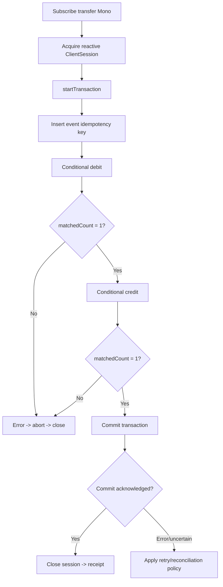
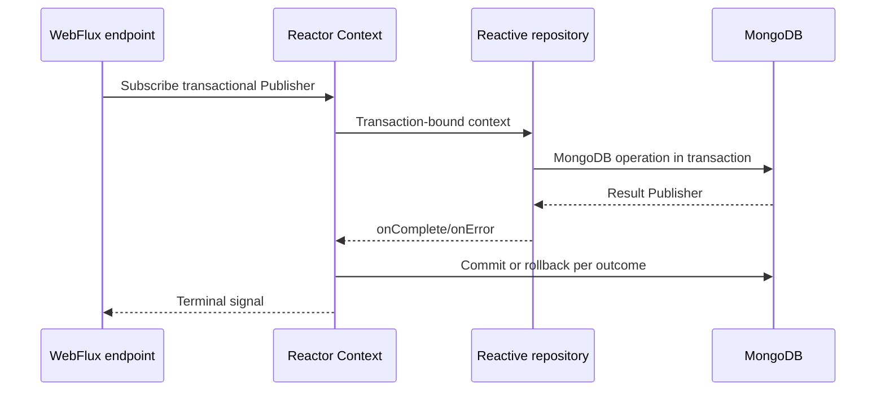

# Manual ClientSession via Template and Repository Integration Limits

## 1. Problem Statement: Why Aren't Two Reactive Commands Automatically in the Same Transaction?

An internal wallet-to-wallet transfer service:

1. Debits the source wallet balance.
2. Credits the destination wallet balance.
3. Inserts a transfer confirmation document.

Business requirement: **either all three changes commit, or all of them roll back**. If the source wallet is debited while the destination wallet is not credited, data becomes inconsistent.

In Spring Data MongoDB, reactive programming uses `Mono`, `Flux`, `ReactiveMongoTemplate`, or `ReactiveMongoRepository`. Creating Publishers in Java **does not automatically mean** MongoDB commands have started. Likewise, placing two calls in the same method or running them on the same thread **does not automatically turn them into a transaction**.

A common mistake:

```java
Mono<UpdateResult> debit = reactiveTemplate.updateFirst(
    debitQuery, debitUpdate, Wallet.class
);

Mono<UpdateResult> credit = reactiveTemplate.updateFirst(
    creditQuery, creditUpdate, Wallet.class
);

return debit.then(credit);
```

This snippet enforces subscription order: **debit followed by credit**. However, without a properly configured session/transaction, **debit can succeed and persist while credit fails**. `then(...)` does not provide atomic commit.

To control a transaction manually, MongoDB provides **`ClientSession`**. Reactive Spring Data MongoDB lets you bind a session to **template operations** via `ReactiveMongoTemplate.withSession(...)`. However, using an explicit session carries major limitations when other code invokes repositories.

This lesson belongs to the **Reactive Transactions** chapter of the **SPRING_DATA_MONGODB** module, where Spring Data is used to connect, map documents, query, aggregate, manage transactions, access MongoDB reactively, test, and diagnose performance. The focus is on:

- Creating and using a **manual reactive `ClientSession`** via `ReactiveMongoTemplate`.
- Distinguishing **session**, **transaction**, **subscription**, and **transaction context**.
- Keeping every command inside the same session, sequential, and properly scoped.
- Handling **commit/abort/close** without missing error or cancellation branches.
- Why standard `ReactiveMongoRepository` calls **do not automatically use an explicit session** attached to a separate template.
- When to switch to **`ReactiveMongoTransactionManager` + `TransactionalOperator` or `@Transactional`**.

This is a technical guide with design examples; always verify illustrative snippets against your exact Spring Data MongoDB, MongoDB driver, and Spring Boot versions before using them in production.

## 2. Four Conceptual Layers to Keep Separate

| Concept | Responsibility | What It Does Not Guarantee Alone |
| --- | --- | --- |
| `ClientSession` | Logical identity and context for a sequence of MongoDB operations | Does not start a transaction by itself |
| `ReactiveMongoTemplate.withSession(...)` | Produces operations bound to an explicit session | Does not automatically enlist separate repositories |
| `startTransaction / commitTransaction / abortTransaction` | Coordinates a transaction on a session | Does not automatically enforce business invariants or proper retries |
| `ReactiveMongoTransactionManager` | Manages reactive transactions via Spring/Reactor context | Does not apply to operations detached onto separate subscriptions |

**Reactive Publisher** is the fifth layer: it governs when the flow actually executes. If you acquire a session at assembly time and close it before subscription, every transactional intent breaks down.

### 2.1. Example: Session Without a Transaction

```text
startSession
  insert A  -> written independently
  insert B  -> written independently
close session
```

If insert B fails, insert A **does not roll back automatically**, because no transaction was started.

### 2.2. Example: Transaction on a Session

```text
startSession
  startTransaction
    insert A
    insert B
  commitTransaction
close session
```

If insert B fails and the transaction aborts, changes inside the transaction are not committed. This requires a MongoDB deployment supporting multi-document transactions; not every MongoDB setup supports them.

### 2.3. Example: Manual Session Does Not Propagate Into Repositories

```java
ReactiveMongoOperations bound =
    template.withSession(sessionPublisher);

Mono<Wallet> a = bound.findById(idA, Wallet.class);
Mono<Wallet> b = walletRepository.findById(idB);
```

`a` uses the operations instance bound to the explicit session; `b` goes through the repository proxy and **is not automatically guaranteed to use that session**. No `ClientSession` parameter is passed through `walletRepository.findById(...)` here.

This **differs** from a repository operation joining a **Spring-managed reactive transaction** properly configured with `ReactiveMongoTransactionManager`. Treat the two session-ownership/binding mechanisms separately and never conflate them.

## 3. Minimum Infrastructure for Reactive Transactions

### 3.1. MongoDB Deployment

MongoDB multi-document transactions require a supported topology, such as a **replica set** or compatible **sharded cluster**. Calling `startTransaction` against an unconfigured standalone MongoDB instance will fail when transactional commands execute.

For local testing, use a genuine **single-node replica set** initialized as a replica set, or Testcontainers MongoDB configured for transactions. Simply having an open port to a MongoDB server is not enough to assume transactions work.

### 3.2. Choosing the Right Reactive Driver

Reactive MongoDB uses reactive client interfaces:

```java
import com.mongodb.reactivestreams.client.MongoClient;
import com.mongodb.reactivestreams.client.ClientSession;
import org.springframework.data.mongodb.core.ReactiveMongoTemplate;
import org.springframework.data.mongodb.core.ReactiveMongoOperations;
```

Do not confuse them with the synchronous API:

```java
// Synchronous — DO NOT use as a reactive ClientSession:
import com.mongodb.client.ClientSession;
```

Both classes share the same simple name yet belong to different packages with different commit/abort methods and lifecycles. Mixing them fails to compile or breaks non-blocking execution.

### 3.3. Which Objects Are Shared?

| Object | Typical Lifecycle | Usage |
| --- | --- | --- |
| `ReactiveMongoClient` / reactive `MongoClient` | Application-scoped, pooled and reused | Shared bean |
| `ReactiveMongoTemplate` | Application-scoped, shared | Shared bean |
| `ReactiveMongoRepository` | Application-scoped proxy | Standard CRUD/queries |
| Reactive `ClientSession` | One scoped sequence, request, or transaction | Acquired and closed per subscription |
| Session-bound `ReactiveMongoOperations` | Never outlives its corresponding session | Used strictly within the resource scope |
| Active `Flux`/cursor | Until completion/error/cancel | Drained/cleaned up before closing session |

Never instantiate a new `MongoClient` per request just to "get a dedicated session." Never store a shared `ClientSession` in a singleton bean.

## 4. Subscription Is When a Session Should Be Acquired

`Mono` and `Flux` are reactive execution descriptions. A Publisher returned from a method may not have a subscriber yet. Thus:

```java
Mono<ClientSession> sessionSource =
    Mono.from(client.startSession());

// Creating the Mono does not mean a session has been allocated.
```

Only when `sessionSource` is subscribed to does the driver request a client session per API semantics. Doing:

```java
ClientSession session = client.startSession().block();
// This is NOT an appropriate reactive pattern.
```

both breaks types on raw `Publisher`s and pulls blocking calls into WebFlux/services. **Never use `block()` to acquire a session inside a reactive pipeline.**

### 4.1. Anti-Pattern: Closing the Session Before Subscription

```java
Mono<Wallet> wrongFlow(ClientSession session) {
    try {
        ReactiveMongoOperations ops =
            template.withSession(Mono.just(session));
        return ops.findById("wallet-1", Wallet.class);
    } finally {
        session.close();
    }
}
```

This method returns a **lazy Publisher**; before the caller even subscribes, `finally` closes the session. Never use lexical `try/finally` inside a method **merely returning a Publisher** without keeping the session alive for the subscription's duration.

### 4.2. Correct: Resource Scope Wrapping the Entire Publisher

Reactor's `Mono.usingWhen`/`Flux.usingWhen` allocates a resource upon subscription and cleans it up on completion, error, or cancellation.

```java
Mono<Wallet> flow = Mono.usingWhen(
    Mono.from(client.startSession()),
    session -> {
        ReactiveMongoOperations ops =
            template.withSession(Mono.just(session));
        return ops.findById("wallet-1", Wallet.class);
    },
    session -> Mono.fromRunnable(session::close)
);
```

Explanation:

1. `Mono.from(client.startSession())` acts as the session resource supplier.
2. Each subscription to `flow` gets its own resource scope.
3. `template.withSession(Mono.just(session))` binds that explicit session to operations.
4. `ops.findById` is consumed **while the session is still alive**.
5. `usingWhen` executes cleanup upon termination; with the three-argument overload, the same async cleanup runs across compatible terminal paths.

The snippet above **does not start a transaction**. It demonstrates proper session lifecycle management with the template.

## 5. Data Model: Source Wallet, Target Wallet, and Transfer Event

### 5.1. Wallet

```java
package example.transfer;

import org.springframework.data.mongodb.core.mapping.Document;
import org.springframework.data.mongodb.core.mapping.FieldType;
import org.springframework.data.mongodb.core.mapping.MongoId;

@Document("wallets")
public record Wallet(
    @MongoId(FieldType.STRING) String id,
    String tenantId,
    long balanceCents
) {}
```

The example uses BSON Int64 for amounts in the smallest unit defined by the system. Multi-currency systems must define units and currencies in the business contract; `balanceCents` is illustrative.

### 5.2. TransferEvent

```java
package example.transfer;

import org.springframework.data.mongodb.core.mapping.Document;
import org.springframework.data.mongodb.core.mapping.FieldType;
import org.springframework.data.mongodb.core.mapping.MongoId;

@Document("transfer_events")
public record TransferEvent(
    @MongoId(FieldType.STRING) String id,
    String tenantId,
    String sourceWalletId,
    String targetWalletId,
    long amountCents
) {}
```

`TransferEvent.id` can act as a server-verified **idempotency key**. Establish policies enforcing key uniqueness, distinguishing retries of the same transfer from new transfers, and returning committed results. Inserting an event with the same `_id` twice hits the `_id` unique constraint, yet **a duplicate key alone does not resolve all network/commit ambiguities**.

### 5.3. Sample Data

```javascript
db.wallets.insertMany([
  {
    _id: "w-a",
    tenantId: "shop-a",
    balanceCents: NumberLong("10000")
  },
  {
    _id: "w-b",
    tenantId: "shop-a",
    balanceCents: NumberLong("2500")
  }
]);

db.transfer_events.createIndex(
  { tenantId: 1, sourceWalletId: 1 },
  { name: "ix_transfer_tenant_source" }
);
```

Goal: transfer 3,000 units from `w-a` to `w-b`:

| State | `w-a` | `w-b` |
| --- | ---: | ---: |
| Before | 10,000 | 2,500 |
| After commit | 7,000 | 5,500 |
| On error and abort | 10,000 | 2,500 |

Ensure both wallets belong to the authorized tenant. Never let clients pass an arbitrary `tenantId` outside their authorized scope.

## 6. ReactiveMongoTemplate.withSession(Publisher<ClientSession>)

At the reactive template layer, you can create **session-bound operations**:

```java
Publisher<ClientSession> sessionPublisher =
    client.startSession(
        ClientSessionOptions.builder()
            .causallyConsistent(true)
            .build()
    );

ReactiveMongoOperations ops =
    template.withSession(sessionPublisher);
```

Relevant imports:

```java
import com.mongodb.ClientSessionOptions;
import com.mongodb.reactivestreams.client.ClientSession;
import com.mongodb.reactivestreams.client.MongoClient;
import org.reactivestreams.Publisher;
import org.springframework.data.mongodb.core.ReactiveMongoOperations;
import org.springframework.data.mongodb.core.ReactiveMongoTemplate;
```

Pass a **reactive `ClientSession` Publisher** to this API, never a synchronous session. Keep its lifecycle within **a single callback/resource scope**; never store session-bound operations in a singleton shared across requests.

### 6.1. Differences From Synchronous MongoTemplate

| Synchronous | Reactive |
| --- | --- |
| `MongoTemplate.withSession(ClientSession)` | `ReactiveMongoTemplate.withSession(Publisher<ClientSession>)` |
| Session opened before a synchronous block | Session typically acquired when Publisher is subscribed to |
| `try (session) { ... }` | `Mono/Flux.usingWhen` or API resource callbacks |
| Sync driver `ClientSession` | Reactive driver `ClientSession` |
| Methods typically return entity/List | Methods typically return `Mono`/`Flux` |

Never blindly copy synchronous `try-with-resources` patterns around a method returning `Flux`; doing so closes the session before downstream consumes the cursor.

### 6.2. Do Not Reuse a Publisher Containing a Closed Session

```java
ClientSession session = ...; // Already acquired from a prior scope.
Mono<ClientSession> source = Mono.just(session);
```

If `source` is retained after the session closes, new subscriptions will operate on an invalid resource. To **acquire a fresh session per subscription**, use the driver's resource Publisher directly inside `usingWhen` and never cache or replay a `ClientSession` object like an ordinary DTO.

### 6.3. Operations Outside the Bound Instance Do Not Join Automatically

```java
ReactiveMongoOperations ops =
    template.withSession(Mono.just(session));

Mono<Wallet> withinSession =
    ops.findById(id, Wallet.class);

Mono<Wallet> outsideExplicitSession =
    walletRepository.findById(id);
```

`outsideExplicitSession` **is not guaranteed** to use the explicit `session` simply because it appears in the same method. To keep every operation inside the same manual session, keep calling `ops` or custom APIs explicitly taking session-bound operations.

## 7. Manual Session Without Transaction: Complete Example

Before adding commit/abort, verify how to keep a session alive properly across operations with ordering semantics.

```java
package example.transfer;

import com.mongodb.ClientSessionOptions;
import com.mongodb.reactivestreams.client.MongoClient;
import org.springframework.data.mongodb.core.ReactiveMongoOperations;
import org.springframework.data.mongodb.core.ReactiveMongoTemplate;
import org.springframework.data.mongodb.core.query.Criteria;
import org.springframework.data.mongodb.core.query.Query;
import org.springframework.stereotype.Service;
import reactor.core.publisher.Mono;

@Service
public class WalletReadSequence {

    private final MongoClient client;
    private final ReactiveMongoTemplate template;

    public WalletReadSequence(
            MongoClient client,
            ReactiveMongoTemplate template) {
        this.client = client;
        this.template = template;
    }

    public Mono<Wallet> findForTenant(
            String authorizedTenantId,
            String walletId) {

        if (authorizedTenantId == null
                || authorizedTenantId.isBlank()) {
            return Mono.error(new IllegalArgumentException(
                "Invalid tenant"
            ));
        }

        return Mono.usingWhen(
            Mono.from(client.startSession(
                ClientSessionOptions.builder()
                    .causallyConsistent(true)
                    .build()
            )),
            session -> {
                ReactiveMongoOperations ops =
                    template.withSession(Mono.just(session));
                Query query = Query.query(
                    Criteria.where("id").is(walletId)
                        .and("tenantId").is(authorizedTenantId)
                );
                return ops.findOne(query, Wallet.class);
            },
            session -> Mono.fromRunnable(session::close)
        );
    }
}
```

This service only **reads a single document**; it does not open a transaction because multi-document atomicity is unnecessary. If durable *read-your-writes* guarantees with secondaries are needed, configure **majority read concern and majority write concern** on the actual operations and execute them sequentially inside a causally consistent session. `causallyConsistent(true)` alone does not upgrade read/write concerns.

### 7.1. When Is an Explicit Session Unnecessary?

Most standalone `findById` or `findOne` queries do not need manual application-level sessions. The driver already uses **implicit sessions** depending on API and deployment. Reach for explicit sessions only when you need to:

- Coordinate a manual transaction.
- Execute multiple operations sharing a **causal context**.
- Orchestrate a workflow where the template API allows managing a single session.
- Explicitly inspect or control session attachment to commands.

Sessions are not a "speed boost" for queries. If a query is slow, examine indexes, aggregation pipelines, and document counts before adding a session.

## 8. Starting a Manual Transaction: Proper Sequence

A manual transaction needs at least:

```text
subscribe
  acquire ClientSession
  startTransaction(TransactionOptions)
  bind session to ReactiveMongoOperations
  execute MongoDB operations sequentially
  check matchedCount and invariants
  commitTransaction (Publisher must be subscribed)
  release ClientSession

If an error occurs before commit:
  abortTransaction if still active
  release ClientSession

If the subscriber cancels:
  abort if a transaction is active when appropriate
  release ClientSession
```

In the reactive driver, `session.startTransaction(...)` sets transaction state on the session, while `session.commitTransaction()` and `session.abortTransaction()` return **Publishers** that must be subscribed to. Never invoke them like synchronous void methods and discard the Publisher.

### 8.1. TransactionOptions

```java
import com.mongodb.ReadConcern;
import com.mongodb.ReadPreference;
import com.mongodb.TransactionOptions;
import com.mongodb.WriteConcern;

TransactionOptions options = TransactionOptions.builder()
    .readConcern(ReadConcern.SNAPSHOT)
    .writeConcern(WriteConcern.MAJORITY)
    .readPreference(ReadPreference.primary())
    .build();
```

- `ReadConcern.SNAPSHOT`: suitable for snapshot reads inside transactions per MongoDB support.
- `WriteConcern.MAJORITY`: configures acknowledgment durability for **transaction commit** per MongoDB semantics.
- `ReadPreference.primary()`: fits most real-world transaction flows.

Do not assume you can arbitrarily vary read preference or concern per individual operation inside the same transaction. Choose transaction options based on topology, server version, and business requirements.

### 8.2. Enforcing Ordering in Reactor

```java
Mono<UpdateResult> debit = ops.updateFirst(
    debitQuery, debitUpdate, Wallet.class
);

Mono<UpdateResult> credit = ops.updateFirst(
    creditQuery, creditUpdate, Wallet.class
);

Mono<Void> ordered = debit
    .flatMap(first -> {
        if (first.getMatchedCount() != 1) {
            return Mono.error(new IllegalStateException(
                "Insufficient funds or invalid source wallet"
            ));
        }
        return credit;
    })
    .flatMap(second -> {
        if (second.getMatchedCount() != 1) {
            return Mono.error(new IllegalStateException(
                "Destination wallet missing or different tenant"
            ));
        }
        return Mono.<Void>empty();
    });
```

This is an **illustrative snippet** assuming `ops`, `debitQuery`, `debitUpdate`, `creditQuery`, and `creditUpdate` are defined in transaction scope. Crucially, **never use `Mono.zip(debit, credit)`** to run two operations concurrently on the same session: driver sessions are not built for concurrent operations that way.

## 9. Sample Transaction Using ReactiveMongoTemplate and usingWhen

The code below demonstrates **session + transaction + cleanup** inside a service. It does not replace a full production retry engine: handling `UnknownTransactionCommitResult` and `TransientTransactionError` is addressed separately.

### 9.1. Request and Result

```java
package example.transfer;

public record TransferCommand(
    String transferId,
    String sourceWalletId,
    String targetWalletId,
    long amountCents
) {}

public record TransferReceipt(
    String transferId,
    String sourceWalletId,
    String targetWalletId,
    long amountCents
) {}
```

`authorizedTenantId` must come from a server-side security layer, never blindly trusting a client-supplied field. `transferId` must correspond to a command/idempotency key validated per system policy.

### 9.2. Service

```java
package example.transfer;

import com.mongodb.ClientSessionOptions;
import com.mongodb.ReadConcern;
import com.mongodb.ReadPreference;
import com.mongodb.TransactionOptions;
import com.mongodb.WriteConcern;
import com.mongodb.reactivestreams.client.ClientSession;
import com.mongodb.reactivestreams.client.MongoClient;
import org.slf4j.Logger;
import org.slf4j.LoggerFactory;
import org.springframework.data.mongodb.core.ReactiveMongoOperations;
import org.springframework.data.mongodb.core.ReactiveMongoTemplate;
import org.springframework.data.mongodb.core.query.Criteria;
import org.springframework.data.mongodb.core.query.Query;
import org.springframework.data.mongodb.core.query.Update;
import org.springframework.stereotype.Service;
import reactor.core.publisher.Mono;

@Service
public class ManualTransferService {

    private static final Logger log =
        LoggerFactory.getLogger(ManualTransferService.class);

    private final MongoClient client;
    private final ReactiveMongoTemplate template;

    public ManualTransferService(
            MongoClient client,
            ReactiveMongoTemplate template) {
        this.client = client;
        this.template = template;
    }

    public Mono<TransferReceipt> transfer(
            String authorizedTenantId,
            TransferCommand command) {

        if (authorizedTenantId == null
                || authorizedTenantId.isBlank()
                || command == null
                || command.transferId() == null
                || command.transferId().isBlank()
                || command.sourceWalletId() == null
                || command.targetWalletId() == null
                || command.sourceWalletId().equals(
                    command.targetWalletId())
                || command.amountCents() <= 0) {
            return Mono.error(new IllegalArgumentException(
                "Invalid transfer request"
            ));
        }

        return Mono.usingWhen(
            Mono.from(client.startSession(
                ClientSessionOptions.builder().build()
            )),
            session -> executeInTransaction(
                session, authorizedTenantId, command
            ),
            session -> Mono.fromRunnable(session::close),
            (session, failure) -> abortAndClose(session),
            session -> abortAndClose(session)
        );
    }

    private Mono<TransferReceipt> executeInTransaction(
            ClientSession session,
            String tenantId,
            TransferCommand command) {

        return Mono.defer(() -> {
            TransactionOptions options =
                TransactionOptions.builder()
                    .readConcern(ReadConcern.SNAPSHOT)
                    .writeConcern(WriteConcern.MAJORITY)
                    .readPreference(ReadPreference.primary())
                    .build();

            session.startTransaction(options);

            ReactiveMongoOperations ops =
                template.withSession(Mono.just(session));

            TransferEvent event = new TransferEvent(
                command.transferId(),
                tenantId,
                command.sourceWalletId(),
                command.targetWalletId(),
                command.amountCents()
            );

            Query source = Query.query(
                Criteria.where("id")
                    .is(command.sourceWalletId())
                    .and("tenantId").is(tenantId)
                    .and("balanceCents")
                    .gte(command.amountCents())
            );

            Query target = Query.query(
                Criteria.where("id")
                    .is(command.targetWalletId())
                    .and("tenantId").is(tenantId)
            );

            Mono<TransferReceipt> work =
                ops.insert(event)
                    // Insert event first: duplicate ID fails the
                    // transaction before debit/credit run.
                    .then(ops.updateFirst(
                        source,
                        new Update().inc(
                            "balanceCents",
                            -command.amountCents()
                        ),
                        Wallet.class
                    ))
                    .flatMap(debit -> {
                        if (debit.getMatchedCount() != 1) {
                            return Mono.error(
                                new IllegalStateException(
                                    "Insufficient funds in source wallet"
                                )
                            );
                        }
                        return ops.updateFirst(
                            target,
                            new Update().inc(
                                "balanceCents",
                                command.amountCents()
                            ),
                            Wallet.class
                        );
                    })
                    .flatMap(credit -> {
                        if (credit.getMatchedCount() != 1) {
                            return Mono.error(
                                new IllegalStateException(
                                    "Invalid destination wallet"
                                )
                            );
                        }

                        return Mono.just(new TransferReceipt(
                            command.transferId(),
                            command.sourceWalletId(),
                            command.targetWalletId(),
                            command.amountCents()
                        ));
                    });

            return work.flatMap(receipt ->
                Mono.from(session.commitTransaction())
                    .thenReturn(receipt)
            );
        });
    }

    private Mono<Void> abortAndClose(
            ClientSession session) {

        return Mono.defer(() -> {
            Mono<Void> abort = session.hasActiveTransaction()
                ? Mono.from(session.abortTransaction())
                : Mono.empty();

            return abort
                .doOnError(error ->
                    log.error(
                        "Failed to abort MongoDB transaction; " +
                        "reconciliation required. exceptionType={}",
                        error.getClass().getSimpleName()
                    )
                )
                .onErrorResume(error -> Mono.empty())
                .then(Mono.fromRunnable(session::close));
        });
    }
}
```

**Scope note for this example:** the code shows the **core lifecycle**; it is **not** a production transaction retry engine. The abort/cleanup path logs only the exception class for investigation without exposing sensitive payloads. `onErrorResume` ensures cleanup still proceeds to closing the session if abort fails, **which does not mean an abort error is resolved in business terms**; production systems require monitoring, alerts, and reconciliation. Uncertain commit states still need dedicated handling by error labels, idempotency, and checking whether the transaction already committed.

### 9.3. Why Does This Code Not Commit Early?

`ops.insert(...)` and `ops.updateFirst(...)` both return Publishers. They are sequenced via `then`/`flatMap`, and `commitTransaction()` runs inside `flatMap(receipt -> ...)` **only after all operations complete** and all `matchedCount` checks pass.

If debit or credit fails to match:

1. `work` emits an error.
2. The commit branch never runs.
3. `usingWhen` invokes error cleanup.
4. Cleanup attempts to abort the active transaction and closes the session.
5. No success receipt is returned.

If any write fails due to a MongoDB write error, execution also takes the error cleanup path.

### 9.4. Why Not Use zip for Debit and Credit?

`Mono.zip(debit, credit)` can subscribe to both Publishers simultaneously. When both share **the same ClientSession**, this violates the recommended sequential execution model for sessions/transactions and destroys the ordering needed to validate debit before credit.

Proper flow:



**Never** misread this diagram as implying that every commit error can simply be aborted to guarantee nothing was written. In particular, when the commit outcome is **unknown**, the server may have committed even though the client received no response.

## 10. Resource Ownership: Complete, Error, and Cancel

### 10.1. Why Use the Five-Argument Overload of usingWhen?

`Mono.usingWhen` provides an overload with distinct cleanup branches:

```java
Mono.usingWhen(
    resourcePublisher,
    resource -> useResource(resource),
    resource -> cleanupOnComplete(resource),
    (resource, error) -> cleanupOnError(resource, error),
    resource -> cleanupOnCancel(resource)
);
```

In a manual transaction:

- **Complete:** transaction committed successfully; just close the session.
- **Error:** if a transaction is still active, attempt abort, then close the session.
- **Cancel:** if the stream still holds a transaction, clean up/abort as supported by the driver.

Do not use `doFinally(session::close)` on an asynchronously acquired session without proper ownership handling, because `doFinally` does not await asynchronous cleanup Publishers. `usingWhen` models cleanup directly as part of the reactive flow.

### 10.2. Cancellation Does Not Guarantee Rollback

If a subscriber cancels after the server already processed the transaction commit but before the response reached the client, the commit outcome is **uncertain** from the application's perspective.

```text
Client subscribes transfer
  MongoDB processes commit
  network/HTTP client disconnects
  client never receives receipt

Accurate state to investigate:
  May have committed
  May not have committed
  Must NOT assume "definitely rolled back"
```

Calling abort inside the cancel handler when a session appears active **is no magic bullet** for that ambiguity. You still need **idempotency keys, checks against committed events/ledgers, label-appropriate retries, and reconciliation**.

### 10.3. Close Cursors Before Closing the Session

If a transaction uses a `Flux` reading multiple documents via a cursor, never let a live `Flux` escape the resource scope after the session closes. Use `Flux.usingWhen` and ensure cursors are drained or cleaned up before closing the session.

Never hold a transaction open for seconds just to stream hundreds of megabytes to an HTTP client; transactions should be short, bounded, and wrap only operations genuinely needing atomicity.

## 11. Manual Transactions Cover MongoDB Commands Only

A transaction protects **MongoDB operations executing inside that transaction**; it does not make any of the following atomic:

- Sending emails.
- Calling HTTP payment gateways.
- Writing to a separate database outside the transaction.
- Publishing Kafka messages directly from another thread.
- Updating entries in a Redis cache.

### 11.1. Anti-Pattern: Calling External Services While a Transaction Is Open

```java
return transferMongoWrites()
    .flatMap(result -> externalPaymentApi.capture());
```

If the external payment API fails, the MongoDB transaction cannot roll back **effects that already occurred** on the payment system. Conversely, if payment was captured before commit and the MongoDB commit fails, state diverges as well.

For multi-system workflows, consider the **outbox pattern, sagas, idempotent event consumers**, or controlled reconciliation. Never treat a MongoDB `ClientSession` as a system-wide distributed transaction manager.

### 11.2. Never Hold a Transaction Open Waiting on a User

Never open a session/transaction and hand out a token expecting a subsequent request minutes later to resume the same open session. Doing so causes resource leaks, timeouts, concurrency bottlenecks, and failover failures.

Instead, keep each request/workflow cleanly bounded. Design long-running workflows using state machines or resumable jobs.

## 12. Repository Integration Limits: Two Separate Paths

### 12.1. Explicit Session via Template

```java
ReactiveMongoOperations txOps =
    template.withSession(Mono.just(session));

Mono<Wallet> fromTemplate =
    txOps.findById(sourceWalletId, Wallet.class);

Mono<Wallet> fromRepository =
    walletRepository.findById(targetWalletId);
```

**`fromRepository` is not automatically attached to the explicit `session`** just because both appear in the same method. The repository proxy does not take a `ClientSession` argument on `findById`.

If you later write:

```java
return fromTemplate
    .flatMap(wallet ->
        walletRepository.save(wallet)
    );
```

`save` can execute **outside the manual transaction** and commit independently, violating the assumption that "the whole method shares a transaction."

### 12.2. Does This Mean Reactive Repositories Cannot Use Transactions?

Do not jump to that absolute conclusion. **Explicit manual sessions** and **Spring-managed reactive transactions** integrate differently:

- With **explicit sessions via `withSession`**, you must keep all operations in the manual workflow on **session-bound template operations**. Repository calls lack session parameters to automatically inherit explicit sessions.
- With **`ReactiveMongoTransactionManager`**, Spring binds the session/transaction to the reactive context so compatible template operations and repositories join when configured properly; verify your exact version and test behavior.

**Never treat repository participation in a Spring-managed transaction as proof that repositories automatically join every explicit manual session.**

### 12.3. API Selection Table

| Requirement | Consider Using | Boundary to Remember |
| --- | --- | --- |
| Single reactive CRUD operation | `ReactiveMongoRepository` | Usually needs no explicit session |
| Complex query wanting explicit session control | `ReactiveMongoTemplate.withSession` | Only bound operations join the manual session |
| Multiple repositories in a service transaction | `ReactiveMongoTransactionManager` + `TransactionalOperator` / `@Transactional` | Shared reactive transaction context |
| Flow requiring custom commit/abort logic | Manual `ClientSession`/template | Must handle errors, retries, and cleanup yourself |
| Workflows spanning outside MongoDB | Outbox/saga/reconciliation | MongoDB sessions are not atomic across external systems |

## 13. The Usually More Maintainable Solution: ReactiveMongoTransactionManager

### 13.1. Transaction Manager Bean

```java
package example.transfer;

import org.springframework.context.annotation.Bean;
import org.springframework.context.annotation.Configuration;
import org.springframework.data.mongodb.ReactiveMongoDatabaseFactory;
import org.springframework.data.mongodb.ReactiveMongoTransactionManager;

@Configuration
public class ReactiveTransactionConfiguration {

    @Bean
    ReactiveMongoTransactionManager reactiveMongoTransactionManager(
            ReactiveMongoDatabaseFactory factory) {
        return new ReactiveMongoTransactionManager(factory);
    }
}
```

The transaction manager binds MongoDB transactions to the subscription's **Reactor Context**. As a result, compatible reactive Spring Data operations and repositories share the transaction-bound session without manually threading an explicit `ClientSession` through every method.

### 13.2. TransactionalOperator

```java
package example.transfer;

import org.springframework.stereotype.Service;
import org.springframework.transaction.reactive.TransactionalOperator;
import reactor.core.publisher.Mono;

@Service
public class ManagedTransferService {

    private final WalletRepository walletRepository;
    private final TransactionalOperator tx;

    public ManagedTransferService(
            WalletRepository walletRepository,
            TransactionalOperator tx) {
        this.walletRepository = walletRepository;
        this.tx = tx;
    }

    public Mono<Void> runAsTransaction(
            String sourceId,
            String targetId) {

        Mono<Void> operations =
            walletRepository.findById(sourceId)
                .switchIfEmpty(Mono.error(
                    new IllegalStateException("Source wallet missing")
                ))
                .flatMap(source ->
                    walletRepository.findById(targetId)
                )
                .switchIfEmpty(Mono.error(
                    new IllegalStateException("Target wallet missing")
                ))
                .then();

        return operations.as(tx::transactional);
    }
}
```

This is an **example of placing a transaction boundary**, without actual transfer mutations, and must not be used as a real payment service. `WalletRepository` must be declared by the application; `TransactionalOperator` can be created via:

```java
import org.springframework.context.annotation.Bean;
import org.springframework.context.annotation.Configuration;
import org.springframework.data.mongodb.ReactiveMongoTransactionManager;
import org.springframework.transaction.reactive.TransactionalOperator;

@Configuration
public class ReactiveOperatorConfiguration {

    @Bean
    TransactionalOperator transactionalOperator(
            ReactiveMongoTransactionManager manager) {
        return TransactionalOperator.create(manager);
    }
}
```

`operations.as(tx::transactional)` composes the transaction onto a Publisher; the transaction begins when the chain is subscribed to under the reactive contract. Never call `subscribe()` on another branch inside a callback, as that creates a **new subscription** that may not share the transaction context.

### 13.3. @Transactional With Mono/Flux

```java
@Service
public class TransactionalWalletService {

    private final WalletRepository wallets;

    public TransactionalWalletService(
            WalletRepository wallets) {
        this.wallets = wallets;
    }

    @Transactional(
        transactionManager = "reactiveMongoTransactionManager"
    )
    public Mono<Wallet> readInsideTransaction(String id) {
        return wallets.findById(id);
    }
}
```

This illustrates a **Spring-managed transaction** on a method returning `Mono`. In production, ensure:

- The Spring-managed bean is invoked through the proper proxy; self-invocation bypasses the transaction interceptor.
- The reactive transaction manager exists and is properly selected.
- The MongoDB topology supports transactions.
- The pipeline is **subscribed** within the boundary.
- Blocking `MongoTemplate`/synchronous repositories are never called inside reactive transactions expecting them to share the context.

**Do not assume `@Transactional` automatically handles every manual session workflow**: if code uses the raw driver with its own explicit session or nested subscriptions, those calls can fall outside Spring's transaction.

## 14. How ThreadLocal and Reactor Context Differ

In synchronous code, transactions typically attach to thread-bound resources. In reactive flows, a chain can switch threads mid-execution. Spring reactive transactions rely on **Reactor Context** rather than pinning a fixed `ThreadLocal` across the pipeline.



### 14.1. Nested subscribe Is a Severe Boundary Bug

```java
return tx.transactional(
    walletRepository.findById(id)
        .doOnNext(wallet -> {
            walletRepository.save(wallet).subscribe();
        })
);
```

`save(...).subscribe()` launches an independent subscription. The outer chain can commit before the save finishes, and the save is not guaranteed to share the transaction context.

Fix:

```java
return tx.transactional(
    walletRepository.findById(id)
        .flatMap(wallet ->
            walletRepository.save(wallet)
        )
);
```

`flatMap` composes the second operation into the same pipeline; of course, still enforce update rules, tenant checks, and concurrency controls.

### 14.2. Using zip Inside a Transaction Is Also Dangerous

```java
// Do NOT use to run two commands concurrently on the same session:
Mono.zip(
    txOps.updateFirst(queryA, updateA, Wallet.class),
    txOps.updateFirst(queryB, updateB, Wallet.class)
);
```

A MongoDB session/transaction should not execute concurrent operations on the same session. Use `then`/`flatMap`/`concatMap` sequentially; never let a high-concurrency `flatMap` fire multiple commands simultaneously inside one transaction.

## 15. Cancellation, Errors, and Commit Ambiguity

### 15.1. Three Distinct Failure Categories

| Scenario | Meaning | Handling |
| --- | --- | --- |
| Write error before commit | An operation inside the transaction failed | Abort if appropriate, close session, propagate error |
| `TransientTransactionError` | Transient transaction-related failure | Consider retrying the **whole transaction** per guidelines |
| `UnknownTransactionCommitResult` | Client cannot verify whether commit completed | Retry **commit** per guidelines; do not blindly replay business side effects |

Never write:

```java
return transferMono.retry(3);
```

around arbitrary exceptions claiming exactly-once semantics. `retry` creates a new subscription, a new session, and **re-executes the operation**. If the prior attempt committed yet the response was lost, the new transaction can produce duplicate business side effects without idempotency.

### 15.2. Retrying Transactions With the Right Scope

A real retry policy must consider:

1. Does the MongoDB error label permit retrying?
2. Did the error happen **before commit** or **during commit**?
3. Can commit be retried on the same session?
4. When retrying a whole transaction, does an idempotency key block duplicate business execution?
5. Are there non-MongoDB side effects inside the callback?
6. Are there a deadline and a maximum attempt limit?

**The manual transaction example in section 9 does not implement full commit-retry handling.** This is an explicit, intentional limitation; if production needs production-grade retries, follow MongoDB driver guidelines and consider using a transaction manager to cut down on custom lifecycle boilerplate.

### 15.3. Cancellation and Timeouts Do Not Determine the Final Outcome

```java
Mono<TransferReceipt> bounded =
    manualService.transfer(tenant, command)
        .timeout(Duration.ofSeconds(5));
```

A Reactor timeout can cancel upstream. Yet if the server already processed the commit, the client **must not assume rollback**. For payments/transfers, responses must clearly distinguish **confirmed success**, **confirmed failure**, and **unknown state pending reconciliation**.

## 16. Testing Real Transactions: Minimum Scenarios

A trustworthy test does not merely verify that a method returns a `Mono`. It must verify **database state after commit and rollback**.

### 16.1. Environment

- A MongoDB test deployment supporting **multi-document transactions**.
- A reactive MongoDB driver compatible with your Spring Data/Boot versions.
- Testcontainers or a properly initialized MongoDB test replica set.
- An isolated test database/collection or randomized IDs to prevent collisions.
- Never run destructive migration or transaction tests against production.

### 16.2. Testing Commit

Fixture:

```javascript
db.wallets.insertMany([
  { _id: "a", tenantId: "test", balanceCents: NumberLong("10000") },
  { _id: "b", tenantId: "test", balanceCents: NumberLong("1000") }
]);
```

Invoke `transfer(test, 3000)`, then read back **outside the finished transaction**:

```text
Wallet a.balanceCents == 7000
Wallet b.balanceCents == 4000
transfer_events contains the exact event for the requested transferId
```

Do not just assert that `Mono<TransferReceipt>` emitted a value: a bug could return a receipt before commit if written incorrectly.

### 16.3. Testing Rollback

Set up a scenario where the source has sufficient funds but the destination does not exist:

```text
Before:
  a = 10000
  b = does not exist

Operations:
  insert transfer event (inside transaction)
  debit a
  credit b matchedCount == 0
  abort

After:
  a still == 10000
  no new transfer event exists
```

If debit had accidentally run through a repository **outside the explicit manual session**, this test catches it immediately because `a`'s balance drops despite the template transaction aborting.

### 16.4. Testing Duplicate transferId

Submit two requests with the same `transferId` after the first commits. The second must not deduct funds again. In the sample code, setting `_id = transferId` causes the second insert to conflict; the service should turn that error into a well-defined contract:

- If the idempotency key and payload match a committed result, return the existing receipt if permitted after verification.
- If the key matches but the payload differs, return a conflict error.
- If commit status is unknown, reconcile per policy; never treat duplicate key as a transient system error for infinite retries.

### 16.5. Never Test on Standalone and Assume Passing Means Success

A test that merely saves one document and reads it back passes on standalone MongoDB without ever exercising real transactions. Integration tests must **actually invoke `startTransaction` and execute at least two writes that commit/abort together** on a proper topology.

## 17. JUnit 5 and StepVerifier: Business Verification Example

Assuming the test context provides `ManualTransferService`, reactive `MongoTemplate`, and a MongoDB replica set:

```java
package example.transfer;

import static org.junit.jupiter.api.Assertions.*;

import java.util.UUID;
import org.junit.jupiter.api.Test;
import org.springframework.beans.factory.annotation.Autowired;
import org.springframework.boot.test.autoconfigure.data.mongo.DataMongoTest;
import org.springframework.context.annotation.Import;
import org.springframework.data.mongodb.core.ReactiveMongoTemplate;
import reactor.core.publisher.Mono;
import reactor.test.StepVerifier;

@DataMongoTest
@Import(ManualTransferService.class)
class ManualTransferTransactionTest {

    @Autowired
    ReactiveMongoTemplate template;

    @Autowired
    ManualTransferService service;

    @Test
    void commitsBothWalletUpdatesAndEvent() {
        String suffix = UUID.randomUUID().toString();
        String tenant = "tenant-" + suffix;
        String sourceId = "source-" + suffix;
        String targetId = "target-" + suffix;
        String transferId = "transfer-" + suffix;

        Mono<Void> seed = template.insert(
                new Wallet(sourceId, tenant, 10000L)
            )
            .then(template.insert(
                new Wallet(targetId, tenant, 2500L)
            ))
            .then();

        StepVerifier.create(seed)
            .verifyComplete();

        StepVerifier.create(service.transfer(
            tenant,
            new TransferCommand(
                transferId, sourceId, targetId, 3000L
            )
        ))
            .assertNext(receipt ->
                assertEquals(transferId,
                    receipt.transferId())
            )
            .verifyComplete();

        StepVerifier.create(
            template.findById(sourceId, Wallet.class)
        )
            .assertNext(wallet ->
                assertEquals(7000L, wallet.balanceCents())
            )
            .verifyComplete();

        StepVerifier.create(
            template.findById(targetId, Wallet.class)
        )
            .assertNext(wallet ->
                assertEquals(5500L, wallet.balanceCents())
            )
            .verifyComplete();

        StepVerifier.create(
            template.findById(transferId, TransferEvent.class)
        )
            .assertNext(event ->
                assertEquals(3000L, event.amountCents())
            )
            .verifyComplete();
    }
}
```

**Setup note:** this snippet omits Testcontainers/replica-set wiring and fixture cleanup since those vary by project version. Supply a transaction-capable MongoDB test instance, reactive `MongoClient`/template beans, and proper permissions. Randomized IDs reduce collisions but do not replace an isolated test database and teardown.

### 17.1. Testing Rollback With StepVerifier

Add a test inside the same class:

```java
@Test
void abortsWhenTargetWalletIsMissing() {
    String suffix = UUID.randomUUID().toString();
    String tenant = "tenant-" + suffix;
    String sourceId = "source-" + suffix;
    String missingTarget = "missing-" + suffix;
    String transferId = "transfer-" + suffix;

    StepVerifier.create(template.insert(
        new Wallet(sourceId, tenant, 10000L)
    ))
        .expectNextCount(1)
        .verifyComplete();

    StepVerifier.create(service.transfer(
        tenant,
        new TransferCommand(
            transferId, sourceId, missingTarget, 3000L
        )
    ))
        .expectError(IllegalStateException.class)
        .verify();

    StepVerifier.create(template.findById(
        sourceId, Wallet.class
    ))
        .assertNext(wallet ->
            assertEquals(10000L, wallet.balanceCents())
        )
        .verifyComplete();

    StepVerifier.create(template.findById(
        transferId, TransferEvent.class
    ))
        .verifyComplete(); // No committed event exists.
}
```

This is the most critical test separating a **real transaction** from two sequential yet non-atomic writes.

### 17.2. Do Not Test Timeouts Using Arbitrary Sleeps

Never write tests demanding "MongoDB must time out after 1 ms" over a tiny document set. For cancellation, failover, and commit ambiguity, use controlled test environments, **fakes/test hooks** for resource lifecycles, and verify error labels and commit counts practically. Basic commit/rollback functional tests do not need artificial replication lag.

## 18. Testing Resource Cleanup on Error and Cancel

### 18.1. What to Prove

A solid resource test should verify:

| Scenario | Expectation |
| --- | --- |
| Transaction commits successfully | Session closes after commit |
| Business logic signals an error | Aborts if active, session closes |
| MongoDB operation signals an error | Cleanup runs; error is not turned into success |
| Subscriber cancels | Cleanup runs per subscription lifecycle |
| Commit status unknown | Do not assert rollback or success without proof |

### 18.2. Standalone Reactor usingWhen Test

```java
import static org.junit.jupiter.api.Assertions.*;

import java.util.concurrent.atomic.AtomicBoolean;
import org.junit.jupiter.api.Test;
import reactor.core.publisher.Mono;
import reactor.test.StepVerifier;

class ReactiveResourceScopeTest {

    @Test
    void closesResourceOnSuccess() {
        AtomicBoolean closed = new AtomicBoolean();

        Mono<String> result = Mono.usingWhen(
            Mono.just("resource"),
            resource -> Mono.just("done"),
            resource -> Mono.fromRunnable(
                () -> closed.set(true)
            )
        );

        StepVerifier.create(result)
            .expectNext("done")
            .verifyComplete();

        assertTrue(closed.get());
    }

    @Test
    void closesResourceOnError() {
        AtomicBoolean closed = new AtomicBoolean();

        Mono<String> result = Mono.usingWhen(
            Mono.just("resource"),
            resource -> Mono.error(
                new IllegalStateException("failure")
            ),
            resource -> Mono.fromRunnable(
                () -> closed.set(true)
            )
        );

        StepVerifier.create(result)
            .expectError(IllegalStateException.class)
            .verify();

        assertTrue(closed.get());
    }
}
```

This test proves **Reactor resource lifecycle** behavior, not that the driver sent `abortTransaction`. For the manual service, use an injectable session factory or Mockito-backed wrapper to verify `commitTransaction`/`abortTransaction`/`close`; mocking driver Publisher APIs directly requires exact Publisher stubbing and must never replace real transaction integration tests.

### 18.3. Cancellation Requires Dedicated Testing

In a reactive test:

```java
AtomicBoolean closed = new AtomicBoolean();

Mono<String> neverEnding = Mono.usingWhen(
    Mono.just("resource"),
    resource -> Mono.never(),
    resource -> Mono.fromRunnable(
        () -> closed.set(true)
    )
);

StepVerifier.create(neverEnding)
    .thenCancel()
    .verify();

assertTrue(closed.get());
```

This snippet can be added as an appropriate test method. When async cleanup Publishers perform real asynchronous I/O, use synchronization/test instrumentation to await cleanup completion; never assume a `doFinally` callback finished all I/O by the time an assertion executes.

## 19. Verifying Commands Belong to the Same Session

### 19.1. Observing Commands With CommandListener

The MongoDB driver provides `CommandListener` to inspect `CommandStartedEvent` metadata in test environments.

```java
import com.mongodb.event.CommandListener;
import com.mongodb.event.CommandStartedEvent;

public final class SessionCommandObserver
        implements CommandListener {

    @Override
    public void commandStarted(CommandStartedEvent event) {
        String name = event.getCommandName();

        if (!"update".equals(name)
                && !"insert".equals(name)
                && !"commitTransaction".equals(name)
                && !"abortTransaction".equals(name)) {
            return;
        }

        boolean hasSession =
            event.getCommand().containsKey("lsid");
        boolean hasTransactionNumber =
            event.getCommand().containsKey("txnNumber");

        System.out.println(
            name + " lsid=" + hasSession
                + " txnNumber=" + hasTransactionNumber
        );
    }
}
```

You must **register the listener on `MongoClientSettings`** before constructing the client. This class does not activate automatically. In production, never log full commands containing sensitive IDs, tenants, or payloads without redaction.

**Important:** the MongoDB driver can use **implicit sessions**; seeing `lsid` on two commands only proves they carry session metadata, **not that they share the same explicit session or transaction**. To verify properly:

1. Compare safely redacted `lsid` values across commands.
2. Inspect `txnNumber` and transaction fields per driver/server semantics.
3. Observe `commitTransaction` or `abortTransaction`.
4. Verify final database state after commit or rollback.

### 19.2. Why Can a Repository "Leak" Outside a Manual Transaction?

`walletRepository.save(...)` does not magically pick up a session ID from `template.withSession(Mono.just(session))`. To catch leaks:

- Write a rollback integration test mixing one repository call and one bound template call to see what actually rolls back.
- Use command monitoring to verify `lsid` and transaction metadata.
- Fix the code so every manual workflow operation goes through `ops`, or migrate the entire workflow to a Spring-managed transaction.

**Never** run experiments in production to verify this; transaction rollback tests write and delete data.

## 20. Debugging Common Issues

| Symptom | Likely Cause | Fix |
| --- | --- | --- |
| Error "transaction numbers are only allowed on a replica set" | Standalone MongoDB or unsupported topology | Use a replica set or transaction-capable sharded deployment |
| Reactive code complains of wrong `ClientSession` type | Sync vs. reactive package mismatch | Use `com.mongodb.reactivestreams.client.ClientSession` |
| Query runs after session closed | Closed at assembly before Publisher subscribed | Use `usingWhen`/resource callbacks |
| Commit runs before writes | Publishers not chained in order | Use `then`/`flatMap`; commit only after results |
| Transaction fails when two commands run together | `zip` or concurrent `flatMap` on one session | Serialize operations |
| One change persists after abort | Command ran via repository/template outside manual session | Use bound `ops`; inspect `lsid` |
| `@Transactional` present yet no rollback | Wrong transaction manager/proxy/context | Check reactive TM, subscription, and topology |
| `subscribe()` inside service | Creates independent subscription | Compose with `flatMap` |
| Commit times out, service retries and deducts twice | Unknown commit result without idempotency | Retry commit per label; reconcile |
| HTTP canceled yet DB wrote data | Server processed/committed before cancel | Design unknown-outcome responses and idempotency |
| Session leak or pool exhaustion | Missing cleanup or overly long transactions | Handle complete/error/cancel in `usingWhen`; add metrics |
| Creating a new `MongoClient` per request | Wrong client/pool lifecycle | Use a shared singleton bean |
| `Mono.block()` inside WebFlux | Blocks event loop and breaks reactive model | Return/compose Publishers |
| Duplicate transfer ID error | Idempotency conflict or client retry | Distinguish matching-payload retries from conflicts |
| `matchedCount = 0` yet transaction commits | Missing business invariant check | Validate every update before committing |
| Tests pass on standalone | Tests never exercised real transactions | Use a replica set and test multi-document commit/abort |
| `lsid` appears in logs so assumed same session | Implicit sessions also include `lsid` | Compare session IDs and transaction metadata |

### Pre-Merge Design Checklist

1. Are reactive `MongoClient`/`ReactiveMongoTemplate` shared singleton beans?
2. Is `ClientSession` acquired at subscription time and never closed prior to subscription?
3. Do all commands in a **manual transaction** go through session-bound operations?
4. Are any repository calls left unbound to the manual session?
5. Are commands inside the session executed **sequentially**?
6. Does `startTransaction` run before writes and `commit` after all validations?
7. Is `abortTransaction` handled on both error and cancellation?
8. Is session closing guaranteed on every terminal signal?
9. Are write errors, transient transaction errors, and unknown commit results distinguished?
10. Are idempotency and reconciliation in place for network timeouts?
11. Are tenant filters, balance checks, and `matchedCount` assertions enforced?
12. Are there real rollback tests running against a replica set?
13. Is command monitoring/testing verifying shared sessions and transactions?
14. Are long HTTP I/O calls and long-running streams kept out of transactions?
15. If preferring repositories, are you using **Spring-managed transactions** instead of non-propagating explicit sessions?

## 21. Practice Exercises

### Exercise 1 — Session Without Transaction

Create a `Mono.usingWhen` allocating a reactive `ClientSession` and run two `ReactiveMongoOperations` inside that session. Intentionally fail the second operation **without calling `startTransaction`**, and observe whether the first rolls back. Explain why.

### Exercise 2 — Closing Sessions at the Right Lifecycle Stage

Write a buggy method that opens a session and closes it in `finally` before returning `Mono<Wallet>`. Fix it with `Mono.usingWhen`, test success/error/cancel branches, and verify cleanup.

### Exercise 3 — Manual Transaction

Implement a 3,000-unit transfer between two wallets using `startTransaction`, `ReactiveMongoTemplate.withSession`, conditional `updateFirst`, `commitTransaction`, `abortTransaction`, and `close`. Add tests for both commit and rollback paths.

### Exercise 4 — Commands Leaking Out of the Session

Inside a manual transaction, invoke an update via a standard `walletRepository` instead of `sessionOps`. Use a rollback test and command monitoring to analyze the difference. Then fix it so all operations use the template-bound session.

### Exercise 5 — ReactiveMongoTransactionManager

Configure `ReactiveMongoTransactionManager` and `TransactionalOperator`, and rewrite the transfer using repository operations inside a transaction-bound reactive context. Compare the session cleanup code volume against the manual approach.

### Exercise 6 — No Nested Subscribe

Introduce a bug using `doOnNext(x -> repository.save(x).subscribe())` inside a transaction. Explain why the save can execute outside the boundary; fix it with `flatMap` and write an integration test.

### Exercise 7 — Concurrency

Replace sequential `then/flatMap` with `Mono.zip` to run debit and credit concurrently on one session. Analyze why this pattern is discouraged and restore sequential ordering. Never run uncontrolled concurrency experiments against production.

### Exercise 8 — Commit Ambiguity

Simulate a network failure at commit time. Design an idempotency key, committed-event lookup, and retry rules restricted to permitted error labels. Distinguish **commit retry** from **whole-transaction retry**.

### Exercise 9 — Cancellation

Write a resource test with `Mono.never()` to cancel a subscription mid-flight and verify the cleanup path. Then design a proper transaction cancellation integration test, noting why server rollback cannot be guaranteed if commit already finished.

### Exercise 10 — Testcontainers

Spin up a MongoDB test replica set, seed two wallets, invoke `transfer`, and verify total balance remains constant across both commit and abort paths. Add a duplicate `transferId` test and verify the event is never recorded twice.

### Self-Check Questions

- Does creating a `ClientSession` automatically start a transaction?
- What session type does `ReactiveMongoTemplate.withSession(...)` take, and why is it a Publisher?
- Why must the session scope span the subscription rather than the Java method returning `Mono`?
- Can synchronous `MongoTemplate.withSession` be used with a reactive `ClientSession`?
- How does `Mono.usingWhen` handle complete/error/cancel differently from `doFinally`?
- Why doesn't a manual template session propagate into `ReactiveMongoRepository.save`?
- Which mechanism do Spring-managed reactive transactions use to propagate transaction context?
- How do `TransactionalOperator` and `@Transactional` differ from explicit manual sessions in resource ownership?
- Why is using `Mono.zip` for two writes on the same session risky?
- What must be done for `session.commitTransaction()` in the reactive driver to actually execute?
- If an update inside a transaction reports `matchedCount=0`, why must the transaction abort?
- Does an HTTP client cancel guarantee MongoDB aborted the transaction?
- How does `UnknownTransactionCommitResult` differ from `TransientTransactionError`?
- Why shouldn't you place an unconditional `retry(3)` around `transfer`?
- Does seeing `lsid` on a command prove it belongs to the right manual transaction?
- Why might transaction tests on standalone MongoDB fail to verify your goal?

## Key Takeaways

**A manual `ClientSession` in reactive Spring Data MongoDB must follow the subscription lifecycle.** Use the reactive driver's `ClientSession`, bind it via **`ReactiveMongoTemplate.withSession(Publisher<ClientSession>)`**, and keep every operation of a **manual transaction** on the session-bound `ReactiveMongoOperations`. Start the transaction before writes, execute Publishers **sequentially**, validate business invariants, and subscribe to commit; on errors or cancellations, run abort/cleanup strategies while **never silently equating timeouts with rollback**. Standard repository calls **do not automatically join explicit sessions** created on a separate template; if your workflow relies heavily on repositories, prefer **`ReactiveMongoTransactionManager` and `TransactionalOperator`/`@Transactional`** so Spring manages transactions via Reactor Context. Either way, ensure **idempotency, error-label-aware retries, tenant authorization, real commit/abort tests, and proper session/cursor cleanup**.

## References

- [Spring Data MongoDB Reference — Client Sessions and Transactions](https://docs.spring.io/spring-data/mongodb/reference/mongodb/client-session-transactions.html)
- [Spring Data MongoDB API — ReactiveMongoOperations](https://docs.spring.io/spring-data/mongodb/docs/current/api/org/springframework/data/mongodb/core/ReactiveMongoOperations.html)
- [Spring Data MongoDB API — ReactiveMongoTemplate](https://docs.spring.io/spring-data/mongodb/docs/current/api/org/springframework/data/mongodb/core/ReactiveMongoTemplate.html)
- [Spring Data MongoDB API — ReactiveMongoTransactionManager](https://docs.spring.io/spring-data/mongodb/docs/current/api/org/springframework/data/mongodb/ReactiveMongoTransactionManager.html)
- [Spring Framework Reference — Reactive Transaction Management](https://docs.spring.io/spring-framework/reference/data-access/transaction/programmatic.html)
- [MongoDB Manual — Transactions](https://www.mongodb.com/docs/manual/core/transactions/)
- [MongoDB Manual — Transactions Production Considerations](https://www.mongodb.com/docs/manual/core/transactions-production-consideration/)
- [MongoDB Manual — Retry a Transaction](https://www.mongodb.com/docs/manual/core/transactions-in-applications/)
- [MongoDB Java Reactive Streams Driver — Transactions](https://www.mongodb.com/docs/languages/java/reactive-streams-driver/current/write/transactions/)
- [Project Reactor — Resource Handling with usingWhen](https://projectreactor.io/docs/core/release/reference/coreFeatures/error-handling.html)
- [Project Reactor — Testing with StepVerifier](https://projectreactor.io/docs/core/release/reference/testing.html)
