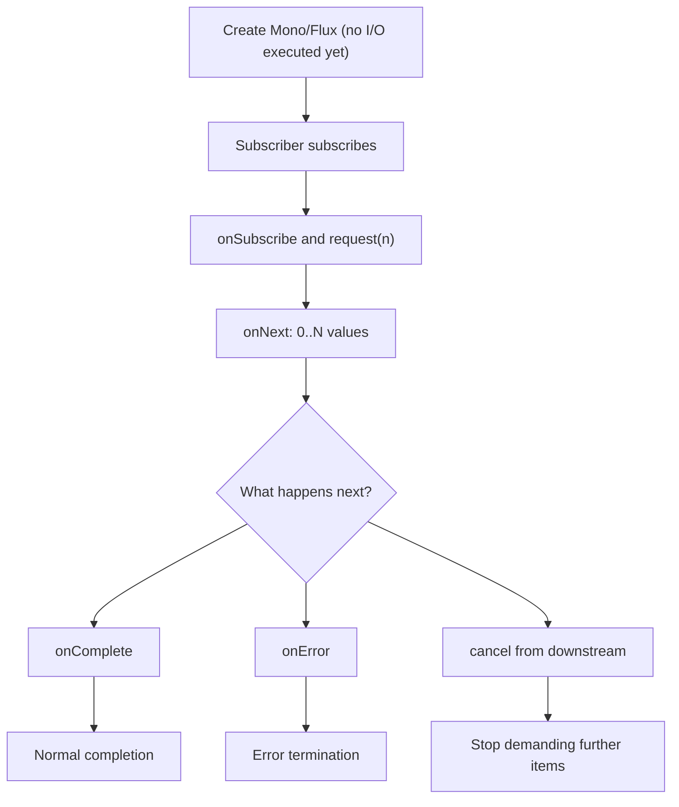
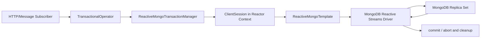

# Rollback on Error, Subscription Cancellation, and Resource Cleanup

## 1. Problem Statement: A Reactive Transaction Does Not End at `return`

An order placement workflow needs to **reserve inventory**, **insert an order**, and **write an outbox event** in MongoDB. If reserving inventory succeeds yet inserting the order fails, the system must roll back the inventory reservation. If an HTTP client drops the connection mid-flight, the Reactor chain can receive a **cancel** signal rather than an exception. If the pipeline holds a `ClientSession`, cursor, or custom resource, those resources must be released whether the publisher completes, errors, or is canceled.

In synchronous code, we are accustomed to:

```java
try {
    beginTransaction();
    writeInventory();
    writeOrder();
    commit();
} catch (Exception ex) {
    rollback();
    throw ex;
} finally {
    closeResources();
}
```

In reactive systems, execution begins **when the publisher is subscribed to**. Errors, completions, and cancellations are **subscription lifecycle signals**, not equivalent to synchronous control flow when constructing a `Mono`/`Flux`. Wrapping `return repository.save(...);` in a `try/catch` generally **does not** catch MongoDB errors occurring later when a subscriber runs the pipeline.

This lesson belongs to the **Reactive Transactions** chapter of the **SPRING_DATA_MONGODB** module. The module teaches using Spring Data MongoDB to connect, map documents, and work with MongoDB through `MongoTemplate` or repositories; practicing queries, aggregations, indexes, transactions, reactive access, testing, and data performance diagnostics.

After this lesson, you will be able to:

1. Distinguish the three primary Reactive Streams terminations: **complete**, **error**, and **cancel**.
2. Explain how `ReactiveMongoTransactionManager` and `TransactionalOperator` commit, roll back, and release `ClientSession`.
3. Compose multiple reactive operations inside **one transaction boundary** instead of calling detached `subscribe()`.
4. Recognize how `onErrorResume`, `onErrorComplete`, `take`, `next`, and `timeout` can alter transaction outcomes.
5. Use `Mono.usingWhen`/`Flux.usingWhen` when **managing asynchronous resources yourself**, distinguishing resource cleanup from transaction rollback.
6. Handle timeouts and cancellations when you cannot prove a write or commit actually rolled back.
7. Design tests with a MongoDB replica set, `StepVerifier`, and post-transaction assertions.

> **Principle:** Consider data committed only when there is **evidence matching the write/transaction contract**; never treat an HTTP disconnect, `cancel`, or timeout as automatic proof that MongoDB reverted every side effect.

## 2. Reading the Three Terminal Signals in Reactor

A publisher typically moves through this lifecycle:



| Signal | Source | Interpretation |
| --- | --- | --- |
| `onComplete` | Upstream | Publisher completed normally |
| `onError(Throwable)` | Upstream | Pipeline failed; error signal terminates the publisher |
| `cancel()` | Subscriber/downstream operator | Subscriber no longer wants data; not an `onError` |

**Cancel carries no standard failure reason.** It can originate from a user closing an HTTP connection, a WebFlux timeout, `take(1)`, `next()`, switching subscriptions, or another orchestrating operator. You cannot safely assume every cancel represents a system failure.

### 2.1. Without a Subscription, Typically No Write Occurs

```java
Mono<OrderDocument> pending = repository.save(order);
// Only builds a publisher; does not mean insert has executed.
```

With standard reactive repositories, I/O is triggered on subscription. In production code, let the caller or framework drive subscription; never call `subscribe()` from a service and return success before MongoDB finishes processing.

### 2.2. Distinguishing Publisher Completion From Successful Commit

If the chain is **wrapped by `TransactionalOperator`**, the transactional publisher executes commit as part of its lifecycle. If a `Mono` containing MongoDB operations is subscribed to **outside any transaction**, completion only means that publisher path finished—not that any multi-document transaction protected it.

### 2.3. Errors Caught Inside Can Still Turn Into Completion

```java
// When called inside a transaction, onErrorResume turns the error into
// a successful completion as seen by the transaction boundary.
Mono<String> step = repository.insert(order)
    .map(saved -> saved.id())
    .onErrorResume(ex -> Mono.just("IGNORED"));
```

If business rules require rollback when the insert fails, catching errors this way can cause **earlier successful steps to commit**. Place error recovery properly outside the boundary, or explicitly mark rollback-only when intended.

## 3. Role of the Transaction Manager in Spring Data MongoDB

Reactive MongoDB transactions rely on **MongoDB `ClientSession`** and server transaction support. In Spring Data, `ReactiveMongoTransactionManager` manages beginning, committing, aborting, and cleaning up sessions acquired from `ReactiveMongoDatabaseFactory`.



| Component | Responsibility |
| --- | --- |
| `ReactiveMongoDatabaseFactory` | Supplies MongoDB database/client resources for the reactive stack |
| `ReactiveMongoTransactionManager` | Manages MongoDB transactions via sessions and Reactor Context |
| `TransactionalOperator` | Wraps a publisher in a transaction lifecycle |
| `ReactiveMongoTemplate` / `ReactiveMongoOperations` | Executes reads/writes participating in the active transaction context |
| `ReactiveMongoRepository` | Builds publishers operating via mapping/repository infrastructure |
| `Reactor Context` | Carries transaction metadata per subscription without depending on a fixed thread |

### 3.1. Do Not Use ThreadLocal Like Synchronous Transactions

In a reactive chain, processing can move across schedulers and threads. Spring's `ReactiveTransactionManager` uses the **subscriber context** to propagate transaction state. Never treat the current thread as the source of truth for transactions, and never invent a `ThreadLocal<ClientSession>` expecting every `flatMap` to find it.

### 3.2. Templates and Factories Must Share the Transaction Infrastructure

If a repository uses one `ReactiveMongoDatabaseFactory` while another `ReactiveMongoTemplate` was constructed from an independent client or factory, do not assume their operations share a session or transaction. Keep repositories and templates wired to the same managed configuration.

### 3.3. Server Prerequisites for Transactions

MongoDB multi-document transactions require a supported topology, typically a **replica set or sharded cluster** with an appropriate server version and configuration. Tests against standalone MongoDB do not demonstrate transaction behavior.

Modifying multiple fields on a **single document** is already atomic in MongoDB and usually does not require a multi-statement transaction. Reserve transactions for business invariants spanning multiple documents or collections.

## 4. Minimal Dependencies and Configuration

### 4.1. Maven

```xml
<dependencies>
    <dependency>
        <groupId>org.springframework.boot</groupId>
        <artifactId>spring-boot-starter-data-mongodb-reactive</artifactId>
    </dependency>

    <!-- If exposing a reactive HTTP API -->
    <dependency>
        <groupId>org.springframework.boot</groupId>
        <artifactId>spring-boot-starter-webflux</artifactId>
    </dependency>
</dependencies>
```

In Gradle:

```groovy
dependencies {
    implementation 'org.springframework.boot:spring-boot-starter-data-mongodb-reactive'
    implementation 'org.springframework.boot:spring-boot-starter-webflux'
}
```

Spring Data MongoDB and driver versions should come from the Spring Boot BOM/parent unless overridden intentionally and tested. Do not pull in the blocking `spring-boot-starter-data-mongodb` starter just to use transactions in reactive flows.

### 4.2. Configuring the MongoDB URI

For **Spring Boot 3.x**:

```yaml
spring:
  data:
    mongodb:
      uri: "${MONGODB_URI}"
```

For **Spring Boot 4.x**:

```yaml
spring:
  mongodb:
    uri: "${MONGODB_URI}"
```

**Choose the property matching your Boot version.** Never commit credentials into source control or log raw URIs containing passwords. Test multi-document transactions against a MongoDB replica set using the matching reactive driver.

### 4.3. ReactiveMongoTransactionManager

```java
package com.example.orders.config;

import org.springframework.context.annotation.Bean;
import org.springframework.context.annotation.Configuration;
import org.springframework.data.mongodb.ReactiveMongoDatabaseFactory;
import org.springframework.data.mongodb.ReactiveMongoTransactionManager;

@Configuration
public class ReactiveTransactionConfig {

    @Bean
    ReactiveMongoTransactionManager reactiveMongoTransactionManager(
        ReactiveMongoDatabaseFactory factory
    ) {
        return new ReactiveMongoTransactionManager(factory);
    }
}
```

This bean bridges Spring reactive transactions with MongoDB. With Spring Boot auto-configuration, `ReactiveMongoDatabaseFactory` and `ReactiveMongoTemplate` are created when dependencies and properties are configured. If customizing `MongoClient`, make sure factory, template, and transaction manager align.

### 4.4. TransactionalOperator

```java
import org.springframework.context.annotation.Bean;
import org.springframework.context.annotation.Configuration;
import org.springframework.transaction.ReactiveTransactionManager;
import org.springframework.transaction.reactive.TransactionalOperator;

@Configuration
public class ReactiveTxOperatorConfig {

    @Bean
    TransactionalOperator mongoTransactionalOperator(
        ReactiveTransactionManager manager
    ) {
        return TransactionalOperator.create(manager);
    }
}
```

If the application defines multiple reactive transaction managers, specify the exact bean via `@Qualifier` or explicit configuration; never let a MongoDB workflow accidentally pick a manager for another data store.

## 5. Sample Data: Order, Inventory, and Outbox

Consider a transaction with three actions:

1. Reserve one item in `inventory` via conditional update.
2. Insert a document into `orders`.
3. Insert an event into `outbox_events` for post-commit dispatch.

Test fixture collections:

```javascript
// Run ONLY in an isolated TEST DB reset before seeding.
db.inventory.insertOne({
  _id: "tenant-a:sku-101",
  tenantId: "tenant-a",
  sku: "sku-101",
  available: 2,
  reserved: 0
});

db.orders.createIndex(
  { tenantId: 1, operationId: 1 },
  { unique: true, name: "uk_order_tenant_operation" }
);

db.outbox_events.createIndex(
  { tenantId: 1, eventId: 1 },
  { unique: true, name: "uk_outbox_tenant_event" }
);
```

Do not create new collections or indexes **for the first time** inside a transaction unless your deployment's topology/version/DDL support is verified. For hands-on practice, provision collections and indexes during test setup beforehand.

### 5.1. Sample Domain

```java
package com.example.orders.persistence;

import java.time.Instant;
import org.springframework.data.mongodb.core.mapping.Document;
import org.springframework.data.mongodb.core.mapping.FieldType;
import org.springframework.data.mongodb.core.mapping.MongoId;

@Document("orders")
public record OrderDocument(
    @MongoId(FieldType.STRING) String id,
    String tenantId,
    String operationId,
    String sku,
    int quantity,
    String status,
    Instant createdAt
) {}

@Document("outbox_events")
public record OutboxEvent(
    @MongoId(FieldType.STRING) String id,
    String tenantId,
    String eventId,
    String orderId,
    String type,
    Instant createdAt
) {}
```

In a real Java project, place each `public record` in its own file. The sample uses `@MongoId(FieldType.STRING)` so BSON `_id` is stored as a String. Never use this fixture against production.

### 5.2. Expected Outcomes

| Scenario | Inventory After Transaction | Orders | Outbox |
| --- | --- | --- | --- |
| Success | `available` decremented by 1, `reserved` incremented by 1 | One new order | One event |
| Order insert signals error | Inventory reservation **rolled back** | No order | No event |
| Outbox insert signals error | Inventory reservation **rolled back** | No order | No event |
| Subscriber cancels before transaction finishes | **Rollback requested via manager**; check completion/commit race | Cannot assert from cancel signal alone | Cannot assert from cancel signal alone |
| Commit response lost | Outcome may be uncertain | Reconciliation required | Reconciliation required |

The cancellation row deliberately makes no absolute claim. If commit **already completed** before cancellation arrived or the outcome is uncertain due to network failure, `cancel` cannot reverse an already-applied commit.

## 6. Repositories and Gateway for the Three Operations

### 6.1. Order Repository

```java
package com.example.orders.persistence;

import org.springframework.data.mongodb.repository.ReactiveMongoRepository;

public interface ReactiveOrderRepository
        extends ReactiveMongoRepository<OrderDocument, String> {
}
```

### 6.2. Outbox Repository

```java
package com.example.orders.persistence;

import org.springframework.data.mongodb.repository.ReactiveMongoRepository;

public interface ReactiveOutboxRepository
        extends ReactiveMongoRepository<OutboxEvent, String> {
}
```

### 6.3. Atomic Reservation Gateway

```java
package com.example.orders.persistence;

import org.springframework.data.mongodb.core.ReactiveMongoOperations;
import org.springframework.data.mongodb.core.query.Criteria;
import org.springframework.data.mongodb.core.query.Query;
import org.springframework.data.mongodb.core.query.Update;
import org.springframework.stereotype.Component;
import reactor.core.publisher.Mono;

@Component
public class InventoryGateway {
    private final ReactiveMongoOperations mongo;

    public InventoryGateway(ReactiveMongoOperations mongo) {
        this.mongo = mongo;
    }

    public Mono<Void> reserveOne(String tenantId, String sku) {
        String inventoryId = tenantId + ":" + sku;

        Query filter = Query.query(
            Criteria.where("_id").is(inventoryId)
                .and("tenantId").is(tenantId)
                .and("available").gte(1)
        );

        Update update = new Update()
            .inc("available", -1)
            .inc("reserved", 1);

        return mongo.updateFirst(filter, update, "inventory")
            .flatMap(result -> {
                if (!result.wasAcknowledged()) {
                    return Mono.error(new IllegalStateException(
                        "Write was not acknowledged"
                    ));
                }
                if (result.getMatchedCount() != 1L) {
                    return Mono.error(new OutOfStockException());
                }
                return Mono.<Void>empty();
            });
    }
}

class OutOfStockException extends RuntimeException {}
```

In this exercise, `OutOfStockException` can stay package-private in the same package; in a real project, place exceptions where services and gateways can access them cleanly. `Query` and `Update` are built **fresh per invocation**, keeping no mutable tenant state on singleton components.

Because `reserveOne` returns `Mono<Void>` completing normally on success, use `then(...)` to chain subsequent steps. If no document matches (out of stock), it emits an **error signal** — essential so the transaction manager rolls back.

## 7. TransactionalOperator: Combining All Steps Inside One Boundary

### 7.1. Correct Service

```java
package com.example.orders.service;

import com.example.orders.persistence.InventoryGateway;
import com.example.orders.persistence.OrderDocument;
import com.example.orders.persistence.OutboxEvent;
import com.example.orders.persistence.ReactiveOrderRepository;
import com.example.orders.persistence.ReactiveOutboxRepository;
import java.time.Instant;
import org.springframework.stereotype.Service;
import org.springframework.transaction.reactive.TransactionalOperator;
import reactor.core.publisher.Mono;

@Service
public class PlaceOrderService {

    private final InventoryGateway inventory;
    private final ReactiveOrderRepository orders;
    private final ReactiveOutboxRepository outbox;
    private final TransactionalOperator tx;

    public PlaceOrderService(
        InventoryGateway inventory,
        ReactiveOrderRepository orders,
        ReactiveOutboxRepository outbox,
        TransactionalOperator tx
    ) {
        this.inventory = inventory;
        this.orders = orders;
        this.outbox = outbox;
        this.tx = tx;
    }

    public Mono<String> placeOne(
        String tenantId,
        String orderId,
        String operationId,
        String sku
    ) {
        if (tenantId == null || tenantId.isBlank()
                || orderId == null || orderId.isBlank()
                || operationId == null || operationId.isBlank()
                || sku == null || sku.isBlank()) {
            return Mono.error(
                new IllegalArgumentException("Invalid request")
            );
        }

        return Mono.defer(() -> {
            Instant now = Instant.now();
            OrderDocument order = new OrderDocument(
                orderId, tenantId, operationId,
                sku, 1, "RESERVED", now
            );
            OutboxEvent event = new OutboxEvent(
                "event-" + operationId,
                tenantId, operationId, orderId, "ORDER_RESERVED", now
            );

            return inventory.reserveOne(tenantId, sku)
                .then(orders.insert(order))
                .flatMap(saved ->
                    outbox.insert(event)
                        .thenReturn(saved.id())
                );
        }).as(tx::transactional);
    }
}
```

On the happy path, the publisher inside `Mono.defer` runs **reserve inventory -> insert order -> insert outbox** and emits the order ID. `.as(tx::transactional)` wraps **the entire upstream chain** in one transaction. No step is detached onto a separate `subscribe()`.

### 7.2. Why Use Mono.defer?

`Mono.defer` constructs request data and the inner pipeline **on every subscription**. A publisher may be re-subscribed on retry; `defer` avoids sharing stateful objects across subscribers. However, `defer` **does not make retries idempotent automatically**: reusing `operationId` still requires unique constraints and reconciliation.

### 7.3. Actual Transaction Boundary

```text
Subscriber
  |
  v
TransactionalOperator opens session/transaction
  |
  +-- update inventory
  |
  +-- insert order
  |
  +-- insert outbox
  |
  +-- success -> commit
  +-- error   -> abort/rollback
  +-- cancel  -> request rollback if transaction still active
  |
  v
cleanup session, release transaction resources
```

**Note:** `TransactionalOperator` only governs reactive operations actually **participating in the transaction context**. Any blocking `MongoTemplate` call or independent raw driver client executes outside the transaction even when written inside the same Java method.

## 8. Rollback When a Publisher Emits onError

### 8.1. Errors Must Cross the Transaction Boundary

When `orders.insert(...)` errors due to a unique index conflict or invalid data, the error flows through `flatMap`/`then` to `TransactionalOperator`:

```text
inventory.reserveOne  -> completed
orders.insert         -> onError(DuplicateKeyException)
outbox.insert         -> never runs
TransactionalOperator -> rolls back transaction
MongoDB               -> inventory reverts to pre-reservation state
downstream            -> receives error or rollback/cleanup failure
```

With a transaction-capable database and operations sharing the session, uncommitted changes in the transaction are aborted. Yet an **error signal does not automatically undo other external side effects**: messages already published to a broker or HTTP calls already made sit outside the MongoDB transaction.

### 8.2. Intentional Failure Demo

```java
Mono<String> failurePath = inventory
    .reserveOne("tenant-a", "sku-101")
    .then(Mono.<String>error(
        new IllegalStateException("Simulated failure")
    ))
    .as(tx::transactional);
```

This assumes `inventory` and `tx` are injected as in section 7. Against a real transaction-capable MongoDB environment, once subscribed, the test error fires **before commit**, so the transaction manager rolls back the reservation executed inside the transaction.

**Never test this in production.** Run it in an integration test with isolated fixtures and inspect post-transaction database state rather than merely asserting the exception type.

### 8.3. doOnError Does Not Swallow Errors

```java
Mono<String> observed = failurePath
    .doOnError(ex ->
        metrics.recordTransactionFailure(ex.getClass().getSimpleName())
    );
```

`metrics` is an illustrative monitoring dependency that must be defined in a real project. `doOnError` is useful for recording errors; by default it **does not convert errors into success**. Avoid logging credentials, raw BSON payloads, or sensitive customer data.

### 8.4. Commit and Rollback Failures Must Also Be Handled

Sometimes all writes inside a transaction succeed, yet **commit** hits a network error or returns an uncertain response. The client receives an exception at the commit phase rather than from an earlier insert. Distinguish:

- **Pre-commit operation error:** manager attempts to abort the transaction.
- **Abort/rollback failure:** transaction cleanup failed to complete cleanly; inspect state and logs.
- **Commit error:** in some cases commit definitely failed; in others it is **unknown** whether commit happened.

Never assume a pipeline-ending error always means **nothing was committed**. Combine MongoDB error labels, operation IDs, and reconciliation.

## 9. How `onErrorResume` Placement Can Flip Commit vs. Rollback

### 9.1. Anti-Pattern: Swallowing Errors Before TransactionalOperator Sees Them

```java
// WRONG if business rules require rolling back the reservation when insert fails.
Mono<String> unsafe = inventory
    .reserveOne(tenantId, sku)
    .then(orders.insert(order))
    .map(OrderDocument::id)
    .onErrorResume(ex -> Mono.just("FALLBACK_SUCCESS"))
    .as(tx::transactional);
```

Here, if reservation succeeds and insert fails, `onErrorResume` **inside the transactional publisher** turns the error into a normal completion. The transaction manager may **commit the reservation**, corrupting business state. This is a logic bug even though Java compiles and the endpoint returns HTTP 200.

### 9.2. Handle Errors After the Transaction Boundary

```java
Mono<String> safe = inventory
    .reserveOne(tenantId, sku)
    .then(orders.insert(order))
    .map(OrderDocument::id)
    .as(tx::transactional)
    .onErrorMap(OutOfStockException.class,
        ex -> new IllegalStateException("Out of stock", ex));
```

With `onErrorMap` placed **downstream after the transaction**, the transaction manager observes the error before it is mapped to a domain/API exception. This is normally the right place to translate exception types without hiding the rollback signal.

### 9.3. External Fallbacks Are Allowed, Provided They Are Honest

```java
Mono<OrderResult> outcome = placeOrderService
    .placeOne(tenantId, orderId, operationId, sku)
    .map(OrderResult::applied)
    .onErrorResume(OutOfStockException.class,
        ex -> Mono.just(OrderResult.rejected("OUT_OF_STOCK")));
```

Here `OrderResult` is an illustrative response contract defined by the application. The fallback sits **after the transactional service method**. A business rejection can be mapped to a structured response instead of HTTP 500 **after rollback finishes**.

Never catch every `Throwable` and return `REJECTED`: network/commit ambiguity must be classified as **UNKNOWN_NEEDS_RECONCILIATION**, never assumed "not ordered."

### 9.4. What If You Must Intercept Errors Inside Yet Still Roll Back?

One approach is **re-emitting the error**:

```java
Mono<String> stillRollsBack = inventory
    .reserveOne(tenantId, sku)
    .then(orders.insert(order))
    .map(OrderDocument::id)
    .onErrorResume(DuplicateKeyException.class,
        ex -> Mono.error(
            new OrderAlreadyExistsException(ex)
        ))
    .as(tx::transactional);
```

`DuplicateKeyException` and `OrderAlreadyExistsException` require proper imports/definitions. Because the chain still terminates with `onError`, the transaction manager can roll back.

In rare situations where you must emit a normal value while forcing rollback, `TransactionalOperator.execute(status -> ...)` offers `status.setRollbackOnly()`. That pattern is trickier and demands thorough testing of rollback-only semantics and commit behavior; **prefer letting errors propagate** whenever the situation is a business failure.

## 10. @Transactional on Methods Returning Mono or Flux

Besides `TransactionalOperator`, Spring supports declarative transactions:

```java
package com.example.orders.service;

import com.example.orders.persistence.InventoryGateway;
import com.example.orders.persistence.OrderDocument;
import com.example.orders.persistence.ReactiveOrderRepository;
import com.example.orders.persistence.ReactiveOutboxRepository;
import com.example.orders.persistence.OutboxEvent;
import org.springframework.stereotype.Service;
import org.springframework.transaction.annotation.Transactional;
import reactor.core.publisher.Mono;

@Service
public class DeclarativeOrderService {
    private final InventoryGateway inventory;
    private final ReactiveOrderRepository orders;
    private final ReactiveOutboxRepository outbox;

    public DeclarativeOrderService(
        InventoryGateway inventory,
        ReactiveOrderRepository orders,
        ReactiveOutboxRepository outbox
    ) {
        this.inventory = inventory;
        this.orders = orders;
        this.outbox = outbox;
    }

    @Transactional
    public Mono<String> place(
        String tenantId,
        OrderDocument order,
        OutboxEvent event
    ) {
        return inventory.reserveOne(tenantId, order.sku())
            .then(orders.insert(order))
            .flatMap(saved ->
                outbox.insert(event)
                    .thenReturn(saved.id())
            );
    }
}
```

For the annotation to take effect:

1. Spring must resolve a **reactive transaction manager** for the reactive method.
2. The method must be invoked **through the Spring proxy/interception path**, not via direct `this` self-invocation expecting a new transaction.
3. Operations must share the same reactive MongoDB factory/session infrastructure.
4. The caller must **subscribe** to the returned publisher; the service never calls `subscribe()` internally.
5. No rollback-swallowing operators may hide failures inside the boundary.

Do not stack `@Transactional` and `TransactionalOperator` on the same workflow just "to be extra safe" without understanding propagation/nesting. Pick one clear boundary so it stays easy to reason about and test.

### 10.1. When Multiple Transaction Managers Exist

If a project defines both `ReactiveMongoTransactionManager` and a manager for another data store, specify the exact manager supported by your Spring Framework release (e.g., via qualifier and transaction config). Otherwise, the MongoDB workflow may pick the wrong manager or fail at transaction creation.

### 10.2. ReadOnly Does Not Mean No Session Is Opened

With `ReactiveMongoTransactionManager`, `@Transactional(readOnly = true)` can still open a transaction/session under Spring Data MongoDB semantics. Never treat `readOnly` as a free shortcut for reading from secondaries; consider read concern, read preference, and overhead.

## 11. Cancel Signals: Why They Make Transactions Trickier

Starting with **Spring Framework 5.3**, a cancel signal on a transactional publisher is handled by **rolling back**. This was a major shift from the older Spring Framework 5.2 behavior.

Spring Framework documentation notes that transactional publishers should **avoid mid-stream cancellation**: downstream cannot convey a standard cancellation reason, so the manager treats cancellation conservatively to prevent committing an unconsumed workflow.

### 11.1. Where Can Cancel Signals Come From?

| Source | Example |
| --- | --- |
| Explicit subscriber disposal | `Disposable.dispose()` |
| HTTP client disconnect | Browser tab closed, reverse proxy drops connection |
| `take(1)` | Downstream requests only a single value |
| `next()` | Converts a Flux to its first item as a Mono |
| `timeout(Duration)` | Downstream wait deadline expires |
| `switchMap` | Switches to a new publisher, canceling the old one |
| `takeUntilOther(...)` | Cancels when another signal arrives |

Not every cancel signal means an application crash; however, for transactions containing uncommitted writes, canceling before completion can trigger transaction rollback.

### 11.2. Dangerous Example With Multi-Item Flux

```java
Flux<OrderDocument> transactionalStream = mongo
    .find(query, OrderDocument.class)
    .as(tx::transactional);

// next() DOWNSTREAM cancels upstream after the first item.
Mono<OrderDocument> first = transactionalStream.next();
```

Even for a read-only transaction, canceling can trigger rollback/cleanup rather than clean completion. If upstream performs writes, cancellation can roll back uncommitted writes. Never place `.next()` or `.take(1)` **outside a transactional Flux** when the goal is committing the full workflow.

### 11.3. Example Performing a Write Followed by Multiple Emissions

```java
Flux<String> workflow = inventory
    .reserveOne(tenantId, sku)
    .thenMany(Flux.just("reserved", "order-will-follow"))
    .as(tx::transactional);

// May observe "reserved", then take(1) cancels the transaction.
Flux<String> firstOnly = workflow.take(1);
```

In a real workflow you would also insert the order; the point here is showing how **a write followed by multiple `onNext` signals** can be canceled by downstream before `onComplete`. Never base transaction success on a client receiving "part of a stream."

## 12. Completion, Error, and Cancellation State Matrix

| Transactional Publisher State | What the Transaction Manager Normally Does | What the Caller Must Understand |
| --- | --- | --- |
| Normal completion before commit | Attempts to **commit** | Result is certain only once commit is properly acknowledged |
| `onError` before commit | Attempts **rollback/abort** | Must still watch for rollback errors if any |
| `cancel` while transaction is active | Attempts **rollback/abort** in modern Spring Framework | Subscribers do not receive an `onError` explaining the cancel |
| Cancel before subscription | No transaction I/O occurred | No basis to say a transaction ever started |
| Cancel while commit is in flight | Potential race | Cannot guarantee commit was rolled back |
| Commit response unknown due to network | May or may not have committed | Reconcile using the operation ID |
| Out-of-band side effect before cancel | Outside MongoDB transaction | Not automatically rolled back |

**Key takeaway:** "Rollback on cancel" describes the **reactive transaction manager's policy within a manageable scope**. It does not guarantee that an already-completed commit can be undone, nor that external systems revert automatically.

### 12.1. Do Not Infer Event Order From an HTTP Disconnect

An HTTP client dropping the connection after the server already sent commit to MongoDB may never receive the final status. The service needs operation IDs and idempotency so clients can query status safely. Never re-send non-idempotent `POST` requests just because a browser reported a "network error."

### 12.2. In Reactor, Cancel Is Not onError

`doOnError(...)` **does not run on cancellation**. To observe all three termination paths, use `doFinally(SignalType)` or dedicated metrics operators; never rely on `doOnError` to count cancellations.

## 13. Timeout: Before or After TransactionalOperator?

### 13.1. Timeout Inside the Transactional Publisher

```java
Mono<String> insideTimeout = inventory
    .reserveOne(tenantId, sku)
    .then(orders.insert(order))
    .map(OrderDocument::id)
    .timeout(Duration.ofSeconds(5))
    .as(tx::transactional);
```

Here `timeout` sits **upstream of TransactionalOperator**. If it expires while the transaction is unfinished, it emits `TimeoutException` to the manager, letting the manager run the **onError -> rollback** path. An in-flight MongoDB operation being canceled may still be finishing on the server; reading back after cleanup is essential in tests.

### 13.2. Timeout Outside the Transactional Publisher

```java
Mono<String> outsideTimeout = inventory
    .reserveOne(tenantId, sku)
    .then(orders.insert(order))
    .map(OrderDocument::id)
    .as(tx::transactional)
    .timeout(Duration.ofSeconds(5));
```

Here the **downstream** `timeout` **cancels** the transactional publisher and emits `TimeoutException` to the subscriber. Modern Spring Framework attempts rollback if the transaction is still active, though a race window with commit/abort still exists.

### 13.3. Neither Timeout Placement Eliminates All Ambiguity

Both placements require:

- Choosing deadlines aligned with SLAs and actual commit durations.
- Never treating cancel/timeout as guaranteed proof of rollback.
- Operation IDs to reconcile when the client receives no ACK.
- Separating HTTP, Reactor, MongoDB driver, write concern, and transaction timeouts.
- Testing on transaction-capable topologies under load and failover.

Never configure overly aggressive timeouts coupled with infinite retries; doing so amplifies cluster load and contention.

## 14. doOnCancel, doFinally, and doOnTerminate

### 14.1. Using doFinally to Observe All Signals

```java
Mono<String> traced = placeOrderService
    .placeOne(tenantId, orderId, operationId, sku)
    .doFinally(signal -> {
        if (signal == SignalType.CANCEL) {
            metrics.incrementCancelledOrders();
        } else if (signal == SignalType.ON_ERROR) {
            metrics.incrementFailedOrders();
        } else if (signal == SignalType.ON_COMPLETE) {
            metrics.incrementCompletedOrders();
        }
    });
```

`SignalType` is `reactor.core.publisher.SignalType`; `metrics` is an illustrative service. Check operator placement: a downstream `doFinally` may observe the completion of a fallback even though the transaction rolled back, or observe cancel before async rollback cleanup finishes.

### 14.2. doOnCancel Is Not a Rollback Command

```java
Mono<String> flow = placeOrderService
    .placeOne(tenantId, orderId, operationId, sku)
    .doOnCancel(() -> auditLogger.noteCancellation(operationId));
```

This callback merely **records cancellation**. Rollback is executed by `TransactionalOperator`/the transaction manager within its lifecycle. Never manually call `mongo.abortTransaction()` inside `doOnCancel` when the transaction manager owns the session.

### 14.3. Avoid Blocking I/O in doFinally

`doFinally` is suited for lightweight metrics and logging. If a resource requires closing via an asynchronous Publisher, use `usingWhen` or a proper transaction lifecycle; calling `closeAsync().subscribe()` inside `doFinally` detaches cleanup from completion tracking and easily drops errors.

### 14.4. Logging Placement Affects Observed Signals

```java
Mono<String> txFlow = writeSteps
    .as(tx::transactional)
    .doFinally(signal -> log.info("tx flow signal={}", signal));

Mono<String> httpFlow = txFlow
    .onErrorResume(BusinessException.class,
        ex -> Mono.just("REJECTED"))
    .doFinally(signal -> log.info("http signal={}", signal));
```

If a business error rolled back the transaction, the downstream HTTP flow may still complete normally via fallback. Track **transaction rollback** and **HTTP response** metrics separately instead of relying on a single "successful requests" counter.

## 15. Who Should Close ClientSession?

### 15.1. Managed Sessions Belong to the Transaction Manager

When writing:

```java
return inventory.reserveOne(tenantId, sku)
    .then(orders.insert(order))
    .as(tx::transactional);
```

`ReactiveMongoTransactionManager` owns the session and transaction lifecycle under Spring Data infrastructure. Never call `session.close()` inside a business service when the manager owns the session.

### 15.2. Why You Should Not Close Sessions Manually Inside doFinally

A callback can fire while rollback or commit is still in flight. Closing a manager-owned session prematurely can break active commands or obscure outcomes, causing:

- Double-close or use-after-close errors.
- Hard-to-classify commit/abort failures.
- Lost context for subsequent operations.
- Closing a shared session without proper ownership.

**Ownership rule:** whichever layer opens/owns a session must close it according to that layer's lifecycle. With a transaction manager, **let the manager handle it**. When your own code explicitly creates a raw driver session, that code must reliably clean it up on complete, error, and cancel.

### 15.3. Never Store ClientSession in a Singleton Field

```java
// Anti-pattern (do NOT implement):
// @Component
// class BadSessionHolder {
//     ClientSession current; // Mutable session shared across requests!
// }
```

Reactive transaction contexts belong to individual subscribers; many requests execute concurrently. Sharing one mutable session across requests causes interleaved commands and races.

### 15.4. Driver and Template Must Share the Same Session

Spring Data `ReactiveMongoTemplate` acquires its session through Reactor Context integration. If code spins up an independent `com.mongodb.reactivestreams.client.MongoClient` and queries through it, those commands **do not join** the Spring-managed transaction.

When raw reactive driver calls need to participate in a session, use Spring Data's session-aware database/session APIs or build a persistence adapter with strictly managed explicit sessions. Never call the factory directly to get a database bypassing transaction-aware utilities if doing so drops the context-bound session.

## 16. Closing Resources With Mono.usingWhen

`usingWhen` is Reactor's API for **allocating a resource per subscription** and executing an **asynchronous cleanup publisher** when resource usage completes, errors, or is canceled. It fits connections, leases, cursors, or temporary handles **owned directly by your application**.

### 16.1. Five-Argument API

Concept:

```text
Mono.usingWhen(
    resourceSupplier,    // allocates the resource
    resourceClosure,     // uses the resource, returns Mono<T>
    asyncComplete,       // cleanup on success
    asyncError,          // cleanup on error
    asyncCancel          // cleanup on cancel
)
```

These are parameter role names, not directly compilable Java. With `Flux.usingWhen`, `resourceClosure` returns a multi-element Publisher.

### 16.2. Example of a Self-Managed Resource

```java
import java.util.concurrent.atomic.AtomicBoolean;
import reactor.core.publisher.Mono;

final class AuditLease {
    private final AtomicBoolean closed = new AtomicBoolean();

    Mono<String> run(String requestId) {
        return Mono.defer(() -> {
            if (closed.get()) {
                return Mono.error(new IllegalStateException(
                    "Lease already closed"
                ));
            }
            return Mono.just("processed:" + requestId);
        });
    }

    Mono<Void> closeAsync() {
        return Mono.fromRunnable(() -> closed.set(true));
    }
}

public final class AuditLeaseGateway {
    public Mono<String> work(String requestId) {
        return Mono.usingWhen(
            Mono.fromSupplier(AuditLease::new),
            lease -> lease.run(requestId),
            AuditLease::closeAsync,
            (lease, error) -> lease.closeAsync(),
            AuditLease::closeAsync
        );
    }
}
```

This illustrates lifecycle handling, not a MongoDB transaction. `AuditLease` does not open a real database session; it demonstrates how a caller-owned resource is cleaned up across all three termination paths.

### 16.3. Do Not Confuse Cleanup With Rollback

`AuditLease.closeAsync()` **closes a resource**; it does not revert MongoDB writes. If the resource were a manual MongoDB transaction, separate commit/abort logic must run correctly. With transactions managed by `ReactiveMongoTransactionManager`, **never wrap a Spring-managed `ClientSession` inside a custom `usingWhen`**.

### 16.4. Cleanup Failures Are Also Errors

If asynchronous cleanup fails, Reactor can alter the final error or result per `usingWhen` semantics. Never assume cleanup exceptions are harmless or always preserve the original business exception verbatim. Emit sufficient logs and metrics to diagnose both root errors and cleanup errors without masking cleanup failures as accidental success.

## 17. Flux.usingWhen and Resources Spanning a Stream

Suppose an external API issues a lease for a chunked stream:

```java
Flux<String> output = Flux.usingWhen(
    leaseFactory.acquire(),
    lease -> lease.streamRecords(),
    lease -> lease.closeAsync(),
    (lease, error) -> lease.closeAsync(),
    lease -> lease.closeAsync()
);
```

Here `leaseFactory` and `lease` are illustrative abstractions to be defined in real code. Semantics:

- If the stream reaches `onComplete`, invoke success cleanup.
- If the stream emits `onError`, invoke error cleanup.
- If the subscriber cancels, invoke cancel cleanup.
- The resource must be **consumed inside the closure**; never return a publisher that holds onto the resource while performing remaining work outside the boundary.

### 17.1. Do Not Assume Closure While a Flux Remains Alive

An unsubscribed stream allocates no resource. A subscribed stream not yet fully consumed can hold a cursor or lease until cancellation. Enforce timeouts, cancellation policies, and monitoring of open resources.

### 17.2. using vs. usingWhen

| API | Best Fit |
| --- | --- |
| `Mono.using(...)` / `Flux.using(...)` | Resources with simple **synchronous** cleanup |
| `Mono.usingWhen(...)` / `Flux.usingWhen(...)` | Resources needing **asynchronous Publisher** cleanup |
| `doFinally(...)` | Lightweight metrics/side effects by signal |
| `TransactionalOperator` | Spring-managed transaction lifecycle |

Using `doFinally(x -> resource.close())` with a blocking close risks stalling threads. Using `doFinally(x -> closeAsync().subscribe())` detaches cleanup from lifecycle tracking and drops error observability. Pick the API matching the resource and ownership model.

## 18. doFinally Is an Observation Hook, Not a Termination Contract Modifier

For a transaction-wrapped publisher:

```java
return tx.transactional(workflow)
    .doFinally(signal -> {
        switch (signal) {
            case ON_COMPLETE -> statistics.complete();
            case ON_ERROR -> statistics.error();
            case CANCEL -> statistics.cancel();
            default -> {}
        }
    });
```

`statistics` is an illustrative stats dependency. The snippet assumes `workflow` is a `Mono<T>` or `Flux<T>` and a Java release supporting switch arrow syntax.

Never execute a raw MongoDB abort inside this hook. If the manager already started aborting, issuing a second abort races. If the manager already committed, an extra abort cannot reverse the commit.

### 18.1. Measure Cleanup Latency

Under high request cancellation rates, abort and cleanup time can create pool pressure. Monitor:

1. Active transactions and sessions from driver/server metrics.
2. Rates of `CANCEL`, `ON_ERROR`, and `ON_COMPLETE`.
3. Commit/abort latency and error rates.
4. HTTP disconnect and timeout rates.
5. Connection pool checkout wait times, active connections, and queued operations.

Distinguish **HTTP response completion** from **completed transaction cleanup**: downstream hooks do not necessarily block synchronously until async post-cancel cleanup finishes.

## 19. Why onErrorContinue Is Usually Dangerous With Transactions

Reactor provides `onErrorContinue` in certain scenarios to skip an element's processing error and continue upstream, whose semantics clash sharply with "transaction rollback."

```java
// Not recommended inside write transactions:
// rows.flatMap(this::write)
//     .onErrorContinue((error, row) -> log.warn("skipped", error))
//     .as(tx::transactional);
```

If an error is skipped, the transaction boundary may receive **normal `onComplete`** and commit the remaining writes, violating "all or nothing." Moreover, `onErrorContinue` behaves differently depending on upstream operators, making reasoning fragile.

### 19.1. When Failed Records Should Be Skipped

If the business requirement genuinely allows **partial success**, model it explicitly in the batch design:

- Give each record its own transaction, or
- Validate upfront and run the transaction only on the valid subset, or
- Persist per-record failures idempotently and report them explicitly.

Never claim a batch is "atomic" if the pipeline silently skips exceptions mid-stream.

### 19.2. Do Not Arbitrarily Convert Errors to Boolean false

```java
// Anti-pattern if inventory was reserved earlier:
// return reserve()
//     .then(insertOrder())
//     .onErrorReturn(false)
//     .as(tx::transactional);
```

Turning `onError` into `onNext(false) + onComplete` **before the transaction manager** can trigger a commit. If the API needs a `false` response after rollback, place that conversion **outside** the boundary and apply it only to classified business errors.

## 20. Controlling Side Effects Outside MongoDB Transactions

### 20.1. Classic Mistake: Publishing Messages Before Commit

```java
// Never treat a message broker as part of a MongoDB transaction.
Mono<String> risky = orders.insert(order)
    .flatMap(saved ->
        messagePublisher.publishOrderCreated(saved)
            .thenReturn(saved.id())
    )
    .as(tx::transactional);
```

If the broker receives the event and then the MongoDB transaction rolls back, consumers receive an event for an order that does not exist. Conversely, if the database commits and the service crashes before publishing, the event is lost.

### 20.2. Outbox Is Safer

```text
Transaction:
  update inventory
  insert order
  insert outbox document
  commit

After commit:
  dispatcher reads outbox
  publishes message with eventId
  marks dispatched per policy

Consumer:
  deduplicates by eventId / operationId
```

An outbox closes the failure window between DB commit and broker publish, though it **does not** automatically produce exactly-once delivery on the broker. The dispatcher may publish more than once, so consumers must be idempotent.

### 20.3. HTTP Cancel Does Not Cancel External Systems

An outbound REST call or message publish already dispatched can keep executing even after the Reactor subscriber cancels; canceling the MongoDB service subscription cannot undo side effects in external systems. For critical operations, record state and reconcile via operation ID.

### 20.4. Fire-and-Forget Is an Anti-Pattern

```java
// WRONG: event runs outside the transaction without awaiting ack.
// messagePublisher.publish(event).subscribe();
// return orders.insert(order);
```

Instead, persist an outbox record inside the transaction and dispatch it outside the transaction via a dedicated worker with managed retries and idempotency.

## 21. Retrying After Rollback: What Is Safe to Rerun?

### 21.1. When Is Retrying the Entire Transaction Valid?

Certain transient errors permit retrying the **entire transaction** if all transactional steps are idempotent/reconcilable and contain no uncontrolled external side effects.

```java
Mono<String> guarded = placeOrderService
    .placeOne(tenantId, orderId, operationId, sku)
    .retryWhen(
        Retry.backoff(2, Duration.ofMillis(200))
            .filter(this::isClearlyRetryableTransactionError)
    );
```

`Retry` is `reactor.util.retry.Retry`; `Duration` is `java.time.Duration`; `isClearlyRetryableTransactionError` is an application-defined predicate inspecting **specific error labels/contracts**. This snippet is a **conditional template**, not a policy to copy blindly.

### 21.2. Duplicate-Key Errors Should Usually Not Auto-Retry

If the client sent the same `operationId` earlier, the unique index raises a duplicate error. Unconditional retries cannot fix that; read the record by tenant/operation ID, verify payload equality, and return an idempotent response if it is indeed the same request.

### 21.3. UnknownTransactionCommitResult Needs Separate Handling

The MongoDB driver provides **error labels** including `TransientTransactionError` and `UnknownTransactionCommitResult`. They are not interchangeable:

- A transient error inside an active transaction allows retrying the **whole transaction** per driver guidelines.
- An unknown commit outcome typically calls for **retrying commit or reconciling** per driver semantics, not blindly starting a brand-new business attempt.

Never catch every `TransactionException` and immediately rerun `placeOrder(...)`; a prior attempt may have committed and emitted an order and event.

### 21.4. TransactionalOperator + Retry: Placement and Replay

```java
Mono<String> retried = writeSteps
    .as(tx::transactional)
    .retryWhen(safeRetryPolicy);
```

When retry sits **outside** the boundary, each resubscription opens a fresh transaction and reruns the workflow. This is safe only with stable operation IDs, bounded retries, classified transient errors, and no unguarded external side effects.

Conversely:

```java
Mono<String> insideRetry = writeSteps
    .retryWhen(safeRetryPolicy)
    .as(tx::transactional);
```

Retrying **inside** the boundary can replay steps inside **the same failed transaction context**, which is not a safe general way to recover an aborted MongoDB transaction. **Prefer managed whole-transaction retries** rather than sprinkling `retryWhen` inside individual write steps.

### 21.5. Preventing Retry Storms

Enforce:

- A finite maximum retry count.
- Backoff with jitter per policy.
- Request deadlines and circuit breaking when the cluster is unhealthy.
- Concurrency and retry budget caps.
- Metrics for retry attempts, final successes, final failures, and unknown outcomes.

A retry strategy that amplifies load on an impaired database degrades availability rather than improving it.

## 22. MongoDB Transaction Options and Consistency

### 22.1. ReadConcern, WriteConcern, and TransactionOptions

```java
import com.mongodb.ReadConcern;
import com.mongodb.TransactionOptions;
import com.mongodb.WriteConcern;

TransactionOptions mongoOptions = TransactionOptions.builder()
    .readConcern(ReadConcern.SNAPSHOT)
    .writeConcern(WriteConcern.MAJORITY)
    .build();
```

Spring Data provides constructors and configuration APIs to pass transaction options into `ReactiveMongoTransactionManager`. Exact options and configuration details vary by Spring Data release; verify the active bean and transaction context.

### 22.2. Transaction Boundaries vs. Write Concern

| Component | Responsibility |
| --- | --- |
| `TransactionalOperator` | Frames publishers inside a transaction lifecycle |
| `readConcern: snapshot` | Controls snapshot read visibility within the transaction |
| `writeConcern: majority` | Durability acknowledgment level of transaction commit per policy |
| CAS/unique index | Enforces state invariants and prevents duplicates |
| Retry/idempotency | Handles transient/unknown outcomes and replays |

Setting `majority` does not make the application roll back on error if an operation ran **outside** the transaction. Nor do transactions eliminate the need for tenant/version filters on concurrent commands.

### 22.3. Do Not Apply Arbitrary Per-Operation Write Concerns Inside a Transaction

In MongoDB transactions, write concern is governed at the **transaction/commit level**, not overridden write-by-write inside the transaction. Consult server/driver docs for your release rather than calling `withWriteConcern(...)` on a collection handle expecting it to override transaction policy.

### 22.4. Read-Only Transactions Still Carry Overhead

A read-only transactional publisher still manages a session and transaction; it is not a free standard query. If a use case only reads one document without needing cross-operation snapshot isolation, consider a normal reactive query with the desired read concern/read preference.

## 23. Integration Tests Require a Real MongoDB Replica Set

You cannot prove transaction rollback by mocking repositories or emitting `Mono.error(...)` without MongoDB. You need a **transaction-capable MongoDB instance** wired to a matching reactive client and manager.

### 23.1. Test Dependencies

Example Maven setup (versions managed by Spring Boot BOM/platform where applicable):

```xml
<dependency>
    <groupId>org.springframework.boot</groupId>
    <artifactId>spring-boot-starter-test</artifactId>
    <scope>test</scope>
</dependency>
<dependency>
    <groupId>io.projectreactor</groupId>
    <artifactId>reactor-test</artifactId>
    <scope>test</scope>
</dependency>
<dependency>
    <groupId>org.testcontainers</groupId>
    <artifactId>mongodb</artifactId>
    <scope>test</scope>
</dependency>
<dependency>
    <groupId>org.testcontainers</groupId>
    <artifactId>junit-jupiter</artifactId>
    <scope>test</scope>
</dependency>
```

With Testcontainers 2.x or Spring Boot 4.x, some artifact coordinates and container APIs may differ; choose **compatible lines** from your build rather than blindly copying older coordinates.

### 23.2. Spring Boot 3.x + Testcontainers Skeleton

```java
package com.example.orders;

import org.junit.jupiter.api.Test;
import org.springframework.beans.factory.annotation.Autowired;
import org.springframework.boot.test.context.SpringBootTest;
import org.springframework.test.context.DynamicPropertyRegistry;
import org.springframework.test.context.DynamicPropertySource;
import org.testcontainers.containers.MongoDBContainer;
import org.testcontainers.junit.jupiter.Container;
import org.testcontainers.junit.jupiter.Testcontainers;
import reactor.test.StepVerifier;

@Testcontainers
@SpringBootTest
class ReactiveTransactionIntegrationTest {
    @Container
    static MongoDBContainer mongo =
        new MongoDBContainer("mongo:7.0");

    @DynamicPropertySource
    static void mongoProperties(DynamicPropertyRegistry registry) {
        registry.add(
            "spring.data.mongodb.uri",
            mongo::getReplicaSetUrl
        );
        // Spring Boot 4.x: "spring.mongodb.uri".
    }

    @Autowired PlaceOrderService service;

    @Test
    void exampleTest() {
        // Seed inventory, orders, outbox in the test database.
        // Subscribe via StepVerifier and assert after commit/rollback.
    }
}
```

This is an **integration skeleton**, not a copy-paste complete test. Register/import all required beans, seed collections and indexes, clean up between tests, configure the transaction manager, and verify the MongoDB container actually runs as a replica set.

### 23.3. Never Share Mutable Fixtures Across Tests

Each test should use an isolated database, explicit cleanup, or randomized IDs/prefixes. If one test leaves `available=2` after rollback while the next expects `available=1`, order-dependent suites become flaky. Isolate test collections/DBs when running tests in parallel.

### 23.4. Avoid Accidentally Wrapping Setup/Verification Inside the Test Transaction

Seeding fixtures and post-rollback verification reads must run in **subscriptions/transactions separate** from the workflow under test. Reading within an active uncommitted transaction sees uncommitted data and leads to false conclusions.

## 24. Testing Rollback on onError

### 24.1. Failing Right After Inventory Reservation

Given seeded inventory `available=2, reserved=0`:

```java
Mono<String> failing = inventory
    .reserveOne("tenant-a", "sku-101")
    .then(Mono.<String>error(
        new IllegalStateException("Forced failure")
    ))
    .as(tx::transactional);

StepVerifier.create(failing)
    .expectErrorMatches(error ->
        error instanceof IllegalStateException
            && error.getMessage().contains("Forced failure")
    )
    .verify();
```

`StepVerifier` subscribes, opens the transaction, executes the reservation, and triggers the simulated error. When the transaction manager works properly on a replica set, the reservation rolls back.

### 24.2. Reading Back After Rollback

```java
StepVerifier.create(
    mongo.findById(
        "tenant-a:sku-101",
        org.bson.Document.class,
        "inventory"
    )
)
    .assertNext(row -> {
        assertEquals(2, row.getInteger("available"));
        assertEquals(0, row.getInteger("reserved"));
    })
    .verifyComplete();
```

This assertion snippet belongs in a test class with injected `mongo` (`ReactiveMongoOperations`) and JUnit assertions imported. Crucially, inspect state **after the transactional publisher emits the error and rollback cleanup completes**; if setups/versions vary, add a bounded wait/retry to avoid timing races.

### 24.3. Failure Occurring at the Final Step

Another test should trigger:

```text
reserve inventory = succeeds
insert order      = succeeds
insert outbox     = duplicate eventId error

Expected:
  inventory reverts to initial values
  new order does not exist
  new outbox event is not committed
```

Create the unique index `{tenantId, eventId}` **before** running the transaction, pre-seed a conflicting event outside the transaction, then invoke the service with the same event ID. `DuplicateKeyException` rolls back the transaction; verify database state across all three collections.

### 24.4. Do Not Merely Mock Mono.error

A unit test such as:

```java
when(orders.insert(any()))
    .thenReturn(Mono.error(new IllegalStateException("fail")));
```

verifies **service error composition**, not MongoDB transaction rollback. Use unit tests for composition logic and integration tests for database semantics.

## 25. Testing Cancellation and Practical Limits

### 25.1. Creating a Cancelable Transaction Flux

```java
Flux<String> cancelable = inventory
    .reserveOne("tenant-a", "sku-101")
    .thenMany(
        Flux.concat(
            Mono.just("reservation-observed"),
            Mono.<String>never()
        )
    )
    .as(tx::transactional);

StepVerifier.create(cancelable)
    .expectNext("reservation-observed")
    .thenCancel()
    .verify();
```

This test deliberately **never emits `onComplete`** from the body; after one value, `StepVerifier` cancels the subscription. In modern Spring Framework, the transactional publisher receives cancellation and the manager **attempts to roll back** the active transaction.

### 25.2. Timing Assertions After Cancellation

`thenCancel().verify()` confirms the test canceled the subscription, **not that MongoDB already finished processing the abort** under every timing schedule. Because cleanup/rollback can run asynchronously, after cancellation:

1. Wait for a **bounded** interval or use an await-condition utility in the test.
2. Open a **new subscription outside the old transaction** to read inventory.
3. Verify `available=2` and `reserved=0`.
4. Verify no uncommitted order or outbox document exists.
5. Collect metrics/errors if rollback misses its deadline.

Never use unbounded `Thread.sleep(...)` in production; in tests, prefer bounded polling to avoid assertion races and flakiness.

### 25.3. Testing With take(1)

```java
Flux<String> transactionValues = inventory
    .reserveOne("tenant-a", "sku-101")
    .thenMany(Flux.just("one", "two"))
    .as(tx::transactional);

StepVerifier.create(transactionValues.take(1))
    .expectNext("one")
    .verifyComplete();
```

Never conclude from downstream `take(1)` completing normally that **the transaction committed**. `take(1)` normally cancels upstream after the first item; the transaction operator may trigger cancellation rollback. Verify database state as in section 25.2.

### 25.4. Testing With timeout

```java
Mono<String> stuck = inventory
    .reserveOne("tenant-a", "sku-101")
    .then(Mono.<String>never())
    .as(tx::transactional)
    .timeout(Duration.ofMillis(300));

StepVerifier.create(stuck)
    .expectError(java.util.concurrent.TimeoutException.class)
    .verify();
```

This tests the **timeout cancellation path**, not guaranteed rollback if a transaction was already committing. Pair it with bounded readback against an isolated fixture/configuration. The 300 ms value is purely illustrative; on slower CI machines use `VirtualTime` for pure Reactor logic and generous real timeouts for DB integration tests.

### 25.5. Never Use Timeouts as a Business Guarantee

An HTTP timeout after MongoDB already committed leaves the client without a response. For orders and payments, use operation IDs and status lookup endpoints rather than blindly retrying to create a new order.

## 26. Testing usingWhen: Complete, Error, Cancel

### 26.1. Cleanup on Complete

```java
import static org.junit.jupiter.api.Assertions.assertEquals;
import java.util.concurrent.atomic.AtomicInteger;
import org.junit.jupiter.api.Test;
import reactor.core.publisher.Mono;
import reactor.test.StepVerifier;

class UsingWhenLifecycleTest {
    @Test
    void closesOnComplete() {
        AtomicInteger closed = new AtomicInteger();

        Mono<String> result = Mono.usingWhen(
            Mono.just("lease"),
            lease -> Mono.just("ok"),
            lease -> Mono.fromRunnable(() ->
                closed.incrementAndGet()
            ),
            (lease, error) -> Mono.fromRunnable(() ->
                closed.incrementAndGet()
            ),
            lease -> Mono.fromRunnable(() ->
                closed.incrementAndGet()
            )
        );

        StepVerifier.create(result)
            .expectNext("ok")
            .verifyComplete();

        assertEquals(1, closed.get());
    }
}
```

In `Mono.usingWhen`, normal completion waits until async cleanup completes because cleanup is part of the publisher lifecycle.

### 26.2. Cleanup on Error

```java
AtomicInteger closed = new AtomicInteger();
AtomicInteger errors = new AtomicInteger();

Mono<String> failed = Mono.usingWhen(
    Mono.just("lease"),
    lease -> Mono.<String>error(
        new IllegalStateException("failure")
    ),
    lease -> Mono.fromRunnable(() -> closed.incrementAndGet()),
    (lease, error) -> Mono.fromRunnable(() -> {
        closed.incrementAndGet();
        errors.incrementAndGet();
    }),
    lease -> Mono.fromRunnable(() -> closed.incrementAndGet())
);

StepVerifier.create(failed)
    .expectError(IllegalStateException.class)
    .verify();

assertEquals(1, closed.get());
assertEquals(1, errors.get());
```

Place this inside a test method/class with matching imports. It verifies resource cleanup along the **error branch** without replacing real MongoDB transaction rollback tests.

### 26.3. Cleanup on Cancel

```java
AtomicInteger cancelled = new AtomicInteger();

Mono<String> endless = Mono.usingWhen(
    Mono.just("lease"),
    lease -> Mono.<String>never(),
    lease -> Mono.empty(),
    (lease, error) -> Mono.empty(),
    lease -> Mono.fromRunnable(() -> {
        cancelled.incrementAndGet();
    })
);

StepVerifier.create(endless)
    .thenCancel()
    .verify();

// Verify cancelled == 1 with a bounded eventual assertion
// when cleanup executes asynchronously in real implementations.
```

The test uses `Mono.never()` to prevent the closure from completing. Cancellation invokes `usingWhen`'s **asyncCancel cleanup path**, though `thenCancel().verify()` does not necessarily wait for asynchronous cleanup side effects to finish immediately. In real tests, use a latch or bounded polling.

### 26.4. Testing Cleanup Errors

Have `asyncError` or `asyncComplete` return `Mono.error(new CleanupException(...))` and verify `usingWhen`'s terminal signal on your Reactor version. This reminds the team not to assume the original error is always the only exception surfaced after cleanup.

## 27. Observability: Separating API Completion From Transaction Outcome

### 27.1. Metrics to Track

| Metric | Why It Matters |
| --- | --- |
| Transaction begin/commit/abort counts | Completion and rollback rates |
| Commit/abort latency | How long transactional resources remain held |
| Reactor signal counts | `ON_COMPLETE`, `ON_ERROR`, `CANCEL` |
| HTTP disconnect/cancel rate | Clients or proxies dropping responses |
| Active transaction/session count | Detecting leaked or overly long sessions/cursors |
| Connection pool wait/checked-out | Spotting pool exhaustion under cancel bursts |
| Duplicate key / optimistic conflicts | Business contention |
| Transient / unknown commit errors | Need for retries and reconciliation |
| Outbox backlog age | Committed events waiting to be dispatched |
| Retry attempts | Spotting retry storms |
| Resource cleanup failures | Leaked self-managed leases/cursors/sessions |

### 27.2. Never Equate "HTTP 200" With "MongoDB Committed"

For instance, `onErrorResume(... -> Mono.just("OK"))` can make HTTP succeed even when the transaction rolled back. Return success only when the application holds a contract-valid outcome; when uncertain, return an outcome trackable via operation ID.

### 27.3. Structured Logging

Record:

```text
traceId
operationId
tenantScope (per policy)
transactionOutcome = COMMITTED | ROLLED_BACK | UNKNOWN
terminalSignal     = COMPLETE | ERROR | CANCEL
errorCategory
durationMs
attemptNo
```

`transactionOutcome` and `terminalSignal` **are not the same field**. If you observe `CANCEL` without confirmed rollback or commit, log `UNKNOWN` or cleanup-in-progress rather than asserting `ROLLED_BACK`.

Never log connection URIs, tokens, passwords, or full BSON documents holding customer data.

### 27.4. Metrics Do Not Replace Integration Tests

A dashboard showing zero rollbacks does not mean data is consistent if code uses `onErrorComplete` inside transactions or detaches operations onto separate subscriptions. Only targeted error and cancellation tests catch semantic bugs.

## 28. Common Errors and Anti-Patterns Table

| Symptom | Likely Cause | Fix |
| --- | --- | --- |
| Order insert fails yet inventory still decrements | `onErrorResume` sits before `TransactionalOperator` or update ran outside tx | Propagate errors; inspect boundary and context |
| No transaction despite `@Transactional` | Missing reactive manager, called via `this`, self-invocation | Configure manager, invoke via proxy, or use operator |
| Transaction rolls back when UI reads only first row | Downstream `next()`/`take(1)` cancels transactional Flux | Consume entire publisher or use a Mono transaction with explicit outcome |
| HTTP timeout assumed to be guaranteed rollback | Cancel/commit race; response may simply be lost | Use operation IDs and reconciliation |
| Resource leaks on cancel | Cleanup ran only on `onComplete` | Use `usingWhen`/owner cleanup handling cancel as well |
| `doOnError` did not run on client disconnect | Cancel is not `onError` | Add `doFinally(CANCEL)` metrics |
| `doFinally` reports success despite rolled-back data | Hook sits after `onErrorResume` fallback | Measure transaction outcome separately |
| `MongoSession` closed exception | Service manually closed manager-owned session | Let the manager own session lifecycle |
| Session/connection pool exhaustion | Long-lived publishers, unclosed streams, failed cleanup | Enforce timeouts/bounded streams and pool/session metrics |
| Message broker cannot roll back | Broker is outside MongoDB transaction | Transactional outbox + idempotent consumers |
| Retry creates duplicate orders | Unknown commit outcome and unstable operation ID | Unique keys, reconciliation, classified retries |
| Every error treated as retryable | Retrying duplicate keys and validation failures | Separate transient vs. permanent errors |
| `Flux.collectList()` triggers OOM | Materializing huge result sets to avoid cancel | Bound queries reasonably; avoid huge streaming tx |
| Rollback test passes without checking DB | Only mocked `Mono.error` | Replica set integration tests with multi-collection readback |
| Spring transaction manager misses repository writes | Two distinct MongoDB factories/clients | Align infrastructure and session context |
| Pipeline loses transaction context | Internal `subscribe()`, independent raw client | Compose publishers; use Spring's Reactor Context |
| `onErrorContinue` causes partial commit | Errors skipped inside transaction | Enforce clear atomic policy and propagate errors |
| Transaction abort fails on disconnect | Network/topology/commit race | Isolate cleanup errors; reconcile unknown outcomes |
| Flaky cancel tests | Asserting DB state immediately after `thenCancel()` returns | Use bounded eventual consistency checks in tests |
| Auto-retry amplifies cluster load spikes | Retry storm during outage | Limit attempts, add jitter, deadlines, circuit breakers |

### 28.1. Concrete Diagnostic Flow

```text
1. Identify which publisher defines the transaction boundary.
                       ↓
2. Verify the reactive transaction manager and factory.
                       ↓
3. Check for internal subscribe(), raw clients, or blocking MongoTemplate.
                       ↓
4. Verify errors reach the transaction manager instead of being swallowed.
                       ↓
5. Check downstream for next/take/timeout/switchMap causing cancels.
                       ↓
6. Inspect how commit / abort / session close were observed.
                       ↓
7. Check for unknown outcomes or operation IDs needing reconciliation.
                       ↓
8. Read database state from a fresh subscription.
                       ↓
9. Correlate session/pool/latency metrics with replica set logs.
```

## 29. Practice Exercises With Solutions

### Exercise 1 — Does an Insert Error Roll Back Inventory?

**Prompt:** Pipeline:

```java
Mono<String> flow = reserveInventory()
    .then(insertOrder())
    .as(tx::transactional);
```

`insertOrder()` throws `DuplicateKeyException`. What should happen?

**Solution:** Provided both reactive operations participate in the same `ReactiveMongoTransactionManager` transaction, the error reaches the operator and triggers abort/rollback, reverting the uncommitted inventory reservation. Tests must re-read inventory and orders after rollback on a MongoDB replica set, not merely assert the exception.

### Exercise 2 — Spotting Misplaced onErrorResume

**Prompt:** A developer changes the pipeline to:

```java
Mono<String> flow = reserveInventory()
    .then(insertOrder())
    .onErrorResume(ex -> Mono.just("OK"))
    .as(tx::transactional);
```

Is rollback guaranteed?

**Solution:** No. `onErrorResume` inside the boundary converts the error into a normal completion, allowing the transaction manager to commit the inventory reservation. Let errors pass through `tx`, place fallback handling **after** `.as(tx::transactional)`, and never return `"OK"` on infrastructure failures or unknown commits.

### Exercise 3 — Where to Place timeout?

**Prompt:** Compare `work.timeout(5s).as(tx::transactional)` and `work.as(tx::transactional).timeout(5s)`.

**Solution:** Placing `timeout` before the operator emits `onError` inside the transaction -> error rollback path. Placing `timeout` after the operator causes downstream timeout to **cancel** the transactional publisher and emit timeout outward -> cancellation rollback path while the transaction is active. Both can race with commit/response; never treat timeout as proof that writes were not applied.

### Exercise 4 — next() on a Transactional Flux

**Prompt:** Code calls `someFlux.as(tx::transactional).next()` to grab the first result. What is the risk?

**Solution:** `next()` cancels upstream after the first item. In Spring Framework 5.3+, canceling a transactional publisher triggers rollback while active. Design the transaction as a **Mono returning a business result** so all steps complete before commit, or query a single element **inside** the transaction logic per appropriate semantics.

### Exercise 5 — Does doOnError Observe Cancellation?

**Prompt:** A user closes their browser, canceling the chain. Will `doOnError(ex -> ...)` run?

**Solution:** No. Cancel is a different signal from `onError`. Use `doFinally(signal)` to record `SignalType.CANCEL`, without performing manual abort or session closing inside that callback.

### Exercise 6 — Closing Asynchronous Resources

**Prompt:** Custom code allocates a lease whose `closeAsync()` returns `Mono<Void>`. Should you use `doFinally(() -> closeAsync().subscribe())` or `Mono.usingWhen`?

**Solution:** Use `Mono.usingWhen` with the resource supplier, closure, and cleanup handlers for complete, error, and cancel. `doFinally(...subscribe())` detaches cleanup from the lifecycle, obscures exceptions, and risks leaks on cancellation.

### Exercise 7 — Who Closes ClientSession?

**Prompt:** A service uses `ReactiveMongoTransactionManager` and tries calling `session.close()` inside `doOnCancel`.

**Solution:** Do not do that. The session belongs to the transaction manager, managed via Reactor Context and the transaction lifecycle. Closing it manually in the service can race with abort/commit. Only code that allocates its own raw session outside a manager is responsible for closing it properly.

### Exercise 8 — Minimum Rollback Test

**Prompt:** A test injects an error after reserving inventory. What two assertions are essential?

**Solution:** (1) `StepVerifier` asserts the publisher emitted the expected error; (2) a **post-rollback** database read asserts `available`/`reserved` returned to their initial values. If the workflow also writes orders/outbox, check those collections contain no uncommitted writes. Tests require a real MongoDB replica set and transaction manager.

### Exercise 9 — Why Retrying Is Not Always Safe

**Prompt:** The transaction commit response is lost, so the client retries `placeOne(...)` with a brand-new order ID. What can happen?

**Solution:** The earlier transaction may have committed. Retrying with a new order ID can create two logical orders and deduct stock twice without idempotency. Use a **stable `operationId`**, unique indexes, and reconciliation; for unknown commit error labels, follow driver guidance on commit retries.

### Exercise 10 — Outbox Inside or Outside the Transaction?

**Prompt:** A service must save an order and emit `ORDER_RESERVED` to a broker. Why shouldn't you publish directly inside the MongoDB transaction?

**Solution:** The broker is not part of the MongoDB transaction; the message could be delivered even if the database later rolls back. Write an **outbox document inside the transaction**, let a dispatcher publish after commit, and have consumers deduplicate by `eventId`.

### Exercise 11 — usingWhen Cleanup Errors

**Prompt:** `resourceClosure` completes normally, yet `asyncComplete` emits an error. Is the publisher guaranteed to emit a successful `onComplete`?

**Solution:** No. Asynchronous cleanup is part of `usingWhen`'s lifecycle and cleanup errors can affect the terminal signal. Test your Reactor version's semantics and record metrics/logs for cleanup failures; never swallow errors to fake success.

### Exercise 12 — Designing Acceptance Criteria

**Prompt:** List the minimum verifications required for an `inventory -> order -> outbox` workflow.

**Solution:** Test successful commit of all three changes; order insert failure rolling back inventory; outbox insert failure rolling back order and inventory; mid-transaction cancellation triggering rollback verified via bounded readback; reconciliation of unknown commits by operation ID; zero session/lease leaks; duplicate error classification; retries without duplicate side effects; and metrics distinguishing HTTP completion from transaction outcome. All DB tests require a transaction-capable topology.

## 30. Pre-Production Checklist for Reactive Transactions

| Review Question | Required Evidence |
| --- | --- |
| Is a multi-document transaction actually needed? | Business invariant spanning multiple documents |
| Does the database support transactions? | Replica set/sharded topology, server version |
| Are reactive starter and driver aligned? | Dependency graph, connection URI |
| Is `ReactiveMongoTransactionManager` present? | Bean/auto-configuration inspection |
| Do templates/repositories share the factory? | Integration tests, session context verification |
| Where is the transaction boundary? | Explicit `@Transactional` or `TransactionalOperator` |
| Are there any internal `subscribe()` calls? | Code review and Reactor tests |
| Are blocking APIs present in the reactive chain? | Instrumentation / BlockHound where applicable |
| Do errors reach the transaction manager? | Order/outbox insert failure rollback tests |
| Is `onErrorResume`/`onErrorContinue` before the boundary? | Review for error-swallowing bugs |
| Is downstream cancellation accounted for? | Review `next`/`take`/`timeout`/`switchMap` |
| Can cancellation happen near commit? | Reconciliation contract |
| Are ERROR and CANCEL distinguished? | Reactor signal metrics |
| Who owns and closes sessions? | No manual closing of Spring-managed sessions |
| Do self-managed resources clean up on all three paths? | `usingWhen` tests for complete/error/cancel |
| Are cleanup failures monitored? | Metrics, logs, and alerts |
| How long are transaction resources held? | Duration and active session metrics |
| Are operation IDs and idempotency enforced? | Unique index and duplicate replay tests |
| Is the retry policy bounded? | Transient/unknown labels, backoff, budget |
| What about side effects outside MongoDB? | Outbox/saga, never publish before commit |
| Are write concerns/commit options verified? | Topology and durability SLAs |
| Are tenant/authorization predicates in write filters? | Cross-tenant integration tests |
| Is post-rollback DB state checked? | Post-transaction readback assertions |
| Have failover and network ambiguity been tested? | Isolated test environment + runbooks |
| Is commit/abort/unknown monitoring complete? | Dashboards and alerting |
| Is the Spring Framework version appropriate? | Rollback-on-cancel behavior since 5.3 |
| Is there a follow-up specialist QA pass? | STEP 6 NEW per process |

## 31. References for Exact Verification

Official sources for checking transaction semantics against your exact dependency and server versions:

- Spring Framework — [Programmatic Transaction Management, TransactionalOperator and Cancel Signals](https://docs.spring.io/spring-framework/reference/data-access/transaction/programmatic.html).
- Spring Data MongoDB — [Client Sessions and Transactions](https://docs.spring.io/spring-data/mongodb/reference/mongodb/client-session-transactions.html).
- Spring Data MongoDB — [Reactive MongoDB support](https://docs.spring.io/spring-data/mongodb/reference/mongodb/reactive-mongodb.html).
- Spring Data MongoDB — [ReactiveMongoTransactionManager API](https://docs.spring.io/spring-data/mongodb/docs/current/api/org/springframework/data/mongodb/ReactiveMongoTransactionManager.html).
- Project Reactor — [Mono API, usingWhen](https://projectreactor.io/docs/core/release/api/reactor/core/publisher/Mono.html).
- Project Reactor — [Flux API, usingWhen](https://projectreactor.io/docs/core/release/api/reactor/core/publisher/Flux.html).
- MongoDB — [Transactions](https://www.mongodb.com/docs/manual/core/transactions/).
- MongoDB — [Transaction production considerations](https://www.mongodb.com/docs/manual/core/transactions-production-consideration/).
- MongoDB — [Retryable writes and transactions](https://www.mongodb.com/docs/manual/core/retryable-writes/).
- Testcontainers — [MongoDB module](https://java.testcontainers.org/modules/databases/mongodb/).

## 32. Summary: Completing a Transaction Is an End-to-End Contract

1. **`onComplete`, `onError`, and `cancel` are three distinct terminations**. Reactive transaction logic must be designed for all three paths.
2. **`TransactionalOperator` and `ReactiveMongoTransactionManager` manage begin, commit, rollback, and session lifecycle** when reactive operations participate in the proper Reactor Context.
3. **Errors must reach the transaction boundary**. Inside-boundary `onErrorResume` or `onErrorComplete` can convert errors into completion, committing partial writes.
4. **Canceling a transactional publisher in Spring Framework 5.3+ triggers a rollback request** while the transaction is active; downstream `next()`, `take(1)`, or `timeout` can cause unintended cancellations.
5. **Cancellation and timeouts do not undo completed commits nor guarantee outcomes**. When responses are uncertain, rely on operation IDs, idempotency, and reconciliation.
6. **When Spring's transaction manager opens `ClientSession`, let the manager close it**. For self-owned resources with asynchronous cleanup across complete, error, and cancel, use `usingWhen`.
7. **Never use `doFinally` for manual aborts or fire-and-forget async closes**; restrict it to signal observation and lightweight metrics/logs.
8. **Never dispatch messages or HTTP side effects assuming MongoDB rollback will undo them**. For asynchronous integrations, use a transactional outbox and idempotent consumers.
9. **Rollback tests must inspect real database state** after error or cancellation on a transaction-capable topology; mocks and `StepVerifier.expectError` alone are insufficient.
10. Optimizing reactive concurrency only makes sense once **correctness, resource lifecycle, retry safety, topology, and latency** are measured with real data.

**Conclusion:** A reliable reactive transaction takes far more than calling `.as(tx::transactional)`. It demands exact boundaries, intentional error and cancellation handling, strict resource-closure ownership, and commit/rollback verification via integration tests. Only when those prerequisites hold can Spring Data MongoDB cleanly protect business invariants in asynchronous environments.
