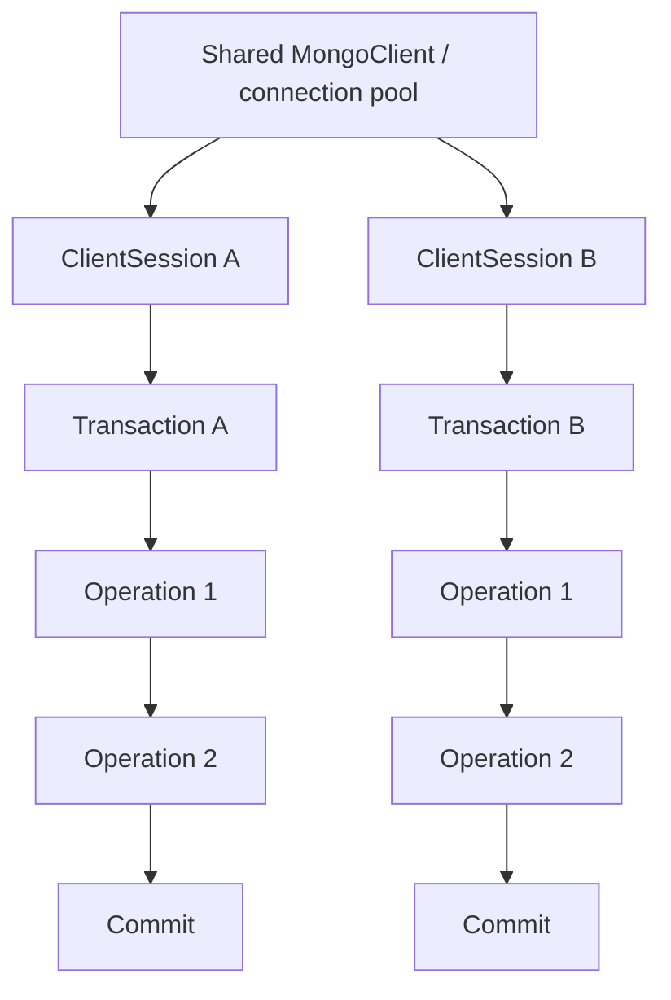

# Parallel Processing Limits on the Same Session or Transaction

In **Spring Data MongoDB reactive**, Reactor can execute multiple asynchronous tasks concurrently using `flatMap`, `Mono.when`, `Mono.zip`, or `merge`. This is useful when I/O tasks are **independent**, but easily turns into a bug if those MongoDB commands participate in **the same `ClientSession` or the same transaction**. The official **MongoDB Java Reactive Streams Driver** documentation explicitly states: **parallel operations are not supported within the same transaction**.

This does not preclude opening **multiple independent transactions** concurrently across multiple sessions. The limit applies to **operations sharing a session/transaction**: you must structure the flow so that one command completes before the next command using the same transaction is subscribed to. In Reactor, readable approaches are `then`, `flatMap` depending on the result of a single `Mono`, or `concatMap` when processing multiple items. Combinators that subscribe concurrently such as `when`, `zip`, and `flatMap` over a multi-element `Flux` must be evaluated carefully.

This lesson belongs to the **Reactive Transactions** chapter of the `SPRING_DATA_MONGODB` module. The module uses Spring Data MongoDB to connect, map documents, interact with MongoDB via template or repository, and practice querying, aggregation, indexing, transactions, reactive access, testing, and performance diagnostics. This lesson focuses on the concurrency boundaries of **MongoDB Reactive Streams Driver**, `ReactiveMongoTemplate`, `ReactiveMongoRepository`, `ReactiveMongoTransactionManager`, and `TransactionalOperator`, rather than covering all Reactor operators in general.

> **Principle:** Within **a single transaction**, execute MongoDB commands **sequentially** and keep them within **the same reactive transaction context**. Do not use `Mono.when(writeA, writeB)` or `Flux.fromIterable(items).flatMap(repository::save)` to increase parallelism for commands inside the same transaction. If you need throughput, parallelize **across independent transactions/sessions** with bounded concurrency or use an appropriate **bulk write command**, rather than launching multiple concurrent commands on the same session.

## 1. Learning Objectives

After this lesson, you will be able to:

1. Distinguish `ClientSession`, server session, transaction, and Reactor subscription.
2. Explain why **a single transaction does not support multiple parallel operations** in the MongoDB Java Reactive Streams Driver.
3. Understand that a `ClientSession` must not be used concurrently at will, even outside a transaction.
4. Distinguish **parallelism across sessions** from **parallelism within a single session**.
5. Identify the risks of using `Mono.when`, `Mono.zip`, `Flux.merge`, `flatMap`, and `parallel()` inside a transactional flow.
6. Use `then`, result-dependent `flatMap`, `concatMap`, or `flatMapSequential` in the right context.
7. Distinguish **output ordering** from **actual operation execution order**.
8. Configure `ReactiveMongoTransactionManager` and `TransactionalOperator` with the same database factory.
9. Understand how Spring binds `ClientSession` to the **Reactor Context**.
10. Avoid calling a separate `subscribe()` in a service that causes a MongoDB command to leave the current transaction.
11. Distinguish cold `Publisher`s, assembly time, and subscription time.
12. Build a two-account and ledger transaction using a **sequential chain of operations**, along with result verification.
13. Distinguish query/duplicate-key errors from **transaction concurrency errors**; do not "fix" them with unbounded retries.
14. Explain the limitations of `ClientSession` when used directly with the MongoDB Reactive Streams Driver.
15. Manage commit, abort, cancellation, and session cleanup across the proper lifecycle.
16. Evaluate using `bulkWrite`/`insertMany` versus running multiple concurrent Publishers.
17. Design a throughput strategy: independent transactions, bounded concurrency, and backpressure.
18. Write unit tests with `StepVerifier` verifying **no overlap** between inner publishers.
19. Write integration tests on a MongoDB replica set to verify commit/rollback and data integrity.
20. Identify cases where a transaction is unnecessary and replace it with a single conditional atomic update.

## 2. MongoDB ClientSession and Transaction: Scope of Sharing

A MongoDB transaction is executed within a **logical session**. `ClientSession` is created and used by the Driver to attach commands to the same session, combining `lsid` and transaction metadata. Within a transaction, operations belonging to the same transaction must be **attached to the right session**, regardless of which collections they operate on.



**Transaction A and Transaction B can run concurrently** if they use **two independent sessions** and database resources are sufficient. However, **Operation 1 and Operation 2 within the same Transaction A must be coordinated sequentially** per Driver limitations.

A session can exist **without** a transaction (for example, when using causal consistency). `ClientSession.startTransaction()` is what starts a transaction. Within the same session, MongoDB does not allow opening two active transactions simultaneously.

### 2.1. Do Not Equate ClientSession with Connection

`ClientSession` is a logical session context, not another name for a socket or connection pool. Opening two `ClientSession` instances does not mean opening two `MongoClient` instances or creating a dedicated fixed connection per session. `MongoClient` should be reused and closed when the application shuts down; a session has a shorter lifecycle tied to an intentional sequence of operations.

### 2.2. Same Collection but Different Sessions

Two independent requests both updating the `accounts` collection can run concurrently on **two different sessions**. MongoDB handles single-document atomicity and transaction isolation according to its policies. If they update the same document, a **write conflict** can still occur: separating sessions does not eliminate business contention.

## 3. Official Limitation: Parallel Operations Not Supported in a Transaction

The MongoDB Java Reactive Streams Driver documentation includes a dedicated note **"Parallel Operations Not Supported"** for transactions. The core point is **do not run multiple MongoDB operations simultaneously within the same transaction**.

Unsafe:

```java
Mono<Void> both = Mono.when(
    reactiveTemplate.insert(accountA),
    reactiveTemplate.insert(accountB)
).as(transactionalOperator::transactional);
```

`Mono.when` subscribes to the sources to wait for **all** of them to complete; it does not guarantee that insert A completes before insert B starts. If `ReactiveMongoTransactionManager` binds both commands to **the same ClientSession**, the workflow above requests parallel execution that the Driver does not support.

Safer:

```java
Mono<Void> both = reactiveTemplate.insert(accountA)
    .then(reactiveTemplate.insert(accountB))
    .then()
    .as(transactionalOperator::transactional);
```

`then` only subscribes to the second Publisher after the first **completes successfully**. If insert A emits `onError`, insert B **is not subscribed to**, and the transaction manager has the opportunity to roll back according to the transaction boundary contract.

`reactiveTemplate`, `accountA`, `accountB`, and `transactionalOperator` are configured by the application in later sections; this example focuses on **subscription ordering**.

### 3.1. Do Not Assume Failure Behavior Is Deterministic

If you attempt parallel execution, failures may appear as a command failure, an aborted transaction, a session state error, or a race/timing anomaly. You do not need to and should not rely on **a fixed error message string** to detect the bug.

**"The test passed 10 times" does not prove parallel operations are supported.** Two small operations might happen not to overlap in one environment; Driver/Server versions, schedulers, and real load can change the ordering.

### 3.2. One Exception: A Single Bulk Command Is Not Multiple Parallel Commands

MongoDB Server 8.0+ and the Java Reactive Streams Driver may support a **client-level bulk write** command operating across multiple namespaces within a transaction when using the appropriate API/version. That is **a single command containing multiple write models**, not `Mono.when(writeA,writeB)` sending two concurrent commands. `bulkWrite` still has its own semantics, limits, and results; do not generalize "bulk is supported" into "all commands in a transaction can run in parallel".

## 4. Another Session Limit: ClientSession Should Not Be Used Concurrently

The MongoDB Driver Sessions Specification explicitly states that `ClientSession` instances are **not thread-safe**; each session should only be used by one thread/process at a time. In a reactive application, multiple Publishers sharing a session can interleave across schedulers/threads even when a service is handling a single HTTP request.

Safety rules:

- Do not hold a `ClientSession` as a singleton shared across requests.
- Do not emit a session into a `Flux` and then `flatMap` multiple commands on the same session with high concurrency.
- Do not use `parallel().runOn(...)` with operations that require a shared session.
- When creating a session manually, use it only with the **MongoClient that created the session**.
- Do not close the session before all operations and commit or abort have completed.
- Ensure operations within the session are **subscribed to and completed in order**.

### 4.1. Session Use Without a Transaction Also Requires Ordering

With a **causally consistent session**, causal ordering between reads and writes is part of the guarantee. When you send two operations sharing a session **concurrently**, you cannot assume `read1` completed before `write2` or that the later operation sees the result of the earlier one. Therefore, preserving order is also necessary for causal consistency, even though MongoDB does not create transaction atomicity just because a session exists.

### 4.2. Reactor Context Differs from Thread Affinity

Spring Data reactive transactions use **Reactor Context**, rather than relying on a fixed Java thread. Therefore:

- Do not assume switching schedulers always loses the transaction: the Context can be propagated properly.
- **However**, Context propagation **does not make ClientSession thread-safe**, nor does it allow multiple operations to use the session at the same time.
- Do not assume a chain sharing the same Context is enough: **operator topology can still introduce concurrency**.

## 5. Distinguishing Parallelism, Concurrency, and Ordering

Several terms are frequently confused:

| Concept | Meaning | Implication for MongoDB Session |
| --- | --- | --- |
| Concurrent subscriptions | Two sources can be active at the same time | Dangerous if in the same transaction |
| Parallel execution | Running simultaneously across multiple threads/CPUs | Unsupported for commands sharing a transaction |
| Sequential subscription | The next Publisher subscribes only after the previous finishes | Safe pattern to prefer |
| Ordered output | Results are emitted in input order | **Does not necessarily** mean operations execute sequentially |
| Backpressure | Downstream regulates `request(n)` demand | Does not by itself guarantee "only one active DB command" |
| Transaction isolation | Writes have commit/abort boundaries | Does not enable parallel operations |

In particular, **`flatMapSequential` preserves output emission order, yet can still subscribe to inner Publishers concurrently**. It is **not** a substitute for `concatMap` when the goal is to prevent overlapping operations.

```java
Flux<Result> notSequentialInExecution =
    Flux.fromIterable(commands)
        .flatMapSequential(this::executeInSameSession, 8);
```

The line above can preserve result order while still keeping up to eight inner Publishers open at the same time. If all of them use **a single transaction**, this remains an anti-pattern.

## 6. Operators That Commonly Cause Overlap

| Reactor Operator | Typical Subscription Pattern | Safe for Multiple DB Commands in One Transaction? |
| --- | --- | --- |
| `Mono.when(a,b)` | Subscribes to both a and b to wait for completion | **No** |
| `Mono.zip(a,b)` | Subscribes to both a and b, combines values | **No** |
| `Flux.merge(a,b)` | Subscribes to multiple sources concurrently | **No** |
| `Flux.fromIterable(xs).flatMap(f)` | Inner operations have concurrency/prefetch | **No** if sharing a session |
| `flatMapSequential(f,n)` | Inner concurrency but ordered output | **No** if sharing a session |
| `parallel().runOn(scheduler)` | Splits into rails for concurrent execution | **No** if sharing a session |
| `Mono<A>.flatMap(a -> Mono<B>)` | Mono B is subscribed after A emits a value | **Yes**, if no other branch is launched |
| `Mono<Void>.then(Mono<B>)` | B is subscribed after A completes | **Yes** |
| `Flux.fromIterable(xs).concatMap(f)` | Inner Publishers are processed sequentially | **Yes** |
| `Flux.fromIterable(xs).flatMap(f,1)` | Limits to one active inner | Possible, though `concatMap` expresses intent more clearly |
| `doOnNext(...)` | Synchronous side-effect, does not await a secondary Publisher | **Do not** use to launch a second DB command |

This table applies to **cases where each Publisher calls MongoDB within the same session/transaction**. `Mono.zip` on two **pure CPU** operations or two requests using **two independent sessions** is not subject to that same restriction.

### 6.1. FlatMap on a Single Mono vs. FlatMap on Multiple Items

`Mono<Read>.flatMap(read -> write)` only creates the write Publisher after the read produces a value; this is a **sequential data-dependency** pattern. By contrast, `Flux<Read>.flatMap(read -> write)` can start **multiple parallel writes** across records because the outer Flux emits multiple items.

Therefore, never judge safety solely by the keyword `flatMap` — you must examine **how many onNext signals the upstream publisher emits** and how many inner publishers are subscribed to concurrently.

## 7. The Mono.when Trap: Waiting for Two Commands Does Not Mean Sequential Execution

```java
// Anti-pattern when both operations participate in one transaction.
Mono<Void> result = Mono.when(
    template.updateFirst(debitQuery, debit, Account.class),
    template.updateFirst(creditQuery, credit, Account.class)
).as(tx::transactional);
```

`Mono.when` is a combinator that **establishes no before–after ordering** between two sources. Even when both update **two different documents**, they still share **the session of the same transaction** and therefore are not supported in parallel by the Driver.

Fix:

```java
Mono<Void> result =
    template.updateFirst(debitQuery, debit, Account.class)
        .flatMap(debitResult -> {
            if (debitResult.getMatchedCount() != 1) {
                return Mono.error(
                    new IllegalStateException("Unable to debit"));
            }
            return template.updateFirst(
                creditQuery, credit, Account.class);
        })
        .flatMap(creditResult -> {
            if (creditResult.getMatchedCount() != 1) {
                return Mono.error(
                    new IllegalStateException("Unable to credit"));
            }
            return Mono.<Void>empty();
        })
        .as(tx::transactional);
```

Here, debit completes and emits an `UpdateResult` before credit is subscribed to. However, using `Mono.<Void>empty()` merely to terminate the chain can hurt readability; the production-style example in Section 15 will use `then` and check results more cleanly.

## 8. The Mono.zip Trap: Combining Results Does Not Create a Dependency

Wrong if reading two accounts **within the same transaction** using `zip`:

```java
Mono<reactor.util.function.Tuple2<Account, Account>> both =
    Mono.zip(
        template.findById(sourceId, Account.class),
        template.findById(targetId, Account.class)
    ).as(tx::transactional);
```

`zip` subscribes to both Monos to combine their results. It has no rule saying "find source completes first, then find target". Thus these are **two operations on the same session that can overlap**.

If the reads truly must participate in the transaction, run them sequentially:

```java
Mono<reactor.util.function.Tuple2<Account, Account>> both =
    template.findById(sourceId, Account.class)
        .flatMap(source ->
            template.findById(targetId, Account.class)
                .map(target -> reactor.util.function.Tuples.of(
                    source, target))
        )
        .as(tx::transactional);
```

**Note on empty:** if source or target is missing, the chain can complete empty; business logic needs `switchIfEmpty(Mono.error(...))` in the appropriate place. Do not treat `Mono.zip` on reads outside a transaction as always bad: it can be reasonable when **each read uses its own session/connection** and there is no shared snapshot requirement.

## 9. The Flux.flatMap Trap: One Session, Many Writes

Example processing 100 ledger lines:

```java
Flux<LedgerEntry> writes =
    Flux.fromIterable(entries)
        .flatMap(template::insert, 8);

Mono<Void> all = writes.then()
    .as(tx::transactional);
```

`flatMap(...,8)` can open eight inner subscriptions simultaneously. With a shared transaction context, that is a request the Driver **does not support**.

Replace with:

```java
Mono<Void> all =
    Flux.fromIterable(entries)
        .concatMap(template::insert)
        .then()
        .as(tx::transactional);
```

`concatMap` subscribes to each inner Publisher and waits for it to finish before subscribing to the next inner. `then()` only completes when all inserts succeed; an error on any insert fails the outer chain and the manager handles rollback.

### 9.1. concatMap Guarantees Operation Order, Not Commit Atomicity

`concatMap` is not a transaction. If you remove `.as(tx::transactional)`, each insert may already have committed individually, and a failure on the third item **does not automatically roll back** the first two items.

Conversely, `TransactionalOperator` provides the transaction boundary but **does not automatically turn `flatMap` into `concatMap`**. To have both atomicity and concurrency restriction, you need **both**.

### 9.2. When Source Data Is Emitted Asynchronously

`concatMap` manages inner subscriptions in the order of outer signals. The outer Flux can still prefetch/queue, yet no multiple **inner DB Publishers** initiated by `concatMap` itself are active at once. If the outer source is also a MongoDB query **in the same session**, examine the cursor/read lifecycle: do not assume streaming an unfinished read inside a transaction while writing on the same session is a safe pattern; consider materializing a **bounded** set before running sequential writes or designing the workflow with phased queries.

## 10. Repeated Subscriptions and Session Scope

The MongoDB Reactive Streams Driver returns **cold** Publishers. `Mono<Void> transactionPipeline` is not equivalent to an already-executed transaction:

```java
Mono<Void> transactionPipeline =
    template.insert(entryA)
        .then(template.insert(entryB))
        .then()
        .as(tx::transactional);

// No subscriber yet -> has not run.
// Subscription A -> one transaction.
// Subscription B -> a new transaction execution.
```

With a transaction manager, each valid subscription typically creates its own transaction/session, so two subscriptions **can run concurrently as two independent transactions**. However, they might write **the same business data** or hit duplicate key errors; do not treat a cold Publisher as exactly-once.

### 10.1. Do Not Use Inner Subscribe

Wrong:

```java
Mono<Void> unsafe() {
    template.insert(entryA).subscribe(); // A separate flow, not awaited.
    return template.insert(entryB).then()
        .as(tx::transactional);
}
```

`insert(entryA).subscribe()` creates an independent subscription; it can run outside the returned branch's transaction, is not awaited before commit/rollback, and can happen concurrently with insert B. If insert B rolls back, insert A running separately **may still persist**.

Fix:

```java
Mono<Void> safe() {
    return template.insert(entryA)
        .then(template.insert(entryB))
        .then()
        .as(tx::transactional);
}
```

**A single chain is returned/subscribed to by the application boundary**; there is no hidden subscription.

## 11. What Can Be Run in Parallel?

An important distinction: **MongoDB does not forbid a reactive application from performing concurrent work.** Do not turn every flow sequential out of a misunderstanding of **session** limits.

Cases that can run concurrently, once evaluated for business rules:

| Case | Can Run Concurrently? | Conditions |
| --- | --- | --- |
| Two HTTP requests, one transaction/session each | Yes | Resources, write conflicts, retries, and idempotency |
| Two independent CPU calculations not touching a MongoDB session | Yes | No unsafe shared mutable state |
| Two external API calls outside a transaction | Yes | Understand side effects and outcomes |
| Two queries using separate sessions outside a transaction | Yes | Consider consistency/replication |
| Two commands using the same `ClientSession` | Should not | Session is not thread-safe; keep ordering |
| Two commands inside the same transaction | **Not supported** | Run sequentially |
| One bulk command updating multiple documents | Possible | Subject to driver/server/operation semantics, not parallel calls |
| Two transactions contending on one account | Can run concurrently, may conflict | Design contention handling |

### 11.1. Independent Computation Before Opening a Transaction

You can run pure computation or external I/O in parallel before a transaction, and only then begin the sequential write chain:

```java
Mono<ValidatedTransfer> prepared = Mono.zip(
    validateTransferRules(command),
    loadPricingPolicy(command)
).map(tuple -> combine(tuple.getT1(), tuple.getT2()));

Mono<Void> write = prepared.flatMap(validated ->
    writeTransferSequentially(validated)
        .as(tx::transactional)
);
```

`validateTransferRules`, `loadPricingPolicy`, `combine`, and `writeTransferSequentially` are **application-defined business functions**. Assume the pre-transaction sources have no irreversible side effects. If a DB snapshot or authorization is required inside the transaction, **it must be re-checked at write time**: validating before the transaction does not prevent stale data.

### 11.2. Place the Transaction Boundary in the Right Spot

In the example above, `.as(tx::transactional)` sits **inside** `flatMap`, wrapping only `writeTransferSequentially`. If placed at the end of `prepared.flatMap(...).as(tx::transactional)`, the preparation tasks also join the transaction context if they use the MongoDB template. This can unnecessarily prolong the transaction or turn independent reads into concurrent operations sharing a session.

## 12. Throughput: Parallelism Across Independent Transactions

Suppose there are many **independent** transfers. Each transfer has a service method returning `Mono<TransferResult>`, and **the transaction boundary sits inside that method**:

```java
Flux<TransferResult> results =
    Flux.fromIterable(transferCommands)
        .flatMap(
            command -> transferService.transfer(command),
            4
        );
```

Here `flatMap(...,4)` can have **up to four transfer Monos active at once**, and if each transfer starts its own transaction with its own session, this is parallelism **across transactions**, not parallelism **within a single transaction**.

Crucial point: **do not** wrap the entire Flux in **a single** `.as(tx::transactional)`:

```java
// Unsuitable if the goal is 4 independent transactions:
Flux<TransferResult> wrong =
    Flux.fromIterable(transferCommands)
        .flatMap(transferService::transfer, 4)
        .as(tx::transactional); // One transaction context for the outer flow.
```

In that case, the outer transaction can cause inner database operations to share a session/context inappropriately, or alter propagation in unintended ways.

### 12.1. Concurrency 4 Does Not Mean 4 Transactions Never Conflict

Two transfers might both debit the same account. Even on separate sessions, MongoDB can still abort one transaction due to a write conflict. You need rollback/bounded retry, idempotency, and invariants; separating sessions is an **operational prerequisite**, not a guarantee that business conflicts disappear.

### 12.2. Is an Outer Flux Multiple Requests or One Batch?

If a single HTTP request submits 100 transfers and the system must satisfy **"all 100 transfers commit together or roll back together"**, you must not replace it with 4 independent transactions without clarifying the semantic change. You may need a single sequential transaction or a different business batch design, while accounting for transaction time limits, memory, and locks. If the 100 transfers are allowed to succeed or fail independently, bounded parallel transactions is a valid alternative design.

## 13. Configuring ReactiveMongoTransactionManager

`ReactiveMongoTransactionManager` manages MongoDB sessions and transactions in reactive applications. It binds resources to the **Reactor Context** so operations within the same subscription can participate in the transaction, rather than assuming the transaction lives in a fixed `ThreadLocal`.

```java
package dev.learning.transactions;

import org.springframework.context.annotation.Bean;
import org.springframework.context.annotation.Configuration;
import org.springframework.data.mongodb.ReactiveMongoDatabaseFactory;
import org.springframework.data.mongodb.ReactiveMongoTransactionManager;

@Configuration
public class ReactiveMongoTxConfiguration {

    @Bean
    ReactiveMongoTransactionManager reactiveMongoTransactionManager(
            ReactiveMongoDatabaseFactory factory) {

        return new ReactiveMongoTransactionManager(factory);
    }
}
```

Key prerequisites:

- MongoDB is a **replica set** or sharded cluster that supports transactions.
- `ReactiveMongoTemplate`, repositories, and the manager share the appropriate **ReactiveMongoDatabaseFactory**.
- Business collections and indexes should be provisioned before business transactions; DDL inside transactions has restrictions depending on server/topology.
- The MongoDB account has the required privileges; the transaction uses a valid read preference.
- If multiple clients/factories exist, explicitly select the right manager bean rather than assuming every repository uses the same transaction.

### 13.1. TransactionalOperator and @Transactional

```java
import org.springframework.transaction.reactive.TransactionalOperator;

TransactionalOperator tx =
    TransactionalOperator.create(reactiveMongoTransactionManager);
```

Declarative example:

```java
import org.springframework.transaction.annotation.Transactional;

@Transactional
public Mono<Void> insertBoth() {
    return template.insert(first)
        .then(template.insert(second))
        .then();
}
```

The method example above is illustrative; `template`, `first`, and `second` are fields/values provided by the application. `@Transactional` is only applied when the method is invoked through a Spring proxy or equivalent management mechanism; self-invocation can bypass the proxy.

**Neither `TransactionalOperator` nor `@Transactional` automatically serializes `Mono.when` or `flatMap`.** Pipeline authors still have to choose operators that guarantee order.

## 14. Example Domain: Account and Ledger

Suppose we transfer 2,000 cents from account A-1 to A-2. Both accounts and one ledger entry must commit together or roll back together.

```java
package dev.learning.transactions;

import org.springframework.data.annotation.Id;
import org.springframework.data.mongodb.core.mapping.Document;
import org.springframework.data.mongodb.core.mapping.Field;

@Document("rx_tx_accounts")
public record TxAccount(
    @Id String id,
    @Field("tenant_id") String tenantId,
    long balanceCents) {
}
```

```java
package dev.learning.transactions;

import org.springframework.data.annotation.Id;
import org.springframework.data.mongodb.core.mapping.Document;
import org.springframework.data.mongodb.core.mapping.Field;

@Document("rx_tx_ledger")
public record TxLedger(
    @Id String id,
    @Field("tenant_id") String tenantId,
    String fromAccountId,
    String toAccountId,
    long amountCents) {
}
```

**Place each `public record` in its own Java file.** Collection names `rx_tx_accounts`/`rx_tx_ledger` are created in the test database or provisioned via migrations before transactions run.

| Account | tenant_id | Before | After Commit |
| --- | --- | ---: | ---: |
| `A-1` | tenant-a | 10.000 | 8.000 |
| `A-2` | tenant-a | 4.000 | 6.000 |
| `B-1` | tenant-b | 99.000 | Unchanged |

A transfer with the wrong tenant or insufficient balance **must not commit**. `TransactionalOperator` enforces the MongoDB transaction boundary, but does not automatically write authorization predicates or balance checks.

### 14.1. Business Predicates Belong Inside the Write Command

```javascript
db.rx_tx_accounts.updateOne(
  {
    _id: "A-1",
    tenant_id: "tenant-a",
    balanceCents: { $gte: NumberLong("2000") }
  },
  { $inc: { balanceCents: NumberLong("-2000") } }
);
```

`$inc` together with the predicate on **a single document** is itself atomic. A transaction is used here because the business logic also needs to **credit the target account** and **insert a ledger entry** within the same commit boundary.

## 15. Transfer Service: Three Sequential MongoDB Commands

```java
package dev.learning.transactions;

import org.springframework.data.mongodb.ReactiveMongoTransactionManager;
import org.springframework.data.mongodb.core.ReactiveMongoTemplate;
import org.springframework.data.mongodb.core.query.Criteria;
import org.springframework.data.mongodb.core.query.Query;
import org.springframework.data.mongodb.core.query.Update;
import org.springframework.stereotype.Service;
import org.springframework.transaction.reactive.TransactionalOperator;
import reactor.core.publisher.Mono;

@Service
public class TxTransferService {

    private final ReactiveMongoTemplate template;
    private final TransactionalOperator tx;

    public TxTransferService(
            ReactiveMongoTemplate template,
            ReactiveMongoTransactionManager manager) {
        this.template = template;
        this.tx = TransactionalOperator.create(manager);
    }

    public Mono<Void> transfer(
            String tenantId,
            String fromId,
            String toId,
            long cents,
            String requestId) {

        return Mono.defer(() -> {
            if (tenantId == null || tenantId.isBlank()
                    || fromId == null || toId == null
                    || fromId.equals(toId)
                    || requestId == null || requestId.isBlank()
                    || cents <= 0) {
                return Mono.error(
                    new IllegalArgumentException("Invalid transfer"));
            }

            Query debitQuery = Query.query(
                Criteria.where("id").is(fromId)
                    .and("tenantId").is(tenantId)
                    .and("balanceCents").gte(cents)
            );
            Query creditQuery = Query.query(
                Criteria.where("id").is(toId)
                    .and("tenantId").is(tenantId)
            );

            Update debit = new Update().inc("balanceCents", -cents);
            Update credit = new Update().inc("balanceCents", cents);

            TxLedger ledger = new TxLedger(
                "TRANSFER-" + requestId, tenantId,
                fromId, toId, cents
            );

            return template
                .updateFirst(debitQuery, debit, TxAccount.class)
                .flatMap(debitResult -> {
                    if (debitResult.getMatchedCount() != 1) {
                        return Mono.error(new IllegalStateException(
                            "Invalid source account or insufficient balance"));
                    }

                    // Credit is subscribed to only after debit produces a result.
                    return template.updateFirst(
                        creditQuery, credit, TxAccount.class);
                })
                .flatMap(creditResult -> {
                    if (creditResult.getMatchedCount() != 1) {
                        return Mono.error(new IllegalStateException(
                            "Invalid target account"));
                    }

                    // Insert ledger only after credit produces a result.
                    return template.insert(ledger);
                })
                .then();
        }).as(tx::transactional);
    }
}
```

This is a **core MongoDB transaction** example, not a complete production financial system. Real-world operation also requires principal-based tenant authorization, a unique index/idempotency for `requestId`, retrying transient write conflicts, overflow/currency-type guards, handling unknown commit outcomes, and a transactional outbox for side effects outside MongoDB.

### 15.1. Reading the Chain in Execution Order

1. `Mono.defer` defers building queries and the ledger until **subscription**.
2. MongoDB receives the debit command and returns an `UpdateResult`.
3. `flatMap` after debit checks `matchedCount`; if 0, it emits `onError`.
4. Only when debit matches does the reactive chain subscribe to credit.
5. `flatMap` after credit checks `matchedCount`; if 0, it emits `onError`.
6. Only when credit matches does the chain subscribe to insert the ledger.
7. `then()` emits terminal completion when the ledger insert succeeds.
8. `TransactionalOperator` is placed **around the entire chain**; on success it commits, and on error it rolls back per the manager contract.

**Do not use `Mono.when`/`Mono.zip`/`flatMap` over multiple items** to send these DB writes.

### 15.2. Why Must matchedCount Be Checked?

`updateFirst` does not necessarily emit an error when the query matches no document. It can return an `UpdateResult` with `matchedCount=0` and complete successfully from a server communication standpoint. If the service ignores `matchedCount`, the transaction can commit even though half of the transfer logic never took effect.

`matchedCount=0` could mean insufficient balance, wrong tenant, missing account, or data contention. Returning specific details to the caller must respect authorization rules and avoid leaking another tenant's accounts.

### 15.3. Do Not Call subscribe Inside the Service

Wrong:

```java
// Anti-pattern: credit runs on an independent subscription.
template.updateFirst(creditQuery, credit, TxAccount.class)
    .subscribe();

return template.updateFirst(
    debitQuery, debit, TxAccount.class).then();
```

The credit command can execute **outside the managed transaction**, out of business order, without propagating errors or cancellation to the caller. Manual `subscribe()` belongs only at lifecycle-managed boundaries, never randomly inside a service transaction.

## 16. Batching Inside One Transaction: concatMap Instead of flatMap

```java
import java.util.List;
import reactor.core.publisher.Flux;
import reactor.core.publisher.Mono;

// Inside the same service with fields template and tx:
public Mono<Void> insertLedgerBatch(List<TxLedger> entries) {
    return Flux.fromIterable(entries)
        .concatMap(template::insert)
        .then()
        .as(tx::transactional);
}
```

`concatMap` waits for each insert Publisher to complete before subscribing to the next insert. With `flatMap(template::insert, 16)`, up to 16 operations could run simultaneously **within the same transaction context** — which is unsupported by the Driver.

**`concatMap` does not create a transaction by itself.** If you omit `as(tx::transactional)`, earlier inserts may already have committed when a later insert fails. You need **both sequential execution order and a transaction boundary** when you want all-or-nothing.

### 16.1. Avoid Overly Long Transactions

A transaction containing hundreds of thousands of sequential writes can exceed its lifetime limit, increase lock contention, or grow snapshot overhead. If the business allows groups to commit separately, split into smaller transactions and process **independent transactions** with bounded concurrency. However, if all-or-nothing is required across the entire batch, do not silently split the transaction and break the contract.

### 16.2. Unfinished Read Cursor and Write in the Same Session

```java
// Use caution: the read cursor may still be active.
Mono<Void> questionable = template.find(
        query, TxAccount.class)
    .concatMap(acc -> template.updateFirst(
        buildQuery(acc), buildUpdate(acc), TxAccount.class).then())
    .then()
    .as(tx::transactional);
```

`concatMap` ensures only one **inner update** is active, but the outer `find` may still have an active cursor/`getMore`. This requires careful evaluation if they share a session. When the result set is small and **bounded**, you can complete the read phase first:

```java
Mono<Void> twoPhase = template.find(
        query.limit(100), TxAccount.class)
    .collectList()
    .flatMapMany(rows -> Flux.fromIterable(rows)
        .concatMap(acc -> template.updateFirst(
            buildQuery(acc), buildUpdate(acc),
            TxAccount.class).then()))
    .then()
    .as(tx::transactional);
```

`query`, `buildQuery`, and `buildUpdate` are application values/functions. `collectList` is only sensible for bounded sets; never use it on millions of rows. After the read phase, protect write invariants with predicates/locking and understand snapshot semantics.

## 17. A Bulk Command Differs from Parallel Commands

The Driver's `insertMany`/`bulkWrite` can send multiple write models in **a single operation with its own semantics**.

```java
import java.util.List;
import org.bson.Document;
import reactor.core.publisher.Mono;

// reactiveCollection is a MongoDB Reactive Streams MongoCollection<Document>
// session belongs to the corresponding client and has an active transaction.
Mono<?> oneOperation = Mono.from(
    reactiveCollection.insertMany(
        session,
        List.of(
            new Document("_id", "BATCH-1"),
            new Document("_id", "BATCH-2")
        )
    )
);
```

This is **one Publisher for one API operation**, not equivalent to `Mono.when(insertOneA, insertOneB)` with two concurrent subscriptions.

- `insertMany`/`bulkWrite` have their own ordered/unordered modes, error results, and limits.
- MongoDB Server **8.0+** supports client-level bulk writes across multiple namespaces within a transaction through the appropriate driver/API.
- The Bulk API does not automatically enforce per-entity optimistic locking like `repository.save(versionedEntity)`.
- Bulk does not make a transaction immune to timeouts or write conflicts.
- After a bulk operation, do not launch another operation **concurrently on the same session**.

## 18. Managing Sessions Directly via the Reactive Streams Driver

When not using Spring's `ReactiveMongoTransactionManager`, the Driver API requires passing the session to **every operation participating in the transaction**.

```java
import com.mongodb.reactivestreams.client.MongoClient;
import com.mongodb.reactivestreams.client.MongoCollection;
import org.bson.Document;
import reactor.core.publisher.Mono;

// client is an application-managed reactive MongoClient:
MongoCollection<Document> a = client.getDatabase("training_tx")
    .getCollection("first");
MongoCollection<Document> b = client.getDatabase("training_tx")
    .getCollection("second");

Mono<Void> manualIllustration =
    Mono.from(client.startSession())
        .flatMap(session -> {
            session.startTransaction();
            return Mono.from(
                    a.insertOne(session, new Document("_id", "ONE")))
                .then(Mono.from(
                    b.insertOne(session, new Document("_id", "TWO"))))
                .then(Mono.from(session.commitTransaction()))
                .doFinally(signal -> session.close());
        });
```

**This is only an illustration of session parameter ordering.** It **does not handle abort on error/cancel**, does not retry commit, and should not be copied verbatim into production.

### 18.1. What Does a Complete Manual Flow Require?

If using the raw Driver, you must manage:

1. Acquiring a session when subscription starts.
2. Calling `startTransaction` with valid options.
3. Passing that same session to each Driver API overload.
4. Composing operations **sequentially**.
5. Committing only after all business operations succeed.
6. Aborting on error; handling cancellation separately.
7. Closing the session after commit/abort (even if cleanup emits an error).
8. Classifying `TransientTransactionError` and `UnknownTransactionCommitResult`.
9. Not sharing the session across requests/threads.
10. Guarding external side effects and idempotency.

One resource management approach is `Mono.usingWhen` or `Flux.usingWhen` with **asyncComplete → commit/close**, **asyncError → abort/close**, and **asyncCancel → abort/close** callbacks. Unlike `doFinally`, asynchronous cleanup must be **composed and awaited** rather than calling `abortTransaction().subscribe()` separately and hoping it finishes properly.

### 18.2. Why Prefer TransactionalOperator?

`TransactionalOperator` handles transaction resource lifecycle and Spring Data integration, letting the service focus on queries and result checks. If there is a specific reason to manage sessions manually, integration tests must cover cancellation, commit failure, and abort failure — not just the happy path.

## 19. Retry the Right Errors, Never Use Retry to Mask Concurrency Misuse

A transaction can fail due to a **write conflict**, timeout, network error, duplicate key, unmet business condition, or session misuse. Do not treat every failure as a transient error.

| Situation | Meaning | Action |
| --- | --- | --- |
| `TransientTransactionError` | Transient error labeled by the Driver | Can retry the entire transaction per contract |
| `UnknownTransactionCommitResult` | Unclear whether commit succeeded | Handle/retry commit per Driver, avoid duplicating commands |
| `DuplicateKeyException` | Unique key / idempotency violation | Inspect data and `requestId` |
| `matchedCount=0` | Predicate did not match | Business error, missing permission, or changed data |
| Parallel operations on same session | Pipeline uses wrong topology | **Fix `when/zip/flatMap` to be sequential** |
| Transaction lifetime exceeded | Transaction ran too long | Shrink scope, optimize queries/batching |
| HTTP request canceled | Outcome may be uncertain | Cleanup and idempotency/reconciliation |

Do not write:

```java
return transactionalWork
    .retryWhen(reactor.util.retry.Retry.max(100));
```

`retryWhen` **re-subscribes** to upstream. If the workflow sends emails, charges payments, or writes outside MongoDB, those side effects do not roll back automatically. Retries must have a bounded count, clear error classification, and an idempotency key for business commands.

### 19.1. Retrying a Transaction Is Not the Same as Retrying a Commit

With an appropriate `TransientTransactionError`, a program can abort and rerun the transaction. With `UnknownTransactionCommitResult`, the commit may already have succeeded while the response was lost, so you must not blindly **rerun the entire business operation**. The MongoDB Driver provides callback helpers and specific commit retry rules; manual implementations must follow official error labels.

### 19.2. Retry Does Not Legalize Mono.when

A `Mono.when(writeA,writeB).retryWhen(...)` pipeline still subscribes to both commands at the same time on every attempt. If both share a transaction, this remains an operation **unsupported by the Driver**. Fix the topology before considering retries.

## 20. Commit, Abort, Cancel, and Terminal Signals

| Publisher Signal | Expectation | Caveats |
| --- | --- | --- |
| `onComplete` | Commit then terminate boundary | Commit itself can error or be unknown |
| `onError` | Abort/rollback and propagate error | Do not swallow errors into empty |
| `cancel` | Cleanup, attempt abort if uncommitted | Cancel does not always undo an already committed write |
| Timeout | Error/cancel per Reactor | Server may already have received the command |
| Resubscribe | A new transaction execution | Business action may repeat |

### 20.1. Swallowing Errors Before the Transaction Boundary Can Cause a False Commit

```java
Mono<Void> incorrect = template.insert(entry)
    .onErrorResume(error -> Mono.empty())
    .then()
    .as(tx::transactional);
```

If insert fails but is turned into `Mono.empty` **before** reaching the manager, the manager only sees completion and attempts to commit. Recover an error into success only when **business rules genuinely allow** ignoring it.

### 20.2. Do Not Abort via Inner Subscribe

```java
// Anti-pattern, do not use alongside the Spring manager:
return businessFlow
    .doOnError(error ->
        session.abortTransaction().subscribe());
```

This is an unawaited asynchronous abort command; it can race with the rollback the manager is performing on the same session. When using Spring, let the transaction manager handle it. When using the raw Driver, **compose/await** the abort Publisher in the appropriate cleanup flow.

### 20.3. Client Cancellation Does Not Guarantee Immediate Rollback

WebFlux cancellation can propagate upstream, but if the commit has already reached MongoDB or the commit response was lost, the outcome is uncertain. For critical operations, use a `requestId`/unique key and a status lookup endpoint; never promise "if the client disconnects, no write occurred".

## 21. Reactor Context Does Not Guarantee Execution Order

`ReactiveMongoTransactionManager` binds the session via **Reactor Context**. Unlike imperative transactions using `ThreadLocal`, a reactive chain can switch threads while the Context still propagates through Reactor/Spring integration.

```text
Same Reactor Context
    -> can share the same transaction-bound ClientSession
    -> DOES NOT make ClientSession thread-safe

Same ClientSession + same transaction
    -> DOES NOT support parallel MongoDB commands
    -> operations must be coordinated sequentially
```

### 21.1. Schedulers Do Not Fix Concurrency Topology

```java
Mono<Void> stillWrong = Mono.when(
    template.insert(entryA).subscribeOn(schedulerA),
    template.insert(entryB).subscribeOn(schedulerB)
).as(tx::transactional);
```

`subscribeOn` can change the thread where subscription begins; `publishOn` changes the downstream execution context. Neither turns `when` into `then`. Putting both branches on the same scheduler does not guarantee sequential completion of DB operations either.

### 21.2. Do Not Store Sessions Manually in ThreadLocal or Globals

Reactive code can switch threads. Never create a `ThreadLocal<ClientSession>` to fetch a session inside callbacks, and never store a singleton session to share across requests. Use the session-aware `ReactiveMongoTemplate` and a transaction manager wired to the right factory.

### 21.3. Self-Invocation Can Bypass @Transactional

A `@Transactional` method called via `this.method()` within the same bean may not pass through the Spring AOP proxy. In that case, the returned Publisher may **not be wrapped by the transaction manager**, even though the annotation appears in source code. Test rollback on a replica set, rather than merely checking annotations via reflection.

## 22. Performance: Short Transactions and Bounded Parallel Transactions

Parallelism limits on the same session do not mean a reactive application loses throughput. You can process multiple **independent transactions** simultaneously with `flatMap(...,concurrency)` when business rules allow.

Metrics to monitor:

- Active transaction count, commit/abort/error rates.
- Transaction duration and commit latency.
- Number of MongoDB commands per transaction and execution time per command.
- Write conflicts, transient retries, unknown commit outcomes.
- Driver connection pool, wait queues, and server selection timeouts.
- Replication lag, lock contention, snapshot memory.
- Batch size, request rate, and service concurrency.
- `matchedCount=0` rate on debit/credit.
- Index usage for queries filtering by `tenant_id`/`_id`.

### 22.1. Avoid Calling Slow Remote Services Inside a Transaction When Possible

```java
Mono<Void> slow = template.updateFirst(
        debitQuery, debit, TxAccount.class)
    .then(remoteFraudCheck()) // Long-running HTTP call.
    .then(template.insert(ledger))
    .then()
    .as(tx::transactional);
```

`remoteFraudCheck` is a Publisher calling an external system outside MongoDB. The transaction holds resources while waiting; if the fraud check does not require a MongoDB snapshot, run it **before** the transaction. Once the transaction begins, re-verify the business invariant in the atomic query.

### 22.2. Time and Memory Limits

MongoDB has `transactionLifetimeLimitSeconds` (typically defaulting to around 60 seconds, configurable depending on version/deployment), along with other operational limits. Do not put 100,000 documents into a single long-running transaction just because `concatMap` can iterate through all of them. Optimize schema/indexes and keep transaction scope short.

### 22.3. When a Single Atomic Update Is Enough

If you only need to decrement inventory on **a single document**, a query with a predicate and an atomic `$inc` can suffice:

```java
Query q = Query.query(
    Criteria.where("id").is(productId)
        .and("tenantId").is(authorizedTenant)
        .and("available").gte(quantity));

Update u = new Update().inc("available", -quantity);

Mono<Boolean> reserved = template.updateFirst(
    q, u, StockItem.class)
    .map(result -> result.getMatchedCount() == 1);
```

`StockItem` is an illustrative entity with `id`, `tenantId`, and `available`. A multi-document transaction is only needed when an invariant requires synchronizing changes across multiple resources, not because every reactive update must live inside a transaction.

## 23. Unit Testing: Proving Inner Subscriptions Do Not Overlap

Test the sequential property of `concatMap` with Reactor `StepVerifier`, **without** trying to force a failure on a real MongoDB session.

```java
package dev.learning.transactions;

import static org.assertj.core.api.Assertions.assertThat;

import java.time.Duration;
import java.util.concurrent.atomic.AtomicInteger;
import org.junit.jupiter.api.Test;
import reactor.core.publisher.Flux;
import reactor.core.publisher.Mono;
import reactor.test.StepVerifier;

class SequentialOperatorsTest {

    @Test
    void concatMapKeepsOnlyOneInnerActive() {
        AtomicInteger active = new AtomicInteger();
        AtomicInteger peak = new AtomicInteger();

        Mono<Void> pipeline = Flux.range(1, 5)
            .concatMap(n -> Mono.defer(() -> {
                int now = active.incrementAndGet();
                peak.accumulateAndGet(now, Math::max);

                return Mono.delay(Duration.ofMillis(10))
                    .doOnSuccess(value -> active.decrementAndGet());
            }))
            .then();

        StepVerifier.create(pipeline).verifyComplete();

        assertThat(active.get()).isZero();
        assertThat(peak.get()).isEqualTo(1);
    }
}
```

Here `doOnSuccess` decrements the counter before completion propagates down to `concatMap`, making the peak check easy to reason about. This test verifies **operator topology**; it does not prove MongoDB Driver support/non-support via a specific error.

### 23.1. Do Not Test "flatMap Must Always Error"

If you send 10 concurrent commands on a real session, the environment might accidentally serialize some commands and raise no error, or raise different errors depending on driver/server. Tests expecting "must throw message X" are prone to flakiness. Fix the pipeline according to the documented contract, test serialization with Reactor, and test transaction success/rollback on a replica set.

### 23.2. Ordered Output Is Not Ordered Execution

`flatMapSequential` preserves output emission order but can subscribe to inner Publishers concurrently. Asserting that an output list is sorted properly **does not prove DB commands did not overlap**.

## 24. Integration Testing: Commit and Rollback on a Replica Set

Use a MongoDB **test replica set** (Testcontainers or a dedicated test cluster), not standalone mode, to verify transaction behavior. Collections `rx_tx_accounts` and `rx_tx_ledger` must be provisioned **before** transactions run.

### 24.1. Successful Transfer

```java
package dev.learning.transactions;

import static org.assertj.core.api.Assertions.assertThat;

import java.util.UUID;
import org.junit.jupiter.api.Test;
import org.springframework.beans.factory.annotation.Autowired;
import org.springframework.boot.test.context.SpringBootTest;
import org.springframework.data.mongodb.core.ReactiveMongoTemplate;
import reactor.core.publisher.Mono;
import reactor.test.StepVerifier;

@SpringBootTest
class ReactiveTransferIntegrationTest {

    @Autowired ReactiveMongoTemplate template;
    @Autowired TxTransferService service;

    @Test
    void commitsBothAccountsAndLedger() {
        String suffix = UUID.randomUUID().toString();
        String tenant = "tenant-" + suffix;
        String sourceId = "SOURCE-" + suffix;
        String targetId = "TARGET-" + suffix;
        String requestId = "REQ-" + suffix;

        TxAccount source = new TxAccount(
            sourceId, tenant, 10_000L);
        TxAccount target = new TxAccount(
            targetId, tenant, 4_000L);

        Mono<Void> scenario = template.insert(source)
            .then(template.insert(target))
            .then(service.transfer(
                tenant, sourceId, targetId, 2_000L, requestId))
            // Reads are subscribed to after the transaction has ended.
            .then(Mono.zip(
                template.findById(sourceId, TxAccount.class),
                template.findById(targetId, TxAccount.class),
                template.findById(
                    "TRANSFER-" + requestId, TxLedger.class)
            ))
            .doOnNext(tuple -> {
                assertThat(tuple.getT1().balanceCents())
                    .isEqualTo(8_000L);
                assertThat(tuple.getT2().balanceCents())
                    .isEqualTo(6_000L);
                assertThat(tuple.getT3().amountCents())
                    .isEqualTo(2_000L);
            })
            .then();

        StepVerifier.create(scenario).verifyComplete();
    }
}
```

**`Mono.zip` in the verification step is valid**: it starts **after `service.transfer` completes**, once the transaction boundary inside the service has ended; the three verification reads are independent and not part of the same active transaction.

### 24.2. Failed Credit Rolls Back Debit

Add to the same class:

```java
@Test
void missingTargetRollsBackDebit() {
    String suffix = UUID.randomUUID().toString();
    String tenant = "tenant-" + suffix;
    String sourceId = "SOURCE-" + suffix;
    String requestId = "REQ-" + suffix;

    StepVerifier.create(
        template.insert(new TxAccount(
            sourceId, tenant, 10_000L))
        .then(service.transfer(
            tenant, sourceId,
            "MISSING-" + suffix,
            2_000L, requestId))
    ).expectError(IllegalStateException.class).verify();

    StepVerifier.create(
        template.findById(sourceId, TxAccount.class))
        .assertNext(source ->
            assertThat(source.balanceCents())
                .isEqualTo(10_000L))
        .verifyComplete();

    StepVerifier.create(
        template.findById(
            "TRANSFER-" + requestId, TxLedger.class))
        .verifyComplete();
}
```

Inside the transaction, debit matched while credit did not; the service emitted an error, the manager rolled back, the source balance remained 10,000, and no ledger entry was created. The test uses a UUID to avoid colliding with other tests' data; do not run `dropCollection`/`deleteAll` on a namespace that could be production.

### 24.3. Testing Requires Real Data and Topology

- The test MongoDB must be a replica set, with the transaction manager using the matching factory.
- Collections and indexes should be provisioned prior to tests or via the test environment's migrations.
- Never conclude "a transaction is active" merely because `@Transactional` appears in code.
- Use `StepVerifier` to subscribe and await the terminal signal; do not assert that a Publisher is non-null and assume writes occurred.
- Do not use these tests as evidence that parallel `Mono.when` inside a transaction is supported.

## 25. Observing the Same Session with CommandListener

When investigating a transaction, use the MongoDB Java Driver's `CommandListener` in tests to inspect metadata:

- `lsid`: logical session id.
- `txnNumber`: transaction number.
- `startTransaction` on the command that starts the transaction.
- `autocommit:false` for commands inside the transaction.
- `commitTransaction`/`abortTransaction` for termination.
- Command name, start/end timestamps, and driver outcome.

Never log full production BSON payloads containing financial data, PII, or credentials.

### 25.1. Proving Non-Overlap

When multiple commands share the **same `lsid + txnNumber`**, you can check via appropriate events whether command B was started before command A finished. Combine this with `concatMap` unit tests to confirm topology. Keep in mind that command monitoring and driver internals change across versions, so do not write assertions tied to rigid error messages.

### 25.2. Do Not Check Only Output Ordering

`flatMapSequential` returns data in order yet **can still execute inner operations concurrently**. Output-order tests are not sufficient to prove that the requirement "do not run MongoDB operations in parallel" has been met.

## 26. Common Pitfalls

| Symptom | Cause | Fix |
| --- | --- | --- |
| `Mono.when` of two DB writes in a transaction | Concurrent subscription | `writeA.then(writeB)` |
| `Mono.zip` of two reads in the same transaction | Concurrent subscription | Sequential dependent `flatMap` |
| `flatMap(repository::save,8)` in a transaction | Multiple active inners | `concatMap` |
| `flatMapSequential` mistaken for sequential | Only ordered output | `concatMap` |
| `parallel().runOn` on the same session | Session is not thread-safe | Parallelize across sessions |
| Inner `subscribe()` | Leaves transaction/context | Return/compose the Publisher |
| Outer Flux `flatMap` wrapped in one transaction | Inner flows share session | Separate transactions or sequential |
| `concatMap` present without a transaction | Partial success | Wrap in a transaction when all-or-nothing is needed |
| `@Transactional` present alongside `Mono.when` | Annotation does not serialize | Fix the topology |
| Missing `matchedCount` check | Business-invalid commit | Emit `Mono.error` |
| Swallowing error into `Mono.empty` | Manager sees completion | Recover only when permitted |
| Manual abort via `subscribe` | Abort is not awaited | Ordered async cleanup |
| Singleton/shared session | Race across requests | Session per workflow |
| Using session with wrong `MongoClient` | Driver error | Use the client that created the session |
| Closing session before subscription | Resource already gone | Close after terminal signal |
| Read cursor still active during write | Risk of `getMore`/write overlap | Split into bounded read phase |
| Retrying concurrency misuse | Repeats a broken pipeline | Fix the operator |
| Retrying unknown commit like a failed transfer | Duplicate business command | Idempotency/commit handling |
| Overly long transaction | Timeout/locks | Shrink scope |
| Splitting one transaction into four | Loses all-or-nothing | Follow invariants, not speed |
| Testing parallel must throw a specific exception | Non-deterministic | Test operator contract |
| Testing on standalone | Does not verify transactions | Use a replica set |
| Confusing bulk with parallel commands | Wrong semantics | Understand single bulk command |

### 26.1. Debug Checklist

1. How many inner Publishers are active at the same time?
2. Are `when`/`zip`/`merge`/`flatMap`/`parallel` used?
3. Do they share the same `ClientSession`/transaction?
4. Is the boundary placed per transfer or around the outer batch?
5. Is there any inner `subscribe()`?
6. Are all DB writes awaited before commit?
7. Is any error swallowed, causing an unintended commit?
8. Is the session closed on the proper terminal signal?
9. Is there an active cursor/`getMore` on the same session when a write begins?
10. Are write conflicts, aborts, unknown commits, and latency abnormal?

## 27. Practice Exercises

**Exercise 1.** Can two transactions on two different sessions run concurrently? What about two commands within a single transaction?

**Exercise 2.** Refactor `Mono.when(insertA, insertB)` into `insertA.then(insertB)` and wrap it with a `TransactionalOperator`.

**Exercise 3.** Refactor `Mono.zip(findA,findB)` inside a transaction using dependent `flatMap`.

**Exercise 4.** Compare `flatMap(...,16)` and `concatMap` on 100 ledger entries inside a single transaction.

**Exercise 5.** Why does `flatMapSequential` preserve output order yet still fail to guarantee no overlap?

**Exercise 6.** Replace `repository.save(a).subscribe(); return repository.save(b);` with a chain returning a single Publisher.

**Exercise 7.** Write a debit update checking tenant, ID, and `balanceCents≥amount`; verify `matchedCount` before crediting.

**Exercise 8.** Create a non-existent target account; verify the debit rolls back and the ledger entry is not inserted.

**Exercise 9.** Given 20 independent transfers: use `flatMap(service::transfer,4)` with a separate transaction boundary inside each transfer.

**Exercise 10.** When 20 transfers must be **all-or-nothing**, why can you not split them into four transactions just to make them faster?

**Exercise 11.** What does `StepVerifier`'s `thenCancel` prove, and what does it not prove about commit/rollback?

**Exercise 12.** Distinguish `TransientTransactionError` and `UnknownTransactionCommitResult`; why can retrying the whole business command be dangerous?

**Exercise 13.** Reading 100 documents and then updating on the same session: why must cursor lifecycle be controlled?

**Exercise 14.** Compare a single `insertMany(session,list)` call against `Mono.when` of multiple `insertOne` calls.

**Exercise 15.** Use `AtomicInteger`/`StepVerifier` to assert that `concatMap` has peak active inners = 1.

**Exercise 16.** Compare transaction duration and abort rate when combining a large batch versus splitting into smaller transactions; propose a solution that preserves business invariants.

## 28. Implementation Checklist and Official Sources

- [ ] Understand that MongoDB Java Reactive Streams Driver **does not support parallel operations inside a single transaction**.
- [ ] Do not share a `ClientSession` concurrently across multiple threads or requests.
- [ ] Distinguish parallelism across independent transactions from parallelism within a single transaction.
- [ ] Do not use `Mono.when`/`zip`/`merge` for commands sharing a session.
- [ ] Do not use concurrent `flatMap`/`flatMapSequential` for writes in the same transaction.
- [ ] Use `then`, dependent `flatMap`, or `concatMap` for sequential execution.
- [ ] Know that `flatMapSequential` only preserves output ordering and does not serialize inner subscriptions.
- [ ] Never call inner `subscribe()` inside a transactional service.
- [ ] Never treat a constructed Publisher as an already-executed operation; resubscribing can repeat it.
- [ ] Ensure `ReactiveMongoTemplate` and the manager share the same `ReactiveMongoDatabaseFactory`.
- [ ] Wrap the transaction boundary only around operations that must commit/roll back together.
- [ ] Ensure `@Transactional` is invoked through a proxy or use the equivalent programmatic operator.
- [ ] Include tenant authorization and business predicates directly in the write command.
- [ ] Check `matchedCount` and emit an error when a business operation is invalid.
- [ ] Do not swallow errors inside a transaction.
- [ ] Handle abort/commit/cancel and session cleanup in the right order.
- [ ] Base retries on error labels and use an idempotency key.
- [ ] Parallelize independent transactions with bounded concurrency only when business rules permit.
- [ ] Never turn an all-or-nothing contract into unintended partial success.
- [ ] Do not confuse a bulk command with two concurrent commands.
- [ ] Avoid overly long transactions and uncontrolled streaming cursors.
- [ ] Test topology with `StepVerifier` and transactions on a MongoDB replica set.
- [ ] Do not require misuse to throw one fixed exception.
- [ ] Use `CommandListener` safely when inspecting session/txn ordering.
- [ ] Measure real connection pools, latency, write conflicts, aborts, and unknown commits.
- [ ] `WRITTEN` is only a writing status; it does not mean Content QA/publishing is complete.

### Official Documentation

1. [MongoDB Java Reactive Streams Driver — Transactions](https://www.mongodb.com/docs/languages/java/reactive-streams-driver/current/crud/transactions/): explicitly notes that parallel operations are not supported within a single transaction.
2. [MongoDB Java Sync Driver — Transactions](https://www.mongodb.com/docs/drivers/java/sync/current/crud/transactions/): similar session and parallel operation limitations.
3. [MongoDB Server Manual — Transactions](https://www.mongodb.com/docs/manual/core/transactions/): atomicity, one transaction at a time per session, and restricted operations.
4. [MongoDB Driver Sessions Specification](https://github.com/mongodb/specifications/blob/master/source/sessions/driver-sessions.md): thread-safety of `ClientSession`.
5. [Spring Data MongoDB — Sessions and Transactions](https://docs.spring.io/spring-data/mongodb/reference/mongodb/client-session-transactions.html): session-aware operations, reactive transaction manager, and operator.
6. [Spring Data MongoDB — ReactiveMongoTransactionManager API](https://docs.spring.io/spring-data/mongodb/docs/current/api/org/springframework/data/mongodb/ReactiveMongoTransactionManager.html): reactive manager.
7. [Spring Framework — TransactionalOperator](https://docs.spring.io/spring-framework/docs/current/javadoc-api/org/springframework/transaction/reactive/TransactionalOperator.html): wrapping transaction boundaries.
8. [Project Reactor — Mono/Flux](https://projectreactor.io/docs/core/release/reference/coreFeatures/mono-flux.html): signals and composition.
9. [Project Reactor — Operator Choice](https://projectreactor.io/docs/core/release/reference/apdx-operatorChoice.html): `then`, `zip`, `flatMap`, and `concatMap`.
10. [Project Reactor — Hot versus Cold](https://projectreactor.io/docs/core/release/reference/advancedFeatures/reactor-hotCold.html): resubscription.
11. [Project Reactor — Testing](https://projectreactor.io/docs/core/release/reference/testing.html): `StepVerifier` and testing signals.
12. [MongoDB Java Reactive Streams Driver — Bulk Writes](https://www.mongodb.com/docs/languages/java/reactive-streams-driver/current/write/bulk-write/): single bulk command and API versions.
13. [MongoDB Manual — Transactions Production Considerations](https://www.mongodb.com/docs/manual/core/transactions-production-consideration/): transaction duration/locks.
14. [MongoDB Manual — Retryable Writes](https://www.mongodb.com/docs/manual/core/retryable-writes/): distinguishing driver retries from business idempotency.
15. [Spring Data MongoDB — Reactive Template](https://docs.spring.io/spring-data/mongodb/reference/mongodb/template-api.html): typed reactive CRUD.

**Conclusion:** The MongoDB Java Reactive Streams Driver **does not support executing multiple MongoDB operations in parallel within a single transaction**, and `ClientSession` must not be used concurrently at will. `Mono.when`, `Mono.zip`, concurrent `flatMap`, or `flatMapSequential` can cause commands sharing a session to **overlap** even when results appear in order. Design transactional flows with `then`, result-dependent `flatMap`, or `concatMap`, place `TransactionalOperator` at the right boundary, check write results, and let the manager handle commit/rollback. When throughput is needed, open **independent transactions** with bounded concurrency or choose an appropriate **bulk command** — never break all-or-nothing guarantees just for speed. Verify with `StepVerifier`, replica set integration tests, and command monitoring before running in production.


