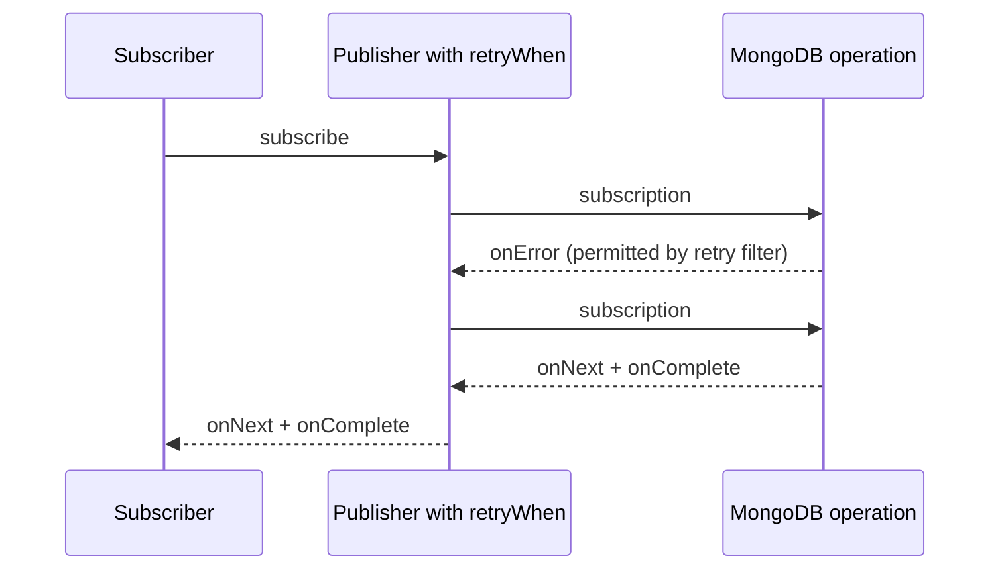
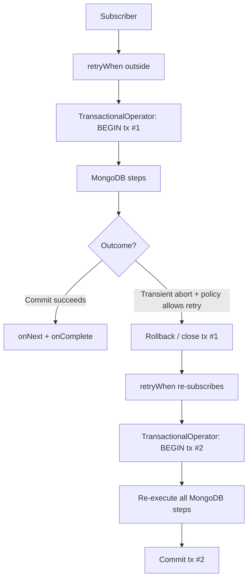
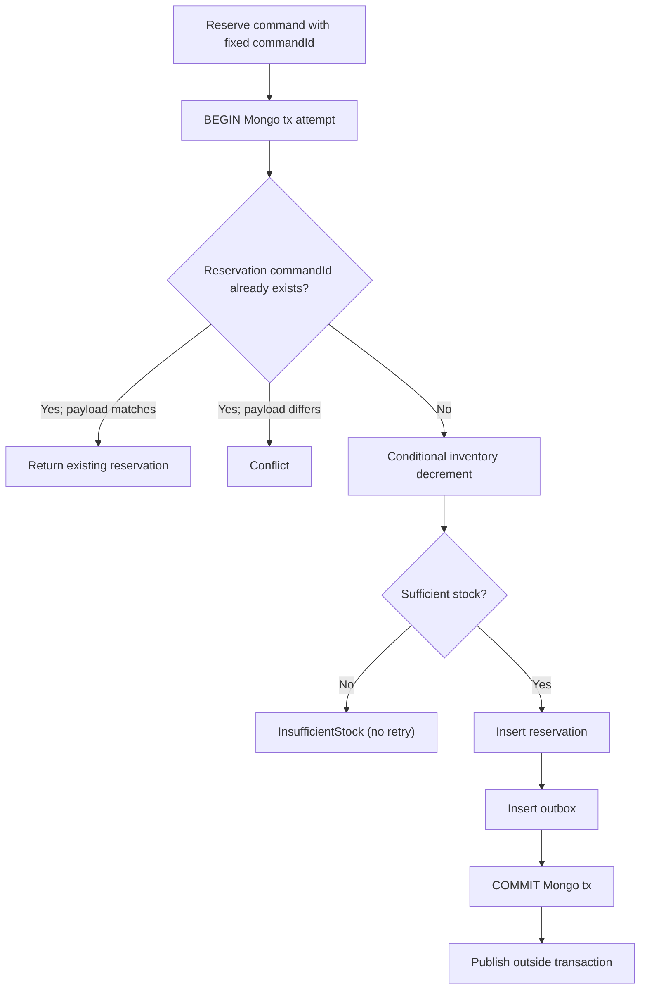
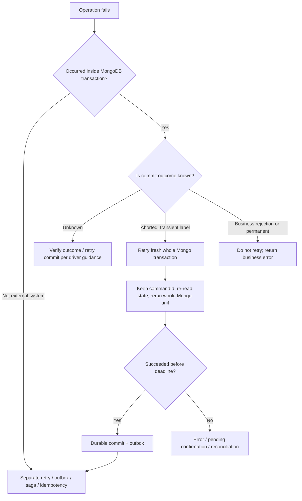

# Placing Retries Around the Right Unit of Work in Spring Data MongoDB Reactive Transactions

## 1. Why Retry Placement Matters More Than Retry Count

In Spring Data MongoDB, `ReactiveMongoTemplate` and reactive repositories return `Mono` or `Flux`. When multiple documents must be updated consistently, applications can use `ReactiveMongoTransactionManager` paired with `TransactionalOperator`. When encountering transient errors such as write conflicts, a Reactor developer's natural reflex is to append `retryWhen(...)`.

Yet **what is actually being retried?** There are at least three distinct scopes:

1. Retrying **a single MongoDB operation** such as `updateFirst`.
2. Retrying **an entire MongoDB transaction**, including dependent reads, preconditions, and writes.
3. Retrying **an entire business workflow** that might include HTTP payments, Kafka, PostgreSQL, or emails.

These three scopes **are not equivalent**. A MongoDB transaction aborted by a transient error cannot be healed by retrying the update statement alone inside the same aborted transaction. Conversely, retrying an entire HTTP workflow after a payment already succeeded can cause duplicate side effects even if the MongoDB transaction commits only once.

```text
Client / API command
  │
  ├─ Validate input and create stable commandId
  │
  └─ Reactive MongoDB transaction
       ├─ Read state / check invariants
       ├─ Update document A
       ├─ Insert document B
       └─ Insert outbox event C
            │
            └─ Commit/abort MongoDB
  │
  └─ Relay and external systems process asynchronously
```

When three MongoDB operations must succeed or roll back together, **the minimum transactionally valid retry unit is the whole transaction**. When external payments sit outside MongoDB, **never** treat the distributed workflow as a single blindly retryable transaction.

This lesson belongs to the **Reactive Transactions** chapter of the **SPRING_DATA_MONGODB** module: connecting, mapping documents, operating on MongoDB via `ReactiveMongoTemplate`/repositories, ensuring transactions, testing, and performance diagnostics. No additional academic notes are needed. The objective centers on **retry boundaries** rather than merely the syntax of one Reactor operator.

### 1.1. Learning Outcomes

After this lesson, readers will be able to:

- Explain that `retryWhen` works by **re-subscribing**, not "jumping back mid-Java method."
- Order `TransactionalOperator` and `retryWhen` so retries start a **fresh transaction**.
- Distinguish whole-transaction retries, single-operation retries, and business-request retries.
- Recognize `TransientTransactionError`, `UnknownTransactionCommitResult`, duplicate keys, insufficient-stock errors, and schema errors.
- Guard every retry with a **command ID**, unique indexes, conditional writes, idempotency, and transaction outcome lookups.
- Keep operations sharing a transaction inside **Reactor Context**, avoiding scope-breaking `subscribe()`/`block()`/fire-and-forget calls.
- Separate HTTP/Kafka from transactions and practice transaction + outbox design.
- Write tests verifying commits, rollbacks, re-subscription, transient failures, and unknown commit outcomes.

## 2. Objects and Concepts to Distinguish

| Component | Purpose | What It Does Not Do |
|---|---|---|
| `ReactiveMongoTemplate` | Executes MongoDB operations via reactive driver and Spring Data mapping | Does not automatically open transactions for arbitrary sequences |
| `ReactiveMongoRepository` | Declares reactive domain data access | Does not turn two repository calls into an atomic multi-document unit |
| `ReactiveMongoTransactionManager` | Begins/commits/aborts MongoDB transactions and binds sessions to reactive tx context | Does not roll back PostgreSQL, Kafka, or HTTP |
| `TransactionalOperator` | Applies a transaction boundary around a `Publisher` | Does not know which errors are safe to retry |
| Reactor `retry`/`retryWhen` | Re-subscribes to a source upon error per policy | Does not make business logic idempotent automatically |
| `Mono.defer` | Builds/assembles a source at subscription time, enabling clean reruns | Does not create transactions or stable unique IDs |
| `Retry.backoff` | Bounded retry policy with delay and jitter | Does not filter business errors accurately if the predicate is wrong |
| `ClientSession` | Carries MongoDB transaction context in the driver | Must never be shared arbitrarily across concurrent streams |
| **Idempotency key** | Identifies one business request across retries | Does not prove on its own that commit succeeded |
| **Transactional outbox** | Stores business state and event-publishing intent inside the same MongoDB transaction | Does not provide end-to-end exactly-once delivery alone |

**Foundational rule:** the transaction boundary must encompass *all* database operations that commit together. The retry boundary must wrap the transaction boundary when the goal is **retrying the whole transaction**.

## 3. What Does Reactor retryWhen Actually Do?

### 3.1. Cold Publishers and Per-Subscription Execution

In Reactor, most reactive MongoDB publishers are **cold**: no database I/O runs when creating a `Mono`/`Flux`; operations run upon subscription.

```java
Mono<OrderDocument> query =
    reactiveMongoTemplate.findById(
        "O-101", OrderDocument.class);

// No database read happens merely by declaring query.
// Execution begins only when subscribed.
```

`retryWhen` listens for `onError` and **re-subscribes to the source**. It does not snapshot Java stack frames and rewind statements, nor does it undo side effects already performed outside MongoDB.



With `Mono`, a post-error retry re-runs the entire upstream source. With `Flux`, if several items already emitted downstream before an error, the new subscription can re-emit **items already seen**, which is especially hazardous if downstream runs side effects per item.

### 3.2. Bounded Retries vs. Infinite Retries

```java
import reactor.util.retry.Retry;
import java.time.Duration;

Retry policy = Retry.backoff(3, Duration.ofMillis(100))
    .maxBackoff(Duration.ofSeconds(2))
    .jitter(0.3);
```

`3` in `Retry.backoff(3, ...)` specifies the number of **retries after the initial run**, meaning up to four attempts total if every run fails without cancellation. Because this policy has no `filter(...)`, it retries **every error**. This is **not yet** a safe transaction retry policy.

In production, a policy must:

1. Cap total attempts.
2. Retry only exceptions/labels classified as legitimately transient.
3. Apply backoff and jitter to prevent retry storms.
4. Respect an overall timeout/deadline if required by the workflow.
5. Record metrics per attempt and final outcome.
6. Pass non-retryable errors straight through to the caller or domain handler.

### 3.3. onErrorResume Is Not retryWhen

```java
source.onErrorResume(ex -> Mono.just(fallback));
```

replaces an error with a fallback value **without re-running the source**. Placed inside a transaction, turning a database error into normal completion may cause the transaction operator to **attempt committing** earlier operations if the transaction is still valid.

```java
source.retryWhen(retryPolicy);
```

instead **re-executes the source when the filter permits the error**. Choose operators based on business semantics; never use `onErrorResume(Mono.empty())` to "ignore errors" when an operation must succeed.

### 3.4. defer and Data Generation Timing

```java
Mono<String> fresh = Mono.defer(() ->
    Mono.just(java.util.UUID.randomUUID().toString()));
```

Each subscription to `fresh` generates a new UUID. That works for transient attempt trace IDs, **but is wrong if that UUID is the idempotency key for one business command**. Create `commandId` once at the API/intake boundary and pass it across all resubscriptions:

```java
String commandId = request.commandId(); // Stable across retries.

Mono<Result> operation =
    Mono.defer(() -> executeOneAttempt(commandId));
```

`executeOneAttempt` is an application helper, not a Spring Data API. It must return a **cold** reactive publisher with zero out-of-transaction side effects during pipeline assembly.

## 4. The Right Boundary: TransactionalOperator Inside, retryWhen Outside

### 4.1. Two Similar-Looking Compositions With Opposite Semantics

**Approach A — Correct when retrying the entire transaction:**

```java
Mono<Result> result =
    Mono.defer(() -> performAllMongoSteps(command))
        .as(mongoTx::transactional)
        .retryWhen(transactionRetryPolicy);
```

**Approach B — Dangerous when retrying an error that aborted the transaction:**

```java
Mono<Result> result =
    Mono.defer(() -> performAllMongoSteps(command))
        .retryWhen(transactionRetryPolicy)
        .as(mongoTx::transactional);
```

Assumptions:

- `mongoTx` is built from the matching **`ReactiveMongoTransactionManager`**.
- `performAllMongoSteps(command)` runs only MongoDB operations that must commit together, with no HTTP/Kafka calls in the chain.
- `transactionRetryPolicy` selects only errors eligible for a **whole-transaction** retry, never all errors.

In **Approach A**, every resubscription from `retryWhen` includes `TransactionalOperator`. Each attempt opens a **fresh transaction** with a new session and transaction context.

In **Approach B**, retries happen **inside an already-open transaction**. If MongoDB reports a transient error aborting the transaction, retrying the inner steps on that same aborted transaction cannot resurrect it. Moreover, Approach B can mask intermediate step failures and cause the operator to commit inconsistent state.

### 4.2. Illustrating Subscription Order



**Do not** read this diagram as a guarantee that retries always succeed: budgets can exhaust, quorum can fail, conflicts can repeat, or commit outcomes can become unknown.

### 4.3. Rewriting Explicitly to Make Composition Clear

Developers may write this equivalently as:

```java
Mono<Result> businessAttempt =
    Mono.defer(() -> performAllMongoSteps(command));

Mono<Result> withTransaction =
    mongoTx.transactional(businessAttempt);

Mono<Result> retried =
    withTransaction.retryWhen(transactionRetryPolicy);
```

The decisive factor is not operator naming, but **which publisher region the transaction operator wraps** and **which publisher region `retryWhen` re-subscribes to**. When using reactive `@Transactional` on a bean, keep the same proxy placement in mind: an outer caller must retry **the entire transactional method call**, never a single inner repository call.

### 4.4. Retries Must Sit Downstream of the Commit Signal, Not Merely the Last Write

Example:

```java
return template.insert(order)
    .then(template.insert(outbox))
    .thenReturn(order)
    .as(mongoTx::transactional)
    .retryWhen(policy);
```

When `TransactionalOperator` completes normally, transaction commit has been handled by the transaction infrastructure. If the final write succeeds yet commit fails, the **outer** retry observes the commit error (which must be classified precisely).

**Critical warning:** if commit returns an uncertain outcome (`UnknownTransactionCommitResult`), never automatically retry the **entire business transaction** assuming nothing committed; see section 9 on commit ambiguity.

## 5. Transaction Scope Is Not Request Scope

### 5.1. Three Nested Scopes to Keep Clear

```text
HTTP request / Business command (stable commandId)
   |
   +-- Retry policy for MongoDB transaction
   |     |
   |     +-- Attempt #1: begin -> Mongo writes -> commit/abort
   |     +-- Attempt #2: begin -> Mongo writes -> commit/abort
   |
   \-- Post-commit: outbox relay / independent remote workflows
```

If an API involves both MongoDB work and an HTTP payment, split them into **local atomic units** connected by durable intent, compensation, and idempotency. Never compose:

```java
template.insert(order)
    .then(paymentClient.charge(order.id()))
    .as(mongoTx::transactional)
    .retryWhen(Retry.max(3));
```

because HTTP payments never join MongoDB transactions. If the transaction fails after charging, retries can charge repeatedly.

### 5.2. Spring Reactive Transactions Use Reactor Context

`ReactiveMongoTransactionManager` stores session and resource state in **Reactor Context**, not `ThreadLocal` like imperative `MongoTransactionManager`. Operations must be **composed into the same reactive chain** sharing the same reactive database factory.

```text
TransactionalOperator
      |
      +-- Mono step 1
      +-- flatMap(step 2)
      \-- then(step 3)

Reactor Context carries the MongoDB session through signals.
```

Merely injecting the same `ReactiveMongoTemplate` instance is **insufficient** if an operation splits off via `subscribe()` or executes outside the transactional publisher.

### 5.3. Never Spawn Detached Subscriptions

```java
// ANTI-PATTERN: outbox insert can run outside the transaction.
return template.insert(order)
    .doOnNext(saved -> template.insert(outbox).subscribe())
    .as(mongoTx::transactional);
```

`template.insert(outbox)` gets its own subscription; invoking a side effect inside `doOnNext` neither awaits completion nor guarantees shared transaction context.

Write instead:

```java
return template.insert(order)
    .flatMap(saved ->
        template.insert(outbox).thenReturn(saved))
    .as(mongoTx::transactional);
```

Now **both inserts belong to the same transactional publisher**, assuming valid factory configuration and transaction support. No `subscribe()` or `block()` appears in between.

### 5.4. Never Run Parallel Operations on the Same Transaction Session

The MongoDB driver/session/transaction does not support arbitrary **parallel** database operations within the same transaction. Reactor code like:

```java
// Avoid running multiple writes concurrently in one MongoDB transaction.
Mono.when(
    template.insert(order),
    template.insert(outbox)
).as(mongoTx::transactional);
```

creates concurrent operations unsupported by the MongoDB transaction contract. Replace with explicit sequencing:

```java
template.insert(order)
    .then(template.insert(outbox))
    .as(mongoTx::transactional);
```

For a `Flux` performing multiple Mongo writes, use `concatMap` or limit concurrency to **one** inside the transaction. Never assume high-concurrency `flatMap` is safe just because Reactor supports concurrent publishers.

## 6. Configuring ReactiveMongoTransactionManager and TransactionalOperator

### 6.1. Infrastructure Prerequisites Before Trying

Reactive multi-document transactions require a transaction-capable MongoDB deployment (replica set or compatible sharded cluster), the reactive MongoDB driver, and Spring Data's transaction manager wired to the **same** `ReactiveMongoDatabaseFactory` used by templates and repositories.

A typical standalone MongoDB instance is insufficient to verify multi-document transactions. A single-node replica set works for basic API integration tests, though it does not simulate multi-member failover or majority replication dynamics.

Example configuration with Java 17+:

```java
import com.mongodb.ReadConcern;
import com.mongodb.ReadPreference;
import com.mongodb.TransactionOptions;
import com.mongodb.WriteConcern;
import org.springframework.beans.factory.annotation.Qualifier;
import org.springframework.context.annotation.Bean;
import org.springframework.context.annotation.Configuration;
import org.springframework.data.mongodb.ReactiveMongoDatabaseFactory;
import org.springframework.data.mongodb.ReactiveMongoTransactionManager;
import org.springframework.transaction.ReactiveTransactionManager;
import org.springframework.transaction.reactive.TransactionalOperator;

@Configuration
public class ReactiveMongoTxConfiguration {

    @Bean("reactiveMongoTransactionManager")
    ReactiveMongoTransactionManager mongoTxManager(
            ReactiveMongoDatabaseFactory factory) {
        TransactionOptions options = TransactionOptions.builder()
            .readConcern(ReadConcern.SNAPSHOT)
            .writeConcern(WriteConcern.MAJORITY)
            .readPreference(ReadPreference.primary())
            .build();
        return new ReactiveMongoTransactionManager(factory, options);
    }

    @Bean("mongoTx")
    TransactionalOperator mongoTxOperator(
            @Qualifier("reactiveMongoTransactionManager")
            ReactiveTransactionManager manager) {
        return TransactionalOperator.create(manager);
    }
}
```

Notes:

- `SNAPSHOT` and `MAJORITY` illustrate choices when business rules demand snapshot reads and majority commit durability; they are not a universal formula for every workload.
- Spring Boot may auto-configure client, factory, and template; avoid duplicate bean declarations that silently override TLS, pool settings, credentials, or monitoring.
- `TransactionalOperator` above binds strictly to the **injected MongoDB resource factory**. An `R2dbcTransactionManager` in the same app does not participate automatically.
- Never fold a Kafka producer or payment HTTP client into `mongoTx` expecting MongoDB to roll them back.
- Never mutate configuration of a shared transaction manager or template across active requests.

### 6.2. Sequential MongoDB Operations

Simple example testing atomicity of two inserts:

```java
public Mono<OrderDocument> createWithOutbox(
        OrderDocument order, OutboxEvent event) {
    return reactiveMongoTemplate.insert(order)
        .flatMap(saved ->
            reactiveMongoTemplate.insert(event)
                .thenReturn(saved))
        .as(mongoTx::transactional);
}
```

Here `order`, `event`, and `mongoTx` are supplied by the service; a fuller class example appears next. `flatMap` creates sequential chaining without detached `subscribe()` calls.

If `insert(event)` fails and the transaction aborts, `insert(order)` **is not committed independently** when everything properly shares the configured transaction.

### 6.3. Applying Retry Outside the Transaction

```java
public Mono<OrderDocument> createWithRetry(
        OrderDocument order, OutboxEvent event) {
    return Mono.defer(() ->
        reactiveMongoTemplate.insert(order)
            .flatMap(saved ->
                reactiveMongoTemplate.insert(event)
                    .thenReturn(saved)))
        .as(mongoTx::transactional)
        .retryWhen(mongoTransactionRetry());
}
```

`mongoTransactionRetry()` here is an application helper (section 8), **not a built-in Spring Data API**. Each retry passes through the transaction operator again rather than re-running `insert(event)` alone inside the broken transaction.

Keep `order.id` and `event.id` **stable across attempts**; never generate new random IDs inside `Mono.defer` for an incoming client command. If the previous commit outcome is uncertain, never blindly rerun the whole transaction.

## 7. Complete Example: Reserve Inventory + Reservation + Outbox

### 7.1. Business Contract

The service receives a validated command:

```text
ReserveInventory(
  commandId: stable request UUID,
  tenantId: derived from authentication context,
  orderId: order requesting stock,
  sku: item identifier,
  quantity: amount > 0
)
```

Within the same MongoDB deployment, three mutations are required:

1. Decrement `available` on an inventory document if sufficient stock remains.
2. Insert a `reservation` keyed by `commandId`.
3. Insert an `outbox event` announcing inventory reservation, dispatched to a broker post-commit.

Invariants:

- Remaining inventory is never negative.
- One command idempotency key never creates two reservations.
- Whenever a reservation succeeds, its outbox intent also exists.
- Events are never emitted externally before MongoDB commits.
- Retries after write conflicts never deduct inventory twice.



### 7.2. Document Types

```java
import java.time.Instant;
import org.springframework.data.annotation.Id;
import org.springframework.data.mongodb.core.mapping.Document;

@Document(collection = "inventory")
public record InventoryItem(
    @Id String id,
    long available
) {}

@Document(collection = "inventory_reservations")
public record Reservation(
    @Id String id,
    String tenantId,
    String orderId,
    String sku,
    long quantity,
    Instant createdAt
) {}

@Document(collection = "inventory_outbox")
public record ReservationOutbox(
    @Id String id,
    String reservationId,
    String type,
    String tenantId,
    String orderId,
    String sku,
    long quantity,
    Instant occurredAt
) {}

public record ReserveCommand(
    String commandId,
    String tenantId,
    String orderId,
    String sku,
    long quantity
) {}
```

These are **illustrative Java types**; place each public top-level type in its own Java file. In multi-tenant systems, `InventoryItem.id` should be an immutable tenant-scoped business key constructed by the service after validating tenant and SKU (never allowing clients to forge cross-tenant IDs).

### 7.3. Business Failures Must Not Retry

```java
public final class InsufficientStockException
        extends RuntimeException {
    public InsufficientStockException(String sku) {
        super("Insufficient stock for " + sku);
    }
}

public final class IdempotencyConflictException
        extends RuntimeException {
    public IdempotencyConflictException(String commandId) {
        super("Conflicting command payload: " + commandId);
    }
}
```

Never include these in a retry filter just because they extend `RuntimeException`. Insufficient stock is a valid business outcome; differing payloads under the same idempotency key represent a conflict that backoff cannot resolve.

### 7.4. Service Focusing on One Real MongoDB Unit

```java
import java.time.Instant;
import java.util.Objects;

import org.springframework.beans.factory.annotation.Qualifier;
import org.springframework.dao.DuplicateKeyException;
import org.springframework.data.mongodb.core.FindAndModifyOptions;
import org.springframework.data.mongodb.core.ReactiveMongoTemplate;
import org.springframework.data.mongodb.core.query.Criteria;
import org.springframework.data.mongodb.core.query.Query;
import org.springframework.data.mongodb.core.query.Update;
import org.springframework.stereotype.Service;
import org.springframework.transaction.reactive.TransactionalOperator;
import reactor.core.publisher.Mono;
import reactor.util.retry.Retry;

@Service
public class ReactiveReservationService {
    private final ReactiveMongoTemplate template;
    private final TransactionalOperator mongoTx;

    public ReactiveReservationService(
            ReactiveMongoTemplate template,
            @Qualifier("mongoTx") TransactionalOperator mongoTx) {
        this.template = template;
        this.mongoTx = mongoTx;
    }

    public Mono<Reservation> reserve(ReserveCommand command) {
        // API validation and tenant authorization happen
        // before building operations; ensure commandId is stable.
        validate(command);

        return Mono.defer(() -> reserveOnce(command))
            .as(mongoTx::transactional)
            .retryWhen(MongoRetryPolicy.transientTransactionRetry())
            // Duplicate key is NOT a transient retry.
            // If another request with the same commandId won the race,
            // return the existing result only after verifying payload equality.
            .onErrorResume(
                DuplicateKeyException.class,
                ignored -> findExistingMatching(command));
    }

    private Mono<Reservation> reserveOnce(
            ReserveCommand command) {
        String reservationId = reservationId(command);
        return template.findById(
                reservationId, Reservation.class)
            .flatMap(existing ->
                matches(existing, command)
                    ? Mono.just(existing)
                    : Mono.error(
                        new IdempotencyConflictException(
                            command.commandId())))
            .switchIfEmpty(Mono.defer(
                () -> createReservation(command, reservationId)));
    }

    private Mono<Reservation> createReservation(
            ReserveCommand command, String reservationId) {
        String stockId =
            command.tenantId() + ":" + command.sku();

        Query enough = Query.query(
            Criteria.where("id").is(stockId)
                .and("available").gte(command.quantity()));
        Update subtract = new Update()
            .inc("available", -command.quantity());

        return template.findAndModify(
                enough,
                subtract,
                FindAndModifyOptions.options().returnNew(true),
                InventoryItem.class)
            .switchIfEmpty(Mono.error(
                new InsufficientStockException(command.sku())))
            .flatMap(ignoredStock -> {
                Instant now = Instant.now();
                Reservation reservation = new Reservation(
                    reservationId,
                    command.tenantId(),
                    command.orderId(),
                    command.sku(),
                    command.quantity(),
                    now);
                ReservationOutbox event = new ReservationOutbox(
                    "reserved:" + reservationId,
                    reservationId,
                    "InventoryReserved",
                    command.tenantId(),
                    command.orderId(),
                    command.sku(),
                    command.quantity(),
                    now);

                return template.insert(reservation)
                    .then(template.insert(event))
                    .thenReturn(reservation);
            });
    }

    private Mono<Reservation> findExistingMatching(
            ReserveCommand command) {
        return template.findById(
                reservationId(command), Reservation.class)
            .switchIfEmpty(Mono.error(
                new IllegalStateException(
                    "Duplicate key but no reservation found")))
            .flatMap(existing ->
                matches(existing, command)
                    ? Mono.just(existing)
                    : Mono.error(
                        new IdempotencyConflictException(
                            command.commandId())));
    }

    private static String reservationId(
            ReserveCommand command) {
        // Example expects commandId to be a UUID / canonical value;
        // tenantId comes from auth, never free-form client input.
        return command.tenantId() + ":" + command.commandId();
    }

    private static boolean matches(
            Reservation existing, ReserveCommand command) {
        return Objects.equals(
                existing.tenantId(), command.tenantId())
            && Objects.equals(
                existing.orderId(), command.orderId())
            && Objects.equals(existing.sku(), command.sku())
            && existing.quantity() == command.quantity();
    }

    private static void validate(ReserveCommand command) {
        if (command == null
                || isBlank(command.commandId())
                || isBlank(command.tenantId())
                || isBlank(command.orderId())
                || isBlank(command.sku())
                || command.quantity() <= 0) {
            throw new IllegalArgumentException(
                "Invalid inventory reservation command");
        }
        // In production: validate UUID format, input length, max quantity, tenant auth.
    }

    private static boolean isBlank(String s) {
        return s == null || s.isBlank();
    }
}
```

#### Why Can This Code Retry the Entire Transaction?

`Mono.defer(() -> reserveOnce(command))` sits **inside** `mongoTx::transactional`; `retryWhen` sits **outside**. If attempt #1 fails with a transient transaction error, that transaction aborts; attempt #2 opens a fresh transaction, re-reads any existing reservation, and evaluates current inventory as observed by the new transaction.

If a previous request committed yet the response was lost, a new request with the **same `commandId`** finds the existing `Reservation` and returns it without deducting inventory again. However, `UnknownTransactionCommitResult` requires dedicated handling; the code above does not treat commit timeouts as proof of rollback (section 9).

#### Why Is a Unique Key Still Needed Even After Reading Existing?

Two concurrent requests can both read "no reservation yet" before trying to insert. `@Id` enforces uniqueness on `reservationId` in the database. Depending on conflict timing, one transaction fails with a write conflict or duplicate key; only one transaction can commit a reservation for that ID.

The `onErrorResume(DuplicateKeyException.class, ...)` handler sits **outside the transaction wrapper**, avoiding issuing queries inside an already-aborted transaction. It returns the existing record only if the **payload matches**; otherwise it emits a conflict error. Production systems may also need primary read preference/read concern and a small lookup retry in case the winner just committed and replication lags, rather than reporting success before finding the record.

#### Why Does Outbox Also Sit Inside the Same Transaction?

If inventory decrements and reservation inserts, yet inserting the outbox fails, the MongoDB transaction aborts **all three mutations**. A relay dispatches `InventoryReserved` post-commit from the outbox using the stable `event.id` across retries; consumers deduplicate. Never send to Kafka inside the `flatMap` above.

#### Data and Index Preparation

`inventory` holds documents with `_id = tenantId:sku` and non-negative `available`. `inventory_reservations` and `inventory_outbox` rely on unique `_id`; add secondary indexes matching your relay's actual polling queries. Never create collections or indexes mid-transaction in environments with DDL restrictions; provision schemas prior to testing and release.

## 8. Choosing Retryable Errors: TransientTransactionError Is Not Just Any RuntimeException

### 8.1. Classifying by Transaction Error Labels

MongoDB attaches **error labels** to certain exceptions, including:

- `TransientTransactionError`: transient failures permitting the **entire transaction** to be retried from the start.
- `UnknownTransactionCommitResult`: commit outcome cannot be verified; **never** automatically safe to rerun the entire business transaction.

The Java Driver exposes `MongoException.hasErrorLabel(...)`. However, Spring Data can **translate/wrap** exceptions into `DataAccessException`. Checking only `error instanceof MongoException` at the top level can miss the underlying cause.

Never broaden the retry filter to all `TimeoutException`, `MongoException`, `DataAccessException`, or `RuntimeException`: a network timeout during commit can represent an **unknown outcome**.

### 8.2. Bounded Retry Policy Example

```java
import java.time.Duration;
import com.mongodb.MongoException;
import reactor.util.retry.Retry;

public final class MongoRetryPolicy {
    private MongoRetryPolicy() {}

    public static Retry transientTransactionRetry() {
        return Retry.backoff(3, Duration.ofMillis(100))
            .maxBackoff(Duration.ofSeconds(2))
            .jitter(0.35)
            .filter(MongoRetryPolicy::isTransientTransactionError)
            .onRetryExhaustedThrow(
                (spec, signal) -> signal.failure());
    }

    public static boolean isTransientTransactionError(
            Throwable failure) {
        // Spring Data may wrap the Driver exception.
        Throwable current = failure;
        for (int depth = 0;
                current != null && depth < 16;
                depth++, current = current.getCause()) {
            if (current instanceof MongoException mongo) {
                // UNKNOWN commit must route to outcome verification.
                if (mongo.hasErrorLabel(
                        "UnknownTransactionCommitResult")) {
                    return false;
                }
                if (mongo.hasErrorLabel(
                        "TransientTransactionError")) {
                    return true;
                }
            }
        }
        return false;
    }
}
```

This policy is **deliberately narrow**: it retries only when the cause chain carries driver label `TransientTransactionError` and does not carry `UnknownTransactionCommitResult`. Certain `OptimisticLockingFailureException` cases can be retried at the business-command level **when the full unit of work and idempotency design permit it**; keep that as a separate policy rather than adding it blindly to the default list.

### 8.3. Retry Decision Table

| Error / State | Retry Whole Mongo Transaction? | Why? |
|---|---|---|
| `TransientTransactionError` | Yes, bounded | The transaction aborted under this failure class; start a fresh transaction |
| `UnknownTransactionCommitResult` | **Not blindly** | Commit may have succeeded; verify outcome or retry commit per driver guidance |
| Duplicate key on `reservationId` | Do not treat as transient | Likely duplicate request or payload conflict; guarded lookup |
| Insufficient stock | No | Business rejection; backoff will not conjure inventory |
| Invalid tenant | No | Validation/authorization failure |
| `OptimisticLockingFailureException` | Conditionally per separate policy | Re-read state/version and rerun full unit if idempotent |
| JSON Schema validation failure | No | Fix payload or schema |
| Unclear HTTP payment error | Not inside Mongo retry | Remote outcome requires idempotency/status lookup |
| MongoDB server-selection timeout | Not by default | Can occur at multiple phases; determine phase and outcome first |
| Downstream cancellation | Not by default | Cancellation is not a retry signal; inspect transaction scope |

### 8.4. Backoff, Jitter, and Deadlines

Suppose 1,000 requests hit a write conflict simultaneously. If all retry immediately, they collide on the same inventory document again. Exponential backoff with jitter dampens retry storms.

Still:

- Never configure `Retry.max(Long.MAX_VALUE)` on transaction errors, exhausting resources.
- Never retry faster than the database can recover.
- Never exceed HTTP request deadlines, SLOs, or command timeouts.
- Never log sensitive payloads on every retry attempt.
- Once retry budget runs out, return an appropriate **uncertain/exhausted** status matching the failure type—never turn every error into "insufficient stock."

### 8.5. Timeout Placement Also Changes Semantics

```java
// Single timeout budget covering the whole chain including retries.
source.as(mongoTx::transactional)
    .retryWhen(policy)
    .timeout(Duration.ofSeconds(8));

// Per-attempt timeout; each retry gets a fresh budget.
source.as(mongoTx::transactional)
    .timeout(Duration.ofSeconds(3))
    .retryWhen(policy);
```

These two snippets are not equivalent. The second can stretch total latency across multiple attempt timeouts plus backoff. In either placement, a timeout during **commit** leaves the outcome uncertain; never apply a "retry all timeouts" filter without distinguishing the phase.

In production services, pair an **overall deadline** with per-transaction timeouts, strict retry predicates, and cancellation respect.

## 9. UnknownTransactionCommitResult: Never Blindly Retry the Entire Business Command

### 9.1. Commit Can Succeed Even When the Client Misses the ACK

A MongoDB transaction may send `commitTransaction`, the server processes the commit, and the network drops before the client receives confirmation.

```mermaid
sequenceDiagram
    participant A as Reactive client
    participant M as MongoDB
    A->>M: BEGIN tx; write inventory/reservation/outbox
    A->>M: commitTransaction
    M-->>M: May have committed
    Note over A,M: Network timeout / ACK lost
    M--xA: Commit result never received
    Note over A: Outcome = UNKNOWN, NOT equivalent to ABORTED
```

The driver attaches `UnknownTransactionCommitResult`. This differs fundamentally from a `TransientTransactionError` arising **before commit succeeded**, which can be retried per guidelines.

**Key insight:** re-subscribing to the entire source after an uncertain commit can re-execute business logic after the earlier attempt **already committed**.

### 9.2. Two Distinct Kinds of Retries to Separate

| Action | What Is Being Retried | When to Consider |
|---|---|---|
| **Retry commit** | Same transaction/session and commit request | When driver/transaction API permits, per `UnknownTransactionCommitResult` guidance |
| **Retry transaction** | Start a fresh transaction and rerun read/write logic | When a transient error aborted the transaction and the business unit is safe to rerun |
| **Retry API command** | Resend business intent from client/service | Only with an idempotency key, lookup/checkpoint, and clear outcome contract |

A casual Spring/Reactor retry:

```java
.retryWhen(Retry.backoff(5, Duration.ofMillis(200)))
```

conflates all three cases. Especially if callbacks mint new UUIDs, write new outbox records, or charge HTTP endpoints, blind retries duplicate business actions.

### 9.3. Handling Uncertain Outcomes at the Business Layer

For `ReserveCommand` from section 7:

1. Every business command carries a **stable `commandId`**.
2. The transaction stores `Reservation` with `_id` derived from tenant + commandId.
3. After an unknown commit outcome, **never claim the order failed to reserve**.
4. Run an independent idempotency lookup checking the reservation by key, ideally with read consistency matching required guarantees.
5. If the reservation exists with matching payload, return the existing result.
6. If not found, do not immediately conclude from a single "not found" right after a timeout that the old transaction definitely aborted; per policy, return `PENDING_CONFIRMATION`, perform bounded polling, check commit status, or hand off to a reconciliation job.
7. Only replay the business command through a reviewed path guarded by unique indexes/idempotency if the prior outcome settles late.

### 9.4. Example Separating a Post-Error Lookup

```java
public Mono<Reservation> reserveOrVerify(
        ReserveCommand command) {
    return reserve(command)
        .onErrorResume(
            this::isUnknownCommitOutcome,
            failure -> verifyUnknownOutcome(command, failure));
}

private boolean isUnknownCommitOutcome(Throwable error) {
    // Walk cause chain looking for MongoException labeled
    // "UnknownTransactionCommitResult".
    // Do not treat every network timeout as an abort.
    return MongoErrorInspection.hasLabel(
        error, "UnknownTransactionCommitResult");
}

private Mono<Reservation> verifyUnknownOutcome(
        ReserveCommand command, Throwable original) {
    return findExistingMatching(command)
        .onErrorResume(
            IllegalStateException.class,
            missing -> Mono.error(
                new ReservationOutcomeUnknownException(
                    command.commandId(), original)));
}
```

`MongoErrorInspection` and `ReservationOutcomeUnknownException` are **application helpers you implement**; they illustrate separating **unknown commit outcomes** from transient retries. This simple lookup **does not prove** the transaction aborted if no reservation appears yet; it returns an "outcome unknown" failure/response so the caller or reconciliation continues.

In production, avoid a broad `onErrorResume(IllegalStateException.class, ...)` if unrelated bugs also throw `IllegalStateException`. Define dedicated exceptions like `ReservationNotFoundException` or `OutcomeNotVisibleYetException` to distinguish cases accurately. When deploying, verify Spring Data exception translation and read from the primary with suitable read/write concerns.

A minimal implementation for the **driver-label inspection helper** (usable in the predicate above):

```java
import com.mongodb.MongoException;

public final class MongoErrorInspection {
    private MongoErrorInspection() {}

    public static boolean hasLabel(
            Throwable failure, String label) {
        Throwable current = failure;
        for (int depth = 0;
                current != null && depth < 16;
                depth++, current = current.getCause()) {
            if (current instanceof MongoException mongo
                    && mongo.hasErrorLabel(label)) {
                return true;
            }
        }
        return false;
    }
}
```

And a dedicated domain exception:

```java
public final class ReservationOutcomeUnknownException
        extends RuntimeException {
    public ReservationOutcomeUnknownException(
            String commandId, Throwable cause) {
        super("Reservation outcome not verified: " + commandId,
            cause);
    }
}
```

In real applications, never return raw exception details containing sensitive data to clients; map to safe API codes, attach correlation IDs, and retain evidence for reconciliation.

### 9.5. Stable Business IDs Matter More Than "Right Retry Syntax"

In `ReserveCommand`:

```java
// Good: commandId created before starting transactions or retries.
ReserveCommand command = new ReserveCommand(
    "a8f2352a-4020-47f7-b432-b08cbf414a82",
    "T-A", "O-101", "SKU-BOOK", 2L);

Mono<Reservation> result = reservationService.reserve(command);
```

Conversely:

```java
// Wrong if every resubscription generates a brand-new business operation.
Mono<Reservation> result = Mono.defer(() ->
    reservationService.reserve(
        new ReserveCommand(
            java.util.UUID.randomUUID().toString(),
            "T-A", "O-101", "SKU-BOOK", 2L)))
    .retryWhen(Retry.max(3));
```

The wrong snippet can reserve stock repeatedly whenever an earlier attempt committed and lost its response. **Even placing retry in the right spot is unsafe without idempotency.**

## 10. Reactive @Transactional: Put Retries on the Caller, Not Inside the Transactional Body

### 10.1. Reactive Annotations Create Transactions per Subscription

Spring supports reactive `@Transactional` when a method returns a `Publisher` such as `Mono` or `Flux` and the manager is a `ReactiveTransactionManager`.

```java
import org.springframework.stereotype.Service;
import org.springframework.transaction.annotation.Transactional;
import reactor.core.publisher.Mono;

@Service
public class ReservationTransactionalBoundary {
    private final ReactiveReservationSteps steps;

    public ReservationTransactionalBoundary(
            ReactiveReservationSteps steps) {
        this.steps = steps;
    }

    @Transactional(
        transactionManager = "reactiveMongoTransactionManager")
    public Mono<Reservation> reserveOnce(ReserveCommand cmd) {
        return steps.reserveMongoOnly(cmd);
    }
}
```

`ReactiveReservationSteps` is a collaborator service returning a publisher of MongoDB operations without manual subscriptions or HTTP calls. The annotation must be applied via the Spring AOP proxy on the method call.

### 10.2. Retry in a Facade Outside the Transaction Proxy

```java
import org.springframework.stereotype.Service;
import reactor.core.publisher.Mono;

@Service
public class ReservationFacade {
    private final ReservationTransactionalBoundary txBoundary;

    public ReservationFacade(
            ReservationTransactionalBoundary txBoundary) {
        this.txBoundary = txBoundary;
    }

    public Mono<Reservation> reserve(ReserveCommand command) {
        // Invokes transactional bean through the Spring proxy.
        return Mono.defer(() -> txBoundary.reserveOnce(command))
            .retryWhen(
                MongoRetryPolicy.transientTransactionRetry());
    }
}
```

In this design, each retry **re-subscribes** to the publisher returned by `txBoundary.reserveOnce(...)`; Spring's transaction interceptor wraps the publisher and starts a new transaction on each resubscription. `Mono.defer` also rebuilds the publisher per attempt when pipeline construction reads dynamic state.

There is no need to combine `@Transactional` on the method with `TransactionalOperator` wrapping the **same scope** unless nesting/propagation semantics intentionally require it. Pick one clear boundary representation to review and test.

### 10.3. Anti-Pattern: Retrying Inside a @Transactional Method

```java
@Transactional(
    transactionManager = "reactiveMongoTransactionManager")
public Mono<Reservation> reserveOnce(ReserveCommand cmd) {
    return steps.reserveMongoOnly(cmd)
        .retryWhen(
            MongoRetryPolicy.transientTransactionRetry());
}
```

Because the transaction interceptor wraps the **entire publisher returned by the method**, `retryWhen` inside the method sits **underneath** the transaction wrapper. An error that aborted the transaction cannot be fixed by re-subscribing to `steps` inside the same broken transaction. Place retries in the caller/facade **outside the proxy**.

### 10.4. Self-Invocation Does Not Trigger the AOP Proxy as Expected

```java
public Mono<Reservation> outer(ReserveCommand cmd) {
    return this.reserveOnce(cmd); // Bypasses the @Transactional proxy.
}
```

In Spring's default proxy mode, calling `this.reserveOnce` inside the same instance skips the transaction interceptor. Even if the caller adds `retryWhen`, no transaction exists. Split into a separate bean or use programmatic `TransactionalOperator`.

### 10.5. Reactive Return Types and Method Boundaries

Never mark a `@Transactional` method `void` and call `subscribe()` inside it:

```java
// ANTI-PATTERN.
@Transactional(
    transactionManager = "reactiveMongoTransactionManager")
public void reserveNow(ReserveCommand cmd) {
    steps.reserveMongoOnly(cmd).subscribe();
}
```

Callers receive no completion or error signal to coordinate commit or retry, and the reactive transaction context may never bind properly to that subscription. Return `Mono`/`Flux` to the framework; let `StepVerifier` or the web runtime subscribe **at the application edge**.

### 10.6. When Multiple Reactive Transaction Managers Exist

If an app uses both reactive MongoDB and R2DBC, explicitly specify:

```java
@Transactional(
    transactionManager = "reactiveMongoTransactionManager")
```

for MongoDB operations. Even if one `Mono` combines R2DBC and MongoDB stages, a single transaction manager **never acts as a 2PC coordinator**. Multi-resource workflows require outboxes, sagas, and eventual consistency designs—never "retry the whole Mono" to compensate for missing cross-system atomicity.

## 11. Reactor Operators That Quietly Alter Transaction/Retry Semantics

### 11.1. Misplaced onErrorResume Can Turn Errors Into Commits

```java
// Dangerous: a mandatory step fails yet converts into completion.
return template.insert(order)
    .then(template.insert(outbox))
    .onErrorResume(ex -> Mono.empty())
    .as(mongoTx::transactional);
```

The source completes normally and the transaction operator attempts to commit unless the server already aborted the transaction. When inserting the outbox is mandatory, **never swallow the error**. Let `onError` cross the transaction boundary so Spring rolls back.

To convert final errors into controlled API responses:

```java
return performAllMongoSteps(command)
    .as(mongoTx::transactional)
    .retryWhen(policy)
    .onErrorResume(ex -> mapFinalFailureToResponse(ex));
```

`mapFinalFailureToResponse` is an application helper **outside the transaction**, after retries are exhausted, never hiding errors before commit. Never use it to mask `UnknownTransactionCommitResult` as "guaranteed failure."

### 11.2. repeatWhen Is Not retryWhen

`repeat`/`repeatWhen` re-subscribes when a source **completes normally**. Putting it on a succeeding transaction reruns the business operation and deducts inventory twice.

```java
// ANTI-PATTERN: reruns after success.
reservePublisher
    .as(mongoTx::transactional)
    .repeat(3);
```

Use `repeat` only for intentional idempotent polling/streaming, never for transaction error recovery.

### 11.3. retryWhen on a Flux That Already Emitted Items Duplicates Downstream Effects

```java
Flux<OrderLine> lines = loadOrderLines();

lines.concatMap(this::reserveLine)
    .retryWhen(policy);
```

If some lines were already processed downstream before a later line errored, re-subscribing **re-emits** earlier lines. If each line triggers an external side effect, business actions duplicate.

If every line belongs to **the same MongoDB transaction**, collect/validate upfront or process sequentially with `concatMap` inside one transaction, wrapping the entire group before retrying:

```java
Mono<java.util.List<Reservation>> result =
    lines.concatMap(this::reserveLineMongoOnly)
        .collectList()
        .as(mongoTx::transactional)
        .retryWhen(policy);
```

`reserveLineMongoOnly` must perform **only MongoDB operations** participating in that transaction. Do not treat `collectList` as unbounded: huge lists bloat memory and transaction duration; split batches along clean business boundaries.

### 11.4. cache, share, and Hot Publishers Break Per-Retry Execution Assumptions

```java
Mono<Reservation> cached =
    performAllMongoSteps(command).cache();
```

`cache()` replays cached completion or error signals per Reactor semantics. If a source is cached outside the transaction or shared across subscribers, retries may skip re-executing database work. Conversely, a hot publisher firing I/O eagerly may execute side effects before the transaction is subscribed to.

**Principle:** the transactional unit must be a **cold, re-subscribable source**. Never share or cache write-transaction publishers across business commands.

### 11.5. publishOn/subscribeOn Do Not Automatically Lose Reactor Context

Reactor Context propagates along the operator chain per Reactor rules rather than sticking solely to one thread. `publishOn` or `subscribeOn` **does not automatically drop** the transaction context in a properly composed reactive chain.

However, spawning a detached subscription, handing off to uncomposed callbacks, or calling blocking libraries lacking reactive context support breaks scope.

Never roll your own `ThreadLocal` to "attach" a MongoDB `ClientSession` for reactive requests.

### 11.6. Never Use doOnNext for Remote Side Effects

```java
// ANTI-PATTERN: publishes event before commit is certain.
template.insert(order)
    .doOnNext(saved -> kafka.send("orders", saved.id()))
    .as(mongoTx::transactional);
```

`doOnNext` is a synchronous signal hook; it does not await broker ACKs and executes **before the transaction finishes committing**. If the transaction subsequently aborts, the broker still received the event. Store a MongoDB outbox record inside the transaction and publish via an outbox relay post-commit.

### 11.7. Cancellation Is Another Termination Path

Reactive downstreams can cancel on HTTP disconnects, `take`, timeouts, or backpressure rules. Spring's transaction operator cleans up/rolls back per framework cancellation policy, yet an external HTTP side effect already sent **cannot be undone by cancel**.

Never interpret cancellation as "guaranteed no commit." Cancellation right near commit produces an **unknown outcome** requiring idempotency and status lookup.

### 11.8. usingWhen and Session Resources

Some code uses `Mono.usingWhen(...)` for async resource lifecycles. While valid for driver-level client sessions if you manage transactions yourself, cleanup is intricate: it must separate complete/error/cancel paths and commit/abort failures.

In Spring Data MongoDB, unless you specifically need raw driver session control, **prefer `ReactiveMongoTransactionManager` + `TransactionalOperator`** over assembling `ClientSession` lifecycles manually to avoid missed rollbacks or leaked sessions.

## 12. Optimistic Locking, Write Conflicts, and Retrying With Fresh State

### 12.1. Conflict Does Not Mean "Write the Exact Old Values Again"

Suppose two transactions concurrently attempt to reserve 8 units on an inventory document holding 10:

```text
inventory.available = 10

Transaction A reads available = 10
Transaction B reads available = 10

A subtracts 8 -> expects 2
B subtracts 8 -> expects 2
```

Without conditional predicates or conflict detection, naive updates cause **lost updates** or overselling. When MongoDB signals a write conflict or transient transaction error, a proper retry must **re-read current state, re-evaluate preconditions**, and decide anew.

In section 7, `findAndModify` with `available >= quantity` protects the non-negative invariant inside an atomic conditional update. When the transaction retries from the top and sees only 2 units left while 8 are requested, the right result is **`InsufficientStockException`**, never forcing a negative balance.

### 12.2. @Version for Optimistic Locking

Spring Data MongoDB supports `@Version` on entities:

```java
import org.springframework.data.annotation.Id;
import org.springframework.data.annotation.Version;
import org.springframework.data.mongodb.core.mapping.Document;

@Document("inventory")
public class InventoryVersioned {
    @Id
    private String id;

    @Version
    private Long version;

    private long available;

    // Constructors, getters, setters per project mapping policy.
}
```

Calling `save` through the mapping layer uses the version field to catch concurrent changes, throwing `OptimisticLockingFailureException` on mismatch. Still:

- `@Version` does not apply to **raw driver updates** bypassing mapping/version handling.
- Custom update queries/pipelines must check version semantics explicitly.
- Detecting concurrency conflicts reliably requires appropriate write concerns; never rely on unacknowledged writes.
- An `OptimisticLockingFailureException` can be retried at the **command level**, provided you re-read the entity/version and rerun the full business unit rather than calling `save` again with the stale versioned object.

### 12.3. Retrying Optimistic Conflicts Differs From TransientTransactionError

With `@Version` and an idempotent command, you can handle `OptimisticLockingFailureException` in a **dedicated policy**:

```java
import org.springframework.dao.OptimisticLockingFailureException;
import reactor.util.retry.Retry;

Retry optimisticRetry = Retry.max(2)
    .filter(
        error -> error instanceof OptimisticLockingFailureException);
```

Apply this only when the retried source **includes reloading the version, recomputing business rules, and opening a fresh transaction if needed**. Never attach a blanket `OptimisticLockingFailureException` retry to flows containing HTTP payments, emails, or irreversible side effects.

### 12.4. Wrong Pattern: Retrying save Alone With a Stale Entity

```java
// Unlikely to resolve conflicts: entity retains stale version.
return template.save(staleInventoryObject)
    .retryWhen(optimisticRetry);
```

Once the server version bumped, re-sending the **same `staleInventoryObject`** simply conflicts again. The right pattern is **load + check + mutate + save** inside a cold source, retrying the **entire source** under a proper policy/transaction boundary.

### 12.5. Retries Can Change the Business Outcome

First attempt:

```text
available = 10
reserve 8: allowed
```

Retry attempt:

```text
available = 2
reserve 8: must reject
```

Retries are **not** meant to force the initial attempt's decision when underlying state changed; they exist to **preserve invariants**, returning the valid outcome for the state visible to the final transaction. If a customer needs a guaranteed hold window before checkout, model **expiring reservations** or explicit orchestration contracts.

## 13. Retrying Outside the Transaction Does Not Mean Retrying Downstream Side Effects

### 13.1. Decoupling the MongoDB Unit From the Message Broker

```text
HTTP request
   |
   +-- MongoDB transaction:
   |      reserve stock
   |      insert reservation
   |      insert outbox
   |
   +-- Transaction retry (MongoDB only)
   |
   \-- Outbox relay:
          publish InventoryReserved
          retry broker independently with same eventId
```

**Never** place the Kafka publisher inside `reserveOnce`. If MongoDB commits and the app crashes before publishing, the outbox record ensures the relay recovers the event.

### 13.2. Post-Commit Retries Have Failure Windows Too

A common pattern:

```java
return reserveMongoOnly(command)
    .as(mongoTx::transactional)
    .flatMap(saved ->
        kafkaPublisher.publish(saved).thenReturn(saved))
    .retryWhen(policy);
```

If Kafka fails after MongoDB already committed, the outer `retryWhen` **wraps the MongoDB reservation again**. Even when a stable ID prevents double reservations, this design muddies commit/lookup ambiguity with broker delivery—and without ID protection it is downright dangerous.

Clean **separation of concerns**:

```java
Mono<Reservation> outcome =
    reserveMongoOnly(command)
        .as(mongoTx::transactional)
        .retryWhen(mongoTransactionRetryPolicy);

// A separate relay reads committed MongoDB outbox events and publishes.
return outcome;
```

`reserveMongoOnly` and `mongoTransactionRetryPolicy` are implemented by the application (such as `ReactiveReservationService.reserve` in section 7). The HTTP response reports **reservation accepted / event delivery pending**, never claiming downstream consumers already processed the event.

### 13.3. Redis Cache Invalidation Is Not Transactional

`template.updateFirst(...).as(mongoTx::transactional).flatMap(...redisDel...)` still leaves a gap between Mongo commit and Redis `DEL`. If Redis is unavailable, retrying the entire MongoDB command just to delete a cache entry increases DB load and risks duplicate side effects.

Handle cache consistency via outbox, TTL/version keys, or an eventual-consistency SLA; for data requiring strong consistency, read MongoDB directly under the right contract rather than trusting cache.

### 13.4. MongoDB Transactions Cannot Roll Back External Payments

When a workflow spans MongoDB state and a payment API:

1. Persist the payment intent + outbox inside MongoDB.
2. A worker calls the provider using a stable `paymentOperationId`.
3. Provider responses/webhooks are deduplicated and saved into a local inbox.
4. MongoDB updates status inside a new transaction and optionally emits the next outbox event.
5. If provider outcome is unknown, query provider status/reconcile; never charge under a new ID.

Reactor's `Retry.max(3)` is no substitute for sagas and idempotency in multi-resource workflows.

### 13.5. MongoDB Transactions and Kafka Transactions Have Separate Boundaries

Kafka producer transactions provide atomicity across Kafka records and offsets within Kafka's scope. They do not enlist MongoDB writes into a shared XA commit. Kafka producer retries and MongoDB transaction retries **are distinct policies** and must be measured and tested independently.

## 14. Choosing Transaction Duration and Retry Unit Size

### 14.1. Overly Large Units Backfire

Suppose an endpoint processes 5,000 orders inside one reactive transaction:

```java
Flux.fromIterable(commands)
    .concatMap(this::reserveOneMongoOnly)
    .collectList()
    .as(mongoTx::transactional)
    .retryWhen(policy);
```

If command #4,999 fails, retrying reruns nearly **all 5,000 operations**; the transaction holds snapshots and resources far too long, increasing lock conflicts, memory footprint, and timeout risk. Even with proper sequential ordering, the business unit boundary is far too wide.

### 14.2. Splitting Into Batches Must Respect Business Invariants

If orders are independent, split them into small **business units**:

```java
Flux.fromIterable(commands)
    .concatMap(command ->
        Mono.defer(() -> reserveOneMongoOnly(command))
            .as(mongoTx::transactional)
            .retryWhen(policy));
```

Now each command has its own transaction and retry attempts, isolating failures. Still, changing from "all 5,000 orders atomic" to "per-order atomic" **alters the contract**—never make that switch silently if business rules require batch-wide all-or-nothing.

### 14.3. Fix Hot Documents Before Increasing Retries

When every transaction hammers one hot inventory document, raising retries to 20 just fuels write contention. Consider:

- Atomic conditional single-document updates when only one document changes.
- Sharding/partition keys tailored to tenant and SKU.
- Shrinking transaction scope and batch sizes.
- Concurrency throttling per SKU or hot key.
- Distributed reservation buckets or pre-allocation for very high throughput.
- Measuring transaction abort rates and P95/P99 latency, not just post-retry success rates.

Any data-model shift must respect business invariants—never swap in eventual-consistent counters solely for throughput if overselling is unacceptable.

### 14.4. Inspect Indexes and Query Cost

For a `findAndModify` like:

```java
Criteria.where("id").is(stockId)
    .and("available").gte(quantity)
```

MongoDB's `_id` index locates the inventory document directly; `available >= quantity` evaluates on that document. For outbox polling queries (`state/nextAttemptAt`), create dedicated indexes supporting polling and retries.

Retrying a transaction does not speed up an unindexed query; it runs that slow query repeatedly. Inspect `explain("executionStats")` on equivalent queries outside transactions and monitor real production workloads.

### 14.5. Deadlines and User Experience

The service can return explicit outcome codes:

```text
RESERVED           committed with verified data
INSUFFICIENT_STOCK business rejection
INVALID_COMMAND    validation error
RETRY_EXHAUSTED    did not succeed within retry budget
OUTCOME_UNKNOWN    uncertain whether commit succeeded
```

Never collapse `RETRY_EXHAUSTED` or `OUTCOME_UNKNOWN` into `INSUFFICIENT_STOCK`. The UI can display "verifying status" and poll by `commandId` per contract.

### 14.6. Schedulers vs. Database Connection Pools

Reactor Schedulers coordinate subscriptions and operators, while the MongoDB reactive driver manages I/O and connection pools. Calling `publishOn(Schedulers.boundedElastic())` does not expand the MongoDB pool or speed up transactions. Blocking I/O inside reactive chains saturates threads, inflates latency, and triggers timeouts that spark retry storms.

When retries spike, inspect connection pool utilization, server selection latency, transaction duration, write conflicts, and backpressure together—never just bump `maxRetries`.

## 15. Testing Retry Placement With StepVerifier and Real MongoDB

### 15.1. Three Testing Levels to Keep Distinct

| Test Level | Verifies | Does Not Prove |
|---|---|---|
| Reactor unit test | `retryWhen` resubscription, filter, max attempts, backoff | Real MongoDB transaction commit or rollback |
| MongoDB integration test | `TransactionalOperator` sessions, commit/rollback, atomic writes | Multi-node cluster failover or real unknown commit races |
| Fault-injection / chaos test | Write conflicts, failover, timeouts, lost ACKs, commit ambiguity | Cannot be faked by mocking `Mono.error` after `Mono.just` |

Technologically sound tests separate **attempt count** from **committed business effect count**. Two transaction attempts can be normal while committed reservations equal exactly one.

### 15.2. StepVerifier Checking Retry Predicates and Delays

Pure Reactor unit test requiring no MongoDB:

```java
import java.time.Duration;
import java.util.concurrent.atomic.AtomicInteger;
import org.junit.jupiter.api.Test;
import reactor.core.publisher.Mono;
import reactor.test.StepVerifier;
import reactor.util.retry.Retry;

import static org.assertj.core.api.Assertions.assertThat;

class ReactorRetrySemanticsTest {
    static final class InjectedRetryable
            extends RuntimeException {}

    @Test
    void resubscribesTwiceThenSucceeds() {
        AtomicInteger attempts = new AtomicInteger();

        StepVerifier.withVirtualTime(() ->
            Mono.defer(() -> {
                    int n = attempts.incrementAndGet();
                    return n < 3
                        ? Mono.<String>error(
                            new InjectedRetryable())
                        : Mono.just("OK");
                })
                .retryWhen(
                    Retry.fixedDelay(
                            2, Duration.ofSeconds(5))
                        .filter(
                            InjectedRetryable.class::isInstance)))
            .expectSubscription()
            .thenAwait(Duration.ofSeconds(10))
            .expectNext("OK")
            .verifyComplete();

        assertThat(attempts.get()).isEqualTo(3);
    }

    @Test
    void doesNotRetryBusinessRejection() {
        AtomicInteger attempts = new AtomicInteger();

        Mono<String> source = Mono.defer(() -> {
            attempts.incrementAndGet();
            return Mono.error(
                new InsufficientStockException("SKU-X"));
        });

        StepVerifier.create(
                source.retryWhen(
                    Retry.max(3)
                        .filter(
                            InjectedRetryable.class::isInstance)))
            .expectError(InsufficientStockException.class)
            .verify();

        assertThat(attempts.get()).isEqualTo(1);
    }
}
```

`StepVerifier.withVirtualTime` verifies retry delays without waiting 10 real seconds. Using `Retry.fixedDelay` without jitter makes timings deterministic. This tests Reactor operators only; `InjectedRetryable` is not a real MongoDB failure.

### 15.3. Integration Test: Post-Update Failure Rolls Back Attempt 1

The following test requires a Spring Test context configured with `ReactiveMongoTemplate`, `TransactionalOperator`, and an **isolated test MongoDB replica set**. It creates a unique inventory document per test via UUID without wiping shared collections:

```java
import java.time.Instant;
import java.util.UUID;
import java.util.concurrent.atomic.AtomicInteger;

import org.junit.jupiter.api.Test;
import org.springframework.beans.factory.annotation.Autowired;
import org.springframework.beans.factory.annotation.Qualifier;
import org.springframework.boot.test.context.SpringBootTest;
import org.springframework.data.mongodb.core.FindAndModifyOptions;
import org.springframework.data.mongodb.core.ReactiveMongoTemplate;
import org.springframework.data.mongodb.core.query.Criteria;
import org.springframework.data.mongodb.core.query.Query;
import org.springframework.data.mongodb.core.query.Update;
import org.springframework.transaction.reactive.TransactionalOperator;
import reactor.core.publisher.Mono;
import reactor.test.StepVerifier;
import reactor.util.retry.Retry;

import static org.assertj.core.api.Assertions.assertThat;

@SpringBootTest
class ReservationRetryBoundaryIntegrationTest {
    @Autowired
    ReactiveMongoTemplate template;

    @Autowired
    @Qualifier("mongoTx")
    TransactionalOperator mongoTx;

    static final class InjectedTransient
            extends RuntimeException {}

    @Test
    void outerRetryRollsBackFirstAttemptThenCommitsOnce() {
        String tenant = "T-TEST";
        String sku = "SKU-" + UUID.randomUUID();
        String commandId = UUID.randomUUID().toString();
        String stockId = tenant + ":" + sku;
        String reservationId = tenant + ":" + commandId;
        String eventId = "reserved:" + reservationId;

        StepVerifier.create(
                template.insert(new InventoryItem(stockId, 10L)))
            .expectNextCount(1)
            .verifyComplete();

        AtomicInteger attempts = new AtomicInteger();

        Mono<Reservation> oneAttempt = Mono.defer(() -> {
            Query query = Query.query(
                Criteria.where("id").is(stockId)
                    .and("available").gte(2L));
            Update update = new Update()
                .inc("available", -2L);

            return template.findAndModify(
                    query, update,
                    FindAndModifyOptions.options()
                        .returnNew(true),
                    InventoryItem.class)
                .switchIfEmpty(Mono.error(
                    new InsufficientStockException(sku)))
                .flatMap(stock -> {
                    // First attempt: inventory already updated in tx,
                    // yet injected fault must abort the whole transaction.
                    if (attempts.incrementAndGet() == 1) {
                        return Mono.error(
                            new InjectedTransient());
                    }

                    Instant now = Instant.now();
                    Reservation reservation =
                        new Reservation(
                            reservationId, tenant,
                            "O-TEST", sku, 2L, now);
                    ReservationOutbox event =
                        new ReservationOutbox(
                            eventId, reservationId,
                            "InventoryReserved",
                            tenant, "O-TEST", sku, 2L, now);

                    return template.insert(reservation)
                        .then(template.insert(event))
                        .thenReturn(reservation);
                });
        });

        // Correct: retry sits outside the transaction wrapper.
        Mono<Reservation> retried = oneAttempt
            .as(mongoTx::transactional)
            .retryWhen(
                Retry.max(1)
                    .filter(InjectedTransient.class::isInstance));

        StepVerifier.create(retried)
            .assertNext(reservation ->
                assertThat(reservation.id())
                    .isEqualTo(reservationId))
            .verifyComplete();

        assertThat(attempts.get()).isEqualTo(2);

        StepVerifier.create(
                template.findById(stockId, InventoryItem.class)
                    .map(InventoryItem::available))
            .expectNext(8L)  // Not 6L.
            .verifyComplete();

        StepVerifier.create(
                template.findById(
                    reservationId, Reservation.class))
            .expectNextCount(1)
            .verifyComplete();

        StepVerifier.create(
                template.findById(
                    eventId, ReservationOutbox.class))
            .expectNextCount(1)
            .verifyComplete();
    }
}
```

What this test proves: **attempt 1 updated inventory yet rolled back**, and attempt 2 committed the decrement once alongside the reservation and outbox. Thus `available = 8`, not `6`.

This test uses a **synthetic fault** to verify the transaction boundary, **not full MongoDB `TransientTransactionError` simulation**. Test driver-label handling and real write conflicts/failover separately using fault injection on a test cluster.

### 15.4. Testing Rollback When Outbox Insert Fails

Add another integration test:

1. Seed inventory `available=10`.
2. Run a transaction decrementing inventory and inserting the reservation.
3. On outbox insert, force a duplicate `_id` or emit an error in the publisher.
4. Assert the transaction signals `onError`.
5. Read back outside the transaction: inventory remains 10, and the new reservation does not exist.
6. Assert no new outbox event was committed.

Do not test solely by mocking `template.insert(...)`: mocks never prove MongoDB rolled back.

### 15.5. Testing That Business Failures Do Not Retry

With `available=1` and a command requesting `quantity=2`:

```java
ReserveCommand cmd = new ReserveCommand(
    UUID.randomUUID().toString(),
    "T-TEST", "O-101", "SKU-BOOK", 2L);

StepVerifier.create(service.reserve(cmd))
    .expectError(InsufficientStockException.class)
    .verify();
```

This assumes `service` is injected and the fixture holds matching inventory state. Instrument attempt metrics or command counters in the test to assert **exactly one attempt** occurred—never infer retry count from the final `InsufficientStockException` alone.

### 15.6. Testing Stable commandId and Payload Conflicts

An important test suite:

1. Call `service.reserve(commandId=K, sku=X, qty=2)` and wait for commit.
2. Call again with the **same K and same payload**: must return the same reservation ID without further inventory deduction.
3. Call again with the **same K but qty=3**: must throw `IdempotencyConflictException`.
4. Submit two concurrent requests sharing K: only one reservation commits; the losing request detects the conflict/reads existing state without over-reserving.
5. With two distinct tenants, namespaces `tenantId:commandId` stay isolated.

Do not merely assert MongoDB throws a duplicate key; that is the final backstop, while the API must expose a clean idempotency contract.

### 15.7. Testing @Transactional Proxies Using Real Service Beans

If using `@Transactional` instead of `TransactionalOperator`:

- Invoke the method through the Spring-managed bean, never `this.method()`.
- Inject a failure after the first write to confirm rollback.
- Place retries in a caller/facade outside the transactional method and prove re-subscription.
- Use an application context configured with the production reactive transaction manager and factory.

A unit test instantiating `new ReservationTransactionalBoundary(...)` directly **bypasses the AOP proxy**, proving nothing about `@Transactional`.

### 15.8. Testing Error Labels With Real Exceptions or Explicit Fixtures

When testing `MongoRetryPolicy.isTransientTransactionError(...)`:

- Construct a `MongoException` carrying the `TransientTransactionError` label via supported driver APIs, or capture real errors via fault injection on a test cluster.
- Verify the label triggers retry.
- Verify `UnknownTransactionCommitResult` is not retried as a transient transaction error.
- Verify `DuplicateKeyException`, `InsufficientStockException`, and validation errors never retry.
- Verify wrapping inside `DataAccessException` still traverses the cause chain properly.

Never check whether the Java exception message contains the word `"transient"`; driver error labels govern strategy selection.

### 15.9. Virtual Time Does Not Replace MongoDB Timing

Virtual time tests only control Reactor schedulers. They **cannot fast-forward MongoDB server clocks, replication, or transaction commits**. To reproduce failover, snapshots, write conflicts, and unknown commits, use a test cluster with fault injection—never test by disrupting majority on a production cluster.

## 16. Failure Windows: Which Phase Failed Determines How to Retry

### 16.1. Matrix From Pre-Transaction Through Post-Publish

| Phase Where Error Occurred | Could MongoDB Have Committed? | Primary Handling |
|---|---|---|
| Input validation before subscribe | No | Return input error; **never** retry database |
| Transaction started, no writes yet | No business effect | Retry whole transaction if eligible transient error and within budget |
| After inventory update, before reservation insert | Uncommitted; transaction must abort on error | Retry fresh transaction on `TransientTransactionError` |
| After reservation insert, before outbox insert | Uncommitted; same transaction must roll back | Retry fresh transaction on transient error; handle schema/duplicate separately |
| After outbox insert, **before commit** | Not yet committed | Classify transaction error and retry accordingly |
| During `commitTransaction`, response lost | **Unknown** whether committed | Retry commit per driver guidance or verify by ID; never blindly replay business |
| After commit, before HTTP response | **May have committed** | Client retries with same `commandId`; idempotency lookup |
| After commit, relay has not published yet | Order/reservation and outbox are committed | Relay picks up pending record; **never** rerun MongoDB business command |
| Broker ACKed, relay has not marked SENT | Outbox may be re-sent | Consumer inbox/dedup; mark SENT after ACK |
| Consumer updates SQL then loses offset ACK | Local SQL effect may have committed | Replay message with stable `eventId`; SQL inbox unique constraint |
| Payment API processed yet HTTP timed out | MongoDB and payment have independent outcomes | Provider idempotency/status lookup, saga/reconciliation |

**First question when handling an error:** "Which resource's commit boundary was crossed?" That answer determines whether to **abort**, **retry transaction**, **retry commit**, **lookup**, or **compensate**.

### 16.2. Transient Errors Do Not Make Every Step Safe to Retry

A network error here:

```text
MongoDB snapshot read -> insert -> COMMIT -> Kafka publish
                                          ^
                                    network error
```

differs completely from:

```text
MongoDB snapshot read -> insert -> COMMIT -> Kafka publish
                                                  ^
                                             broker error
```

Wrapping the entire chain in one `retryWhen` cannot distinguish these causes unless boundaries are structured properly. Split the Mongo transaction publisher and the relay/broker publisher into **two units of work** with separate policies.

### 16.3. Process Crashes Emit No onError to Application Retries

If the JVM or container dies, `retryWhen` **never receives a signal** to retry. In-memory retries help only while the process lives; they are no substitute for durability.

To recover across restarts:

- Persist requests, reservations, and outboxes in the database.
- Enforce unique idempotency keys.
- Run relays/reconciliation scanning pending state after restart.
- Rely on broker ACK and replay policies.
- Never rely on an in-memory `AtomicInteger` to know whether an event was processed.

### 16.4. Exhausting Retry Attempts Does Not Roll Back Every External Resource

If MongoDB transaction retries exhaust before commit, uncommitted local writes from aborted attempts are discarded; however, any external side effects mistakenly called inside the workflow **may still have occurred**. Keep the transaction publisher **purely MongoDB**, eliminate external side effects inside it, and enforce idempotency downstream.

### 16.5. Broker Offline: Never Hold a Transaction Waiting on the Broker

If an event must be published while the broker is down, the MongoDB transaction should commit **business state + outbox intent** and return the corresponding status. The relay retries on its own SLA. Never keep an inventory reservation transaction open for minutes waiting for Kafka to recover.

### 16.6. Post-Commit Lookups Require a Consistent Contract

When resolving an uncertain commit outcome via lookup, read preference and read concern matter:

- `majority` avoids reading rolled-back data yet does not guarantee reading the latest state from a lagging secondary.
- Reading from the primary paired with majority write concern and appropriate causal context minimizes stale reads.
- A `"not found"` lookup during an unknown commit outcome **does not prove** the command failed to commit.
- If strict real-time single-document ordering is required, evaluate `linearizable` read concern on primary with unique keys and `maxTimeMS` rather than applying it indiscriminately to every query.

Never resolve unknown outcomes with infinite polling loops; set deadlines, return `PENDING_CONFIRMATION`, and rely on recoverable reconciliation jobs.

## 17. Observability and Diagnostics for Reactive Transaction Retries

### 17.1. Metrics Worth Tracking

| Metric | Meaning |
|---|---|
| `mongo_tx_attempts_total` | Total execution attempts of the transaction unit |
| `mongo_tx_retry_count` | Number of retries triggered by policy |
| `mongo_tx_commit_success_total` | Acknowledged successful commits |
| `mongo_tx_abort_total` | Failures/rollbacks/aborts tagged by cause label |
| `mongo_tx_unknown_commit_total` | Uncertain commit outcomes requiring reconciliation |
| `mongo_tx_retry_exhausted_total` | Retries hitting max budget |
| `mongo_tx_duration_p95/p99` | Per-transaction and end-to-end duration |
| `mongo_write_conflict_total` | Write contention level on hot keys |
| `reservation_idempotency_hit_total` | Requests returning an existing reservation |
| `reservation_idempotency_conflict_total` | Same `commandId` with conflicting payload |
| `outbox_pending_oldest_age` | Age of oldest committed outbox event awaiting publish |
| `inventory_stock_rejection_total` | Insufficient stock (business outcome, not transient retry) |
| `reactor_cancel_before_commit_total` | Cancellations tracked alongside outcome rules |

Exact metric names are flexible; what matters is **separating retry attempt counts from committed business effect counts**. Measuring only HTTP 200 rates after retries hides rising contention and commit ambiguity.

### 17.2. Logging Each Attempt While Protecting Data

Attach lightweight observation:

```java
Mono<Reservation> flow =
    Mono.defer(() -> reserveOnce(command))
        .as(mongoTx::transactional)
        .retryWhen(
            MongoRetryPolicy.transientTransactionRetry()
                .doBeforeRetry(signal ->
                    logRetryAttempt(
                        command.commandId(),
                        signal.totalRetries() + 1,
                        signal.failure())));
```

`logRetryAttempt(...)` is an application helper logging only correlation IDs, error labels, error classes, and attempt numbers. Never log full credit card/order payloads or credentials. Never run blocking I/O inside retry hooks; keep logging/metrics non-blocking so the event loop stays responsive.

`doBeforeRetry` runs when Reactor schedules a retry and **does not** prove the new transaction committed. Correlate retry metrics with final business outcomes.

### 17.3. Troubleshooting Table

| Symptom | Likely Flaw | Fix |
|---|---|---|
| Retries still fail with `NoSuchTransaction` or aborted transaction error | `retryWhen` placed inside `TransactionalOperator` | Move retry **outside** the transaction wrapper |
| Stock deducted twice after timeout | Regenerated `commandId` or replayed ambiguous commit | Use stable idempotency key + lookup |
| Transaction times out when Kafka slows down | HTTP/broker call inside tx | Move to outbox and external relay |
| One Mongo insert escapes the transaction | Separate `subscribe()` inside `doOnNext` | Compose with `flatMap`/`then` |
| Intermittent "parallel operations not supported" errors | Concurrent `Mono.when`/`flatMap` on one session | Serialize writes inside tx |
| `@Transactional` appears ignored | Self-invocation, missing proxy/wrong manager | Enforce bean boundary; verify session/rollback |
| Retries run three times even on insufficient stock | `Retry.max(3)` without error filter | Filter strictly for transient labels |
| Retries do not fire on DB conflicts | Spring Data exception wrapping hides Mongo label | Traverse cause chain and verify version behavior |
| Many retries yet never succeeds | Hot document with heavy contention | Reduce concurrency, shorten tx, index, backoff |
| Outbox events delivered twice | Crash between publish and marking SENT | Consumer inbox/dedup; never delete blindly |
| `onErrorResume` causes partial DB commit | Swallowed error inside transactional publisher | Propagate errors outside tx to roll back properly |
| Unit tests pass yet failover breaks | Mocks lack real sessions and commit ambiguity | Replica set integration/fault-injection tests |
| `cache()` stops retries from hitting DB | Publisher memoized/hot | Keep sources cold; never share write publishers |
| Backoff exceeds HTTP deadline | Per-attempt timeout with no overall deadline | Enforce overall deadline and retry budget |
| Same `commandId` with different payload succeeds | Lookup skipped payload comparison | Validate immutable command fields/hash |
| Transaction callback retry duplicates external side effects | Remote calls executed inside callback | Switch to outbox and idempotent workers |

### 17.4. Layered Debugging Workflow

1. **Trace operators in subscription direction:** is `retryWhen` outside or inside `TransactionalOperator`?
2. **Verify the transaction manager:** does `ReactiveMongoTransactionManager` use the right factory, rather than an R2DBC manager?
3. **Check resource scope:** do all MongoDB operations share Reactor Context without detached subscriptions?
4. **Identify the error phase:** body, commit, post-commit lookup, Kafka/HTTP, or consumer?
5. **Inspect error labels:** `TransientTransactionError`, `UnknownTransactionCommitResult`, duplicate key, or business error?
6. **Check idempotency:** do `commandId`, `eventId`, and provider operation IDs remain unchanged across attempts?
7. **Inspect committed DB state:** verify reservation, outbox, and stock on MongoDB after completion rather than trusting mock logs.
8. **Evaluate contention and timing:** query indexes, pool utilization, tx duration, backoff, and overall SLAs.
9. **Write regression tests per failure window:** inject failures after update, during commit, after publish, before ACK.

Never "fix" issues by slapping `retryWhen(Retry.max(50))` onto every method. That hides architectural flaws and overloads an already struggling cluster.

### 17.5. Tracing by commandId and Attempt

A tracing span should capture:

```text
traceId: request trace
commandId: stable business UUID
mongoTxAttempt: 1, 2, 3...
mongoTxResult: COMMITTED / ABORTED / UNKNOWN
outboxEventId: stable
downstreamDeliveryId: stable
```

Never mint a **new business `commandId`** per attempt; only the attempt counter and span ID change. This enables clean post-mortem auditing: three attempts of the same command correspond to **one committed reservation**, not three separate orders.

## 18. Practice Exercise: Fixing a Broken Retry Pipeline

### 18.1. Initial Problem

A team wrote an inventory reservation method:

```java
public Mono<Reservation> reserveUnsafe(
        ReserveCommand command) {
    return template.findById(
            command.sku(), InventoryItem.class)
        .flatMap(stock -> {
            // Illustrative code intentionally omitting
            // available >= quantity predicate and tenant scope.
            Mono<?> update = template.updateFirst(
                Query.query(
                    Criteria.where("id").is(command.sku())),
                new Update()
                    .inc("available", -command.quantity()),
                InventoryItem.class);

            return update.then(
                template.insert(new Reservation(
                    java.util.UUID.randomUUID().toString(),
                    command.tenantId(),
                    command.orderId(),
                    command.sku(),
                    command.quantity(),
                    java.time.Instant.now()
                )));
        })
        .retryWhen(Retry.max(5))
        .as(mongoTx::transactional)
        .flatMap(saved ->
            paymentClient.charge(saved.id()).thenReturn(saved));
}
```

This is a **composite anti-pattern**, not valid production code. `template`, `mongoTx`, and `paymentClient` are service dependencies. Spot at least eight flaws:

1. `retryWhen` sits **inside** the transaction wrapper.
2. No error filter: retries everything, including out-of-stock, validation, and unknown commits.
3. Mints a fresh reservation ID on every attempt.
4. Update predicate fails to guard against negative `available`.
5. Inventory ID is not scoped by trusted tenant.
6. Payment HTTP runs immediately after the Mongo transaction inside the failure zone without durable intent or reconciliation.
7. No outbox event for recovery if the process crashes post-commit.
8. No idempotency key or payload compatibility check.
9. Splitting read, compute, and update invites stale-state assumptions under concurrency.
10. No phase-aware retry/deadline/metrics or error-label handling.

### 18.2. Remediation Requirements

1. Carry a stable `commandId` in the request DTO and derive `tenantId` from the security context.
2. Use `Criteria.where("id").is(stockId).and("available").gte(qty)` for atomic conditional stock deduction.
3. Derive reservation ID from `tenantId + commandId` rather than generating a fresh UUID per retry.
4. Write `Reservation` and `ReservationOutbox` inside the same Mongo transaction.
5. Place `retryWhen` **after** `as(mongoTx::transactional)`, restricted strictly to eligible transient transaction errors.
6. On duplicate keys, look up the existing record **outside the aborted transaction** and verify payload equality.
7. On unknown commit results, verify commit/outcome instead of blindly retrying payments or business commands.
8. Let a separate relay/consumer dispatch events with inbox deduplication.
9. Write tests for mid-write aborts, transient retries, concurrent duplicate `commandId`s, and payload conflicts.
10. Measure transaction duration, attempt counts, committed reservations, and outbox backlog.

### 18.3. Fill in the Operator Positions

Fill in `A` and `B`:

```java
Mono<Reservation> result =
    Mono.defer(() -> reserveMongoOnly(command))
        // [A]
        // [B]
        ;
```

Answer:

```java
Mono<Reservation> result =
    Mono.defer(() -> reserveMongoOnly(command))
        .as(mongoTx::transactional)                  // A
        .retryWhen(MongoRetryPolicy.transientTransactionRetry()); // B
```

Explanation: `retryWhen` re-subscribes to the **publisher wrapped by the transaction operator**, giving each attempt a fresh transaction. There is still no guarantee that every error should retry or that every commit timeout has a known outcome.

### 18.4. Scenario Reasoning Table

| Scenario | Correct Behavior |
|---|---|
| Attempt #1 hits a write conflict before commit | Transaction aborts; retry whole source with a new transaction if label/policy permits |
| Attempt #2 sees insufficient stock | Return business rejection; stop retrying |
| Attempt #2 commits yet response is lost | Do not mint a new `commandId`; perform lookup/checkpoint/unknown-outcome handling |
| Broker is offline after Mongo commits | Outbox stays pending; relay retries without rerunning Mongo reservation |
| Kafka delivers event twice | Consumer deduplicates on event ID; business effect runs only once |
| API retries with same `commandId` but different quantity | Signal idempotency conflict |
| Tests pass on mocked MongoDB yet fail on replica set | Test real transactions and error labels; mocks never reflect MongoDB semantics |
| Transaction query uses `Mono.when` for two writes | Review concurrency constraints; serialize sequentially |
| `onErrorResume` inside transaction returns `Mono.empty` | Risks turning errors into normal completion/commit; fix contract |
| Payment call sits inside `retryWhen` | Decouple remote workflows and use provider idempotency/sagas |

### 18.5. Completion Criteria

Learners meet the bar when they can:

- Accurately explain **resubscription** and `as(tx::transactional) -> retryWhen` ordering.
- Distinguish retry scopes across single Mongo operations, Mongo transactions, business requests, and external systems.
- Inspect transaction error labels and **never retry unknown commits as whole business units**.
- Keep `commandId` and outbox event IDs stable across retries.
- Build conditional updates protecting inventory and unique keys preventing duplicate reservations.
- Avoid `subscribe()`/`block()` breaking transaction scope and avoid concurrent Mongo operations on one session.
- Write `StepVerifier` unit tests and MongoDB replica set integration tests proving rollback and commit.
- Separate business rejections, timeouts, cancellations, and commit ambiguity into distinct outcomes.
- Implement retry budgets, backoff/jitter, metrics, and crash-recovery flows.

## 19. Pre-Release Checklist

### 19.1. Reactive Transaction Structure

- [ ] Every operation needing atomicity sits in the **same cold Publisher**.
- [ ] `ReactiveMongoTransactionManager` uses the matching `ReactiveMongoDatabaseFactory`.
- [ ] Zero detached `subscribe()` or blocking calls inside the transaction chain.
- [ ] Zero concurrent MongoDB operations sharing one transaction session.
- [ ] `retryWhen` sits **outside** the transaction wrapper or in a caller outside the `@Transactional` proxy.
- [ ] Zero `onErrorResume` inside the transaction hiding mandatory-step failures.
- [ ] Zero remote HTTP/Kafka side effects inside the MongoDB retry region.
- [ ] Read/write concerns and transaction timeouts match business requirements.

### 19.2. Retry Safety

- [ ] Max attempts, backoff, jitter, and overall deadline are configured.
- [ ] Retry predicate matches only eligible transient transaction errors and traverses wrapper causes.
- [ ] `UnknownTransactionCommitResult` is handled separately rather than assuming abort.
- [ ] Duplicate keys are never blindly retried; instead they look up and compare business payloads.
- [ ] Business rejections (insufficient stock, invalid input) never retry.
- [ ] Every command keeps a stable `commandId` across attempts and HTTP client retries.
- [ ] External side effects have stable operation IDs and dedicated retry policies.
- [ ] No hot/cached publishers are used as transactional write units.

### 19.3. Recoverability and Observability

- [ ] Outbox records are written inside the MongoDB transaction whenever events must be published.
- [ ] Relay supports restarts, retries, leases, ACKs, and consumer deduplication.
- [ ] Reconciliation handles uncertain commit outcomes and remote steps.
- [ ] Metrics separate transaction attempts, committed business effects, and exhausted retries.
- [ ] Integration tests cover faults after the first write, duplicate races, and crashes between publish and ACK.
- [ ] Fault-injection tests never target production or shared databases.
- [ ] Logs never expose tenant secrets, payment tokens, or raw sensitive documents.

## 20. Summary Table and Decision Flow

| Question | Short Answer |
|---|---|
| What does `retryWhen` do? | Re-subscribes to the source on `onError` per retry policy |
| Where should retries sit for MongoDB transactions? | **Outside** `TransactionalOperator` or in the caller outside `@Transactional` proxies |
| Is retrying one update inside an aborted transaction enough? | No; start a fresh transaction and rerun the entire unit of work |
| Should you retry every `RuntimeException`? | No; separate transient labels, business errors, and unknown commits |
| What is `TransientTransactionError`? | A MongoDB signal indicating the transaction can be retried per guidance |
| What is `UnknownTransactionCommitResult`? | Commit may have succeeded yet the client cannot verify it |
| Does `Retry.max(3)` mean three runs total? | No; **three retries** after the initial attempt |
| Does `Mono.defer` create idempotency keys automatically? | No; IDs must remain stable across re-subscriptions |
| Can `@Transactional` be used? | Yes, with the reactive manager and proxy; put retries on the caller |
| Can `@Version` handle optimistic locking? | Yes, provided retries reload the entity/version and re-evaluate business invariants |
| Is `onErrorResume(Mono.empty())` safe inside a transaction? | No if it masks failure of a mandatory step |
| Should `Mono.when(writeA, writeB)` be used inside a tx? | Avoid concurrent writes sharing a MongoDB transaction session |
| Does a MongoDB transaction roll back an HTTP payment inside it? | No; decouple with outbox, saga, and idempotency |
| Can Reactor recover after a process crash? | No; durable state, outbox, and reconciliation are required |
| Does virtual-time `StepVerifier` prove MongoDB rollback? | No; you need real replica set integration tests |

### 20.1. Retry Scope Selection Flowchart



### 20.2. Conclusion

**Wrapping retries around the right unit of work** starts with identifying the **commit boundary** before reaching for Reactor operators. In reactive Spring Data MongoDB, when a group of operations must commit together, assemble a **cold publisher** for that group, wrap it with `TransactionalOperator`, and place `retryWhen` **outside** so every resubscription opens a fresh transaction.

That placement is necessary yet insufficient on its own: the retry policy must separate transient failures from business rejections and unknown commits; business commands need **stable idempotency keys**; and side effects to Kafka, HTTP, SQL, or Redis must stay outside MongoDB transactions. Ultimately, only real integration/fault-injection tests paired with observability confirm that your system never deducts stock twice, never drops outbox events, and recovers cleanly from failures.

### 20.3. Official References

- [Spring Data MongoDB — Client Sessions and Transactions](https://docs.spring.io/spring-data/mongodb/reference/mongodb/client-session-transactions.html): `ReactiveMongoTransactionManager`, `TransactionalOperator`, session binding, and transaction options.
- [Spring Framework — Reactive Transaction Management](https://docs.spring.io/spring-framework/reference/data-access/transaction/programmatic.html): `TransactionalOperator` and reactive transaction boundaries.
- [Spring Framework — Declarative @Transactional](https://docs.spring.io/spring-framework/reference/data-access/transaction/declarative/annotations.html): proxy boundaries, reactive return types, qualifiers, and error/rollback behavior.
- [Project Reactor — Handling Errors](https://projectreactor.io/docs/core/release/reference/coreFeatures/error-handling.html): `retry`, `retryWhen`, and resubscription.
- [Project Reactor — Retry API](https://projectreactor.io/docs/core/release/api/reactor/util/retry/Retry.html): `Retry.backoff`, `Retry.fixedDelay`, filtering, and hooks.
- [Project Reactor — Testing](https://projectreactor.io/docs/core/release/reference/testing.html): `StepVerifier` and virtual time.
- [MongoDB — Transactions](https://www.mongodb.com/docs/manual/core/transactions/): transaction limitations, sessions, commit/abort, and error labels.
- [MongoDB Java Driver — Transactions](https://www.mongodb.com/docs/drivers/java/sync/current/crud/transactions/): transaction retry guidance and outcome ambiguity (also check the corresponding reactive Java Driver documentation).
- [MongoDB — Retryable Writes](https://www.mongodb.com/docs/manual/core/retryable-writes/): distinguishing retryable writes from transaction-level retries.

**Version note:** Spring Data MongoDB syntax, exception translation/wrapping, driver error labels, and transaction/commit semantics can vary across versions of Spring Framework, Spring Data, MongoDB Server, the Java Driver, and Reactor. Code snippets here are construction guides rather than certified drop-ins for every project; always verify Javadocs/dependencies and test against a properly configured MongoDB replica set.
