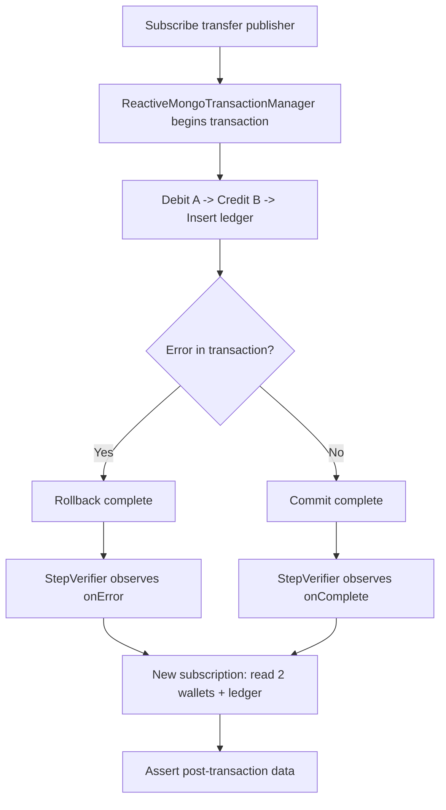

# Testing With StepVerifier and Verifying Post-Commit State

> **Chapter:** Reactive Transactions  
> **Module:** `SPRING_DATA_MONGODB` — using Spring Data MongoDB to connect, map documents, and operate through `MongoTemplate` or repositories; practicing queries, aggregations, indexes, transactions, reactive access, testing, and performance diagnostics. This lesson focuses on **testing reactive transactions with `StepVerifier`**, verifying **actually committed state**, and testing **rollback** against a real MongoDB instance.

## 1. Problem Statement: Does a Success Signal Prove Data Was Committed?

A service transfers 3,000 cents from wallet A to wallet B and writes a ledger entry:

1. Debit wallet A, conditioned on sufficient balance.
2. Credit wallet B in the same tenant.
3. Insert a transfer record with a unique `transferId`.
4. **Commit** everything or **roll back** everything.

If a test merely writes:

```java
StepVerifier.create(service.transfer(command))
    .expectNextCount(1)
    .verifyComplete();
```

that test only verifies the publisher emitted one item and completed **per the method's contract**; it does not inspect **either wallet balance** or the **ledger record**. Even if an `onNext` item is emitted inside the transaction, that item can appear **before the transaction fully commits**; never treat `onNext` as proof of durable persistence.

A meaningful test requires **two verification layers**:

- **Reactive layer:** `StepVerifier` checks subscription, emitted values, `onComplete`, or `onError`.
- **Database layer:** after the transactional publisher **has terminated**, read back via an **independent subscription outside the previous transaction** and assert MongoDB state.



**Goal:** write reliable tests for commits, rollbacks, business failures, duplicate keys, cancellations, concurrent updates, and unknown commit outcomes; avoid "green" tests that silently hide out-of-transaction writes or inspect state **inside** the transaction.

## 2. Layers to Distinguish

| Layer | Tool | What Does It Prove? | What Does It Not Prove? |
| --- | --- | --- | --- |
| **Publisher** | Reactor `Mono`/`Flux` | Processing chain and reactive signals | Database commit, if using fake sources or wrong boundaries |
| **Verification** | Reactor Test `StepVerifier` | `onNext`, demand, completion, error, cancellation | Real balances and ledger without querying the database |
| **Transaction scope** | `TransactionalOperator` or `@Transactional` | Shared-context Spring Data operations coordinate start/commit/rollback | Raw driver calls without session or external side effects joining |
| **MongoDB** | Supporting replica set / sharded cluster | Atomic multi-document commit and rollback | Business rules like sufficient balance unless explicitly checked |
| **External verification** | Re-reading via `ReactiveMongoTemplate` | Visible post-transaction state at read time | A permanent snapshot across concurrent clients/requests |
| **Idempotency** | Unique transfer ID + retry handling | Prevents re-applying the same command per policy | Automatic deduplication merely from using a transaction |

### 2.1. Why `onNext` Is Not a "Commit Event"

A service can construct:

```java
Mono<Receipt> writeSteps = debit()
    .then(credit())
    .then(insertLedger())
    .map(doc -> new Receipt(doc.getString("transferId")));

Mono<Receipt> transactional = writeSteps
    .as(transactionalOperator::transactional);
```

`Receipt` is an application-defined record; `debit`, `credit`, and `insertLedger` represent publishers. `Receipt` can be constructed once the **inner** operations execute, yet the transaction manager still has to execute commit when the source completes.

To conclude "commit succeeded," wait for **terminal success** of the framework-managed transactional publisher, and then query the database when the test requires certainty over persisted business state.

### 2.2. `onComplete` Does Not Guarantee External Systems Succeeded

MongoDB transactions never roll back emails, HTTP calls, external payment gateways, or standalone message broker publishes. If a callback sends an email before commit, a subsequent rollback cannot un-send that email. Integration tests must verify the MongoDB transaction and separately test outbox/idempotency protocols for external systems.

### 2.3. `onError` Does Not Automatically Mean the Transaction Rolled Back

If an error occurs **inside the transactional publisher**, the transaction manager normally rolls back per contract. However, an error attached **after the transactional publisher already completed** cannot unwind an earlier commit:

```java
Mono<Void> errorAfterCommit = service.transfer(command)
    .then(Mono.error(new IllegalStateException(
        "An unrelated step failed after transfer"
    )));
```

`errorAfterCommit` signals an error, yet the transfer may have **committed successfully**. Never assume "`expectError` means both wallets stayed untouched" without checking **where the error sits relative to the transaction boundary**.

## 3. Proper Test Environment: A MongoDB Replica Set

Multi-document transactions require a supported topology:

- Replica set from MongoDB 4.0+.
- Sharded cluster from MongoDB 4.2+.
- **Standalone MongoDB does not support multi-document transactions.**

When testing with `@SpringBootTest`/`@DataMongoTest`, provide a real **test MongoDB replica set**, such as Testcontainers with a compatible image/version. `StepVerifier` cannot simulate MongoDB commit or rollback if tests only mock repositories.

### 3.1. Requirements to Avoid False Positives

1. MongoDB Server must start in a transaction-capable topology.
2. `ReactiveMongoTransactionManager` and `ReactiveMongoTemplate` must share the **same `ReactiveMongoDatabaseFactory`**.
3. The transactional method must actually be wrapped by `TransactionalOperator` or a `@Transactional` proxy.
4. Debit, credit, and ledger insert must **share the same Reactor Context/session**.
5. Seed fixtures into an isolated database **outside** the transaction under test.
6. Read back **after the transaction ends**, never relying on in-heap entities.
7. Trigger exactly one intentional subscription; never accidentally subscribe twice to a cold transactional publisher.

### 3.2. Never Test on Standalone and Conclude Rollback Works

If the server throws an error mentioning transaction numbers or replica set required, that is an **environment error**, not a valid business test failure. Never "fix" the test by removing `@Transactional` or `TransactionalOperator` just to turn it green.

### 3.3. Testcontainers Across Versions

With Spring Boot 3.x and Testcontainers 1.x, examples commonly use `org.testcontainers.containers.MongoDBContainer` with `getReplicaSetUrl()`. Newer Testcontainers/Spring Boot releases may use different packages or modules, so verify against actual dependencies:

```java
import org.junit.jupiter.api.Test;
import org.springframework.boot.test.context.SpringBootTest;
import org.springframework.test.context.DynamicPropertyRegistry;
import org.springframework.test.context.DynamicPropertySource;
import org.testcontainers.containers.MongoDBContainer;
import org.testcontainers.junit.jupiter.Container;
import org.testcontainers.junit.jupiter.Testcontainers;
import org.testcontainers.utility.DockerImageName;

@Testcontainers
@SpringBootTest
class MongoReplicaSetSmokeTest {

    @Container
    static final MongoDBContainer mongo =
        new MongoDBContainer(DockerImageName.parse("mongo:7.0"));

    @DynamicPropertySource
    static void properties(DynamicPropertyRegistry registry) {
        registry.add(
            "spring.data.mongodb.uri",
            mongo::getReplicaSetUrl
        );
        registry.add(
            "spring.data.mongodb.database",
            () -> "reactive_tx_test"
        );
    }

    @Test
    void contextLoads() {
        // Verifies setup only; does not prove transactions work yet.
    }
}
```

Minimum dependencies: Spring Boot test, Spring Data MongoDB reactive, Reactor Test, JUnit 5, Testcontainers MongoDB + JUnit Jupiter, and a container runtime. On Spring Boot 4 / Testcontainers 2, packages and property names may differ. In CI, containers must be permitted to initialize a replica set and tests should await server readiness.

**Never put collection-dropping commands in production:** the fixture reset snippets below target isolated test databases only.

## 4. Preparing Data: Two Wallets and a Transfer Ledger

Suppose collection `wallets` contains two documents:

```javascript
db.wallets.insertMany([
  {
    _id: "W-A",
    tenantId: "TENANT-A",
    currency: "USD",
    balanceCents: NumberLong(10000)
  },
  {
    _id: "W-B",
    tenantId: "TENANT-A",
    currency: "USD",
    balanceCents: NumberLong(2000)
  }
]);
```

And collection `transfers` stores receipts:

```javascript
{
  _id: "TENANT-A|TR-001",
  tenantId: "TENANT-A",
  transferId: "TR-001",
  fromId: "W-A",
  toId: "W-B",
  amountCents: NumberLong(3000),
  currency: "USD"
}
```

Add a unique index `{tenantId:1, transferId:1}` to enforce the idempotency key within each tenant:

```javascript
db.transfers.createIndex(
  { tenantId: 1, transferId: 1 },
  { name: "ux_tenant_transfer", unique: true }
);
```

| State | Wallet A (cents) | Wallet B (cents) | Ledger Count |
| --- | ---: | ---: | ---: |
| Initial | 10,000 | 2,000 | 0 |
| Transfer 3,000 succeeds | 7,000 | 5,000 | 1 |
| Insufficient funds, rollback | 10,000 | 2,000 | 0 |
| Missing target wallet, rollback | 10,000 | 2,000 | 0 |
| Re-send same `transferId` after commit | 7,000 | 5,000 | 1 |

To test **mid-flight rollback**, intentionally let the debit step succeed while the credit step fails to match. When the method emits an error, the transaction must abort; a **post-rollback** read observes wallet A still holding 10,000 even though the debit update ran inside the transaction.

### 4.1. Balances and Ledgers Must Be Real Database State, Not In-Memory Objects

Avoid keeping an `AtomicLong` inside a service and asserting it changed; that only tests JVM memory. Re-query `wallets` and `transfers` via `ReactiveMongoTemplate` after the terminal signal.

### 4.2. Avoid `double` for Money

The example uses `long` cents with `$inc` to avoid floating-point errors. Production systems must also validate amounts, currencies, integer bounds, multi-currency rules, and business authorization; transactions do not enforce domain rules automatically.

## 5. Configuring ReactiveMongoTransactionManager

In Spring Data MongoDB, reactive transactions bind to **Reactor Context**, not thread-local storage like imperative `MongoTransactionManager`:

```java
package demo.transfers;

import org.springframework.context.annotation.Bean;
import org.springframework.context.annotation.Configuration;
import org.springframework.data.mongodb.ReactiveMongoDatabaseFactory;
import org.springframework.data.mongodb.ReactiveMongoTransactionManager;
import org.springframework.transaction.reactive.TransactionalOperator;

@Configuration
public class ReactiveTxConfig {

    @Bean
    ReactiveMongoTransactionManager reactiveMongoTransactionManager(
        ReactiveMongoDatabaseFactory factory
    ) {
        return new ReactiveMongoTransactionManager(factory);
    }

    @Bean
    TransactionalOperator mongoTransactionalOperator(
        ReactiveMongoTransactionManager manager
    ) {
        return TransactionalOperator.create(manager);
    }
}
```

`ReactiveMongoTemplate` must share the same `ReactiveMongoDatabaseFactory` as this manager. In applications with multiple reactive transaction managers (MongoDB, R2DBC, etc.), declare explicit qualifiers/bean names so the wrong manager is never picked.

### 5.1. Which Scope Does TransactionalOperator Wrap?

`TransactionalOperator.transactional(publisher)` manages a transaction for the **wrapped upstream publisher**. With `Mono`:

```java
Mono<Receipt> tx = doWrites()
    .as(mongoTransactionalOperator::transactional);
```

`doWrites` represents a service-provided publisher. Upon subscription, the manager opens a transaction, executes upstream inside the context, and commits/rolls back on completion/error per contract.

**Do not** do this:

```java
// ANTI-PATTERN: detached insert runs outside the transaction chain.
someWrite().subscribe();
return otherWrite().as(mongoTransactionalOperator::transactional);
```

A spontaneous `subscribe()` creates a new subscription that does not inherit the returned chain's transaction context. Nor should you run two operations concurrently on the same transactional session via `Mono.when`/`zip`, because the MongoDB driver does not support parallel operations inside one transaction.

### 5.2. @Transactional as an Alternative

Declarative style:

```java
@org.springframework.transaction.annotation.Transactional(
    transactionManager = "reactiveMongoTransactionManager"
)
public Mono<Receipt> transferAnnotated(TransferCommand command) {
    return doWrites(command);
}
```

Public methods must be invoked **through the Spring proxy**. Self-invocation like `this.transferAnnotated(...)` bypasses the transaction interceptor in proxy mode. `@Transactional` cannot manage detached `subscribe()` calls or context-less raw driver calls either.

**Pick one strategy for the main example:** the following sections use `TransactionalOperator` so boundaries remain explicit in tests; as an exercise, you can rewrite it using `@Transactional` and test equivalently.

## 6. Reactive Transfer Service Used in Tests

Two data records:

```java
package demo.transfers;

public record TransferCommand(
    String tenantId,
    String fromId,
    String toId,
    long amountCents,
    String transferId
) {}
```

```java
package demo.transfers;

public record Receipt(
    String tenantId,
    String transferId,
    long amountCents
) {}
```

### 6.1. All Operations Must Stay in the Same Chain

```java
package demo.transfers;

import com.mongodb.client.result.UpdateResult;
import org.bson.Document;
import org.springframework.data.mongodb.core.ReactiveMongoTemplate;
import org.springframework.data.mongodb.core.query.Criteria;
import org.springframework.data.mongodb.core.query.Query;
import org.springframework.data.mongodb.core.query.Update;
import org.springframework.stereotype.Service;
import org.springframework.transaction.reactive.TransactionalOperator;
import reactor.core.publisher.Mono;

@Service
public class TransferService {

    private final ReactiveMongoTemplate mongo;
    private final TransactionalOperator txOperator;

    public TransferService(
        ReactiveMongoTemplate mongo,
        TransactionalOperator mongoTransactionalOperator
    ) {
        this.mongo = mongo;
        this.txOperator = mongoTransactionalOperator;
    }

    public Mono<Receipt> transfer(TransferCommand c) {
        return Mono.defer(() -> {
            validate(c);

            Query source = Query.query(
                Criteria.where("_id").is(c.fromId())
                    .and("tenantId").is(c.tenantId())
                    .and("currency").is("USD")
                    .and("balanceCents").gte(c.amountCents())
            );

            Query destination = Query.query(
                Criteria.where("_id").is(c.toId())
                    .and("tenantId").is(c.tenantId())
                    .and("currency").is("USD")
            );

            Document ledger = new Document(
                    "_id", c.tenantId() + "|" + c.transferId())
                .append("tenantId", c.tenantId())
                .append("transferId", c.transferId())
                .append("fromId", c.fromId())
                .append("toId", c.toId())
                .append("amountCents", c.amountCents())
                .append("currency", "USD");

            Mono<Receipt> work = mongo.updateFirst(
                    source,
                    new Update().inc(
                        "balanceCents", -c.amountCents()
                    ),
                    "wallets"
                )
                .flatMap(debit -> {
                    if (debit.getMatchedCount() != 1L) {
                        return Mono.<UpdateResult>error(
                            new IllegalStateException(
                                "Source missing or insufficient funds"
                            )
                        );
                    }
                    return mongo.updateFirst(
                        destination,
                        new Update().inc(
                            "balanceCents", c.amountCents()
                        ),
                        "wallets"
                    );
                })
                .flatMap(credit -> {
                    if (credit.getMatchedCount() != 1L) {
                        return Mono.<Receipt>error(
                            new IllegalStateException(
                                "Destination missing"
                            )
                        );
                    }
                    return mongo.insert(ledger, "transfers")
                        .map(ignored -> new Receipt(
                            c.tenantId(),
                            c.transferId(),
                            c.amountCents()
                        ));
                });

            return work.as(txOperator::transactional);
        });
    }

    private static void validate(TransferCommand c) {
        if (c == null
            || c.tenantId() == null || c.tenantId().isBlank()
            || c.fromId() == null || c.fromId().isBlank()
            || c.toId() == null || c.toId().isBlank()
            || c.transferId() == null || c.transferId().isBlank()
            || c.fromId().equals(c.toId())
            || c.amountCents() <= 0) {
            throw new IllegalArgumentException(
                "Invalid transfer command"
            );
        }
    }
}
```

**Design decisions:**

1. `Mono.defer` defers validation and object creation **until subscription**, avoiding running MongoDB logic during method assembly.
2. `updateFirst` on the source wallet filters on `balanceCents >= amount`, preventing overdrafts atomically inside the document update.
3. When `matchedCount=0`, the service emits **`Mono.error`**, never `Mono.empty`, because empty counts as normal completion and could commit the transaction.
4. Debit, credit, and ledger insert are chained **sequentially**—no detached `subscribe()`, no `Mono.when`.
5. `work.as(txOperator::transactional)` wraps **all three operations**.
6. Never emit `Receipt` out of a failed transaction by catching errors internally and faking success.

This is educational code: production systems must derive tenant from the authenticated principal, verify wallet ownership and currency, guard against numeric overflow, check idempotency against **stored payloads**, map errors safely, and define transaction retry policies. Concatenating ledger IDs with `|` is illustrative; if tenant or `transferId` can contain `|`, use an unambiguous encoding or `ObjectId` with a unique compound index.

### 6.2. Why Never Place `onErrorResume` Inside the Transaction?

Anti-pattern:

```java
Mono<Receipt> wrong = debit()
    .then(creditThatMayFail())
    .onErrorResume(ex -> Mono.empty())
    .as(txOperator::transactional);
```

If `creditThatMayFail` errors after `debit()` modified a document, `onErrorResume` turns the error into **normal completion**, letting the transaction manager **commit the lone debit**. Data becomes corrupt even while `verifyComplete()` passes green.

To trigger rollback, keep the error inside the transactional publisher. If the UI needs a friendly response, map the error **after the transaction boundary** and verify database state:

```java
Mono<TransferResponse> response = transfer(command)
    .map(receipt -> TransferResponse.success(receipt))
    .onErrorResume(
        IllegalStateException.class,
        e -> Mono.just(TransferResponse.rejected(e.getMessage()))
    );
```

`TransferResponse` is an illustrative application DTO. Confirm `transfer(command)` wraps the transaction as shown above and verify post-rollback database state in tests.

## 7. StepVerifier: Minimal API for Verifying Transactional Publishers

Test dependency uses `io.projectreactor:reactor-test`. In Spring Boot, it is commonly pulled in via `spring-boot-starter-test` or declared explicitly in test scope depending on build setup.

```java
import reactor.test.StepVerifier;
```

Core operations:

| API | Purpose | Notes |
| --- | --- | --- |
| `StepVerifier.create(publisher)` | Creates verifier with default initial demand | **Does not run** until `verify()` |
| `expectNext(value)` | Asserts next item by equality | Good for simple types/records |
| `assertNext(consumer)` | Asserts fields of next item | Assertion failures fail the test |
| `expectNextCount(n)` | Consumes `n` arbitrary items | Does not verify item payloads |
| `expectComplete()`, `verify()` | Verifies terminal completion | Does not query the database automatically |
| `verifyComplete()` | Shorthand for `expectComplete().verify()` | Awaits termination up to test timeout/config |
| `expectErrorSatisfies(...)` | Inspects error type/details | Does not imply rollback if error sat outside boundary |
| `thenRequest(n)` | Grants additional demand | Useful for `Flux`/backpressure tests |
| `thenCancel()` | Cancels subscription | Requires checking transaction outcome separately |
| `verify(Duration)` | Sets max wait duration | Prevents tests hanging indefinitely if MongoDB stalls |

### 7.1. Pure Mono Examples

```java
StepVerifier.create(Mono.just("OK"))
    .expectNext("OK")
    .verifyComplete();

StepVerifier.create(Mono.<String>error(
        new IllegalStateException("boom")))
    .expectErrorMatches(e ->
        e instanceof IllegalStateException
            && "boom".equals(e.getMessage()))
    .verify();
```

These examples test Reactor signals only and **do not** prove MongoDB transactions work.

### 7.2. Never Call `subscribe()` Before StepVerifier

```java
Mono<Receipt> transfer = service.transfer(command);

// WRONG: creates 2 subscriptions / 2 write attempts.
transfer.subscribe();
StepVerifier.create(transfer).expectNextCount(1).verifyComplete();
```

Reactive MongoDB publishers are typically cold: **every subscription** re-runs the queries/transaction. For non-idempotent transfers, the second run deducts money twice or hits duplicate-key errors. To test a single write, create the publisher and let `StepVerifier` perform the sole subscription.

### 7.3. Items Emitted Before Completion Are Not Durable State

```java
StepVerifier.create(service.transfer(command))
    .assertNext(receipt -> {
        assertThat(receipt.transferId()).isEqualTo("TR-001");
        // DO NOT block() to query DB here assuming commit already happened.
    })
    .verifyComplete();
```

Inside `assertNext`, the transaction may still be mid-flight before commit completes. Inspect database state from a **new subscription after `verifyComplete()`**, or chain `.then(Mono.defer(...))` strictly after the entire transactional publisher with clear boundaries.

## 8. Snapshotting MongoDB State After Commit

Create a DTO capturing data **re-read from the DB**, not objects held in memory by the service:

```java
package demo.transfers;

public record TransferSnapshot(
    long fromCents,
    long toCents,
    long ledgerCount
) {}
```

Helper in the integration test:

```java
private Mono<TransferSnapshot> snapshot() {
    Mono<Long> from = template
        .findById("W-A", Document.class, "wallets")
        .map(doc -> ((Number) doc.get("balanceCents")).longValue());

    Mono<Long> to = template
        .findById("W-B", Document.class, "wallets")
        .map(doc -> ((Number) doc.get("balanceCents")).longValue());

    Mono<Long> ledgerCount = template.count(
        new Query(), "transfers"
    );

    return Mono.zip(from, to, ledgerCount)
        .map(tuple -> new TransferSnapshot(
            tuple.getT1(),
            tuple.getT2(),
            tuple.getT3()
        ));
}
```

`template` is an injected `ReactiveMongoTemplate`; import `org.bson.Document`, `org.springframework.data.mongodb.core.query.Query`, and `reactor.core.publisher.Mono`. Querying the database after terminal success verifies real state rather than trusting `Receipt` alone.

### 8.1. Two Separate Verifications Is the Clearer Pattern

```java
TransferCommand c = new TransferCommand(
    "TENANT-A", "W-A", "W-B", 3000L, "TR-001"
);

// Subscription 1: transaction execution and commit.
StepVerifier.create(service.transfer(c))
    .assertNext(r -> {
        assertThat(r.transferId()).isEqualTo("TR-001");
        assertThat(r.amountCents()).isEqualTo(3000L);
    })
    .verifyComplete();

// Subscription 2: read state AFTER the transactional publisher finished.
StepVerifier.create(snapshot())
    .expectNext(new TransferSnapshot(7000L, 5000L, 1L))
    .verifyComplete();
```

**Crucial point:** the second read subscription is created **after** `verifyComplete()`, so it cannot accidentally read mid-transaction state. With appropriate concerns and a healthy primary, the test confirms committed state. If durability across failovers is required, evaluate `majority` write concern separately; tests alone do not replace durability configuration.

### 8.2. Chaining Post-Completion Read in One Publisher

If you prefer a single `StepVerifier`:

```java
Mono<TransferSnapshot> afterCommit = service.transfer(c)
    .then(Mono.defer(this::snapshot));

StepVerifier.create(afterCommit)
    .expectNext(new TransferSnapshot(7000L, 5000L, 1L))
    .verifyComplete();
```

`then` subscribes to the next source **only after the prior publisher completes normally**. Because `service.transfer` returns the transactional publisher wrapping all of `work`, `snapshot()` sits **outside that boundary**. `Mono.defer` ensures the helper runs when the post-commit stage is subscribed to, not at pipeline assembly time.

Never move `snapshot()` into `work`'s `flatMap` **before `.as(tx::transactional)`** claiming it shows post-commit state: inside the transaction, it simply observes uncommitted changes via read-your-own-writes.

### 8.3. Reading Inside a Transaction Can Observe Uncommitted Data

Anti-pattern:

```java
Mono<TransferSnapshot> misleading = writeSteps()
    .then(Mono.defer(this::snapshot))
    .as(txOperator::transactional);
```

Because `snapshot` shares the `ReactiveMongoTemplate`/context, it reads the updated balances **inside the transaction**, yet the subsequent commit can still fail. An assertion here **does not** prove data committed.

### 8.4. Reading Only One Collection Is Insufficient

After a transfer, checking only that wallet A equals 7,000 misses a failed credit on wallet B. Checking only that the ledger has 1 row misses wrong balances. Multi-document transaction contracts must assert **every related invariant**, at minimum A, B, and the ledger—plus outbox and versions/audits in broader workflows.

## 9. Complete Integration Test: Commit and Rollback

The test class below uses **Spring Boot 3.x + Testcontainers 1.x**. Each test seeds an isolated database, verifies the transactional publisher with `StepVerifier`, and verifies database state via a **fresh subscription**:

```java
package demo.transfers;

import static org.assertj.core.api.Assertions.assertThat;

import java.time.Duration;
import java.util.concurrent.atomic.AtomicInteger;
import org.bson.Document;
import org.junit.jupiter.api.BeforeEach;
import org.junit.jupiter.api.Test;
import org.springframework.beans.factory.annotation.Autowired;
import org.springframework.boot.test.context.SpringBootTest;
import org.springframework.data.domain.Sort;
import org.springframework.data.mongodb.core.ReactiveMongoTemplate;
import org.springframework.data.mongodb.core.index.Index;
import org.springframework.data.mongodb.core.query.Query;
import org.springframework.test.context.DynamicPropertyRegistry;
import org.springframework.test.context.DynamicPropertySource;
import org.testcontainers.containers.MongoDBContainer;
import org.testcontainers.junit.jupiter.Container;
import org.testcontainers.junit.jupiter.Testcontainers;
import org.testcontainers.utility.DockerImageName;
import reactor.core.publisher.Mono;
import reactor.test.StepVerifier;

@SpringBootTest
@Testcontainers
class ReactiveTransferIntegrationTest {

    @Container
    static final MongoDBContainer mongo =
        new MongoDBContainer(DockerImageName.parse("mongo:7.0"));

    @DynamicPropertySource
    static void mongoProperties(DynamicPropertyRegistry registry) {
        registry.add(
            "spring.data.mongodb.uri", mongo::getReplicaSetUrl
        );
        registry.add(
            "spring.data.mongodb.database",
            () -> "reactive_tx_test"
        );
    }

    @Autowired ReactiveMongoTemplate template;
    @Autowired TransferService service;

    @BeforeEach
    void resetDatabase() {
        // ONLY for an isolated test MongoDB; dropCollection wipes data.
        template.dropCollection("transfers")
            .then(template.dropCollection("wallets"))
            .then(template.insert(
                wallet("W-A", 10_000L), "wallets"
            ))
            .then(template.insert(
                wallet("W-B", 2_000L), "wallets"
            ))
            .then(template.indexOps("transfers").ensureIndex(
                new Index()
                    .on("tenantId", Sort.Direction.ASC)
                    .on("transferId", Sort.Direction.ASC)
                    .named("ux_tenant_transfer")
                    .unique()
            ))
            .then()
            .block(Duration.ofSeconds(30));
    }

    private Document wallet(String id, long cents) {
        return new Document("_id", id)
            .append("tenantId", "TENANT-A")
            .append("currency", "USD")
            .append("balanceCents", cents);
    }

    private TransferCommand command(String transferId) {
        return new TransferCommand(
            "TENANT-A", "W-A", "W-B", 3_000L, transferId
        );
    }

    private Mono<TransferSnapshot> snapshot() {
        Mono<Long> from = template
            .findById("W-A", Document.class, "wallets")
            .map(d -> ((Number) d.get("balanceCents")).longValue());

        Mono<Long> to = template
            .findById("W-B", Document.class, "wallets")
            .map(d -> ((Number) d.get("balanceCents")).longValue());

        Mono<Long> count = template.count(
            new Query(), "transfers"
        );

        return Mono.zip(from, to, count)
            .map(t -> new TransferSnapshot(
                t.getT1(), t.getT2(), t.getT3()
            ));
    }

    private void assertState(
        long from, long to, long ledgerCount
    ) {
        StepVerifier.create(snapshot())
            .expectNext(new TransferSnapshot(
                from, to, ledgerCount
            ))
            .expectComplete()
            .verify(Duration.ofSeconds(20));
    }

    @Test
    void successCommitsBothWalletsAndOneLedgerEntry() {
        StepVerifier.create(service.transfer(command("TR-001")))
            .assertNext(receipt -> {
                assertThat(receipt.transferId()).isEqualTo("TR-001");
                assertThat(receipt.amountCents()).isEqualTo(3_000L);
            })
            .expectComplete()
            .verify(Duration.ofSeconds(20));

        assertState(7_000L, 5_000L, 1L);

        StepVerifier.create(template.findById(
                "TENANT-A|TR-001", Document.class, "transfers"
            ))
            .assertNext(doc -> {
                assertThat(doc.getString("tenantId"))
                    .isEqualTo("TENANT-A");
                assertThat(doc.getString("fromId"))
                    .isEqualTo("W-A");
                assertThat(doc.getString("toId"))
                    .isEqualTo("W-B");
                assertThat(
                    ((Number) doc.get("amountCents")).longValue()
                ).isEqualTo(3_000L);
            })
            .expectComplete()
            .verify(Duration.ofSeconds(20));
    }

    @Test
    void missingDestinationRollsBackAfterDebit() {
        TransferCommand missing = new TransferCommand(
            "TENANT-A", "W-A", "W-MISSING",
            3_000L, "TR-002"
        );

        StepVerifier.create(service.transfer(missing))
            .expectErrorMatches(e ->
                e instanceof IllegalStateException
                    && e.getMessage().contains("Destination missing"))
            .verify(Duration.ofSeconds(20));

        // Debit matched inside the transaction, yet must roll back.
        assertState(10_000L, 2_000L, 0L);
    }

    @Test
    void insufficientFundsDoesNotCreditDestination() {
        TransferCommand tooLarge = new TransferCommand(
            "TENANT-A", "W-A", "W-B",
            20_000L, "TR-003"
        );

        StepVerifier.create(service.transfer(tooLarge))
            .expectErrorMatches(e ->
                e instanceof IllegalStateException
                    && e.getMessage().contains("insufficient funds"))
            .verify(Duration.ofSeconds(20));

        assertState(10_000L, 2_000L, 0L);
    }

    @Test
    void duplicateTransferIdRollsBackSecondAttempt() {
        StepVerifier.create(service.transfer(command("TR-004")))
            .expectNextCount(1)
            .expectComplete()
            .verify(Duration.ofSeconds(20));

        assertState(7_000L, 5_000L, 1L);

        StepVerifier.create(service.transfer(command("TR-004")))
            .expectErrorSatisfies(error ->
                assertThat(error).hasMessageContaining("duplicate"))
            .verify(Duration.ofSeconds(20));

        // Second request attempted debit/credit, yet duplicate ledger
        // caused its entire transaction to roll back.
        assertState(7_000L, 5_000L, 1L);
    }

    @Test
    void publisherIsLazyAndHasOneSubscription() {
        AtomicInteger subscriptions = new AtomicInteger();

        Mono<Receipt> write = service.transfer(command("TR-005"))
            .doOnSubscribe(s -> subscriptions.incrementAndGet());

        assertThat(subscriptions.get()).isZero();
        assertState(10_000L, 2_000L, 0L);

        StepVerifier.create(write)
            .expectNextCount(1)
            .expectComplete()
            .verify(Duration.ofSeconds(20));

        assertThat(subscriptions.get()).isEqualTo(1);
        assertState(7_000L, 5_000L, 1L);
    }

    @Test
    void errorAfterCommitCannotUndoCommittedData() {
        Mono<Void> afterwards = service
            .transfer(command("TR-006"))
            .then(Mono.error(new IllegalStateException(
                "failure after transaction"
            )));

        StepVerifier.create(afterwards)
            .expectErrorMessage("failure after transaction")
            .verify(Duration.ofSeconds(20));

        // Final publisher errored, yet error sits AFTER the boundary.
        assertState(7_000L, 5_000L, 1L);
    }
}
```

### 9.1. Why Are These Tests Stronger Than `verifyComplete()` Alone?

The success test asserts **A decreased by 3,000, B increased by 3,000, ledger grew by 1**, and ledger metadata matches. The missing-destination test proves **debit executed prior to failure yet rolled back**; the duplicate test proves **neither debit nor credit from the second run persisted**.

The main assertion makes only one subscription to `service.transfer(...)`. `assertState` uses a **separate** subscription created after the transaction emitted its terminal signal. Never read an "updated balance" from an in-JVM cached object and claim it represents committed state.

### 9.2. Avoid Over-Relying on Duplicate-Key Error Messages

`hasMessageContaining("duplicate")` is kept concise here for demonstration. Depending on driver versions and Spring exception translation, a duplicate error may be wrapped or worded differently. In real projects, check the **appropriate exception type or MongoDB error code 11000** rather than relying solely on message substrings.

### 9.3. Fixtures and Package Scanning Matter

`@SpringBootTest` needs a `@SpringBootApplication` in a parent package (or explicit class imports) to scan `TransferService` and `ReactiveTxConfig`; otherwise bean wiring errors mask transaction tests. In CI, Testcontainers needs container/replica-set permissions and matching dependency coordinates.

`.block(Duration)` inside `@BeforeEach` prepares fixtures strictly **on the JUnit thread**, never in production WebFlux code. Do not run tests in parallel against **the same fixed database name**, or one test's `dropCollection` will wipe data mid-flight for another test.

### 9.4. Do Not Annotate the Test Method Itself With `@Transactional`

If the test method itself is wrapped in a transaction, post-operation verification reads may stay inside the **same transaction/context** or get rolled back by the test framework at the end of the test. Leave `@Transactional` off these test methods: the **service** opens and closes its own transaction, and the test inspects persisted state from outside. Avoid tests passing falsely due to reading uncommitted writes or framework-driven test rollbacks.

## 10. Testing Rollback on `Mono.empty`, Business Errors, and Error Placement

### 10.1. `matchedCount=0` Does Not Automatically Emit a MongoDB Error

`updateFirst` completes normally with `UpdateResult.matchedCount=0`. Never ignore it:

```java
// ANTI-PATTERN: may commit credit/ledger even though debit matched nothing.
return mongo.updateFirst(source, debit, "wallets")
    .then(mongo.updateFirst(destination, credit, "wallets"))
    .then(mongo.insert(ledger, "transfers"))
    .as(txOperator::transactional);
```

To trigger rollback on business preconditions, emit `Mono.error` when `matchedCount` differs from expectations; never assume returning `Mono<UpdateResult>` means a document was modified.

### 10.2. `switchIfEmpty` Does Not Catch `matchedCount=0`

```java
// WRONG: updateFirst emits an UpdateResult even with matchedCount=0.
mongo.updateFirst(source, debit, "wallets")
    .switchIfEmpty(Mono.error(
        new IllegalStateException("Insufficient funds")
    ));
```

`switchIfEmpty` triggers only when a publisher emits **zero items**, whereas MongoDB emits an `UpdateResult` even when zero documents matched. Check `getMatchedCount()` inside `flatMap`. Similarly, when deleting, check `DeleteResult.getDeletedCount()` if business rules require deleting one exact document.

### 10.3. Rollback After Successful Writes

The insufficient-funds test verifies blocking a transfer before debit runs. However, the **missing-destination** test is far stronger for testing transactions: debit matched, then credit failed to match, forcing the transaction to revert the debit. The duplicate test tests failure at stage three, after both wallet updates.

### 10.4. Handling Errors Outside the Transactional Publisher

```java
Mono<TransferResponse> response = service.transfer(command)
    .map(TransferResponse::accepted)
    .onErrorResume(
        IllegalStateException.class,
        ex -> Mono.just(TransferResponse.rejected(
            "Transfer was not accepted"
        ))
    );
```

`TransferResponse` is an application-defined DTO. `onErrorResume` in this snippet sits **outside** the transactional publisher returned by `service.transfer`. It maps the error to an API response; to prove rollback, still assert database state after the response emits.

### 10.5. Post-Commit Errors Do Not Retroactively Roll Back

`service.transfer(...).then(callExternalService())` can emit an error from the external call **after MongoDB committed**, so an `expectError` on the outer publisher does not prove MongoDB rolled back. When external side effects require consistency, use a transactional outbox and idempotent consumers rather than relying on cross-system rollback.

## 11. Cancellation: `thenCancel`, `take`, `timeout`, and Rollback Boundaries

Spring Framework documents that since **version 5.3**, a cancel signal on a transactional publisher causes the transaction to **roll back**. For a `Flux` wrapped in a transaction, the subscriber must **consume the entire source for the transaction to complete**; stopping early cancels work and triggers rollback.

### 11.1. Operators Commonly Causing Cancellation

```java
// Each example can cancel upstream:
Flux<Order> onlyFirst = allOrders.take(1);
Mono<Order> first = allOrders.next();
Mono<Order> timed = longRunning.timeout(
    Duration.ofSeconds(2)
);
```

`take` and `next` cancel the subscription once enough items arrive; `timeout` cancels upstream when the timer expires. If upstream runs inside a transaction, cancellation does not mean "commit everything emitted so far."

**Distinction:** canceling while a transaction is **still active** triggers rollback per contract; canceling **after commit already finished** cannot undo the commit.

### 11.2. `StepVerifier.thenCancel` Alone Does Not Prove Rollback

```java
StepVerifier.create(transactionalPublisher)
    .expectSubscription()
    .thenCancel()
    .verify();
```

This test only proves the subscription was canceled. If cancel fires **before any writes execute**, the database never changed anyway—asserting initial state does not prove the transaction rolled back writes.

To test cancellation rollback **after a real write**:

1. Place a **gate** inside the transactional pipeline: let the first insert/update succeed, then wait on an uncompleted signal.
2. Use `Sinks.One`, `PublisherProbe`, or test synchronization to confirm the first write stage **executed inside the transaction**.
3. Have `StepVerifier` cancel **while the gate remains closed**, before the pipeline can complete.
4. Give asynchronous rollback/cleanup time to finish using bounded awaits/metrics; never assert immediately after `thenCancel` before cleanup completes.
5. Re-read MongoDB from an out-of-transaction context to confirm the intermediate write **was not committed**, and inspect cursor/session resources if required.

### 11.3. A Gate Pattern for Controlling Cancellation Point

```java
import java.time.Duration;
import java.util.concurrent.atomic.AtomicBoolean;
import org.bson.Document;
import reactor.core.publisher.Mono;
import reactor.core.publisher.Sinks;
import reactor.test.StepVerifier;

Sinks.One<Boolean> firstWriteReached = Sinks.one();
Sinks.One<Void> neverOpenedGate = Sinks.one();
AtomicBoolean cancelled = new AtomicBoolean(false);

Mono<Void> pendingTransaction = template.insert(
        new Document("_id", "TX-CANCEL-1")
            .append("value", "uncommitted"),
        "tx_probe"
    )
    .doOnNext(doc -> firstWriteReached.tryEmitValue(true))
    .then(neverOpenedGate.asMono())
    .as(txOperator::transactional)
    .doOnCancel(() -> cancelled.set(true));

StepVerifier.create(pendingTransaction)
    .expectSubscription()
    // Block ONLY on test thread to confirm write stage reached the gate.
    .then(() -> firstWriteReached.asMono()
        .block(Duration.ofSeconds(10)))
    .thenCancel()
    .verify(Duration.ofSeconds(20));

assert cancelled.get();
```

**Snippet scope:** this only confirms **execution reached the gate and then canceled**. `insert`'s `doOnNext` marks driver acknowledgment inside the transaction, **not commit**. Proving full rollback/cleanup requires a separate integration assertion after cancellation finishes, using a timeout and reading from an independent context; never treat `assert cancelled` as proof MongoDB already finished rolling back. Use a dedicated test collection `tx_probe` and clean it before tests.

### 11.4. Do Not Use `take(1)` to "Partially Commit" a Flux Transaction

```java
// RISK: caller takes only the first item of a Flux transaction.
Flux<Receipt> allReceipts = writeManyTransactionsAsOneFlux()
    .as(txOperator::transactional);

Mono<Receipt> firstOnly = allReceipts.next();
```

If `next()` cancels upstream before the transaction completes, earlier statements can roll back; **never** treat the first received item as durable. If an API emits multiple independent items, give each business item its own small transaction boundary instead of one giant Flux transaction.

## 12. Timeouts and Virtual Time: Never Simulate MongoDB Commits With a Virtual Clock

### 12.1. Attach Timeouts to Integration Tests

`StepVerifier.verifyComplete()` has no default timeout unless `StepVerifier.setDefaultTimeout` was configured. Because a test MongoDB server can hang or lag on network calls, prefer:

```java
StepVerifier.create(service.transfer(command))
    .expectNextCount(1)
    .expectComplete()
    .verify(Duration.ofSeconds(20));
```

`verify(Duration)` limits **how long the test waits for signals**. It is not a MongoDB server transaction timeout, nor does it guarantee driver cleanup finished the instant the verifier times out.

To bound production queries and transactions, configure transaction timeouts, MongoDB `maxTimeMS`/driver timeouts, and cancellation/retry policies rather than relying solely on test timeouts.

### 12.2. `withVirtualTime` Is for Timers/Retries, Not Databases

```java
StepVerifier.withVirtualTime(
        () -> Mono.delay(Duration.ofHours(1))
    )
    .thenAwait(Duration.ofHours(1))
    .expectNext(0L)
    .verifyComplete();
```

`withVirtualTime` controls Reactor timer schedulers. It **does not make MongoDB respond faster**, does not create transaction snapshots, and does not simulate server commits.

In integration tests verifying real persistence, use **real MongoDB + `StepVerifier.verify(Duration)`**. Keep virtual time strictly for unit-testing retry backoff and time-based operators with lazy suppliers, never as persistence proof.

### 12.3. Retrying Timeouts Can Cause Duplicates If Commit Already Succeeded

If a client times out right after sending commit, the commit outcome may be **unknown**. Blindly re-running `service.transfer` with a fresh transfer ID can deduct funds twice. Tests must distinguish:

- Transaction failed **before commit**: known rollback.
- Commit outcome **unknown**: retry commit per driver protocol or reconcile by idempotency key.
- HTTP client timed out **after transaction committed**: data changed even though the client missed the receipt.

`StepVerifier.expectError(TimeoutException.class)` alone does not tell you whether the database rolled back or committed. Inspect receipts/ledgers and retry policies.

## 13. Commit Failures, MongoException Labels, and Uncertainty

The MongoDB Java Driver attaches **error labels** to classify transaction failures:

| Label | Common Meaning | Testing Strategy |
| --- | --- | --- |
| `TransientTransactionError` | **Whole transaction** may be retried under appropriate conditions | Inject controlled failure; verify bounded retry and rule re-evaluation |
| `UnknownTransactionCommitResult` | Client cannot tell whether commit succeeded | Reconcile by `transferId`; never swap IDs and replay funds |
| `E11000 duplicate key` | Ledger key already exists | Second transaction rolls back; assert balances remain unchanged |
| Business `IllegalStateException` | Filter mismatch / state violation | Roll back, return business error; never retry infinitely |

`ReactiveMongoTransactionManager` Javadoc notes that commit failures can wrap into `TransactionSystemException`; retrying commit by error labels requires dedicated design for your Spring/driver version. Never wrap `service.transfer(...)` in a blanket `Retry.backoff` as a catch-all for **unknown commits**.

### 13.1. Whole-Transaction Retry Is a New Subscription

```java
Mono<Receipt> retried = service.transfer(command)
    .retryWhen(
        reactor.util.retry.Retry.backoff(
            2, Duration.ofMillis(100)
        ).filter(this::isRetryableTransactionError)
    );
```

`isRetryableTransactionError` is application-implemented, inspecting error types/labels and business policy—**not** a built-in method. `retryWhen` creates a **new subscription**, re-running the entire transaction callback, meaning any external side effects inside the callback would run repeatedly.

**Never apply this retry pattern to unknown commit outcomes without proper idempotency/commit-retry design.** For duplicate transfer IDs, read the stored receipt, compare payloads (source, destination, amount, currency), and respond accordingly; never treat every duplicate as a valid replay.

### 13.2. Test Driver Failures With Isolated Fault Injection

Normal tests do not easily drop the network **right between commit and response**. When verifying recovery, use controlled fault-injection/chaos testing:

- MongoDB failpoints if allowed by the test environment.
- Proxies severing connections at targeted phases.
- Controlled primary restarts/failovers.
- Driver command monitoring recording `commitTransaction`, retry counts, and MongoDB error labels.

Never hardcode expectations that "every disconnect rolls back"; outcomes depend on whether the server already processed the commit.

## 14. Testing Two Concurrent Transactions: Never Rely on Arbitrary Ordering

Two concurrent requests debiting wallet A contend with each other. Each `service.transfer` subscription should own **its own transaction and session**—completely different from using `flatMap(concurrency)` to run parallel operations **inside one transaction**.

### 14.1. Assert Invariants Instead of Forcing a Specific Winner

Suppose two requests concurrently transfer 8,000 from A (10,000) to B (2,000) using distinct `transferId`s:

```java
TransferCommand c1 = new TransferCommand(
    "TENANT-A", "W-A", "W-B", 8000L, "PAR-1"
);
TransferCommand c2 = new TransferCommand(
    "TENANT-A", "W-A", "W-B", 8000L, "PAR-2"
);

Mono<Void> twoRequests = Mono.when(
    service.transfer(c1).then()
        .onErrorResume(e -> Mono.empty()),
    service.transfer(c2).then()
        .onErrorResume(e -> Mono.empty())
);

StepVerifier.create(twoRequests)
    .verifyComplete();
```

This snippet is **strictly for a concurrency test**; `onErrorResume` sits **outside** each transactional publisher so the test awaits both requests without aborting prematurely. In production, always log and classify errors rather than swallowing them.

Once both finish, read back (outside any transaction):

- Total `fromCents + toCents` still equals **12,000**.
- `fromCents` is non-negative.
- With amount 8,000 and source 10,000, at most **one** transfer committed.
- `ledgerCount <= 1`.
- If `ledgerCount == 1`, wallets A/B must be **2,000/10,000**; if `ledgerCount == 0`, wallets must remain **10,000/2,000**.

Never assert "PAR-1 always wins" because thread scheduling and write conflicts are non-deterministic. Without a retry policy, one request may fail with a write conflict while the other succeeds, or both could fail for distinct reasons; tests should classify failures rather than blindly accepting any outcome.

### 14.2. Handle Write Conflicts at the Right Layer

Under transactions, MongoDB may throw a write conflict on a contending request. That signals retrying the **whole transaction** where appropriate, never "just retry that update statement inside the same transaction."

Before retrying, re-read the balance and re-check `balance >= amount` in the fresh transaction. If funds became insufficient after the winning request committed, the proper outcome is a **business rejection**, not endless retries.

### 14.3. Never Share One Session Across Two Parallel Operations

`Mono.when` in section 14.1 runs **two independent transactions**. Never confuse it with:

```java
// WRONG if both share one transactional session:
Mono.when(
    template.updateFirst(source, debit, "wallets"),
    template.updateFirst(destination, credit, "wallets")
).as(txOperator::transactional);
```

The MongoDB driver does not support running parallel operations on the same session/transaction as a speedup. Sequence them with `flatMap`/`then`.

## 15. Reactive @Transactional: Testing the Real Proxy Path

`@Transactional(transactionManager="reactiveMongoTransactionManager")` can be more concise than `TransactionalOperator`, provided:

- Reactive return type `Mono`/`Flux` allows the interceptor to recognize a reactive transaction.
- The method is called **through the Spring bean proxy**.
- `ReactiveMongoTransactionManager` shares the same factory as `ReactiveMongoTemplate`/repositories.
- All work is composed into the **returned** publisher without detached `subscribe()`.

### 15.1. Annotation Pattern

```java
@Service
public class AnnotatedTransferService {
    private final ReactiveMongoTemplate template;

    public AnnotatedTransferService(ReactiveMongoTemplate template) {
        this.template = template;
    }

    @Transactional(
        transactionManager = "reactiveMongoTransactionManager"
    )
    public Mono<Void> writeBoth(
        Query source, Update debit,
        Query destination, Update credit
    ) {
        return template.updateFirst(
                source, debit, "wallets"
            )
            .flatMap(r -> {
                if (r.getMatchedCount() != 1L) {
                    return Mono.<UpdateResult>error(
                        new IllegalStateException("Debit failed")
                    );
                }
                return template.updateFirst(
                    destination, credit, "wallets"
                );
            })
            .flatMap(r -> r.getMatchedCount() == 1L
                ? Mono.just(r)
                : Mono.error(new IllegalStateException(
                    "Credit failed"
                )))
            .then();
    }
}
```

This snippet requires imports for `@Service`, `@Transactional`, `ReactiveMongoTemplate`, `Query`, `Update`, `Mono`, and `UpdateResult`. It shows a **two-wallet** example focusing on the proxy; a production transfer still needs ledgers, idempotency, and authorization like section 6.

### 15.2. Proxy Tests vs. Self-Invocation

```java
@Autowired AnnotatedTransferService annotatedService;

StepVerifier.create(annotatedService.writeBoth(
        source, debit, destination, credit
    ))
    .verifyComplete();
```

`annotatedService` is a Spring-injected bean, so this call crosses the proxy. Calling `this.writeBoth(...)` internally inside `AnnotatedTransferService` bypasses the proxy-mode transaction interceptor.

To prove this, write an integration test injecting an error **after debit** and verify rollback via the injected bean; compare against a controlled call that bypasses the interceptor. Never try to "fix" proxy bypass by slapping `@Transactional` onto a private method.

### 15.3. Do Not Layer Two Transaction Strategies Unnecessarily

If a method already carries `@Transactional` and its body also calls `.as(txOperator::transactional)`, you risk confusing propagation/nested boundaries, especially with multiple transaction managers. Choose one clear transaction boundary owner for tests and assert state after terminal signals.

## 16. Post-Commit Reads: Consistency, Write Concern, and Observation Timing

A sound post-commit assertion knows **where it is reading from** and **what guarantees apply**:

### 16.1. Reading From Primary After Terminal Success

In straightforward tests, `ReactiveMongoTemplate` reads from the same MongoDB replica set **after `StepVerifier` observes terminal completion** of the transactional publisher. Prefer reading from the primary so secondary replication lag is never mistaken for rollback.

MongoDB write concerns include `w:1`, `majority`, and others; an acknowledged commit does not automatically mean "durable across every failover." When strong durability is required, configure an appropriate **transaction commit write concern** and run dedicated failover tests.

Startup configuration example for transaction options (never mutate per request):

```java
import com.mongodb.ReadConcern;
import com.mongodb.ReadPreference;
import com.mongodb.TransactionOptions;
import com.mongodb.WriteConcern;
import org.springframework.data.mongodb.ReactiveMongoDatabaseFactory;
import org.springframework.data.mongodb.ReactiveMongoTransactionManager;

TransactionOptions options = TransactionOptions.builder()
    .readConcern(ReadConcern.SNAPSHOT)
    .writeConcern(WriteConcern.MAJORITY)
    .readPreference(ReadPreference.primary())
    .build();

ReactiveMongoTransactionManager manager =
    new ReactiveMongoTransactionManager(factory, options);
```

`factory` is the application's configured `ReactiveMongoDatabaseFactory`. This shows an **alternative** to the default manager bean in section 5; never register a second unintended manager. `ReadConcern.SNAPSHOT` and `WriteConcern.MAJORITY` provide specific server guarantees, not business authorization or idempotency. Likewise, a **single-node** test replica set cannot prove multi-node failover durability.

### 16.2. A Post-Commit Read Is Not a Permanent Snapshot

If a test reads wallet A and then wallet B on two separate subscriptions in an environment with concurrent writers, data can change **between the two reads**. To keep tests deterministic:

- Use **isolated database fixtures** with no concurrent external writers.
- Use `Mono.zip` to aggregate post-commit document reads conveniently, while **remembering `zip` does not create a MongoDB snapshot transaction**.
- If a consistent multi-document view is truly needed amid active writers, use an explicit **snapshot read/transaction** matching read concern and topology.

For sequential integration tests against a dedicated test DB, `snapshot()` from section 9 is a practical post-state helper.

### 16.3. MongoDB Transaction Commit and Client Signals

`ReactiveMongoTransactionManager` commits through the driver. Only after the transactional publisher completes successfully should test code run out-of-boundary reads. If the client sees **`UnknownTransactionCommitResult`** or timeout, never assume rollback; tests for uncertain commit handling must reconcile receipts by idempotency key.

### 16.4. Never Mistake `onNext` for Durability

`Receipt` can be built in the pipeline prior to commit. Never publish payment results to a broker inside `doOnNext(receipt -> publish(...))` **within** transactional work, because the callback can run right before the transaction rolls back.

To emit events after commit, write an **outbox document inside the transaction** alongside wallets and ledger; an independent worker reads committed outbox records and publishes idempotently.

## 17. Diagnosing Failing Tests and Observing Real Commands

### 17.1. Log the Right Events

A reactive transaction test suite should observe:

| Source | Signal | Diagnostic Value |
| --- | --- | --- |
| `StepVerifier` | `onNext/onComplete/onError/cancel` | Shows which signals the publisher emitted |
| Reactor `doOnSubscribe` | Subscription count | Catches double subscriptions or retries |
| Reactor `doFinally` | `CANCEL/ON_ERROR/ON_COMPLETE` | Identifies how the stream terminated |
| MongoDB command monitoring | `startTransaction` flag on command, `commitTransaction`, `abortTransaction` | Confirms operations actually ran inside a transaction |
| MongoDB driver errors | Error codes/labels | Separates transient, unknown commit, and duplicate errors |
| MongoDB post-state | Both balances, ledger, outbox | Verifies business outcomes after commit/rollback |
| Transaction metrics | Active/committed/aborted counts, latency | Reveals error trends and contention |

MongoDB transactions typically do not send a standalone `startTransaction` command: the driver sets `startTransaction:true` on the first command in the transaction, followed later by `commitTransaction`/`abortTransaction`. Never design a listener requiring a **separate command literally named `startTransaction`** to recognize an active transaction.

### 17.2. Driver CommandListener

With Java Driver command monitoring enabled on the reactive MongoDB client, you can observe command names, `lsid`/transaction metadata, and timings:

```text
update        (transaction start flag on the first command when applicable)
update
insert
commitTransaction
```

On rollback:

```text
update
update
abortTransaction
```

This illustrates a **typical observable sequence**, not a fixed guarantee across every driver version or error path. A transaction can fail before sending the insert, and the driver manages sessions internally.

Never log full account numbers, PII, tokens, connection URIs, or payment payloads in production. Log a controlled `transferId`, status, error label, and trace ID under strict data-protection policies.

### 17.3. AssertJ and StepVerifier Diagnostics

`StepVerifierOptions.scenarioName` and `.as("...")` document test failure context:

```java
import reactor.test.StepVerifierOptions;

StepVerifier.create(
        service.transfer(command),
        StepVerifierOptions.create()
            .scenarioName("transfer commits ledger and balances")
    )
    .assertNext(r -> assertThat(r.amountCents()).isPositive())
    .as("valid receipt")
    .expectComplete()
    .verify(Duration.ofSeconds(20));
```

On failure tests, add descriptive failure messages detailing the operation and expected state rather than adding hidden retries. This pays off quickly when a suite covers rollback, duplicates, write conflicts, and failover.

### 17.4. Never Measure Real MongoDB Latency With Virtual Time

P95/p99 transaction latency measurements require wall-clock time in a representative environment with realistic datasets, replica topology, and networking. Virtual time only replaces Reactor schedulers; it does not model disk I/O, commit acknowledgments, or replication lag.

## 18. Which Test Layer Answers Which Question?

| Test Layer | What Can Be Mocked? | Core Question |
| --- | --- | --- |
| **Service logic unit test** | Mocked operations, fake result publishers | When `matchedCount=0`, does the service emit `Mono.error`? |
| **Reactor contract test** | `Mono.just/error`, `Sinks`, `StepVerifier` | Are demand, cancellation, propagation, and ordering right? |
| **Spring slice/context test** | Minimal test beans if needed | Are manager, operator, and proxies wired correctly? |
| **MongoDB integration test** | **Never mock MongoDB** for commit/rollback | Do debit, credit, and ledger actually commit or roll back together? |
| **Concurrency test** | Two real subscriptions/transactions | Do business invariants hold under write conflicts? |
| **Fault-injection test** | Controlled network/failover faults | Are retries, unknown commits, and idempotency handled right? |
| **Performance test** | Realistic replica set deployment | What are commit latency, contention, resources, and throughput? |

### 18.1. Mocks Prove Chaining, Not Transactions

`StepVerifier.create(Mono.just(receipt)).verifyComplete()` passes **without MongoDB**. That works for testing DTO mapping, not transactions. Never advertise a test mocking `ReactiveMongoTemplate.updateFirst` as an integration test for multi-document rollback.

### 18.2. Input Validation Tests Must Run Before Mutation

For `TransferService` in section 6:

```java
StepVerifier.create(service.transfer(
        new TransferCommand(
            "TENANT-A", "W-A", "W-B", -100, "INVALID"
        )
    ))
    .expectError(IllegalArgumentException.class)
    .verify();
```

Afterwards, query wallets and ledgers to confirm **nothing was written**. For invalid commands, no transaction even needs to open; the key requirement is validating before any mutation.

### 18.3. Test Isolation vs. Transaction Isolation

Transaction isolation governs visibility between concurrent database operations. Test isolation ensures **tests never corrupt or delete each other's data**. Sharing one DB while running `dropCollection` concurrently creates flaky failures even when MongoDB transactions work flawlessly.

### 18.4. Rollback Tests Do Not Replace Durability Tests

Rollback tests prove failed business logic does not commit writes. Durability across restarts and failovers depends on transaction write concern, replica set configuration, and recovery workflows—requiring dedicated durability tests.

## 19. Security, Tenant Isolation, and Idempotency in Tests

### 19.1. Tenant Must Appear in Both Filters

In the service, both source and destination filters include:

```javascript
{
  tenantId: "TENANT-A",
  currency: "USD"
}
```

If a client supplies a `toId` owned by TENANT-B and the service filters only by `_id`, the transaction happily commits an **unauthorized cross-tenant** transfer. Database transactions know nothing about principals or authorization.

Tests should seed a foreign-tenant wallet and verify transfers targeting it are rejected with both balances and the ledger untouched. Never trust `tenantId` taken blindly from an unauthenticated request; production services must derive it from the authenticated principal.

### 19.2. Duplicate `transferId` Does Not Mean Every Retry Is Valid

Repeating the same `transferId` with a different amount or destination is a **business conflict**, never "transfer already succeeded." To provide a safe idempotent API:

1. Enforce a unique key on `tenantId + transferId`.
2. Persist full canonical inputs (source, destination, amount, currency) in the ledger.
3. On duplicate, read the committed receipt and **compare payloads**.
4. If identical, return the stored receipt; if different, signal conflict.
5. Handle races and unknown commit outcomes per policy without infinite retries.

The duplicate test in section 9 verifies second-attempt rollback; **full idempotent response replay** is an additional layer built on top.

### 19.3. Never Use Transactions for External Side Effects

Emails, push notifications, and broker publishes do not roll back with MongoDB. Transactional outbox tests must verify that the outbox record exists only after commit and is absent after rollback; test the publishing worker and idempotent consumer in a separate suite.

### 19.4. Never Leak Internal Exception Details

`StepVerifier` can assert detailed messages inside internal tests, yet HTTP APIs must never expose raw MongoDB commands, URIs, keys, credentials, or stack traces to callers. Map duplicate, insufficient-funds, and write-conflict errors to safe API error contracts with controlled auditing and tracing.

## 20. Common Issues Table and Diagnostic Checklist

| Symptom | Common Cause | Fix |
| --- | --- | --- |
| `StepVerifier.verifyComplete()` passes yet data is unchanged | Mocked publisher, never subscribed to DB, or inspecting wrong collection | Read raw documents post-transaction against real MongoDB |
| Receipt exists yet ledger is missing | `Receipt` emitted early, ledger missed transaction, or wrong query | Ensure ledger insert shares publisher chain and query post-commit |
| Debit does not roll back when credit fails | `onErrorResume` converted credit error to complete inside tx | Propagate errors; test missing destination after debit |
| Insufficient-funds test passes yet fails to catch broken atomicity | Debit matched nothing, so nothing needed rollback | Add tests failing at step 2 and step 3 |
| `switchIfEmpty` misses unmatched update | `updateFirst` emits `UpdateResult` with `matchedCount=0` | Inspect `getMatchedCount()` |
| `expectError` passes yet balances changed | Error happened after transaction committed | Check boundaries; inspect state after error |
| No transaction ever opened | Missing `ReactiveMongoTransactionManager`, wrong factory/manager | Declare proper bean; inspect command monitoring |
| `@Transactional` has no effect | Self-invocation, non-proxied call, wrong bean | Call via injected Spring bean; test real rollback |
| Operation ran outside transaction | Detached `subscribe()`, session-less raw driver, wrong factory | Compose on one chain/context; share template/factory |
| Error: transaction numbers / replica set required | Standalone MongoDB | Use Testcontainers replica set or supporting cluster |
| `StepVerifier` hangs in CI | DB not ready, uncompleting publisher, missing timeout | Add `verify(Duration)`, readiness probes, diagnostics |
| `thenCancel` passes yet DB rollback is unclear | Canceled before write or async cleanup incomplete | Gate after write, bounded wait, and post-state read |
| `take(1)` keeps Flux transaction from committing | Canceled before completion | Consume fully or adjust transaction boundaries |
| Duplicate key still runs second debit/credit | Insert error swallowed or missing tx coverage | Unique ledger + error propagation + post-state checks |
| Duplicate test fails to match exception | Spring/driver wrapped error or altered message | Match exception type or MongoDB error code 11000 |
| Two tests corrupt each other's data | Shared DB with parallel `dropCollection` | Isolate test fixtures; avoid parallel runs on shared namespaces |
| Post-commit assertion sees stale values | Lagging secondary read or checked before commit completed | Read from primary after completion; verify concerns |
| Data looked right pre-commit then commit failed | Read executed inside the transaction | Read via fresh subscription outside boundary after terminal |
| Test code hangs calling `block()` | Blocked on event loop during reactive flow | Use `StepVerifier`/non-blocking service; `block()` only from JUnit thread |
| Commit timeout + retry transfers money twice | Unknown commit treated as rollback | Reconcile ledger by `transferId` and apply proper retry policy |
| Concurrency test fails intermittently | Asserted fixed winner or ignored write conflicts | Assert invariants and classify errors, never scheduling order |
| `withVirtualTime` does not speed up MongoDB tests | DB I/O does not follow Reactor virtual clocks | Use real DB + `verify(Duration)` for integration tests |
| Long transaction, low throughput | External calls, blocking/parallel ops, unindexed scans | Keep transactions short, index queries, monitor commit latency |
| Test is green yet wrong tenant got credited | Missing tenant/permission guard on destination filter | Add cross-tenant tests asserting both wallets and ledger |

### 10-Step Diagnostic Procedure

1. Confirm the **MongoDB replica set** and verify the test URI targets it.
2. Confirm `ReactiveMongoTransactionManager` is active and shares the factory with `ReactiveMongoTemplate`.
3. Locate the actual transaction boundary: `.as(tx::transactional)` or `@Transactional`.
4. Count **subscriptions**: did anything call `subscribe()` before `StepVerifier`, or is `retryWhen` rerunning?
5. Confirm **all three operations** sit inside one reactive chain without detached subscribes or parallel commands on one session.
6. Verify business predicates and update results: tenant, currency, sufficient funds, `matchedCount`.
7. Check error placement: **inside** vs. **after** the transaction boundary; is `onErrorResume` swallowing it?
8. Inspect MongoDB driver command/transaction metrics and error labels if needed.
9. **After the terminal signal**, open a fresh subscription to read wallet A, wallet B, ledger (and outbox if present); verify expected state.
10. If tests flake, examine fixture isolation, scheduling, replica readiness, timeouts, and concurrent writers instead of deleting assertions.

## 21. Hands-On Lab: Writing a Complete Commit/Rollback Test Suite

**Context:** a multi-tenant system has wallet A=10,000 cents and wallet B=2,000 cents; transferring 3,000 cents must insert a ledger entry unique per `transferId`. Your task is to prove **reactive transactions work properly** using both `StepVerifier` and database state checks.

1. **Prepare environment:** use Spring Data MongoDB reactive, Reactor Test, JUnit 5, and a compatible Testcontainers MongoDB version. Ensure Testcontainers runs in replica-set mode, not standalone.
2. **Define domain:** create `TransferCommand`, `Receipt`, `TransferSnapshot`, and `wallets`/`transfers` collections.
3. **Isolated seed:** reset both wallets and the ledger per test, creating the unique `tenantId+transferId` index **before** starting any transaction.
4. **Configuration:** create `ReactiveMongoTransactionManager` from the same `ReactiveMongoDatabaseFactory` as `ReactiveMongoTemplate`, and build `TransactionalOperator`.
5. **Service:** sequence `debit -> credit -> insert ledger` with `flatMap`, with zero manual `subscribe()` calls.
6. **Strict validation:** check tenant, source ID, destination ID, positive amount, distinct wallets, and valid currency.
7. **Check update outcomes:** if `matchedCount != 1` on debit or credit, emit `Mono.error` to roll back—never `Mono.empty`.
8. **`StepVerifier` success:** assert receipt matches `transferId` and amount; wait for terminal completion.
9. **Post-commit read:** a new subscription to `snapshot()` must return `(7000, 5000, 1)` and verify ledger metadata.
10. **Rollback after debit:** transfer to a nonexistent wallet; assert `onError`, then verify state remains `(10000, 2000, 0)`.
11. **Insufficient funds:** try transferring 20,000; assert business error and unchanged state.
12. **Duplicate ledger:** replay the same `transferId`; assert duplicate error after both updates were attempted, with state staying `(7000, 5000, 1)`.
13. **Prevent double subscribe:** count subscriptions with `doOnSubscribe`; never subscribe manually before `StepVerifier`.
14. **Post-commit error:** append `.then(Mono.error(...))` after the service call; assert the publisher errors yet the DB **still committed**, explaining the boundary.
15. **Reading at the wrong time:** write an anti-example `writeSteps.then(read).as(tx::transactional)` and explain why that read fails to prove commit.
16. **Cancellation:** build a gate after a write inside the transaction, call `thenCancel()` while the gate stays closed, and verify rollback using proper test synchronization and post-state readback.
17. **Timeout:** use `verify(Duration)` to cap test wait time; explain why `withVirtualTime` cannot replace a real server.
18. **Concurrent transactions:** run two 8,000 transfers from A using two distinct IDs; verify total balance stays 12,000, balances stay non-negative, and ledger count is at most 1.
19. **`@Transactional`:** build the annotation-based service variant, invoke it via the bean proxy to verify rollback, and demonstrate self-invocation as an anti-pattern.
20. **Cross-tenant test:** seed a TENANT-B wallet, attempt a cross-tenant transfer, expect error, and verify neither tenant was modified.
21. **Idempotency contract:** on replay with the same key, read the committed receipt and compare payloads; differing amount/destination must return conflict.
22. **Observability:** configure driver command monitoring in tests to observe `commitTransaction`/`abortTransaction` and error labels without logging PII.
23. **CI:** ensure fixtures do not collide across tests, set timeouts, await container readiness, and isolate test databases from production.
24. **Report:** document which tests verify subscriber signals, which verify post-state DB persistence, which test mocked/validation logic, and which verify durability/failover.

### Self-Check Questions

- Why isn't `assertNext(receipt)` enough to confirm a transaction committed?
- What does `verifyComplete()` on a transactional publisher prove, and what else is needed to verify real balances?
- When is `snapshot()` invoked if you write `service.transfer(c).then(Mono.defer(this::snapshot))`?
- Why can a read **inside** a transaction observe new balances that are still not durable?
- Which test best proves rollback after an earlier write already succeeded?
- Why doesn't `matchedCount=0` emit `onError` automatically?
- Does `switchIfEmpty` catch an unmatched `UpdateResult`?
- What happens if `onErrorResume` sits **inside** the transaction chain?
- Does an `onError` **after** the transactional publisher roll back an earlier commit?
- Why must duplicate-ledger tests verify both wallet balances after the error, not just the ledger count?
- When using `StepVerifier.thenCancel`, how do you ensure cancellation hits after a write yet before commit?
- How does Spring Framework 5.3+ handle cancel signals on a transactional publisher?
- Can `withVirtualTime` simulate a real MongoDB commit?
- How does `TransientTransactionError` differ from `UnknownTransactionCommitResult`?
- Why is retrying a whole transaction with a brand-new `transferId` so dangerous?
- How do two independent transactions running concurrently differ from two MongoDB operations running in parallel inside one session?
- Why should concurrency tests assert invariants instead of hardcoding which request wins?
- Why shouldn't you put `@Transactional` on the test method itself when verifying a service committed?
- Does a test mocking `ReactiveMongoTemplate` prove multi-document rollback?
- What should you test if the database uses secondary read preferences or requires majority durability?
- Why don't transactions automatically protect tenant authorization or external HTTP calls?

## 22. Summary and Official References

### Key Takeaways

- **`StepVerifier` verifies reactive signals; MongoDB post-state verifies commit and rollback outcomes.** You need both to prove multi-document transactions work.
- **`onNext` can arrive before commit.** Wait for **terminal success** of the transactional publisher and verify via an independent subscription.
- **`onError` implies rollback only if it occurs inside the transaction boundary** and reaches the transaction manager. Post-commit errors never roll back retroactively.
- **`Mono.empty` or `onErrorResume` inside a transaction** can cause partial commits when business failures turn into normal completion.
- **`matchedCount=0` is a business outcome you must check**, not an automatic `onError` from `updateFirst`.
- **The strongest rollback tests fail at step 2 or 3** after earlier writes executed, then assert everything reverted to initial state.
- **Duplicate-key tests verify more than exceptions**: assert balances and ledgers did not change again; full idempotency also compares receipt payloads.
- **Since Spring Framework 5.3, canceling a transactional publisher triggers rollback**; cancel tests must control cancellation timing and await async cleanup.
- **`withVirtualTime` never replaces real MongoDB**; integration tests require a replica set, matching transaction manager/factory, and `StepVerifier.verify(Duration)` timeouts.
- **Never detach subscriptions or run parallel writes on the same session**; use one reactive chain and one clear transaction boundary.
- **Concurrent transaction tests assert invariants**, never a hardcoded winning request.
- **Unknown commit outcomes must reconcile by `transferId`**; never retry with a new ID and duplicate business effects.
- **Tests should read post-terminal state from primary in an isolated DB**, without putting `@Transactional` on the test method when verifying service commits.
- **Transactions do not replace authorization, idempotency, write concern, or outboxes.**

### Official Documentation

Always cross-check API signatures and supported features against the exact versions of Spring Framework, Reactor, Spring Data MongoDB, Testcontainers, and MongoDB Server in your project:

- [Spring Data MongoDB — Sessions & Transactions](https://docs.spring.io/spring-data/mongodb/reference/mongodb/client-session-transactions.html)
- [Spring Data MongoDB — ReactiveMongoTransactionManager JavaDoc](https://docs.spring.io/spring-data/mongodb/docs/current/api/org/springframework/data/mongodb/ReactiveMongoTransactionManager.html)
- [Spring Framework — Programmatic Transaction Management and Cancel Signals](https://docs.spring.io/spring-framework/reference/data-access/transaction/programmatic.html)
- [Spring Framework — Declarative Transactions](https://docs.spring.io/spring-framework/reference/data-access/transaction/declarative/annotations.html)
- [Project Reactor — Testing with StepVerifier](https://projectreactor.io/docs/core/release/reference/testing.html)
- [Project Reactor — StepVerifier JavaDoc](https://projectreactor.io/docs/test/release/api/reactor/test/StepVerifier.html)
- [Spring Boot — Testcontainers](https://docs.spring.io/spring-boot/reference/testing/testcontainers.html)
- [Testcontainers Java — MongoDB Module](https://java.testcontainers.org/modules/databases/mongodb/)
- [MongoDB Java Driver — Transactions](https://www.mongodb.com/docs/drivers/java/sync/current/crud/transactions/)
- [MongoDB — Transactions](https://www.mongodb.com/docs/manual/core/transactions/)
- [MongoDB — Transaction Production Considerations](https://www.mongodb.com/docs/manual/core/transactions-production-consideration/)
- [MongoDB — Write Concern](https://www.mongodb.com/docs/manual/reference/write-concern/)
- [MongoDB — Read Concern](https://www.mongodb.com/docs/manual/reference/read-concern/)
- [MongoDB — Atomicity and Transactions](https://www.mongodb.com/docs/manual/core/write-operations-atomicity/)
