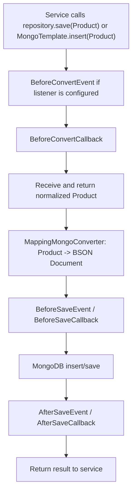

# BeforeConvertCallback Before Converting an Entity to a Document

## 1. The Problem to Solve in Mini Commerce

The **Mini Commerce** system stores `Product`, `Customer`, and `Order` in MongoDB using **Spring Data MongoDB**. A new Product can enter the system through a REST API, an importer, or an admin console action:

```json
{
  "sku": "  kbd-001  ",
  "name": "  Bàn phím Mini  ",
  "price": 129900.00,
  "stock": 12
}
```

We want to persist the data in a consistent format:

- The display SKU has leading/trailing whitespace stripped, while a normalized `sku_key` is formatted as `KBD-001` to enforce uniqueness **per tenant**.
- `name` keeps its Vietnamese diacritics for human readability; `name_search` becomes `ban phim mini` for lookup on the normalized field.
- `price` is stored as BSON Decimal128 instead of a BSON String.
- If the SKU is invalid or the name is blank/whitespace-only, the write operation must fail **before sending the document to the database**.
- Both `MongoRepository.save(...)` and `MongoTemplate.insert(...)` share the normalization logic instead of duplicating it across controllers.

This is a natural fit for **`BeforeConvertCallback<Product>`**: an interception point in the entity write lifecycle, **before Spring Data converts the entity into an `org.bson.Document`**.

The lesson **"BeforeConvertCallback Before Converting an Entity to a Document"** belongs to the **"Lifecycle and Callbacks"** chapter of the `SPRING_DATA_MONGODB` module. We will practice mapping, repositories, `MongoTemplate`, indexes, transactions, reactive access, testing, and performance diagnostics related to callbacks.

### Objectives

After this lesson, you will be able to:

1. Explain when `BeforeConvertCallback` runs and distinguish it from `BeforeSaveCallback`, `AfterSaveCallback`, and `BeforeConvertEvent`.
2. Properly implement the `BeforeConvertCallback<T>` interface and signature `T onBeforeConvert(T entity, String collection)`.
3. Register callbacks via `@Component` or `@Bean`, controlling entity types and `@Order` execution order.
4. Know that the **returned entity** becomes the input to BSON conversion, especially for immutable/Java record entities.
5. Design **pure, idempotent** normalization logic without writing external data outside transactions or making network calls from callbacks.
6. Understand the relationship with Spring Data auditing and `@CreatedDate`/`@LastModifiedDate`.
7. Know that `updateFirst`, `findAndModify`, repository `@Update`, raw driver calls, and bulk operations do not by default execute the entity `BeforeConvertCallback` path.
8. Verify actual BSON types, `@Field` mappings, unique indexes, and derived-key consistency.
9. Implement `ReactiveBeforeConvertCallback` with `Publisher<T>`, avoiding blocking I/O.
10. Write unit tests, integration tests against real MongoDB, and verify write paths that bypass callbacks.

**Prerequisites:** Java 17+, Spring Boot + `spring-boot-starter-data-mongodb` (reactive sections use the corresponding reactive starter), running MongoDB, familiarity with `@Document`, `@Id`, `@Field`, `MongoTemplate`, and repositories. `EntityCallback` APIs have been supported since Spring Data Commons 2.2; before copying examples, check your project's Spring Data version.

## 2. Where Does BeforeConvert Sit?

For an entity write operation going through Spring Data mapping, the typical flow is:



In this pipeline:

- **`BeforeConvertCallback` sees the Java object**, before any converted BSON `Document` exists.
- **`BeforeSaveCallback` sees both the entity *and* the BSON `Document`**, making it suitable for processing specific to the mapped document.
- **`AfterSaveCallback`** runs after the save step and can adjust the returned entity, but **is not a rollback mechanism or an exactly-once event emitter**.
- **Events** extending `ApplicationEvent` differ from callbacks invoked directly in the pipeline; an asynchronous event multicaster can make entity mutation non-deterministic. `EntityCallback` is the mechanism recommended by Spring Data when modifying an entity prior to persistence.

This sequence is a conceptual model for understanding checkpoints. Internal details such as ID/version handling, auditing, converters, and event delegation depend on APIs/versions; write integration tests when combining multiple callbacks and custom conversions.

### 2.1. Which Write Paths Typically Go Through BeforeConvert?

| Write Path | Before-Convert Entity Callback? | Notes |
| --- | --- | --- |
| `MongoTemplate.insert(product)` | Yes | Entity write; conversion step runs |
| `MongoTemplate.save(product)` | Yes | Check version/auditing policy |
| `MongoTemplate.insert(List<Product>, "products")` | Yes on standard entity insert path | Not identical to driver bulk |
| `MongoRepository.save(product)` | Yes | Repository uses Spring Data mapping |
| `MongoRepository.saveAll(...)` | Yes for entities written via mapping path | Implementation/batching depends on repository and version |
| `MongoTemplate.updateFirst(Query, Update, Product.class)` | **No** | Sends update modifiers; does not convert a full Product |
| `MongoTemplate.findAndModify(...)` | **No** per entity-save lifecycle | Query/update; does not invoke `onBeforeConvert(Product)` for modified record |
| Repository `@Update` | **No** | Direct update, not `save(entity)` |
| `BulkOperations` | **Do not assume** callbacks run | Batch update/insert needs explicit normalization if protocol requires |
| `MongoCollection<Document>.insertOne(...)` | **No** | Raw Java driver does not invoke Spring Data callbacks |
| Aggregation `$merge`/`$out` | **No** | Server-side pipeline write, not mapper entity conversion |

**Business invariants must be enforced at the database and service layers**, not only in callbacks, because not every writer goes through callbacks.

### 2.2. Root Entities and Embedded Objects

Lifecycle events in MongoDB are published for root-level documents, not automatically calling a separate `BeforeConvertCallback<OrderLine>` for every embedded `Order.lines` element. Entity callbacks are likewise applied at the **point of writing the root entity through the mapping lifecycle**, rather than walking the entire object graph and invoking independent callbacks on every embedded value.

Example:

```java
@Document(collection = "orders")
public class Order {
    @Id
    private String id;
    private List<OrderLine> lines;
}

public record OrderLine(String productId, int quantity) {}
```

The two types above are **two illustrative declarations**; when adding to a project, place them in appropriate Java files and add imports for `List`, `Id`, and `Document`. If `OrderLine` elements need normalization, do so in the Order service/validator or in the callback for the **Order root**, instead of expecting `BeforeConvertCallback<OrderLine>` to receive each element.

## 3. The BeforeConvertCallback Interface Contract

The interface belongs to:

```java
import org.springframework.data.mongodb.core.mapping.event.BeforeConvertCallback;
```

Core contract:

```java
@FunctionalInterface
public interface BeforeConvertCallback<T> {
    T onBeforeConvert(T entity, String collection);
}
```

This is a **simplified signature sketch**: the actual interface also extends `EntityCallback<T>` from Spring Data Commons. Keep three points in mind:

1. `entity` is the object Spring Data is about to convert into a `Document`.
2. `collection` is the **actual collection name** of the write operation, such as `"products"`, not the Java class name.
3. The **return** value is the entity used for the conversion step. You may return the same mutated instance or a new immutable instance; **never return `null`**.

### 3.1. The Callback Receives the Entity, Not a Document

```java
// Correct:
public Product onBeforeConvert(Product entity, String collection)

// Not the BeforeConvertCallback signature:
// onBeforeConvert(Product entity, Document document, String collection)
```

The second signature resembles `BeforeSaveCallback`, which occurs after mapping. Separating the two interfaces helps prevent the mistake of "modifying the Java object too late and assuming BSON updates automatically."

### 3.2. Imperative and Reactive Are Two Separate Contracts

| Imperative API | Reactive API |
| --- | --- |
| `BeforeConvertCallback<T>` | `ReactiveBeforeConvertCallback<T>` |
| Returns `T` | Returns `Publisher<T>` |
| Synchronous `MongoTemplate`/repository | `ReactiveMongoTemplate`/reactive repository |
| Runs on synchronous write path | Publisher participates in the reactive chain |
| Do not call slow DB/network operations from callback | Do not call `block()`; compose publishers |

Spring Data separates callbacks by API flavor: **a synchronous callback does not automatically become a reactive callback**. If an application uses both stacks, configure each explicitly and share a **pure normalization service** when equivalent behavior is desired.

## 4. The Product Entity and Mini Commerce BSON Contract

A shop's Product has an SKU, Vietnamese name, unit price, stock, and metadata.

```java
package com.example.minicommerce.domain;

import java.math.BigDecimal;
import java.time.Instant;

import org.springframework.data.annotation.Id;
import org.springframework.data.annotation.Version;
import org.springframework.data.annotation.CreatedDate;
import org.springframework.data.annotation.LastModifiedDate;
import org.springframework.data.mongodb.core.mapping.Document;
import org.springframework.data.mongodb.core.mapping.Field;
import org.springframework.data.mongodb.core.mapping.FieldType;

@Document(collection = "products")
public class Product {

    @Id
    private String id;

    @Field("tenant_id")
    private String tenantId;

    private String sku;

    @Field("sku_key")
    private String skuKey;

    private String name;

    @Field("name_search")
    private String nameSearch;

    @Field(name = "unit_price", targetType = FieldType.DECIMAL128)
    private BigDecimal price;

    private int stock;
    private boolean active;

    @Version
    private Long version;

    @CreatedDate
    private Instant createdAt;

    @LastModifiedDate
    private Instant updatedAt;

    public Product() {}

    public Product(String id, String tenantId, String sku,
                   String name, BigDecimal price, int stock) {
        this.id = id;
        this.tenantId = tenantId;
        this.sku = sku;
        this.name = name;
        this.price = price;
        this.stock = stock;
        this.active = true;
    }

    public String getId() { return id; }
    public String getTenantId() { return tenantId; }
    public String getSku() { return sku; }
    public String getSkuKey() { return skuKey; }
    public String getName() { return name; }
    public String getNameSearch() { return nameSearch; }
    public BigDecimal getPrice() { return price; }
    public int getStock() { return stock; }
    public boolean isActive() { return active; }
    public Long getVersion() { return version; }
    public Instant getCreatedAt() { return createdAt; }
    public Instant getUpdatedAt() { return updatedAt; }

    public void setId(String id) { this.id = id; }
    public void setTenantId(String tenantId) {
        this.tenantId = tenantId;
    }
    public void setSku(String sku) { this.sku = sku; }
    public void setSkuKey(String skuKey) {
        this.skuKey = skuKey;
    }
    public void setName(String name) { this.name = name; }
    public void setNameSearch(String nameSearch) {
        this.nameSearch = nameSearch;
    }
    public void setPrice(BigDecimal price) {
        this.price = price;
    }
    public void setStock(int stock) { this.stock = stock; }
    public void setActive(boolean active) { this.active = active; }
}
```

### 4.1. Java Properties Differ from BSON Field Names

| Java Property | BSON Key | Meaning |
| --- | --- | --- |
| `id` | `_id` | Product ID |
| `tenantId` | `tenant_id` | Data partitioning across shops |
| `sku` | `sku` | Display SKU |
| `skuKey` | `sku_key` | Normalized SKU for unique lookup |
| `name` | `name` | Display name with diacritics |
| `nameSearch` | `name_search` | Accent-stripped, lowercase search name |
| `price` | `unit_price` | BSON Decimal128 |
| `stock` | `stock` | BSON Int32 |
| `active` | `active` | BSON Boolean |
| `version` | `version` | Optimistic-locking field |
| `createdAt` | `createdAt` | Creation timestamp when auditing is enabled |
| `updatedAt` | `updatedAt` | Last modified timestamp when auditing is enabled |

The callback only modifies `Product`; **`MappingMongoConverter`** is what translates Java properties to the BSON fields above. If the callback sets `skuKey = "KBD-001"`, the generated Document must contain `"sku_key": "KBD-001"` thanks to `@Field("sku_key")`. You neither need nor want to manipulate raw BSON `Document` inside `BeforeConvertCallback` just to rename fields.

### 4.2. Expected Data Schema

```javascript
{
  _id: "p-kbd-001",
  tenant_id: "shop-a",
  sku: "kbd-001",
  sku_key: "KBD-001",
  name: "Bàn phím Mini",
  name_search: "ban phim mini",
  unit_price: NumberDecimal("129900.00"),
  stock: 12,
  active: true,
  version: NumberLong(0),
  createdAt: ISODate("2026-11-20T00:00:00Z"),
  updatedAt: ISODate("2026-11-20T00:00:00Z")
}
```

Timestamps and version values above are **structural illustrations**, not fixed values on every insert. Whether auditing populates timestamps depends on configuration; `@Version` is handled by Spring Data according to the version and write path.

## 5. Building a Pure Normalizer Tested Independently

Do not bury all regex and Unicode transformations inside a callback where they cannot be easily unit tested. Extract a helper with **no I/O, no request dependencies, and no mutable state**.

### 5.1. Normalized SKU

```java
package com.example.minicommerce.catalog;

import java.util.Locale;
import java.util.Objects;
import java.util.regex.Pattern;

public final class CatalogText {

    private static final Pattern SKU_PATTERN = Pattern.compile(
        "[A-Z0-9][A-Z0-9._-]{1,63}");

    private CatalogText() {}

    public static String skuKey(String input) {
        Objects.requireNonNull(input, "sku");
        String result = input.strip()
            .toUpperCase(Locale.ROOT);

        if (!SKU_PATTERN.matcher(result).matches()) {
            throw new IllegalArgumentException(
                "SKU must be 2-64 safe characters");
        }
        return result;
    }
}
```

Examples:

| Input | `skuKey` |
| --- | --- |
| `"  kbd-001  "` | `"KBD-001"` |
| `"KBD_001"` | `"KBD_001"` |
| `"kbd.001"` | `"KBD.001"` |
| `"a"` | Rejected because too short |
| `"  kbd 001 "` | Rejected because of internal space |

**Why not strip every unfamiliar character automatically?** If normalizing `"KBD 001"` and `"KBD-001"` collapses them into the same key when business rules disallow spaces, it can cause silent collisions or alter SKU meaning without clear feedback. For business keys, strict validation and rejection of invalid input is usually better.

### 5.2. Vietnamese Search Name

Add a method to the `CatalogText` class above:

```java
import java.text.Normalizer;
import java.util.Locale;
import java.util.Objects;

public static String searchText(String input) {
    Objects.requireNonNull(input, "name");

    String lower = input.strip()
        .toLowerCase(Locale.ROOT);
    String decomposed = Normalizer.normalize(
        lower, Normalizer.Form.NFD);

    String withoutMarks = decomposed
        .replaceAll("\\p{M}+", "")
        .replace('đ', 'd');

    String normalized = withoutMarks
        .replaceAll("[^a-z0-9]+", " ")
        .strip()
        .replaceAll(" +", " ");

    if (normalized.isEmpty()) {
        throw new IllegalArgumentException(
            "Name contains no searchable characters");
    }
    return normalized;
}
```

This is a **method body with imports** to add to `CatalogText`, not a standalone Java file (top-level methods are invalid in Java). Key steps:

1. Lowercase with `Locale.ROOT` to avoid server-locale dependence.
2. `Normalizer.Form.NFD` decomposes accented letters into base characters plus combining marks.
3. Remove `\\p{M}` (combining marks).
4. Handle `đ → d` explicitly since NFD does not decompose `đ` into `d`.
5. Replace consecutive punctuation/whitespace with a single space.

```text
"  Bàn phím Mini  "  -> "ban phim mini"
"Chuột KHÔNG DÂY"     -> "chuot khong day"
"Đèn học – LED"       -> "den hoc led"
```

**Limitations:** this is a Mini Commerce text-search normalization policy; it does not replace a multilingual tokenizer/analyzer, does not guarantee disambiguation of homographs, and does not automatically create **full-text search** or search indexes. Non-ASCII letters (e.g., characters from other languages) may be stripped: if products require multilingual support, design a richer normalization strategy.

### 5.3. Idempotency of Transformations

A callback should strive to guarantee:

\[
f(f(\text{entity})) = f(\text{entity})
\]

Examples:

```text
skuKey("  kbd-001  ") -> "KBD-001"
skuKey("KBD-001")     -> "KBD-001"

searchText("Bàn phím Mini") -> "ban phim mini"
searchText("ban phim mini") -> "ban phim mini"
```

Idempotency ensures that `save`, re-imports, and retries do not mutate data on every pass through the callback. **Do not** generate a new UUID, append an element to an array, or increment a counter on every `onBeforeConvert` unless you have an explicit anti-duplication protocol.

## 6. Complete BeforeConvertCallback<Product> Implementation

```java
package com.example.minicommerce.catalog;

import org.springframework.core.annotation.Order;
import org.springframework.data.mongodb.core.mapping.event.BeforeConvertCallback;
import org.springframework.stereotype.Component;

import com.example.minicommerce.domain.Product;

@Component
@Order(200)
public class ProductBeforeConvertCallback
        implements BeforeConvertCallback<Product> {

    @Override
    public Product onBeforeConvert(
            Product entity, String collection) {

        if (!"products".equals(collection)) {
            // Lesson policy: do not save Product to another collection.
            // Apps with archive collections should adjust this policy.
            throw new IllegalArgumentException(
                "Unexpected Product collection: " + collection);
        }

        if (entity.getTenantId() == null ||
                entity.getTenantId().isBlank()) {
            throw new IllegalArgumentException(
                "Tenant is required");
        }
        if (entity.getSku() == null ||
                entity.getSku().isBlank()) {
            throw new IllegalArgumentException(
                "SKU is required");
        }
        if (entity.getName() == null ||
                entity.getName().isBlank()) {
            throw new IllegalArgumentException(
                "Product name is required");
        }
        if (entity.getPrice() == null ||
                entity.getPrice().signum() < 0) {
            throw new IllegalArgumentException(
                "Price must be non-negative");
        }
        if (entity.getStock() < 0) {
            throw new IllegalArgumentException(
                "Stock must be non-negative");
        }

        // Normalize only leading/trailing whitespace for display SKU.
        entity.setSku(entity.getSku().strip());
        entity.setName(entity.getName().strip());

        // Always recompute derived fields, even when saving an existing entity.
        entity.setSkuKey(
            CatalogText.skuKey(entity.getSku()));
        entity.setNameSearch(
            CatalogText.searchText(entity.getName()));

        return entity;
    }
}
```

Key highlights:

- `@Component` lets Spring manage the callback. Controllers do not need to invoke it manually.
- The generic type `BeforeConvertCallback<Product>` scopes the callback to `Product`; it does not apply to unrelated entities like `Customer` or `Order`.
- `collection` is checked against the **actual collection name**. This is an illustrative policy; if you intentionally save Products into `products_archive` or `product_drafts`, adjust the policy deliberately.
- The callback validates, normalizes, and **returns the entity**; the framework uses this object to map BSON.
- `@Order(200)` specifies relative ordering when multiple callbacks of the same type exist; it does not mean the callback runs 200 times.
- The logic does not connect to MongoDB, make HTTP calls, publish events, or write to other resources.

### 6.1. Why Recompute skuKey/nameSearch Instead of Only When Null?

Suppose an existing Product has:

```text
name       = "Bàn phím Mini"
nameSearch = "ban phim mini"
```

Later a user edits `name = "Chuột không dây"`. If the callback only computed `nameSearch` when null, the old search key would remain. Derived fields must therefore always be **recomputed from source fields** or have an explicit synchronized update mechanism.

### 6.2. Do Not Change Tenant or Create Access Permissions

The callback verifies `tenantId` is non-blank, but it cannot verify **whether the tenant is authorized for the caller** from the Product alone. The tenant must be attached and validated in the service/security context; controllers must never blindly trust a `tenantId` from the request body and expect callbacks to "protect" it.

### 6.3. Do Not Turn Callbacks into Business Orchestrators

Do not put responsibilities in callbacks such as:

- Decrementing stock of another Product.
- Creating an Order/Payment.
- Sending emails or calling payment gateways.
- Writing events directly to a broker.
- Calling an API to fetch exchange rates at save time.

These actions depend on transactions, idempotency, commit timing, retries, and aggregate boundaries. Callbacks should remain focused on entity normalization/validation right before conversion.

## 7. Registering Callbacks and Execution Order

The simplest registration is `@Component` as in section 6. If you do not use component scanning, declare a bean:

```java
package com.example.minicommerce.config;

import org.springframework.context.annotation.Bean;
import org.springframework.context.annotation.Configuration;
import org.springframework.data.mongodb.core.mapping.event.BeforeConvertCallback;

import com.example.minicommerce.catalog.ProductBeforeConvertCallback;
import com.example.minicommerce.domain.Product;

@Configuration
class ProductCallbackConfiguration {

    @Bean
    BeforeConvertCallback<Product> productBeforeConvert() {
        return new ProductBeforeConvertCallback();
    }
}
```

**The two registration styles are alternatives**: if you already have `@Component`, do not also define a `@Bean` for the same callback, otherwise a single `save` may run the logic twice with unpredictable ordering.

### 7.1. @Order and Ordered

When multiple callbacks apply to `Product`:

```java
@Component
@Order(50)
class EarlyProductValidation
        implements BeforeConvertCallback<Product> {

    @Override
    public Product onBeforeConvert(
            Product product, String collection) {
        if (product.getTenantId() == null) {
            throw new IllegalArgumentException(
                "Missing tenant");
        }
        return product;
    }
}
```

`@Order(50)` takes precedence before `@Order(200)` (smaller numbers run earlier). If multiple callbacks modify the same field, their order determines the final outcome. Design and test ordering deliberately instead of relying on Spring bean scan order.

You can implement `Ordered` instead of `@Order`:

```java
@Override
public int getOrder() {
    return 200;
}
```

This is a **method of a callback implementing `Ordered`**, not a required method on `BeforeConvertCallback`. Pick one ordering mechanism for clarity.

### 7.2. Lambda Callbacks

```java
@Bean
BeforeConvertCallback<Product> productNormalizer() {
    return (product, collection) -> {
        product.setSkuKey(
            CatalogText.skuKey(product.getSku()));
        return product;
    };
}
```

Lambdas are concise for small logic, but Spring Data notes that generic type filtering on lambda callbacks can be less optimal because the runtime may not see the full generic type as clearly as on a concrete class. For important callbacks needing logging, testing, or complex logic, **a class with explicit generic typing** is usually easier to maintain.

Do not register this lambda **alongside** `ProductBeforeConvertCallback` from section 6 unless you intentionally want two callbacks running for the same Product.

## 8. Using Callbacks Through MongoTemplate and Repositories

You do not need to call `callback.onBeforeConvert(...)` manually in services when writing through Spring Data. Spring Data discovers callbacks in the `ApplicationContext` and applies them to matching entity types.

### 8.1. MongoTemplate.insert(...)

```java
import java.math.BigDecimal;

Product product = new Product(
    "p-kbd-001",
    "shop-a",
    "  kbd-001  ",
    "  Bàn phím Mini  ",
    new BigDecimal("129900.00"),
    12);

Product inserted = mongoTemplate.insert(product);
```

After the write:

```text
inserted.sku        = "kbd-001"
inserted.skuKey     = "KBD-001"
inserted.name       = "Bàn phím Mini"
inserted.nameSearch = "ban phim mini"
```

When the callback is registered, these normalized values appear in the BSON before MongoDB receives the insert. `createdAt`/`updatedAt` require enabling auditing separately; having `@CreatedDate` on the field alone is not enough.

### 8.2. MongoRepository.save(...)

```java
package com.example.minicommerce.repository;

import org.springframework.data.mongodb.repository.MongoRepository;
import com.example.minicommerce.domain.Product;

public interface ProductRepository
        extends MongoRepository<Product, String> {
}
```

In a service:

```java
Product stored = productRepository.save(product);
```

`MongoRepository.save` goes through Spring Data mapping and callbacks when saving an entity. Understand that `save` has **entity insert or replacement/update semantics depending on state**, not per-field CAS semantics. If Product has `@Version`, a stale save can throw `OptimisticLockingFailureException` when another write occurred first.

### 8.3. Not Invoked on Read-Only Operations

```java
Product loaded = mongoTemplate.findById(
    "p-kbd-001", Product.class);
```

Reads go through `MappingMongoConverter` to instantiate the Java entity, not through the write-path `BeforeConvertCallback`. If you need to process data **after loading**, there is `AfterConvertCallback`/mappers or migrations, but read callbacks must not silently rewrite the persistence contract.

### 8.4. Distinguishing insert and save

| Scenario | Expected Behavior |
| --- | --- |
| Insert Product with new ID | `BeforeConvertCallback` normalizes; MongoDB writes new document |
| Insert again with same `_id` | Callback may run, but server rejects duplicate key |
| Save an existing Product | Callback re-normalizes before mapping; applies version semantics if configured |
| Save a Product loaded from a partial projection | May cause data loss via replacement, even though callback runs |
| Save Product with stale `@Version` | May fail with optimistic locking failure; callback does not replace version checks |

**Callback execution does not mean the write definitely committed.** Validation can fail, a unique index can reject, an optimistic lock can conflict, a transaction can roll back, or the client can lose connection after the server wrote.

## 9. Immutable Entities: Must Return a New Instance

Java records and immutable classes have no setters. `BeforeConvertCallback` allows **returning a different entity instance** for Spring Data to map.

### 9.1. Record CatalogEntry

```java
package com.example.minicommerce.domain;

import org.springframework.data.annotation.Id;
import org.springframework.data.mongodb.core.mapping.Document;
import org.springframework.data.mongodb.core.mapping.Field;

@Document(collection = "catalog_entries")
public record CatalogEntry(
    @Id String id,
    String label,
    @Field("label_search") String labelSearch
) {}
```

### 9.2. Immutable Callback

```java
package com.example.minicommerce.catalog;

import org.springframework.core.annotation.Order;
import org.springframework.data.mongodb.core.mapping.event.BeforeConvertCallback;
import org.springframework.stereotype.Component;

import com.example.minicommerce.domain.CatalogEntry;

@Component
@Order(200)
public class CatalogEntryBeforeConvertCallback
        implements BeforeConvertCallback<CatalogEntry> {

    @Override
    public CatalogEntry onBeforeConvert(
            CatalogEntry entry, String collection) {

        if (!"catalog_entries".equals(collection)) {
            throw new IllegalArgumentException(
                "Unsupported collection");
        }
        if (entry.label() == null || entry.label().isBlank()) {
            throw new IllegalArgumentException(
                "Label is required");
        }

        String trimmed = entry.label().strip();
        String search = CatalogText.searchText(trimmed);

        // Return a new record; cannot mutate the old entry.
        return new CatalogEntry(
            entry.id(), trimmed, search);
    }
}
```

Usage:

```java
CatalogEntry initial = new CatalogEntry(
    "entry-001", "  Đèn học LED  ", null);

CatalogEntry written = mongoTemplate.insert(initial);

// In the persisted document:
// label: "Đèn học LED"
// label_search: "den hoc led"
```

**Key takeaway:** `initial` is immutable and **is not modified in place**. What enters conversion can be the new instance returned by the callback. If the caller needs the normalized entity, use the **return value of the save operation** (and verify mapping/returned entity behavior on your framework version), rather than assuming the pre-insert instance changed.

### 9.3. Do Not Drop Metadata When Constructing a New Record

For an immutable entity with `@Id`, `@Version`, `@CreatedDate`, `@LastModifiedDate`, tenant, and relation fields, creating a new instance must **preserve all fields you do not intend to change**. Constructing a record from only a subset of fields can drop version/auditing metadata and cause duplicate inserts or optimistic locking errors.

You can add a `withLabelSearch(...)` method on an immutable class to copy all fields more safely. With Spring Data Auditing, callback ordering matters even more because auditing can also return a new instance of an immutable entity.

## 10. Auditing Is Also a BeforeConvertCallback

Spring Data MongoDB uses `AuditingEntityCallback` for auditing:

```java
@CreatedDate
private Instant createdAt;

@LastModifiedDate
private Instant updatedAt;
```

When enabling auditing:

```java
package com.example.minicommerce.config;

import org.springframework.context.annotation.Configuration;
import org.springframework.data.mongodb.config.EnableMongoAuditing;

@Configuration
@EnableMongoAuditing
public class MongoAuditingConfiguration {
}
```

`@EnableMongoAuditing` activates auditing infrastructure **for imperative applications**. Spring Data determines "new/modified" from metadata, including `@Version` or ID, and populates the fields accordingly.

### 10.1. Ordering of AuditingEntityCallback

According to Spring Data MongoDB documentation and APIs, `AuditingEntityCallback` is a `BeforeConvertCallback<Object>` with a **default order of 100** in current releases.

`ProductBeforeConvertCallback` uses:

```java
@Component
@Order(200)
public class ProductBeforeConvertCallback
        implements BeforeConvertCallback<Product> {
    // ...
}
```

Thus auditing at order 100 typically runs **before** normalization at order 200 when both apply. That does not mean every application must use order 200; if a custom callback needs to validate before auditing, choose an order lower than 100. **Your project's docs and version are the source of truth for actual ordering**; write tests whenever dependencies between callbacks matter.

### 10.2. When Should You Set Timestamps Manually?

If the application already enables `@CreatedDate`/`@LastModifiedDate`, **do not also call `Instant.now()` manually in every `BeforeConvertCallback`**. Doing both can produce mismatched timestamps depending on callback ordering.

If you truly need a custom clock or timestamp from a trusted source, configure `DateTimeProvider`/auditing appropriately or establish an explicit domain contract. Do not treat a timestamp from **another request server** as the actual transaction commit time if commit-level precision is required.

### 10.3. AuditorAware and Actor

If `@CreatedBy`/`@LastModifiedBy` are used, an `AuditorAware<T>` must provide the actor for the imperative stack. The actor must come from the security context or service principal, **never** arbitrarily from Product. For reactive stacks, use `ReactiveAuditorAware<T>`; do not read servlet `ThreadLocal`s to infer identity on an event loop.

### 10.4. Limitations of Auditing

- Auditing runs through the **Spring Data-supported entity write lifecycle**; it does not automatically apply to raw MongoDB driver calls or direct `$inc`/`$set` updates.
- If legacy data lacks `createdAt` and `version`, saving again can trigger different "new" behavior depending on mapping/`isNew` detection; test migrations carefully.
- Auditing fields do not replace immutable event logs, outbox records, or state history.
- The ordering among auditing, validation, and custom normalization can affect what data each sees; design and test explicitly.

## 11. Comparing BeforeConvert and BeforeSave

| Criterion | `BeforeConvertCallback<Product>` | `BeforeSaveCallback<Product>` |
| --- | --- | --- |
| Runs before or after mapping? | **Before** Java entity → BSON Document | **After** converter creates Document, before write |
| Main parameters received | `Product entity, String collection` | `Product entity, Document document, String collection` |
| Is BSON Document available? | **No** | **Yes** |
| Best suited for | Normalizing Java properties, computing derived fields, validating domain state | Inspecting/adjusting BSON fields before write |
| Return type | `Product` | `Product` |
| Immutable entity | Can return a new instance | Can still return an instance, but Document is already mapped |
| Need to inspect BSON aliases? | Not directly | Yes, via `Document` |

### 11.1. BeforeSave Example Inspecting BSON

```java
package com.example.minicommerce.catalog;

import java.util.Objects;
import org.bson.Document;
import org.springframework.data.mongodb.core.mapping.event.BeforeSaveCallback;
import org.springframework.stereotype.Component;

import com.example.minicommerce.domain.Product;

@Component
public class ProductBeforeSaveCheck
        implements BeforeSaveCallback<Product> {

    @Override
    public Product onBeforeSave(
            Product product,
            Document document,
            String collection) {

        if (!Objects.equals(
                document.getString("sku_key"),
                product.getSkuKey())) {
            throw new IllegalStateException(
                "BSON sku_key does not match entity");
        }
        return product;
    }
}
```

In `BeforeSaveCallback`, `document.getString("sku_key")` is the **mapped BSON key**, not the Java property `skuKey`. If you call `product.setSkuKey(...)` **only inside `BeforeSaveCallback`**, the already-built Document may **not automatically be re-mapped**; to change the persisted field, you must update `Document` or (better) move entity-mutation logic into `BeforeConvertCallback`.

### 11.2. Distinguishing from BeforeConvertEvent

`AbstractMongoEventListener<Product>` lets you handle `BeforeConvertEvent<Product>`:

```java
package com.example.minicommerce.catalog;

import org.springframework.data.mongodb.core.mapping.event.AbstractMongoEventListener;
import org.springframework.data.mongodb.core.mapping.event.BeforeConvertEvent;
import org.springframework.stereotype.Component;

import com.example.minicommerce.domain.Product;

@Component
public class ProductBeforeConvertObserver
        extends AbstractMongoEventListener<Product> {

    @Override
    public void onBeforeConvert(
            BeforeConvertEvent<Product> event) {
        // Observe or record safe metrics only.
        // Do not rely on mutating the object here.
    }
}
```

**Entity callbacks** are the better choice for **modifying the persisted entity** because they return the entity and execute at a deterministic checkpoint in the lifecycle. **`ApplicationEvent`** goes through `ApplicationEventMulticaster`, which can be configured asynchronously: mutating an entity in an async listener can cause races/unpredictable behavior. Existing mapping events may still be published prior to callbacks.

Do not enable both a listener modifying `skuKey` and a callback also modifying it and rely on accidental order. Centralize normalization logic into one tested callback/utility.

## 12. Callbacks, Validation, and Converters: Choosing the Right Layer

### 12.1. Callbacks Do Not Replace Bean Validation

Bean Validation annotations such as:

```java
@NotBlank
private String sku;

@Min(0)
private int stock;
```

This is an **illustrative field snippet** requiring imports from `jakarta.validation.constraints` and an appropriate `Validator` configuration. Annotations alone do not guarantee every `MongoTemplate` write automatically validates under every configuration.

Spring Data MongoDB offers `ValidatingEntityCallback` and `ReactiveValidatingEntityCallback`, which can be registered with Bean Validation to validate entities before persistence. When validation depends on normalized values, control the order between the validation callback and your `BeforeConvertCallback`. Service-layer validation and collection-level JSON Schema are distinct layers that complement each other.

### 12.2. Callbacks Do Not Replace JSON Schema Collection Validation

MongoDB `$jsonSchema` runs on the server—even for raw driver calls, direct updates, and certain bulk operations—aside from bypass/validation settings. It can enforce:

```javascript
{
  $jsonSchema: {
    bsonType: "object",
    required: ["tenant_id", "sku", "sku_key", "name",
               "name_search", "unit_price"],
    properties: {
      tenant_id: { bsonType: "string" },
      sku: { bsonType: "string" },
      sku_key: { bsonType: "string" },
      name: { bsonType: "string" },
      name_search: { bsonType: "string" },
      unit_price: { bsonType: "decimal" },
      stock: { bsonType: "int", minimum: 0 }
    }
  }
}
```

This validator protects **field presence and types**, but **does not prove `name_search` is the normalized version of `name`** or that `sku_key` always equals the canonical SKU. Complex cross-field constraints may require JSON Schema expressions (where supported) or service/migration logic and tests.

### 12.3. Callbacks Do Not Replace Property Converters

If you only need to convert **a single property's type** to a specific BSON type, look at `MongoCustomConversions`, `@ValueConverter`/`PropertyValueConverter`, or `@Field(targetType = FieldType.DECIMAL128)` rather than writing a callback for the entire entity.

| Requirement | Appropriate Layer |
| --- | --- |
| Convert `BigDecimal` ↔ `Decimal128` | `@Field(targetType=DECIMAL128)` / conversion |
| Normalize `skuKey` from `sku` before save | `BeforeConvertCallback<Product>` or domain service |
| Adjust Document before insert for specific BSON needs | `BeforeSaveCallback` when truly needed |
| Enforce `stock >= 0` in MongoDB itself | Collection `$jsonSchema` |
| Prevent duplicate SKUs within a tenant | **Unique compound index** |
| Atomic stock decrement and oversell prevention | `Query` with `stock >= quantity` + `$inc` |
| Send ORDER_PLACED event after commit | Outbox/transaction/service, **not callbacks** |

A callback is not the answer to every persistence problem; picking the right layer avoids subtle bugs when multiple writers exist.

## 13. Derived Fields Must Be Protected by Indexes

A callback can generate `skuKey` consistently, yet it **cannot guarantee uniqueness when two writers insert concurrently**. Create a unique index:

```javascript
db.products.createIndex(
  { tenant_id: 1, sku_key: 1 },
  { unique: true }
);
```

With `MongoTemplate`:

```java
import org.springframework.data.domain.Sort.Direction;
import org.springframework.data.mongodb.core.index.Index;

mongoTemplate.indexOps(Product.class).ensureIndex(
    new Index()
        .on("tenantId", Direction.ASC)
        .on("skuKey", Direction.ASC)
        .unique());
```

When declared via `indexOps(Product.class)`, Spring Data maps property names via `@Field` to BSON `tenant_id`/`sku_key`. Verify the result via `listIndexes` in integration/migration tests, because having an index definition **in code** does not guarantee the index exists on the database.

### 13.1. Legacy Data and Unique Indexes

If many legacy Products lack `sku_key`, creating a unique index immediately may fail or apply unwanted uniqueness to documents missing the field. Before enabling it:

1. Scan legacy Products per tenant.
2. Backfill `sku_key` using **the exact approved normalization function**.
3. Detect collisions; decide on an SKU-renaming/merge policy or reject.
4. Create the unique index and verify.
5. Open write paths under the new protocol.

Do not expect a callback to automatically backfill millions of old Products: it only runs when entities are written through the matching lifecycle path.

### 13.2. Indexes for Search

If you need to find Products whose `name_search` starts with `"ban phim"`:

```javascript
db.products.createIndex({
  tenant_id: 1,
  active: 1,
  name_search: 1
});

db.products.find({
  tenant_id: "shop-a",
  active: true,
  name_search: /^ban phim/
});
```

A **case-sensitive, fixed-prefix** regex can leverage a prefix index scan; a contains regex like `/phim/` behaves very differently from `/^ban/` in B-tree index usage. Do not assume that merely generating `name_search` in a callback makes every search style (contains, fuzzy, ranking) index-optimal; for full-text needs, design MongoDB Search/indexes suited to your deployment.

## 14. Direct Updates Do Not Invoke BeforeConvertCallback

This is a critical operational point. Suppose currently:

```text
name        = "Bàn phím Mini"
name_search = "ban phim mini"
```

A service renames the product via a direct update:

```java
mongoTemplate.updateFirst(
    Query.query(Criteria.where("id").is(productId)
        .and("tenantId").is(tenantId)),
    new Update().set("name", "Chuột không dây"),
    Product.class);
```

`updateFirst` applies `$set name` in MongoDB and **does not load the whole Product to call `onBeforeConvert`**. The result can be:

```text
name        = "Chuột không dây"
name_search = "ban phim mini"  <-- WRONG
```

No exception is thrown automatically; queries on `name_search` can return stale results while the document still looks valid externally.

### 14.1. Fix: Compute the Derived Field in the Service

```java
public boolean renameProduct(
        String tenantId, String productId,
        long expectedVersion, String newName) {

    if (newName == null || newName.isBlank()) {
        throw new IllegalArgumentException("Name is required");
    }

    String displayName = newName.strip();
    String searchName = CatalogText.searchText(displayName);

    Query query = Query.query(
        Criteria.where("id").is(productId)
            .and("tenantId").is(tenantId)
            .and("version").is(expectedVersion));

    Update update = new Update()
        .set("name", displayName)
        .set("nameSearch", searchName)
        .inc("version", 1L)
        .currentDate("updatedAt");

    var result = mongoTemplate.updateFirst(
        query, update, Product.class);

    if (!result.wasAcknowledged()) {
        throw new IllegalStateException(
            "Acknowledged write required");
    }
    return result.getMatchedCount() == 1;
}
```

This is a method inside a service with `MongoTemplate` injected and `Query`, `Criteria`, `Update`, `Product`, and `CatalogText` imported. `"nameSearch"` is mapped to BSON `"name_search"` via `Product.class`. Both `$set` operations and `$inc` run **atomically on a single Product** with an expected version, preventing a new name / old derived-name mismatch between writes.

### 14.2. Recomputing SKU in updateFirst

```java
String trimmedSku = newSku.strip();
String key = CatalogText.skuKey(trimmedSku);

Update update = new Update()
    .set("sku", trimmedSku)
    .set("skuKey", key)
    .inc("version", 1L);
```

When calling update, include proper filters on `_id`/`tenantId`/`version` and handle `UpdateResult`. The unique index on `(tenant_id,sku_key)` will reject collisions; on a duplicate-key error, do not overwrite another Product or retry infinitely.

### 14.3. Repository @Update Also Needs Explicit Logic

```java
@Query("{ '_id': ?0, 'tenant_id': ?1, 'version': ?2 }")
@Update("{ '$set': { 'name': ?3, 'name_search': ?4 }, " +
        "  '$inc': { 'version': 1 } }")
long renameIfVersion(String id, String tenant,
                     long expectedVersion,
                     String displayName, String searchName);
```

This is an **illustrative method** on `MongoRepository<Product, String>`, with imports:

```java
import org.springframework.data.mongodb.repository.Query;
import org.springframework.data.mongodb.repository.Update;
```

The service must compute `displayName`/`searchName` from validated input before calling it. Repository `@Update` is a direct update; it cannot rely on `ProductBeforeConvertCallback`. With a unique `_id` filter, a `long` return value is the count of updated documents per the repository contract, not the full `UpdateResult`.

### 14.4. Upsert, Bulk, Raw Driver, and Aggregation Writes

| Bypass Path | Risk | How to Maintain Invariants |
| --- | --- | --- |
| `updateFirst`/`updateMulti` | Stale `name_search` | `$set` both source + derived fields in the same update |
| `findAndModify` | Returns a new entity without running `BeforeConvert` | Build update with the right fields beforehand |
| Repository `@Update` | No entity save callbacks | Compute input and bind both fields |
| `BulkOperations` | Batch does not guarantee entity lifecycle callbacks | Normalize before constructing bulk models |
| Native `MongoCollection<Document>` | Bypasses all Spring mapping/callbacks | Use actual BSON keys + validation/indexes |
| `$merge`/`$out` | Aggregation results written directly on server | Design pipeline and schema/validation |
| Migration/ETL | May write data outside the service | Use the same normalization contract, check collisions |

**Rule:** if derived fields are an important invariant, every writer to the collection must uphold them or the database needs a suitable constraint mechanism. A callback is a convenient checkpoint on the **Spring entity write path**, not a global MongoDB trigger.

## 15. Callbacks, Concurrency, and Transactions

`BeforeConvertCallback` runs when Spring Data prepares an entity for writing, **not** when MongoDB commits a transaction.

```text
Service creates Product
  -> BeforeConvertCallback normalizes Product
  -> Mapper builds Document
  -> Send MongoDB write
  -> [Possible] unique-index violation
  -> [Possible] optimistic-lock conflict
  -> [Possible] transaction rollback
  -> Service receives success/exception or unknown outcome
```

### 15.1. No Guarantee a Callback Runs Exactly Once per Commit

In a transaction with retries:

```java
tx.execute(status -> {
    productRepository.save(product);
    return product.getId();
});
```

If the entire transaction callback is re-executed by a retry policy, `BeforeConvertCallback` can run **multiple times** for the same write intent. Therefore callbacks must not:

- Send emails or HTTP requests.
- Decrement counters outside MongoDB.
- Publish events to Kafka without an outbox/idempotency.
- Generate a new operation ID and expect it to stay constant across retries.
- Mutate non-idempotent values on every save.

In the normalization example, `skuKey` and `nameSearch` are computed deterministically from source fields, making repeated execution safe.

### 15.2. Unique Indexes Solve Races That Callbacks Cannot

Two concurrent requests creating an SKU:

```text
Request A: sku="kbd-001" -> callback produces skuKey="KBD-001"
Request B: sku="KBD-001" -> callback produces skuKey="KBD-001"
Request A: insert succeeds
Request B: insert rejected by unique compound index
```

If you only call `existsBySkuKey(...)` and then insert, both requests can observe "not found" and proceed. The unique index `{tenant_id:1, sku_key:1}` is the server mechanism guaranteeing business keys do not collide within the allowed scope.

### 15.3. @Version and Callbacks

`@Version` on `Product` is handled by Spring Data optimistic locking on write paths supporting version contracts. Callbacks must not arbitrarily increment `version`, because:

- `save` has its own mechanism to check and increment version.
- If a callback increments it first, the expected condition may no longer match.
- If a callback resets version on an immutable copy, the document may be misclassified as new/updated.

Never put `entity.setVersion(entity.getVersion()+1)` in `BeforeConvertCallback`. For direct updates, update version explicitly via an expectedVersion `Query` and `Update.inc(...)` as in section 14.

### 15.4. Transactions Do Not Turn Callbacks into Database Triggers

Inside a MongoDB transaction managed by `MongoTransactionManager`, `MongoTemplate.save(entity)` using the same factory can join the transaction and run callbacks before the write. A raw driver update or `BulkOperations` can still bypass callbacks even when issued inside the transaction with the right session.

Transactions protect the atomicity of **writes participating in the same session**; they do not automatically enforce normalization or authorization. If a workflow involves Product + Order + Outbox, orchestration belongs at the service/transaction boundary.

## 16. ReactiveBeforeConvertCallback: Using Publisher<Product>

With `spring-boot-starter-data-mongodb-reactive`, Spring Data provides the interface:

```java
import org.springframework.data.mongodb.core.mapping.event.ReactiveBeforeConvertCallback;
```

Signature:

```java
Publisher<T> onBeforeConvert(T entity, String collection);
```

The return value is a `Publisher` emitting the **entity prepared for conversion**. You can use `Mono.just(entity)`, `Mono.fromSupplier(...)`, or an appropriate non-blocking pipeline.

### 16.1. Reactive Implementation for Product

```java
package com.example.minicommerce.catalog;

import org.reactivestreams.Publisher;
import org.springframework.core.annotation.Order;
import org.springframework.data.mongodb.core.mapping.event.ReactiveBeforeConvertCallback;
import org.springframework.stereotype.Component;

import com.example.minicommerce.domain.Product;
import reactor.core.publisher.Mono;

@Component
@Order(200)
public class ReactiveProductBeforeConvertCallback
        implements ReactiveBeforeConvertCallback<Product> {

    @Override
    public Publisher<Product> onBeforeConvert(
            Product product, String collection) {

        return Mono.fromSupplier(() -> {
            if (!"products".equals(collection)) {
                throw new IllegalArgumentException(
                    "Unexpected Product collection");
            }
            if (product.getTenantId() == null ||
                    product.getTenantId().isBlank()) {
                throw new IllegalArgumentException(
                    "Tenant required");
            }
            if (product.getSku() == null ||
                    product.getSku().isBlank()) {
                throw new IllegalArgumentException(
                    "SKU required");
            }
            if (product.getName() == null ||
                    product.getName().isBlank()) {
                throw new IllegalArgumentException(
                    "Name required");
            }
            if (product.getPrice() == null ||
                    product.getPrice().signum() < 0 ||
                    product.getStock() < 0) {
                throw new IllegalArgumentException(
                    "Invalid price or stock");
            }

            product.setSku(product.getSku().strip());
            product.setName(product.getName().strip());
            product.setSkuKey(
                CatalogText.skuKey(product.getSku()));
            product.setNameSearch(
                CatalogText.searchText(product.getName()));

            return product;
        });
    }
}
```

`Mono.fromSupplier` emits exceptions as reactive `onError` signals upon subscription. For CPU-only logic like this, no thread pool is required. **Never call `block()`** inside a callback to query MongoDB or HTTP.

**Design note:** this example repeats a few checks to illustrate the API. In a real project, extract all normalization/validation into a **shared pure function** (such as `ProductNormalizer.prepare(Product)`) and invoke it from both synchronous and reactive callbacks to prevent two implementations from drifting apart.

### 16.2. Reactive Does Not Automatically Use Synchronous Callbacks

If an application registers only:

```java
BeforeConvertCallback<Product>
```

`ReactiveMongoTemplate` does not automatically substitute it for `ReactiveBeforeConvertCallback<Product>`. The two callback types are separated across synchronous/reactive APIs. If an application uses both write styles, register/configure each properly and share pure normalization logic.

### 16.3. Reactive Auditing

```java
package com.example.minicommerce.config;

import org.springframework.context.annotation.Configuration;
import org.springframework.data.mongodb.config.EnableReactiveMongoAuditing;

@Configuration
@EnableReactiveMongoAuditing
public class ReactiveAuditingConfiguration {
}
```

`ReactiveAuditingEntityCallback` also belongs to the `ReactiveBeforeConvertCallback` family and has a **default order of 100** in current Spring Data lines. This configuration is the **reactive-stack option**; it does not automatically replace `@EnableMongoAuditing` for the imperative stack if an app uses both.

### 16.4. Reactive Reads/Writes in a Service

```java
import reactor.core.publisher.Mono;

Mono<Product> persisted = reactiveMongoTemplate.insert(
    new Product(
        "p-reactive-001",
        "shop-a",
        "  chuot-001  ",
        "Chuột không dây",
        new java.math.BigDecimal("249000.00"),
        5));
```

`reactiveMongoTemplate` is an injected bean in the reactive service. No write occurs until a subscriber requests execution of the publisher. Upon subscription, the callback normalizes the entity in the reactive pipeline before conversion. If the same publisher is subscribed to twice and the operation is non-idempotent (like inserting the same ID), the second attempt can hit a duplicate key; **reactive does not make inserts exactly-once**.

## 17. Unit Testing Normalization and BeforeConvert

Unit test the callback directly to catch algorithmic bugs without needing MongoDB.

### 17.1. Testing CatalogText

```java
package com.example.minicommerce.catalog;

import static org.junit.jupiter.api.Assertions.*;

import org.junit.jupiter.api.Test;

class CatalogTextTest {

    @Test
    void normalizesSkuAndVietnameseName() {
        assertEquals(
            "KBD-001",
            CatalogText.skuKey("  kbd-001  "));
        assertEquals(
            "ban phim mini",
            CatalogText.searchText("  Bàn phím Mini  "));
        assertEquals(
            "chuot khong day",
            CatalogText.searchText("Chuột KHÔNG DÂY"));
        assertEquals(
            "den hoc led",
            CatalogText.searchText("Đèn học – LED"));
    }

    @Test
    void normalizationIsIdempotent() {
        String key = CatalogText.skuKey("  kbd-001  ");
        assertEquals(key, CatalogText.skuKey(key));

        String text = CatalogText.searchText(
            "Bàn phím Mini");
        assertEquals(text, CatalogText.searchText(text));
    }

    @Test
    void rejectsUnsafeSku() {
        assertThrows(
            IllegalArgumentException.class,
            () -> CatalogText.skuKey("kbd 001"));
        assertThrows(
            IllegalArgumentException.class,
            () -> CatalogText.skuKey("x"));
    }
}
```

### 17.2. Testing a Mutable Callback

```java
package com.example.minicommerce.catalog;

import static org.junit.jupiter.api.Assertions.*;

import java.math.BigDecimal;
import org.junit.jupiter.api.Test;

import com.example.minicommerce.domain.Product;

class ProductBeforeConvertCallbackTest {

    private final ProductBeforeConvertCallback callback =
        new ProductBeforeConvertCallback();

    @Test
    void preparesEntityBeforeDocumentMapping() {
        Product input = new Product(
            "p-001", "shop-a",
            "  kbd-001  ", "  Bàn phím Mini  ",
            new BigDecimal("129900.00"), 12);

        Product result = callback.onBeforeConvert(
            input, "products");

        assertSame(input, result);
        assertEquals("kbd-001", result.getSku());
        assertEquals("KBD-001", result.getSkuKey());
        assertEquals("Bàn phím Mini", result.getName());
        assertEquals("ban phim mini",
            result.getNameSearch());

        Product again = callback.onBeforeConvert(
            result, "products");

        assertEquals("KBD-001", again.getSkuKey());
        assertEquals("ban phim mini",
            again.getNameSearch());
    }

    @Test
    void rejectsWrongCollectionOrInvalidPrice() {
        Product p = new Product(
            "p-002", "shop-a",
            "kbd-002", "Chuột",
            new BigDecimal("-1.00"), 5);

        assertThrows(
            IllegalArgumentException.class,
            () -> callback.onBeforeConvert(p, "products"));

        p.setPrice(new BigDecimal("10.00"));
        assertThrows(
            IllegalArgumentException.class,
            () -> callback.onBeforeConvert(
                p, "products_archive"));
    }
}
```

This unit test verifies that the callback **returns the right result when invoked manually**; it does not prove Spring registered the bean, `MappingMongoConverter` mapped `@Field` properly, or the callback executes through a real `repository.save`. Integration tests are needed.

### 17.3. Testing an Immutable Entity

```java
CatalogEntry original = new CatalogEntry(
    "entry-test", "  Đèn học LED  ", null);

CatalogEntryBeforeConvertCallback cb =
    new CatalogEntryBeforeConvertCallback();

CatalogEntry prepared = cb.onBeforeConvert(
    original, "catalog_entries");

assertNotSame(original, prepared);
assertNull(original.labelSearch());
assertEquals("den hoc led", prepared.labelSearch());
assertEquals("entry-test", prepared.id());
```

This is a **test body** with appropriate imports. It proves the immutable contract: the callback returns a new instance without mutating the original record.

## 18. Integration Test: Callback Actually Runs on insert/save

Test against **real MongoDB or Testcontainers** to verify:

- Spring picks up the callback bean from `ApplicationContext`.
- `MongoTemplate.insert(Product)` invokes the callback.
- Java `skuKey`/`nameSearch` map to BSON `sku_key`/`name_search`.
- `BigDecimal` is stored as Decimal128.
- `save` after changing `name` recomputes the search field.
- Auditing is enabled if checking `createdAt`/`updatedAt`.
- After failures/cleanup, no test documents are left behind.

### 18.1. Complete Integration Test

```java
package com.example.minicommerce;

import static org.junit.jupiter.api.Assertions.*;

import java.math.BigDecimal;
import java.util.UUID;

import org.bson.Document;
import org.bson.types.Decimal128;
import org.junit.jupiter.api.Test;
import org.springframework.beans.factory.annotation.Autowired;
import org.springframework.boot.test.context.SpringBootTest;
import org.springframework.data.mongodb.core.MongoTemplate;

import com.example.minicommerce.domain.Product;

@SpringBootTest
class ProductBeforeConvertIntegrationTest {

    @Autowired
    MongoTemplate template;

    @Test
    void insertAndSaveUseCallbackBeforeBsonConversion() {
        String suffix = UUID.randomUUID()
            .toString().replace("-", "");
        String id = "cb-test-" + suffix;
        String sku = "  kbd-" + suffix + "  ";

        var products = template.getCollection("products");

        try {
            Product created = new Product(
                id, "shop-callback-test",
                sku, "  Bàn phím Mini  ",
                new BigDecimal("129900.00"), 3);

            template.insert(created);

            Document first = products
                .find(new Document("_id", id)).first();

            assertNotNull(first);
            assertEquals("kbd-" + suffix, first.getString("sku"));
            assertEquals(
                "KBD-" + suffix.toUpperCase(),
                first.getString("sku_key"));
            assertEquals(
                "Bàn phím Mini", first.getString("name"));
            assertEquals(
                "ban phim mini", first.getString("name_search"));
            assertEquals(
                "shop-callback-test",
                first.getString("tenant_id"));

            Decimal128 storedMoney = first.get(
                "unit_price", Decimal128.class);
            assertNotNull(storedMoney);
            assertEquals(
                0, new BigDecimal("129900.00")
                    .compareTo(storedMoney.bigDecimalValue()));

            Product loaded = template.findById(
                id, Product.class);
            assertNotNull(loaded);
            loaded.setName("  Chuột không dây  ");

            template.save(loaded);

            Document second = products
                .find(new Document("_id", id)).first();
            assertNotNull(second);
            assertEquals(
                "Chuột không dây",
                second.getString("name"));
            assertEquals(
                "chuot khong day",
                second.getString("name_search"));

        } finally {
            // Delete only the test document; NEVER drop the collection.
            products.deleteOne(new Document("_id", id));
        }
    }
}
```

**Setup notes:**

- Use an isolated test MongoDB/database; never run against production.
- The `ProductBeforeConvertCallback` bean must be component-scanned; do not create a duplicate `@Bean` with the same logic.
- If the `products` collection has a validator requiring fields omitted from the snippet, add them to the Product fixture to match the schema.
- If a unique index exists on `tenant_id + sku_key`, use distinct IDs/SKUs per test to avoid collisions.
- If Product uses `@Version`, the framework checks version during `save`; the test uses the instance read back from the DB rather than constructing a Product without a version.
- The test avoids asserting a literal `version=0` because initial version type/value can vary by framework and entity metadata.

### 18.2. Checking Auditing When Enabled

When the test application loads `MongoAuditingConfiguration` from section 10, you can add assertions:

```java
assertNotNull(first.getDate("createdAt"));
assertNotNull(first.getDate("updatedAt"));
assertNotNull(second.getDate("createdAt"));
assertNotNull(second.getDate("updatedAt"));
```

These are **additional assertions in the test** after confirming auditing is actually enabled. Never assume every Spring Boot app enables auditing just because a class has `@CreatedDate`.

### 18.3. Testing Save via Repository

If the application has `ProductRepository`:

```java
Product saved = productRepository.save(
    new Product(
        id, "shop-callback-test",
        "  sku-001  ", "Bàn phím",
        new BigDecimal("100.00"), 2));

assertEquals("SKU-001", saved.getSkuKey());
```

This snippet assumes `ProductRepository` is injected and `id` fixture is prepared; it does not replace reading back raw BSON. Do not run `insert` and `save` repeatedly with the same ID in the same test without cleanup or accounting for version/`isNew` semantics.

## 19. Negative Test: Direct Updates Are Not Fixed by Callbacks

To prove the most important boundary of callbacks, start with a Product that went through `insert` and has a valid `name_search`:

```java
template.updateFirst(
    Query.query(Criteria.where("id").is(id)),
    new Update().set("name", "Chuột Bluetooth"),
    Product.class);

Document changed = template.getCollection("products")
    .find(new Document("_id", id)).first();

assertNotNull(changed);
assertEquals("Chuột Bluetooth",
    changed.getString("name"));
assertEquals("ban phim mini",
    changed.getString("name_search"));
```

This is a **test intentionally producing inconsistent data** to prove callbacks do not run on update modifiers; run only against a test database and clean up afterward. Required imports include `Query`, `Criteria`, `Update`, `Document`, and JUnit.

Then fix it:

```java
String displayName = "Chuột Bluetooth";

template.updateFirst(
    Query.query(Criteria.where("id").is(id)),
    new Update()
        .set("name", displayName)
        .set("nameSearch",
            CatalogText.searchText(displayName)),
    Product.class);

Document repaired = template.getCollection("products")
    .find(new Document("_id", id)).first();

assertNotNull(repaired);
assertEquals("chuot bluetooth",
    repaired.getString("name_search"));
```

In systems with concurrent writers, production tests should include the **expected version in the filter** and increment version in the same update; the snippet above focuses on the difference between lifecycle callbacks and direct updates.

### 19.1. Calling the Callback in a Unit Test Is Not Enough

If the callback unit test passes yet an integration test via `MongoTemplate.insert` does not modify BSON, possible causes include:

- The callback is not registered in `ApplicationContext` under a scanned package.
- The callback is registered for a different generic type.
- The service is using the raw driver instead of `MongoTemplate`.
- Product is written to a different collection from the callback's policy.
- Tests have two application contexts or the callback is duplicated/overridden.
- The code path uses `updateFirst` instead of `save`/`insert`.

That is why raw BSON readback belongs in your test suite rather than merely mocking `MongoTemplate` and verifying `insert` was called.

## 20. Testing Reactive Callbacks with StepVerifier

When an application uses `ReactiveMongoTemplate`, test that **`ReactiveBeforeConvertCallback` runs on subscription** and that post-insert BSON is accurate.

### 20.1. Unit Testing a Reactive Callback

```java
package com.example.minicommerce.catalog;

import static org.junit.jupiter.api.Assertions.*;

import java.math.BigDecimal;
import org.junit.jupiter.api.Test;
import reactor.core.publisher.Mono;
import reactor.test.StepVerifier;

import com.example.minicommerce.domain.Product;

class ReactiveProductBeforeConvertCallbackTest {

    private final ReactiveProductBeforeConvertCallback cb =
        new ReactiveProductBeforeConvertCallback();

    @Test
    void returnsPreparedProductOnSubscription() {
        Product product = new Product(
            "r-001", "shop-a", "  mouse-001  ",
            "Chuột không dây",
            new BigDecimal("249000.00"), 3);

        StepVerifier.create(
                Mono.from(cb.onBeforeConvert(
                    product, "products")))
            .assertNext(prepared -> {
                assertEquals("MOUSE-001",
                    prepared.getSkuKey());
                assertEquals("chuot khong day",
                    prepared.getNameSearch());
            })
            .verifyComplete();
    }

    @Test
    void rejectsInvalidStateAsReactiveError() {
        Product product = new Product(
            "r-002", "shop-a", "bad-001",
            "Chuột", new BigDecimal("-1"), 3);

        StepVerifier.create(
                Mono.from(cb.onBeforeConvert(
                    product, "products")))
            .expectError(IllegalArgumentException.class)
            .verify();
    }
}
```

`StepVerifier` subscribes to the publisher and asserts values or `onError`. A callback must never return `Mono.empty()` when rejecting a schema-invalid Product, as that can complete the chain **without an entity to persist** instead of surfacing a clear business error.

### 20.2. Reactive Integration Test

```java
package com.example.minicommerce;

import static org.junit.jupiter.api.Assertions.*;

import java.math.BigDecimal;
import java.util.UUID;

import org.bson.Document;
import org.junit.jupiter.api.Test;
import org.springframework.beans.factory.annotation.Autowired;
import org.springframework.boot.test.context.SpringBootTest;
import org.springframework.data.mongodb.core.ReactiveMongoTemplate;
import org.springframework.data.mongodb.core.query.Criteria;
import org.springframework.data.mongodb.core.query.Query;
import reactor.test.StepVerifier;

import com.example.minicommerce.domain.Product;

@SpringBootTest
class ReactiveBeforeConvertIntegrationTest {

    @Autowired
    ReactiveMongoTemplate template;

    @Test
    void normalizesProductBeforeReactiveInsert() {
        String id = "reactive-cb-" + UUID.randomUUID();
        String tenant = "shop-reactive-" + UUID.randomUUID();

        Product p = new Product(
            id, tenant,
            "  kbd-002  ", "  Đèn học LED  ",
            new BigDecimal("89000.00"), 2);

        try {
            StepVerifier.create(template.insert(p))
                .assertNext(saved -> {
                    assertEquals("KBD-002",
                        saved.getSkuKey());
                    assertEquals("den hoc led",
                        saved.getNameSearch());
                })
                .verifyComplete();

            StepVerifier.create(
                    template.findById(id, Product.class))
                .assertNext(loaded -> {
                    assertEquals("KBD-002",
                        loaded.getSkuKey());
                    assertEquals("den hoc led",
                        loaded.getNameSearch());
                })
                .verifyComplete();
        } finally {
            StepVerifier.create(
                    template.remove(
                        Query.query(Criteria.where("id").is(id)),
                        Product.class).then())
                .verifyComplete();
        }
    }
}
```

**Test conditions:** reactive starter, isolated test MongoDB, reactive callback bean component-scanned, and Product fixture valid under MongoDB JSON Schema. If a unique index already exists on `tenant_id + sku_key`, fixtures must use distinct SKUs across tests or isolated test tenants; this test uses a UUID tenant to avoid collisions during parallel CI runs.

This test shows reactive insert and find executing, though it does not count callback invocations. To verify **the callback is not called on reads**, you can use a test callback with a dedicated counter and assert the counter increments only on insert/save, never on find; do not use global production counters as a business mechanism.

## 21. Performance, Concurrency, and Callback Side Effects

### 21.1. Callbacks Run on the Write Path

An application importing 50,000 Products runs normalization on 50,000 entities. If the callback is slow, write throughput drops:

- Do not recompile regexes on every invocation when patterns are fixed; define `static final Pattern` where appropriate.
- Do not call remote APIs to fetch exchange rates or metadata inside a callback.
- Do not scan the collection to check SKU uniqueness per entity (N+1 queries).
- Do not run unbounded text/JSON processing without validating input size limits.
- Do not log whole entities if they contain PII, internal prices, or sensitive data.
- Measure normalization latency using metrics with controlled cardinality.

Callbacks implemented as **classes with explicit generic types** support type filtering better than lambda callbacks whose generics can be erased at runtime in certain cases.

### 21.2. Stateless Beans and Mutable Objects

`ProductBeforeConvertCallback` is a singleton Spring bean that may be called by many threads concurrently:

```java
@Component
class UnsafeCallback implements BeforeConvertCallback<Product> {
    private String lastSkuKey; // Unsafe: shared mutable state.

    @Override
    public Product onBeforeConvert(
            Product product, String collection) {
        lastSkuKey = CatalogText.skuKey(
            product.getSku());
        product.setSkuKey(lastSkuKey);
        return product;
    }
}
```

This is a **counterexample**: another request can overwrite `lastSkuKey` mid-execution. In the real example from section 6, results stay in local variables and the current request's Product without shared mutable state.

Similarly, **never pass the same mutable Product instance to two concurrent writes** on two threads. If the project prefers an immutable domain, create a new instance in the callback and preserve all metadata as shown in section 9.

### 21.3. BSON Conversion Has Its Own Cost

`BeforeConvertCallback` executes **before** `MappingMongoConverter`. When profiling performance, distinguish:

1. Time spent computing `skuKey`/`nameSearch` in the callback.
2. Time spent converting Java → BSON, including Decimal128, nested objects, and custom converters.
3. Time spent on the MongoDB write, validation/index updates, and network round trip.

Do not conclude from a slow endpoint that the callback is the culprit; unique indexes, query load, write concern, or transactions may be the real bottleneck.

### 21.4. Do Not Use Callbacks to Cache Mutable Data

A static `Map<SKU, Product>` cache inside a callback can grow stale when Products change, leak memory, and bypass tenant isolation. If pure input normalization caching is ever considered, evaluate benefit/limits/security; for short string transforms, pure computation is usually simpler.

## 22. Security and Trustworthy Data

### 22.1. Callbacks Do Not Authenticate Requests

Suppose a client submits:

```json
{
  "tenantId": "shop-b",
  "sku": "KBD-001",
  "name": "Bàn phím Mini"
}
```

The callback sees `tenantId` is non-blank and normalizes the SKU, yet **it has no idea whether the logged-in user belongs to shop-a or shop-b**. Tenant must be set/checked in the service from an authenticated context; server queries/updates must be tenant-scoped. The unique index `(tenant_id, sku_key)` prevents duplicates, not unauthorized access.

### 22.2. Do Not Trust Client-Supplied Derived Fields

A client can submit:

```json
{
  "name": "Bàn phím Mini",
  "nameSearch": "chuot khong day"
}
```

The callback in the example **always recomputes** `nameSearch` from `name`, ignoring spoofed derived fields. However, raw update/bulk paths could still write spoofed values if the API exposes them. Use input DTOs containing only permitted source fields and avoid exposing `skuKey`/`nameSearch` as arbitrary consumer inputs.

### 22.3. Validation Must Exist in Multiple Layers

| Layer | Protects |
| --- | --- |
| HTTP/request DTO | Size limits, data types, required input |
| Security/service | Tenant authorization, customer/product ownership, allowed transitions |
| `BeforeConvertCallback` | Entity normalization prior to write mapping |
| MongoDB JSON Schema | Required fields, BSON types, certain numeric/value ranges |
| Unique index | Preventing duplicate business keys under concurrent inserts/updates |
| CAS/transaction | Preventing lost updates, protecting invariants across updates |
| Audit/outbox | Traceability and durable event emission after commit |

These layers complement each other. **Never** use a callback to legitimize unauthenticated inputs or actors.

## 23. Critical Test Matrix

| Scenario | What Must Be Proven |
| --- | --- |
| `MongoTemplate.insert(Product)` | Callback normalizes before BSON mapping |
| `MongoTemplate.save(Product)` | Callback recomputes derived fields after source changes |
| Repository `save` | Callback is properly registered in ApplicationContext |
| `@Field("sku_key")` | Raw BSON has `sku_key`, not `skuKey` |
| `@Field("name_search")` | Raw BSON has `name_search` |
| BigDecimal/Decimal128 | BSON `unit_price` has right type and value |
| SKU with whitespace and lowercase | `sku` trimmed, `skuKey` uppercased |
| Vietnamese name with diacritics | `name` retains diacritics, `nameSearch` strips them |
| Invalid SKU | Callback rejects before write |
| Callback invoked twice | Normalized output remains unchanged (idempotent) |
| Wrong collection passed to callback | Policy throws clearly |
| Immutable record | Returns new instance, retains ID |
| `@CreatedDate`/`@LastModifiedDate` | Auditing populates only when config enabled |
| Multiple callbacks | `@Order` sequence behaves as expected |
| `updateFirst` modifies `name` | Callback does not run; derived field may become stale |
| Direct update modifies both fields | Derived field updated atomically |
| Repository `@Update` | Does not depend on save callbacks |
| Raw driver insert | Bypasses Spring lifecycle |
| Two inserts with same canonical SKU | Unique index rejects one |
| Legacy document missing `sku_key` | Backfill/migration required |
| Reactive insert | `ReactiveBeforeConvertCallback` runs on subscription |
| Reactive publisher rejects input | `onError` emits expected exception |
| Transaction rollback | Do not treat callback execution as committed data |
| Production test safety | Cleanup deletes only test fixture, never drops production collections |

## 24. Common Pitfalls and Fixes

| Symptom | Common Cause | Resolution |
| --- | --- | --- |
| `onBeforeConvert` does not run | Callback not a Spring bean | `@Component`/`@Bean` in correct application context |
| Callback runs twice per save | Both `@Component` and `@Bean`, or duplicate callback | Remove duplicate registration |
| Product callback runs on other entities | Generic type declared too broadly | Use `BeforeConvertCallback<Product>` with concrete class type |
| Callback has no `Document` parameter | Confused with `BeforeSaveCallback` | Mutate entity only; Document appears after conversion |
| Product modified in BeforeSave but BSON unchanged | Document already mapped | Move logic to BeforeConvert or update Document intentionally |
| Immutable record keeps old value | Forgot to return new copy | Return new immutable instance with full metadata |
| `name_search` unchanged after `updateFirst` | Direct update bypasses entity callback | Update both `name` and `nameSearch` atomically |
| Raw driver insert not normalized | Raw BSON bypasses Spring lifecycle | Validate/normalize at writer and DB schema/index |
| Bulk insert has wrong derived fields | No callback contract for bulk | Normalize inputs before building bulk models |
| Duplicate SKUs despite uppercasing callback | Callback lacks unique constraint | Unique index by tenant/SKU key |
| Search name strips diacritics incorrectly | Normalizer unsuitable for language | Test Unicode cases and refine tokenizer |
| Audit data missing | `@EnableMongoAuditing` not enabled | Enable config and test timestamps |
| Timestamps overwritten multiple times | Custom callback and auditing both set them | Single time source, clear order |
| Validation runs before normalization and rejects | Callback order incorrect | Set explicit order and test |
| Callback hits `NullPointerException` | Null SKU input | Validate required input early with clear error |
| Callback slow during import | Blocking I/O or N+1 queries inside callback | Pure, bounded CPU work and indexes |
| Async event listener causes race | Mutation placed in `BeforeConvertEvent` | Use `BeforeConvertCallback` |
| Callback test passes yet raw BSON is wrong | Mapping/bean registration not tested | MongoDB integration test reading `Document` |
| Version conflict on save | Entity is stale | Handle `@Version`/CAS; never reset version in callback |
| Saving from projection loses fields | Replacement with partial entity | Use an appropriate atomic partial update |
| Reactive callback does not run | Only sync callback registered | Add `ReactiveBeforeConvertCallback` |
| Reactive callback blocks event loop | Calling `block()`/remote I/O | Compose non-blocking publishers |
| Saving Product to archive collection fails | Collection name policy too strict | Explicitly list allowed collections |
| New normalization logic not applied to old data | Callbacks do not backfill automatically | Migration/ETL + consistency checks |

## 25. Hands-On Exercises

**Exercise 1 — Mutable Product.** Implement `BeforeConvertCallback<Product>` to normalize `skuKey` and `nameSearch` before `MongoTemplate.insert`. Use raw BSON readback to verify actual field names.

**Exercise 2 — Idempotency.** Invoke the callback twice on an already-normalized Product. Prove the result is unchanged, then write a counterexample that appends a random suffix to SKU to see the danger.

**Exercise 3 — Validation.** Reject Products with `stock<0`, `price<0`, malformed SKUs, or blank names. Compare callback exceptions with MongoDB JSON Schema errors.

**Exercise 4 — Immutable record.** Create a `CatalogEntry` record with `labelSearch`. Implement a callback returning a new copy, and assert the original record is unchanged while the new record preserves the ID.

**Exercise 5 — Auditing.** Enable `@EnableMongoAuditing` and add `@CreatedDate`/`@LastModifiedDate`. Compare orders 50/200 against auditing order 100 and inspect final data.

**Exercise 6 — Preventing duplicate SKUs.** Create a unique index `{tenant_id:1,sku_key:1}`. Send two inserts `"kbd-001"` and `"KBD-001"` in the same tenant; only one may succeed.

**Exercise 7 — BeforeSave vs. BeforeConvert.** Write a `BeforeSaveCallback<Product>` reading BSON `sku_key`. Try moving normalization to BeforeSave by mutating only the entity and inspect why the Document does not necessarily change.

**Exercise 8 — Direct update.** Update `name` via `MongoTemplate.updateFirst`; prove `name_search` does not auto-update. Fix by `$set`ing both fields with expected version CAS.

**Exercise 9 — Bulk import.** Design an import of 50,000 Products using bulk operations, moving normalization into record preparation alongside MongoDB unique/schema validation. Explain why you must not assume lifecycle callbacks run for bulk writes.

**Exercise 10 — Reactive.** Write a `ReactiveBeforeConvertCallback<Product>` returning `Mono<Product>` and unit test with `StepVerifier`. Verify rejected inputs emit `onError`.

**Exercise 11 — Root and embedded.** Create an Order containing multiple OrderLines. Try registering `BeforeConvertCallback<OrderLine>` and saving the root Order; explain why child callbacks must not be relied upon and how to validate lines in the Order service.

**Exercise 12 — Transactions/retries.** Wrap `MongoTemplate.save(Product)` in a transaction. Simulate rollback/retry and explain why callbacks must have no external side effects.

**Exercise 13 — Migration.** Given a collection with legacy Products missing `sku_key`, design a batched backfill and conflict report before creating the unique index.

**Exercise 14 — Performance.** Benchmark batch saves with and without normalization, recording callback time, conversion time, and MongoDB write time; avoid blaming callbacks for slowdowns caused by indexes or transactions.

### Self-Check Questions

1. Does `BeforeConvertCallback` run before or after `MappingMongoConverter`?
2. Which parameters does `onBeforeConvert` take and what does it return?
3. Why does this callback not receive a BSON `Document`?
4. Can the callback return a new immutable instance?
5. Why should you never return `null` from the callback?
6. What is the fundamental difference between `BeforeConvertCallback` and `BeforeConvertEvent`?
7. What does `@Order` determine when multiple callbacks exist?
8. How is `AuditingEntityCallback` related to `BeforeConvertCallback`?
9. If a callback has order 200, does auditing at order 100 typically run before or after it?
10. Why might `@CreatedDate` remain null even though the entity carries the annotation?
11. Why does `@Field("sku_key")` matter when comparing Java properties with BSON?
12. Why must a callback recompute derived fields whenever a source field changes?
13. How does `save` differ from `updateFirst` in callback execution?
14. Does repository `@Update` trigger `BeforeConvertCallback<Product>`?
15. Why is a unique index needed if a callback already normalizes the SKU?
16. When should you use a custom converter instead of a BeforeConvert callback?
17. Why must a callback never call a payment gateway or publish events directly?
18. Why can a callback run again even though the transaction ultimately rolls back?
19. Does `ReactiveBeforeConvertCallback` return `Product` or `Publisher<Product>`?
20. Why does a synchronous callback not automatically run for reactive APIs?
21. Which BSON fields should integration tests verify?
22. Does a callback automatically migrate or normalize old documents that are never re-saved?

**Expected outcome:** learners can use **`BeforeConvertCallback<T>` to normalize/validate root entities before building BSON Documents**, keep `@Field` mappings accurate, manage immutable types and auditing, enforce uniqueness with indexes, handle update/bulk/raw paths that bypass callbacks, and write practical imperative and reactive tests. Choosing the right lifecycle checkpoint lets Spring Data MongoDB store documents more consistently without turning callbacks into transaction managers or unguaranteed triggers.

## References

- [Spring Data MongoDB — Lifecycle Events](https://docs.spring.io/spring-data/mongodb/reference/mongodb/lifecycle-events.html): ordering and meaning of entity callbacks, events, auditing, and validating callbacks.
- [Spring Data MongoDB — BeforeConvertCallback API](https://docs.spring.io/spring-data/mongodb/docs/current/api/org/springframework/data/mongodb/core/mapping/event/BeforeConvertCallback.html): `onBeforeConvert(T,String)` signature and entity-return contract.
- [Spring Data MongoDB — BeforeSaveCallback API](https://docs.spring.io/spring-data/mongodb/docs/current/api/org/springframework/data/mongodb/core/mapping/event/BeforeSaveCallback.html): entity and `Document` after mapping.
- [Spring Data MongoDB — ReactiveBeforeConvertCallback API](https://docs.spring.io/spring-data/mongodb/docs/current/api/org/springframework/data/mongodb/core/mapping/event/ReactiveBeforeConvertCallback.html): `Publisher<T>` and reactive checkpoints.
- [Spring Data MongoDB — AuditingEntityCallback API](https://docs.spring.io/spring-data/mongodb/docs/current/api/org/springframework/data/mongodb/core/mapping/event/AuditingEntityCallback.html): auditing callback and order.
- [Spring Data MongoDB — Auditing](https://docs.spring.io/spring-data/mongodb/reference/mongodb/auditing.html): `@EnableMongoAuditing`, `@CreatedDate`, `@LastModifiedDate`, and auditor support.
- [Spring Data MongoDB — Object Mapping](https://docs.spring.io/spring-data/mongodb/reference/mongodb/mapping/mapping.html): `MappingMongoConverter`, property mapping, constructors, and immutable objects.
- [Spring Data MongoDB — Saving, Updating and Removing Documents](https://docs.spring.io/spring-data/mongodb/reference/mongodb/template-crud-operations.html): differences between `save/insert` and direct updates.
- [Spring Data MongoDB — Index and Collection Management](https://docs.spring.io/spring-data/mongodb/reference/mongodb/template-collection-management.html): unique indexes and collection management.
- [Spring Data MongoDB — Client Sessions and Transactions](https://docs.spring.io/spring-data/mongodb/reference/mongodb/client-session-transactions.html): transaction boundaries and participation.
- [Spring Data Commons — Auditing](https://docs.spring.io/spring-data/commons/reference/auditing.html): `AuditorAware`, auditing metadata, and `DateTimeProvider`.
- [MongoDB Manual — Schema Validation](https://www.mongodb.com/docs/manual/core/schema-validation/): database-level validators.
- [MongoDB Manual — Unique Indexes](https://www.mongodb.com/docs/manual/core/index-unique/): preventing duplicates across concurrent writers.
- [MongoDB Manual — BSON Types](https://www.mongodb.com/docs/manual/reference/bson-types/): `Decimal128`, String, Date, and storage types.
