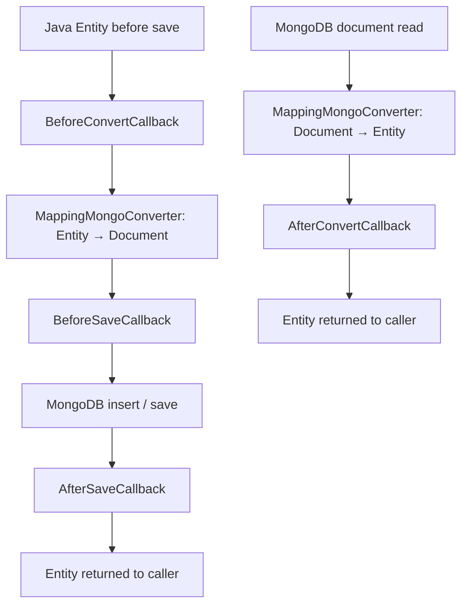
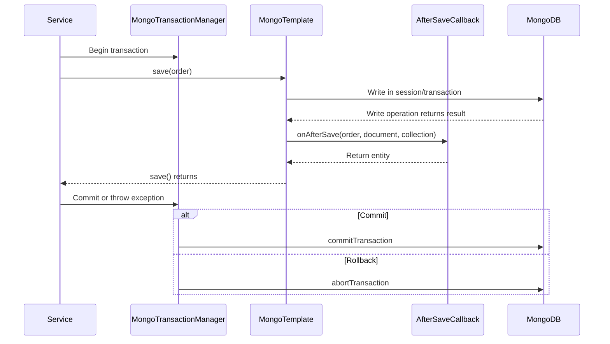

# AfterSaveCallback and AfterConvertCallback

In **Spring Data MongoDB**, when a document is saved or read, the framework can invoke **Entity Callbacks** at specific checkpoints in the mapping lifecycle. Two callbacks on the *after* side of the cycle are frequently confused:

- **`AfterSaveCallback<T>`** is called after an entity save operation has passed through MongoDB. It can return an adjusted entity **to forward to the caller**, but it does not automatically save any additional changes back to the document.
- **`AfterConvertCallback<T>`** is called after a MongoDB `Document` has been converted into a Java object during a read. It is suited for finalizing derived fields, presentation attributes, or transient entity state **before returning it to the caller**.

This lesson belongs to the **Lifecycle and Callbacks** chapter of the **SPRING_DATA_MONGODB** module. In this module, you connect and map documents, work with data via `MongoTemplate` or repositories, and practice queries, aggregations, indexes, transactions, reactive access, testing, and performance diagnostics. Here we dive deep into both callbacks, synchronous and reactive APIs, transaction boundaries, write paths that do not trigger callbacks, testing strategies, and common implementation pitfalls.

**Objective:** know exactly which callback runs, when it runs, what data it may modify, and why you must not use `AfterSaveCallback` to send emails or guarantee a "post-commit" event.

## 1. Write and Read Cycles from the Callback Perspective

Suppose an HTTP request calls `MongoRepository.save(order)`. Spring Data maps the entity to BSON, sends the save to MongoDB, and returns the result to the service. When matching EntityCallbacks exist, the basic outline is:



The two branches mean different things:

1. On the **write** branch, `AfterSaveCallback` sees the entity after the save command has executed. Modifications made to the entity **at this point** are no longer part of the BSON already sent, unless you explicitly run **another write command**.
2. On the **read** branch, `AfterConvertCallback` receives the entity newly materialized from `Document` and can populate `@Transient` fields before the caller receives it.
3. With transactions, "the save command finished" **does not mean "the entire transaction committed."**
4. Callbacks are not MongoDB **Change Streams**. Change streams observe changes emitted by the database server, whereas Entity Callbacks execute inside the **Spring Data entity mapping** execution path.

## 2. Quick Comparison of the Two Callbacks

| Aspect | `AfterSaveCallback<T>` | `AfterConvertCallback<T>` |
| --- | --- | --- |
| Timing | After entity save operation | After reading BSON and mapping into an entity |
| Data direction | Java → MongoDB | MongoDB → Java |
| Primary inputs | Entity, `Document` used for save, collection | Newly read entity, source `Document`, collection |
| Sync method | `onAfterSave(T, Document, String)` | `onAfterConvert(T, Document, String)` |
| Sync return | `T`: same or new entity | `T`: same or new entity |
| Reactive return | `Publisher<T>` | `Publisher<T>` |
| Good fit | Adjusting non-persisted state of returned entity; lightweight observation | Building `@Transient` derived fields; finalizing in-memory view |
| Poor fit | Sending "after-commit" events; editing fields hoping DB updates | Silent DB writes, N+1 lookups, injecting sensitive auth data into entities |
| Applies to raw driver? | No, outside Spring EntityCallback mechanism | No, outside Spring EntityCallback mechanism |
| If it throws an exception | Caller may see save failure even though DB wrote | Caller may see read failure even though query fetched BSON |

**Key point:** both callbacks can replace the **resulting Java object**; merely running them never issues an additional database write.

## 3. Exact Interfaces and Package

Spring Data MongoDB provides these interfaces in package `org.springframework.data.mongodb.core.mapping.event`.

```java
import org.bson.Document;
import org.springframework.data.mongodb.core.mapping.event.AfterSaveCallback;
import org.springframework.data.mongodb.core.mapping.event.AfterConvertCallback;

// Core signatures:
public interface AfterSaveCallback<T> {
    T onAfterSave(T entity, Document document, String collection);
}

public interface AfterConvertCallback<T> {
    T onAfterConvert(T entity, Document document, String collection);
}
```

This is a **simplified signature illustration**, not the complete Spring Data source code (the real interfaces extend `EntityCallback<T>`).

- `entity`: the Java domain object being saved or just converted.
- `document`: the BSON `org.bson.Document` created by Spring Data to save or received from MongoDB.
- `collection`: the actual collection name used by the operation.
- Return value: the original entity or a new entity **of the same type T**.

These interfaces were introduced in the Spring Data MongoDB **3.0** line. On older projects, check your API version instead of assuming EntityCallback exists in every release. `@Component` or bean declarations allow Spring to discover callbacks in `ApplicationContext`.

## 4. Example Entity: Order with Transient Fields

We use the `orders` collection with important business fields plus two fields strictly for observation/display.

```java
import org.bson.types.ObjectId;
import org.springframework.data.annotation.Id;
import org.springframework.data.annotation.Transient;
import org.springframework.data.annotation.Version;
import org.springframework.data.mongodb.core.mapping.Document;
import org.springframework.data.mongodb.core.mapping.Field;

@Document(collection = "orders")
public class OrderDocument {
    @Id
    private ObjectId id;

    @Field("tenant_id")
    private String tenantId;

    @Field("order_key")
    private String orderKey;

    private String status;

    @Field("total_vnd")
    private long totalVnd;

    @Version
    private Long version;

    @Transient
    private String displayLabel;

    @Transient
    private boolean afterSaveInvoked;

    public OrderDocument() {}

    public OrderDocument(
            ObjectId id, String tenantId, String orderKey,
            String status, long totalVnd) {
        this.id = id;
        this.tenantId = tenantId;
        this.orderKey = orderKey;
        this.status = status;
        this.totalVnd = totalVnd;
    }

    public ObjectId getId() { return id; }
    public String getTenantId() { return tenantId; }
    public String getOrderKey() { return orderKey; }
    public String getStatus() { return status; }
    public long getTotalVnd() { return totalVnd; }
    public Long getVersion() { return version; }
    public String getDisplayLabel() { return displayLabel; }
    public boolean isAfterSaveInvoked() { return afterSaveInvoked; }

    public void setStatus(String value) { this.status = value; }
    public void setDisplayLabel(String value) { this.displayLabel = value; }
    public void setAfterSaveInvoked(boolean value) {
        this.afterSaveInvoked = value;
    }
}
```

Properties `tenantId`, `orderKey`, and `totalVnd` map to BSON `tenant_id`, `order_key`, and `total_vnd` via `@Field`. The two properties `displayLabel` and `afterSaveInvoked` carry `@Transient` so they are **not persisted** as BSON fields through normal mapping.

`@Version` helps detect lost updates on Spring Data-supported save operations, though it is not the main focus of these callbacks. In this example, version illustrates that `AfterSaveCallback` must not arbitrarily tamper with version metadata as a DB-update mechanism either.

An actual document after insert looks like:

```javascript
{
  _id: ObjectId("674000000000000000009001"),
  tenant_id: "T1",
  order_key: "ORD-101",
  status: "NEW",
  total_vnd: NumberLong("150000"),
  version: NumberLong("0")
}
```

Neither `displayLabel` nor `afterSaveInvoked` appears in BSON.

## 5. Writing Synchronous AfterSaveCallback Correctly

A simple example showing the callback runs and can adjust the **Java result**:

```java
import org.bson.Document;
import org.springframework.data.mongodb.core.mapping.event.AfterSaveCallback;
import org.springframework.stereotype.Component;

@Component
public class OrderAfterSaveCallback
        implements AfterSaveCallback<OrderDocument> {

    @Override
    public OrderDocument onAfterSave(
            OrderDocument entity,
            Document document,
            String collection) {

        if (!"orders".equals(collection)) {
            return entity;
        }

        // Only update transient state on the Java object.
        entity.setAfterSaveInvoked(true);
        return entity;
    }
}
```

This behavior is **intentionally purely for illustrating the lifecycle**, not a business field to ship to production. In a real app, a callback might apply a lightweight tweak to the returned entity, such as building a non-sensitive display token, though placing view formatting in a DTO mapper/service is often cleaner than turning entities into view models.

Mandatory rules to remember:

- `@Component` exposes the bean in the Spring context for discovery.
- The generic type `OrderDocument` filters the callback to that entity type rather than all collections.
- Returning `entity` (or a valid new instance) is required by the contract.
- Never return `null`.
- Never call `mongoTemplate.save(entity)` inside this callback: that easily causes **callback → save → callback recursion**.

## 6. Writing Synchronous AfterConvertCallback Correctly

Now let us populate `displayLabel` after reading BSON:

```java
import org.bson.Document;
import org.springframework.data.mongodb.core.mapping.event.AfterConvertCallback;
import org.springframework.stereotype.Component;

@Component
public class OrderAfterConvertCallback
        implements AfterConvertCallback<OrderDocument> {

    @Override
    public OrderDocument onAfterConvert(
            OrderDocument entity,
            Document document,
            String collection) {

        if (!"orders".equals(collection)) {
            return entity;
        }

        String label = entity.getOrderKey()
            + " / " + entity.getStatus();

        entity.setDisplayLabel(label);
        return entity;
    }
}
```

When `MongoTemplate.findById` materializes `OrderDocument` from BSON, the callback sets `displayLabel="ORD-101 / NEW"` before returning the entity to the caller.

`displayLabel` is **derived data**. It:

1. Does not need to be stored in MongoDB because it can be constructed from `orderKey` and `status`.
2. Can go stale if `status` changes in memory; the callback **does not re-run** when setters are called.
3. Can alternatively be computed in a DTO mapper if you do not want transient fields attached on every entity read.
4. Should never pull in remote API lookups or data belonging to another tenant.

If an app returns entities directly from REST controllers, check Jackson serialization: Spring Data's `@Transient` means **do not persist in MongoDB**, not that Jackson omits the field from JSON. Use DTOs or `@JsonIgnore` per your API contract.

## 7. What Is the Document Passed to the Callback Used For?

`Document` is the BSON representation at the mapping boundary:

```java
@Override
public OrderDocument onAfterConvert(
        OrderDocument entity,
        Document document,
        String collection) {

    // Read actual BSON field for diagnostics.
    String persistedStatus = document.getString("status");

    // Do not call document.put(...) expecting DB to update.
    entity.setDisplayLabel(
        entity.getOrderKey() + " / " + persistedStatus
    );
    return entity;
}
```

For `AfterSaveCallback`, `document` is the BSON that was used for the save. For `AfterConvertCallback`, `document` is the source BSON just converted into a Java object.

**Do not treat `Document` as a live MongoDB document.** It is merely a Java map holding BSON data. Calling `document.put("status","PAID")` after save **does not update MongoDB**. Modifying `Document` after conversion issues no write command. To modify persisted data, use `BeforeConvertCallback`, `BeforeSaveCallback`, or an intentional update/save in the service layer.

Treat `Document` in both after-callbacks as **read-only metadata/context**. Mutating it easily desynchronizes entity/DB views or misleads readers about semantics.

## 8. Observing Behavior on MongoTemplate

With both callbacks registered, a service might run:

```java
import org.bson.types.ObjectId;
import org.springframework.data.mongodb.core.MongoTemplate;

public class OrderExample {
    private final MongoTemplate template;

    public OrderExample(MongoTemplate template) {
        this.template = template;
    }

    public void demo() {
        ObjectId id = new ObjectId();
        OrderDocument entity = new OrderDocument(
            id, "T1", "ORD-101", "NEW", 150_000L
        );

        OrderDocument saved = template.insert(entity);
        // After insert: AfterSaveCallback has run.
        System.out.println(saved.isAfterSaveInvoked());

        OrderDocument found =
            template.findById(id, OrderDocument.class);

        // After read: AfterConvertCallback has run.
        System.out.println(found.getDisplayLabel());
    }
}
```

Here `template.insert` follows Spring Data's lifecycle path; the returned entity passed through `AfterSaveCallback`.

On readback, `found` is materialized as **a fresh Java entity** by the converter, so `afterSaveInvoked` (being `@Transient`) defaults to `false` on the loaded object. Meanwhile `displayLabel` is populated by `AfterConvertCallback`.

Do not ship `System.out.println` statements to production logging; use structured logging and redact PII/sensitive fields when observing callbacks.

## 9. Where Do Repositories and MongoTemplate Invoke Callbacks?

Common operations:

| Operation | AfterSave? | AfterConvert? | Notes |
| --- | --- | --- | --- |
| `MongoTemplate.insert(entity)` | **Yes**, on mapped entity | No | Entity write path |
| `MongoTemplate.save(entity)` | **Yes**, on mapped entity | No | May insert or save existing |
| `MongoRepository.save(entity)` | **Yes**, when going through Spring Data save | No | Spring Data repository uses mapping infrastructure |
| `MongoRepository.findById(id)` | No | **Yes**, when materializing entity | Read path |
| `MongoTemplate.find(..., Entity.class)` | No | **Yes**, on mapped entity | Can run for each result entity |
| `MongoTemplate.findById(..., Entity.class)` | No | **Yes** | Tested in this lesson |
| `MongoTemplate.updateFirst(...)` | **No, not an entity-save path** | No | Update operator; produces no saved entity result |
| `MongoTemplate.updateMulti(...)` | **No, not an entity-save path** | No | Multi-document update |
| `MongoTemplate.remove(query)` | No | No | No entity save/load on this path |
| Native `MongoCollection.updateOne/insertOne` | No | No | Bypasses Spring Data callback infrastructure |
| Native `MongoCollection.find(Document.class)` | No | No | Returns raw Document via native driver |
| `BulkOperations` | Do not rely on per-entity callbacks like `save` | No | Has separate lifecycle semantics; do not assume callbacks run |

For `findAndModify`, `findAndRemove`, aggregation mappings, projections, and special overloads, whether callbacks execute depends on the **specific Spring Data mapping path** and result type. Never apply blanket rules to every query form; test the exact overload and version your system uses.

**Important rule:** callbacks are not a global MongoDB trigger. Writers outside Spring Data can modify documents without your Java callbacks **ever being called**.

## 10. Why Are save and updateFirst Different?

A `save` runs through entity mapping:

```java
OrderDocument order = template.findById(
    id, OrderDocument.class
);

order.setStatus("PAID");
template.save(order);
// May trigger AfterSaveCallback along the save path.
```

An update operator targets the specified field directly:

```java
import org.springframework.data.mongodb.core.query.Criteria;
import org.springframework.data.mongodb.core.query.Query;
import org.springframework.data.mongodb.core.query.Update;

template.updateFirst(
    Query.query(Criteria.where("id").is(id)),
    new Update().set("status", "PAID"),
    OrderDocument.class
);
// Does not execute an entity save cycle like above.
```

`updateFirst` may auto-increment `@Version` on supported paths if the update does not explicitly set version, yet that **does not cause `AfterSaveCallback` to run like `save(entity)`**.

If an invariant must hold across **all writes** (such as blocking negative quantities or enforcing unique business keys), **do not place it solely in AfterSaveCallback**. Enforce it via service validation, MongoDB schema/unique indexes, conditional updates, transactions, or data-layer controls.

## 11. AfterSaveCallback Is Not After Transaction Commit

This is one of the most dangerous misconceptions.



**`AfterSaveCallback` is invoked on the save path before the outer transaction finishes.** If the service calls `save` and then throws an exception, the transaction can **roll back** even though the callback already ran.

Example:

```java
import org.springframework.stereotype.Service;
import org.springframework.transaction.annotation.Transactional;

@Service
public class OrderTransactionExample {
    private final MongoTemplate template;

    public OrderTransactionExample(MongoTemplate template) {
        this.template = template;
    }

    @Transactional(transactionManager = "mongoTransactionManager")
    public void saveThenAbort(OrderDocument order) {
        template.save(order); // After-save callback may already have run.
        throw new IllegalStateException("Business abort");
        // Spring rolls back if exception propagates
        // through a properly configured transaction proxy.
    }
}
```

Therefore **never send "order confirmed" emails, publish Kafka events, or acknowledge business commits inside `AfterSaveCallback`**. Callback execution is not proof the transaction committed.

## 12. If You Need Post-Commit Actions, Choose Another Mechanism

Several options exist depending on reliability needs:

1. **In-process notifications**: a `@TransactionalEventListener(phase = AFTER_COMMIT)` wired to the right transaction manager, noting this is not durable delivery and should not run blocking network calls on an event loop.
2. **Transactional outbox**: store an outbox record **in the same MongoDB transaction** as the business data; a worker reads and publishes events after commit.
3. **MongoDB Change Streams**: observe changes committed by MongoDB in a suitable deployment, with resume tokens and consumer idempotency.
4. **Service orchestration**: act after the service knows the transaction succeeded, while still handling network errors, process restarts, and duplicate delivery.

Conceptual example:

```text
@Transactional:
  save(order)
  save(outboxEvent)
  COMMIT

Outbox worker:
  read committed outbox
  send message to broker
  mark/persist processed state
  retry with idempotency key
```

**Nothing turns a callback into a transaction commit hook.** For systems needing at-least-once delivery without losing events, outbox + consumer idempotency is generally far better than sending network requests directly from callbacks.

## 13. What Happens When AfterSaveCallback Throws an Exception?

Consider a flawed callback:

```java
@Component
class DangerousAfterSave
        implements AfterSaveCallback<OrderDocument> {

    @Override
    public OrderDocument onAfterSave(
            OrderDocument entity, Document document,
            String collection) {

        // The save command may already have succeeded.
        if ("ORD-FAIL".equals(entity.getOrderKey())) {
            throw new IllegalStateException(
                "Callback failed after save"
            );
        }
        return entity;
    }
}
```

**Without a transaction**, the save may have written successfully while the caller receives an exception from the callback. Blindly retrying the whole `save`/request can create business duplicates or overwrite fields unexpectedly.

**Inside a transaction**, if the exception propagates across a properly configured transaction boundary, the transaction can roll back uncommitted writes. Still, **never rely on an after-save callback throwing errors as a consistency policy**; the late invocation timing and any prior external side effects remain hazardous.

Design rules:

- Keep `AfterSaveCallback` **lightweight, deterministic, and immune to external failures** where possible.
- Avoid secondary remote API/DB writes, and do not fail saves just because metrics/logging is temporarily unavailable.
- If a callback can fail, define clear save error semantics and retry strategies.
- Never swallow exceptions and report success when a real business invariant was not met.

## 14. AfterConvertCallback Can Cause a Read Query to Fail

A `findById` may read BSON cleanly yet fail when the after-convert callback throws:

```java
@Component
class StrictAfterConvert
        implements AfterConvertCallback<OrderDocument> {

    @Override
    public OrderDocument onAfterConvert(
            OrderDocument entity, Document document,
            String collection) {

        if (entity.getOrderKey() == null) {
            throw new IllegalStateException(
                "Missing orderKey while building view"
            );
        }
        return entity;
    }
}
```

The caller sees the query fail, yet **that does not mean MongoDB failed to find the document**. It is a post-read object processing error, not a network or query failure.

To **validate stored data**, use MongoDB schema validation, migrations, or targeted validation rather than breaking every read over a display field that could take a safe fallback.

A label-building callback can be written more safely:

```java
String key = entity.getOrderKey() == null
    ? "(unknown)"
    : entity.getOrderKey();

String status = entity.getStatus() == null
    ? "(unknown)"
    : entity.getStatus();

entity.setDisplayLabel(key + " / " + status);
return entity;
```

Using a view fallback **does not replace** fixing malformed schema data; it simply prevents inferable display fields from breaking reads.

## 15. @Transient, JsonIgnore, and Sensitive Data

Spring Data's `@Transient` makes a field **ignored during MongoDB mapping**, while JSON serialization is a separate step.

Example:

```java
@Transient
private String displayLabel;
```

If a public getter exists, serializers may emit `displayLabel` in HTTP responses. If a property **must not be exposed to clients**, use a DTO allowlist or an explicit serializer annotation:

```java
import com.fasterxml.jackson.annotation.JsonIgnore;
import org.springframework.data.annotation.Transient;

@Transient
@JsonIgnore
private String internalDebugHint;
```

Never use `AfterConvertCallback` to attach tokens, credentials, roles, or tenant-private data onto an entity returned directly by an API. Data computed after conversion can accidentally leak in logs, serialization, or caches.

**Authorization** belongs in queries, services, and controllers, while DTO mapping decides which fields are allowed in responses. Callbacks are not an authentication mechanism.

## 16. Immutable Entities: Return a New Instance Instead of Mutating Final Fields

Immutable entities are a great Java practice, though callbacks cannot invoke setters on them.

One pattern:

```java
import org.springframework.data.annotation.Id;
import org.springframework.data.annotation.Transient;
import org.springframework.data.mongodb.core.mapping.Document;

@Document("order_summaries")
public record OrderSummary(
    @Id String id,
    String orderKey,
    String status,
    @Transient String displayLabel
) {
    public OrderSummary withDisplayLabel(String label) {
        return new OrderSummary(id, orderKey, status, label);
    }
}
```

The callback returns a new instance:

```java
@Component
class SummaryAfterConvert
        implements AfterConvertCallback<OrderSummary> {

    @Override
    public OrderSummary onAfterConvert(
            OrderSummary entity, Document document,
            String collection) {

        return entity.withDisplayLabel(
            entity.orderKey() + " / " + entity.status()
        );
    }
}
```

This illustrates the contract **"return same or modified instance."** When applying in real code, verify immutable record mapping, constructor parameter names, and `@Transient` property support on your Spring Data version.

**Never return a new entity that drops `id`, `version`, or essential fields.** After conversion, the caller must receive a valid object for subsequent operations; returning an instance missing metadata can cause unintended inserts, optimistic locking failures, or data loss on re-save.

## 17. Multiple Callbacks of the Same Type: Controlling Order

When multiple `AfterConvertCallback<OrderDocument>` beans exist, later callbacks see the entity returned by earlier ones. Use `@Order` or `Ordered` to set execution order when needed.

```java
import org.springframework.core.annotation.Order;
import org.springframework.stereotype.Component;

@Component
@Order(100)
class NormalizeAfterConvert
        implements AfterConvertCallback<OrderDocument> {

    @Override
    public OrderDocument onAfterConvert(
            OrderDocument entity, Document document,
            String collection) {

        // Example: normalize only view state,
        // without altering business fields meant to persist.
        return entity;
    }
}

@Component
@Order(200)
class LabelAfterConvert
        implements AfterConvertCallback<OrderDocument> {

    @Override
    public OrderDocument onAfterConvert(
            OrderDocument entity, Document document,
            String collection) {

        entity.setDisplayLabel(
            entity.getOrderKey() + " / " + entity.getStatus()
        );
        return entity;
    }
}
```

**Lower** order values usually carry **higher** precedence. Never rely on accidental bean registration order or alphabetical class names.

If two callbacks both assign `displayLabel`, whichever runs later overwrites the earlier value. Avoid having multiple classes own one derived field; if a real dependency exists, declare explicit ordering and write tests to verify it.

Spring Data EntityCallback generic types help avoid unrelated processing; lambda callbacks do not always preserve generic type info as clearly as concrete classes, so in multi-entity apps prefer concretely typed bean classes for efficient filtering.

## 18. Distinguishing Entity Callbacks from ApplicationEvent / MongoMappingEvent

Prior to EntityCallbacks, Spring Data MongoDB supported mapping events and `AbstractMongoEventListener`:

```java
import org.springframework.data.mongodb.core.mapping.event.AfterSaveEvent;
import org.springframework.data.mongodb.core.mapping.event.AbstractMongoEventListener;

public class OrderSaveEventListener
        extends AbstractMongoEventListener<OrderDocument> {

    @Override
    public void onAfterSave(AfterSaveEvent<OrderDocument> event) {
        // Observe the mapping event; do not replace the entity
        // by returning a new instance.
    }
}
```

Comparison:

| Criterion | Entity Callback | MongoMappingEvent listener |
| --- | --- | --- |
| Interface | `AfterSaveCallback<T>`, `AfterConvertCallback<T>` | `AbstractMongoEventListener<T>` or event listener |
| Effect on entity | Returns modified entity or new instance | Listener handles event; no contract to return replacement entity |
| Ordering | Invoked in order by EntityCallbacks infrastructure | Depends on `ApplicationEventMulticaster`; async multicaster can alter order |
| Reactive | Dedicated `ReactiveAfter...Callback` interfaces | Application events do not replace Publisher flows |
| Good fit | Controlled transformations in mapping lifecycle | Event observation and legacy compatibility |
| Post-transaction commit? | Not guaranteed | Not guaranteed |

Spring Data recommends EntityCallback for **entity transformation** extension points because it defines exact checkpoints and can return modified entities. Application event listeners may be executed asynchronously by the multicaster depending on configuration; do not use them to mutate entities already processed by the converter.

Do not register the **same logic** in both `AfterSaveCallback` and `AbstractMongoEventListener.onAfterSave` unless you want it to run twice.

## 19. Compared to BeforeConvertCallback and BeforeSaveCallback

A common question: "I modified `status` in `AfterSaveCallback`, yet MongoDB still kept the old status." That is expected according to the lifecycle.

| Extension Point | Timing | How to Change Persisted Data? |
| --- | --- | --- |
| `BeforeConvertCallback` | Before entity is converted to Document | Mutate entity so converter generates updated BSON |
| `BeforeSaveCallback` | After convert, before MongoDB write | Can adjust the BSON `Document` to be saved |
| `AfterSaveCallback` | After MongoDB save | Adjusts returned entity only; **does not re-save** |
| `AfterConvertCallback` | After BSON becomes entity | Adjusts read entity only; **does not update DB** |

Example normalization rule before convert:

```java
@Component
class NormalizeOrderBeforeConvert
        implements org.springframework.data.mongodb.core.mapping.event
            .BeforeConvertCallback<OrderDocument> {

    @Override
    public OrderDocument onBeforeConvert(
            OrderDocument entity, String collection) {

        if (entity.getStatus() != null) {
            entity.setStatus(
                entity.getStatus().trim().toUpperCase(
                    java.util.Locale.ROOT
                )
            );
        }
        return entity;
    }
}
```

This is better placed in **before** than in `AfterSaveCallback` when you want persisted BSON to reflect the change. Still, correctness-critical invariants must be enforced across all write paths (including update operators and native writers), not just callbacks.

Spring Data auditing's `@CreatedDate`/`@LastModifiedDate` is backed by auditing callbacks running **before convert**, because timestamps need to be persisted. `AfterSaveCallback` is not where you set `createdAt` expecting the DB to store the new value.

## 20. Decoupling Business Logic from Callbacks: Avoid Hard-to-Test Coupling

A single callback may run across many code paths:

```java
repository.findById(id);
template.findAll(OrderDocument.class);
repository.save(entity);
template.insert(entity);
```

If a callback **reads external configuration, makes HTTP calls, writes heavy metrics, or causes side effects**, all these read/write paths become coupled to external services. Consequences:

- Read paths fail whenever an enrichment API is down.
- Simple repository tests require wiring heavy external dependencies.
- Bulk reads of 1,000 documents trigger 1,000 external calls.
- A transaction save succeeds yet an after-save callback throws, making the caller think the save failed.
- When reactive infrastructure is used, synchronous callbacks may not run, causing behavioral drift between APIs.

**More controllable design:** keep business orchestration in services, persistence in repositories/templates, and non-DB projections/enrichment in explicit mappers. Use callbacks only when logic truly **belongs to the mapping lifecycle for every entity of that type**.

## 21. AfterConvert and the N+1 Query Problem

Suppose `AfterConvertCallback<OrderDocument>` does:

```java
// WRONG: a fresh database query for every loaded order.
@Override
public OrderDocument onAfterConvert(
        OrderDocument entity, Document source,
        String collection) {

    Customer customer = mongoTemplate.findById(
        entity.getId(), Customer.class
    );

    entity.setDisplayLabel(customer.getName());
    return entity;
}
```

This illustrates the anti-pattern (in real code, the lookup ID would also need to be `customerId`, not the order ID). When `findAll` returns 1,000 orders, the callback executes 1,000 additional queries. If the callback's query materializes the same entity type, it can trigger **read callback recursion**.

Instead:

- Fetch required related data in **one batched query** in the service.
- Use `$lookup` or suitable aggregations/projections when data shape and volume fit.
- Use a domain DTO mapper backed by a bounded, tenant-checked request-scoped map/cache.
- Reserve callbacks for derived fields computable **solely from the current entity/document** without external I/O.

In multi-tenant systems, joins/enrichments must preserve tenant isolation; a callback running on every read result must never bypass authorization boundaries.

## 22. Callbacks and Repository Projections / Aggregations

A derived repository query can return:

- Domain entity `OrderDocument`.
- An interface-based projection.
- A DTO/record projection.
- A raw `Document`.
- Another aggregation result type.

Never assume `AfterConvertCallback<OrderDocument>` runs for **every** result type. Generic callbacks apply when the execution path **materializes the matching entity** via Spring Data infrastructure. Raw BSON/DTO pipelines may take different conversion paths and skip the callback.

Example:

```java
List<OrderDocument> entities =
    mongoTemplate.find(
        Query.query(Criteria.where("status").is("NEW")),
        OrderDocument.class
    );
```

Here Spring Data maps the concrete domain type; `AfterConvertCallback<OrderDocument>` can populate `displayLabel` on the returned entities.

```java
List<Document> raw =
    mongoTemplate.getCollection("orders")
        .find()
        .into(new java.util.ArrayList<>());
```

In this native driver example, there is no mapping step to `OrderDocument` via `MongoTemplate`, so callbacks for `OrderDocument` **do not run**.

Whenever switching a repository method to a performance-optimized projection, check any derived fields previously added by callbacks.

## 23. Native Drivers, MongoTemplate Partial Updates, and BulkOperations

An application often has multiple writers:

```java
// Spring Data entity save path:
template.save(order);

// Spring Data update operator path:
template.updateFirst(query, update, OrderDocument.class);

// Native MongoDB driver path:
template.getCollection("orders").updateOne(
    new Document("_id", order.getId()),
    new Document("$set", new Document("status", "PAID"))
);
```

`AfterSaveCallback` is not a universal rule applied to all three lines above. To enforce rules such as valid `status` transitions uniformly, use:

1. Service validation and authorization.
2. Atomic query conditions (e.g., `status="NEW"` in the filter before setting `PAID`).
3. MongoDB schema validation or unique indexes where appropriate.
4. Optimistic locking/versioning when lost updates are possible.
5. Integration tests covering every active write path.

`BulkOperations` also generally lacks `save(entity)`-style per-object lifecycle callbacks. Do not rely on callbacks to assign `orderKey`, `tenantId`, or mandatory audit fields if bulk or native writers bypass them.

## 24. Does AfterSaveCallback Affect Optimistic Locking?

Spring Data's `@Version` supports optimistic locking on supported entity save paths:

```java
OrderDocument a = repository.findById(id).orElseThrow();
OrderDocument b = repository.findById(id).orElseThrow();

a.setStatus("PAID");
repository.save(a); // Version increments.

b.setStatus("CANCELLED");
repository.save(b); // May throw OptimisticLockingFailureException.
```

If the second save does not match the expected version, the framework throws an exception; never think of `AfterSaveCallback` as a place to "fix" conflicts by writing again.

Inside `AfterSaveCallback`:

- Do not alter the entity's `@Version` to "fool" optimistic locking.
- Do not call save again from the callback, as it can re-enter the lifecycle with unclear effects.
- Do not treat after-save as after-commit.
- Do not use callbacks to report 200/OK before the transaction/HTTP response actually finishes.

For workflow status transitions, prefer conditional `updateFirst` or service orchestration with appropriate optimistic locking/transactions.

## 25. Reactive Variants: Different Interfaces, Different Publishers

Spring Data MongoDB provides reactive counterparts:

```java
import org.bson.Document;
import org.reactivestreams.Publisher;
import org.springframework.data.mongodb.core.mapping.event.ReactiveAfterSaveCallback;
import org.springframework.data.mongodb.core.mapping.event.ReactiveAfterConvertCallback;

// Simplified signatures:
Publisher<T> onAfterSave(T entity, Document document, String collection);
Publisher<T> onAfterConvert(T entity, Document document, String collection);
```

They differ from synchronous variants in **return type**: reactive callbacks must return `Publisher<T>`, typically Reactor's `Mono<T>`.

**Important:** synchronous `MongoTemplate` inspects synchronous callbacks; `ReactiveMongoTemplate` and reactive repositories inspect **reactive callbacks**. Registering only `AfterSaveCallback<OrderDocument>` while calling `ReactiveMongoTemplate.insert(...)` will not automatically run the sync callback.

If an app uses both client styles, provide separate callback adapters sharing a **pure transformation function**; never force a reactive service to invoke sync callbacks.

## 26. Writing a Non-Blocking ReactiveAfterSaveCallback

```java
import org.bson.Document;
import org.reactivestreams.Publisher;
import org.springframework.data.mongodb.core.mapping.event.ReactiveAfterSaveCallback;
import org.springframework.stereotype.Component;
import reactor.core.publisher.Mono;

@Component
public class ReactiveOrderAfterSave
        implements ReactiveAfterSaveCallback<OrderDocument> {

    @Override
    public Publisher<OrderDocument> onAfterSave(
            OrderDocument entity, Document document,
            String collection) {

        return Mono.fromSupplier(() -> {
            if ("orders".equals(collection)) {
                entity.setAfterSaveInvoked(true);
            }
            return entity;
        });
    }
}
```

`Mono.fromSupplier` defers lightweight processing until subscription. For precomputed data and pure transforms, `Mono.just(entity)` can also fit. Either way, **never call `subscribe()` or `block()` inside the callback**.

In reactive APIs:

- Return a Publisher emitting **the single entity** to return.
- Never return `Mono.empty()` when the caller expects the saved/loaded entity.
- Do not swallow `onError`; a callback error can cause the whole `save`/`find` publisher to error.
- Never use `doOnNext` to fire a detached DB write as a side effect.
- Never mask a blocking `MongoTemplate` on an arbitrary scheduler; use reactive APIs or keep boundaries clean.

## 27. Writing ReactiveAfterConvertCallback After Reading

```java
import org.bson.Document;
import org.reactivestreams.Publisher;
import org.springframework.data.mongodb.core.mapping.event.ReactiveAfterConvertCallback;
import org.springframework.stereotype.Component;
import reactor.core.publisher.Mono;

@Component
public class ReactiveOrderAfterConvert
        implements ReactiveAfterConvertCallback<OrderDocument> {

    @Override
    public Publisher<OrderDocument> onAfterConvert(
            OrderDocument entity, Document document,
            String collection) {

        return Mono.fromSupplier(() -> {
            if ("orders".equals(collection)) {
                entity.setDisplayLabel(
                    entity.getOrderKey()
                        + " / " + entity.getStatus()
                );
            }
            return entity;
        });
    }
}
```

When `ReactiveMongoTemplate.findById(...)` is subscribed and BSON is materialized into `OrderDocument`, the reactive callback becomes a step in the Publisher chain. The caller can write:

```java
Mono<OrderDocument> found =
    reactiveMongoTemplate.findById(id, OrderDocument.class);

return found.map(order -> new OrderDto(
    order.getId().toHexString(),
    order.getDisplayLabel()
));
```

`OrderDto` is simply an illustrative DTO such as `record OrderDto(String id, String label) {}`. `found` executes no query until subscribed. Never `block()` inside a WebFlux handler.

## 28. If a Reactive Callback Needs I/O, Compose Instead of Subscribing

Occasionally true asynchronous enrichment is needed. At the API level, reactive callbacks let you return a `Publisher<T>` composed into the reactive pipeline:

```java
@Override
public Publisher<OrderDocument> onAfterConvert(
        OrderDocument entity, Document document,
        String collection) {

    return reactiveConfigService.lookupDisplaySetting(
            entity.getTenantId()
        )
        .map(setting -> {
            entity.setDisplayLabel(
                setting.format(entity.getOrderKey(),
                    entity.getStatus())
            );
            return entity;
        });
}
```

Here `reactiveConfigService` is an **illustrative reactive dependency**, not a built-in Spring Data API. Composing with `map` keeps errors and completion signals in the Publisher chain, unlike manual `subscribe()`.

**Yet a performance risk remains:** reading 1,000 orders can trigger 1,000 remote/config lookups. Prefer pure label computation, batched service enrichment, or bounded caching/refreshing. Do not put high-latency remote calls on every read just because reactive callbacks accept a Publisher.

## 29. Reactive Callbacks Do Not Run Before Subscription

```java
Mono<OrderDocument> savePublisher =
    reactiveMongoTemplate.insert(order);

// Not subscribed yet: cannot claim the save
// or ReactiveAfterSaveCallback has run.

Mono<OrderDocument> observable =
    savePublisher.doOnNext(saved ->
        log.debug("After save flag={}",
            saved.isAfterSaveInvoked())
    );

// WebFlux / StepVerifier / managed job will subscribe.
```

A WebFlux endpoint must **return `Mono`/`Flux`** instead of calling `subscribe()` manually and returning success:

```java
// CORRECT:
@PostMapping("/orders")
Mono<OrderDocument> create(@RequestBody OrderDocument input) {
    return reactiveMongoTemplate.insert(input);
}
```

This controller snippet focuses on the subscription contract; production code must validate payloads, resolve tenant from authentication, and return DTOs rather than raw entities.

**If a reactive after-save callback errors after MongoDB wrote**, the caller receives `onError` even though the write applied; handle idempotency and outbox following the same principles as the sync path.

## 30. Callback Ordering in Reactive Pipelines

When multiple reactive callbacks of the same type exist, Spring Data can order them via `@Order`/`Ordered`. Each callback returns a Publisher that the framework composes sequentially.

What to avoid:

```java
// WRONG: creates a detached side subscription breaking ordering.
public Publisher<OrderDocument> onAfterSave(
        OrderDocument entity, Document document,
        String collection) {

    reactiveAuditRepository.save(
        buildAudit(entity)
    ).subscribe();

    return Mono.just(entity);
}
```

This creates a **detached** audit write that can run outside the reactive transaction, fail after the caller already saw success, or duplicate side effects on resubscription.

Even if rewritten as:

```java
return reactiveAuditRepository.save(buildAudit(entity))
    .thenReturn(entity);
```

you still have to consider: **the order write already ran before the callback**, an audit write failure can make the caller see an error after saving the order, and the callback may run before transaction commit. When auditing is a business invariant, place both writes inside a **service-level reactive transaction** with collections/indexes prepared beforehand instead of hiding audits in callbacks.

## 31. Registering Callbacks and Scope by Entity Type

Callback beans are commonly discovered via component scanning:

```java
@Component
class OrderAfterSaveCallback
        implements AfterSaveCallback<OrderDocument> {
    // ...
}
```

Or configured explicitly via `@Bean`:

```java
import org.springframework.context.annotation.Bean;
import org.springframework.context.annotation.Configuration;

@Configuration
class OrderCallbackConfig {

    @Bean
    AfterConvertCallback<OrderDocument> orderViewCallback() {
        return (entity, document, collection) -> {
            entity.setDisplayLabel(
                entity.getOrderKey() + " / " + entity.getStatus()
            );
            return entity;
        };
    }
}
```

If you already registered `OrderAfterConvertCallback` from section 6, **do not also register the equivalent bean from section 31** in the same context: both callbacks would run and mutate the same field twice. The two snippets are **independent alternatives**.

If an application has multiple `MongoTemplate`/`MongoConverter` instances or constructs templates manually outside the Spring context, verify that the callback registry is wired into the right template. Having a bean in the project **does not guarantee** a manually built template uses it.

## 32. Sync Testing: Proving AfterSave Only Alters the Java Result

An integration test against real MongoDB (e.g., Testcontainers or an isolated test database) can verify:

- After `insert`, the after-save callback ran.
- The callback's `@Transient` field **is not in the MongoDB document**.
- After `findById`, after-convert computes the label from BSON fields.
- Version/ID metadata is preserved.

Spring Boot MongoDB test slice example:

```java
import static org.assertj.core.api.Assertions.assertThat;

import org.bson.Document;
import org.bson.types.ObjectId;
import org.junit.jupiter.api.Test;
import org.springframework.beans.factory.annotation.Autowired;
import org.springframework.boot.test.autoconfigure.data.mongo.DataMongoTest;
import org.springframework.context.annotation.Import;
import org.springframework.data.mongodb.core.MongoTemplate;

@DataMongoTest
@Import({
    OrderAfterSaveCallback.class,
    OrderAfterConvertCallback.class
})
class OrderLifecycleCallbacksTest {
    @Autowired MongoTemplate template;

    @Test
    void afterSaveDecoratesJavaResultNotBsonDocument() {
        ObjectId id = new ObjectId();

        OrderDocument saved = template.insert(
            new OrderDocument(
                id, "test-T1", "ORD-101",
                "NEW", 150_000L
            )
        );

        assertThat(saved.isAfterSaveInvoked()).isTrue();

        Document raw = template.getCollection("orders")
            .find(new Document("_id", id)).first();

        assertThat(raw).isNotNull();
        assertThat(raw.getString("status")).isEqualTo("NEW");
        assertThat(raw.containsKey("afterSaveInvoked"))
            .isFalse();
        assertThat(raw.containsKey("displayLabel"))
            .isFalse();
    }

    @Test
    void afterConvertAddsTransientLabelOnFind() {
        ObjectId id = new ObjectId();

        template.insert(new OrderDocument(
            id, "test-T1", "ORD-202", "PAID", 90_000L
        ));

        OrderDocument loaded =
            template.findById(id, OrderDocument.class);

        assertThat(loaded).isNotNull();
        assertThat(loaded.getDisplayLabel())
            .isEqualTo("ORD-202 / PAID");

        // Transient flag set in AfterSaveCallback
        // is not persisted and is not set during find.
        assertThat(loaded.isAfterSaveInvoked()).isFalse();
    }
}
```

Requirements: the test uses a real MongoDB instance and callback beans are imported. `@DataMongoTest` auto-configures slice components; `@Import` makes callback scope explicit. Never run tests against production; each case uses a fresh ObjectId.

**Note:** if other callbacks are auto-scanned, they may affect results. Keep the test context minimal so the test proves the exact target behavior.

## 33. Sync Testing: Callbacks Can Return a Different Entity

A unit test without a database can verify pure callback logic:

```java
import static org.assertj.core.api.Assertions.assertThat;

import org.bson.Document;
import org.bson.types.ObjectId;
import org.junit.jupiter.api.Test;

class AfterConvertUnitTest {

    @Test
    void derivesLabelWithoutChangingPersistedFields() {
        OrderDocument order = new OrderDocument(
            new ObjectId(), "test-T1",
            "ORD-303", "NEW", 15_000L
        );

        OrderAfterConvertCallback callback =
            new OrderAfterConvertCallback();

        OrderDocument result = callback.onAfterConvert(
            order, new Document("status", "NEW"), "orders"
        );

        assertThat(result.getDisplayLabel())
            .isEqualTo("ORD-303 / NEW");
        assertThat(result.getStatus()).isEqualTo("NEW");
        assertThat(result.getTotalVnd()).isEqualTo(15_000L);
    }
}
```

This unit test proves **the callback's logic**, yet **does not prove Spring Data hooked the callback into `find`**. The integration test above covers the real mapping path.

For immutable return-value callbacks, unit tests should verify the new instance preserves `id`, `version`, tenant, and business fields; when multiple `@Order` callbacks exist, integration tests should verify application order.

## 34. Reactive Testing with StepVerifier

Reactive tests must **subscribe** via `StepVerifier` rather than calling `block()` on a WebFlux request thread.

```java
import static org.assertj.core.api.Assertions.assertThat;

import org.bson.Document;
import org.bson.types.ObjectId;
import org.junit.jupiter.api.Test;
import reactor.test.StepVerifier;

class ReactiveAfterConvertUnitTest {

    @Test
    void emitsDecoratedEntity() {
        OrderDocument order = new OrderDocument(
            new ObjectId(), "test-T1",
            "ORD-404", "NEW", 20_000L
        );

        ReactiveOrderAfterConvert callback =
            new ReactiveOrderAfterConvert();

        StepVerifier.create(
            callback.onAfterConvert(
                order,
                new Document("status", "NEW"),
                "orders"
            )
        )
        .assertNext(result ->
            assertThat(result.getDisplayLabel())
                .isEqualTo("ORD-404 / NEW")
        )
        .verifyComplete();
    }
}
```

This test only exercises the **callback Publisher directly**, not whether `ReactiveMongoTemplate` invokes it. To verify the real pipeline, use a Spring Boot test context with the reactive MongoDB driver and reactive callback beans:

```java
import static org.assertj.core.api.Assertions.assertThat;

import org.bson.types.ObjectId;
import org.junit.jupiter.api.Test;
import org.springframework.beans.factory.annotation.Autowired;
import org.springframework.boot.test.context.SpringBootTest;
import org.springframework.context.annotation.Import;
import org.springframework.data.mongodb.core.ReactiveMongoTemplate;
import reactor.test.StepVerifier;

@SpringBootTest
@Import({
    ReactiveOrderAfterSave.class,
    ReactiveOrderAfterConvert.class
})
class ReactiveOrderCallbacksIntegrationTest {
    @Autowired ReactiveMongoTemplate template;

    @Test
    void reactiveSaveAndReadInvokeCorrectCallbacks() {
        ObjectId id = new ObjectId();

        StepVerifier.create(template.insert(
            new OrderDocument(
                id, "test-T1", "ORD-505",
                "NEW", 50_000L
            )
        ))
            .assertNext(saved ->
                assertThat(saved.isAfterSaveInvoked())
                    .isTrue()
            )
            .verifyComplete();

        StepVerifier.create(
            template.findById(id, OrderDocument.class)
        )
            .assertNext(found -> {
                assertThat(found.getDisplayLabel())
                    .isEqualTo("ORD-505 / NEW");
                assertThat(found.isAfterSaveInvoked())
                    .isFalse();
            })
            .verifyComplete();
    }
}
```

The integration test requires a **dedicated test MongoDB**, version-compatible reactive auto-configuration, and no duplicate callback bean registration with component scan. If `@Component` is already on the reactive callbacks, `@Import` may be unnecessary, though you should verify registration in the test context.

## 35. Testing Transaction Boundaries and After-Commit

To prove `AfterSaveCallback` **is not** after-commit, a test against a MongoDB replica set with a transaction manager can:

1. Register a synchronous callback incrementing a **test-only thread-safe counter**.
2. Inside a `@Transactional` method, call `template.save(order)` so the callback increments the counter.
3. Throw a `RuntimeException` to roll back the transaction.
4. Once the transaction ends, query MongoDB in a fresh session: **the order is absent** if it did not exist beforehand.
5. The callback counter **still incremented**, proving the callback ran before rollback.
6. Read from another operation to verify no outbox record committed.

Service skeleton:

```java
@Service
class RollbackExampleService {
    private final MongoTemplate template;

    RollbackExampleService(MongoTemplate template) {
        this.template = template;
    }

    @Transactional(transactionManager = "mongoTransactionManager")
    public void saveThenFail(OrderDocument order) {
        template.insert(order);
        throw new IllegalStateException("rollback-for-test");
    }
}
```

**This is not a standalone runnable test.** It requires `MongoTransactionManager`, a real replica set, Spring proxying, an injected counting callback, and before/after assertions. Never run transaction tests on a standalone `mongod` and mistake the error for broken callbacks.

If a callback executes external side effects like HTTP requests, those side effects **are not rolled back** with the MongoDB transaction; verify and prevent this in production.

## 36. Testing Write Paths That Bypass Callbacks

An important test: callbacks are not database-wide invariants.

```java
// Spring Data entity save:
template.save(order); // May invoke AfterSaveCallback.

// Native update:
template.getCollection("orders").updateOne(
    new Document("_id", order.getId()),
    new Document("$set",
        new Document("status", "PAID"))
);

// MongoTemplate update operator:
template.updateFirst(
    Query.query(Criteria.where("id").is(order.getId())),
    new Update().set("status", "CANCELLED"),
    OrderDocument.class
);
```

If a callback only writes logs or sets transient flags, there is no issue. But if you assumed the callback guarantees a mandatory event or forbids the `CANCELLED` status, the native/update paths above prove **the rule is bypassed**.

Write integration tests for all writers: synchronous template, reactive template, repositories, bulk jobs, migration scripts, and consumers. Whenever a business invariant matters, enforce it at the **database/service boundary**, not just in Entity Callbacks.

## 37. Diagnosing Why a Callback Did Not Run

When `AfterSaveCallback` or `AfterConvertCallback` appears inactive, check in order:

1. **Bean registration**: does the callback class have `@Component` inside the scan path, or a `@Bean`?
2. **Matching generic type**: `AfterConvertCallback<OrderDocument>` will not run for `OrderDto` or raw `Document`.
3. **Matching API model**: is code calling sync `MongoTemplate`/repository or `ReactiveMongoTemplate`/reactive repository?
4. **Matching operation**: is it `save`/`insert`/`find`, or `updateFirst`/bulk/native driver?
5. **Subscription present?** Unsubscribed reactive publishers never execute operations or callbacks.
6. **Custom template**: does a manually created template have the right callback registry?
7. **Collection name**: did the callback return early on `collection != "orders"` while the operation used a collection override?
8. **Exception before callback**: did MongoDB fail on a duplicate key or validation before reaching after-save?
9. **Projection type**: is the query returning a DTO/raw Document instead of the domain entity?
10. **Multiple callbacks/order**: did a later callback overwrite an earlier callback's field?
11. **@Transient and JSON**: did the Java field change without persisting, or did a serializer drop it?
12. **Test slice configuration**: did `@DataMongoTest` import the needed callback beans?
13. **Reactive errors**: did an inner publisher emit `Mono.empty()`, error, or get cancelled?
14. **Transaction state**: did the callback run before a rollback, leaving no document visible after commit?

Never work around this by calling `callback.onAfterConvert(...)` directly in business services; that masks misconfiguration and runs logic twice once framework wiring is fixed.

## 38. Common Mistakes and Fixes Table

| Mistake | Consequence | Fix |
| --- | --- | --- |
| Modifying persistent field in `AfterSaveCallback` expecting DB change | Java and BSON out of sync | Use before-callbacks or explicit write |
| Treating `AfterSaveCallback` as after-commit | Publishes events for rolled-back transactions | Transactional outbox / after-commit policy |
| Sending email/HTTP from after-save callback | Unrolled-back side effects, duplicate sends | Orchestrate outside callbacks |
| Throwing exception after successful save | Caller sees failure despite DB write | Keep callbacks lightweight; use idempotency/reconciliation |
| `AfterConvertCallback` queries remote service per document | N+1 calls, latency, read failures | Batch in service / DTO mapping |
| Mutating `Document` after-convert thinking MongoDB updates | No update command issued | Explicit save/update |
| Failing to return a valid entity | Broken chain or lost metadata | Return same or complete new instance |
| Mixing sync callbacks with reactive APIs | Callbacks never invoked | Use `ReactiveAfter...Callback` |
| Calling `block()`/`subscribe()` inside reactive callbacks | Blocking / detached side effects | Compose Publisher |
| Enforcing uniqueness only in callbacks | Bulk/native writers bypass | MongoDB unique index |
| Using callbacks for tenant authorization | Data leaks or too-late checks | Scoped queries + service authorization |
| Assuming `@Transient` hides fields from JSON | Leaks internal/debug fields | DTOs / `@JsonIgnore` |
| Registering both `@Component` and `@Bean` | Runs twice | One deliberate registration |
| Missing ordering when multiple callbacks edit one field | Unpredictable results | `@Order` and tests |
| Direct callback unit test mistaken for integration test | Does not prove template wiring | MongoDB test reading back via template |
| Switching repository to native driver expecting callbacks | Lifecycle hooks skipped | Enforce rules at proper layer |
| Reactive publisher left unsubscribed | No save/load/callback runs | Return Mono from WebFlux / use StepVerifier |

## 39. Production Code Review Checklist

- [ ] Entities and callbacks have exact generic types and are properly registered in the Spring context.
- [ ] `AfterSaveCallback` only adjusts Java return values or records lightweight telemetry; never assumes DB re-writes.
- [ ] `AfterConvertCallback` derives transient fields deterministically with no hidden N+1 or remote calls.
- [ ] No emails, Kafka messages, or webhooks are sent directly from after-save expecting post-commit safety.
- [ ] All business invariants hold across `save`, update operators, bulk, and native writers.
- [ ] If callbacks can throw, callers account for the possibility the write succeeded and follow idempotency policies.
- [ ] No tenant IDs, tokens, or internal fields leak via `@Transient`/JSON serialization.
- [ ] `id` and `@Version` are never arbitrarily mutated in after-callbacks.
- [ ] For immutable entities, callbacks return valid instances preserving all metadata.
- [ ] Callback ordering is defined whenever multiple callbacks have dependencies.
- [ ] Imperative uses `After...Callback`; reactive uses `ReactiveAfter...Callback`.
- [ ] Reactive callbacks never call `block()` or manual `subscribe()`, and emit a complete Publisher.
- [ ] Callbacks are never relied upon for side effects requiring transaction commit.
- [ ] Integration tests cover `insert/save/find`, raw BSON, and bypass paths.
- [ ] Transaction tests run against a replica set test and prove rollback/after-save timing.
- [ ] Callback logging/metrics stay within latency/error budgets and avoid sensitive BSON/PII.
- [ ] Tests are re-run when upgrading Spring Data versions, changing projections, or customizing `MongoTemplate`.

## 40. Self-Assessment Questions

**1.** Does `AfterSaveCallback` run before or after a MongoDB save?  
**Answer:** after Spring Data's save operation, which **does not mean after transaction commit**.

**2.** Does calling `entity.setStatus("PAID")` inside `AfterSaveCallback` automatically persist the new status?  
**Answer:** no. It modifies the Java entity afterward without issuing another update command.

**3.** In what state does `AfterConvertCallback` receive the entity?  
**Answer:** as an entity already materialized from a BSON Document, before being returned to the caller on a matching read path.

**4.** Can either callback return a new instance instead of the original entity?  
**Answer:** yes, provided it returns a valid entity of the same type preserving required metadata.

**5.** Is the `Document` parameter in these two callbacks a live proxy to the MongoDB document on the server?  
**Answer:** no. Mutating `Document` in memory does not automatically persist.

**6.** Which callbacks are better suited for normalizing fields to be written to the database?  
**Answer:** `BeforeConvertCallback` or `BeforeSaveCallback`, depending on whether you want to modify the entity or the BSON.

**7.** When a transaction rolls back after `save` already invoked `AfterSaveCallback`, is the callback "rolled back"?  
**Answer:** no. Java callback execution and its external side effects already happened; only DB writes inside the transaction roll back.

**8.** Does a native driver `MongoCollection.updateOne` call trigger `AfterSaveCallback<OrderDocument>`?  
**Answer:** no; it bypasses Spring Data's entity callback infrastructure.

**9.** Is `AfterConvertCallback` suitable for calling an external API for every document returned by `findAll`?  
**Answer:** generally no, as it introduces N+1 calls and couples reads to external latency and availability.

**10.** Can synchronous callbacks and reactive callbacks be used interchangeably?  
**Answer:** not by default; Spring Data defines separate interfaces for the two API models.

**11.** What return type does reactive `AfterSaveCallback` use?  
**Answer:** `Publisher<T>`, typically `Mono<T>`.

**12.** Should you call `subscribe()` inside reactive after-save to write an audit log?  
**Answer:** no. It creates a detached side subscription that can lose transaction and error contexts.

**13.** Does `@Transient` automatically hide a field from JSON responses?  
**Answer:** not guaranteed; use DTOs or appropriate serializer annotations.

**14.** Between `@Order(100)` and `@Order(200)`, which callback generally runs first?  
**Answer:** the callback with order **100**.

**15.** What does a unit test calling `callback.onAfterConvert` directly prove?  
**Answer:** only the callback's logic; to prove wiring, test `MongoTemplate.findById` against real MongoDB.

## 41. Hands-On Labs

**Lab A — Synchronous:** set up a test MongoDB and define `OrderDocument` with `@Transient displayLabel` and `afterSaveInvoked`. Register both callbacks and insert an order via `MongoTemplate.insert`. Verify the returned entity has `afterSaveInvoked=true` while BSON does not store the flag. Read it back via `findById` to verify `displayLabel` is computed and the old flag is false. Use native `getCollection("orders").find(...)` to inspect raw BSON. Change `status` with `updateFirst` and verify after-save does not run like an entity `save`.

**Lab B — Transactions:** on a test replica set, open a `@Transactional` service method, call `save`, and throw a runtime exception. Use a callback counter to prove `AfterSaveCallback` ran even though the document did not commit. Then design a transactional outbox for `ORDER_CREATED` instead of publishing from callbacks.

**Lab C — Reactive:** register `ReactiveAfterSaveCallback` and `ReactiveAfterConvertCallback`, use `ReactiveMongoTemplate`, and verify with `StepVerifier`. Never call `block()` in a controller. Add a callback intentionally returning an error to observe error propagation to the subscriber. Create a `Mono` without subscribing to verify neither save nor callbacks execute; then subscribe and inspect the database.

**Lab D — N+1 and Projections:** read 1,000 orders from a test database, comparing a callback computing labels in memory against a callback issuing extra queries. Measure MongoDB command counts and latency, then design batched enrichment in the service layer. Switch the query to a DTO projection and check whether the callback applies on the new mapping path.

## 42. References and Summary

**Official documentation:**

- [Spring Data MongoDB — Lifecycle Events and Entity Callbacks](https://docs.spring.io/spring-data/mongodb/reference/mongodb/lifecycle-events.html).
- [Spring Data MongoDB — AfterSaveCallback API](https://docs.spring.io/spring-data/mongodb/docs/current/api/org/springframework/data/mongodb/core/mapping/event/AfterSaveCallback.html).
- [Spring Data MongoDB — AfterConvertCallback API](https://docs.spring.io/spring-data/mongodb/docs/current/api/org/springframework/data/mongodb/core/mapping/event/AfterConvertCallback.html).
- [Spring Data MongoDB — ReactiveAfterSaveCallback API](https://docs.spring.io/spring-data/mongodb/docs/current/api/org/springframework/data/mongodb/core/mapping/event/ReactiveAfterSaveCallback.html).
- [Spring Data MongoDB — ReactiveAfterConvertCallback API](https://docs.spring.io/spring-data/mongodb/docs/current/api/org/springframework/data/mongodb/core/mapping/event/ReactiveAfterConvertCallback.html).
- [Spring Data MongoDB — MongoTemplate CRUD Operations](https://docs.spring.io/spring-data/mongodb/reference/mongodb/template-crud-operations.html).
- [Spring Data MongoDB — Sessions and Transactions](https://docs.spring.io/spring-data/mongodb/reference/mongodb/client-session-transactions.html).
- [Spring Framework — Transaction-bound Events](https://docs.spring.io/spring-framework/reference/data-access/transaction/event.html).
- [Project Reactor — Testing](https://projectreactor.io/docs/core/release/reference/testing.html).

**Conclusion:** in Spring Data MongoDB, **`AfterSaveCallback` executes after the entity save path while `AfterConvertCallback` executes after reading BSON into an entity**. Both can modify the **returned Java object**, yet neither automatically writes back to MongoDB; to alter persisted documents, choose before-callbacks or explicit writes. `AfterSaveCallback` **is not an after-commit hook**, making it unsuitable for emails, Kafka events, or durable business events; use transactions/outboxes or dedicated post-commit mechanisms. For reactive APIs, use `ReactiveAfterSaveCallback`/`ReactiveAfterConvertCallback` and compose Publishers without calling `subscribe()` or `block()` inside callbacks. Always verify against real MongoDB, test update/native/bulk bypasses, prevent N+1 queries, enforce tenant isolation, and do not let `@Transient` mislead you about persistence or JSON serialization.
