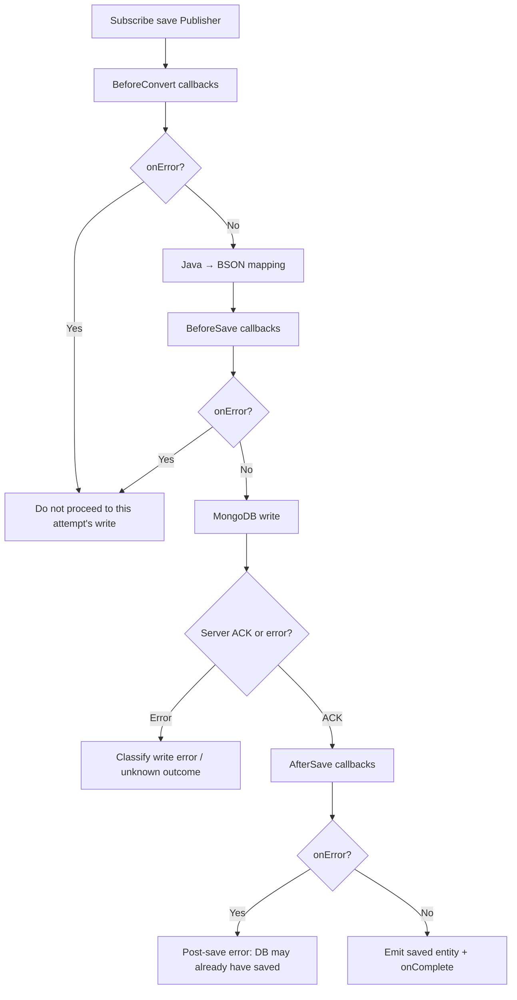
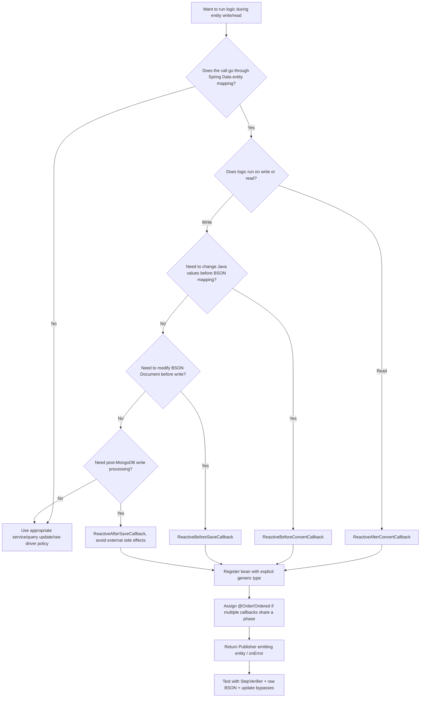

# Reactive Callbacks and Execution Order

In a **Spring Data MongoDB Reactive** application, an operation like `repository.insert(order)` does not merely turn an entity into BSON and send it to MongoDB. Depending on configuration, writes and reads can also pass through **entity callbacks** to normalize data, populate default fields, check constraints, apply auditing metadata, or prepare data after reading. When multiple callbacks are registered for the same entity, **execution order** determines which callback observes the changes made by an earlier one.

Imagine an order creation command that needs to:

1. Normalize `externalId` before writing.
2. Validate that the normalized identifier meets business contracts.
3. Add `schemaVersion` to the BSON document.
4. Persist the document to MongoDB.
5. Record observability details when the save succeeds.

Those steps do not belong to the same callback type. Some must run **before converting the entity into an `org.bson.Document`**, some run **after conversion**, and the final step runs only **after the save operation**. Stuffing everything into a single `ReactiveBeforeSaveCallback` can cause the entity and BSON to diverge or run validation at the wrong time.

This lesson belongs to the **Lifecycle and Callbacks** chapter of the **SPRING_DATA_MONGODB** module, where you learn how to connect, map documents, work with MongoDB via repositories or templates, and design queries, indexes, transactions, reactive access, tests, and data diagnostics. The direct goal is to master **Reactive EntityCallbacks and execution order at each checkpoint in the mapping/write/read lifecycle**, without confusing them with Spring application events or Reactor operators.

After this lesson, you will be able to:

- Explain the checkpoints **before convert → before save → database write → after save** and **database read → after convert**.
- Properly implement `ReactiveBeforeConvertCallback<T>`, `ReactiveBeforeSaveCallback<T>`, `ReactiveAfterSaveCallback<T>`, and `ReactiveAfterConvertCallback<T>`.
- Choose `@Order` or `Ordered` to define execution order among **multiple callbacks in the same phase**, understanding precedence direction and auditing order.
- Distinguish the **Java entity**, the **BSON `Document`**, the data actually persisted, and the entity returned to the caller.
- Explain why reactive callbacks return `Publisher<T>` and only take effect when the stream is properly subscribed.
- Handle empty/error publishers, post-write errors, retries, cancellation, and repeated subscriptions.
- Recognize write paths that **bypass entity callbacks**, such as query updates and raw driver operations.
- Write `StepVerifier` tests proving callback order, post-write BSON, read-only enrichment, and write-blocking errors.

## 1. The Lifecycle Picture: Non-Interchangeable Checkpoints

### 1.1. Entity Write Path

For entity save operations supported by Spring Data MongoDB, the conceptual sequence is:

```text
Caller subscribes to Mono/Flux
        │
        ▼
Java Entity (OrderDocument)
        │
        ▼
ReactiveBeforeConvertCallback<T>
        │  returns normalized/modified entity
        ▼
MappingMongoConverter
        │  Java object → org.bson.Document
        ▼
ReactiveBeforeSaveCallback<T>
        │  can modify the BSON Document to be written
        ▼
MongoDB write / acknowledgment per write concern
        │
        ▼
ReactiveAfterSaveCallback<T>
        │  returns entity downstream; can enrich in-memory
        ▼
Subscriber receives onNext(savedEntity), onComplete
```

This is the **phase order**, not a promise that every API invokes every callback. For example, `ReactiveMongoTemplate.updateFirst(...)` sends update operators on BSON rather than running the full `insert/save` "entity → Document → save" cycle.

### 1.2. Entity Read Path

```text
MongoDB read returns BSON Document
        │
        ▼
MappingMongoConverter
        │  org.bson.Document → Java entity
        ▼
ReactiveAfterConvertCallback<T>
        │  can enrich entity before emitting to subscriber
        ▼
Mono<T> / Flux<T> emits entity
```

**Note on `afterLoad`:** Spring Data MongoDB also has a **lifecycle application event** `AfterLoadEvent` occurring after the BSON `Document` is loaded and before mapping into an entity. This is **not** an invitation to invent a `ReactiveAfterLoadCallback` interface in the reactive entity callbacks listed above. Keep the two mechanisms distinct; MongoDB's entity callback APIs list `ReactiveAfterConvertCallback` for the post-conversion point on the read path.

### 1.3. Quick Comparison Table

| Phase | Reactive EntityCallback | Main Inputs | Recommended Work |
| --- | --- | --- | --- |
| Before mapping on write | `ReactiveBeforeConvertCallback<T>` | Java entity, collection name | Normalize entity, populate default/auditing fields before BSON |
| After mapping, before write | `ReactiveBeforeSaveCallback<T>` | Java entity, BSON Document, collection | Modify **BSON Document to be written**, add storage metadata |
| After write | `ReactiveAfterSaveCallback<T>` | Java entity, BSON Document, collection | Observability, prepare returned entity; do not assume uncommitted writes never roll back |
| After BSON → entity on read | `ReactiveAfterConvertCallback<T>` | Java entity, BSON Document, collection | Compute `@Transient` fields / enrich in-memory view |

Each callback returns a `Publisher<T>` so the pipeline continues with the emitted entity; for non-blocking synchronous logic, returning `Mono.just(entity)` is common. When performing genuine reactive work, return a publisher representing that work that emits **exactly one entity** upon completion.

## 2. Distinguishing Reactive EntityCallback and Lifecycle ApplicationEvent

Spring Data MongoDB has two families of extension points with similar names:

**Family 1 — EntityCallback:** `ReactiveBeforeConvertCallback`, `ReactiveBeforeSaveCallback`, `ReactiveAfterSaveCallback`, and `ReactiveAfterConvertCallback`. These are mapping/lifecycle extension points integrated directly into the processing pipeline. They can return a modified entity; multiple callbacks run sequentially in a defined order.

**Family 2 — Mapping lifecycle events:** `BeforeConvertEvent`, `BeforeSaveEvent`, `AfterSaveEvent`, `AfterLoadEvent`, and `AfterConvertEvent` published via Spring `ApplicationEvent`. Listeners typically extend `AbstractMongoEventListener<T>`; behavior depends on `ApplicationEventMulticaster`. If an asynchronous multicaster is used, listeners can execute on another thread with **no guarantee of order or completion before the next step**.

| Criterion | Reactive EntityCallback | Mapping ApplicationEvent |
| --- | --- | --- |
| Where used | Reactive entity mapping pipeline | Event publishing / listeners |
| Return contract | `Publisher<T>` emitting processed entity | Event listeners typically return void to the pipeline |
| Processing order | Ordered at checkpoint, supports `@Order`/`Ordered` | Depends on multicaster and listeners; async lacks callback guarantees |
| Modifying immutable entities | Can return a **new instance** of the right type | Mutation via events is harder to keep safe/coordinated |
| Before/after BSON mapping | Specifically supported reactive callbacks | Also includes `AfterLoadEvent` |
| Ideal use cases | Defaulting/validation/enrichment required in the read/write chain | Observation and Spring context event integration |

According to Spring Data MongoDB documentation, store-specific application events **are published before invoking the corresponding entity callbacks**. Even so, that **does not guarantee an async listener finishes before the callback**. When data correctness depends on a step completing before proceeding, prefer **EntityCallback** or service-level Publisher composition, not the timing of an async event listener.

**Further distinction:** `@EventListener` receiving application domain events and `ReactiveMongoRepository` saving entities do not turn every app event into a MongoDB lifecycle callback. Never infer which operations invoke a hook solely from the word "listener."

## 3. Exact APIs and Signatures of the Reactive Callbacks

The core interfaces live in `org.springframework.data.mongodb.core.mapping.event`. The snippets below use `reactor.core.publisher.Mono` as the `org.reactivestreams.Publisher` implementation.

### 3.1. `ReactiveBeforeConvertCallback<T>`

```java
import org.reactivestreams.Publisher;
import org.springframework.data.mongodb.core.mapping.event.ReactiveBeforeConvertCallback;
import reactor.core.publisher.Mono;

public final class NormalizeOrderBeforeConvert
        implements ReactiveBeforeConvertCallback<OrderDocument> {

    @Override
    public Publisher<OrderDocument> onBeforeConvert(
            OrderDocument entity, String collection) {
        entity.normalizeExternalId();
        return Mono.just(entity);
    }
}
```

This checkpoint runs **before** Spring Data maps the entity to BSON. Changes on Java fields such as `createdAt`, `externalId`, or `status` will be picked up by the converter into the document.

For immutable entities (records / constructor-based types), the callback can return a **new entity** with normalized values instead of mutating the instance.

### 3.2. `ReactiveBeforeSaveCallback<T>`

```java
import org.bson.Document;
import org.reactivestreams.Publisher;
import org.springframework.data.mongodb.core.mapping.event.ReactiveBeforeSaveCallback;
import reactor.core.publisher.Mono;

public final class StampBeforeSave
        implements ReactiveBeforeSaveCallback<OrderDocument> {

    @Override
    public Publisher<OrderDocument> onBeforeSave(
            OrderDocument entity,
            Document document,
            String collection) {
        document.put("schemaVersion", 1);
        return Mono.just(entity);
    }
}
```

This checkpoint runs **after mapping**. The passed `Document` is the mapped BSON prepared for writing; adding `schemaVersion` to it is reflected in the persisted data if the write succeeds. If you only mutate a Java field **after mapping** without updating the matching BSON Document, do not assume the converter will re-map that field before writing.

### 3.3. `ReactiveAfterSaveCallback<T>`

```java
import org.bson.Document;
import org.reactivestreams.Publisher;
import org.springframework.data.mongodb.core.mapping.event.ReactiveAfterSaveCallback;
import reactor.core.publisher.Mono;

public final class ObserveAfterSave
        implements ReactiveAfterSaveCallback<OrderDocument> {

    @Override
    public Publisher<OrderDocument> onAfterSave(
            OrderDocument entity,
            Document document,
            String collection) {
        // Do not treat this as "before saving".
        // Do not trigger an unintended second business write.
        return Mono.just(entity);
    }
}
```

This callback runs **after** the save operation to MongoDB. Modifying the Java entity here affects the object **returned downstream**, yet **does not automatically re-save it**. If this callback emits `onError`, the upstream write **may already have succeeded**, so callers cannot infer solely from the error that the document was not saved.

### 3.4. `ReactiveAfterConvertCallback<T>`

```java
import org.bson.Document;
import org.reactivestreams.Publisher;
import org.springframework.data.mongodb.core.mapping.event.ReactiveAfterConvertCallback;
import reactor.core.publisher.Mono;

public final class EnrichAfterConvert
        implements ReactiveAfterConvertCallback<OrderDocument> {

    @Override
    public Publisher<OrderDocument> onAfterConvert(
            OrderDocument entity,
            Document document,
            String collection) {
        entity.setDisplayLabel(
            entity.getStatus() + ":" + entity.getExternalId()
        );
        return Mono.just(entity);
    }
}
```

`setDisplayLabel` in this example assumes a setter on a `@Transient` Java field. This mutates **the loaded entity**, not MongoDB via `$set`. To alter persisted data, issue a deliberate write with its own lifecycle control.

### 3.5. Which Callbacks Can Be Asynchronous?

Because the signature returns `Publisher<T>`, you can return:

```java
@Override
public Publisher<OrderDocument> onBeforeConvert(
        OrderDocument entity, String collection) {
    return reactivePolicyService.validate(entity)
        .thenReturn(entity);
}
```

`reactivePolicyService.validate(entity)` illustrates a **truly non-blocking** service returning `Mono<Void>` and signaling an error when invalid. Never call `.block()` in a callback. Likewise, never call `.subscribe()` and return `Mono.just(entity)`: doing so prevents the write pipeline from **waiting** for validation to finish.

## 4. Two Levels of Ordering: Phase Order and Intra-Phase Callback Order

This is the most important part of the topic. There are **two independent ordering dimensions**:

1. **Order across phases** defined by Spring Data MongoDB: before convert → conversion → before save → write → after save, or read → conversion → after convert.
2. **Order among multiple beans implementing the same callback interface**, controlled by `@Order` or `Ordered`.

A `ReactiveBeforeSaveCallback` bean with `@Order(-1000)` **cannot run before** a `ReactiveBeforeConvertCallback` bean with `@Order(500)` on a normal write path: order values are compared **only among callbacks at the same checkpoint**, never inverting checkpoints.

### 4.1. Lower Numbers Run First

Suppose three beans implement `ReactiveBeforeConvertCallback<OrderDocument>`:

| Bean | Configuration | Order in Before Convert |
| --- | --- | --- |
| `NormalizeIdCallback` | `@Order(10)` | First |
| `ValidateNormalizedIdCallback` | `@Order(20)` | After normalization |
| `TraceDefaultCallback` | No order declared | Typically last, lowest precedence |

Spring uses the `Ordered` convention: **smaller integer values execute earlier**. `Ordered.HIGHEST_PRECEDENCE` represents highest priority, and `Ordered.LOWEST_PRECEDENCE` represents lowest.

```java
import org.springframework.core.annotation.Order;
import org.springframework.stereotype.Component;

@Component
@Order(10)
class NormalizeIdCallback
        implements ReactiveBeforeConvertCallback<OrderDocument> {
    // ...
}

@Component
@Order(20)
class ValidateNormalizedIdCallback
        implements ReactiveBeforeConvertCallback<OrderDocument> {
    // ...
}
```

**Do not rely on bean registration order or Java filename order.** Whenever two callbacks share the **same order** and correctness depends on which runs first, the design is underspecified: assign distinct orders or combine the dependent steps into a single callback/pipeline.

### 4.2. `Ordered` Is an Equivalent Alternative Declaration

```java
import org.springframework.core.Ordered;

@Component
public class NormalizeIdCallback
        implements ReactiveBeforeConvertCallback<OrderDocument>,
                   Ordered {

    @Override
    public int getOrder() {
        return 10;
    }

    @Override
    public Publisher<OrderDocument> onBeforeConvert(
            OrderDocument entity, String collection) {
        entity.normalizeExternalId();
        return Mono.just(entity);
    }
}
```

This is an **alternative** to `@Order(10)`, not a recommendation to declare both on the same class. If a project mixes annotations and `Ordered`, standardize conventions and verify the effective order values Spring sorts by.

### 4.3. Auditing Has a Position in Before-Convert Ordering

When Spring Data MongoDB reactive auditing is enabled, `ReactiveAuditingEntityCallback` participates at the **before convert** checkpoint, and Spring Data documentation notes a default order of **100** for the auditing callback. Consequently:

```text
@Order(50)  custom before convert   ─┐
                                     ├─ same before-convert phase
Auditing callback (order 100)      ──┤
                                     │
@Order(150) custom before convert  ──┘
     ↓
Java → BSON mapping
     ↓
beforeSave callbacks in their own order
```

This assumes auditing **is enabled and the auditing bean is registered**; if not enabled, no auditing step exists. This ordering lets a custom callback at 50 normalize data before auditing, and a callback at 150 inspect the entity after auditing. Never share order 100 and depend on an unspecified tie-break.

**Note:** `ReactiveAuditingEntityCallback`'s order may vary across versions or customizations. In real projects, check your Spring Data version and verify via integration tests.

### 4.4. Order Applies Within the Same Phase, Not System-Wide

Suppose:

```text
ReactiveBeforeConvertCallback A   order = 100
ReactiveBeforeConvertCallback B   order = 200
ReactiveBeforeSaveCallback C      order = 1
ReactiveBeforeSaveCallback D      order = 999
ReactiveAfterSaveCallback E       order = -100
```

On a successful write:

```text
A → B → MappingMongoConverter → C → D → MongoDB write → E
```

Callback E never runs first merely because `-100` is the smallest number. Numeric ordering resolves sequence *within each callback type*.

### 4.5. Callbacks Must Emit a Valid Result for the Chain to Continue

Every `Reactive...Callback<T>` returns `Publisher<T>`. In normal execution, the publisher must emit **one valid entity** (which may be a modified instance):

```java
return Mono.just(entity);
```

If a callback returns `Mono.error(...)`, the chain terminates with an error at that checkpoint. If it returns `Mono.empty()`, the pipeline has no entity left to pass along the normal path; **never treat `Mono.empty()` as a way to "skip the callback and still save."**

For asynchronous callbacks, Spring Data composes the callback's publisher into the chain; ordering is guaranteed by that composition, **not** by calling `subscribe()` manually.

## 5. End-to-End Example: Entity, Callbacks, and Verifiable Ordering

The following example is designed for **Spring Boot + Spring Data MongoDB Reactive + Reactor**. All classes reside in package `com.example.mongo.lifecycle` and can be placed into separate Java files in a project.

### 5.1. Entity: Persisted Fields and Read-Only Fields

```java
package com.example.mongo.lifecycle;

import java.math.BigDecimal;
import java.time.Instant;
import java.util.Locale;
import org.bson.types.ObjectId;
import org.springframework.data.annotation.Id;
import org.springframework.data.annotation.Transient;
import org.springframework.data.mongodb.core.mapping.Document;
import org.springframework.data.mongodb.core.mapping.Field;
import org.springframework.data.mongodb.core.mapping.FieldType;

@Document(collection = "orders_lifecycle_lab")
public class OrderDocument {

    @Id
    private ObjectId id;

    private String tenantId;
    private String externalId;
    private String status;
    private Instant createdAt;

    @Field(targetType = FieldType.DECIMAL128)
    private BigDecimal totalAmount;

    @Transient
    private String displayLabel;

    protected OrderDocument() {}

    public OrderDocument(
            String tenantId,
            String externalId,
            String status,
            BigDecimal totalAmount) {
        this.tenantId = tenantId;
        this.externalId = externalId;
        this.status = status;
        this.totalAmount = totalAmount;
    }

    public void normalizeExternalId() {
        if (externalId != null) {
            externalId = externalId.strip()
                .toUpperCase(Locale.ROOT);
        }
    }

    public void setCreatedAt(Instant value) {
        this.createdAt = value;
    }

    public void setDisplayLabel(String value) {
        this.displayLabel = value;
    }

    public ObjectId getId() { return id; }
    public String getTenantId() { return tenantId; }
    public String getExternalId() { return externalId; }
    public String getStatus() { return status; }
    public Instant getCreatedAt() { return createdAt; }
    public BigDecimal getTotalAmount() { return totalAmount; }
    public String getDisplayLabel() { return displayLabel; }
}
```

**Spring Data's** `@Transient` ensures `displayLabel` is not persisted, distinguishing it from ordinary mapped Java fields. When `ReactiveAfterConvertCallback` computes the label, MongoDB **does not automatically store this field**.

`@Field(targetType = FieldType.DECIMAL128)` instructs storing `BigDecimal` as BSON Decimal128; verify raw BSON in integration tests instead of assuming storage types solely from the Java type.

### 5.2. Recording Execution Checkpoints in the Lab

```java
package com.example.mongo.lifecycle;

import java.util.List;
import java.util.concurrent.CopyOnWriteArrayList;
import org.springframework.stereotype.Component;

@Component
public class CallbackTrace {
    private final CopyOnWriteArrayList<String> events =
        new CopyOnWriteArrayList<>();

    public void record(String event) {
        events.add(event);
    }

    public List<String> snapshot() {
        return List.copyOf(events);
    }

    public void clear() {
        events.clear();
    }
}
```

**Use this trace strictly in labs/tests.** A singleton list recording every callback in production would mix requests across tenants and grow unboundedly in memory. In production, use properly scoped logging/tracing/metrics with redaction, and never store request processing state inside callbacks.

### 5.3. First Callback — Normalization Before Convert

```java
package com.example.mongo.lifecycle;

import java.time.Instant;
import org.reactivestreams.Publisher;
import org.springframework.core.annotation.Order;
import org.springframework.data.mongodb.core.mapping.event.ReactiveBeforeConvertCallback;
import org.springframework.stereotype.Component;
import reactor.core.publisher.Mono;

@Component
@Order(50)
public class NormalizeBeforeConvert
        implements ReactiveBeforeConvertCallback<OrderDocument> {

    private final CallbackTrace trace;

    public NormalizeBeforeConvert(CallbackTrace trace) {
        this.trace = trace;
    }

    @Override
    public Publisher<OrderDocument> onBeforeConvert(
            OrderDocument entity, String collection) {

        return Mono.fromSupplier(() -> {
            entity.normalizeExternalId();
            if (entity.getCreatedAt() == null) {
                entity.setCreatedAt(Instant.now());
            }
            trace.record("beforeConvert.50");
            return entity;
        });
    }
}
```

`Mono.fromSupplier` defers field mutation until the callback publisher is subscribed. Defaulting `createdAt` only when missing avoids unintentionally overwriting timestamps when re-saving an entity. Normalization must be **idempotent** so intentional resubscriptions or retries do not produce a different externalId each time.

### 5.4. Second Callback — Validation After Normalization, Still Before Convert

```java
package com.example.mongo.lifecycle;

import org.reactivestreams.Publisher;
import org.springframework.core.annotation.Order;
import org.springframework.data.mongodb.core.mapping.event.ReactiveBeforeConvertCallback;
import org.springframework.stereotype.Component;
import reactor.core.publisher.Mono;

@Component
@Order(150)
public class ValidateBeforeConvert
        implements ReactiveBeforeConvertCallback<OrderDocument> {

    private final CallbackTrace trace;

    public ValidateBeforeConvert(CallbackTrace trace) {
        this.trace = trace;
    }

    @Override
    public Publisher<OrderDocument> onBeforeConvert(
            OrderDocument entity, String collection) {
        return Mono.defer(() -> {
            trace.record("beforeConvert.150");
            if (entity.getTenantId() == null
                    || entity.getTenantId().isBlank()
                    || entity.getExternalId() == null
                    || entity.getExternalId().isBlank()
                    || entity.getTotalAmount() == null
                    || entity.getTotalAmount().signum() < 0) {
                return Mono.error(
                    new IllegalArgumentException(
                        "Order failed pre-mapping constraints"
                    )
                );
            }
            return Mono.just(entity);
        });
    }
}
```

Because `@Order(50)` runs before `@Order(150)` in the same phase, the validation callback observes the already-normalized `externalId`. This checks local fields; do not treat a syntactically valid `tenantId` as **authorized**. Tenants must come from the authentication context and be enforced in the service.

### 5.5. First Before-Save Callback — Mutating the BSON Document

```java
package com.example.mongo.lifecycle;

import org.bson.Document;
import org.reactivestreams.Publisher;
import org.springframework.core.annotation.Order;
import org.springframework.data.mongodb.core.mapping.event.ReactiveBeforeSaveCallback;
import org.springframework.stereotype.Component;
import reactor.core.publisher.Mono;

@Component
@Order(20)
public class StampBeforeSave
        implements ReactiveBeforeSaveCallback<OrderDocument> {

    private final CallbackTrace trace;

    public StampBeforeSave(CallbackTrace trace) {
        this.trace = trace;
    }

    @Override
    public Publisher<OrderDocument> onBeforeSave(
            OrderDocument entity,
            Document document,
            String collection) {
        return Mono.fromSupplier(() -> {
            document.put("schemaVersion", 1);
            trace.record("beforeSave.20");
            return entity;
        });
    }
}
```

At this checkpoint, the entity has already been converted to `Document`. `schemaVersion` in the example **has no matching field on the entity** yet is still written to BSON because the callback edits `Document`. When reading the entity back, mapping may ignore undeclared fields; reading raw documents is how you prove it truly persisted.

### 5.6. Second Before-Save Callback — Verifying Data from the Previous Callback

```java
package com.example.mongo.lifecycle;

import org.bson.Document;
import org.reactivestreams.Publisher;
import org.springframework.core.annotation.Order;
import org.springframework.data.mongodb.core.mapping.event.ReactiveBeforeSaveCallback;
import org.springframework.stereotype.Component;
import reactor.core.publisher.Mono;

@Component
@Order(80)
public class CheckStampedDocumentBeforeSave
        implements ReactiveBeforeSaveCallback<OrderDocument> {

    private final CallbackTrace trace;

    public CheckStampedDocumentBeforeSave(CallbackTrace trace) {
        this.trace = trace;
    }

    @Override
    public Publisher<OrderDocument> onBeforeSave(
            OrderDocument entity,
            Document document,
            String collection) {
        return Mono.defer(() -> {
            trace.record("beforeSave.80");
            if (!Integer.valueOf(1).equals(
                    document.get("schemaVersion"))) {
                return Mono.error(
                    new IllegalStateException(
                        "schemaVersion has not been stamped"
                    )
                );
            }
            return Mono.just(entity);
        });
    }
}
```

`@Order(20)` runs before `@Order(80)` within the **same before-save phase**. If you intentionally swap the order so the check runs before the stamp, the test must fail before writing; that proves ordering directly affects correctness.

### 5.7. After-Save Callback — Observing After the Write

```java
package com.example.mongo.lifecycle;

import org.bson.Document;
import org.reactivestreams.Publisher;
import org.springframework.core.annotation.Order;
import org.springframework.data.mongodb.core.mapping.event.ReactiveAfterSaveCallback;
import org.springframework.stereotype.Component;
import reactor.core.publisher.Mono;

@Component
@Order(50)
public class TraceAfterSave
        implements ReactiveAfterSaveCallback<OrderDocument> {

    private final CallbackTrace trace;

    public TraceAfterSave(CallbackTrace trace) {
        this.trace = trace;
    }

    @Override
    public Publisher<OrderDocument> onAfterSave(
            OrderDocument entity,
            Document document,
            String collection) {
        return Mono.fromSupplier(() -> {
            trace.record("afterSave.50");
            return entity;
        });
    }
}
```

Once this callback emits the entity, downstream receives the result of `template.insert/save`. **Never put email sending, card charging, or non-idempotent external system updates directly inside after-save** when pipelines can retry: MongoDB writes and external side effects do not share a single transaction.

### 5.8. After-Convert Callback — Enriching the Loaded Entity

```java
package com.example.mongo.lifecycle;

import org.bson.Document;
import org.reactivestreams.Publisher;
import org.springframework.core.annotation.Order;
import org.springframework.data.mongodb.core.mapping.event.ReactiveAfterConvertCallback;
import org.springframework.stereotype.Component;
import reactor.core.publisher.Mono;

@Component
@Order(50)
public class LabelAfterConvert
        implements ReactiveAfterConvertCallback<OrderDocument> {

    private final CallbackTrace trace;

    public LabelAfterConvert(CallbackTrace trace) {
        this.trace = trace;
    }

    @Override
    public Publisher<OrderDocument> onAfterConvert(
            OrderDocument entity,
            Document document,
            String collection) {
        return Mono.fromSupplier(() -> {
            entity.setDisplayLabel(
                entity.getStatus() + ":" + entity.getExternalId()
            );
            trace.record("afterConvert.50");
            return entity;
        });
    }
}
```

Because `displayLabel` is `@Transient`, it appears on the object returned by `findById/findOne` yet does not exist in BSON. **Do not** imply that "reading an entity updates the database": the after-convert callback only adjusts the representation on the read pipeline.

### 5.9. Expected Trace

With one subscribed `ReactiveMongoTemplate.insert(...)` and no extra auditing/validation callbacks enabled, the expected trace is:

```text
beforeConvert.50
beforeConvert.150
beforeSave.20
beforeSave.80
afterSave.50
```

After **reading the entity** via `ReactiveMongoTemplate.findOne(...)`, the trace appends:

```text
afterConvert.50
```

If other callbacks (auditing, validation, custom extensions) are enabled, the real trace may include additional entries. This shows **the sequence of the lab-defined callbacks**, not a claim that only five/six checkpoints exist in every version.

### 5.10. Why Not Record Trace Inside the Constructor?

Constructors are called by Spring Data during entity materialization, yet **do not correspond to a specific lifecycle callback**. Switching mapping constructors or using immutable types changes when constructors run. To observe exact checkpoints, record traces from `onBeforeConvert/onBeforeSave/onAfterSave/onAfterConvert` and assert them in tests.

## 6. Callback Registration and Scope by Domain Type

### 6.1. Spring Must Know the Callback Is an Application Context Bean

In the examples above, each class is annotated:

```java
@Component
@Order(50)
public class NormalizeBeforeConvert
        implements ReactiveBeforeConvertCallback<OrderDocument> {
    // ...
}
```

A class that merely `implements ReactiveBeforeConvertCallback<T>` without **being registered as a Spring bean** will not be picked up by Spring Data. You can register via `@Component`/component scan or `@Bean` in `@Configuration`.

`@Bean` example:

```java
import org.springframework.context.annotation.Bean;
import org.springframework.context.annotation.Configuration;

@Configuration
class OrderCallbackConfiguration {

    @Bean
    ReactiveBeforeConvertCallback<OrderDocument> customCallback() {
        return new DefaultingBeforeConvertCallback();
    }
}
```

`DefaultingBeforeConvertCallback` here is an illustrative class your project would define; this snippet demonstrates bean registration and **must not be used alongside an overlapping `@Component`**. Registering two equivalent beans causes both to run.

### 6.2. Why Generic `<OrderDocument>` Matters

`ReactiveBeforeSaveCallback<OrderDocument>` targets only entities matching that type scope. Implementing a callback without clear generics—using raw types or lambda beans lacking type metadata—can degrade type filtering or accidentally run the callback on unintended entities.

Example to avoid overusing:

```java
@Bean
ReactiveBeforeConvertCallback rawCallback() {
    return (entity, collection) -> Mono.just(entity);
}
```

This raw type conveys no domain class. With many collections and hundreds of entities, callbacks should declare a **concrete type**, avoiding unintended collections or redundant runtime type checks.

If you truly need a shared generic callback, design a generic class with explicit type filtering and contracts; do not let a catch-all callback stamp `schemaVersion` onto every BSON document regardless of domain.

### 6.3. Collection Name Is Context, Not Authorization

Callbacks receive `String collection`, the actual collection name targeted by the entity operation. It can help with logging or collection-specific logic, yet:

- Do not treat the collection name as "the user has been authenticated."
- Do not derive a tenant from the collection name and assume changing the entity's tenant is allowed.
- Do not read request-scoped `ThreadLocal` inside reactive callbacks assuming it survives async boundaries.
- If an app uses dynamic collections or multiple tenants, write tests confirming which collection name the callback receives on every write path.

**Tenant scoping and authorization belong at the service/boundary layer** and are never replaced by a callback checking `tenantId != null`.

## 7. Reactive Auditing and Validation in the Callback Chain

### 7.1. Auditing Before Converting Java Entities to BSON

Spring Data supports auditing metadata such as `@CreatedDate`, `@LastModifiedDate`, `@CreatedBy`, and `@LastModifiedBy` when auditing is properly configured.

Entity snippet:

```java
import java.time.Instant;
import org.springframework.data.annotation.CreatedDate;
import org.springframework.data.annotation.LastModifiedDate;

@CreatedDate
private Instant createdAt;

@LastModifiedDate
private Instant updatedAt;
```

Declaring metadata annotations alone **does not guarantee** fields get populated unless reactive auditing and related infrastructure are enabled. In supported setups, enable it via `@EnableReactiveMongoAuditing`:

```java
import org.springframework.context.annotation.Configuration;
import org.springframework.data.mongodb.config.EnableReactiveMongoAuditing;

@Configuration
@EnableReactiveMongoAuditing
class MongoReactiveAuditingConfig {}
```

This auditing snippet is an **extension option** for the lab entity; if you use `@CreatedDate` to set `createdAt`, consider removing manual `createdAt` defaulting from `NormalizeBeforeConvert` so two places do not compete. In a real project, clearly designate a single source of truth for audit fields.

### 7.2. Order 100 of `ReactiveAuditingEntityCallback`

Spring Data MongoDB registers the auditing callback at the `beforeConvert` checkpoint with a default order of **100** in current documentation. Hence a callback at `@Order(50)` runs before auditing, while `@Order(150)` runs after auditing for the same type.

Auditing may also depend on configurations like a reactive auditor context or `DateTimeProvider`. If `auditorId` comes from a security context, integrate with the reactive context properly rather than reading incompatible ThreadLocals.

### 7.3. Bean Validation Requires Its Own Callback Configuration

Jakarta Bean Validation annotations like `@NotBlank` and `@NotNull` do not automatically execute on every write merely because an entity has `@Document`. With reactive Spring Data MongoDB, you can register `ReactiveValidatingEntityCallback`:

```java
import jakarta.validation.Validator;
import org.springframework.context.annotation.Bean;
import org.springframework.context.annotation.Configuration;
import org.springframework.data.mongodb.core.mapping.event.ReactiveValidatingEntityCallback;

@Configuration
class MongoValidationConfig {

    @Bean
    ReactiveValidatingEntityCallback validatingEntityCallback(
            Validator validator) {
        return new ReactiveValidatingEntityCallback(validator);
    }
}
```

The validation callback runs at its interface's checkpoint for your Spring Data version; never guess whether it runs before or after custom callbacks without checking its order and writing tests. Specifically, a rule validating a Java field **normalized in `beforeConvert`** must run after that field reaches its final value.

### 7.4. Java Validators Do Not Replace MongoDB Collection Validation

Reactive EntityCallbacks run only on **operations passing through Spring Data's mapping pipeline**, leaving other clients using raw drivers/`mongosh` unchecked. A MongoDB `$jsonSchema` with `validationAction:"error"` is a **database server** mechanism checking BSON against the collection schema (aside from explicitly bypassed modes/permissions).

Distinguish:

| Constraint | Enforcement Point |
| --- | --- |
| HTTP request DTO not blank | `@Valid` at WebFlux boundary |
| Entity needs defaults and normalization | `ReactiveBeforeConvertCallback` |
| Entity needs Jakarta Bean Validation | Configured `ReactiveValidatingEntityCallback` |
| BSON must use Decimal128/Date/status enum | Server-side MongoDB `$jsonSchema` |
| Orders of another tenant must not be accessed | Authorization and scoped queries/updates |
| Status must transition NEW → PAID conditionally | Service + conditional updates/transactions |

Never use one callback as a patch for every kind of invariant. Callbacks suit local normalization or field validation, while uniqueness needs indexes/transactions and access control needs security context and query predicates.

## 8. Subscription, Reactor Signals, and Common Timing Pitfalls

### 8.1. Creating a Publisher Does Not Mean Callbacks Ran

```java
OrderDocument input = new OrderDocument(
    trustedTenantId,
    " ext-100 ",
    "NEW",
    new BigDecimal("100.00")
);

Mono<OrderDocument> savePublisher =
    reactiveMongoTemplate.insert(input);

// At this point we only hold a Publisher: there is no proof
// the MongoDB write or any callback has completed.
```

Reactive repositories/templates describe work via Publishers. For standard cold streams, execution and callbacks trigger only upon **subscription**. In WebFlux, the framework subscribes to the Publisher returned by the controller. In tests, use `StepVerifier` to subscribe and assert signals.

If you build a Publisher and **never subscribe**, do not expect traces to be recorded, documents to appear in MongoDB, or after-save callbacks to run.

### 8.2. Never Call `subscribe()` Inside a Callback

Wrong:

```java
@Override
public Publisher<OrderDocument> onBeforeConvert(
        OrderDocument entity, String collection) {
    reactivePolicyService.validate(entity)
        .subscribe(); // Fire-and-forget: race bug.

    return Mono.just(entity);
}
```

The write can proceed **before validation finishes**. Validation errors detach from the save error signal, and cancellation/transaction context breaks.

Correct:

```java
@Override
public Publisher<OrderDocument> onBeforeConvert(
        OrderDocument entity, String collection) {

    return reactivePolicyService.validate(entity)
        .thenReturn(entity);
}
```

Here `reactivePolicyService.validate` is an application method returning `Mono<Void>`. If it emits `onError`, the callback emits the error and subsequent persistence steps **do not proceed normally**.

### 8.3. Never Call `block()` to Query Another Repository Inside a Callback

Wrong:

```java
@Override
public Publisher<OrderDocument> onBeforeConvert(
        OrderDocument entity, String collection) {
    boolean exists = otherReactiveRepository
        .existsByExternalId(entity.getExternalId())
        .block(); // Blocking breaks the reactive chain.
    return Mono.just(entity);
}
```

Better in terms of composition:

```java
return otherReactiveRepository
    .existsByTenantIdAndExternalId(
        entity.getTenantId(), entity.getExternalId()
    )
    .flatMap(exists -> {
        if (exists) {
            return Mono.error(
                new IllegalStateException("Duplicate external ID")
            );
        }
        return Mono.just(entity);
    });
```

**Important business caveat:** even the properly composed Reactor version **still does not guarantee uniqueness under concurrent writes**. Two requests can both observe `exists=false` and both insert. A unique index on `(tenantId,externalId)` is the proper database constraint. Moreover, issuing queries inside every callback creates **N+1 overhead**, increases latency, and risks recursion if touching the same entity/collection. Prefer unique indexes, local validation, and service-layer orchestration.

### 8.4. Never Emit `Mono.empty()` as If Passing Validation

```java
// Wrong semantics if you want normal saving to continue.
return Mono.empty();
```

A callback must supply an entity for the next step. An empty Publisher can leave the chain **with no entity** to persist or emit downstream. To **block a write on invalid data**, emit a meaningful error:

```java
return Mono.error(
    new IllegalArgumentException("Invalid order code")
);
```

To allow the write, return `Mono.just(entity)` or a Publisher emitting the modified entity.

### 8.5. Two Subscriptions Can Trigger Two Callbacks and Two Writes

```java
Mono<OrderDocument> save = repository.insert(order);

// AVOID in a WebFlux service:
save.subscribe();
return save;  // WebFlux subscribes a second time.
```

This can trigger callbacks twice and send a second write. If the document has an ID or unique key, it may hit a duplicate-key error; if callbacks have side effects or generate timestamps/random values, results diverge.

**Do not try to paper over this with `cache()` on every write.** `cache()` alters per-subscription semantics into a shared single result and complicates lifecycle behavior in other contexts. For writes with business impact, define idempotency, unique keys, and clear subscription ownership.

### 8.6. `flatMap` Runs Entities Concurrently Even Though Each Entity's Callbacks Are Ordered

Example service:

```java
Flux<OrderDocument> saved = Flux.fromIterable(commands)
    .flatMap(command -> repository.insert(command), 8);
```

Each individual entity proceeds through `beforeConvert → beforeSave → write → afterSave` in order, yet **two different entities can progress concurrently**. A global trace may interleave:

```text
order-A beforeConvert
order-B beforeConvert
order-A beforeSave
order-B beforeSave
order-B afterSave
order-A afterSave
```

This is **not a callback ordering violation**. Ordering guarantees apply **per entity/operation**, not globally across all concurrent operations.

If business rules require strict ordering across multiple commands, enforce explicit sequencing such as `concatMap` or conditional/transactional writes; never treat `@Order` as a distributed lock.

### 8.7. Never Store Per-Request State in Shared Mutable Fields Between Callbacks

Wrong:

```java
@Component
class DangerousCallback
        implements ReactiveBeforeConvertCallback<OrderDocument> {
    private String lastTenantId;

    @Override
    public Publisher<OrderDocument> onBeforeConvert(
            OrderDocument entity, String collection) {
        lastTenantId = entity.getTenantId();
        return Mono.just(entity);
    }
}
```

Callback beans are typically **singletons**, so concurrent requests overwrite `lastTenantId`. Pass per-operation data via the **entity, Document, or appropriate publisher context**, never mutable instance fields on the callback. Even `CallbackTrace` in this lab is strictly a testing aid and must never be used in production runtime.

## 9. Where to Mutate Data vs. Where Only to Observe

### 9.1. Before Convert: Changes to the Java Entity Are Seen by the Converter

Good fits:

- Normalizing customer/order codes according to clear policy.
- Filling default timestamps when auditing is not enabled.
- Setting **persisted** derived values from fields on the same entity.
- Checking local constraints before BSON is built.
- Returning a **new immutable instance** instead of mutating the old entity.

Immutable example:

```java
public record OrderInput(
    String tenantId,
    String externalId,
    BigDecimal totalAmount
) {}

public Publisher<OrderInput> onBeforeConvert(
        OrderInput order, String collection) {
    return Mono.just(new OrderInput(
        order.tenantId(),
        order.externalId().strip().toUpperCase(Locale.ROOT),
        order.totalAmount()
    ));
}
```

This record snippet illustrates **returning a new instance**; using it as a real immutable MongoDB entity still requires ID configuration, constructor mapping, and conversion rules. Do not treat this snippet as a full production CRUD entity.

### 9.2. Before Save: Operating on the BSON Document

Good fits:

- Adding `schemaVersion` or app-managed storage metadata.
- Stripping an internal BSON field disallowed from persistence.
- Normalizing a specific BSON representation after conversion.
- Checking an invariant on the **final Document** right before writing.

Example:

```java
document.put("schemaVersion", 1);
document.remove("temporaryImportedValue");
return Mono.just(entity);
```

**Never alter `_id`, `tenantId`, or security fields arbitrarily** in a callback. In systems with unique indexes, sharding, or tenant scoping, post-mapping tampering can make application filters/IDs diverge from written BSON.

And never write:

```java
// Risky: the entity was already mapped to Document earlier.
entity.setCreatedAt(Instant.now());
return Mono.just(entity);
```

expecting BSON to pick up the new `createdAt`. If the timestamp must persist, set it in **before convert** or update the BSON field intentionally in **before save** while keeping entity/result contracts synchronized.

### 9.3. After Save: Side Effects Are Not Protected by Transactions

Tracing or logging after save can be useful, but `ReactiveAfterSaveCallback` is not a safe place to automatically run:

```java
paymentGateway.charge(card);
messageBroker.publish(orderCreated);
```

A MongoDB save can succeed while a post-save callback fails. A service retry may **save, charge, or publish again**. For critical workflows, use outboxes, idempotency, transactional coordination where supported, and separate error handling for side effects.

### 9.4. After Convert: Enriching DTOs/Read Models, Not Data Migration

If you want a display label:

```java
entity.setDisplayLabel(
    entity.getStatus() + ":" + entity.getExternalId()
);
return Mono.just(entity);
```

that fits a `@Transient` field. But if you want to **fix old documents in the database** on read, do not silently write inside afterConvert: reads acquire write side effects and risk infinite recursion. Use controlled migrations or write services instead.

### 9.5. Sensitive Data and Encryption

A callback can serve as a hook for transforming sensitive fields, with caveats:

- Pre-write encryption must verify the **actual BSON** is encrypted.
- Decryption on read requires proper authorization and keys.
- Never log raw data before encryption or after decryption.
- Querying and indexing encrypted fields carry specific constraints and mechanisms.
- `afterConvert` returning a decrypted entity **does not** replace collection access control.

In serious applications, **custom converters, MongoDB Client-Side Field Level Encryption / Queryable Encryption**, or dedicated layers are often better than ad-hoc callbacks, depending on security design and queryability requirements.

## 10. When Do Callbacks Not Run?

Not every `ReactiveMongoTemplate` or MongoDB write constructs a full entity and runs the lifecycle callback chain.

| Access Path | Triggers Entity Callbacks Listed Above? | Notes |
| --- | --- | --- |
| `ReactiveMongoTemplate.insert(entity)` | **Yes**, entity write chain | Before convert, before save, after save on success |
| `ReactiveMongoTemplate.save(entity)` | **Yes**, entity write chain | Account for save/upsert/version semantics per API |
| `ReactiveMongoRepository.insert/save(entity)` | **Yes**, via reactive mapping infrastructure | Register callback beans in right context |
| `ReactiveMongoTemplate.findOne/find(..., Entity.class)` | **Yes**, after-convert read callback | When mapping BSON to entity |
| `ReactiveMongoRepository.findById/findBy...` | **Yes**, read callback per mapping | Depends on type and actual execution path |
| `ReactiveMongoTemplate.updateFirst(query, update, Entity.class)` | **Does not run full entity save chain** | Updates BSON directly; skips beforeConvert/beforeSave on full entity |
| `ReactiveMongoTemplate.updateMulti(...)` | **No**, not an entity save | Server-side update operators |
| Repository update method with `@Update` | **Do not assume** entity save callbacks | Check mapping/update path for your version |
| Raw Reactive MongoDB Java Driver | **Does not invoke Spring Data callbacks** | Bypasses Spring mapping/template |
| `mongosh` / Python service | **Does not invoke Java callbacks** | Database validators/unique indexes are a separate layer |
| Aggregation outputting scalars or different DTO types | **Do not assume `OrderDocument` callbacks** | Depends on output mapping and actual domain type |
| Inner embedded objects (not root) | **No separate callbacks by default** | Root-level mapping/events and type filtering have boundaries |

**Distinguish lifecycle events and entity callbacks when discussing "root-level":** Spring Data docs note store-specific lifecycle events are primarily published for root-level types. EntityCallbacks bind to a **domain type** and mapping path; do not assume independent callbacks run for every nested object inside a root document.

### 10.1. Query Updates Can Bypass Rules Placed Only in Before-Convert

Suppose before convert you force `externalId` to uppercase:

```java
entity.normalizeExternalId();
```

Yet another code path runs:

```java
Query query = Query.query(
    Criteria.where("tenantId").is(tenantId)
        .and("externalId").is("EXT-100")
);

Update change = new Update()
    .set("externalId", "  ext-200  ");

reactiveMongoTemplate.updateFirst(
    query, change, OrderDocument.class
);
```

This update operator **does not instantiate an entity and invoke beforeConvert** like `save(entity)`. If an API allows this, unnormalized values reach BSON. Fix: validate/normalize at the **service command**, apply MongoDB constraints, and design updates explicitly; never treat callbacks as the sole defense.

### 10.2. The Raw Driver Is Not Intercepted by Callbacks

```java
Mono<InsertOneResult> rawWrite = reactiveMongoTemplate
    .getCollection("orders_lifecycle_lab")
    .flatMap(collection ->
        Mono.from(collection.insertOne(rawBsonDocument))
    );
```

In this snippet, `rawBsonDocument` is an `org.bson.Document`, `InsertOneResult` is from `com.mongodb.client.result`, and `Mono` is from Reactor. In the reactive Spring Data MongoDB API, `getCollection(String)` returns `Mono<MongoCollection<Document>>`; you `flatMap` and wrap with `Mono.from(...)` to consume the raw reactive driver's Publisher. This is **not `ReactiveMongoTemplate.insert(OrderDocument)`**. Never assume `ReactiveBeforeSaveCallback<OrderDocument>` runs on a caller-constructed `org.bson.Document`.

If schema/type invariants must hold across **all producers**, enforce database validators, unique indexes, and permissions; Spring Data callbacks cover only paths through Spring Data infrastructure.

## 11. Pre-Write vs. Post-Write Errors: Same Exception, Different Consequences

Callback order determines **whether the write command already reached the database when an error occurs**.

### 11.1. Error in Before-Convert

```java
@Override
public Publisher<OrderDocument> onBeforeConvert(
        OrderDocument entity, String collection) {
    if (entity.getExternalId() == null
            || entity.getExternalId().isBlank()) {
        return Mono.error(
            new IllegalArgumentException("externalId is required")
        );
    }
    return Mono.just(entity);
}
```

On a normal `insert(entity)`, when a **pre-mapping** callback errors, the pipeline stops before before-save and the database insert. This is cleanly a pre-write error for this attempt and can map to a 4xx response if classified as invalid input.

### 11.2. Error in Before-Save

```java
@Override
public Publisher<OrderDocument> onBeforeSave(
        OrderDocument entity,
        Document document,
        String collection) {
    if (!document.containsKey("schemaVersion")) {
        return Mono.error(
            new IllegalStateException("Missing schemaVersion")
        );
    }
    return Mono.just(entity);
}
```

At this point the entity is mapped to BSON, yet **the MongoDB write for this save chain has not executed**. In a normal pipeline, an error here prevents the write command. However, any external side effects you foolishly ran in earlier callbacks **will not roll back**.

### 11.3. Error in After-Save

```java
@Override
public Publisher<OrderDocument> onAfterSave(
        OrderDocument entity,
        Document document,
        String collection) {
    return Mono.error(
        new IllegalStateException("Post-save processing failed")
    );
}
```

`ReactiveAfterSaveCallback` executes **after the MongoDB save completes** in the pipeline. The subscriber can receive `onError` **even though the document persisted**. Writing this is extremely dangerous:

```java
// AVOID: assumes every error means nothing was written.
repository.insert(order).retry(3);
```

An error from after-save can make `.retry(3)` resubscribe to the insert, causing duplicate keys, overwrites, or repeated side effects. Always distinguish:

- Clear **before-write** errors.
- **Database write** errors returned by MongoDB (validation, duplicate key, write concern...).
- **Post-write** errors in after-save.
- Transport/timeout errors with unknown outcomes.

That "MongoDB write may already have succeeded" during after-save is a known hazard; for critical workflows, use **idempotency keys, unique indexes, and reconciliation** instead of blind retries.

### 11.4. Error in After-Convert

```java
@Override
public Publisher<OrderDocument> onAfterConvert(
        OrderDocument entity,
        Document document,
        String collection) {
    return Mono.error(
        new IllegalStateException("Cannot enrich order view")
    );
}
```

This is a **read-time** error occurring after BSON was fetched and converted to an entity. It does not mean the BSON is missing or that the database rolled back the document. When a client needs the record yet a read callback fails, turning every error into `Mono.empty()`/404 is wrong.

### 11.5. A Diagram for Classification



## 12. Callbacks and Reactive Transactions

### 12.1. Transaction Context Must Stay in the Same Publisher Chain

In a reactive application, transactions can use `ReactiveMongoTransactionManager` and `TransactionalOperator` (when the MongoDB deployment supports transactions). Service snippet:

```java
import org.springframework.transaction.reactive.TransactionalOperator;
import reactor.core.publisher.Mono;

public Mono<OrderDocument> createInTransaction(
        ReactiveMongoTemplate template,
        OrderDocument order,
        TransactionalOperator transactionOperator) {

    Mono<OrderDocument> operation = template.insert(order);
    return operation.as(transactionOperator::transactional);
}
```

This illustrates structure only; it requires configuring the reactive transaction manager, session, and a supported replica set or sharded cluster. Callbacks must never call `subscribe()` outside the chain, because a detached subscription may **fail to join the transaction**.

### 12.2. After-Save Inside a Transaction Can Happen Before Final Commit

For a `save` inside a transaction, the after-save checkpoint happens **after that single operation's write**. It **does not mean the multi-operation transaction has durably committed**.

Example:

```text
Begin transaction
  Insert Order
  → afterSave(Order) runs
  Insert Audit
  → afterSave(Audit) runs
Commit transaction
```

If inserting Audit or committing fails and the transaction aborts, the fact that `afterSave(Order)` ran **does not prove the order committed**. If `afterSave` sent an email or charged a payment, those external side effects are not rolled back by the transaction.

### 12.3. Transaction Callbacks Can Retry

When a transaction hits a transient error and the framework/driver retries per policy, logic inside transactional callbacks can be **re-executed**. Follow these rules:

- Entity callbacks should be **idempotent**, never spawning fresh business commands on every run.
- Never fire independent HTTP requests or message publications inside before- or after-save callbacks without idempotency.
- Use unique command IDs, transactions/outbox, and reconciliation when commit outcome is ambiguous.
- Distinguish `TransientTransactionError` from `UnknownTransactionCommitResult`; retrying the whole transaction differs from retrying commit on the same transaction.
- Never treat `@Order` as a mechanism for ordering commits across concurrent transactions.

### 12.4. Cancellation Does Not Mean Rollback

In WebFlux, when an HTTP client disconnects, the subscription may cancel. A callback or MongoDB write already dispatched before cancellation **may still execute**. Reactor cancellation does not guarantee MongoDB rolled back. For requests with significant side effects, use reconcilable command IDs and return unknown status when appropriate.

### 12.5. Resources and Throughput

A callback calling a reactive service outside MongoDB for **every** entity will:

- Increase write latency and potentially prolong transactions.
- Trigger N+1 I/O when saving many entities.
- Increase risk of logical deadlocks or recursion if querying/writing the same entity.
- Couple simple writes to a second service's availability.
- Generate unexpected bursts on downstream services when saving concurrently.

Move business orchestration to the **service layer** whenever a step needs network calls, authorization checks, or complex transaction coordination. Keep callbacks local, deterministic, and strictly bounded.

## 13. `mongosh` Lab: Observing Real BSON and Java Callback Boundaries

`mongosh` does not trigger Java reactive entity callbacks; it is a tool for inspecting **what is actually stored in MongoDB** and demonstrating how raw drivers/scripts bypass Spring Data lifecycle callbacks.

This lab uses the `spring_data_training` database and an **isolated collection with a random name**. Never run against production; never modify schemas/indexes or delete data in shared collections.

### 13.1. Create an Isolated Collection

```javascript
use spring_data_training

const labName =
  "lifecycle_callbacks_005_" + new ObjectId().toHexString();

db.createCollection(labName);

const lab = db.getCollection(labName);
const tenant = "test-" + new ObjectId().toHexString();

printjson({
  collection: labName,
  tenant: tenant
});
```

Keep `labName`, `lab`, and `tenant` in **the same `mongosh` session**.

### 13.2. Insert an Unnormalized Raw Document

```javascript
const id = new ObjectId();

const raw = {
  _id: id,
  tenantId: tenant,
  externalId: "  ext-001  ",
  status: "NEW",
  createdAt: ISODate("2026-11-20T09:00:00Z"),
  totalAmount: NumberDecimal("100.00")
};

const inserted = lab.insertOne(raw);
printjson(inserted);
printjson(lab.findOne({ _id: id }));
```

Raw results:

- `externalId` still has whitespace and lowercase letters.
- `schemaVersion` added by `StampBeforeSave` is absent.
- `displayLabel` (a Java `@Transient` read field) is absent.

No Java callbacks executed because `mongosh` **does not go through `ReactiveMongoTemplate.insert(OrderDocument)`**. If schema constraints must apply to all producers, enforce a matching MongoDB collection validator/unique index.

### 13.3. BSON Updates Do Not Trigger Before-Convert

```javascript
lab.updateOne(
  { _id: id, tenantId: tenant },
  {
    $set: {
      externalId: "  ext-002  ",
      status: "PAID"
    }
  }
);

printjson(lab.findOne({ _id: id }));
```

`externalId` is not normalized. While this is a raw script, `ReactiveMongoTemplate.updateFirst(...)` using update operators also **does not automatically run the full `save(entity)` callback chain**. Applications must not put mandatory normalization **only** in callbacks and allow unchecked query updates.

### 13.4. Querying with the Same Criteria Still Works

```javascript
const byTenant = lab.find({
  tenantId: tenant
}).toArray();

print(byTenant.length);
// Expected: 1.

printjson({
  amountType: typeof byTenant[0].totalAmount,
  rawSchemaVersion: byTenant[0].schemaVersion,
  rawDisplayLabel: byTenant[0].displayLabel
});
```

In `mongosh`, JavaScript `typeof` on a BSON Decimal128 wrapper is not the best way to assert BSON type, since JavaScript represents the wrapper as an object. To inspect the server-side BSON type:

```javascript
printjson(lab.aggregate([
  { $match: { _id: id } },
  {
    $project: {
      _id: 0,
      amountType: { $type: "$totalAmount" },
      externalId: 1
    }
  }
]).toArray());
// Expected amountType: "decimal".
```

### 13.5. A Dataset for Testing Multi-Entity Reads

```javascript
lab.insertMany([
  {
    tenantId: tenant,
    externalId: "EXT-003",
    status: "NEW",
    createdAt: ISODate("2026-11-20T10:00:00Z"),
    totalAmount: NumberDecimal("50.00")
  },
  {
    tenantId: tenant,
    externalId: "EXT-004",
    status: "PAID",
    createdAt: ISODate("2026-11-20T11:00:00Z"),
    totalAmount: NumberDecimal("200.00")
  }
]);

print(lab.countDocuments({ tenantId: tenant }));
// Expected: 3.
```

When a reactive Java query returns a `Flux<OrderDocument>` of three elements, `ReactiveAfterConvertCallback<OrderDocument>` can be invoked for **each materialized root entity**. Never assume a `Flux` containing three documents runs afterConvert only **once**.

### 13.6. Safe Cleanup

```javascript
printjson({
  collection: labName,
  docs: lab.countDocuments({})
});

// Run ONLY after verifying the randomly named collection
// was created exclusively in section 13.1 of this lab session.
lab.drop();
```

`drop()` deletes the entire collection, so **use it here only because this collection was created specifically for this session**. In the Java integration tests in section 14, the entity binds to a fixed `orders_lifecycle_lab` collection; tests use a **random tenant marker and clean up by tenant**, never dropping the shared collection.

## 14. Testing Callback Order with `StepVerifier`

### 14.1. Why Integration Tests Beat Just Reading `@Order`

Annotations express *intended* order, yet do not prove:

- The callback bean is registered in the test application context.
- The method executes through **reactive mapping** rather than raw driver/update operators.
- Every Publisher is actually subscribed.
- Which entity `BeforeConvert` sees, and which BSON Document `BeforeSave` receives.
- That after-save runs before returning results, while after-convert runs only on reads.
- Whether additional callbacks (auditing/validation) are enabled and inject extra steps into the pipeline.

Therefore, test against **real MongoDB or Testcontainers MongoDB** with `reactor.test.StepVerifier`. Mocking a callback interface and calling its method directly cannot verify the real pipeline.

### 14.2. Configuring the Test Slice

This example uses Spring Boot's `@DataMongoTest` and `ReactiveMongoTemplate`. Because the lab callback beans are ordinary `@Component`s, a data-test slice might not scan all of them automatically; use `@Import` to **register them explicitly**:

```java
package com.example.mongo.lifecycle;

import org.junit.jupiter.api.AfterEach;
import org.junit.jupiter.api.BeforeEach;
import org.junit.jupiter.api.Test;
import org.springframework.beans.factory.annotation.Autowired;
import org.springframework.boot.test.autoconfigure.data.mongo.DataMongoTest;
import org.springframework.context.annotation.Import;
import org.springframework.data.mongodb.core.ReactiveMongoTemplate;
import reactor.test.StepVerifier;

@DataMongoTest
@Import({
    CallbackTrace.class,
    NormalizeBeforeConvert.class,
    ValidateBeforeConvert.class,
    StampBeforeSave.class,
    CheckStampedDocumentBeforeSave.class,
    TraceAfterSave.class,
    LabelAfterConvert.class
})
class ReactiveOrderLifecycleTest {

    @Autowired
    private ReactiveMongoTemplate template;

    @Autowired
    private CallbackTrace trace;

    private String tenant;

    @BeforeEach
    void init() {
        tenant = "callback-test-" +
            java.util.UUID.randomUUID();
        trace.clear();
    }

    @AfterEach
    void cleanup() {
        var query = Query.query(
            Criteria.where("tenantId").is(tenant)
        );
        StepVerifier.create(
            template.remove(query, OrderDocument.class)
        )
        .expectNextCount(1)
        .verifyComplete();
    }

    // Test cases are implemented below.
}
```

Add imports for `org.springframework.data.mongodb.core.query.Criteria` and `Query` when placing this in a real Java file. Below, each test method belongs inside `ReactiveOrderLifecycleTest`; snippets are split for readability.

Notes:

- Tests must use an **isolated test database**, never production.
- `@Import` explicitly registers the callbacks under test; do not enable extra auditing/validation outside the scope of these cases unless specifically testing them.
- `tenant` uses a UUID so cleanup deletes only this test's documents.
- `@AfterEach` uses query removal (not entity save), so do not expect beforeConvert/afterSave to run during cleanup.
- If tests run in parallel sharing singleton `CallbackTrace`, traces can interleave; run this test class sequentially or key traces by command/test identity.

### 14.3. Case 1 — Inserting an Entity and Verifying Full Order

Place this method **inside `ReactiveOrderLifecycleTest` from section 14.2**, adding the required Java/JUnit imports:

```java
import static org.junit.jupiter.api.Assertions.*;
import java.math.BigDecimal;
import java.util.List;
import java.util.concurrent.atomic.AtomicReference;
import org.bson.Document;
import org.bson.types.ObjectId;
import org.springframework.data.mongodb.core.query.Criteria;
import org.springframework.data.mongodb.core.query.Query;
import reactor.core.publisher.Mono;

@Test
void insertRunsReactiveCallbacksInExpectedOrder() {
    OrderDocument order = new OrderDocument(
        tenant, " ext-100 ", "NEW",
        new BigDecimal("100.00")
    );

    Mono<OrderDocument> operation = template.insert(order);

    // Not subscribed yet: callbacks have not executed.
    assertTrue(trace.snapshot().isEmpty());

    AtomicReference<ObjectId> savedId = new AtomicReference<>();

    StepVerifier.create(operation)
        .assertNext(saved -> {
            savedId.set(saved.getId());
            assertNotNull(saved.getId());
            assertEquals("EXT-100", saved.getExternalId());
            assertNotNull(saved.getCreatedAt());
        })
        .verifyComplete();

    assertEquals(
        List.of(
            "beforeConvert.50",
            "beforeConvert.150",
            "beforeSave.20",
            "beforeSave.80",
            "afterSave.50"
        ),
        trace.snapshot()
    );

    // Raw BSON read: does NOT invoke Java afterConvert callbacks.
    Mono<Document> rawPublisher = template
        .getCollection("orders_lifecycle_lab")
        .flatMap(collection ->
            Mono.from(
                collection.find(
                    new Document("_id", savedId.get())
                ).first()
            )
        );

    StepVerifier.create(rawPublisher)
        .assertNext(raw -> {
            assertEquals("EXT-100", raw.getString("externalId"));
            assertEquals(1, raw.getInteger("schemaVersion"));
            assertFalse(raw.containsKey("displayLabel"));
        })
        .verifyComplete();

    // Raw read triggers no extra Spring Data entity callbacks.
    assertEquals(5, trace.snapshot().size());
}
```

The results prove three independent facts:

1. `NormalizeBeforeConvert` runs **before** `ValidateBeforeConvert`.
2. Both before-save callbacks run in order `20 → 80`, and `schemaVersion` is actually in the **persisted BSON**.
3. `afterSave` runs after the write phase; raw driver readback **does not trigger `afterConvert`**.

### 14.4. Case 2 — Reading an Entity and Verifying `afterConvert`

```java
@Test
void readTriggersAfterConvertAndTransientLabel() {
    OrderDocument input = new OrderDocument(
        tenant, " ext-200 ", "PAID",
        new BigDecimal("250.00")
    );

    AtomicReference<ObjectId> id = new AtomicReference<>();

    StepVerifier.create(template.insert(input))
        .assertNext(saved -> id.set(saved.getId()))
        .verifyComplete();

    trace.clear();

    Query query = Query.query(
        Criteria.where("_id").is(id.get())
            .and("tenantId").is(tenant)
    );

    StepVerifier.create(
        template.findOne(query, OrderDocument.class)
    )
    .assertNext(loaded -> {
        assertEquals("EXT-200", loaded.getExternalId());
        assertEquals("PAID:EXT-200", loaded.getDisplayLabel());
    })
    .verifyComplete();

    assertEquals(
        List.of("afterConvert.50"),
        trace.snapshot()
    );

    StepVerifier.create(
        template.getCollection("orders_lifecycle_lab")
            .flatMap(collection -> Mono.from(
                collection.find(
                    new Document("_id", id.get())
                ).first()
            ))
    )
    .assertNext(raw -> {
        assertFalse(raw.containsKey("displayLabel"));
        assertEquals(1, raw.getInteger("schemaVersion"));
    })
    .verifyComplete();
}
```

Results:

- The read callback populates `displayLabel` on the Java entity.
- The BSON document **lacks `displayLabel`** because the field is `@Transient`.
- A standard `findOne` **does not re-run beforeConvert/beforeSave/afterSave**.

### 14.5. Case 3 — Before-Convert Error Prevents the Write

```java
@Test
void invalidEntityStopsBeforeBsonWrite() {
    OrderDocument invalid = new OrderDocument(
        tenant, "   ", "NEW",
        new BigDecimal("10.00")
    );

    StepVerifier.create(template.insert(invalid))
        .expectError(IllegalArgumentException.class)
        .verify();

    assertEquals(
        List.of(
            "beforeConvert.50",
            "beforeConvert.150"
        ),
        trace.snapshot()
    );

    Query query = Query.query(
        Criteria.where("tenantId").is(tenant)
    );

    StepVerifier.create(
        template.count(query, OrderDocument.class)
    )
    .expectNext(0L)
    .verifyComplete();
}
```

The error occurs in the second before-convert callback, so **neither** `beforeSave` nor `afterSave` runs. The zero count is scoped to the test collection and this isolated tenant set up initially.

### 14.6. Case 4 — Query Update Does Not Run Save Callbacks

```java
import org.springframework.data.mongodb.core.query.Update;

@Test
void queryUpdateDoesNotRunEntitySaveCallbacks() {
    AtomicReference<ObjectId> id = new AtomicReference<>();

    StepVerifier.create(
        template.insert(new OrderDocument(
            tenant, " ext-300 ", "NEW",
            new BigDecimal("10.00")
        ))
    )
    .assertNext(saved -> id.set(saved.getId()))
    .verifyComplete();

    trace.clear();

    Query scoped = Query.query(
        Criteria.where("_id").is(id.get())
            .and("tenantId").is(tenant)
    );

    StepVerifier.create(
        template.updateFirst(
            scoped,
            new Update().set(
                "externalId", "  not-normalized  "
            ),
            OrderDocument.class
        )
    )
    .assertNext(result -> {
        assertEquals(1L, result.getMatchedCount());
    })
    .verifyComplete();

    assertTrue(
        trace.snapshot().isEmpty(),
        "Query update bypasses entity save callbacks"
    );

    StepVerifier.create(
        template.getCollection("orders_lifecycle_lab")
            .flatMap(collection -> Mono.from(
                collection.find(
                    new Document("_id", id.get())
                ).first()
            ))
    )
    .assertNext(raw ->
        assertEquals(
            "  not-normalized  ",
            raw.getString("externalId")
        )
    )
    .verifyComplete();
}
```

This test proves **normalization in before-convert does not cover query updates**. To preserve invariants, update APIs must normalize/validate inputs themselves or enforce MongoDB validators/update logic rather than relying solely on callbacks.

### 14.7. Case 5 — Two Subscriptions Are Not One Single Transaction

You do not need duplicate DB writes to verify subscription semantics; `StepVerifier` and `AtomicInteger` suffice:

```java
import java.util.concurrent.atomic.AtomicInteger;
import org.junit.jupiter.api.Test;
import reactor.core.publisher.Mono;
import reactor.test.StepVerifier;

@Test
void coldPublisherCanExecuteOncePerSubscription() {
    AtomicInteger calls = new AtomicInteger();

    Mono<String> source = Mono.fromSupplier(() -> {
        calls.incrementAndGet();
        return "value";
    });

    assertEquals(0, calls.get());

    StepVerifier.create(source)
        .expectNext("value")
        .verifyComplete();

    StepVerifier.create(source)
        .expectNext("value")
        .verifyComplete();

    assertEquals(2, calls.get());
}
```

This is a **Reactor unit test** on cold publishers, not a MongoDB integration test. It explains why callbacks with side effects execute multiple times if a save publisher is subscribed twice.

### 14.8. Case 6 — After-Save Error After MongoDB Has Already Written

To verify this risk against **test MongoDB**, add a test-only callback bean with a toggle flag:

```java
package com.example.mongo.lifecycle;

import java.util.concurrent.atomic.AtomicBoolean;
import org.bson.Document;
import org.reactivestreams.Publisher;
import org.springframework.core.annotation.Order;
import org.springframework.data.mongodb.core.mapping.event.ReactiveAfterSaveCallback;
import reactor.core.publisher.Mono;

@Order(90)
public class TestFailAfterSave
        implements ReactiveAfterSaveCallback<OrderDocument> {

    private final AtomicBoolean enabled =
        new AtomicBoolean(false);

    public void failNext() {
        enabled.set(true);
    }

    @Override
    public Publisher<OrderDocument> onAfterSave(
            OrderDocument entity,
            Document document,
            String collection) {
        return Mono.defer(() ->
            enabled.getAndSet(false)
                ? Mono.error(new IllegalStateException(
                    "Post-save failure for test"
                ))
                : Mono.just(entity)
        );
    }
}
```

In a **separate test class** or test context registering this bean via `@Import(TestFailAfterSave.class)` and injecting it:

```java
// Assumes @Autowired TestFailAfterSave failAfterSave.
// Test context also includes the callbacks from section 5.
OrderDocument input = new OrderDocument(
    tenant, " ext-post-save ", "NEW",
    new BigDecimal("10.00")
);

failAfterSave.failNext();

StepVerifier.create(template.insert(input))
    .expectError(IllegalStateException.class)
    .verify();

// Error in afterSave does not mean the database did not write.
StepVerifier.create(
    template.getCollection("orders_lifecycle_lab")
        .flatMap(collection -> Mono.from(
            collection.find(
                new Document("tenantId", tenant)
                    .append("externalId", "EXT-POST-SAVE")
            ).first()
        ))
)
.assertNext(raw ->
    assertEquals("EXT-POST-SAVE", raw.getString("externalId"))
)
.verifyComplete();
```

**Separate test context:** do not register `TestFailAfterSave` in cases 14.3–14.6 unless testing that failure mode. The `AtomicBoolean` toggle is strictly a test harness tool, never for production callbacks. Test cases target a real test MongoDB and were not executed during authoring.

### 14.9. Takeaways from the Test Suite

| Test | Evidence Obtained |
| --- | --- |
| Insert + trace | Callbacks in the same phase run in order; phases follow proper sequence |
| Raw BSON after insert | Before-save Document edits were actually persisted |
| Find mapped entity | After-convert enriches entity; `@Transient` does not persist |
| Invalid before convert | Error halts the pipeline before DB write |
| Query update | Update operators bypass entity save callbacks |
| Two subscriptions | Cold publishers can run twice |
| Fail after save | Document exists in DB even though subscriber received an error |

Later when enabling auditing or Bean Validation callbacks, add tests with those beans active to verify ordering **under real production configuration**, rather than extrapolating from a lab without auditing.

## 15. Troubleshooting Reactive Callbacks

| Symptom | Common Cause | Resolution |
| --- | --- | --- |
| `onBeforeConvert` is never called | Callback bean unregistered or raw driver used | Check `@Component/@Bean`, actual call path, and subscription |
| Callback class exists yet test misses it | `@DataMongoTest` does not import ordinary beans | Use `@Import` for callbacks under test |
| `insert` called yet callback logs never appear | Publisher unsubscribed or cancelled before checkpoint | Check `StepVerifier` / framework subscriber |
| BeforeConvert `@Order(200)` runs before BeforeSave `@Order(1)` | Confusing order across **two different phases** | Understand phases first; order compares only within same callback type |
| Two callbacks sharing `@Order(100)` run unexpectedly | No guaranteed tie-breaker for dependent logic | Assign distinct orders or merge dependent logic |
| Auditing writes different timestamp from custom callback | Both edit audit field; order unclear | Pick single source of truth, check auditing order 100, and test |
| `@CreatedDate` stays null | Reactive auditing or provider not enabled | Enable auditing per version and verify with integration test |
| Java field mutated in beforeSave not persisted | BSON Document already constructed | Move mutation to beforeConvert or edit Document properly |
| `schemaVersion` in MongoDB yet missing on entity | Added directly to BSON; entity has no field | Inspect raw BSON; declare field if app needs to read it |
| AfterSave modifies entity yet database unchanged | Callback runs **after write** | Design an explicit controlled write to persist changes |
| AfterConvert sets label yet raw read lacks it | `@Transient` field exists only in memory | Distinguish view enrichment from storage |
| Test fails due to interleaved traces | Singleton callback shares trace across parallel tests | Scope trace by identity or run lab sequentially |
| Callback reads wrong tenant from `ThreadLocal` | Reactive execution can switch threads/contexts | Pass tenant in service or use Reactor Context properly |
| Validation runs after normalize when needed before | Bean ordering is set that way | Design/test order explicitly; never guess |
| `Mono.empty()` causes save to yield no result | Callback emits no entity | Return `Mono.just(entity)` or intentional error |
| Callback calls `subscribe()` and errors do not block write | Fire-and-forget not awaited in chain | Return composed publisher via `flatMap/thenReturn` |
| Callback calls `block()` causing hangs/slowdowns | Blocking inside reactive processing thread | Switch to non-blocking publisher or move to service |
| DB error turned into empty by overly broad `onErrorResume` | Swallowed error | Classify errors; keep `onError` distinct from empty |
| AfterSave emits error yet document exists | Error occurred **after write executed** | Reconcile by business key; avoid blind duplicate retries |
| Retried `insert` runs callback twice | Resubscription or blind business retry | Command idempotency/unique guards and reconciliation |
| Raw `updateFirst` saves unnormalized externalId | Query update skips entity beforeConvert | Validate in command/service and enforce DB invariants |
| Embedded object gets no separate callback | No per-element root mapping event/callback | Test root-level behavior; use parent callback or converter |
| `@Query` projection/aggregation skips expected callback | Output does not map to that domain type | Check mapping and actual result type |
| Async AfterLoad event completes out of order | Using async `ApplicationEventMulticaster` | Use EntityCallback when sequential order is required |
| Excessive callback logging hurts performance | Runs per entity on large result sets | Reduce callback I/O, sample/use metrics, benchmark |
| `getCollection(...).insertOne` triggers no callback | Raw reactive driver bypasses entity mapping | Use template entity API or server-side validation |

### 15.1. Debugging When a Callback Is Not Invoked

Check in order:

1. Confirm code uses **`ReactiveMongoTemplate`/`ReactiveMongoRepository`**, not imperative `MongoTemplate` or raw driver.
2. Check whether the method handles the **exact entity type** and matching lifecycle checkpoint.
3. Verify the bean is registered in the Spring context with the right generic type.
4. Verify the Publisher was **subscribed** and not cancelled prior to the checkpoint.
5. Check whether the operation is `insert/save` vs. `updateFirst/updateMulti`—they are not equivalent.
6. Use `StepVerifier` and per-entity/command trace IDs in tests.
7. If auditing/validation callbacks are enabled, verify they did not error before your callback ran.

### 15.2. Debugging When Callbacks Run "Out of Order"

Sketch the pipeline:

```text
before convert: normalize(50) → audit(100) → validate(150)
                                 ↓ mapping
before save: stamp(20) → check(80)
                                 ↓ write
after save: trace(50)
                                 ↓ result
read path: document → mapping → label(50)
```

Identify the **phase** first. Only then compare `@Order` across **beans within the same phase**. Never compare an `afterSave` order against a `beforeConvert` order, and never infer ordering from global logs while multiple documents run concurrently.

### 15.3. Debugging When DB Data Differs from the Entity

An entity showing `createdAt = T2` while BSON holds `createdAt = T1` can happen if:

- Before-convert returned a **new instance**, yet the caller kept looking at the old instance.
- Before-save mutated the Java entity after Document was already converted.
- A custom converter wrote a different BSON type/value from Java.
- After-save or after-convert enriched the object in memory without persisting.
- A raw query update changed the BSON field bypassing entity callbacks.
- Another concurrent write ran or a transaction did not commit as assumed.

Inspect BSON with the **raw reactive driver** or `mongosh`, checking the returned entity, trace, and request scope together. Never inspect only the post-converter/afterConvert Java object and assume the server document matches identically.

## 16. Design, Security, and Operational Considerations

### 16.1. Callbacks Should Be Deterministic and Idempotent

Operations like `strip()`/uppercasing with `Locale.ROOT`, setting missing defaults, and stamping a fixed `schemaVersion` are easy to verify. Avoid callbacks doing:

```java
entity.setExternalId(UUID.randomUUID().toString());
```

on every `beforeConvert` if business rules expect stable identity across retries. When IDs must be generated, generate them once at the service/API boundary, attach an idempotency key, and enforce a business unique constraint.

### 16.2. Never Modify Tenant or Authorization Conditions in Callbacks

A callback must never take a client-supplied `tenantId` and treat "well-formed = authorized." Tenant identity must come from **authentication/authorization** and be enforced in query/update filters.

Example:

```java
Query query = Query.query(
    Criteria.where("_id").is(orderId)
        .and("tenantId").is(trustedTenantId)
);
```

Callbacks do not enforce query scoping; services must prevent un-scoped `findById(id)`/`deleteById(id)` endpoints from being exposed to users.

### 16.3. Never Use Callbacks as an Exactly-Once Mechanism

`onAfterSave` can run multiple times across multiple saves, application retries/restarts, and retried transaction callbacks. It is **not a reliable single point** to emit external events with exactly-once guarantees.

When emitting events after a DB write:

- Design an outbox/event record with a stable business/event ID.
- Write the event in the same transaction as the business change when the deployment supports it.
- Have the publisher retry and consumers deduplicate.
- Reconcile whenever commit/ACK outcomes are uncertain.

Simply seeing the method name `onAfterSave` never proves end-to-end once-only delivery.

### 16.4. Performance on Multi-Document Reads

When `Flux<OrderDocument>` emits 100,000 documents, a `ReactiveAfterConvertCallback` can execute for **each** matching entity. If the callback issues another MongoDB query:

```text
1 find query + 100,000 secondary lookups
```

the system hits an N+1 pattern and exhausts the connection pool. Consider:

- Query projections or aggregation/batched enrichment.
- Bounded page sizes and cursor batch sizes.
- Caching with proper ownership/staleness policies.
- Never blocking inside callbacks.
- Moving UI-only formatting into service DTO mapping if not needed on every read.

### 16.5. Properly Scoped Observability

When logging:

```text
callback phase
entity type
collection
command ID (sanitized)
elapsed duration
success/error
correlation/trace ID
```

never log raw `org.bson.Document` containing customer PII, access tokens, passwords, or card numbers. In multi-tenant apps, redact fields per policy. Callback metrics should use **bounded-cardinality tags**, never using every unique `externalId` as a metric label.

### 16.6. Callbacks Do Not Replace MongoDB Write Concern

A before-save callback returning an entity cleanly **does not prove MongoDB persisted it**; it simply lets the pipeline continue. An after-save returning an entity downstream must still be understood under your active write concern and transaction rules. `w:1`, `w:"majority"`, retryable writes, transaction commits, and timeout errors each have distinct semantics.

For high-stakes writes, never mark business workflows complete solely because a callback executed; rely on the write/commit outcome per contract and reconcile ambiguous outcomes.

## 17. Decision Flow for Choosing the Right Callback



### 17.1. Callback Code Review Checklist

1. **Phase:** Does the callback use the right phase among beforeConvert/beforeSave/afterSave/afterConvert?
2. **Domain type:** Is the generic `<OrderDocument>` concrete and accurate?
3. **Registration:** Is the bean scanned/imported without duplicate registration?
4. **Ordering:** If multiple callbacks share a phase, is `@Order` explicit?
5. **Auditing:** Does relative order with `ReactiveAuditingEntityCallback` match requirements?
6. **Validation:** Does validation run after or before normalization as intended, and is it tested?
7. **Publisher:** Does it emit one entity or an error, never empty as a "skip"?
8. **No blocking:** Are `block()` and blocking APIs completely absent from callbacks?
9. **No fire-and-forget:** Is there any inner `subscribe()` breaking sequencing or context?
10. **Idempotency:** Are callbacks free of side effects or random IDs that break on retries?
11. **BSON:** Are before-save mutations applied to the `Document` actually persisted?
12. **Read enrichment:** Is `@Transient` clear so transient fields are not mistaken for persisted ones?
13. **Path coverage:** Could query updates, raw drivers, bulk, or aggregations bypass the callback?
14. **Transactions:** Could an after-save callback run prior to final transaction commit?
15. **Failure:** Could a post-save error mislead callers into thinking nothing wrote?
16. **Security:** Are tenant identity and authorization enforced in services/filters?
17. **Concurrency:** Is there any shared mutable state or unscoped trace?
18. **Performance:** Are callbacks free of N+1 queries, network I/O, and excessive per-entity logging?
19. **Tests:** Does `StepVerifier` verify per-phase ordering and raw BSON?
20. **Version:** Have API signatures and auditing settings been checked against your actual Spring Data version?

## 18. Hands-On Exercises

**Exercise 1 — Redraw the write lifecycle.** For `ReactiveMongoTemplate.insert(order)`, order: beforeSave, beforeConvert, Java → BSON mapping, afterSave, MongoDB write. Mark which checkpoints still hold the Java entity and which already hold `org.bson.Document`.

**Exercise 2 — Read lifecycle.** When a repository returns `Mono<OrderDocument>` from MongoDB, explain the order of BSON read, converter, and afterConvert. How does `AfterLoadEvent` differ from `ReactiveAfterConvertCallback`? Why shouldn't you invent a `ReactiveAfterLoadCallback` interface?

**Exercise 3 — Two-tier ordering.** Given `BeforeConvert A @Order(100)`, `BeforeConvert B @Order(200)`, `BeforeSave C @Order(1)`, and `AfterSave D @Order(-100)`, write the actual execution order. Explain why D does not run first.

**Exercise 4 — Normalize before validate.** Create two `ReactiveBeforeConvertCallback<OrderDocument>` beans: order 10 trims/uppercases `externalId`, order 20 validates `externalId`. Use `StepVerifier` to prove the validator observes the normalized value.

**Exercise 5 — Same-order race.** Two callbacks share `@Order(100)`: one sets `createdAt` and one checks non-null. Why is relying on bean registration order unsafe? Propose explicit distinct orders or a combined callback.

**Exercise 6 — Reactive auditing.** Enable `@EnableReactiveMongoAuditing` and declare `@CreatedDate`/`@LastModifiedDate`. Add custom callbacks at `@Order(50)` and `@Order(150)`. Inspect timestamps at both points and check auditing callback order in your version.

**Exercise 7 — Mutating Java too late.** Inside `ReactiveBeforeSaveCallback`, call only `entity.setCreatedAt(now)` and return the entity. Why does BSON not necessarily get the new timestamp? Fix it using beforeConvert or mutating `Document` directly.

**Exercise 8 — Stamp schemaVersion.** Write a `ReactiveBeforeSaveCallback` adding `schemaVersion:1` to `Document`; read raw BSON via the reactive raw driver after insert and assert the field exists.

**Exercise 9 — Order-dependent stamp check.** Create two `ReactiveBeforeSaveCallback`s: stamp at order 20 and check at order 80. Test swapping check to order 10 to prove it errors before write. Why is this stronger evidence than just reading logs?

**Exercise 10 — After-save does not re-persist.** An afterSave callback modifies `status` on the Java entity after saving. Read raw BSON and show what changed on the returned entity vs. what stayed unchanged in the database.

**Exercise 11 — `@Transient` enrichment.** Write an afterConvert computing `displayLabel` from status/externalId. Assert the label appears on the entity after `findOne` yet is absent in raw BSON. Why shouldn't afterConvert be used for data migration?

**Exercise 12 — Unsubscribed publisher.** Call `Mono<OrderDocument> result = template.insert(order)` without subscribing. Check the trace and document count. Then use `StepVerifier.create(result)...verifyComplete()` with assertions to trigger and prove persistence.

**Exercise 13 — Empty callback Publisher.** An `onBeforeConvert` returns `Mono.empty()` for an invalid order. Explain why this is not a valid way to say "skip validation and still save." Rewrite it to emit a meaningful `Mono.error`.

**Exercise 14 — Fire-and-forget.** A callback calls `reactivePolicyService.validate(order).subscribe()` and returns `Mono.just(order)`. Describe the race condition and rewrite it as `validate(...).thenReturn(order)`.

**Exercise 15 — Blocking I/O.** A callback calls `repository.findById(id).block()` on a WebFlux thread. Analyze thread starvation, deadlock risk, and lost transaction/reactive context. Rewrite with non-blocking composition and state when the lookup should move to the service.

**Exercise 16 — Two subscriptions.** Create `Mono<OrderDocument> save = repository.insert(order)`. If both a service and controller subscribe to it, which callbacks run twice? Why doesn't `cache()` automatically make the operation idempotent?

**Exercise 17 — Concurrent entities.** Save 100 orders via `Flux.flatMap(...,8)`. Within one entity, does callback order change? How can the global trace interleave? When should you use `concatMap`?

**Exercise 18 — Update operator bypass.** Create an order whose `externalId` was normalized in beforeConvert. Run `ReactiveMongoTemplate.updateFirst` setting `externalId` to lowercase with spaces. Read BSON: did beforeConvert run? Propose invariant protection outside callbacks.

**Exercise 19 — Raw driver.** Use `ReactiveMongoTemplate.getCollection(...).flatMap(c -> Mono.from(c.insertOne(rawDoc)))` to insert a document. Check whether `schemaVersion` was added by your Java beforeSave callback. Why? How can MongoDB `$jsonSchema` help?

**Exercise 20 — Before-save failure.** Add the callback requiring `schemaVersion` without the stamping callback. On insert, how far does the trace get, and is a write sent to MongoDB? Prove with `StepVerifier` and a raw query.

**Exercise 21 — Post-save error.** Add a test `ReactiveAfterSaveCallback` returning `Mono.error`. Even though the service sees an error, raw BSON still contains the order. Why is `repository.insert(order).retry(3)` dangerous? Design recovery using a command ID.

**Exercise 22 — After-save and transactions.** A transaction inserts an order, inserts an audit record, and commits. Once the order's afterSave callback runs, is the transaction guaranteed to commit? If inserting the audit fails and the transaction aborts, is an email sent from the callback rolled back?

**Exercise 23 — Root and embedded objects.** An `OrderDocument` has `List<OrderLine>`. Register a callback for `OrderLine` and insert `OrderDocument`. Can you assume the `OrderLine` callback runs for each embedded element? Test root-level behavior and propose parent-callback handling if needed.

**Exercise 24 — Bean registration.** One `@Component` callback lies outside component scan; another class implements the interface with no `@Bean`. Neither runs in integration tests. Fix registration via `@Import`/`@Bean` and confirm the beans exist in the Spring context.

**Exercise 25 — Generic typing.** Compare `ReactiveBeforeSaveCallback<OrderDocument>` with a raw-type lambda registered as a bean. Explain the benefit of type filtering and the risk of callbacks firing on unintended entities.

**Exercise 26 — Concurrency / shared mutable state.** A singleton callback stores `lastTenantId` in an instance field. Requests T1 and T2 run concurrently. Describe the possible leak/race; propose passing data via entity/Document or proper context.

**Exercise 27 — Auditing and validation.** When enabling both `ReactiveAuditingEntityCallback` and `ReactiveValidatingEntityCallback`, what order must you check so validation sees all populated fields? Write an integration test verifying your app version's real config instead of guessing.

**Exercise 28 — Read performance.** A `Flux<OrderDocument>` emits 100,000 documents and each afterConvert callback calls an external API. Estimate downstream calls and propose batching, projections, or service enrichment to eliminate N+1.

**Exercise 29 — Mapping immutable types.** For a Java record entity with no setters, write a beforeConvert callback returning a **new instance**. Which fields must be preserved (ID, tenant, version)? Why are mutating event listeners a poor fit for immutable types?

**Exercise 30 — Complete callback design.** For a multi-tenant order needing normalization, auditing, BSON `schemaVersion`, read label, validation, unique `externalId`, and an outbox event, build an assignment table across **beforeConvert / beforeSave / afterConvert / service / unique index / transaction-outbox**. List what must stay out of callbacks and outline a `StepVerifier` test plan.

### Quick Cross-Check Hints

- **Exercise 1:** beforeConvert → conversion → beforeSave → MongoDB write → afterSave.
- **Exercise 3:** A → B → conversion → C → write → D; `@Order` never inverts checkpoints.
- **Exercise 7:** pre-mapping is right for mutating Java entities to persist; post-mapping requires deliberately editing BSON Document.
- **Exercise 11:** `@Transient` is excluded from persisted BSON; afterConvert never writes automatically.
- **Exercise 14:** you must **return** the validation Publisher so the pipeline awaits it; detached `subscribe()` breaks ordering.
- **Exercise 16:** a fresh subscription can re-run callbacks and writes; real idempotency is needed beyond Reactor `cache()`.
- **Exercise 18:** `updateFirst` query operators are not `save(entity)` and skip full-entity save callbacks.
- **Exercise 21:** an afterSave error occurs **after** the write has been processed, not proof nothing persisted.
- **Exercise 22:** afterSave inside a transaction does not mean the whole transaction committed; external side effects do not roll back.
- **Exercise 27:** verify order via integration tests for your exact version and configuration rather than relying on arbitrary bean order.

## 19. Summary

**Reactive EntityCallbacks** in Spring Data MongoDB are ordered checkpoints in the mapping lifecycle. When **writing an entity**, the core chain is:

```text
ReactiveBeforeConvertCallback
    → Java/BSON conversion
    → ReactiveBeforeSaveCallback
    → MongoDB write
    → ReactiveAfterSaveCallback
```

When **reading an entity**, after MongoDB returns BSON and the converter constructs the Java object, `ReactiveAfterConvertCallback` can add presentation fields or adjust the returned object. `AfterLoadEvent` belongs to lifecycle application events and is **not** a similarly named reactive entity callback.

Ordering has **two tiers**: phases follow a fixed sequence; **within the same phase**, callback beans sort by `@Order`/`Ordered` with **smaller numbers first**. When reactive auditing is enabled, `ReactiveAuditingEntityCallback` joins beforeConvert (default order documented by Spring Data as 100), though you should verify against your configuration/version.

Because reactive callbacks return `Publisher<T>`, work takes effect only through **subscription and composition**. Never call `subscribe()` or `block()` inside callbacks, never return `Mono.empty()` as a "pass-through," and never assume writes rolled back when Reactor times out/cancels or afterSave errors.

A good callback is **short, deterministic, idempotent, concretely typed to a domain entity, and tested at its exact checkpoint**. Uniqueness, authorization, transaction commit guarantees, and non-MongoDB side effects still require unique indexes, service/security checks, transactions, or outboxes. Crucially, **query updates, raw driver calls, and external scripts bypass the full entity-save callback chain**.

**Takeaway:** pick callbacks by **when you need to modify data**, use `@Order` only to coordinate **callbacks at the same checkpoint**, and pair `StepVerifier` with **raw BSON readback** to prove execution order and persisted outcomes—never infer behavior solely from method names or annotations.

### API Reference Links

- Spring Data MongoDB Reference — Lifecycle Events and Entity Callbacks: https://docs.spring.io/spring-data/mongodb/reference/mongodb/lifecycle-events.html
- Spring Data MongoDB API — ReactiveBeforeSaveCallback: https://docs.spring.io/spring-data/mongodb/reference/api/java/org/springframework/data/mongodb/core/mapping/event/ReactiveBeforeSaveCallback.html
- Spring Data MongoDB API — ReactiveMongoTemplate: https://docs.spring.io/spring-data/mongodb/reference/api/java/org/springframework/data/mongodb/core/ReactiveMongoTemplate.html

These links help verify interface signatures, auditing orders, and APIs for your project's **actual Spring Data MongoDB version**. Whenever working with a different release, check that exact release's Javadoc/reference before copying examples.
