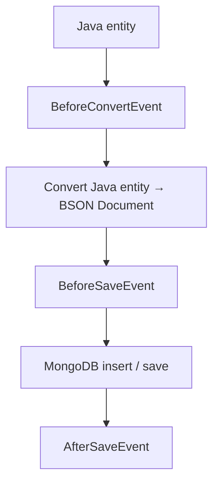
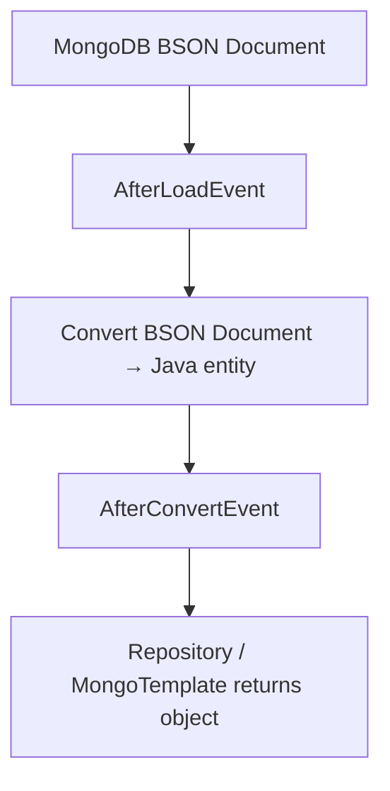
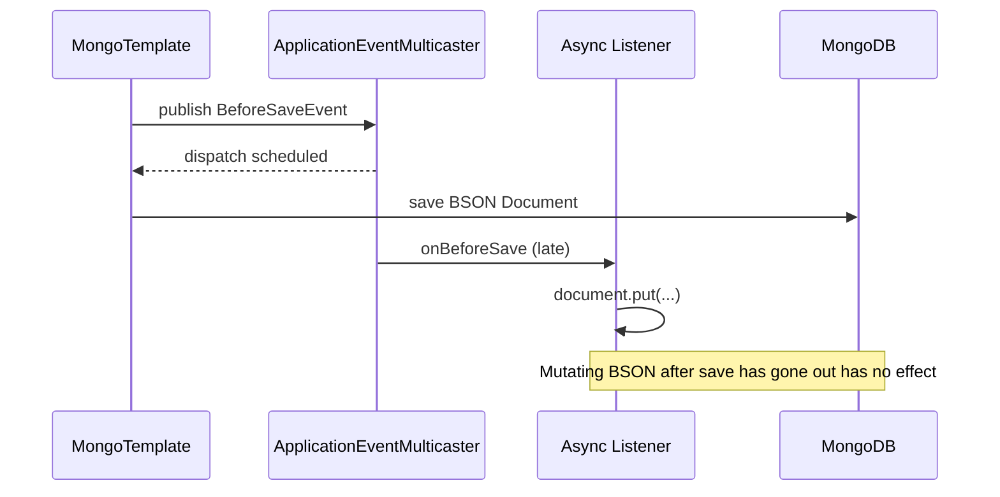
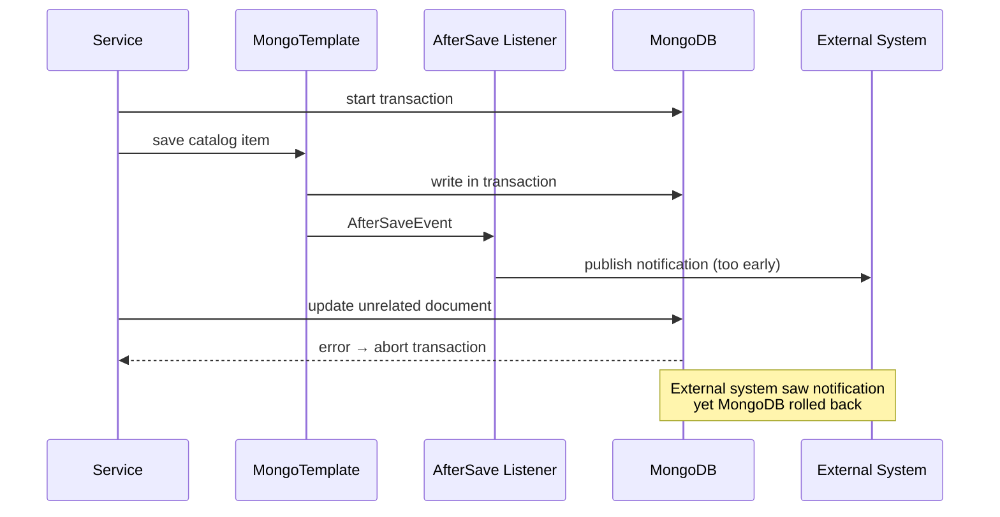

# `AbstractMongoEventListener` and Lifecycle Events

In **Spring Data MongoDB**, an entity does not simply travel straight from a Java object to MongoDB Server. Before saving, data is inspected, converted into a BSON `Document`, and may receive an ID, version, and metadata; after reading, BSON is mapped back into a Java object. Along the way, Spring Data can publish **lifecycle events** allowing applications to observe or react to specific moments.

The central API of this lesson is **`AbstractMongoEventListener<T>`**: a base class for listening to `MongoMappingEvent`s such as `BeforeConvertEvent`, `BeforeSaveEvent`, `AfterSaveEvent`, `AfterLoadEvent`, `AfterConvertEvent`, `BeforeDeleteEvent`, and `AfterDeleteEvent`.

Importantly, **an event listener is neither a transaction hook nor the default tool for enforcing every business rule**. Events may be dispatched synchronously or configured for asynchronous processing; not every `$set`, `$inc`, or bulk update runs full entity conversion and emits the entire lifecycle. For deterministic, ordered data transformations, **`EntityCallback`** is usually the better choice.

This lesson belongs to the **Lifecycle and Callbacks** chapter in the `SPRING_DATA_MONGODB` module. Within the module, learners use Spring Data MongoDB to connect, map documents, work via `MongoTemplate` or repositories, and practice queries, aggregations, indexes, transactions, reactive access, testing, and performance diagnostics. Here we focus on **MongoDB mapping lifecycle events**, clarifying exact timing and practical production boundaries.

After this lesson, you will be able to:

1. Identify events **before/after convert, save, load, and delete**, distinguishing Java entities from BSON `Document`s.
2. Write a `@Component` extending `AbstractMongoEventListener<CatalogItem>` and override the right handlers.
3. Distinguish `onBeforeConvert` from `onBeforeSave`, as well as `onAfterLoad` from `onAfterConvert`.
4. Recognize cases where **listeners do not run** or run in unpredictable order when an application event multicaster uses an async executor.
5. Choose among `MongoMappingEvent`, `EntityCallback`, MongoDB transactions, domain events, and change streams as requirements dictate.
6. Organize normalization, logging, auditing, or document enrichment without leaking tenant data or creating save loops.
7. Write integration tests against a MongoDB test instance and diagnose missed or misfired events.

## 1. Where Do Lifecycle Events Sit in the Write/Read Paths?

When an application uses **entity-mapping** operations in Spring Data MongoDB, the basic write path looks like:



Basic read path:



Both diagrams depict only **the main `MongoMappingEvent`s**, without guaranteeing exact relative placement alongside all `EntityCallback`s, auditing, ID/version generation, or implementation details in every Spring Data version. Having an event also **does not mean MongoDB Server emits it**: these events are published by the **Spring application's mapping layer** during execution.

### 1.1. The Seven Core Events

| Event | Handler in `AbstractMongoEventListener<T>` | Useful Payload | Timing |
| --- | --- | --- | --- |
| `BeforeConvertEvent<T>` | `onBeforeConvert(...)` | Java Entity | Before converting entity to BSON |
| `BeforeSaveEvent<T>` | `onBeforeSave(...)` | Java Entity + BSON `Document` | After mapping, before write command |
| `AfterSaveEvent<T>` | `onAfterSave(...)` | Java Entity + BSON `Document` | After save operation completes |
| `AfterLoadEvent<T>` | `onAfterLoad(...)` | BSON `Document` | After loading from MongoDB, before mapping to entity |
| `AfterConvertEvent<T>` | `onAfterConvert(...)` | Java Entity + BSON `Document` | After mapping entity from BSON |
| `BeforeDeleteEvent<T>` | `onBeforeDelete(...)` | BSON document describing delete/query | Before delete operation |
| `AfterDeleteEvent<T>` | `onAfterDelete(...)` | BSON document describing delete/query | After delete operation |

**Warning:** in both delete events, `Document` typically represents the **deletion criteria**, not a full copy of each deleted document. Never infer from `BeforeDeleteEvent.getDocument()` that you have received the full entity with all fields needed for auditing.

### 1.2. Java Events Differ from MongoDB Change Streams

| Java Lifecycle Event | MongoDB Change Stream |
| --- | --- |
| Emitted by Spring Data in the app process on supported mapping paths | Provided by the server from committed changes in MongoDB |
| Good for observing or intercepting certain pre/post-mapping steps | Good for detecting data changes from **multiple writers** |
| Does not cover raw driver commands or direct `$inc` updates | Can observe changes made by other apps/drivers matching the change stream |
| Not a durable queue for replay after restarts | Provides resume tokens and retention/oplog bounds; still needs ops and deduping |
| May fire before actual transaction commit | Observes change events after changes commit per server semantics |

If the requirement is "every change from any service must be detected," lifecycle listeners inside one Spring Boot process **are not enough**. Evaluate change streams, transactional outboxes, or an appropriate CDC pipeline instead.

## 2. Declaring a Running Example Entity

Suppose an application manages products in the `catalogItems` collection; each document belongs to a tenant. Requirements:

- Before converting the entity to BSON, normalize `name` by trimming whitespace.
- Store an extra `searchName` field in BSON for a designed search pattern.
- Observe IDs/collections after save and load without logging sensitive data.
- Never let listeners arbitrarily alter `tenantId`, check permissions, or send pre-commit emails.

Example document:

```javascript
{
  _id: "ITEM-101",
  tenantId: "T-A",
  sku: "BOOK-01",
  name: "Sách MongoDB",
  searchName: "sách mongodb",
  createdAt: ISODate("2026-11-20T00:00:00Z"),
  active: true
}
```

Entity:

```java
import java.time.Instant;
import org.springframework.data.mongodb.core.mapping.Document;
import org.springframework.data.mongodb.core.mapping.MongoId;

@Document(collection = "catalogItems")
public class CatalogItem {
    @MongoId
    private String id;

    private String tenantId;
    private String sku;
    private String name;
    private Instant createdAt;
    private boolean active;

    protected CatalogItem() {}

    public CatalogItem(
            String id, String tenantId, String sku,
            String name, boolean active
    ) {
        this.id = id;
        this.tenantId = tenantId;
        this.sku = sku;
        this.name = name;
        this.active = active;
    }

    public String getId() { return id; }
    public String getTenantId() { return tenantId; }
    public String getSku() { return sku; }
    public String getName() { return name; }
    public Instant getCreatedAt() { return createdAt; }
    public boolean isActive() { return active; }

    public void setName(String name) { this.name = name; }
    public void setCreatedAt(Instant createdAt) {
        this.createdAt = createdAt;
    }
    public void setActive(boolean active) { this.active = active; }
}
```

The class intentionally omits a `searchName` property: `onBeforeSave` will demonstrate mutating the **raw BSON `Document`**. Fields added only to BSON do not necessarily show up on the entity when read back. For production data, explicitly decide whether `searchName` is a mapped business field or purely an index/search field.

### 2.1. Repository and `MongoTemplate`

```java
import java.util.Optional;
import org.springframework.data.mongodb.repository.MongoRepository;

public interface CatalogItemRepository
        extends MongoRepository<CatalogItem, String> {

    Optional<CatalogItem> findByIdAndTenantId(
            String id, String tenantId);
}
```

The described events can appear on `MongoTemplate`'s entity-mapping paths, and repositories generally delegate through the underlying Spring Data persistence layer. **Do not extend this assumption to raw driver, aggregation update, or bulk write paths**; verify each operation with integration tests.

## 3. Writing Your First Listener with `AbstractMongoEventListener`

A Spring bean extending `AbstractMongoEventListener<CatalogItem>`:

```java
import java.time.Instant;
import java.util.Locale;
import org.bson.Document;
import org.springframework.data.mongodb.core.mapping.event.AbstractMongoEventListener;
import org.springframework.data.mongodb.core.mapping.event.AfterConvertEvent;
import org.springframework.data.mongodb.core.mapping.event.AfterLoadEvent;
import org.springframework.data.mongodb.core.mapping.event.AfterSaveEvent;
import org.springframework.data.mongodb.core.mapping.event.BeforeConvertEvent;
import org.springframework.data.mongodb.core.mapping.event.BeforeSaveEvent;
import org.springframework.stereotype.Component;

@Component
public class CatalogItemLifecycleListener
        extends AbstractMongoEventListener<CatalogItem> {

    @Override
    public void onBeforeConvert(BeforeConvertEvent<CatalogItem> event) {
        CatalogItem item = event.getSource();
        if (item.getName() != null) {
            item.setName(item.getName().trim());
        }
        if (item.getCreatedAt() == null) {
            item.setCreatedAt(Instant.now());
        }
    }

    @Override
    public void onBeforeSave(BeforeSaveEvent<CatalogItem> event) {
        CatalogItem item = event.getSource();
        Document bson = event.getDocument();

        if (item.getName() != null) {
            bson.put("searchName",
                    item.getName().toLowerCase(Locale.ROOT));
        }
    }

    @Override
    public void onAfterSave(AfterSaveEvent<CatalogItem> event) {
        CatalogItem item = event.getSource();
        // Observation example; do not issue extra writes.
        logAfterSave(item.getId(), event.getCollectionName());
    }

    @Override
    public void onAfterLoad(AfterLoadEvent<CatalogItem> event) {
        // Here CatalogItem has not yet been converted.
        Document bson = event.getDocument();
        logAfterLoad(bson.get("_id"));
    }

    @Override
    public void onAfterConvert(AfterConvertEvent<CatalogItem> event) {
        CatalogItem item = event.getSource();
        logAfterConvert(item.getId());
    }

    private void logAfterSave(String id, String collection) {
        // In real code: use SLF4J with policy-compliant redaction.
        // Never log raw documents, credentials, or sensitive tenant data.
    }

    private void logAfterLoad(Object id) {}
    private void logAfterConvert(String id) {}
}
```

The example uses `@Component` so Spring registers the listener via the application context. You do not need to call `addApplicationListener(...)` manually if component scan picks up the bean. The empty `log...` methods keep the example focused on **lifecycle events**; production code should use proper loggers/metrics with bounded label cardinality.

**Why does `onBeforeConvert` mutate the Java object while `onBeforeSave` mutates BSON?** Because when `BeforeConvertEvent` fires, mapping to `Document` has not occurred yet; when `BeforeSaveEvent` fires, the `Document` to be written already exists. If you want a value mapped by the converter like any Java field, set it before conversion or use `BeforeConvertCallback`. To add a field to BSON right before saving, `BeforeSaveEvent.getDocument()` lets you edit the converted structure, though it requires controlling synchronous dispatch and event ordering.

## 4. Understanding Exact Timing on the Write Path

### 4.1. `BeforeConvertEvent<T>`: Before Converting to BSON

`BeforeConvertEvent` carries the **Java entity** via `getSource()`. This is an observation/mutation point before fields are mapped to BSON.

Example:

```java
@Override
public void onBeforeConvert(BeforeConvertEvent<CatalogItem> event) {
    CatalogItem item = event.getSource();

    if (item.getName() != null) {
        item.setName(item.getName().trim());
    }
    if (item.getCreatedAt() == null) {
        item.setCreatedAt(Instant.now());
    }
}
```

The converter then reads the normalized values to construct BSON. For instance, `name = "  Sách MongoDB  "` becomes `"Sách MongoDB"` before mapping.

**Limitation:** this handler mutates the entity object directly. If the same entity instance is reused elsewhere, mutating it can affect calling code. For immutable entities or records, listeners cannot call setters; **`EntityCallback`** with its ability to return a replacement entity is the better model.

### 4.2. `BeforeSaveEvent<T>`: Before Sending the Document to Be Written

`BeforeSaveEvent` provides both:

- `event.getSource()`: the Java entity being saved.
- `event.getDocument()`: the BSON `Document` created from the entity and ready to send to MongoDB.

Example adding a helper field:

```java
@Override
public void onBeforeSave(BeforeSaveEvent<CatalogItem> event) {
    CatalogItem item = event.getSource();
    Document bson = event.getDocument();

    if (item.getName() != null) {
        bson.put("searchName",
                item.getName().trim().toLowerCase(Locale.ROOT));
    } else {
        bson.remove("searchName");
    }
}
```

If `searchName` must accompany every save, keep behavior consistent when `name` is null/empty. This snippet removes the helper field from BSON when there is no name; if `updateFirst` modifies `name` directly, this listener may **not run**, leaving `searchName` stale.

**Never use `BeforeSaveEvent` to mutate the entity hoping the converter maps it a second time.** After conversion, BSON is already constructed; modifying the entity without updating `Document` may omit the change from the write. Conversely, modifying raw `Document` without a matching entity property means `repository.save(...)`'s return value may not reflect the added BSON field.

### 4.3. `AfterSaveEvent<T>`: After the Save Operation, Not Necessarily After Commit

`AfterSaveEvent` fires after the mapping layer's save operation finishes; it can carry both the object and the corresponding `Document`.

```java
@Override
public void onAfterSave(AfterSaveEvent<CatalogItem> event) {
    CatalogItem item = event.getSource();
    auditLogger.debug("Saved catalog item id={}", item.getId());
}
```

This assumes `auditLogger` is a configured logger and the ID is safe to log. Never log entire documents or secrets.

**Transaction pitfall:** if `save` executes **inside a transaction**, `AfterSaveEvent` does not mean the whole transaction committed. The transaction may run further statements and then roll back. If a listener sends an email or publishes `"ITEM_CREATED"` here, recipients can receive an event for a document that **never committed**.

### 4.4. `AfterSaveEvent` Is Not a MongoDB Change Stream

`AfterSaveEvent` applies strictly to **write paths through Spring applications emitting mapping events**. If a Python job, raw MongoDB Driver, or `mongosh` updates a document, a Spring listener in another service **never sees** that event.

To receive server-level changes beyond a single JVM process, use MongoDB change streams or a CDC/outbox mechanism with suitable guarantees. Lifecycle events have no offsets/resume tokens, are not message queues, and provide no exactly-once delivery.

## 5. Read Path: `AfterLoadEvent` vs. `AfterConvertEvent`

### 5.1. `AfterLoadEvent<T>`: Raw BSON Fresh from MongoDB

`AfterLoadEvent` fires after the read layer receives a document, **before converting it into an entity**.

```java
@Override
public void onAfterLoad(AfterLoadEvent<CatalogItem> event) {
    Document bson = event.getDocument();

    Object storedId = bson.get("_id");
    Object storedName = bson.get("name");
    // Inspect BSON types or record bounded metrics;
    // no complete CatalogItem exists yet here.
}
```

This is a useful point to inspect legacy data or raw representations in migration tests. However, do not use this listener to mutate BSON uncontrollably, especially when multiple converters, custom read converters, or async event dispatch are involved.

### 5.2. `AfterConvertEvent<T>`: Entity Already Instantiated

`AfterConvertEvent` carries the Java entity mapped by the converter:

```java
@Override
public void onAfterConvert(AfterConvertEvent<CatalogItem> event) {
    CatalogItem entity = event.getSource();
    if (entity.getSku() == null || entity.getSku().isBlank()) {
        // Observe/record metric for invalid legacy data.
        // Never call save on the entity inside this callback.
    }
}
```

Avoid long side effects or write loops inside `onAfterConvert`. A simple `repository.findById(...)` triggers the listener, so if the listener calls `repository.save(entity)`, every read turns into an uncontrolled write causing contention or version drift.

### 5.3. Neither Event Guarantees a Projection Loaded Every Field

A projected query might fetch only `_id` and `sku`, so the loaded BSON is a **partial** document. Never use `onAfterLoad` to assume missing BSON fields are truly null in the database.

Likewise, an entity mapped from a projection may lack many fields. If an `onAfterConvert` listener saves that partial entity back, it risks wiping unloaded fields. **Projected reads are for reading only; never re-save incomplete objects.**

### 5.4. Which Entity Types Trigger Events?

Using `AbstractMongoEventListener<CatalogItem>` narrows the listener to that target entity in standard Spring Data flows. However, not every query/projection constructs a full `CatalogItem`; interface projections, custom aggregation DTOs, native `Document`s, and raw driver calls can take different mapping paths.

Test the **exact read API** your application uses: `repository.find...`, `MongoTemplate.find(...)`, aggregation DTOs, `findAndModify(...)`, or reactive equivalents. Do not assume root-entity listeners fire for every BSON query result shaped similarly to the entity.

## 6. Delete Lifecycle: Deletion Criteria Are Not Deleted Documents

`BeforeDeleteEvent` and `AfterDeleteEvent` are typically published on delete paths through `MongoTemplate`/repositories.

### 6.1. Listener Observing Delete Criteria

```java
import org.bson.Document;
import org.springframework.data.mongodb.core.mapping.event.AfterDeleteEvent;
import org.springframework.data.mongodb.core.mapping.event.BeforeDeleteEvent;

@Override
public void onBeforeDelete(BeforeDeleteEvent<CatalogItem> event) {
    Document filterDocument = event.getDocument();
    // E.g. filter {_id: "..."} or multi-field filter.
    // Do not treat this as a snapshot of the document about to be deleted.
}

@Override
public void onAfterDelete(AfterDeleteEvent<CatalogItem> event) {
    Document filterDocument = event.getDocument();
    // Observe the delete request via provided metadata;
    // do not infer deleted count or per-document data.
}
```

These two methods illustrate additions **inside an `AbstractMongoEventListener<CatalogItem>` subclass**; arrange imports at the top of the file and class declarations properly when placing in a project.

### 6.2. `deleteMany` Deletes 100 Documents Without Creating 100 Snapshot Events

Suppose:

```javascript
db.catalogItems.deleteMany({
  tenantId: "T-A",
  active: false
});
```

A query-based delete can remove many documents. Even if the app receives a `BeforeDeleteEvent` representing the **delete filter**, it has no default mechanism to deliver a full list of deleted documents or guarantee one callback per entity.

Therefore, **never use delete lifecycle events to store full snapshots of every deleted document**. When per-record deletion audits are required, design an explicit workflow: read/write audit inside a transaction, or use change stream **pre-images** on supported deployments with proper retention and access controls.

### 6.3. `onAfterDelete` Does Not Guarantee Transaction Commit

If a delete runs inside a transaction and a subsequent command throws, the transaction rolls back. Calling an external API in `onAfterDelete` to "immediately purge the search index" can remove the document from search even though MongoDB rolled back the delete.

Prefer a transactional outbox or an event emitted **after commit** via a verified mechanism. Do not confuse `AfterDeleteEvent` with Spring's `@TransactionalEventListener(phase=AFTER_COMMIT)`: they belong to different lifecycles.

## 7. Event Sequence Summary: Measuring an Insert, Read, Delete Cycle

Suppose a service runs sequentially:

```java
CatalogItem created = repository.insert(
        new CatalogItem(
                "ITEM-101", "T-A", "BOOK-01",
                "  Sách MongoDB  ", true));

CatalogItem loaded = repository.findById("ITEM-101")
        .orElseThrow();

repository.delete(loaded);
```

On typical entity-mapping paths with a properly registered listener, the conceptual sequence is:

| Operation | Expected Events | Notes |
| --- | --- | --- |
| `insert(entity)` | BeforeConvert → BeforeSave → AfterSave | May also involve EntityCallbacks/ID/auditing depending on config |
| `findById(...)` | AfterLoad → AfterConvert | Read events involving BSON and entity |
| `delete(entity)` | BeforeDelete → AfterDelete | Delete events do not necessarily include full entity snapshots |

**This is not a contract that "every method emits exactly N events" across every version and overload.** Specialized APIs, projections, raw drivers, asynchronous event dispatch, and referenced-document operations can change what is observed.

### 7.1. Recording a Timeline with a Test Listener

In tests, a listener can append event names to a thread-safe queue/list while running repository/template calls. If the application event multicaster uses an async executor, **event log order can shift** or events may still be pending when assertions run.

For synchronous order tests, configure a synchronous test multicaster or use `EntityCallback` when ordering is part of business correctness; never insert `Thread.sleep(100)` hoping all events have arrived.

### 7.2. Do Listeners for Embedded Children Run?

Lifecycle events center on the **root document** mapped by Spring Data. Objects embedded inside a root document generally **do not receive independent per-child events**. Document references (such as `@DBRef`) may follow separate mapping/lifecycle paths when actually loaded; test explicitly if your application depends on them.

For example, if `Order` embeds `List<OrderLine>`, saving an `Order` does not fire a `BeforeSaveEvent<OrderLine>` for each line item. To validate or normalize children, handle them in the **root Order's** callback, domain service validation, or an appropriate converter.

## 8. How Does `MongoMappingEvent` Differ from `EntityCallback`?

Spring Data has **two lifecycle mechanisms** often mistaken for one:

1. **Application events:** `BeforeConvertEvent`, `BeforeSaveEvent`, etc., broadcast to `ApplicationListener`s like `AbstractMongoEventListener`.
2. **Entity callbacks:** `BeforeConvertCallback`, `BeforeSaveCallback`, `AfterConvertCallback`, and others invoked directly by Spring Data with a contract that can **return a new entity** and supports ordered imperative/reactive execution.

| Criterion | `AbstractMongoEventListener` | `EntityCallback` |
| --- | --- | --- |
| Mechanism | Spring `ApplicationEvent`/`ApplicationListener` | Spring Data `EntityCallbacks` |
| Input | A `MongoMappingEvent<T>` | Entity + phase-specific arguments |
| Return value | Handler is typically `void` | Returns entity, or reactive `Publisher<T>` |
| Modifying immutable entities | Inconvenient | **Better suited** via returning a replacement entity |
| Processing order | Depends on application event multicaster and listener setup | Clearer ordering via `Ordered`/`@Order` |
| Async multicaster | Can cause events to run asynchronously | Invoked inside mapping lifecycle with proper sync/reactive semantics |
| Recommended use | Observation, logging, metrics, lightweight integration | Required pre-mapping/pre-save data transformations per contract |
| Reactor support | Not a reactive publisher context | Dedicated `ReactiveBeforeConvertCallback`, `ReactiveBeforeSaveCallback`, ... |

**Practical choice:** if correctness requires trimming names, setting defaults, normalizing fields, or encrypting prior to save, prefer **`EntityCallback` or a domain service**. If you only need to observe events or emit best-effort metrics, `AbstractMongoEventListener` works well—provided you do not treat events as a reliable queue.

### 8.1. Writing an Equivalent `BeforeConvertCallback`

```java
import java.time.Instant;
import org.springframework.core.Ordered;
import org.springframework.data.mongodb.core.mapping.event.BeforeConvertCallback;
import org.springframework.stereotype.Component;

@Component
public class CatalogItemNormalizationCallback
        implements BeforeConvertCallback<CatalogItem>, Ordered {

    @Override
    public CatalogItem onBeforeConvert(
            CatalogItem entity, String collection
    ) {
        if (entity.getName() != null) {
            entity.setName(entity.getName().trim());
        }
        if (entity.getCreatedAt() == null) {
            entity.setCreatedAt(Instant.now());
        }
        return entity;
    }

    @Override
    public int getOrder() {
        return 100;
    }
}
```

When using the callback above, **do not keep an `onBeforeConvert` listener performing the exact same task** without verifying intent. Running normalization twice may be harmless for `trim()`, whereas generating a UUID, assigning timestamps, or hashing passwords can be **non-idempotent**.

### 8.2. `BeforeSaveCallback` and Controlled BSON Edits

```java
import java.util.Locale;
import org.bson.Document;
import org.springframework.data.mongodb.core.mapping.event.BeforeSaveCallback;
import org.springframework.stereotype.Component;

@Component
public class CatalogItemBsonCallback
        implements BeforeSaveCallback<CatalogItem> {

    @Override
    public CatalogItem onBeforeSave(
            CatalogItem entity,
            Document document,
            String collection
    ) {
        if (entity.getName() != null) {
            document.put("searchName",
                    entity.getName().toLowerCase(Locale.ROOT));
        } else {
            document.remove("searchName");
        }
        return entity;
    }
}
```

`BeforeSaveCallback` accesses `Document` and returns the entity. In this example it yields the same outcome as `onBeforeSave` earlier, but runs inside a mechanism better suited for **pre-persistence transformations**. Still test with your framework version and any custom converters.

### 8.3. Reactive Callback Example

```java
import java.util.Locale;
import org.springframework.data.mongodb.core.mapping.event.ReactiveBeforeConvertCallback;
import org.springframework.stereotype.Component;
import reactor.core.publisher.Mono;

@Component
public class ReactiveCatalogNormalizer
        implements ReactiveBeforeConvertCallback<CatalogItem> {

    @Override
    public Mono<CatalogItem> onBeforeConvert(
            CatalogItem entity, String collection
    ) {
        return Mono.fromSupplier(() -> {
            if (entity.getName() != null) {
                entity.setName(entity.getName().trim());
            }
            return entity;
        });
    }
}
```

In applications using both blocking and reactive MongoDB, identify which callbacks are registered and invoked by each stack. **Never use reactive examples as an excuse to put `block()` inside a callback** to fetch external data: if I/O is unavoidable, choose appropriate reactive APIs and avoid bloating the persistence lifecycle.

### 8.4. Callbacks Transform Data—Where Does Validation Go?

You can validate data inside callbacks, yet avoid cramming every business rule into a callback running on **every save**:

```java
if (!authorizedUserCanChangePrice(...)) {
    throw new DomainValidationException(...);
}
```

That check depends on security/user context; the persistence lifecycle does not necessarily possess full request context or operation intent. Authorization, quotas, and order state transitions belong in **application/domain services and atomic write predicates**; callbacks should only assist with universal entity rules.

## 9. Event Multicaster and Execution Order: Asynchrony Risks

Spring's `ApplicationEventPublisher` can be configured with an `ApplicationEventMulticaster`. By default, events are typically dispatched synchronously on the caller's thread. However, if the app configures a `TaskExecutor` on the multicaster, listeners run **asynchronously**.

### 9.1. Why Mutating Entities in an Async Listener Is Dangerous



If `onBeforeSave` runs too late, edits to `Document` no longer affect the write. Never gamble on thread scheduling luck to persist important fields.

### 9.2. Callbacks Offer Clearer Ordering for Correctness Requirements

For normalization required before saving:

```java
import org.springframework.core.annotation.Order;

@Component
@Order(100)
class NormalizeBeforeConvert
        implements BeforeConvertCallback<CatalogItem> {
    @Override
    public CatalogItem onBeforeConvert(
            CatalogItem entity, String collection
    ) {
        // Return normalized entity.
        return entity;
    }
}
```

Across multiple callbacks in the same phase, Spring Data supports `Ordered`/`@Order` coordination. Understand their order alongside auditing callbacks or built-in callbacks; never assume an order without verifying it. Likewise, **the EntityCallback API does not combine two saves across two transactions into one atomic unit**.

### 9.3. Should You Configure an Async Event Multicaster Just to Send Email?

Even when a listener runs asynchronously, major flaws remain:

- The process can shut down before the task runs.
- The executor queue can fill up and reject tasks.
- The handler can execute after the transaction rolls back.
- Events are not durably persisted or retried under controlled policy.
- Async listeners may lack thread-bound transaction or security contexts from the original request.

For critical emails or integrations, use a **transactional outbox written in the same transaction** with a post-commit worker, or a message broker with retries and DLQs. Never treat slapping `@Async` onto a listener as reliable delivery.

### 9.4. Do Listener Exceptions Roll Back Operations?

With synchronous event dispatch, an exception thrown by a listener **can propagate to the caller** and abort a write path. Still, the exact outcome depends on the event phase, open transactions, and multicaster dispatch.

Examples:

- An exception in synchronous `onBeforeSave` can stop the save from proceeding.
- An exception in `onAfterSave` can occur **after MongoDB already applied a non-transactional write**, so the client sees an error even though the document exists.
- If the save is inside a Spring-managed transaction, the exception may trigger rollback, yet you must never infer from the name "AfterSave" that commit already occurred.
- With async listeners, exceptions normally do not propagate back to the publishing request thread the same way synchronous listeners do.

**Never design business invariants around an "after"-phase event listener throwing exceptions.** Validate prior to writing or use transactions and domain validation.

## 10. Spring Data MongoDB Auditing and Lifecycle Events

Spring Data supports auditing annotations such as `@CreatedDate`, `@LastModifiedDate`, `@CreatedBy`, and `@LastModifiedBy` when configured. This intersects with the lifecycle because auditing updates metadata during persistence.

### 10.1. Automatic Auditing Example

```java
import java.time.Instant;
import org.springframework.data.annotation.CreatedDate;
import org.springframework.data.annotation.LastModifiedDate;
import org.springframework.data.mongodb.core.mapping.Document;
import org.springframework.data.mongodb.core.mapping.MongoId;

@Document("auditedCatalog")
class AuditedCatalogItem {
    @MongoId String id;
    String tenantId;
    String name;

    @CreatedDate
    Instant createdAt;

    @LastModifiedDate
    Instant updatedAt;
}
```

Enable auditing when required by the application:

```java
import org.springframework.context.annotation.Configuration;
import org.springframework.data.mongodb.config.EnableMongoAuditing;

@Configuration
@EnableMongoAuditing
class MongoAuditingConfig {}
```

Once enabled and configured with time/auditor providers, Spring Data automatically populates auditing metadata on entity save paths. **Never conclude from annotations alone that raw `$set` updates or `bulkOps` automatically refresh `updatedAt`.** Write paths bypassing the entity lifecycle need their own rules.

### 10.2. Avoid Updating the Same Field via Two Mechanisms

Suppose an entity has `@CreatedDate`, yet a listener also executes:

```java
if (item.getCreatedAt() == null) {
    item.setCreatedAt(Instant.now());
}
```

This creates **two sources of truth** for timestamps. Depending on callback ordering and mapping checkpoints, one can overwrite the other or cause inconsistencies. Pick **one authoritative mechanism** for `createdAt` and `updatedAt`; prefer built-in auditing when suitable rather than duplicating it in listeners.

### 10.3. Auditing Does Not Replace Conditional Updates or Versioning

Auditing timestamps answer "who/when modified?" at a coarse level, whereas **optimistic locking** requires `@Version` to check stale snapshots on supported save paths. Never use `updatedAt` as a default concurrency guard; clock skew or coarse resolution causes races.

If a batch job or native driver modifies a document without updating auditing/version fields, Spring callbacks in another service **cannot sync it retroactively**. Enforce unified schema and writer policies.

## 11. Which Operation Paths Emit Lifecycle Events?

A common misconception is "whenever a MongoDB collection changes, all Spring lifecycle listeners run automatically." In truth, events are tied to **Spring Data code paths** performing entity mapping.

| Operation | Lifecycle Events Potentially Involved | What Not to Assume |
| --- | --- | --- |
| `repository.insert(entity)` | BeforeConvert, BeforeSave, AfterSave | Different repository implementations always emit the exact same event counts |
| `repository.save(entity)` | BeforeConvert, BeforeSave, AfterSave | After save means the transaction committed |
| `MongoTemplate.insert/save` | Mapping events around convert/save | Identical semantics to raw Java Driver `insertOne` |
| `repository.findById/find...` | AfterLoad, AfterConvert | Entities always carry all fields when projections restrict fields |
| `MongoTemplate.find/findOne` | AfterLoad, AfterConvert for mapped results | Queries returning raw `Document` always emit generic entity events |
| `MongoTemplate.remove`/repository delete | BeforeDelete, AfterDelete | One event per deleted document |
| `MongoTemplate.updateFirst/updateMulti` | Direct update operators; bypasses full entity save lifecycle | `onBeforeConvert/onBeforeSave` will run automatically to fix fields |
| `MongoTemplate.bulkOps(...)` | Bulk operations have a separate path | Callback/auditing/version handling identical to `save` |
| `findAndModify` | May map returned document to emit read-related events per API/version | Entity `BeforeSaveEvent` fires when only issuing `$set` |
| Aggregation pipeline returning custom DTO | Mapping/conversion per result and target type | Root entity listener always receives events |
| Java Driver `MongoCollection.insertOne/updateOne` | Does not emit Spring mapping lifecycle events | Neighboring Spring listeners will receive callbacks |
| `mongosh`/other service writing DB | No Spring events in this process | Event listeners act as system-wide CDC |

Treat this table as **design guidance**, not an exhaustive specification for every overload and version. For any critical API, run an integration test to confirm exactly which events fire.

### 11.1. Why Does `updateFirst` Typically Bypass `BeforeSaveEvent`?

Suppose:

```java
Query query = Query.query(
        Criteria.where("_id").is("ITEM-101")
                .and("tenantId").is("T-A"));

Update update = new Update()
        .set("name", "  Updated via $set  ");

template.updateFirst(query, update, CatalogItem.class);
```

This sends an **update operator** directly to MongoDB rather than loading a `CatalogItem`, calling setters, converting the whole object, and saving. Hence normalization in `onBeforeConvert` and generating `searchName` in `onBeforeSave` **may not occur**. The resulting document may have the new `name` while `searchName` stays stale.

If an application allows modifying `name` via multiple paths, options include:

1. Normalize in the service before building `Update`, updating both `name` **and** `searchName` in the same atomic update.
2. Restrict mutations to a controlled entity save path, where concurrency and document size permit.
3. Design explicit normalized fields and clear indexes/schemas using suitable DB update pipelines or converters.
4. Run a repair job for legacy data when multiple legacy writers exist—without mistaking repair jobs for proper write logic.

### 11.2. Raw Driver Intentionally Bypasses Listeners

```java
import com.mongodb.client.MongoCollection;
import org.bson.Document;

MongoCollection<Document> collection =
        template.getCollection("catalogItems");

collection.updateOne(
        new Document("_id", "ITEM-101"),
        new Document("$set", new Document("active", false)));
```

This command modifies the MongoDB document **without `MongoTemplate` performing entity conversion/save**. Thus it does not emit the `CatalogItem` lifecycle event chain. Even inside a `@Transactional` method, a raw driver call does not automatically join Spring's session unless you pass `ClientSession` properly; **transaction boundaries** and **mapping lifecycles** must be managed distinctly.

### 11.3. Collection Creation, Indexes, Counts, and Metadata

`ensureIndex(...)`, `getIndexInfo()`, `collectionExists(...)`, and metadata operations are not **entity save/load/delete operations**. Do not expect `BeforeSaveEvent<CatalogItem>` when creating an index on a collection.

For `count(...)` or `exists(...)`, MongoDB returns a number or boolean without mapping a document to an entity; they are not lifecycle-equivalent to `findById(...)`.

### 11.4. `ReactiveMongoTemplate` and Event Listeners

Spring Data MongoDB has a separate reactive stack and reactive lifecycle callbacks. When using `ReactiveMongoTemplate`/`ReactiveMongoRepository`, verify **on your exact API/version** which events fire and which callbacks execute. Do not assume imperative listener ordering, threading, or Spring transaction contexts carry over identically to reactive pipelines.

For **mandatory** transformations in reactive persistence, prefer `ReactiveBeforeConvertCallback`/`ReactiveBeforeSaveCallback`, returning a `Publisher` instead of calling `block()`. Never invoke blocking repositories inside listeners triggered on an event loop.

## 12. Transactions, Auditing, and Post-Commit Messaging

A listener named `onAfterSave` only means **the save operation reached that phase**. It is **not** a `commitTransaction` callback. This matters enormously when a transaction writes multiple documents:



### 12.1. Never Send Webhooks/Emails from `AfterSaveEvent`

Anti-pattern:

```java
@Override
public void onAfterSave(AfterSaveEvent<CatalogItem> event) {
    externalWebhook.send("CATALOG_UPDATED", event.getSource());
}
```

If `externalWebhook.send` succeeds and then the transaction aborts, the webhook cannot be rolled back. If an event listener retries, the webhook fires twice. The same holds for direct Kafka/RabbitMQ publishes or emails.

### 12.2. Outbox Written in the Same Transaction

A safer pattern:

```text
Transaction:
  save CatalogItem
  insert OutboxMessage(operationId, "CATALOG_UPDATED", payload)
  commit transaction

Post-commit dispatcher:
  read unsent OutboxMessage
  deliver message/email
  record delivery status
  bounded retries and idempotent consumer
```

If an application does not need a full outbox, you can handle best-effort operations via application events processed at `AFTER_COMMIT` **using proper transaction synchronization**. Even so, **`AFTER_COMMIT` does not provide durable delivery**: the process can crash right after commit before the listener runs. For strong guarantees, an outbox is usually preferable.

### 12.3. `@TransactionalEventListener` Does Not Automatically Turn Mapping Events into After-Commit

Example:

```java
import org.springframework.transaction.event.TransactionPhase;
import org.springframework.transaction.event.TransactionalEventListener;

@TransactionalEventListener(phase = TransactionPhase.AFTER_COMMIT)
public void afterBusinessCommit(CatalogPublishedEvent event) {
    // Runs after the transaction bound to the application event commits,
    // given the right transaction manager/context and event setup.
}
```

This is a **listener for a domain/application event** `CatalogPublishedEvent` published inside a suitable transaction context. It does not replace `AbstractMongoEventListener`, and you should not assume every `MongoMappingEvent` automatically becomes a post-commit event. For **reactive transactions**, transaction context propagation differs from thread-bound transactions and requires reactive-aware event publication per your Spring version.

### 12.4. Listener/Callback Errors Can Affect Transactions

A `BeforeSaveCallback` throwing `DomainValidationException` or a synchronous listener throwing an exception can fail the service call. When a Spring transaction is open, an exception propagating through the transaction interceptor can trigger rollback per policy.

However, if an exception occurs in `AfterSaveEvent` **outside a transaction**, the database change is already applied on the server. Never design "throw in an after-event to undo an already-finished write" as a primary mechanism.

### 12.5. Listeners and `@Version`

An entity with `@Version` uses optimistic locking on supported save paths. If an `onAfterConvert` listener automatically re-`save`s the entity on every read, versions increment unexpectedly and reads race with concurrent updates.

Similarly, if a listener alters raw BSON `version` inside `onBeforeSave`, it can break CAS predicates or cause in-memory and database states to diverge. Let Spring Data manage `@Version`; business updates needing version CAS should be designed explicitly in repository/template services.

## 13. Tenants, Sensitive Data, and Safety Principles

### 13.1. `tenantId` Inside a Listener Does Not Enforce Authorization

`CatalogItem.tenantId` is a data field. If a client submits `tenantId = "T-B"`, `onBeforeConvert` has no authority to assume that tenant is valid for the caller.

Use the security context in the application service layer to:

- Authenticate the current tenant/user.
- Scope `findByIdAndTenantId(...)` and update/delete queries by tenant.
- Check permissions to modify products or sensitive attributes.
- Prevent owner/tenant tampering through payload-mapped `save` calls.

Lifecycle events are **mapping extension points**, not authorization boundaries.

### 13.2. Never Log Full `Document`s

```java
// Avoid in production:
logger.info("BeforeSave: {}", event.getDocument());
```

Real documents may hold emails, phone numbers, access tokens, API secrets, or personal data. Logging full `Document`s copies sensitive payloads into log aggregation systems and risks violating retention and access policies.

Log selectively: event type, collection name, operation type, and a safe trace ID; when document IDs are needed, check PII/security rules and bound cardinality. Never put raw tenant IDs or full documents into metric labels.

### 13.3. Never Encrypt or Hash Secrets in Async Event Listeners

If a field must be hashed/encrypted **before writing**, use a domain service or an `EntityCallback` with an explicit synchronous or reactive contract. An async `BeforeSaveEvent` can arrive after the save command, risking plaintext hitting MongoDB.

For passwords, use vetted security/crypto components and explicit password-change workflows rather than ad-hoc hashing in a listener hoping "every save becomes safe."

### 13.4. One Listener Can Fire Across Many Use Cases

`CatalogItemLifecycleListener` may run when:

- Admin UI creates an item.
- A data import job runs.
- An internal API performs a save.
- A test fixture inserts an item via repository.

Therefore listeners must never implicitly assume an HTTP request, user session, or UI context exists. If behavior belongs specifically to a "publish catalog" command, place it in that command's application service rather than in a global `onAfterSave`.

## 14. Integration Testing Lifecycle Events Against Real MongoDB

A unit test calling `listener.onBeforeSave(event)` directly tests pure Java logic, yet **does not prove** Spring registered the listener and published events at the right times during repository/template execution. Write integration tests against a **dedicated test MongoDB Server**.

With Spring Boot 3.x, one option is `@DataMongoTest` paired with a test MongoDB instance (e.g., Testcontainers). Unlike multi-document transactions, basic insert/find/remove tests can run on a standalone test MongoDB without requiring a replica set; transaction tests require a transaction-capable topology.

### 14.1. Event Recorder to Capture the Timeline

```java
import java.util.List;
import java.util.concurrent.CopyOnWriteArrayList;
import org.springframework.data.mongodb.core.mapping.event.AbstractMongoEventListener;
import org.springframework.data.mongodb.core.mapping.event.AfterConvertEvent;
import org.springframework.data.mongodb.core.mapping.event.AfterDeleteEvent;
import org.springframework.data.mongodb.core.mapping.event.AfterLoadEvent;
import org.springframework.data.mongodb.core.mapping.event.AfterSaveEvent;
import org.springframework.data.mongodb.core.mapping.event.BeforeConvertEvent;
import org.springframework.data.mongodb.core.mapping.event.BeforeDeleteEvent;
import org.springframework.data.mongodb.core.mapping.event.BeforeSaveEvent;

public class RecordingCatalogListener
        extends AbstractMongoEventListener<CatalogItem> {

    private final CopyOnWriteArrayList<String> phases =
            new CopyOnWriteArrayList<>();

    @Override
    public void onBeforeConvert(BeforeConvertEvent<CatalogItem> e) {
        phases.add("beforeConvert");
    }

    @Override
    public void onBeforeSave(BeforeSaveEvent<CatalogItem> e) {
        phases.add("beforeSave");
    }

    @Override
    public void onAfterSave(AfterSaveEvent<CatalogItem> e) {
        phases.add("afterSave");
    }

    @Override
    public void onAfterLoad(AfterLoadEvent<CatalogItem> e) {
        phases.add("afterLoad");
    }

    @Override
    public void onAfterConvert(AfterConvertEvent<CatalogItem> e) {
        phases.add("afterConvert");
    }

    @Override
    public void onBeforeDelete(BeforeDeleteEvent<CatalogItem> e) {
        phases.add("beforeDelete");
    }

    @Override
    public void onAfterDelete(AfterDeleteEvent<CatalogItem> e) {
        phases.add("afterDelete");
    }

    public List<String> snapshot() {
        return List.copyOf(phases);
    }

    public void reset() {
        phases.clear();
    }
}
```

`CopyOnWriteArrayList` prevents memory-visibility/structural errors if events arrive on another thread, yet **does not guarantee an async listener already finished** or preserve ordering under an async multicaster. Ordering assertions below assume **the default synchronous multicaster in tests**.

### 14.2. Declaring the Spring Test Slice and Importing Listeners

```java
import static org.assertj.core.api.Assertions.assertThat;

import org.bson.Document;
import org.junit.jupiter.api.BeforeEach;
import org.junit.jupiter.api.Test;
import org.springframework.beans.factory.annotation.Autowired;
import org.springframework.boot.test.autoconfigure.data.mongo.DataMongoTest;
import org.springframework.context.annotation.Import;
import org.springframework.data.mongodb.core.MongoTemplate;
import org.springframework.data.mongodb.core.query.Criteria;
import org.springframework.data.mongodb.core.query.Query;
import org.springframework.data.mongodb.core.query.Update;

@DataMongoTest
@Import({
        CatalogItemLifecycleListener.class,
        RecordingCatalogListener.class
})
class CatalogItemLifecycleIntegrationTest {

    @Autowired MongoTemplate template;
    @Autowired RecordingCatalogListener recorder;

    private CatalogItem item(String name) {
        return new CatalogItem(
                "ITEM-TEST", "T-A", "BOOK-01",
                name, true);
    }

    @BeforeEach
    void clean() {
        // Run ONLY on an isolated test database.
        template.remove(new Query(), CatalogItem.class);
        recorder.reset();
    }

    // Tests below belong inside this class.
}
```

`@Import` ensures both listener beans are registered in the Spring test slice; `@DataMongoTest` component scanning can differ from full application scanning. Projects must configure an isolated test MongoDB URI and never use production credentials. `template.remove(new Query(), ...)` **deletes all documents in the collection**: never run this setup on a shared or production database.

### 14.3. Testing Insert Sequence and Mutated BSON Data

```java
@Test
void insertInvokesBeforeConvertBeforeSaveAndAfterSave() {
    CatalogItem saved = template.insert(
            item("  Sách MongoDB  "));

    assertThat(saved.getName()).isEqualTo("Sách MongoDB");
    assertThat(saved.getCreatedAt()).isNotNull();

    assertThat(recorder.snapshot()).containsExactly(
            "beforeConvert",
            "beforeSave",
            "afterSave");

    // Raw driver read: does not trigger read mapping events.
    Document stored = template.getCollection("catalogItems")
            .find(new Document("_id", "ITEM-TEST"))
            .first();

    assertThat(stored).isNotNull();
    assertThat(stored.getString("name"))
            .isEqualTo("Sách MongoDB");
    assertThat(stored.getString("searchName"))
            .isEqualTo("sách mongodb");
}
```

The test proves two distinct behaviors: **`onBeforeConvert` modifies the entity before mapping** and **`onBeforeSave` modifies raw BSON before driver save**. Querying the raw `Document` reads `searchName` directly even though the Java entity lacks that property.

### 14.4. Testing `AfterLoad` and `AfterConvert`

```java
@Test
void findInvokesAfterLoadAndAfterConvert() {
    template.insert(item("Sách MongoDB"));
    recorder.reset();

    CatalogItem loaded = template.findById(
            "ITEM-TEST", CatalogItem.class);

    assertThat(loaded).isNotNull();
    assertThat(loaded.getId()).isEqualTo("ITEM-TEST");

    assertThat(recorder.snapshot()).containsExactly(
            "afterLoad",
            "afterConvert");
}
```

`AfterLoadEvent` runs before the entity is constructed from BSON; `AfterConvertEvent` runs after the converter builds the entity. Adding `@DBRef` or custom converters can trigger additional events on nested lookups, so start with a simple fixture to confirm the baseline timeline first.

### 14.5. Testing That Delete Events Do Not Require a Full Entity

```java
@Test
void removeByQueryInvokesDeleteEvents() {
    template.insert(item("Sách MongoDB"));
    recorder.reset();

    Query filter = Query.query(
            Criteria.where("_id").is("ITEM-TEST")
                    .and("tenantId").is("T-A"));

    template.remove(filter, CatalogItem.class);

    assertThat(recorder.snapshot()).containsExactly(
            "beforeDelete",
            "afterDelete");
    assertThat(template.getCollection("catalogItems")
            .find(new Document("_id", "ITEM-TEST"))
            .first()).isNull();
}
```

This test confirms lifecycle events fire along `MongoTemplate.remove`, **without proving** `BeforeDeleteEvent` carries full fields of the deleted document. Never build an audit system expecting `name`/`sku` from `event.getDocument()` on a delete event.

### 14.6. Testing That `updateFirst` Skips Entity Save Normalization

```java
@Test
void directUpdateBypassesEntityBeforeSaveNormalization() {
    template.insert(item("Sách MongoDB"));
    recorder.reset();

    template.updateFirst(
            Query.query(Criteria.where("_id").is("ITEM-TEST")),
            new Update().set(
                    "name", "  New name via updateFirst  "),
            CatalogItem.class);

    Document stored = template.getCollection("catalogItems")
            .find(new Document("_id", "ITEM-TEST"))
            .first();

    assertThat(stored).isNotNull();
    assertThat(stored.getString("name"))
            .isEqualTo("  New name via updateFirst  ");
    assertThat(stored.getString("searchName"))
            .isEqualTo("sách mongodb");

    assertThat(recorder.snapshot())
            .doesNotContain("beforeConvert", "beforeSave", "afterSave");
}
```

**Learning point:** `updateFirst` directly alters the `name` field without using `CatalogItem#setName` or full-entity conversion, leaving `searchName` stale. If the app needs `searchName` to stay consistent, the service building `Update` must update both fields together or redesign the write path.

### 14.7. Warning About Parallel Test Execution

The tests above use `@BeforeEach` to clear the test collection. If two test classes share one database and run in parallel, test A can wipe test B's fixtures. Use **per-suite databases**, disable conflicting parallelism, or clean up strictly by unique test IDs in shared environments.

Do not expect synchronous tests to pass unchanged if the app configures an async `ApplicationEventMulticaster`. To test event ordering, configure a synchronous test multicaster; to test async behavior, use proper await/coordination utilities rather than `sleep()`.

## 15. Unit Testing an Event Listener in Isolation

Beyond integration tests, simple transformations can be unit tested without a server:

```java
import static org.assertj.core.api.Assertions.assertThat;

import org.bson.Document;
import org.junit.jupiter.api.Test;
import org.springframework.data.mongodb.core.mapping.event.BeforeSaveEvent;

@Test
void beforeSaveAddsNormalizedSearchNameToBson() {
    CatalogItemLifecycleListener listener =
            new CatalogItemLifecycleListener();
    CatalogItem item = new CatalogItem(
            "I-1", "T-A", "BK-1", "Sách MongoDB", true);
    Document raw = new Document("name", "Sách MongoDB");

    listener.onBeforeSave(new BeforeSaveEvent<>(
            item, raw, "catalogItems"));

    assertThat(raw.getString("searchName"))
            .isEqualTo("sách mongodb");
}
```

Testing the handler directly verifies **BSON transformation logic**, yet does not prove the Spring context registered the listener, events fire at the expected phase, or BSON changes persist. Therefore use **both unit tests and integration tests** according to risk.

### 15.1. When Testing Order Across Multiple Callbacks

If multiple `BeforeConvertCallback<CatalogItem>` beans exist, declare `@Order`/`Ordered` consistently and test the resulting persisted data:

```text
Callback A: trim name
Callback B: compute searchName from trimmed name
MongoDB: stored.name and stored.searchName are both normalized
```

Do not assert only the order in which callbacks were invoked while ignoring their effect on **actual server values**.

### 15.2. When Testing Delete Auditing

If business rules require full snapshots of every deleted document, write a test **deleting multiple documents** and checking each audit entry's contents. Relying solely on `BeforeDeleteEvent.getDocument()` quickly reveals missing data in such a test. Use a transactional read/audit workflow or suitable server features instead of patching events.

## 16. Diagnosing Missing or Misbehaving Lifecycle Events

| Symptom | Causes to Check | Resolution |
| --- | --- | --- |
| `onBeforeSave` does not run on insert | Listener not registered as bean, wrong generic entity, write path bypasses mapping | Check `@Component`/`@Import`, target class, test `MongoTemplate.insert` |
| `onBeforeConvert` does not run on `updateFirst` | `updateFirst` uses update operators, not full entity conversion | Normalize in service building `Update` or use callbacks on save path |
| `onAfterLoad` does not run for raw `MongoCollection.find` | Raw driver does not emit Spring mapping events | Use `MongoTemplate.find` when mapping is needed or handle raw driver separately |
| `onAfterConvert` does not run for aggregation DTO | Result maps to a different type than root entity listener | Match target mapping type and listener generic type |
| `searchName` is not persisted | Async listener ran after save, overridden by callback, wrong BSON key | Use synchronous `BeforeSaveCallback`, inspect raw BSON/test |
| `searchName` goes stale after updating `name` | Direct `$set` bypasses listener | Update both fields in the same command or redesign |
| `onBeforeSave` edits entity yet BSON unchanged | Entity already converted to `Document` | Edit BSON directly here or move logic to `BeforeConvertCallback` |
| `onBeforeConvert` triggers infinite loop | Handler calls `repository.save` creating persistence cycle | Never re-save entity inside mapping listeners |
| `onAfterSave` sends notification yet transaction rolls back | Event fires before transaction commit | Use transactional outbox / after-commit mechanism |
| `onAfterDelete` lacks `name`/`sku` of deleted entity | Event holds delete/query document, not full snapshot | Design separate audit workflow |
| Deleting 100 documents yields only a few events | Query delete does not fire one event per record | Do not use mapping events as per-document CDC |
| Audit timestamps hold unexpected values | Auditing callback and listener both mutate field | Pick a single rule source and verify ordering |
| Listener runs twice for same event | Duplicate bean registration or multiple listener/event paths | Inspect Spring context, component scan, and `@Import` |
| Event order is unstable | `ApplicationEventMulticaster` runs async | Do not depend on ordering; use EntityCallback for mandatory mutations |
| Listener throws exception yet DB still wrote | Exception happened after non-transactional save | Move validation to before-phase / service |
| Listener sees null fields from projection | Query loaded only partial document | Do not mistake missing projected fields for null values in DB |
| Listener does not run for embedded children | Mapping events target root entities | Handle children in root callback / domain service |
| Tenant overwritten improperly on save | Entity mapped straight from payload without auth check | Enforce security in service and tenant-scoped queries, not listeners |
| Reactive callback does not run as expected | Registered imperative callback or wrong reactive stack | Use `ReactiveBeforeConvertCallback` and test subscription |
| External non-Spring job updates produce no events | Events live strictly in Spring JVM persistence path | Change streams / outbox or job-level integration |

### 16.1. Debugging Procedure for an Incorrect `searchName` Field

1. Inspect the raw MongoDB document for the actual values of `name` and `searchName`.
2. Check whether the create/update request uses **`repository.save/insert`**, `MongoTemplate.updateFirst`, bulk ops, or the raw driver.
3. If using entity save, verify `CatalogItemLifecycleListener` is a Spring bean with the right generic target.
4. Test `BeforeConvertEvent`: was `name` trimmed prior to mapping?
5. Test `BeforeSaveEvent`: was `searchName` added to the BSON `Document`?
6. Check if the multicaster is configured async, causing the handler to run too late.
7. Read back raw BSON **after insert**, rather than inspecting only the Java object returned by the repository.
8. If using direct updates, construct an `Update` setting both `name` and `searchName` or route through an appropriate write path.
9. Run regression tests across every insert, save, update, and bulk path actually used by the app.

This procedure distinguishes **event never emitted**, **event emitted yet mutation too late**, and **event succeeded yet another write path broke the invariant**. Never solve it by piling on extra listeners mutating the same field.

### 16.2. Debugging When a Listener Runs "Twice"

Common reasons:

- The code actually called `save` twice—for example, once in the service and once in a callback.
- A Spring listener bean was registered via both component scan and manual `addApplicationListener(...)`.
- Two Spring application contexts or two distinct beans handle the same event.
- A transaction/workflow retried **the entire method**, firing mapping events again.
- An operation resolving nested references triggered extra mapping events for referenced roots.

To debug, log **event type**, entity type, request correlation ID, and call stack safely in test/staging. Never use `_id` alone to conclude an event duplicated, since a single entity can legitimately be saved multiple times.

### 16.3. When an Event Listener Throws an Exception

Classify clearly:

```text
BeforeConvert / BeforeSave (synchronous)
    ↓
Error can prevent the save operation.

AfterSave (outside transaction)
    ↓
DB already wrote; listener exception does not undo the write.

AfterSave (inside transaction, sync)
    ↓
Error may cause transaction rollback depending on call flow.

AfterSave (async multicaster)
    ↓
Error may occur on a separate executor;
original request does not necessarily receive the exception.
```

Never wrap all listener errors in a generic "retry save" handler, as some writes already succeeded while others did not. Whenever save outcome is uncertain (network or commit ambiguity), use idempotency and reconciliation.

## 17. Case Study: Normalization, Auditing, and Direct Updates

An application manages `customerProfiles`:

```javascript
{
  _id: "CUSTOMER-101",
  tenantId: "T-A",
  displayName: "  Nguyễn Văn A  ",
  searchName: "nguyễn văn a",
  preferredLanguage: "vi",
  createdAt: ISODate("2026-11-20T00:00:00Z")
}
```

Requirements:

- Trim `displayName` before saving.
- Generate lowercased `searchName` for designed indexes/queries.
- Ensure `createdAt` is set only once.
- One endpoint uses `MongoTemplate.updateFirst` to change `displayName`.
- Deleting a profile must record a full prior snapshot for policy auditing and respect tenant isolation.

### 17.1. Exercise 1 — Which Event or Callback?

| Task | Recommendation |
| --- | --- |
| Trim `displayName` on the Java entity | `BeforeConvertCallback` or service validation/normalization |
| Add `searchName` to BSON before save | `BeforeSaveCallback` or formal entity field mapping |
| Observe entity after mapping from BSON | `AfterConvertEvent` |
| Set `createdAt` automatically for auditing | `@CreatedDate` + Mongo auditing where suitable |
| Count how many times entities are saved | Best-effort `AfterSaveEvent`/metrics; never treat as server CDC |
| Audit **every deleted document** | Transactional workflow/CDC, not `BeforeDeleteEvent` alone |

**Key answer:** never replace a full deletion audit store for `deleteMany` with `BeforeDeleteEvent`; the event may contain only the deletion query criteria.

### 17.2. Exercise 2 — Reading the Output of Two Operations

Suppose a new entity has `displayName = "  Nguyễn Văn A  "`:

```java
repository.insert(customer);
```

With a synchronous normalization callback, BSON stores:

```javascript
{
  displayName: "Nguyễn Văn A",
  searchName: "nguyễn văn a"
}
```

Next:

```java
template.updateFirst(
        Query.query(Criteria.where("_id").is("CUSTOMER-101")
                .and("tenantId").is("T-A")),
        new Update().set(
                "displayName", "  Another name  "),
        CustomerProfile.class);
```

**Question:** Will `searchName` automatically update to `"another name"` because of `BeforeSaveEvent`?

**Answer:** do not assume so. `updateFirst` may bypass entity convert/save lifecycles. To preserve the invariant, update both `displayName` and `searchName` together in the update command, or route through a write path with proper normalization.

### 17.3. Exercise 3 — Is Emailing Inside `onAfterSave` Safe?

Suppose a transaction saves a profile, then writes another entity and fails. An email was sent inside the profile's `onAfterSave` before the transaction finished. **Result:** the email went out even though the profile rolled back.

**Fix:** write an outbox message in the same transaction and dispatch after commit; or accept best-effort behavior with a well-designed post-commit mechanism, never mistaking mapping events for message queues.

### 17.4. Exercise 4 — Listeners and Immutable Entities

If `CustomerProfile` is an immutable record:

```java
public record CustomerProfile(
        String id,
        String tenantId,
        String displayName
) {}
```

`onBeforeConvert` has no setter to mutate the name. `BeforeConvertCallback<CustomerProfile>` can **return a new record**:

```java
@Override
public CustomerProfile onBeforeConvert(
        CustomerProfile entity, String collection
) {
    return new CustomerProfile(
            entity.id(),
            entity.tenantId(),
            entity.displayName() == null
                    ? null
                    : entity.displayName().trim());
}
```

This lives in a class `implements BeforeConvertCallback<CustomerProfile>`. Instead of trying to mutate the record, the callback returns a new object per contract.

### 17.5. Exercise 5 — Are Events Needed for `@DBRef`/Embedded Objects?

A root document embeds 10 addresses. You want to validate every address before saving. **Do not** expect 10 separate `BeforeConvertEvent<Address>` firings. Perform validation on the root entity across its nested properties or in the domain service. For separately loaded `@DBRef` documents, events depend on load/version paths, so test explicitly if your app relies on that behavior.

### 17.6. Self-Check Questions

1. **Does `BeforeConvertEvent` receive a Java object or raw BSON?** Java entity.
2. **Does `BeforeSaveEvent` include the raw `Document`?** Yes.
3. **Does mutating the entity inside `onBeforeSave` guarantee BSON updates?** No, mapping already occurred.
4. **Does `AfterLoadEvent` happen before or after conversion?** Before conversion.
5. **Does `AfterConvertEvent` always have a complete entity regardless of query?** It has the mapped entity, though projections may omit fields.
6. **Does `BeforeDeleteEvent` contain the entire entity about to be deleted?** Do not assume so; it typically holds the delete/query document.
7. **Does `AfterSaveEvent` mean the transaction committed?** No.
8. **Does `updateFirst` reliably emit `BeforeSaveEvent`?** No; update operators take a different path from entity save.
9. **Does a raw driver insert invoke Spring `AbstractMongoEventListener`?** Not automatically.
10. **What should you use to transform an immutable entity before persistence?** `EntityCallback` returning a new entity or an appropriate domain mapper.
11. **Can an async multicaster cause mutations in `BeforeSaveEvent` to arrive too late?** Yes.
12. **Can lifecycle events replace change streams?** No.
13. **What risk arises when both auditing and a listener modify `createdAt`?** Two sources of truth and unclear ordering.
14. **Should `onAfterConvert` automatically re-save the just-read entity?** No; it risks read→write loops and lost updates.
15. **Should tenant authorization live in listeners instead of services?** No.

## 18. Production Checklist for Lifecycle Events

### 18.1. Choosing the Right Mechanism

1. **Have you clarified whether the goal is observation or data mutation?** Events can suit observation; mandatory mutations belong in callbacks/services.
2. **Have you distinguished `MongoMappingEvent` from `EntityCallback`?** One is an application event; the other has entity-return and ordering contracts.
3. **Did you pick the right phase?** Before-convert has the entity, before-save has BSON, after-load is pre-mapping, after-convert is post-mapping.
4. **Are mutable and immutable entities handled properly?** Immutable records should use callbacks returning new entities.
5. **Is the listener registered exactly once?** Check component scan/`@Import`, generic entity types, and other listener beans.

### 18.2. Write/Read Paths

6. **Have you mapped which APIs run through the lifecycle?** `save`/`insert` differ from `updateFirst`, bulk ops, and raw driver calls.
7. **Do all paths modifying a source field preserve derived invariants?** `searchName` goes stale if direct updates change only `name`.
8. **Did you avoid mutating Java entities after conversion expecting BSON to update?** Use the right callback/phase.
9. **Did you avoid arbitrarily mutating raw BSON types, `_id`, or `version`?** Let the framework manage identity and optimistic locking.
10. **Have projected queries been tested?** Partially loaded entities must never be re-saved in listeners.
11. **Do you account for delete events holding query documents rather than full entities?** Never use them as per-document deletion audits.
12. **Did you avoid saving entities inside `onAfterConvert`?** Prevent read→write loops.
13. **Have embedded vs. root event boundaries been verified against real schemas?** Never assume children emit separate events.

### 18.3. Concurrency, Transactions, and Security

14. **Is the multicaster async?** Never rely on async events for mutations needed before save.
15. **Are there multiple callbacks in the same phase?** Assign `@Order`/`Ordered` and test final values.
16. **Does the entity use auditing?** Avoid two places setting `createdAt`/`updatedAt`.
17. **Are transaction rollbacks accounted for?** `AfterSaveEvent` is not after-commit.
18. **Do listeners trigger external side effects?** Use outbox/CDC/after-commit per required guarantees.
19. **Are tenants/users authenticated in domain/application services?** Never use listeners as primary authorization.
20. **Are sensitive fields redacted from event logging?** Never log full `Document`s; keep PII out of metric labels.
21. **Are version CAS and retry idempotency handled?** Listeners do not prevent lost updates or duplicate side effects.

### 18.4. Testing and Operations

22. **Do integration tests run against a dedicated test MongoDB?** Confirm insert/read/delete actually fire events.
23. **Do tests inspect raw BSON after `BeforeSaveEvent`?** Never assert only Java objects.
24. **Are direct update and bulk paths tested?** Prove paths bypassing entity listeners still preserve consistency.
25. **Are async/event-ordering tests written cleanly?** Never depend on `Thread.sleep`.
26. **Is failure behavior verified both before and after save?** Never assume every exception triggers rollback.
27. **Are lifecycle events clearly separated from change streams?** Use the right tool when capturing writes from all sources.
28. **Are listener latency and exception rates monitored?** A slow synchronous listener slows every save.
29. **Is there a migration plan for legacy data lacking derived fields?** Listeners only affect writes passing through the current app's lifecycle.
30. **Do you verify MongoDB state and transaction outcomes rather than treating "listener ran" as business success?** Always validate persisted state.

**Rule to remember:** `AbstractMongoEventListener` observes mapping events around **convert, save, load, and delete**. `BeforeConvertEvent` works with the **Java entity**, `BeforeSaveEvent` with the **BSON `Document`**, `AfterLoadEvent` with **pre-mapping BSON**, and `AfterConvertEvent` with the **post-mapping entity**; delete events generally carry **deletion criteria** rather than full snapshots. Events are not guaranteed to be synchronous, do not cover `updateFirst`/bulk/raw driver paths, and `AfterSaveEvent` **does not mean committed**. Whenever correctness depends on a pre-persistence transformation, prefer **`EntityCallback`/services** and verify with integration tests.

### Official References

- [Spring Data MongoDB — Lifecycle Events](https://docs.spring.io/spring-data/mongodb/reference/mongodb/lifecycle-events.html): `AbstractMongoEventListener`, `MongoMappingEvent`, before/after save/load/convert/delete events, and event multicasters.
- [Spring Data MongoDB — Entity Callbacks](https://docs.spring.io/spring-data/mongodb/reference/mongodb/entity-callbacks.html): `BeforeConvertCallback`, `BeforeSaveCallback`, `AfterConvertCallback`, and reactive counterparts.
- [Spring Data MongoDB — Auditing](https://docs.spring.io/spring-data/mongodb/reference/mongodb/auditing.html): `@CreatedDate`, `@LastModifiedDate`, and auditing infrastructure.
- [Spring Data MongoDB — Template CRUD Operations](https://docs.spring.io/spring-data/mongodb/reference/mongodb/template-crud-operations.html): `MongoTemplate.insert/save/updateFirst/remove` and write paths.
- [Spring Data MongoDB — `AbstractMongoEventListener` API](https://docs.spring.io/spring-data/mongodb/docs/current/api/org/springframework/data/mongodb/core/mapping/event/AbstractMongoEventListener.html): handler signatures and semantics.
- [Spring Data MongoDB — `BeforeSaveEvent` API](https://docs.spring.io/spring-data/mongodb/docs/current/api/org/springframework/data/mongodb/core/mapping/event/BeforeSaveEvent.html): accessing the entity and BSON document.
- [Spring Data MongoDB — `BeforeConvertCallback` API](https://docs.spring.io/spring-data/mongodb/docs/current/api/org/springframework/data/mongodb/core/mapping/event/BeforeConvertCallback.html): modifying entities before conversion.
- [Spring Data MongoDB — `ReactiveBeforeConvertCallback` API](https://docs.spring.io/spring-data/mongodb/docs/current/api/org/springframework/data/mongodb/core/mapping/event/ReactiveBeforeConvertCallback.html): callbacks in the reactive stack.
- [Spring Framework — Application Events](https://docs.spring.io/spring-framework/reference/core/beans/context-introduction.html#context-functionality-events): event listeners, publication, and multicasters.
- [Spring Framework — Transaction-bound Events](https://docs.spring.io/spring-framework/reference/data-access/transaction/event.html): `@TransactionalEventListener` and commit/rollback phases.
- [MongoDB Manual — Change Streams](https://www.mongodb.com/docs/manual/changeStreams/): observing server-side changes, resume tokens, and limitations.
- [MongoDB Manual — Write Operations Atomicity](https://www.mongodb.com/docs/manual/core/write-operations-atomicity/): atomic updates and designing write predicates.
