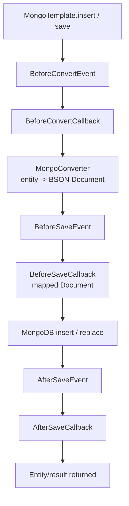
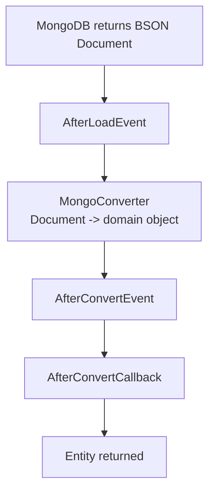
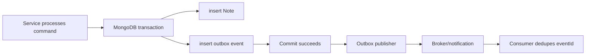

# Distinguishing EntityCallback from ApplicationEvent

## 1. Why Does Spring Data MongoDB Have Two Lifecycle Hook Mechanisms?

When using **Spring Data MongoDB**, we often need to perform an action when an entity is converted, saved, or read: normalizing data, checking preconditions, populating technical fields, logging, or signaling other systems. Two mechanisms are easily confused:

- **`EntityCallback<T>`**: an extension point inside Spring Data's **entity processing flow**; a callback can return a **new or modified entity**, and matching callbacks run in a defined order.
- Spring **`ApplicationEvent`** (specifically `MongoMappingEvent`s like `BeforeConvertEvent`, `BeforeSaveEvent`, `AfterSaveEvent`): an **event published** via `ApplicationContext`/`ApplicationEventMulticaster` for listeners to observe or react to.

Example: a user creates a note with title `"  MongoDB   basics  "`. Before saving, the application wants to normalize the title and compute `normalizedTitle`. After saving, it wants to observe the ID, data type, and processing time.

**Proper split:** use `BeforeConvertCallback<Note>` to produce the normalized entity and pass it to the converter; use `AbstractMongoEventListener<Note>` to collect observation telemetry. **Never** rely on a background event listener to finish mutating the entity in time before MongoDB writes.

### Lesson Objectives

After this lesson, you will be able to:

1. Explain how **`EntityCallback` and `ApplicationEvent` differ in return contracts, ordering, thread/reactive contexts, and purpose**.
2. Choose properly among `BeforeConvertCallback`, `BeforeSaveCallback`, `AfterSaveCallback`, and `AfterConvertCallback`.
3. Write `AbstractMongoEventListener`/`ApplicationListener` to observe `MongoMappingEvent`s properly.
4. Understand that events can run asynchronously, callbacks return new entities supporting immutable classes/records, and `BeforeSave` must operate on the BSON `Document`.
5. Recognize when neither mechanism **runs**, and how to integrate auditing/validation, transactions, reactive access, and integration tests.

## 2. High-Level Comparison

| Criterion | `EntityCallback` | `ApplicationEvent` / `MongoMappingEvent` |
| --- | --- | --- |
| Nature | Hook integrated into entity mapping/persistence pipeline | Notification via Spring application event infrastructure |
| Registration | Bean implementing callback interface; e.g. `BeforeConvertCallback<Note>` | `ApplicationListener<...>`, `@EventListener`, or `AbstractMongoEventListener<Note>` |
| Returns replacement entity | **Yes**: callback returns `T` or reactive `Publisher<T>` | **No contract to return a new entity** to the publisher |
| Modifying immutable entities | Convenient: create a copy and **return** it | Unsuitable for replacing the original object from a listener |
| Same-stage ordering | Ordered via `@Order`/`Ordered`; callbacks run in a deterministic chain | Depends on multicaster/executor; async can break order expectations |
| Reactive support | Dedicated `Reactive...Callback` interfaces | Spring events do not automatically become a reactive composition awaiting listener results |
| When executed | Pre/post conversion, write, and read checkpoints called by Spring Data | When Spring Data publishes the corresponding event |
| BSON access | `BeforeSaveCallback`/`AfterConvertCallback` receive `org.bson.Document` where appropriate | E.g. `BeforeSaveEvent` also carries `Document` |
| Recommended tasks | Normalization, ensuring pre-mapping data, validation | Observation, metrics/logs/notifications not affecting write correctness |
| Guarantees post-DB commit? | **No**, not merely from the name `AfterSave` | **No**, not merely from the name `AfterSaveEvent` |
| Reliable business event? | No | No; for durable publishing consider an outbox |

**Decision rule:** If logic **must complete before the entity persists or must be able to return a new instance**, choose `EntityCallback`. If logic only **listens to a signal** without controlling the mapping output, `ApplicationEvent` can work. For external side effects guaranteed **after commit**, **neither mechanism alone is enough**.

### 2.1. Two Different Meanings of "Event"

In Spring, `ApplicationEvent` is a general-purpose mechanism. Spring Data MongoDB publishes **mapping lifecycle events** (such as `BeforeSaveEvent<Note>`) through it. A system can also publish **domain events** like `OrderPaid`. Both may use `ApplicationEventPublisher`, yet they do **not share the same contract**:

- `BeforeSaveEvent` is tied to the **mapping lifecycle**; it does not prove a business transaction committed.
- `OrderPaid` is an **application-defined business event**; emitting it reliably with transactions requires deciding publication timing, transaction phase, and durability.
- Neither automatically provides "exactly-once" delivery over a message broker or HTTP.

## 3. Entity Save and Read Timelines

For a `MongoTemplate.insert(note)` or `save(note)` operation on a mapped path, conceptually visualize the flow:



When reading a root entity:



According to Spring Data MongoDB documentation, **store-specific `ApplicationEvent`s are published before callbacks at the same lifecycle checkpoint** when callbacks are present. However, if `ApplicationEventMulticaster` uses an async executor, **listeners may execute later**; never assume all listeners finished before the callback begins.

**These diagrams show conceptual flow**, not a guarantee that event listeners always execute synchronously or in absolute order alongside every custom interceptor in your project. Exact APIs and invocation points can vary across Spring Data releases and operation paths.

### 3.1. Supported EntityCallback Points in MongoDB

| Callback Interface | Method / Main Parameters | Effect |
| --- | --- | --- |
| `BeforeConvertCallback<T>` | `onBeforeConvert(T, String collection)` | Before entity becomes BSON Document; returned entity is persisted |
| `BeforeSaveCallback<T>` | `onBeforeSave(T, Document, String collection)` | After convert, before write command; **`Document`** is the actual payload saved |
| `AfterSaveCallback<T>` | `onAfterSave(T, Document, String collection)` | After write operation; can adjust returned entity, **does not re-save** changes |
| `AfterConvertCallback<T>` | `onAfterConvert(T, Document, String collection)` | After converting BSON to entity; can adjust entity returned on read |
| `ReactiveBeforeConvertCallback<T>` | `Publisher<T> onBeforeConvert(T, String)` | Reactive counterpart to BeforeConvert |
| `ReactiveBeforeSaveCallback<T>` | `Publisher<T> onBeforeSave(T, Document, String)` | Reactive counterpart to BeforeSave |
| `ReactiveAfterSaveCallback<T>` | `Publisher<T> onAfterSave(T, Document, String)` | Reactive counterpart to AfterSave |
| `ReactiveAfterConvertCallback<T>` | `Publisher<T> onAfterConvert(T, Document, String)` | Reactive counterpart to AfterConvert |

The Mongo-specific interfaces live in `org.springframework.data.mongodb.core.mapping.event`. `org.springframework.data.mapping.callback.EntityCallback` is the common abstraction in Spring Data Commons, while the specific lifecycle methods belong to the MongoDB module.

### 3.2. Common MongoDB Mapping Events

| Event | When Published | Listener Example |
| --- | --- | --- |
| `BeforeConvertEvent<T>` | Before converting entity to BSON | `onBeforeConvert(BeforeConvertEvent<T>)` |
| `BeforeSaveEvent<T>` | Before writing Document to MongoDB | `onBeforeSave(BeforeSaveEvent<T>)` |
| `AfterSaveEvent<T>` | After writing to MongoDB | `onAfterSave(AfterSaveEvent<T>)` |
| `AfterLoadEvent<T>` | After reading BSON, before mapping to entity | `onAfterLoad(AfterLoadEvent<T>)` |
| `AfterConvertEvent<T>` | After BSON is converted to entity | `onAfterConvert(AfterConvertEvent<T>)` |
| `BeforeDeleteEvent<T>`/`AfterDeleteEvent<T>` | Delete checkpoints on supported mapping APIs | `onBeforeDelete(...)`/`onAfterDelete(...)` |

The event list **is not 1-to-1** with the `EntityCallback` list: for example, MongoDB has mapping events for deletes and `AfterLoad`, yet you must not assume a `BeforeDeleteCallback` or `AfterLoadCallback` interface exists in the main callback table.

## 4. The Decisive Difference: Callbacks Return Entities, Events Only Notify

### 4.1. Immutable Entities Should Not Be "Mutated In Place"

With a Java `record` or immutable class, you cannot write:

```java
// Does not compile on an immutable record:
note.setNormalizedTitle("mongo-db");
```

Instead of trying to mutate the object in a listener, `BeforeConvertCallback` can construct a copy and **return** the new object:

```java
@Override
public Note onBeforeConvert(Note source, String collection) {
    return new Note(
        source.id(),
        source.tenantId(),
        source.title().strip(),
        normalize(source.title()),
        source.createdAt()
    );
}
```

Spring Data uses the callback's return value as the entity for subsequent mapping steps. That is why `EntityCallback` was introduced in Spring Data Commons 2.2: to provide an **ordered entity-modification contract** without relying on haphazard mutations inside event listeners.

### 4.2. Why Is `BeforeSaveCallback` Different from `BeforeConvertCallback`?

`BeforeConvertCallback` runs when the entity has **not yet been converted** to BSON. Modifying the entity beforehand affects the mapped persistent properties.

`BeforeSaveCallback` runs **after** `MongoConverter` has already constructed `org.bson.Document`. Therefore, changing `entity.title` at this point without updating the BSON `Document` can **still write the old Document value**. The [official Javadoc for `BeforeSaveCallback`](https://docs.spring.io/spring-data/mongodb/docs/current/api/org/springframework/data/mongodb/core/mapping/event/BeforeSaveCallback.html) stresses: at this point, **persistent property changes on the domain object are not used for saving**; to alter persisted fields, mutate `Document` or move the logic up to `BeforeConvertCallback`.

Example:

```java
@Override
public Note onBeforeSave(
        Note entity, org.bson.Document document, String collection) {

    // Operate on the payload that will be sent to MongoDB:
    document.put("source_system", "article-api");

    // Can return the same entity or an instance appropriate for the pipeline.
    return entity;
}
```

This code adds the BSON field `source_system`. Because `Note` has no such property, reading back `Note` will **not automatically provide** a getter for this field; to expose it in the domain model, add the mapping or use an appropriate DTO/projection.

### 4.3. ApplicationEvent May Hold Mutable References — Without an Entity-Replacement Contract

`BeforeConvertEvent<Note>` or `BeforeSaveEvent<Note>` may carry entity/Document references. With mutable entities, a listener **can** mutate the shared object when running synchronously. However, there is no contract to return a replacement instance—leaving no way to swap in a new immutable entity—and with an **async event listener**, mutations may happen **after** conversion and writing.

**Never write correctness-critical logic that relies on an event listener mutating an entity before MongoDB writes.** Use callbacks and test persisted results.

## 5. Complete Example: Immutable `Note` and `BeforeConvertCallback`

This section targets Java 17+, Spring Boot 3.x, and `spring-boot-starter-data-mongodb`. Requirement: when inserting a note, normalize whitespace in the title, populate `normalizedTitle` using the same rule, and set `createdAt` only if the caller did not provide one. Because a note is an **immutable record**, the callback must return a **new record**.

### 5.1. Entity and BSON Field Names

```java
package com.example.notes;

import java.time.Instant;
import org.springframework.data.annotation.Id;
import org.springframework.data.mongodb.core.mapping.Document;
import org.springframework.data.mongodb.core.mapping.Field;

@Document(collection = "notes")
public record Note(
    @Id String id,
    @Field("tenant_id") String tenantId,
    String title,
    @Field("normalized_title") String normalizedTitle,
    @Field("created_at") Instant createdAt
) {}
```

The example assigns an explicit ID before inserting (such as `"NOTE-001"`), rather than relying on callbacks to generate IDs. This keeps the example focused and avoids conflating ID mapping with title normalization. `tenantId` must come from an authenticated context; tenant authorization must never be delegated entirely to lifecycle callbacks.

### 5.2. Testable Clock

```java
package com.example.notes;

import java.time.Clock;
import org.springframework.context.annotation.Bean;
import org.springframework.context.annotation.Configuration;

@Configuration
public class NoteClockConfig {

    @Bean
    public Clock noteClock() {
        return Clock.systemUTC();
    }
}
```

Instead of scattering hard-to-test `Instant.now()` calls, the callback receives a `Clock` via constructor injection.

### 5.3. Normalization Callback Running Before Converter

```java
package com.example.notes;

import java.time.Clock;
import java.time.Instant;
import java.util.Locale;
import org.springframework.core.annotation.Order;
import org.springframework.data.mongodb.core.mapping.event.BeforeConvertCallback;
import org.springframework.stereotype.Component;

@Component
@Order(200)
public final class NoteNormalizationCallback
        implements BeforeConvertCallback<Note> {

    private final Clock clock;

    public NoteNormalizationCallback(Clock clock) {
        this.clock = clock;
    }

    @Override
    public Note onBeforeConvert(Note source, String collection) {
        if (source.tenantId() == null
                || source.tenantId().isBlank()) {
            throw new IllegalArgumentException("Missing tenant");
        }
        if (source.title() == null) {
            throw new IllegalArgumentException("Missing title");
        }

        String cleaned = source.title()
            .strip()
            .replaceAll("\\s+", " ");

        if (cleaned.isBlank()) {
            throw new IllegalArgumentException("Empty title");
        }

        String normalized = cleaned.toLowerCase(Locale.ROOT);
        Instant created = source.createdAt() == null
            ? clock.instant()
            : source.createdAt();

        // Return a new record; DO NOT mutate source.
        return new Note(
            source.id(),
            source.tenantId(),
            cleaned,
            normalized,
            created
        );
    }
}
```

Key points:

1. `onBeforeConvert` runs **before MongoConverter**, so the normalized title appears in the resulting BSON Document.
2. The `Note` record is immutable, yet the callback returns a **new instance**; Spring Data passes that new instance down the pipeline.
3. An existing `createdAt` is **preserved**, avoiding overwriting timestamps on every `save`. This matters greatly during retries or updates.
4. `@Order(200)` sets relative priority among callbacks **in the same lifecycle stage**; it does not mean every other event listener finishes before it.
5. `200` is illustrative. When MongoDB auditing is enabled (typically order `100`), check ordering and avoid overwriting timestamps/auditors populated by another callback.

With title `"  MongoDB    and Spring  "`, the expected persisted result is:

```javascript
{
  _id: "NOTE-001",
  tenant_id: "SHOP-A",
  title: "MongoDB and Spring",
  normalized_title: "mongodb and spring",
  created_at: ISODate("2026-11-20T08:00:00Z")
}
```

The `created_at` value illustrates a fixed test `Clock`; in production, `Clock.systemUTC()` supplies the current time.

### 5.4. Callbacks Do Not Prevent Duplicates or Guard All Write Paths

Two distinct requests can normalize to the same `normalizedTitle = "mongodb and spring"`. If business rules require uniqueness on `(tenant_id, normalized_title)`, you **need a unique index** and `DuplicateKeyException` handling—not just a callback:

```javascript
db.notes.createIndex(
  { tenant_id: 1, normalized_title: 1 },
  {
    unique: true,
    name: "notes_tenant_normalized_title_unique"
  }
)
```

Callbacks guarantee normalization only on **entity write paths that invoke them**; they do not replace database constraints or schema validation. Create indexes in migrations before serving concurrent traffic.

## 6. `BeforeSaveCallback`: Distinguishing the Entity Object from the BSON Document

Suppose we want to add a storage field `source_system` to BSON without adding it to the `Note` domain model. A before-save callback can modify the `Document` produced by the converter:

```java
package com.example.notes;

import org.bson.Document;
import org.springframework.core.annotation.Order;
import org.springframework.data.mongodb.core.mapping.event.BeforeSaveCallback;
import org.springframework.stereotype.Component;

@Component
@Order(300)
public final class NoteBsonMarkerCallback
        implements BeforeSaveCallback<Note> {

    @Override
    public Note onBeforeSave(
            Note entity, Document document, String collection) {

        if (!"notes".equals(collection)) {
            return entity;
        }

        document.put("source_system", "note-api");
        return entity;
    }
}
```

After `MongoTemplate.insert(...)` runs, the BSON document contains:

```javascript
{
  _id: "NOTE-001",
  title: "MongoDB and Spring",
  normalized_title: "mongodb and spring",
  source_system: "note-api",
  // ... tenant_id, created_at ...
}
```

`source_system` is not a property on `Note`; when reading back as `Note`, standard mapping ignores unmapped fields. If APIs need to consume this field as durable data, add it to the schema/entity or use a projection. Do not abuse callbacks to stash lots of unmanaged "hidden" fields.

### Common Mistake: Replacing the Entity in `BeforeSave`

```java
// Illustrates WRONG thinking: altering the object after Document was built.
public Note onBeforeSave(Note entity, Document document, String collection) {
    Note changed = new Note(
        entity.id(), entity.tenantId(),
        "New title", "new title", entity.createdAt());

    return changed;
}
```

Returning `changed` does not guarantee `"New title"` is saved, because the **BSON Document was already constructed from the old entity**. The Javadoc states you must mutate **`Document`** to affect persisted contents at this checkpoint. To modify persistent domain properties while keeping the returned object in sync, put the logic in `BeforeConvertCallback`.

### `AfterSaveCallback` Is Not a Second Save Either

`AfterSaveCallback` can return a modified entity to the caller, yet the main MongoDB operation **has already been dispatched/completed** at that checkpoint. Mutating the entity inside `AfterSaveCallback` **does not automatically write** new edits back to the collection.

```java
import org.bson.Document;
import org.springframework.data.mongodb.core.mapping.event.AfterSaveCallback;

public final class NoteAfterSaveObserver
        implements AfterSaveCallback<Note> {

    @Override
    public Note onAfterSave(
            Note entity, Document document, String collection) {
        // Restrict to observation or shaping the return value.
        // Never assume object changes here are persisted.
        return entity;
    }
}
```

This final class merely illustrates the callback; for Spring to discover it automatically, register it as a bean (`@Component` or `@Bean`). In the main example, no extra pass-through callback is needed; it is included here to explain the lifecycle.

## 7. `ApplicationEvent`: Listening to `MongoMappingEvent` Properly

Spring Data MongoDB provides `AbstractMongoEventListener<T>`, an adapter over `ApplicationListener<MongoMappingEvent<?>>` with typed checkpoint methods.

### 7.1. A Listener That Observes Instead of Mutating Data

```java
package com.example.notes;

import org.slf4j.Logger;
import org.slf4j.LoggerFactory;
import org.springframework.data.mongodb.core.mapping.event.AbstractMongoEventListener;
import org.springframework.data.mongodb.core.mapping.event.BeforeConvertEvent;
import org.springframework.data.mongodb.core.mapping.event.BeforeSaveEvent;
import org.springframework.data.mongodb.core.mapping.event.AfterSaveEvent;
import org.springframework.stereotype.Component;

@Component
public final class NoteLifecycleObserver
        extends AbstractMongoEventListener<Note> {

    private static final Logger log =
        LoggerFactory.getLogger(NoteLifecycleObserver.class);

    @Override
    public void onBeforeConvert(BeforeConvertEvent<Note> event) {
        log.debug("BeforeConvert noteId={}",
            event.getSource().id());
    }

    @Override
    public void onBeforeSave(BeforeSaveEvent<Note> event) {
        log.debug("BeforeSave noteId={}",
            event.getSource().id());
    }

    @Override
    public void onAfterSave(AfterSaveEvent<Note> event) {
        log.debug("AfterSave noteId={}",
            event.getSource().id());
    }
}
```

This snippet illustrates **observation** and logging **technical IDs**. In production systems, follow logging/PII policies and never dump note content, tokens, or sensitive fields into logs just because the event carries the entity. `onAfterSave` only indicates the event fired **after the save operation**, not that a transaction committed or that an external message was delivered.

### 7.2. Why Use the Adapter?

`AbstractMongoEventListener<Note>` saves you from manual `instanceof` checks across every event type in an `ApplicationListener<MongoMappingEvent<?>>`. For cross-cutting system needs, you can still use `@EventListener` or `ApplicationListener`, provided you account for type filtering, ordering, and the `ApplicationEventMulticaster` executor.

In apps with many distinct entities, typing listeners to specific root entities reduces overhead and avoids accidentally handling out-of-scope data. If a listener serves system-wide auditing, design dedicated auditing rather than relying on an un-durable event stream.

### 7.3. Event Listeners Can Mutate Document — Why Shouldn't They Be Used for Correctness?

`BeforeSaveEvent<Note>` exposes both the entity and the BSON Document. When dispatched synchronously, mutating Document before the driver writes **can** affect persisted data. Yet if the multicaster uses an async `TaskExecutor`, the listener ceases to be a reliable gate: the write flow can proceed before the listener modifies Document. For immutable types, listeners also lack any contract to return a new entity.

**Practice:** logic producing mandatory fields belongs in `BeforeConvertCallback`/`BeforeSaveCallback`; event listeners handle separate observational work that may lag or even be skipped depending on event-publishing settings. Never rely on listeners as your sole invariant guard.

### 7.4. Listeners Can Handle Delete Events

MongoDB offers `BeforeDeleteEvent` and `AfterDeleteEvent` on supported mapping/template delete paths. This **does not** mean direct driver deletes, TTL expirations, or bulk query updates fire a full-entity event per document:

```java
// The adapter can also override:
// onBeforeDelete(BeforeDeleteEvent<Note> event)
// onAfterDelete(AfterDeleteEvent<Note> event)
```

In particular, TTL deletions execute in the MongoDB background server monitor—bypassing `MongoTemplate` in your JVM—so they never trigger entity callbacks or Spring application lifecycle events per deleted document.

## 8. Ordering, `@Order`, Multicasters, and Threads

### 8.1. `EntityCallback`s Execute Sequentially by Order

If two callbacks both implement `BeforeConvertCallback<Note>`:

```java
@Component
@Order(50)
class FirstNoteCallback implements BeforeConvertCallback<Note> {
    @Override
    public Note onBeforeConvert(Note note, String collection) {
        return note; // E.g. could validate before the next callback.
    }
}

@Component
@Order(200)
class SecondNoteCallback implements BeforeConvertCallback<Note> {
    @Override
    public Note onBeforeConvert(Note note, String collection) {
        return note;
    }
}
```

These are hypothetical beans; do not register them alongside section 5's callback in production. With `@Order`, **lower numbers have higher precedence**; for before-convert callbacks, Spring applies them in order and passes each returned entity into the next step. Unordered callbacks typically run with lowest precedence; when two callbacks share the same order, never rely on arbitrary tie-breaking.

Use `@Order` for **truly meaningful sequences**: validate inputs, enrich defaults, then normalize or audit per policy. Still, the more cross-dependent callbacks you add, the harder the system becomes to reason about; complex business workflows belong in dedicated services.

### 8.2. `ApplicationEventMulticaster` Can Dispatch Asynchronously

By default, Spring's `SimpleApplicationEventMulticaster` invokes listeners **on the publishing thread**. However, an executor can be configured:

```java
import java.util.concurrent.Executor;
import org.springframework.context.annotation.Bean;
import org.springframework.context.annotation.Configuration;
import org.springframework.context.event.ApplicationEventMulticaster;
import org.springframework.context.event.SimpleApplicationEventMulticaster;
import org.springframework.core.task.SimpleAsyncTaskExecutor;

@Configuration
class AsyncEventConfig {

    @Bean(name = "applicationEventMulticaster")
    ApplicationEventMulticaster applicationEventMulticaster() {
        SimpleApplicationEventMulticaster m =
            new SimpleApplicationEventMulticaster();
        m.setTaskExecutor(
            new SimpleAsyncTaskExecutor("app-event-"));
        return m;
    }
}
```

**This example alters dispatch across the entire `ApplicationContext`** and is not a recommendation to copy blindly into every project. It affects other listeners, lifecycle/security/tracing propagation, exception handling, and observed ordering. In newer Spring Framework releases, some listeners declare synchronous execution requirements; check the `supportsAsyncExecution` contract for your framework version.

When events dispatch asynchronously:

- There is no guarantee a listener mutated the entity/Document **before** the template proceeded.
- Listener threads do not automatically inherit the caller's thread-local transaction/security context or Reactor context.
- Exceptions in an async listener do not automatically roll back the caller's MongoDB operation.
- Listeners may process events **after** the caller already returned a response or aborted the transaction.

Hence **events are not blocking hooks for guaranteeing persisted document correctness**.

## 9. Reactive: Use `Reactive...Callback` Interfaces, Never Synchronous Listeners as a Substitute

In Spring WebFlux apps using `ReactiveMongoTemplate`, matching callbacks carry the `Reactive` prefix and return **`Publisher<T>`**, usually `Mono<T>`. Callbacks run upon **subscription** and compose non-blocking work sequentially into the reactive persistence chain.

### 9.1. `ReactiveBeforeConvertCallback<Note>` Example

```java
package com.example.notes;

import java.time.Clock;
import java.time.Instant;
import java.util.Locale;
import org.reactivestreams.Publisher;
import org.springframework.core.annotation.Order;
import org.springframework.data.mongodb.core.mapping.event.ReactiveBeforeConvertCallback;
import org.springframework.stereotype.Component;
import reactor.core.publisher.Mono;

@Component
@Order(200)
public final class ReactiveNoteNormalizationCallback
        implements ReactiveBeforeConvertCallback<Note> {

    private final Clock clock;

    public ReactiveNoteNormalizationCallback(Clock clock) {
        this.clock = clock;
    }

    @Override
    public Publisher<Note> onBeforeConvert(
            Note source, String collection) {

        return Mono.fromSupplier(() -> {
            if (source.title() == null
                    || source.title().isBlank()
                    || source.tenantId() == null
                    || source.tenantId().isBlank()) {
                throw new IllegalArgumentException(
                    "Missing note fields");
            }

            String cleaned = source.title()
                .strip()
                .replaceAll("\\s+", " ");

            Instant created = source.createdAt() == null
                ? clock.instant()
                : source.createdAt();

            return new Note(
                source.id(),
                source.tenantId(),
                cleaned,
                cleaned.toLowerCase(Locale.ROOT),
                created
            );
        });
    }
}
```

With the reactive driver, `ReactiveMongoTemplate.insert(note)` returns `Mono<Note>`, and execution/callbacks trigger only when subscribed. `Mono.fromSupplier` defers computation/validation into the publisher stream rather than running eagerly when building the `Mono`.

If a unit test invokes `onBeforeConvert(...)` **without subscribing**, the supplier body never executes; use `StepVerifier` or a subscribing test operator. In production, **never** call `block()` inside a callback just to make reactive work synchronous.

### 9.2. Two Callback Systems Separated by API

| Operation Path | Callbacks Applied |
| --- | --- |
| `MongoTemplate.insert(note)` | Matching synchronous `BeforeConvertCallback<Note>` / `BeforeSaveCallback<Note>` |
| `ReactiveMongoTemplate.insert(note)` | Matching `ReactiveBeforeConvertCallback<Note>` / `ReactiveBeforeSaveCallback<Note>` |
| Spring Data reactive mapping/read | Matching reactive `after-*` callbacks |
| Direct native driver call bypassing template mapping | No Spring Data callback beans run automatically |

**Registering `BeforeConvertCallback<Note>` does not make the reactive template call it.** Spring Data separates callbacks by API style. If a project uses both imperative and reactive paths, register **both** and share a **pure normalization function** to keep business logic identical. See [Lifecycle Events — Spring Data MongoDB](https://docs.spring.io/spring-data/mongodb/reference/mongodb/lifecycle-events.html).

### 9.3. Reactive `BeforeSaveCallback` Must Return a Publisher of the Entity

```java
package com.example.notes;

import org.bson.Document;
import org.reactivestreams.Publisher;
import org.springframework.data.mongodb.core.mapping.event.ReactiveBeforeSaveCallback;
import org.springframework.stereotype.Component;
import reactor.core.publisher.Mono;

@Component
public final class ReactiveNoteBsonMarkerCallback
        implements ReactiveBeforeSaveCallback<Note> {

    @Override
    public Publisher<Note> onBeforeSave(
            Note note, Document document, String collection) {

        return Mono.fromSupplier(() -> {
            document.put("source_system", "note-api");
            return note;
        });
    }
}
```

Reactive callbacks **must emit the entity** for Spring Data to continue processing. Accidentally returning `Mono.empty()` leaves downstream without an entity, causing unexpected behavior. When validation fails, emit `Mono.error(...)` instead of "swallowing the error as empty." In `BeforeSave`, persisted contents still come from the mapped **BSON Document**.

### 9.4. Reactive Mapping Events Are Not Ordered Reactive Middleware

Mapping lifecycle `ApplicationEvent`s still route through Spring's event infrastructure; they are **not** a `Publisher<T>` chain awaited by Spring Data in business callback order. When listeners run asynchronously, never rely on the caller's transactional `Reactor Context` automatically existing on the listener thread.

Dangerous example:

```java
// AVOID: spawns a detached subscription to modify the entity.
@EventListener
public void beforeSave(BeforeSaveEvent<Note> event) {
    reactiveMongoTemplate.save(event.getSource())
        .subscribe();
}
```

This can **trigger an infinite lifecycle loop** (saving fires the event again), detach from the caller's transaction, cause duplicate writes, and introduce races. If a business requirement needs another write, put it in the service/transaction or outbox; never spawn a fire-and-forget subscription inside a mapping event.

## 10. Auditing, Validation, and Built-In Callback Ordering

Spring Data MongoDB uses `EntityCallback` for built-in features like auditing and Bean Validation. This matters when adding custom callbacks: a single entity may pass through **multiple callbacks at the same stage**.

### 10.1. Auditing Uses `BeforeConvertCallback`

Spring Data supports `@CreatedDate`, `@LastModifiedDate`, `@CreatedBy`, and `@LastModifiedBy` with auditing enabled. Example:

```java
import java.time.Instant;
import org.springframework.data.annotation.CreatedDate;
import org.springframework.data.annotation.LastModifiedDate;
import org.springframework.data.mongodb.core.mapping.Document;

@Document(collection = "audit_notes")
public class AuditNote {

    @CreatedDate
    private Instant createdAt;

    @LastModifiedDate
    private Instant updatedAt;

    // ... id, title, constructor, getters ...
}
```

Imperative configuration:

```java
import org.springframework.context.annotation.Configuration;
import org.springframework.data.mongodb.config.EnableMongoAuditing;

@Configuration
@EnableMongoAuditing
public class MongoAuditingConfig {}
```

For reactive:

```java
import org.springframework.context.annotation.Configuration;
import org.springframework.data.mongodb.config.EnableReactiveMongoAuditing;

@Configuration
@EnableReactiveMongoAuditing
public class ReactiveMongoAuditingConfig {}
```

Auditing callbacks typically carry `Ordered` precedence **100** and run at the `BeforeConvert` phase. If a custom callback creates a **new immutable instance yet forgets to copy the populated audit fields**, it can accidentally wipe timestamps/auditors. In `NoteNormalizationCallback`, we **preserved** existing `createdAt`. For immutable entities with auditing, verify field copying and Spring Data version compatibility.

Do not rewrite all of auditing manually if official annotations cover the need. Add custom callbacks only for custom rules, and test interactions with `@CreatedDate`/`@LastModifiedDate` so timestamps are not overwritten due to ordering.

### 10.2. Validation Is a Pre-Save Callback

Spring Data MongoDB supports registering `ValidatingEntityCallback` with Jakarta Validation:

```java
import jakarta.validation.Validator;
import org.springframework.context.annotation.Bean;
import org.springframework.context.annotation.Configuration;
import org.springframework.data.mongodb.core.mapping.event.ValidatingEntityCallback;

@Configuration
class NoteValidationConfig {

    @Bean
    ValidatingEntityCallback validatingEntityCallback(
            Validator validator) {
        return new ValidatingEntityCallback(validator);
    }
}
```

For reactive, use `ReactiveValidatingEntityCallback` when supported by your dependency version with an appropriate `Validator`. Bean validation does not replace schema validation, unique indexes, or user authorization checks: they guard **different layers** of the system.

**Note:** if a project still has legacy `ValidatingMongoEventListener` registered alongside `ValidatingEntityCallback`, validation may execute **twice**. Inspect existing configuration when migrating from listeners to callbacks to avoid performance surprises or duplicate error messages.

### 10.3. Callback and Validation Order Can Change Semantics

Suppose `Note` has a title padded with whitespace; if a callback checks `title.length() <= 20` **before** normalization runs, a request may be rejected even though the normalized title is 18 characters long. If validation should inspect normalized values, choose the right stage/order and test it. Do not treat `@Order` as duct tape over tangled overlapping callbacks; keep normalization and validation cleanly structured.

## 11. When Lifecycle Hooks Do Not Run

**This is the most common pitfall when treating callbacks as mandatory validation for all writes.** Mapping lifecycle hooks attach to **Spring Data's entity conversion paths**, not to every MongoDB server command.

### 11.1. `updateFirst`, `updateMulti`, and Update Pipelines

```java
mongoTemplate.updateFirst(
    Query.query(Criteria.where("id").is("NOTE-001")),
    new Update().set("title", "  unnormalized  "),
    Note.class
);
```

This builds an **update command** from a query/`UpdateDefinition`, without routing a `Note` entity through `BeforeConvertCallback`/`BeforeSaveCallback` like `insert(note)`. It can directly persist an unnormalized title.

Likewise, `updateMulti`, direct updates, bulk updates, and aggregation pipeline updates should never be assumed to run **per-entity callbacks**. To enforce normalization across all update paths, apply the rule in the service constructing `Update`, use server-side validators/constraints, or control write APIs.

### 11.2. Bulk Operations and the Native Driver

```java
mongoTemplate.bulkOps(
    org.springframework.data.mongodb.core.BulkOperations.BulkMode.UNORDERED,
    Note.class
).updateOne(
    Query.query(Criteria.where("id").is("NOTE-001")),
    new Update().set("title", "unprocessed")
).execute();
```

Bulk operations operate at a lower level with distinct mapping/optimistic-locking semantics; **do not rely on per-entity lifecycle callbacks or per-entity events** for each modified document. Similarly, calling `MongoCollection.insertOne(Document)` directly through the Java driver bypasses Spring Data's mapping layer and callbacks.

Therefore, truly invariant data rules—especially involving money, tenants, permissions, or unique business keys—must be protected at the **schema/index/conditional-update/transaction** and service layers, not callbacks alone.

### 11.3. Root Entities, Embedded Objects, and `@DBRef`

Spring Data MongoDB notes that **mapping lifecycle events are emitted only for root-level types**. An embedded object stored **inside a parent document** does not automatically receive its own events as a root entity; `@DBRef` references may follow separate loading paths depending on operation and version.

```java
@Document("orders")
class OrderDocument {
    @Id String id;
    Address shippingAddress;  // embedded object
}

class Address {
    String city;
}
```

Never create `AbstractMongoEventListener<Address>` assuming every `OrderDocument` save emits `BeforeSaveEvent<Address>`. With `EntityCallback<Address>`, do not assume it fires for every nested property either; callbacks trigger at checkpoints for the **aggregate being processed**. To normalize addresses, handle them in **root `OrderDocument`'s** callback or an appropriate converter/service.

### 11.4. TTL Deletions, Shell, and External Systems

MongoDB's TTL monitor, commands run in `mongosh`, bulk imports, or another Node.js service do not execute inside your Java `ApplicationContext`. They **never** invoke `EntityCallback<Note>` or `ApplicationListener<BeforeSaveEvent<Note>>` in your Spring app. That makes callbacks unsuitable as a cross-client enforcement boundary.

### 11.5. Disabling Lifecycle Events and Read Overhead

Publishing lifecycle events on reads/writes incurs overhead, especially on large result sets. Spring Data MongoDB allows **disabling event publishing** on templates via version-specific configuration APIs. If a project turns off mapping events to cut overhead, listeners will not run—do not interpret missing events as proof MongoDB never loaded or saved the entity.

**EntityCallback and event publishing are two distinct mechanisms**; inspect your actual release's template configuration when disabling or selectively enabling one of them. Never copy event-disabling APIs from another version without verifying your own release's docs.

## 12. Transactions, Rollbacks, and the Truth About "AfterSave"

Names like `AfterSaveCallback` or `AfterSaveEvent` tempt developers into thinking "MongoDB finished committing." **That is false** when an app uses multi-document transactions: a save can succeed **inside an uncommitted transaction**, which later **rolls back** when another operation fails.

### 12.1. Illustrative Timeline

```text
@Transactional
   |
   |--> MongoTemplate.insert(note) -> MongoDB accepts write in transaction
   |       |--> AfterSaveEvent is published
   |       |--> AfterSaveCallback is invoked
   |
   |--> MongoTemplate.updateFirst(otherDocument) -> fails
   |
   +--> transaction rolls back

Result: note does NOT exist after rollback,
yet AfterSave listeners may already have logged or called external services.
```

This does not mean Spring Data callbacks are "broken": they accurately mark the **persistence operation checkpoint**, not an **after-database-commit** contract.

### 12.2. Never Send Emails or Charge Cards Inside `AfterSaveEvent`

Unsafe example:

```java
@Component
class DangerousNoteEventListener
        extends AbstractMongoEventListener<Note> {

    @Override
    public void onAfterSave(AfterSaveEvent<Note> event) {
        // AVOID: external side effects do not roll back with MongoDB.
        // paymentClient.charge(...);
        // emailClient.send(...);
    }
}
```

Suppose the MongoDB transaction aborts after the callback: the sent email cannot be rolled back by MongoDB's transaction. Plus, if the listener runs asynchronously, events can run late or errors can fail to reach the caller.

**Alternative design:** when events must publish reliably after business data commits, use a **transactional outbox**: persist the entity and an outbox record **in the same MongoDB transaction**, then publish via a worker outside the transaction. Consumers deduplicate using an event ID / idempotency key.



For strictly **best-effort observation** (metrics/logs that are safe to drop), `AfterSaveEvent` can be appropriate. Just document clearly that it is neither a legal audit log nor the sole record of business truth.

### 12.3. Does `@TransactionalEventListener(AFTER_COMMIT)` Replace an Outbox?

Spring Framework provides `@TransactionalEventListener` to bind event handling to transaction phases such as `AFTER_COMMIT` for imperative transactions. However:

- The event must be published **while a matching transaction context is active**; by default, without a transaction the listener is not called (unless fallback is configured).
- For reactive transactions using **Reactor Context**, publishing events and passing transaction context to listeners differs from thread-bound imperative transactions; use compatible utilities like `TransactionalEventPublisher` per your Spring Framework release.
- `AfterSaveCallback` itself **does not automatically act like `@TransactionalEventListener(AFTER_COMMIT)`**.
- Even if a listener runs after commit, if the process crashes **after commit but before processing the event**, the in-memory application event is lost. `@TransactionalEventListener` does not replace an outbox when crash-resilient delivery is required.

Recommended choices:

| Requirement | Appropriate Tool |
| --- | --- |
| Transform entity before saving | `EntityCallback` |
| Best-effort mapping event observation | `ApplicationEvent` / `AbstractMongoEventListener` |
| Run an in-process listener after transaction commit when supported | `@TransactionalEventListener(AFTER_COMMIT)` with proper context |
| Emit business events durably across crashes with queued retries | Transactional outbox + idempotent consumer |
| Prevent duplicate processing of the same request | Unique indexes, conditional updates/transactions, and idempotency ledger |

### 12.4. Exception Propagation and Rollbacks

If `BeforeConvertCallback` throws `IllegalArgumentException` before saving, the normal `insert/save` stops and sends no write for that entity. Inside a transaction, propagating exceptions can trigger Spring transaction rollback per policy. However, if a callback **already triggered external side effects** before throwing, those side effects do not roll back.

With a **synchronous** `ApplicationEvent` listener, an exception can propagate back to the publisher and fail the caller's operation, depending on multicaster and error handler settings. With an **asynchronous** listener, exceptions may execute on another thread without blocking the write. **Never** base critical validation on these configuration-sensitive differences.

## 13. Designing Responsibilities and Side Effects in Callbacks

Callbacks are powerful because they sit close to persistence. That also makes code hard to maintain if you stuff business workflows into hooks.

### 13.1. Callbacks Should Be Short, Deterministic, and Free of Slow I/O

Good fits:

- Pre-mapping field normalization (trimming, canonical code formatting, conditional defaults).
- Checking basic entity invariants and throwing specific errors.
- Attaching technical storage metadata to `Document` in `BeforeSave` when genuinely needed.
- Adjusting returned entities for mapping/reads within clearly explainable bounds.

Responsibilities that belong in services instead:

- Creating orders, charging payments, sending emails, calling external services.
- Reading multiple collections to enforce quotas under contention.
- Calling `MongoTemplate.save` again inside the same entity's callback.
- Waiting on HTTP requests, distributed locks, or running large batches inside callbacks.
- Enforcing authorization solely from entity fields instead of authenticated context.

A `BeforeConvertCallback` runs on entity writes even from unrelated requests; "hidden" logic can mutate data unexpectedly, especially when other code calls `save` on existing entities.

### 13.2. Idempotency When Callbacks Run Multiple Times

Suppose a callback appends `"-processed"` to the title on every `save`:

```java
// Contraindicated: non-idempotent normalization.
return new Note(
    source.id(), source.tenantId(),
    source.title() + "-processed",
    source.normalizedTitle(), source.createdAt()
);
```

After two saves, the title becomes `"A-processed-processed"`. Across retries, optimistic locking, or re-imports, this causes data drift. A good rule is a normalization function satisfying:

\[
N(N(x)) = N(x)
\]

For instance, `strip()` and whitespace collapsing are idempotent. For `createdAt`, populate only when null; for `updatedAt`, a real save may intentionally refresh the timestamp, though you must still distinguish "retry of the same request" from "a new update."

### 13.3. Do Not Mix Security Rules into Global Callbacks

Reading `tenantId` from a request-scoped bean is unsafe when callbacks run from background jobs or reactive publishers. An import job has no HTTP request context; an async event listener lacks the caller thread's context. Place authorization checks at the **service boundary**, and enforce tenant filters in queries and unique indexes.

Callbacks can assist with entity validation, yet never replace verifying whether a user is allowed to write or edit that document.

### 13.4. Read Callbacks Do Not Modify Data in MongoDB

`AfterConvertCallback<Note>` is the right checkpoint to return an entity augmented with display or derived attributes, yet it **never updates the BSON Document automatically**. If you use a read callback to "repair legacy data," the fix exists only on the object returned to the caller; migrating stored data requires an explicit, governed write process.

Conceptual example:

```java
import org.bson.Document;
import org.springframework.data.mongodb.core.mapping.event.AfterConvertCallback;

final class NoteReadNormalizer
        implements AfterConvertCallback<Note> {

    @Override
    public Note onAfterConvert(
            Note entity, Document document, String collection) {
        // Can return a new entity for display.
        // Issues NO MongoDB UPDATE automatically.
        return entity;
    }
}
```

This snippet illustrates only the interface; register it as a bean to activate it, and never return a replacement entity that drops IDs, audit fields, or versions.

## 14. Integration Testing: Separating Callbacks from Events via Real Results

Tests should prove **persisted BSON is correct** and returned entities carry callback outputs, rather than mocking method call counts. Use an isolated test MongoDB and `@DataMongoTest` with the required callback/listener beans.

### 14.1. `@DataMongoTest` Setup

```java
package com.example.notes;

import java.time.Clock;
import java.time.Instant;
import java.time.ZoneOffset;
import java.util.concurrent.atomic.AtomicInteger;
import org.bson.Document;
import org.junit.jupiter.api.BeforeEach;
import org.junit.jupiter.api.Test;
import org.springframework.beans.factory.annotation.Autowired;
import org.springframework.boot.test.autoconfigure.data.mongo.DataMongoTest;
import org.springframework.boot.test.context.TestConfiguration;
import org.springframework.context.annotation.Bean;
import org.springframework.context.annotation.Import;
import org.springframework.data.mongodb.core.MongoTemplate;
import org.springframework.data.mongodb.core.mapping.event.AbstractMongoEventListener;
import org.springframework.data.mongodb.core.mapping.event.AfterSaveEvent;
import org.springframework.data.mongodb.core.mapping.event.BeforeConvertEvent;
import org.springframework.data.mongodb.core.query.Criteria;
import org.springframework.data.mongodb.core.query.Query;
import org.springframework.data.mongodb.core.query.Update;

import static org.assertj.core.api.Assertions.assertThat;

@DataMongoTest
@Import({
    NoteNormalizationCallback.class,
    NoteBsonMarkerCallback.class,
    NoteLifecycleIntegrationTest.TestBeans.class
})
class NoteLifecycleIntegrationTest {

    @Autowired
    MongoTemplate template;

    @Autowired
    Probe probe;

    @TestConfiguration
    static class TestBeans {

        @Bean
        Clock clock() {
            return Clock.fixed(
                Instant.parse("2026-11-20T08:00:00Z"),
                ZoneOffset.UTC);
        }

        @Bean
        Probe probe() {
            return new Probe();
        }
    }

    static class Probe extends AbstractMongoEventListener<Note> {
        final AtomicInteger beforeCount = new AtomicInteger();
        final AtomicInteger afterCount = new AtomicInteger();
        volatile String rawTitle;

        @Override
        public void onBeforeConvert(BeforeConvertEvent<Note> event) {
            rawTitle = event.getSource().title();
            beforeCount.incrementAndGet();
        }

        @Override
        public void onAfterSave(AfterSaveEvent<Note> event) {
            afterCount.incrementAndGet();
        }

        void reset() {
            beforeCount.set(0);
            afterCount.set(0);
            rawTitle = null;
        }
    }

    @BeforeEach
    void prepareIsolatedDatabase() {
        // Use ONLY on an isolated test DB, never in production!
        template.remove(new Query(), Note.class);
        probe.reset();
    }

    @Test
    void immutableCallbackChangesPersistedData() {
        Note input = new Note(
            "NOTE-001", "SHOP-A",
            "  MongoDB    and Spring  ", null, null);

        Note saved = template.insert(input);

        assertThat(saved.title())
            .isEqualTo("MongoDB and Spring");
        assertThat(saved.normalizedTitle())
            .isEqualTo("mongodb and spring");
        assertThat(saved.createdAt()).isEqualTo(
            Instant.parse("2026-11-20T08:00:00Z"));

        // Read Document directly to verify BSON fields.
        Document stored = template.getCollection("notes")
            .find(new Document("_id", "NOTE-001"))
            .first();

        assertThat(stored).isNotNull();
        assertThat(stored.getString("title"))
            .isEqualTo("MongoDB and Spring");
        assertThat(stored.getString("normalized_title"))
            .isEqualTo("mongodb and spring");
        assertThat(stored.getString("source_system"))
            .isEqualTo("note-api");

        // Assumes the default synchronous ApplicationEventMulticaster.
        assertThat(probe.beforeCount.get()).isEqualTo(1);
        assertThat(probe.afterCount.get()).isEqualTo(1);
        assertThat(probe.rawTitle)
            .isEqualTo("  MongoDB    and Spring  ");
    }

    @Test
    void directUpdateDoesNotRunBeforeConvertPerEntity() {
        template.insert(new Note(
            "NOTE-002", "SHOP-A",
            "First", null, null));
        probe.reset();

        template.updateFirst(
            Query.query(Criteria.where("id").is("NOTE-002")),
            new Update().set("title", "  Changed  "),
            Note.class);

        Document stored = template.getCollection("notes")
            .find(new Document("_id", "NOTE-002"))
            .first();

        assertThat(stored).isNotNull();
        assertThat(stored.getString("title"))
            .isEqualTo("  Changed  ");
        assertThat(stored.getString("normalized_title"))
            .isEqualTo("first");
        assertThat(probe.beforeCount.get()).isZero();
        assertThat(probe.afterCount.get()).isZero();
    }
}
```

**Test boundary:** `template.remove(new Query(), Note.class)` removes every document in the connected database's `notes` collection; use only on an **isolated test MongoDB**. `@DataMongoTest` does not automatically guarantee an isolated MongoDB in every setup; use Testcontainers or a dedicated test database with an explicit URI.

The `Probe` assertions assume Spring's default **synchronous `ApplicationEventMulticaster`**, without `AsyncEventConfig` from section 8 registered. With an async listener, asserting listener counts immediately after `template.insert` returns is **flaky**. That assertion does not prove persistence correctness; the assertions on `Document` are what matter most.

### 14.2. Notes on Record Mapping and Spring Boot Versions

Modern Spring Data MongoDB supports mapping Java records. Still, the code above requires Java 17+ and compatible dependencies and compiler settings. On other Spring Boot/Spring Data versions, adjust imports/Javadocs and verify actual BSON output. This is a self-contained example for **authoring knowledge content**, not a substitute for running tests in a codebase during later QA steps.

## 15. Testing Reactive Callbacks with `StepVerifier`

In WebFlux applications, you can unit test a `ReactiveBeforeConvertCallback` in isolation using `StepVerifier` without starting MongoDB:

```java
package com.example.notes;

import java.time.Clock;
import java.time.Instant;
import java.time.ZoneOffset;
import org.junit.jupiter.api.Test;
import reactor.core.publisher.Mono;
import reactor.test.StepVerifier;

import static org.assertj.core.api.Assertions.assertThat;

class ReactiveNoteCallbackUnitTest {

    @Test
    void emitsNormalizedNewRecordOnSubscription() {
        Clock fixed = Clock.fixed(
            Instant.parse("2026-11-20T08:00:00Z"),
            ZoneOffset.UTC);

        ReactiveNoteNormalizationCallback callback =
            new ReactiveNoteNormalizationCallback(fixed);

        Note input = new Note(
            "NOTE-R1", "SHOP-A",
            "  Spring    Data  ", null, null);

        StepVerifier.create(
                Mono.from(callback.onBeforeConvert(input, "notes")))
            .assertNext(normalized -> {
                assertThat(normalized).isNotSameAs(input);
                assertThat(normalized.title())
                    .isEqualTo("Spring Data");
                assertThat(normalized.normalizedTitle())
                    .isEqualTo("spring data");
                assertThat(normalized.createdAt())
                    .isEqualTo(
                        Instant.parse("2026-11-20T08:00:00Z"));
            })
            .verifyComplete();
    }
}
```

This test proves the callback's **Publisher/new-entity return contract**, yet **does not** prove `ReactiveMongoTemplate` registered the callback and persisted its result. To test end-to-end:

1. Start `@SpringBootTest` or an appropriate reactive MongoDB test setup.
2. Register `ReactiveNoteNormalizationCallback` and `ReactiveNoteBsonMarkerCallback` as Spring beans.
3. Call `ReactiveMongoTemplate.insert(note)` under `StepVerifier`.
4. Read BSON **outside the callback** using the reactive template or native driver query.
5. Verify `normalized_title` and `source_system` persisted, and invalid inputs emit `onError` before writing.

Never call `block()` inside WebFlux callbacks/services. Calling `block()` at the edges of test setup/teardown can be acceptable in controlled tests, but never copy it into production patterns.

### 15.1. A Single Publisher Can Be Subscribed Multiple Times

```java
Mono<Note> write = reactiveMongoTemplate.insert(note);

// Both calls below create two independent subscriptions:
// write.subscribe();
// write.subscribe();
```

In a real system, the second subscription can attempt to insert the same `_id` again and hit a duplicate-key error; callbacks also run again on that subscription. Keep callbacks **idempotent**, and prevent duplicate requests using identities, unique indexes, and explicit error contracts.

### 15.2. What to Test If the App Uses Both API Styles?

| Scenario | Expected Outcome |
| --- | --- |
| `MongoTemplate.insert(note)` | Synchronous `BeforeConvertCallback<Note>` normalizes |
| `ReactiveMongoTemplate.insert(note)` | Reactive `ReactiveBeforeConvertCallback<Note>` normalizes |
| Only sync callback registered, reactive called | Sync callback does not run automatically |
| Only reactive callback registered, sync called | Reactive callback does not run automatically |
| Reactive callback emits `Mono.error` | Entity write stops; error propagates to subscriber |
| Reactive callback emits `Mono.empty` | Not a standard way to "skip field"; handle explicitly |
| Slow async event listener | Never assume listener completion before persistence |

## 16. Migrating from `AbstractMongoEventListener` to `EntityCallback`

An older project might use an event listener like:

```java
@Component
class LegacyNormalizationListener
        extends AbstractMongoEventListener<MutableNote> {

    @Override
    public void onBeforeConvert(
            BeforeConvertEvent<MutableNote> event) {
        // Legacy projects may mutate mutable entities here.
        event.getSource().setTitle(
            event.getSource().getTitle().strip());
    }
}
```

This illustrates a hypothetical `MutableNote` class with getters/setters, not this lesson's `Note` record. This pattern may have worked while the multicaster was synchronous, yet breaks if events turn async or the domain shifts to immutable types.

### 16.1. Replacement Approach

Move entity-mutating logic into a callback:

```java
@Component
class NewNormalizationCallback
        implements BeforeConvertCallback<MutableNote> {

    @Override
    public MutableNote onBeforeConvert(
            MutableNote entity, String collection) {

        entity.setTitle(entity.getTitle().strip());
        return entity;
    }
}
```

With mutable types, callbacks can replace the instance or mutate and return the same instance; with immutable types, return a copy. Either way, the callback is an **extension point awaited and consumed by Spring Data**, rather than hoping an event listener finishes in time.

### 16.2. Safe Migration Steps

1. Inventory all `AbstractMongoEventListener`, `ApplicationListener`, and `@EventListener` beans mutating entities or Documents.
2. Identify rules that must affect persisted BSON; migrate them to `BeforeConvertCallback` or `BeforeSaveCallback` at the right checkpoint.
3. Define callback ordering, especially across auditing, validation, and custom callbacks.
4. For reactive apps, implement matching `Reactive...Callback` interfaces or share pure functions.
5. Write tests against real MongoDB comparing persisted BSON before and after, not just counting listener invocations.
6. Once the new logic is proven, remove the **old mutating listener** to avoid double processing; keep pure observation listeners only where genuinely needed.
7. Check update/bulk/raw-driver paths that bypass callbacks and protect them in services/database constraints.
8. Monitor callback/event latency and counts under a representative workload.

**Never** keep both an old mutating listener and a new normalizing callback active assuming they coordinate automatically. When both touch the same field, event/callback ordering can cause double-processing bugs, especially with async listeners.

## 17. Common Errors Table

| Symptom | Possible Cause | Resolution |
| --- | --- | --- |
| `BeforeConvertCallback` does not run | Class not a Spring bean, wrong generic type, or different API used | Check component scan/`@Bean`, root entity type, and sync vs. reactive |
| Reactive callback does not run | Only synchronous callback registered | Implement `ReactiveBeforeConvertCallback`, verify subscription |
| Sync callback does not run while reactive does | Only reactive bean registered | Add sync callback when using `MongoTemplate` |
| Field mutated in `BeforeSave` not persisted | Mutated entity without mutating `Document` after conversion | Mutate BSON Document or move to BeforeConvert |
| Before-save listener works intermittently | Multicaster switched to async | Move mandatory mutations to EntityCallback |
| Immutable record unchanged after listener | Events lack a return-replacement contract | Use a callback returning a new record |
| `@Order` behaves unexpectedly | Equal orders, or confusing event vs. callback order | Set explicit orders and test exact lifecycle |
| Callback invoked twice | Double subscription/save/retry or duplicate bean registration | Check write count, bean wiring, and idempotency |
| Title unnormalized after `updateFirst` | Update query bypasses entity mapping lifecycle | Normalize in service/`UpdateDefinition`, add schema/index |
| Embedded object receives no separate events | Lifecycle events target root mapping types | Handle inside root callback/converter |
| TTL deletes document without firing listener | Server-side expiration bypasses Spring template | Use monitoring/change streams if system-wide observation is needed |
| `AfterSaveEvent` fires yet transaction rolls back | Event fires after write, not after commit | Use outbox or proper after-commit listener |
| Email sent twice after retry | Side effects in non-idempotent listener | Use event ID/deduping, outbox, and reconciliation |
| WebFlux stalls | Reactive callback calls `block()` or blocking I/O | Return non-blocking Publisher; move I/O to proper service |
| Validation runs twice | Both `ValidatingMongoEventListener` and `ValidatingEntityCallback` active | Choose one primary validation path |
| Audit timestamp disappears | Callback returns new object without copying auditing fields | Copy audit fields and verify ordering |
| Reading millions of docs slows down after adding listener | High mapping event/callback overhead | Profile, slim down logic, disable event publishing if appropriate |
| Listener misses transaction context | Async event runs on another thread | Never rely on caller thread context; use after-commit/outbox |
| Raw driver insert ignores callbacks | Driver bypasses Spring mapping pipeline | Enforce validation/ordering in services and DB |
| Callback triggers stack overflow / loop | Callback calls `save` on the same entity | Never trigger recursive persistence inside lifecycle hooks |

### Layered Investigation Guide

**Step 1 — API path:** is the code calling `MongoTemplate.save`, or `updateFirst`/`bulkOps`/raw driver? Is an entity even being converted?

**Step 2 — Bean registration:** does the bean implement the exact generic callback and reside in `ApplicationContext`? Was it missed by component scan or test slice?

**Step 3 — Checkpoint:** are you modifying the entity before conversion or BSON after conversion? Are `@Field` mapped names honored?

**Step 4 — Ordering and events:** is the multicaster sync or async? At which checkpoint does the listener observe the entity? Are both an old listener and a new callback active?

**Step 5 — Reactive:** was the publisher subscribed? Are there nested `subscribe()` calls, `block()` calls, or lost contexts?

**Step 6 — Transactions:** did it commit, or did the event fire before a rollback? Do external side effects need an outbox/after-commit mechanism?

**Step 7 — Verify real data:** query raw BSON after saving and verify tenant isolation, unique indexes, field mapping, and persisted values—never rely solely on logs.

## 18. Hands-On Exercises and Answers

### Exercise 1. Choosing the Mechanism for an Immutable Entity

**Question:** The domain uses a Java `record` and needs `normalizedTitle` populated before writing. Use `ApplicationListener<BeforeConvertEvent<Note>>` or `BeforeConvertCallback<Note>`?

**Answer:** Use `BeforeConvertCallback<Note>` to **return a new `Note`** with `normalizedTitle` populated. `ApplicationEvent` has no contract to substitute a new instance for the converter.

### Exercise 2. `BeforeSave` Mutating a Persistent Field

**Question:** `BeforeSaveCallback` receives an entity with title `"Original"` and a BSON `Document` also holding that title. The callback constructs a new record with title `"Changed"` and returns it without modifying `Document`. Will MongoDB definitely store `"Changed"`?

**Answer:** No. `Document` was already mapped before the callback; persistence writes the BSON contents. To change persisted fields at this checkpoint, call `document.put("title", "Changed")`, or better yet for persistent domain properties, update them in `BeforeConvertCallback`.

### Exercise 3. Ordering Expectations

**Question:** `@Order(50)` on callback A and `@Order(200)` on callback B, both `BeforeConvert`. Which callback runs with higher priority?

**Answer:** A has higher precedence and runs before B in the callback chain. Never infer ordering between A and an async `ApplicationEvent` listener from these order numbers.

### Exercise 4. Async Multicaster

**Question:** An `onBeforeSave` listener modifies `Document` on an async executor. Why is the field sometimes missing from the database?

**Answer:** The listener thread may not have modified `Document` before the persistence chain proceeded. Event publishing offers no contract to "wait for an async listener to return a normalized entity/Document." Move the logic to `BeforeSaveCallback`.

### Exercise 5. Event Before Callback

**Question:** `BeforeConvertEvent` logs the raw title; `BeforeConvertCallback` normalizes it. Will the listener necessarily see the normalized title?

**Answer:** No. Store-specific events are **published before callbacks** at the same checkpoint; under the default synchronous model, the BeforeConvert listener sees the raw title. With async events, never depend on timing between listeners and callbacks.

### Exercise 6. Post-Save ApplicationEvent and Transactions

**Question:** `onAfterSave` sent an email, yet the MongoDB transaction subsequently rolled back. Why was an email sent for a non-existent entity?

**Answer:** `AfterSaveEvent` marks completion of the persistence step, **not transaction commit**. Emails cannot be rolled back by MongoDB. Use an outbox when post-commit delivery and crash recovery are required.

### Exercise 7. Direct Update

**Question:** Does `mongoTemplate.updateFirst(query, new Update().set("title", raw), Note.class)` guarantee `BeforeConvertCallback<Note>` normalizes the title?

**Answer:** No. Update commands do not run full per-entity conversion lifecycles. Normalize data when constructing `Update`, or enforce constraints/validators.

### Exercise 8. Embedded Objects

**Question:** `Address` is embedded inside `OrderDocument`. Will `AbstractMongoEventListener<Address>` automatically fire every time an Order is saved?

**Answer:** Do not assume so. Mapping lifecycle events apply primarily to **root-level types**, not individually per embedded value. Use root callbacks/converters or services to process `Address`.

### Exercise 9. Reactive with Only a Sync Callback

**Question:** A project registers only `BeforeConvertCallback<Note>` and then calls `ReactiveMongoTemplate.insert(note)`. Will the sync callback run automatically?

**Answer:** No. Reactive paths use `ReactiveBeforeConvertCallback<Note>`. If both sync and reactive APIs exist, register both adapters calling a shared pure normalizer.

### Exercise 10. Unsubscribed Reactive Callback

**Question:** In a unit test, you call `callback.onBeforeConvert(note, "notes")` without subscribing to the returned Publisher. Did the code inside `Mono.fromSupplier` run?

**Answer:** Not yet. `Mono.fromSupplier` runs only upon subscription; use `StepVerifier.create(Mono.from(...)).verifyComplete()` to verify results.

### Exercise 11. Validation and Auditing

**Question:** Why must a callback cloning an entity with `@CreatedDate` preserve already-populated auditing fields?

**Answer:** The auditing callback may have run before the application's callback; cloning without copying those fields drops creation metadata. Design ordering carefully and test with auditing enabled.

### Exercise 12. Preventing Duplicates

**Question:** `BeforeConvertCallback` computes `normalizedTitle`. Do two concurrent requests normalizing to the same title automatically avoid saving duplicates?

**Answer:** No. Callbacks only normalize data; uniqueness requires a **unique index** on the business key, e.g. `(tenant_id, normalized_title)`. Catch duplicate-key errors and handle scoping/payloads in the service.

### Exercise 13. Does AfterConvert Mutate Storage?

**Question:** `AfterConvertCallback` returns an entity with an updated title. Does the MongoDB document update automatically?

**Answer:** No. That is a **read** path; only the returned object changes. Updating persisted data requires an explicit write, ideally via a controlled migration.

### Exercise 14. TTL Deletion

**Question:** A TTL index expires and deletes a note in MongoDB. Will `AfterDeleteEvent<Note>` necessarily fire in Spring Boot?

**Answer:** No. The TTL monitor runs inside MongoDB server, bypassing `MongoTemplate` and `ApplicationContext`. To observe database-level deletions, consider change streams or appropriate metrics/monitoring, which are separate mechanisms.

### Exercise 15. Distinguishing Spring Application Events from Domain Events

**Question:** Should `BeforeSaveEvent<Note>` be treated as equivalent to an `OrderPaid` event emitted to billing?

**Answer:** No. `BeforeSaveEvent` is an entity-mapping lifecycle event; `OrderPaid` is a domain event with business semantics. If emitting domain events reliably after commit is required, consider a transactional outbox and consumer deduplication.

## 19. Checklist for Adopting Lifecycle Hooks in a Spring Data MongoDB Project

1. **Clarify the goal:** mutate entity/BSON for persistence, or merely observe a lifecycle event?
2. **Prefer `EntityCallback` for mandatory mutations:** especially with immutable classes/records and ordered execution.
3. **Pick the right checkpoint:** persistent fields in `BeforeConvert`; BSON edits in `BeforeSave`; return-only tweaks in `AfterSave`/`AfterConvert`.
4. **Respect return contracts:** sync returns `T`, reactive returns `Publisher<T>`; never return null or empty accidentally.
5. **Register beans cleanly:** `@Component`/`@Bean`, exact generic domain type, right module and application context.
6. **Assign `@Order` deliberately:** especially alongside auditing, validation, and custom callbacks.
7. **Never rely on async event listeners to mutate persisted data:** events only notify and do not await entity returns.
8. **Remember events may fire before callbacks** at the same checkpoint; never depend on async listener completion order.
9. **Never treat `AfterSaveEvent` as after-commit:** critical side effects need transaction-aware processing or outboxes.
10. **Use reactive callbacks with reactive templates:** never assume sync callbacks will execute.
11. **Never call `subscribe()`/`block()` inside mapping hooks:** avoid fire-and-forget side effects and event-loop blocking.
12. **Never re-save the same entity from inside its callback:** prevent recursion, duplicate writes, and deadlocks.
13. **Audit every write path:** `updateFirst`, `updateMulti`, bulk, native clients, and TTL can bypass the lifecycle.
14. **Never assume embedded types get independent lifecycle events:** handle them in root callbacks/converters when needed.
15. **Defend invariants in multiple layers:** validation, unique indexes, tenant filters, conditional updates, transactions.
16. **Keep callbacks simple and idempotent:** normalization must not drift across repeated saves.
17. **Never log sensitive payload data from events:** log only safe fields and correlation IDs.
18. **Test against real MongoDB:** compare persisted `Document`s and returned entities, not just event counts.
19. **For reactive, test with `StepVerifier` and real reactive templates** end-to-end.
20. **Measure performance impact:** running many listeners/callbacks across large result sets adds overhead; trim unnecessary work.
21. **When migrating, remove old mutating listeners once new callbacks are verified** to prevent duplicate processing.
22. **Verify against your exact Spring Data / Spring Framework release docs** before adopting signatures and multicaster settings.

## 20. References

Official documentation from Spring Data, Spring Framework, and MongoDB:

1. **Spring Data MongoDB — Lifecycle Events:** https://docs.spring.io/spring-data/mongodb/reference/mongodb/lifecycle-events.html
2. **Spring Data MongoDB — BeforeConvertCallback API:** https://docs.spring.io/spring-data/mongodb/docs/current/api/org/springframework/data/mongodb/core/mapping/event/BeforeConvertCallback.html
3. **Spring Data MongoDB — BeforeSaveCallback API:** https://docs.spring.io/spring-data/mongodb/docs/current/api/org/springframework/data/mongodb/core/mapping/event/BeforeSaveCallback.html
4. **Spring Data MongoDB — ReactiveBeforeConvertCallback API:** https://docs.spring.io/spring-data/mongodb/docs/current/api/org/springframework/data/mongodb/core/mapping/event/ReactiveBeforeConvertCallback.html
5. **Spring Data MongoDB — ReactiveBeforeSaveCallback API:** https://docs.spring.io/spring-data/mongodb/docs/current/api/org/springframework/data/mongodb/core/mapping/event/ReactiveBeforeSaveCallback.html
6. **Spring Data MongoDB — Auditing:** https://docs.spring.io/spring-data/mongodb/reference/mongodb/auditing.html
7. **Spring Data MongoDB — AbstractMongoEventListener API:** https://docs.spring.io/spring-data/mongodb/docs/current/api/org/springframework/data/mongodb/core/mapping/event/AbstractMongoEventListener.html
8. **Spring Framework — Application Events:** https://docs.spring.io/spring-framework/reference/core/beans/context-introduction.html
9. **Spring Framework — Transaction-Bound Events:** https://docs.spring.io/spring-framework/reference/data-access/transaction/event.html
10. **Spring Data MongoDB — Template CRUD Operations:** https://docs.spring.io/spring-data/mongodb/reference/mongodb/template-crud-operations.html

Pages under `docs/current` may describe APIs **newer** than your project's dependencies. Depending on your Spring Boot/Spring Data release, bean registration, validation packages, annotations, and Reactive API capabilities can differ. Always check the **exact running version** before moving sample code into production; technical Content QA occurs in a subsequent workflow step.

## 21. Conclusion

**`EntityCallback` is a hook with a contract to return an entity back to the mapping/persistence pipeline, while `ApplicationEvent` is a notification mechanism for listeners.** Whenever data must be transformed prior to persistence—especially with immutable classes/records—prefer `BeforeConvertCallback`; to modify mapped BSON directly, use `BeforeSaveCallback` and mutate `org.bson.Document`. Event listeners can observe checkpoints like `BeforeSaveEvent`/`AfterSaveEvent`, yet offer no guarantee mutations apply in time under async multicasters and no post-commit guarantee.

In Spring Data MongoDB, synchronous and reactive callbacks are **separated by API** and must be registered via matching interfaces; query updates, bulk operations, and native driver writes do not automatically follow the same per-entity lifecycle. Auditing/validation, transactions, and unique indexes are independent layers that must work together. For external side effects that must survive durably after commit, use an outbox and idempotency rather than embedding side effects in mapping listeners. Finally, verifying by **reading back persisted BSON**, testing callbacks against real MongoDB, and matching each hook to its proper responsibility keeps systems predictable, safe, and maintainable.
