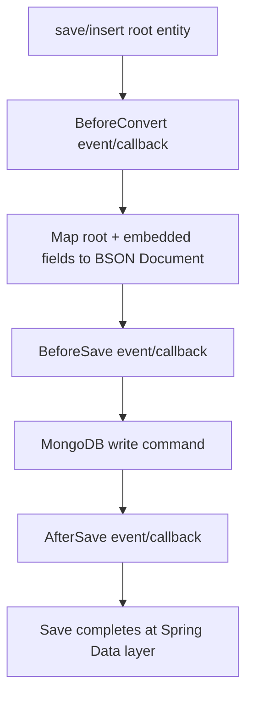
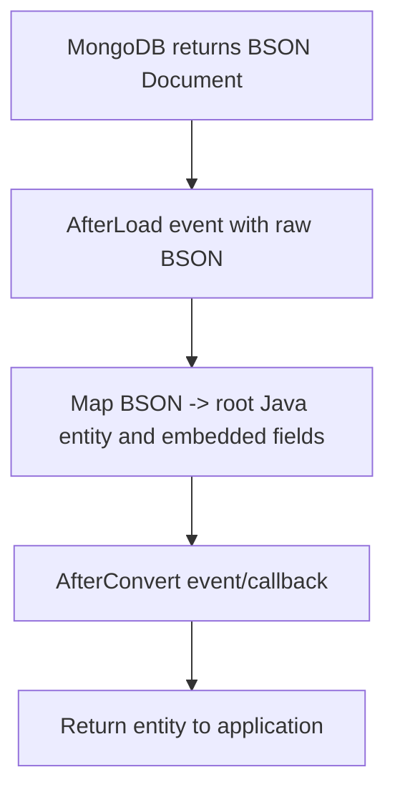

# Event Scope on Root Documents and Embedded Data

## 1. A Callback Doesn't Run per Array Element: Where Does This Design Mistake Come From?

In an e-commerce application using **Spring Data MongoDB**, an order contains multiple *order lines* embedded inside the same MongoDB document:

```javascript
{
  _id: "order-101",
  tenantId: "shop-a",
  lines: [
    { lineKey: "line-1", sku: "ab-100", quantity: 2 },
    { lineKey: "line-2", sku: "cd-200", quantity: 3 }
  ],
  totalQuantity: 5
}
```

The development team wants to normalize each `sku`, generate `searchSku`, validate quantities, and update `totalQuantity` before saving. They write a `BeforeConvertCallback<OrderLine>` and expect:

```text
repository.save(order)
  -> callback for OrderLine(line-1)
  -> callback for OrderLine(line-2)
  -> callback for Order
  -> MongoDB
```

**This assumption contradicts Spring Data MongoDB's standard mapping lifecycle.** Lifecycle events and callbacks are scoped to the **root object being processed by the mapping operation** (*root-level entity*), rather than automatically traversing the entire object graph to emit a separate lifecycle cycle for every embedded object.

In this example, when calling `repository.save(order)` on root entity `CheckoutOrder`:

- Spring Data maps `CheckoutOrder` and its embedded fields into a single MongoDB document.
- Lifecycle events/entity callbacks matching **`CheckoutOrder`** may be triggered.
- Do not assume a separate `BeforeConvertCallback<OrderLine>` runs for each element in `lines`.
- To normalize order lines, perform that **explicitly from the root document's callback/service**, or use appropriate converters/validation.
- If the system runs `$set`/`$push`/`updateMulti` directly instead of `save`, even many write-side root callbacks **never get a chance to run**.

This lesson belongs to the **Lifecycle and Callbacks** chapter in the **SPRING_DATA_MONGODB** module. The module covers using Spring Data MongoDB to connect, map documents, interact via `MongoTemplate`/repositories, design queries, aggregations, indexes, transactions, reactive access, testing, and performance diagnostics.

**Learning goals:** distinguish mapping events from entity callbacks; pinpoint the exact **boundary between root documents and embedded documents**; understand before-convert/before-save/after-load/after-convert phases; understand the impact of `@DBRef`, `@DocumentReference`, direct updates, and reactive mapping; and write code/tests proving no line-level logic is silently skipped.

## 2. How Do Root Documents, Embedded Objects, and References Differ?

In MongoDB, a BSON document can embed nested objects and arrays. In Java, those objects can be POJOs, records, or collections of objects.

### 2.1. Embedded Objects Live Inside the Same Root Document

```java
@Document("checkout_orders")
public record CheckoutOrder(
    @MongoId(FieldType.STRING) String id,
    String tenantId,
    List<OrderLine> lines,
    int totalQuantity
) {}

public record OrderLine(
    String lineKey,
    String sku,
    int quantity
) {}
```

When saving `CheckoutOrder`, `OrderLine` is **converted into an embedded BSON structure**. `MongoTemplate` does not treat it as an independently saved root entity merely because it has its own class or record definition.

### 2.2. A Root-Level Entity Is the Operation's Root, Not Every Java Class

```java
template.save(checkoutOrder);
```

The root in this operation is `CheckoutOrder`. Before and after mapping, Spring Data evaluates callbacks and listeners matching the **root**.

```java
template.findById(orderId, CheckoutOrder.class);
```

The root on read is also `CheckoutOrder`; `lines` is mapped as an embedded field of that root.

**Do not equate "a class has annotations" with "every instance emits lifecycle events."** What governs lifecycle dispatch is primarily **which root type the MongoDB operation is mapping/saving** and the exact API path called.

### 2.3. `@DBRef` / `@DocumentReference` References Are a Different Case

```java
@Document("catalog_products")
public record CatalogProduct(
    @MongoId(FieldType.STRING) String id,
    String sku
) {}

@Document("checkout_orders")
public record OrderWithProductRef(
    @MongoId(FieldType.STRING) String id,
    @DBRef CatalogProduct product
) {}
```

`CatalogProduct` is an **independent referenced document**, not BSON copied in full into `checkout_orders.product`. When referenced documents are loaded/mapped by the reference mechanism, mapping scope and lifecycle differ from embedded objects; check the exact load path and reference type.

**Specifically:** `@DBRef` **does not cascade saves automatically**. Calling `save(orderWithProductRef)` does not mean Spring Data saves prior edits on `CatalogProduct` and fires its full save lifecycle. Likewise, `@DocumentReference` does not imply automatic cascade persistence.

### 2.4. Comparison Table

| Feature | Embedded `OrderLine` | Root `CheckoutOrder` | `@DBRef` to `CatalogProduct` |
| --- | --- | --- | --- |
| Stored in root's BSON | Yes | Is the root document | Holds only reference metadata |
| Has its own collection | No in this design | Yes | Yes |
| Mapped when saving root | Yes, as embedded field | Yes, as root | Reference is written; target entity not auto-saved |
| Gets its own lifecycle callback on root save? | **Not automatically invoked** | Matching callbacks can run | No automatic save callback/cascade on target |
| On read | Mapped with root | Mapped as root | May trigger separate load of target document |
| How to enforce invariants on nested data | Root callback/service, converter, DB schema | Root callback/service | Service/transaction managing the separate collection |

## 3. Distinguishing Application Events and Entity Callbacks

Spring Data MongoDB provides two easily confused hook groups:

1. **Mapping lifecycle events** via Spring `ApplicationEventPublisher`/`AbstractMongoEventListener`.
2. **Entity callbacks** via interfaces such as `BeforeConvertCallback<T>`, `BeforeSaveCallback<T>`, and `AfterConvertCallback<T>`.

Both can observe or intercept the lifecycle, yet **they are not the same mechanism**.

| Criterion | Mapping Event / Listener | Entity Callback |
| --- | --- | --- |
| Mechanism | Spring application event | `EntityCallback` invoked directly by Spring Data at hooks |
| Example | `BeforeConvertEvent<Order>` | `BeforeConvertCallback<Order>` |
| Registration | `AbstractMongoEventListener<T>` / listener bean | Bean implementing callback interface |
| Synchronicity | Depends on `ApplicationEventMulticaster`; may be async if configured | Invoked in processing pipeline; reactive has `Publisher` counterparts |
| Entity modification | Events suit observation; mutation has limits depending on phase | Callbacks have an explicit entity-return contract |
| Embedded boundary | Primarily root-level mapping events | Applies to the target entity operated on; does not recurse into embedded items |
| Ordering | Subject to event multicaster and listener ordering | Callback ordering is clearer via `Ordered`/`@Order` |
| Guarantees domain event after DB commit | **No** | **No** |

### 3.1. Mapping Events Are Not Durable Domain Events

`AfterSaveEvent` or `AfterSaveCallback` indicates a save passed that hook, **not** that an outer transaction committed durably. A transaction can roll back after the callback already ran.

Therefore never send emails, call payment gateways, or publish irreversible Kafka events from a mapping event solely because its name starts with `AfterSave`. To emit post-commit events reliably, use transaction-aware orchestration and the **outbox pattern** or a business-appropriate strategy.

### 3.2. Never Depend on Unguaranteed Event Ordering

If an application configures `ApplicationEventMulticaster` asynchronously, listeners execute on another thread; you cannot rely on listeners to enforce invariants that must finish **before the document is written**.

For logic mutating the root before mapping, **`BeforeConvertCallback`** is usually much easier to control than an asynchronous application event.

## 4. Key Lifecycle Phases

Saving a typical root entity can be visualized as:



Reading a root entity:



The diagrams illustrate **conceptual hook points**. Exact ordering between specific events and callbacks, hook support per API, and implementation optimizations can vary by Spring Data version. Never treat these diagrams as absolute timing guarantees for asynchronous listeners.

### 4.1. Common Event Types

| Event | Data / Phase | Appropriate Use |
| --- | --- | --- |
| `BeforeConvertEvent<T>` | Before mapping root Java object to BSON | Observation, pre-mapping validation |
| `BeforeSaveEvent<T>` | After mapping, before write; has BSON Document | Inspecting final BSON; beware mutation caveats |
| `AfterSaveEvent<T>` | After save step executes | Internal metrics/audits not requiring exactly-once |
| `AfterLoadEvent<T>` | Loaded BSON Document, before mapping to object | Inspecting raw data |
| `AfterConvertEvent<T>` | Root entity mapped from BSON | Observing post-read object |
| `BeforeDeleteEvent<T>` | Before delete command where supported | Observing delete command/filter |
| `AfterDeleteEvent<T>` | After delete command where supported | Metrics; do not assume full Java entity present |

**Delete note:** delete events do not always carry a loaded Java object. A query-based delete may have only a BSON filter; never write `onBeforeDelete` assuming the event hands you every old `OrderLine`.

### 4.2. Corresponding Callbacks

| Callback | Typically Used For |
| --- | --- |
| `BeforeConvertCallback<T>` | Normalizing/updating the root **before** BSON mapping |
| `BeforeSaveCallback<T>` | Intercepting once the `Document` prepared for write exists |
| `AfterSaveCallback<T>` | Receiving the entity after save; does not imply transaction commit |
| `AfterConvertCallback<T>` | Adjusting/checking the root object after mapping read data |

`AfterLoadEvent<T>` is a **mapping event** on incoming BSON data; do not assume an `AfterLoadCallback<T>` interface exists just because the event name exists. To adjust entities after mapping, `AfterConvertCallback<T>` is the explicit hook.

When coding against callback APIs, verify your exact dependency version. Never infer that every event has a 1-to-1 callback interface with the same name and generics.

## 5. Domain Example: Root `CheckoutOrder` and Embedded `OrderLine`

To follow one running example, define the immutable embedded object:

```java
package example.lifecycle;

public record OrderLine(
    String lineKey,
    String sku,
    int quantity,
    String searchSku
) {}
```

Root document:

```java
package example.lifecycle;

import java.time.Instant;
import java.util.List;
import org.springframework.data.mongodb.core.mapping.Document;
import org.springframework.data.mongodb.core.mapping.FieldType;
import org.springframework.data.mongodb.core.mapping.MongoId;

@Document("checkout_orders")
public record CheckoutOrder(
    @MongoId(FieldType.STRING) String id,
    String tenantId,
    List<OrderLine> lines,
    int totalQuantity,
    Instant updatedAt
) {}
```

Business rules for this example:

- `tenantId` must be non-blank.
- Every `lineKey` must be non-blank and unique within the same order.
- `sku` is a technical SKU code and must be non-blank.
- `quantity` must be positive.
- `searchSku` is the normalized SKU for lookup, without altering the display `sku`.
- `totalQuantity` equals the sum of `quantity` across all embedded lines.
- `updatedAt` is set when saving the root via the example callback.

**Limitation:** these are **pre-mapping rules on root saves**, not automatic constraints for raw BSON updates or writes from external tools. To protect data across all producers, add MongoDB schema validation and disciplined write paths.

### 5.1. Normalized BSON Document

```javascript
{
  _id: "order-101",
  tenantId: "shop-a",
  lines: [
    {
      lineKey: "line-1",
      sku: "ab-100",
      quantity: 2,
      searchSku: "AB-100"
    },
    {
      lineKey: "line-2",
      sku: "cd-200",
      quantity: 3,
      searchSku: "CD-200"
    }
  ],
  totalQuantity: 5,
  updatedAt: ISODate("2026-11-20T08:30:00Z")
}
```

`searchSku` is computed explicitly by root-level logic; MongoDB does not know how to invoke Java methods per line.

## 6. The Right Approach: Root `BeforeConvertCallback` Processing Embedded Fields

### 6.1. Full Callback Implementation

```java
package example.lifecycle;

import java.time.Clock;
import java.util.HashSet;
import java.util.List;
import java.util.Locale;
import java.util.Set;
import org.springframework.data.mongodb.core.mapping.event.BeforeConvertCallback;
import org.springframework.stereotype.Component;

@Component
public class CheckoutOrderNormalizer
        implements BeforeConvertCallback<CheckoutOrder> {

    private final Clock clock;

    public CheckoutOrderNormalizer(Clock clock) {
        this.clock = clock;
    }

    @Override
    public CheckoutOrder onBeforeConvert(
            CheckoutOrder source,
            String collection) {

        if (!"checkout_orders".equals(collection)) {
            return source;
        }
        if (source.tenantId() == null
                || source.tenantId().isBlank()) {
            throw new IllegalArgumentException(
                "tenantId is required"
            );
        }
        if (source.lines() == null
                || source.lines().isEmpty()) {
            throw new IllegalArgumentException(
                "Order must have at least one line"
            );
        }

        Set<String> seenKeys = new HashSet<>();

        List<OrderLine> normalizedLines = source.lines()
            .stream()
            .map(line -> normalizeLine(line, seenKeys))
            .toList();

        int total = normalizedLines.stream()
            .mapToInt(OrderLine::quantity)
            .reduce(0, Math::addExact);

        return new CheckoutOrder(
            source.id(),
            source.tenantId(),
            List.copyOf(normalizedLines),
            total,
            clock.instant()
        );
    }

    private static OrderLine normalizeLine(
            OrderLine line,
            Set<String> seenKeys) {

        if (line == null
                || line.lineKey() == null
                || line.lineKey().isBlank()
                || !seenKeys.add(line.lineKey())) {
            throw new IllegalArgumentException(
                "lineKey is blank or duplicated"
            );
        }
        if (line.sku() == null
                || line.sku().isBlank()
                || line.quantity() <= 0) {
            throw new IllegalArgumentException(
                "Invalid SKU or quantity"
            );
        }

        String searchSku =
            line.sku().trim().toUpperCase(Locale.ROOT);

        return new OrderLine(
            line.lineKey(),
            line.sku(),
            line.quantity(),
            searchSku
        );
    }
}
```

Example `Clock` bean:

```java
import java.time.Clock;
import org.springframework.context.annotation.Bean;
import org.springframework.context.annotation.Configuration;

@Configuration
class TimeConfiguration {

    @Bean
    Clock clock() {
        return Clock.systemUTC();
    }
}
```

### 6.2. Why Does the Callback Receive the Root Rather Than OrderLine?

When `MongoTemplate.save(checkoutOrder)` maps the root, Spring Data treats `CheckoutOrder` as the lifecycle object. `CheckoutOrderNormalizer` **explicitly iterates over `lines`**:

```java
List<OrderLine> normalizedLines = source.lines()
    .stream()
    .map(line -> normalizeLine(line, seenKeys))
    .toList();
```

The MongoDB framework is not invoking two separate callbacks for two `OrderLine`s. Placing the logic at the root also lets the callback compute the **aggregate-wide invariant** `totalQuantity` and detect duplicate `lineKey`s.

### 6.3. Why Return a New Entity Instead of Mutating Records?

Both `CheckoutOrder` and `OrderLine` are immutable records. `BeforeConvertCallback<T>` can return a **modified instance** before the converter converts it to BSON, needing neither setters nor reflection.

This pattern:

- Is easy to unit test via input/output.
- Does not mutate a list still held by the caller.
- Avoids mutating Java objects post-conversion where BSON stays unchanged.
- Makes ordering explicit: normalization runs **before mapping**.

With mutable entities, you can also mutate fields pre-mapping per contract; just avoid having both event listeners and callbacks mutate the same field without controlled ordering.

### 6.4. Limits of SKU Normalization

`toUpperCase(Locale.ROOT)` only fits when SKUs are technical codes (with controlled character sets and formats). **Never apply it blindly** to human names, natural-language keywords, or Unicode strings requiring business-specific collation and normalization.

In multi-tenant systems, `searchSku` might also require an index on `tenantId + searchSku`, which is a query/index design concern rather than a property of lifecycle callbacks.

## 7. Common Mistake: Writing a Callback on OrderLine

Suppose a developer writes:

```java
package example.lifecycle;

import java.util.concurrent.atomic.AtomicInteger;
import org.springframework.data.mongodb.core.mapping.event.BeforeConvertCallback;
import org.springframework.stereotype.Component;

@Component
public class OrderLineCallbackCounter
        implements BeforeConvertCallback<OrderLine> {

    private final AtomicInteger calls =
        new AtomicInteger();

    @Override
    public OrderLine onBeforeConvert(
            OrderLine entity,
            String collection) {
        calls.incrementAndGet();
        return entity;
    }

    public int calls() {
        return calls.get();
    }

    public void reset() {
        calls.set(0);
    }
}
```

When simply calling:

```java
repository.save(new CheckoutOrder(
    "order-101",
    "shop-a",
    List.of(
        new OrderLine("line-1", "ab-100", 2, null),
        new OrderLine("line-2", "cd-200", 3, null)
    ),
    0,
    null
));
```

do not expect `OrderLineCallbackCounter.calls() == 2`. Because `OrderLine` is **embedded** inside the root, this callback **is not automatically invoked individually** for each element when saving the root. In an integration test scoped properly, expect the embedded line callback **not to trigger** on root saves.

This does not mean no `OrderLine` callback can ever execute; if `OrderLine` were processed as an **independent root type in its own operation**, behavior would differ. Analyze scope in terms of **root mapping context**, not merely class names.

### 7.1. Do Not Add `@Document` to an Embedded Type to "Force" Events

Slapping `@Document` onto `OrderLine` is not a valid way to make Spring Data save each line as a separate document while it remains an embedded field. Doing so misleads readers about the data model and can alter mapping conventions depending on configuration.

To make `OrderLine` an independent root collection, **redesign the document model**, references, transactions/invariants, and queries—do not just add an annotation.

## 8. Mapping Events: Listeners See the Root, Not Individual Embedded Lines

### 8.1. AbstractMongoEventListener

```java
package example.lifecycle;

import org.springframework.data.mongodb.core.mapping.event.AbstractMongoEventListener;
import org.springframework.data.mongodb.core.mapping.event.BeforeConvertEvent;
import org.springframework.data.mongodb.core.mapping.event.BeforeSaveEvent;
import org.springframework.data.mongodb.core.mapping.event.AfterConvertEvent;
import org.springframework.stereotype.Component;

@Component
public class CheckoutOrderEventObserver
        extends AbstractMongoEventListener<CheckoutOrder> {

    @Override
    public void onBeforeConvert(
            BeforeConvertEvent<CheckoutOrder> event) {

        CheckoutOrder order = event.getSource();
        // Observation only: root order, not
        // a separate event per OrderLine.
    }

    @Override
    public void onBeforeSave(
            BeforeSaveEvent<CheckoutOrder> event) {

        CheckoutOrder order = event.getSource();
        org.bson.Document bson = event.getDocument();

        // bson contains the mapped lines array from the root;
        // it does not mean Spring emitted
        // BeforeSaveEvent<OrderLine> for each item.
    }

    @Override
    public void onAfterConvert(
            AfterConvertEvent<CheckoutOrder> event) {

        CheckoutOrder order = event.getSource();
        // Root has been constructed from BSON.
    }
}
```

Use listeners for **observation** or behaviors explicitly guaranteed by the API docs. Never rely on an async event listener to compute `totalQuantity` before saving; the write may proceed before the listener completes.

### 8.2. Scope Table by Field Kind

| Structure Inside CheckoutOrder | Root Event on Saving CheckoutOrder? | Separate Child Event on Saving Root? |
| --- | --- | --- |
| `String tenantId` | Yes, for root | No |
| Embedded `OrderLine line` | Yes, for root | Not automatic |
| `List<OrderLine> lines` | Yes, for root | Not automatic per element |
| `Map<String, OrderLine>` | Yes, for root | Not automatic per entry |
| Multi-level embedded `Address` | Yes, for root | Not automatic per level |
| `@DBRef CatalogProduct` | Yes, for root | No automatic cascade save; loading referenced root is a separate path |

Having a `List` or `Map` child field does not multiply the number of root callback calls by the element count. To validate or normalize every node, write explicit traversal code.

### 8.3. Why Are Callbacks Stronger When You Need to Modify the Root?

`BeforeConvertCallback<CheckoutOrder>` returns the normalized entity with an explicit contract for affecting mapping. `BeforeConvertEvent` is an application event and is vulnerable to async multicasters if configured.

For invariants required before writing, **direct callbacks** or service-layer validation are usually safer than observation listeners.

## 9. BeforeConvert vs. BeforeSave: When BSON Already Exists

Key distinction:

```text
Root Java entity
    |
    v
BeforeConvertCallback  <- adjust root/embedded objects before mapping
    |
    v
MappingMongoConverter   <- builds BSON Document
    |
    v
BeforeSaveCallback      <- BSON Document already exists
    |
    v
MongoDB write
```

### 9.1. Modifying Java Objects in BeforeSave May Be Too Late

Suppose `BeforeSaveCallback` receives the source and Document:

```java
public CheckoutOrder onBeforeSave(
        CheckoutOrder entity,
        Document bson,
        String collection) {
    // At this point BSON was already built before this hook.
    return entity;
}
```

Mutating a Java object here expecting the converter to re-run full mapping may leave the BSON about to be saved unchanged. For normalizing embedded objects, **BeforeConvert** is almost always the clearest choice.

### 9.2. Modifying the BSON Document in BeforeSave

```java
package example.lifecycle;

import org.bson.Document;
import org.springframework.data.mongodb.core.mapping.event.BeforeSaveCallback;
import org.springframework.stereotype.Component;

@Component
public class CheckoutSchemaTagCallback
        implements BeforeSaveCallback<CheckoutOrder> {

    @Override
    public CheckoutOrder onBeforeSave(
            CheckoutOrder entity,
            Document document,
            String collection) {

        if ("checkout_orders".equals(collection)) {
            document.put("mappingSchemaTag", "checkout-v1");
        }
        return entity;
    }
}
```

This adds a **field on the root BSON** prior to writing. Because `mappingSchemaTag` is not in the Java record, the `CheckoutOrder` returned by `save` will not reflect that field. That demonstrates the risk of **divergence between in-memory objects and BSON** when editing raw Documents.

**Do not take this example as advice to invent out-of-schema fields casually**; in production, model fields explicitly in entities/schemas with readback tests and compatibility checks. Editing raw BSON can also interact unexpectedly with converters and type aliases.

### 9.3. Modifying Nested BSON Fields Requires Even Greater Care

```java
Document rawOrder = /* root BSON Document */;

@SuppressWarnings("unchecked")
List<Document> rawLines =
    (List<Document>) rawOrder.get("lines");

for (Document rawLine : rawLines) {
    rawLine.put("searchSku", "SOME-VALUE");
}
```

This is **pseudocode for Document manipulation**: `rawOrder` must come from a callback/driver, and `List<Document>` requires real null/type checks. If a nested array holds unexpected types, casting throws; mutating raw Documents improperly leaves Java entities out of sync.

Prefer **normalizing `OrderLine` before conversion** unless you genuinely need to adjust already-mapped BSON and protect it with tests.

## 10. AfterLoad and AfterConvert: The Read Phase Is Root-Scoped Too

When `repository.findById(id)` fetches a root BSON document, mapping proceeds:

```text
BSON document checkout_orders
    -> AfterLoad event receives raw root BSON
    -> MappingMongoConverter instantiates CheckoutOrder
        -> maps lines into List<OrderLine>
    -> AfterConvert hook receives CheckoutOrder
    -> repository returns CheckoutOrder
```

Do not expect an `AfterConvertCallback<OrderLine>` to be called **separately** for `line-1` and `line-2` when they are mapped as an embedded array inside the root.

### 10.1. AfterConvertCallback for the Root

```java
package example.lifecycle;

import org.bson.Document;
import org.springframework.data.mongodb.core.mapping.event.AfterConvertCallback;
import org.springframework.stereotype.Component;

@Component
public class CheckoutOrderReadValidator
        implements AfterConvertCallback<CheckoutOrder> {

    @Override
    public CheckoutOrder onAfterConvert(
            CheckoutOrder entity,
            Document document,
            String collection) {

        if ("checkout_orders".equals(collection)
                && entity.lines() == null) {
            throw new IllegalStateException(
                "Order has no lines array"
            );
        }
        return entity;
    }
}
```

This callback performs a minimal check on the root after mapping. If legacy data lacks `lines`, reads will fail. In practice, establish a **migration/backward-compatibility policy** rather than arbitrarily turning on strict read validation over an entire legacy collection.

### 10.2. Read Callbacks Are Not Where You Write Back Data

Never call `repository.save(entity)` automatically inside `AfterConvertCallback` on every read to "repair" old data:

- A single `findAll` can trigger many unexpected writes.
- It can create a `read → save → read` loop.
- Read-only queries gain write side effects.
- It can collide with transactions, sessions, or permissions.
- It introduces races if someone else is concurrently updating the document.

Migrations belong in dedicated, idempotent, monitored jobs/services—not hidden inside read hooks.

## 11. Repository Save and MongoTemplate Save: When Do Hooks Run?

### 11.1. Saving a Root Entity Through Mapping APIs

```java
CheckoutOrder entity = new CheckoutOrder(
    "order-101",
    "shop-a",
    List.of(
        new OrderLine("line-1", "ab-100", 2, null),
        new OrderLine("line-2", "cd-200", 3, null)
    ),
    0,
    null
);

CheckoutOrder stored = repository.save(entity);
```

With a properly configured synchronous MongoDB repository and registered callback beans, the root save passes through the applicable mapping hooks. The root callback from section 6 sets `searchSku` to `AB-100`/`CD-200` and total to 5.

### 11.2. MongoTemplate Also Invokes Mapping Callbacks

```java
CheckoutOrder stored = mongoTemplate.save(entity);
```

`MongoTemplate.save` performs root mapping and runs supported callbacks in the save lifecycle. You do not need a repository for root callbacks to run.

### 11.3. Do Not Write Callbacks Assuming Whether Callers Used save or insert

`save` and `insert` have different upsert/duplicate-ID semantics. Both can invoke entity save hooks, yet callback logic **must not guess whether a document is a fresh insert** merely because `beforeConvert` ran.

To distinguish creation vs. update timestamps, use built-in auditing, a version field, or explicit creation state; test both `save` and `insert` on your API/version.

### 11.4. Callback Beans Must Actually Be Registered

Merely writing a class implementing an interface without registering it in the Spring context will not make it execute. With `@Component`, verify component scanning covers its package; in `@DataMongoTest` slices, `@Import` the callback class and any `Clock` test bean explicitly.

Never conclude "Spring Data doesn't run root callbacks" when the real problem is an unregistered bean.

## 12. Update Operators Do Not Automatically Run Entity BeforeConvert

This is the most frequent source of corrupt invariants when relying solely on root callbacks.

### 12.1. Full Save vs. updateFirst

```java
// Maps root entity and runs matching callbacks:
mongoTemplate.save(order);

// Sends $set/$inc directly without a full
// CheckoutOrder Java entity to before-convert:
mongoTemplate.updateFirst(
    Query.query(Criteria.where("id").is("order-101")),
    new Update().set("lines.0.quantity", 9),
    CheckoutOrder.class
);
```

On the `updateFirst` path, Spring Data builds **update BSON** from `Query`/`Update` rather than loading the whole `CheckoutOrder` to run `BeforeConvertCallback<CheckoutOrder>`. Thus updating `lines.0.quantity` leaves the old `totalQuantity` stale.

### 12.2. `$push`, `$pull`, and `arrayFilters`

```java
mongoTemplate.updateFirst(
    Query.query(Criteria.where("id").is(orderId)),
    new Update().push(
        "lines",
        new OrderLine("line-3", "ef-300", 4, null)
    ),
    CheckoutOrder.class
);
```

Spring Data can **convert the value passed to the update**, yet that does not mean it invokes the **full root entity callback suite** to recompute totals and traverse embedded lines. With `$push`, `searchSku` can remain unset if you rely only on `BeforeConvertCallback<CheckoutOrder>`.

`$pull`, `$set`, `$inc`, positional `$`, `$[]`, and `arrayFilters` must likewise be reasoned about through **their specific update APIs**.

### 12.3. UpdateMulti and bulkOps

```java
mongoTemplate.updateMulti(
    Query.query(Criteria.where("tenantId").is("shop-a")),
    new Update().set("archived", true),
    CheckoutOrder.class
);

mongoTemplate.bulkOps(
    BulkOperations.BulkMode.ORDERED,
    CheckoutOrder.class
).updateOne(
    Query.query(Criteria.where("id").is(orderId)),
    new Update().inc("totalQuantity", 1)
).execute();
```

These update/bulk paths optimize by sending write commands directly rather than instantiating each root entity to run `BeforeConvertCallback<CheckoutOrder>`. **Never rely on entity lifecycle callbacks to protect fields when the application uses raw or bulk updates.**

### 12.4. findAndModify Is Not a Full Save

`findAndModify` performs a query-based update and can return a mapped entity. The returned entity may engage **read-side conversion callbacks**, yet you must never infer that **write-side root `BeforeConvertCallback`** ran to modify fields inside the update command.

Whenever logic is mandatory across every write path, enforce invariants via **atomic queries/updates**, DB-level validation, or a controlled service API—not callbacks alone.

### 12.5. Raw Driver / mongosh Never Run Java Callbacks

```javascript
db.checkout_orders.updateOne(
  { _id: "order-101" },
  { $set: { "lines.0.quantity": 10 } }
);
```

This command runs outside the Spring Data JVM and **cannot invoke** Java callbacks. The same applies to ETL jobs, MongoDB Compass, other microservices using raw drivers, or migration scripts.

## 13. Designing Safe Invariants When Both Saves and Partial Updates Exist

### 13.1. Three Main Strategies

| Strategy | Where It Excels | Limitations |
| --- | --- | --- |
| Root `BeforeConvertCallback` | Normalizing the full embedded graph on full saves | Does not cover `$set`/`$push` updates |
| Dedicated update service | Controls every write path exposed by the app | Other raw writers can still bypass unless restricted |
| MongoDB JSON Schema validator | Blocks structural/type errors on the server | Cannot express every dynamic cross-array sum invariant |

Since `totalQuantity` is derived from embedded lines, consider:

- **Do not store the total** if queries can compute it via aggregation at acceptable cost.
- If stored to speed up reads, enforce **synchronized updates on add, remove, and quantity edits**.
- An atomic update adding a line and incrementing the total can combine `$push + $inc` on the same document when preconditions hold.
- When multiple writers update concurrently, use optimistic locking/versioning or conditional updates to prevent lost updates.

### 13.2. Example: Updating the Same Document Atomically

```java
OrderLine newLine = new OrderLine(
    "line-3", "ef-300", 4, "EF-300"
);

Update update = new Update()
    .push("lines", newLine)
    .inc("totalQuantity", 4);

UpdateResult result = mongoTemplate.updateFirst(
    Query.query(
        Criteria.where("id").is(orderId)
            .and("tenantId").is(authorizedTenantId)
    ),
    update,
    CheckoutOrder.class
);
```

This snippet **only illustrates** updating two fields on the same document. It assumes `newLine` was validated/normalized **prior to building the update**, and assumes no duplicate `lineKey`. In real code check `matchedCount`, retry idempotency, document size bounds, state preconditions, and duplicate-line prevention.

If a retry replays `$push + $inc` without an idempotency condition, the same line gets pushed twice and the total increments twice. Callbacks do not solve that.

### 13.3. Pipeline Updates to Recompute Totals

MongoDB supports aggregation pipeline updates on supported versions. You can define a server-side expression to recompute a derived field:

```javascript
db.checkout_orders.updateOne(
  { _id: "order-101", tenantId: "shop-a" },
  [
    {
      $set: {
        totalQuantity: {
          $sum: "$lines.quantity"
        }
      }
    }
  ]
);
```

This recomputes the total from the current `lines` array during the update. When combining array modifications with recomputation, pay close attention to **pipeline stage order** and avoid races between separate commands; a pipeline update keeps computed updates within **one atomic single-document operation**.

Do not assume identical operator syntax across every MongoDB version; test against your real server and actual BSON types.

## 14. `@DBRef` and `@DocumentReference`: Exceptions Do Not Mean Cascading

Spring Data MongoDB's mapping lifecycle docs emphasize root-level entities; with **document references** such as `@DBRef`, resolving a referenced document creates an independent mapping flow that can involve the target type's lifecycle behavior. That is **different** from traversing an embedded list.

### 14.1. Example of a Reference

```java
@Document("customers")
public record Customer(
    @MongoId(FieldType.STRING) String id,
    String fullName
) {}

@Document("checkout_orders")
public record OrderWithCustomerRef(
    @MongoId(FieldType.STRING) String id,
    @DBRef Customer customer
) {}
```

When reading `OrderWithCustomerRef`, the driver/framework may query the `customers` collection separately (depending on lazy/eager settings and reference mechanics). Yet:

- Never assume `Customer`'s callbacks always run once per `OrderWithCustomerRef`.
- Never assume saving `OrderWithCustomerRef` automatically **saves changes** on `Customer`.
- Never treat a reference as embedded; the target document has its own lifecycle.
- Never keep lazy reference loading outside appropriate resource/session scopes.

### 14.2. `@DocumentReference` Also Requires Separate Verification

`@DocumentReference` links documents via a different mechanism from `@DBRef`. It likewise neither turns referenced roots into embedded objects nor enables automatic cascade persistence. Verify callback behavior and eager/lazy resolution against your **Spring Data MongoDB version**, mapping configuration, and relationships.

### 14.3. Performance Impact

A root document holding 200 references can trigger extra database reads upon resolution. If you only need a few slowly changing fields, embedding may be simpler; if independent lifecycles are required, references can fit better.

**Never choose `@DBRef` just "to get separate callbacks."** Decide between embedding and referencing based on aggregate boundaries, document size, consistency needs, query patterns, transactions, and ownership—then arrange callbacks accordingly.

## 15. Auditing, `@Version`, and Callback Ordering

### 15.1. `@CreatedDate` and `@LastModifiedDate` Typically Belong on the Root

Spring Data provides auditing for entities declaring fields like:

```java
@CreatedDate
private Instant createdAt;

@LastModifiedDate
private Instant updatedAt;
```

When auditing is enabled and the right callbacks are active, these fields are populated in the **root entity's** lifecycle. Never assume auditing automatically updates a `lastModifiedAt` field inside every embedded `OrderLine` in an array on `save(root)`.

If line-level timestamps are required:

- Decide whether a line truly has an independent lifecycle.
- Update the line's timestamp in the **root service/callback** or in an update command targeting that specific line.
- Avoid resetting timestamps on **every** line during a root save if business rules require timestamps only on modified lines.

### 15.2. `@Version` Solves a Different Problem

`@Version` provides optimistic locking for entities saved through supported paths. It does not invoke recursive callbacks on embedded data, nor protect raw updates when writers skip the version mechanism.

With multiple concurrent writers, a callback recomputing totals before saving can still race without versioning or conditional updates. Do not confuse **in-memory invariant correctness** with **concurrency safety**.

### 15.3. Callback Ordering and Conflicts

If multiple `BeforeConvertCallback<CheckoutOrder>` beans exist, their order can be governed via `Ordered` or `@Order` per Spring APIs. Example:

```java
@Component
@Order(100)
class CheckoutOrderFirstPass
        implements BeforeConvertCallback<CheckoutOrder> {

    @Override
    public CheckoutOrder onBeforeConvert(
            CheckoutOrder entity, String collection) {
        return entity;
    }
}
```

This is a separate callback snippet requiring matching imports. Avoid letting two callbacks overwrite `updatedAt` or `totalQuantity` without clear ownership. When a normalization callback must precede a validation callback, **define and test the order** rather than relying on arbitrary bean scan order.

**Do not assume** callback order and application event order always match, especially with an async event multicaster.

## 16. `ReactiveMongoTemplate` and Reactive Callbacks

### 16.1. Synchronous and Reactive Callbacks Are Two Distinct APIs

With `ReactiveMongoTemplate`, Spring Data supports dedicated **reactive entity callbacks** returning `Publisher`:

```java
import org.springframework.data.mongodb.core.mapping.event.ReactiveBeforeConvertCallback;
import reactor.core.publisher.Mono;

@Component
public class ReactiveCheckoutNormalizer
        implements ReactiveBeforeConvertCallback<CheckoutOrder> {

    private final CheckoutNormalizerLogic logic;

    public ReactiveCheckoutNormalizer(
            CheckoutNormalizerLogic logic) {
        this.logic = logic;
    }

    @Override
    public Mono<CheckoutOrder> onBeforeConvert(
            CheckoutOrder entity,
            String collection) {

        return Mono.fromSupplier(() ->
            logic.normalize(entity, collection)
        );
    }
}
```

Here `CheckoutNormalizerLogic` is an application-defined **pure service** for reusing root normalization logic; you can extract `normalizeLine` and total calculation from the synchronous example into it. This prevents duplicating business rules across synchronous and reactive callbacks.

**Never assume** synchronous callbacks automatically execute inside reactive pipelines like matching reactive callbacks. Register the exact reactive API and integration-test with real `ReactiveMongoTemplate`/`ReactiveMongoRepository`.

### 16.2. Laziness and Subscription

```java
Mono<CheckoutOrder> saveMono =
    reactiveTemplate.save(order);

// Operations typically execute only upon subscription.
return saveMono;
```

In WebFlux, the framework subscribes to the Publisher while handling the response; never call `saveMono.subscribe()` yourself and immediately return HTTP 200. Doing so allows validation or callback errors to happen after the response was already sent.

### 16.3. Never Block Inside Reactive Callbacks

```java
// Anti-pattern:
public Mono<CheckoutOrder> onBeforeConvert(
        CheckoutOrder order, String collection) {
    String value = blockingRemoteClient.lookup().get();
    return Mono.just(modify(order, value));
}
```

This is an illustrative anti-pattern; `blockingRemoteClient` and `modify` are placeholder helpers. Blocking I/O in a callback can stall event-loop threads, spike latency, and cause timeouts.

If external data is required:

- Prefer a **reactive API** composed via `flatMap`/`map`.
- Verify transaction context and timeouts.
- Re-evaluate whether remote lookups really belong inside a mapping callback vs. outside the save flow.
- Never use callbacks to trigger hard-to-roll-back side effects.

### 16.4. Embedded Scope Still Does Not Recurse

`ReactiveBeforeConvertCallback<OrderLine>` is not automatically invoked per `OrderLine` merely because `ReactiveMongoTemplate.save(CheckoutOrder)` is saving a root containing a list of lines. The root aggregate boundary applies equally to the reactive API.

## 17. Integration Test: Proving Root Callbacks Run While Embedded Callbacks Do Not

### 17.1. Cases to Verify

1. Save a `CheckoutOrder` with two embedded lines.
2. Root `BeforeConvertCallback<CheckoutOrder>` runs and normalizes both lines.
3. `BeforeConvertCallback<OrderLine>` is **not** called individually for each embedded line.
4. Reading back via repository shows accurate `searchSku` and `totalQuantity`.
5. A raw update modifying quantity **does not** trigger root before-convert.
6. With `@DBRef`, do not expect cascade saves.

### 17.2. `@DataMongoTest` with MongoTemplate and Repository

```java
package example.lifecycle;

import static org.junit.jupiter.api.Assertions.*;

import java.time.Clock;
import java.time.Instant;
import java.time.ZoneOffset;
import java.util.List;
import java.util.UUID;
import org.junit.jupiter.api.BeforeEach;
import org.junit.jupiter.api.Test;
import org.springframework.beans.factory.annotation.Autowired;
import org.springframework.boot.test.autoconfigure.data.mongo.DataMongoTest;
import org.springframework.context.annotation.Bean;
import org.springframework.context.annotation.Import;
import org.springframework.context.annotation.TestConfiguration;
import org.springframework.data.mongodb.core.MongoTemplate;

@DataMongoTest
@Import({
    CheckoutOrderNormalizer.class,
    OrderLineCallbackCounter.class,
    CheckoutOrderLifecycleTest.TestClock.class
})
class CheckoutOrderLifecycleTest {

    @TestConfiguration
    static class TestClock {
        @Bean
        Clock clock() {
            return Clock.fixed(
                Instant.parse("2026-11-20T08:30:00Z"),
                ZoneOffset.UTC
            );
        }
    }

    @Autowired
    CheckoutOrderRepository repository;

    @Autowired
    MongoTemplate template;

    @Autowired
    OrderLineCallbackCounter lineCounter;

    @BeforeEach
    void resetCounter() {
        lineCounter.reset();
    }

    @Test
    void savingRootNormalizesEmbeddedLinesWithoutChildCallbacks() {
        String id = "order-" + UUID.randomUUID();

        CheckoutOrder input = new CheckoutOrder(
            id,
            "shop-a",
            List.of(
                new OrderLine("l-1", "ab-100", 2, null),
                new OrderLine("l-2", "cd-200", 3, null)
            ),
            0,
            null
        );

        CheckoutOrder saved = repository.save(input);

        assertEquals(5, saved.totalQuantity());
        assertEquals("AB-100",
            saved.lines().get(0).searchSku());
        assertEquals("CD-200",
            saved.lines().get(1).searchSku());
        assertEquals(
            Instant.parse("2026-11-20T08:30:00Z"),
            saved.updatedAt()
        );

        CheckoutOrder reread =
            repository.findById(id).orElseThrow();

        assertEquals(5, reread.totalQuantity());
        assertEquals("AB-100",
            reread.lines().get(0).searchSku());
        assertEquals(0, lineCounter.calls());
    }

    @Test
    void rejectsDuplicateLineKeyAtRoot() {
        CheckoutOrder invalid = new CheckoutOrder(
            "order-" + UUID.randomUUID(),
            "shop-a",
            List.of(
                new OrderLine("same", "ab", 1, null),
                new OrderLine("same", "cd", 1, null)
            ),
            0,
            null
        );

        assertThrows(IllegalArgumentException.class,
            () -> repository.save(invalid));
    }
}
```

Repository:

```java
package example.lifecycle;

import org.springframework.data.mongodb.repository.MongoRepository;

public interface CheckoutOrderRepository
        extends MongoRepository<CheckoutOrder, String> {
}
```

**Execution requirements:** `@DataMongoTest` needs a test MongoDB instance or compatible Testcontainers setup. Test config must include callback beans and repository scanning for the package. `updatedAt` uses a fixed clock so assertions are independent of wall-clock time.

This test confirms **root vs. embedded callback behavior** on your Spring Data MongoDB version, without automatically proving update operators or raw drivers pass through hooks.

### 17.3. Checking Raw BSON After Save

```java
Document raw = template.getCollection("checkout_orders")
    .find(new Document("_id", id))
    .first();

assertNotNull(raw);

@SuppressWarnings("unchecked")
List<Document> rawLines =
    (List<Document>) raw.get("lines");

assertEquals("AB-100",
    rawLines.get(0).getString("searchSku"));
assertEquals(5, raw.getInteger("totalQuantity"));
```

This snippet requires importing `org.bson.Document` inside a test method that has `id`. Reading raw BSON separates values **actually persisted** from values returned in memory by callbacks.

## 18. Counterexample Test: `updateFirst` Bypasses Root Normalization

Create a valid order via `repository.save`, then update directly:

```java
@Test
void partialUpdateDoesNotRecalculateRootDerivedTotal() {
    String id = "order-" + UUID.randomUUID();
    repository.save(new CheckoutOrder(
        id, "shop-a",
        List.of(
            new OrderLine("l-1", "ab-100", 2, null),
            new OrderLine("l-2", "cd-200", 3, null)
        ),
        0, null
    ));

    template.updateFirst(
        Query.query(Criteria.where("id").is(id)),
        new Update().set("lines.0.quantity", 10),
        CheckoutOrder.class
    );

    CheckoutOrder reread =
        repository.findById(id).orElseThrow();

    assertEquals(10, reread.lines().get(0).quantity());
    assertEquals(
        5, reread.totalQuantity(),
        "totalQuantity is not recomputed automatically by callback"
    );
}
```

Import `Query`, `Criteria`, and `Update` inside the test class with repository/template injected. Its purpose is to **demonstrate a broken invariant** when relying solely on root callbacks while using partial updates.

In production, **never leave an invariant broken like this**. Fix the update service to maintain totals accurately, or change the data model so totals are derived on read.

### 18.1. Test Using the Raw MongoDB Driver

A test running:

```java
template.getCollection("checkout_orders").updateOne(
    new Document("_id", id),
    new Document("$set",
        new Document("lines.0.quantity", 10))
);
```

never runs Java lifecycle callbacks because the call goes directly to the driver. This boundary is crucial whenever ETL scripts, migrations, or multiple services write to the same collection.

### 18.2. Avoiding False Positives When Testing Child Callbacks Do Not Run

If `OrderLineCallbackCounter` was never registered as a bean, observing `calls()==0` proves nothing. Section 17's test `@Import`ed the counter bean so it is **genuinely present** in the Spring context alongside the root callback.

You can also assert the bean exists in the application context and test a root callback firing to distinguish **"misconfigured registration"** from **"scope excludes embedded objects."**

## 19. Testing Reactive Callbacks for Embedded Scope

For WebFlux applications, write tests using `ReactiveMongoTemplate` and `StepVerifier`:

```java
package example.lifecycle;

import static org.junit.jupiter.api.Assertions.*;

import java.util.List;
import java.util.UUID;
import org.junit.jupiter.api.Test;
import org.springframework.beans.factory.annotation.Autowired;
import org.springframework.boot.test.autoconfigure.data.mongo.DataMongoTest;
import org.springframework.context.annotation.Import;
import org.springframework.data.mongodb.core.ReactiveMongoTemplate;
import reactor.test.StepVerifier;

@DataMongoTest
@Import(ReactiveCheckoutNormalizer.class)
class ReactiveCheckoutLifecycleTest {

    @Autowired
    ReactiveMongoTemplate template;

    @Test
    void reactiveSaveMapsNestedLinesViaRootCallback() {
        String id = "order-" + UUID.randomUUID();

        CheckoutOrder input = new CheckoutOrder(
            id,
            "shop-a",
            List.of(
                new OrderLine(
                    "l-1", "ab-100", 2, null
                )
            ),
            0,
            null
        );

        StepVerifier.create(template.save(input))
            .assertNext(saved -> {
                assertEquals(2, saved.totalQuantity());
                assertEquals(
                    "AB-100",
                    saved.lines().get(0).searchSku()
                );
            })
            .verifyComplete();
    }
}
```

This snippet requires a concrete `CheckoutNormalizerLogic` bean implemented and imported; the test cannot run as-is if you copy `ReactiveCheckoutNormalizer` without its dependency. Also, `@DataMongoTest` may require extra reactive MongoDB auto-configuration depending on Boot version. **Goal of the snippet:** illustrate **subscribing to the Publisher** to drive saves/callbacks; it does not promise `@DataMongoTest` configures a reactive Mongo client identically in every project.

### 19.1. Testing Cancellation and Errors

Reactive callbacks should return Publishers emitting:

- `onNext` with the normalized entity.
- `onError` when validation fails.
- `onComplete` without an entity only when an API contract allows it; for mapping callbacks, an empty result can break the save chain.

Test both valid and invalid branches with `StepVerifier`. If a callback triggers reactive I/O, evaluate timeouts, transaction context, and cancellation. Never block waiting for data only to wrap it in `Mono.just`.

## 20. Can Custom Converters Solve the Embedded Problem?

Custom conversions are another Spring Data MongoDB tool:

- `@ReadingConverter`/`Converter<Document, SomeType>` converts data when reading.
- `@WritingConverter`/`Converter<SomeType, Document>` converts objects when writing, when registered and applicable.
- A converter for an embedded type can run whenever the conversion/mapping framework converts that type.

### 20.1. When Do Converters Fit Well?

For example, a `Money` value object stored in a specialized BSON layout:

```java
public record Money(long minorUnits, String currency) {}
```

When every usage needs one consistent BSON representation for `Money`, a custom converter is a solid choice.

### 20.2. When Are Converters Insufficient?

If the rule needs:

- The `totalQuantity` sum across **all lines**.
- Detecting two duplicate `lineKey` values **within the same root**.
- Checking each line's tenant ID against the root's tenant.
- Decisions based on overall order state.

then a converter inspecting a single `OrderLine` **lacks the broader context**. Root callbacks or domain services fit better.

### 20.3. Converters Do Not Run on Raw MongoDB Updates Either

A `mongosh` script calling `db.collection.updateOne(...)` does not use Spring Data's Java converters. With multiple writers, enforce server-side constraints or unified writer contracts.

## 21. Performance, Transactions, and Lifecycle Hook Consistency

### 21.1. Heavy Callbacks Hurt Write Latency

A `BeforeConvertCallback` running on every root save becomes a bottleneck if:

- Each order holds thousands of embedded lines.
- The callback makes remote HTTP or database lookups per line.
- The callback recomputes large hashes or copies big object graphs repeatedly.
- Logic blocks on a reactive thread.

In `CheckoutOrderNormalizer`, complexity is roughly **O(n)** over the number of embedded lines for validation/normalization, plus list copying overhead. For huge documents, benchmark and consider bounding array/document sizes.

### 21.2. Do Not Call Callbacks Manually Like Domain Services

Calling `checkoutOrderNormalizer.onBeforeConvert(order, "checkout_orders")` directly compiles in Java, yet couples domain logic to Spring Data callback APIs, collection names, and ordering.

Better:

```java
@Component
public class CheckoutNormalizerLogic {

    public CheckoutOrder normalize(
            CheckoutOrder source,
            String collection) {
        // Implement rules as in section 6,
        // independent of lifecycle events.
        return normalized;
    }
}
```

This is a **design skeleton**, where `normalized` comes from complete business logic. The callback simply **delegates** to pure domain logic, and update services call the same domain logic when needed. That lets you unit test business rules independently of MongoDB.

### 21.3. Transactions Do Not Expand Callback Scope

Inside `@Transactional` with `MongoTransactionManager`, `repository.save` on a root runs callbacks; `updateFirst` in the same transaction does not magically turn into a full root save and does not run root before-convert.

Transactions guarantee **joint commit/abort atomicity** across operations; they do not invoke callbacks per embedded object or maintain derived fields automatically.

### 21.4. Mapping Events Are Not Post-Commit Events

If `AfterSaveEvent` fires inside a transaction and the transaction later rolls back, side effects in the listener have already happened even though the document never committed. Therefore:

- Never send emails or process payments in mapping listeners.
- Never publish irreversible Kafka events pre-commit without a reliable protocol.
- Use outboxes / proper transaction synchronization and write rollback tests.

### 21.5. Auditing and Callbacks Can Run Multiple Times

A save may be retried or called multiple times by application logic. A callback setting `updatedAt` from a `Clock` computes a new timestamp on every root save. If callbacks trigger external side effects, retries repeat them; hence **prefer pure/idempotent callbacks** and avoid irreversible side effects.

## 22. Common Troubleshooting Table

| Symptom | Common Cause | Resolution |
| --- | --- | --- |
| `BeforeConvertCallback<OrderLine>` skips on order save | `OrderLine` is an embedded type, not the operation root | Run normalization in root callback/service |
| Even root callback does not run on save | Bean unregistered, raw driver used, or wrong API | Check context and write path |
| `totalQuantity` wrong after `updateFirst` | Partial update skips root before-convert | Update atomically in same command or recompute |
| `searchSku` blank after `$push` | Embedded line not normalized by root callback | Normalize input before `$push` or use update pipeline |
| `BeforeSaveCallback` edits Java object yet BSON unchanged | BSON mapping already ran | Mutate before convert or edit Document carefully |
| `AfterConvert` runs yet embedded listener does not | Events/callbacks follow root mapping | Confirm root scope |
| `@DBRef` product is not saved | DBRef does not auto-cascade persistence | Save referenced root explicitly; coordinate transactions if needed |
| Callback runs unpredictably many times | Repeated saves/retries, bean ordering | Keep callbacks idempotent; test ordering |
| Event listener edits data inconsistently | Async event multicaster / timing | Use entity callbacks directly before convert |
| Kafka message sent for rolled-back order | AfterSave is not after commit | Outbox / transaction-aware publication |
| Reactive save skips callbacks | Publisher unsubscribed or wrong callback API | `StepVerifier`/WebFlux subscription, reactive callbacks |
| Nested field updated in `mongosh` skips Java callback | Command runs outside Spring Data | MongoDB validation / writer discipline |
| Read callback causes write storm | Auto-saving inside `AfterConvert` | Separate migrations from read hooks |
| Index misses `searchSku` | Mismatched normalization/query/index | Establish one search-key contract |
| Root entity looks right yet raw BSON lacks field | Mutated Java post-mapping or test checked only memory | Inspect raw document after save |
| Multiple root callbacks overwrite each other | Order undefined | `@Order`/`Ordered` and tests |
| N+1 query slowdown resolving references | `@DBRef`/`@DocumentReference` triggers extra document loads | Review model, fetch strategy, and profile |
| Root carries millions-element list | Huge BSON document, O(n) callback | Split aggregate; bound sizes and workloads |

### Ordered Diagnostic Checklist

1. Identify which type is the **root entity of the operation**.
2. Determine whether child fields are **embedded** or **document references**.
3. Trace the exact write path: `save`, `insert`, `updateFirst`, `bulkOps`, raw driver, or `mongosh`.
4. Check whether callback/listener beans are registered in Spring.
5. Check the stage: before-convert, before-save, after-load, or after-convert.
6. Check whether Java objects or raw BSON are mutated, and **when**.
7. Check for async event multicasters and callback ordering.
8. Read back raw BSON directly from MongoDB.
9. Check concurrency, optimistic locking, idempotency, and partial updates.
10. For reactive, verify the Publisher is subscribed and reactive callback APIs are registered.
11. For transactions, distinguish before/after save from actual commit/rollback.
12. Write an isolated integration test reproducing the exact operation path.

## 23. Hands-On Exercises

### Exercise 1 — Scope of Embedded Callbacks

Create `CheckoutOrder` with three embedded `OrderLine`s. Register `BeforeConvertCallback<CheckoutOrder>` and `BeforeConvertCallback<OrderLine>`, then count invocations during `repository.save(order)`. Explain why the result is not "called once per line."

### Exercise 2 — Normalizing SKUs and Total Quantity

Write a root callback normalizing `searchSku` for all lines and computing `totalQuantity`. Use `Clock.fixed` to test timestamps. Test duplicate `lineKey`, negative quantities, and an empty `lines` array.

### Exercise 3 — BeforeConvert vs. BeforeSave

Try editing an `OrderLine`'s `searchSku` inside `BeforeConvertCallback` and inside `BeforeSaveCallback`. Read raw BSON after writing; explain why modifying the **entity after mapping** does not necessarily update BSON.

### Exercise 4 — `updateFirst` Bypasses Invariants

Save an order with total 5, then use `$set` to change a line's quantity to 10 without updating the total. Prove `totalQuantity` does not auto-recalculate, then design an atomic/pipeline update to keep it accurate.

### Exercise 5 — `$push` and Idempotency

Write a service adding a line via `$push`. Normalize the line beforehand, add a predicate guarding against duplicate `lineKey`, and update the total. Replay the same request and verify quantities do not double-increment.

### Exercise 6 — `@DBRef` Does Not Cascade

Create `customers` and `checkout_orders` collections. Save a customer and an order linking via `@DBRef`, then mutate the customer object in memory only and save the order. Inspect the `customers` collection; explain why referenced roots must be saved explicitly.

### Exercise 7 — Reactive Callback

Write a `ReactiveBeforeConvertCallback<CheckoutOrder>` returning `Mono<CheckoutOrder>`, save via `ReactiveMongoTemplate`, and test with `StepVerifier`. Try omitting subscription and explain why you must never assume callbacks ran.

### Exercise 8 — Event and Callback Ordering

Register two root callbacks with distinct `@Order` levels and an `AbstractMongoEventListener`. Log pre-convert/pre-save stages. Enable an async multicaster in a separate test and analyze why event listeners must not guard pre-write invariants.

### Exercise 9 — Auditing Nested Objects

Add `updatedAt` to each line and update only the second line. Design update logic so the first line's timestamp stays unchanged. Compare tracking this when lines are embedded vs. an independent root collection.

### Exercise 10 — Transaction + Outbox

Simulate a transaction saving an order and an outbox event. Attach a mapping listener firing an external message, trigger a transaction failure, and roll back. Show why listeners do not replace outboxes. Design an idempotent consumer delivering messages **after the outbox record commits**.

### Self-Check Questions

- Is the **root-level entity** determined by the document model or by class names?
- Why does `BeforeConvertCallback<OrderLine>` not automatically run on every item of an embedded `List<OrderLine>`?
- Do `BeforeConvertEvent` and `BeforeConvertCallback` belong to the same mechanism?
- Does `BeforeSave` happen before or after converting the entity to BSON?
- If you replace the Java object inside `BeforeSaveCallback`, is BSON guaranteed to update?
- At what data state do `AfterLoad` and `AfterConvert` differ?
- Does `@DBRef` automatically save referenced documents when saving the root?
- Does `@DocumentReference` turn the referenced document into an embedded field?
- Why does a `$push` command not automatically run the full root before-convert?
- Why can `updateFirst` leave `totalQuantity` out of sync with array sums?
- Is asserting `lineCallback.calls()==0` sufficient if the bean was never registered?
- Are async event listeners suitable for modifying entities before persistence?
- Does `AfterSaveEvent` mean the MongoDB transaction committed?
- Why do `@Version` and lifecycle callbacks solve two different problems?
- Should reactive callbacks call `block()` to fetch data?
- When is a dedicated custom converter right for an embedded value object?
- Why inspect raw BSON after callback tests instead of only in-memory objects?
- Why must normalizer logic be idempotent and free of side effects?

## Key Takeaways

**Spring Data MongoDB publishes mapping lifecycle events and executes entity callbacks scoped to the root entity of the mapping operation, rather than automatically running individually for every embedded object or array element.** When saving `CheckoutOrder` containing `List<OrderLine>`, enforce invariants across the embedded graph in **root `BeforeConvertCallback<CheckoutOrder>`** or a controlled domain service instead of expecting `BeforeConvertCallback<OrderLine>` to fire automatically. `BeforeSave` occurs after BSON conversion; `AfterLoad`/`AfterConvert` belong to the read path; `updateFirst`, `$push`, bulk, and raw driver commands can bypass root write-side lifecycle hooks. `@DBRef`/`@DocumentReference` are **references to separate documents** without automatic cascade-save and must not be confused with embedded fields. To preserve correctness across all write paths, combine **service invariants, atomic updates, optimistic locking, MongoDB validation, and integration tests**. For reactive flows, use the proper reactive callback APIs and subscription lifecycle; never treat `AfterSave` as "after commit" or use async events to enforce pre-write invariants.

## References

- [Spring Data MongoDB Reference — Lifecycle Events](https://docs.spring.io/spring-data/mongodb/reference/mongodb/lifecycle-events.html)
- [Spring Data MongoDB Reference — Entity Callbacks](https://docs.spring.io/spring-data/mongodb/reference/mongodb/entity-callbacks.html)
- [Spring Data MongoDB Reference — Object Mapping](https://docs.spring.io/spring-data/mongodb/reference/mongodb/mapping/mapping.html)
- [Spring Data MongoDB Reference — DBRef and Document References](https://docs.spring.io/spring-data/mongodb/reference/mongodb/mapping/document-references.html)
- [Spring Data MongoDB Reference — Auditing](https://docs.spring.io/spring-data/mongodb/reference/mongodb/auditing.html)
- [Spring Data MongoDB Reference — Template CRUD Operations](https://docs.spring.io/spring-data/mongodb/reference/mongodb/template-crud-operations.html)
- [Spring Data MongoDB API — BeforeConvertCallback](https://docs.spring.io/spring-data/mongodb/docs/current/api/org/springframework/data/mongodb/core/mapping/event/BeforeConvertCallback.html)
- [Spring Data MongoDB API — BeforeSaveCallback](https://docs.spring.io/spring-data/mongodb/docs/current/api/org/springframework/data/mongodb/core/mapping/event/BeforeSaveCallback.html)
- [Spring Data MongoDB API — AbstractMongoEventListener](https://docs.spring.io/spring-data/mongodb/docs/current/api/org/springframework/data/mongodb/core/mapping/event/AbstractMongoEventListener.html)
- [MongoDB Manual — Update Operators](https://www.mongodb.com/docs/manual/reference/operator/update/)
- [MongoDB Manual — Schema Validation](https://www.mongodb.com/docs/manual/core/schema-validation/)
