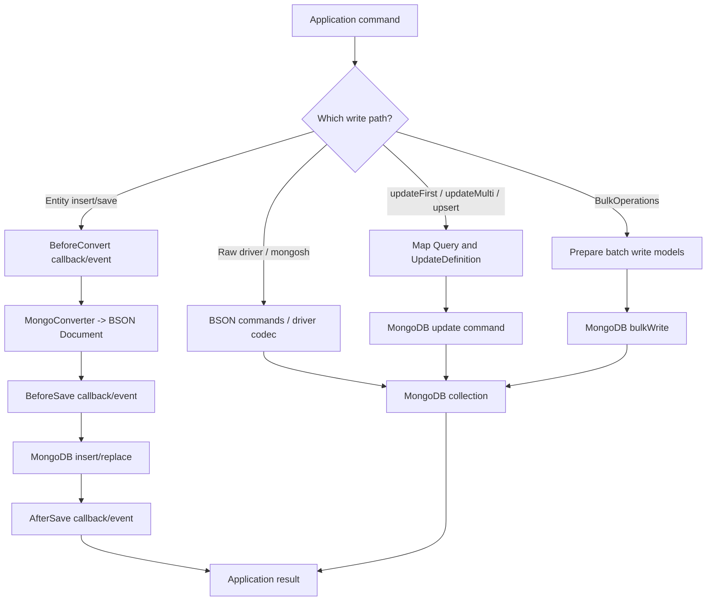
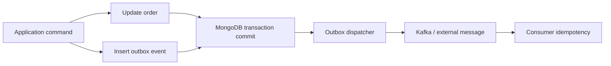

# Limits of Callbacks/Events with Direct Updates, Bulk Writes, and Drivers

## 1. Why Are Some Records Updated Without Callbacks Running?

An order management service registers `BeforeConvertCallback<OrderDocument>` to normalize business codes, `AuditingEntityCallback` to record `updatedAt`, and a listener to log saves. All `repository.save(order)` tests pass. Later the team optimizes the status transition flow:

```java
mongoTemplate.updateFirst(
    Query.query(Criteria.where("id").is(orderId)),
    new Update().set("status", "SHIPPED"),
    OrderDocument.class
);
```

MongoDB updates the status, yet the logic inside `BeforeConvertCallback` does not run the way it did during `save(entity)`. Batch `bulkOps(...).updateOne(...)`, the MongoDB Java driver, or `mongosh` can likewise mutate the collection **without passing through Spring Data callbacks**.

This is the **fundamental difference between saving an entity via the mapping lifecycle and issuing a direct conditional/BSON update command**, not a framework bug.

This lesson belongs to the **Lifecycle and Callbacks** chapter of the **SPRING_DATA_MONGODB** module. The module teaches MongoDB connectivity, document mapping, `MongoTemplate` and repository operations, query design, aggregations, indexes, transactions, reactive access, testing, and data performance diagnostics.

After this lesson, you will be able to:

1. Distinguish **`EntityCallback`**, **mapping `ApplicationEvent`s**, **Spring Data auditing**, and **MongoDB database constraints**.
2. Identify which APIs run entity save callbacks and which **must not rely on callbacks**.
3. Understand the boundaries of `updateFirst`, `updateMulti`, `upsert`, `findAndModify`, `BulkOperations`, and the raw driver.
4. Explain why **mapping**, **`@Version` auto-increment**, and **`EntityCallback`** are three separate mechanisms.
5. Maintain `updatedAt`, audit metadata, validation, normalization, and business invariants across bulk/direct updates.
6. Write integration tests proving whether callbacks run or are bypassed on each API path.
7. Choose appropriately among entity saves, atomic updates, bulk writes, migrations, and database constraints for your workload.

> **Core message:** Callbacks are **hooks inside the application pipeline**, not MongoDB triggers running automatically on every write. Never use callbacks as the sole defense for invariants that must hold across all clients.

## 2. Four Concepts Commonly Conflated

| Concept | Where It Runs | When It Takes Effect | What It Does Not Guarantee |
| --- | --- | --- | --- |
| **EntityCallback** | Spring Data entity persistence pipeline | APIs invoking matching lifecycle callbacks | Does not run automatically on direct updates/bulk/raw driver |
| **Mapping ApplicationEvent** | Spring `ApplicationContext` event infrastructure | Template publishes events for matching operations | May lack synchronicity/ordering if multicaster uses an async executor |
| **Auditing annotations** `@CreatedDate`/`@LastModifiedDate` | Spring Data auditing infrastructure | When auditing is enabled and write path uses compatible hooks | Does not automatically set timestamps on every `$set` or raw driver write |
| **MongoDB validator / unique index** | MongoDB server | Write commands subject to matching constraints | Does not replace every Java business rule |

A `@LastModifiedDate` updating accurately on `save(entity)` **does not prove** the field updates after:

```javascript
db.orders.updateOne(
  { _id: "ord-101" },
  { $set: { status: "SHIPPED" } }
);
```

MongoDB does not understand Java's `@LastModifiedDate` annotation. If timestamps must update on **every direct update**, include them in the update command or enforce a database/operational consistency pattern.

## 3. Two Different Write Paths from an Architectural View



This diagram omits per-API and per-version details. It highlights that **direct updates process `Query` and `UpdateDefinition` without routing a full entity through `BeforeConvert`/`BeforeSave`**, while bulk paths carry restricted lifecycle rules. Before relying on any hook, prove it executes via tests on your **exact API and Spring Data version**.

### 3.1. No Full Entity Exists Inside `$set`

```javascript
{
  filter: {
    _id: "ord-101",
    status: "READY_TO_SHIP"
  },
  update: {
    $set: {
      status: "SHIPPED"
    }
  }
}
```

This command never constructs an `OrderDocument` holding `tenantId`, `externalKey`, `createdAt`, and `updatedAt` to save. A callback expecting a full entity **has no object to run on**. In exchange, the direct update checks preconditions and modifies the document atomically.

## 4. Behavior Matrix by API Group

This table provides **expectations to design and verify against**, not a claim that every overload and release behaves identically:

| Execution Path | BeforeConvert/BeforeSave Entity Callbacks | Spring Data Mapping | Notes |
| --- | --- | --- | --- |
| `MongoTemplate.insert(entity)` | **Yes**, entity lifecycle path | Yes | Standard case for testing callbacks |
| `MongoTemplate.save(entity)` | **Yes**, entity lifecycle path | Yes | `@Version` saves use optimistic locking |
| `MongoRepository.save(entity)` | Typically follows entity save pipeline | Yes | Test repository configuration |
| `MongoTemplate.insert(Collection, Class)` | Has lifecycle per matching batch-insert API | Yes | **Distinct** from `BulkOperations`; test per entity |
| `updateFirst(Query, Update, Class)` | **Do not rely on entity save callbacks** | Maps query/update | `@Version` may auto-increment if omitted from Update |
| `updateMulti(...)` | **Do not rely on entity save callbacks** | Maps query/update | Multiple documents; no per-entity construction |
| `upsert(Query, Update, Class)` | **Do not rely on BeforeConvert/BeforeSave of a new entity** | Maps query/update | Server constructs from query/update; use `setOnInsert` |
| `findAndModify(...)` | Not an entity save | Maps update and returned entity | Test read-side callbacks/events per version |
| `BulkOperations.insert/updateOne/...` | **Restricted lifecycle publishing**; do not rely on full callbacks | Some mapping/initialization may still run | Test auditing/validation explicitly |
| Raw `MongoCollection<Document>` | **No Spring entity callbacks/events** | Bypasses `MappingMongoConverter` | Driver codecs still apply |
| `mongosh` / external apps | **No Spring callbacks/events** | None | Database constraints and client logic only |
| Reactive entity save | Matching reactive callbacks if registered | Reactive mapping | Does not automatically run imperative callbacks |
| Reactive direct update/bulk | Do not rely on entity save callbacks | Maps query/update | Must subscribe/compose publishers |

**Two fallacies never to infer from the table:**

- `@Version` incrementing during a direct update **does not mean** `BeforeSaveCallback` ran.
- `findAndModify`'s result converting to a Java entity **does not mean** `save(entity)` ran; read-side hooks and write-side hooks are separate.

### 4.1. Check Your Spring Data Generation

Spring Data MongoDB 4.5 docs state that bulk operations **do not publish lifecycle events**; newer release lines describe **limited publishing in bulk**. Therefore the safe rule is **never rely on per-entity callbacks/events inside bulk operations**, rather than asserting every batch/bulk API across all releases behaves identically.

## 5. Illustrative Domain: Every Order Requires Metadata and Invariants

Suppose the `orders` collection stores:

```javascript
{
  _id: "ord-101",
  tenantId: "tenant-a",
  externalKey: "partner-101",
  status: "READY_TO_SHIP",
  statusNormalized: "READY_TO_SHIP",
  updatedAt: ISODate("2026-11-20T03:00:00Z"),
  createdAt: ISODate("2026-11-10T03:00:00Z"),
  version: NumberLong("7")
}
```

Requirements:

1. `tenantId + externalKey` is unique per tenant.
2. `status` belongs to an allowed set of values.
3. `statusNormalized` is always the normalized form of `status` if the system uses this derived field.
4. `updatedAt` reflects the last modification per convention.
5. Two writers editing the same order cannot silently overwrite each other.
6. No write—including batch jobs, migrations, or raw driver—can break critical invariants.

Java callbacks can support these conventions **on appropriate save paths**, yet cross-client requirements must be enforced at the write-command and database layers to match actual enforcement needs.

### 5.1. Entity with Version and Auditing Metadata

```java
package com.example.orders.persistence;

import java.time.Instant;
import org.springframework.data.annotation.CreatedDate;
import org.springframework.data.annotation.LastModifiedDate;
import org.springframework.data.annotation.Version;
import org.springframework.data.mongodb.core.mapping.Document;
import org.springframework.data.mongodb.core.mapping.FieldType;
import org.springframework.data.mongodb.core.mapping.MongoId;

@Document("orders")
public class OrderDocument {
    @MongoId(FieldType.STRING)
    private String id;

    private String tenantId;
    private String externalKey;
    private String status;
    private String statusNormalized;

    @CreatedDate
    private Instant createdAt;

    @LastModifiedDate
    private Instant updatedAt;

    @Version
    private Long version;

    protected OrderDocument() {}

    public OrderDocument(
        String id, String tenantId,
        String externalKey, String status
    ) {
        this.id = id;
        this.tenantId = tenantId;
        this.externalKey = externalKey;
        this.status = status;
    }

    public String getId() { return id; }
    public String getTenantId() { return tenantId; }
    public String getExternalKey() { return externalKey; }
    public String getStatus() { return status; }
    public void setStatus(String status) { this.status = status; }
    public String getStatusNormalized() { return statusNormalized; }
    public void setStatusNormalized(String value) {
        this.statusNormalized = value;
    }
    public Instant getCreatedAt() { return createdAt; }
    public Instant getUpdatedAt() { return updatedAt; }
    public Long getVersion() { return version; }
}
```

This class is solely for illustrating callbacks and auditing. Do not add setters for tenant IDs or immutable fields merely because mapping uses fields; Spring Data supports constructor and field access depending on setup. Real apps should clearly separate domain commands from persistence models.

### 5.2. Unique Index Preserves Business Invariants

```javascript
db.orders.createIndex(
  { tenantId: 1, externalKey: 1 },
  {
    unique: true,
    name: "uk_orders_tenant_external"
  }
);
```

Unique indexes execute on the MongoDB server, so raw driver writes are checked too. **Never** replace a unique constraint with a callback checking "does it exist before inserting": two concurrent writers can both pass the check.

## 6. BeforeConvertCallback: Convenient for Saves, Does Not Protect Direct Updates

### 6.1. Normalizing Status Prior to Mapping

```java
package com.example.orders.persistence;

import java.util.Locale;
import org.springframework.data.mongodb.core.mapping.event.BeforeConvertCallback;
import org.springframework.stereotype.Component;

@Component
public class NormalizeOrderCallback
        implements BeforeConvertCallback<OrderDocument> {

    @Override
    public OrderDocument onBeforeConvert(
        OrderDocument order, String collection
    ) {
        String status = order.getStatus();
        if (status == null || status.isBlank()) {
            throw new IllegalArgumentException(
                "Order status is required"
            );
        }
        String normalized = status.trim()
            .toUpperCase(Locale.ROOT);
        order.setStatus(normalized);
        order.setStatusNormalized(normalized);
        return order;
    }
}
```

When `mongoTemplate.insert(order)` or `mongoTemplate.save(order)` enters the entity conversion pipeline with this bean registered, the callback normalizes the entity **before mapping to BSON**.

### 6.2. Direct Updates Do Not Build a Full Entity

```java
mongoTemplate.updateFirst(
    Query.query(Criteria.where("id").is("ord-101")),
    new Update().set("status", "shipped"),
    OrderDocument.class
);
```

There is no basis to expect `NormalizeOrderCallback.onBeforeConvert(...)` to normalize this command. It updates `status`, leaving `statusNormalized` stale and contradictory.

### 6.3. How to Fix It Directly at the Write Command

```java
String normalized = requestStatus.trim()
    .toUpperCase(Locale.ROOT);

Update update = new Update()
    .set("status", normalized)
    .set("statusNormalized", normalized)
    .currentDate("updatedAt");

mongoTemplate.updateFirst(
    Query.query(
        Criteria.where("id").is(orderId)
            .and("tenantId").is(authenticatedTenantId)
    ),
    update,
    OrderDocument.class
);
```

Here `requestStatus`, `orderId`, and `authenticatedTenantId` are already validated/authorized. If rules allow multiple states, validate membership before updating. For commands with concurrency invariants, include expected version/status predicates.

### 6.4. Normalizing via a Reusable Pure Function

Instead of trapping rules inside a callback, extract a function:

```java
package com.example.orders.domain;

import java.util.Locale;
import java.util.Set;

public final class OrderStatuses {
    private static final Set<String> ALLOWED =
        Set.of("NEW", "PAID", "READY_TO_SHIP", "SHIPPED");

    private OrderStatuses() {}

    public static String normalizeAndValidate(String raw) {
        if (raw == null || raw.isBlank()) {
            throw new IllegalArgumentException("Missing status");
        }
        String value = raw.trim().toUpperCase(Locale.ROOT);
        if (!ALLOWED.contains(value)) {
            throw new IllegalArgumentException("Invalid status");
        }
        return value;
    }
}
```

Then callbacks, direct-update services, and bulk preparation can all call **one shared domain policy function**. Never hide critical logic inside a callback that batch writers cannot reuse.

## 7. BeforeSaveCallback: BSON Target and Write Boundaries

`BeforeSaveCallback<OrderDocument>` receives the mapped entity and target `org.bson.Document` right before writing.

```java
package com.example.orders.persistence;

import org.bson.Document;
import org.springframework.data.mongodb.core.mapping.event.BeforeSaveCallback;
import org.springframework.stereotype.Component;

@Component
public class OrderBeforeSaveCallback
        implements BeforeSaveCallback<OrderDocument> {

    @Override
    public OrderDocument onBeforeSave(
        OrderDocument order,
        Document bson,
        String collection
    ) {
        if (order.getTenantId() == null
                || order.getTenantId().isBlank()) {
            throw new IllegalStateException(
                "Cannot save without tenantId"
            );
        }
        bson.put("persistedVia", "spring-entity-save");
        return order;
    }
}
```

When an entity save/insert runs the callback, `bson` receives metadata. This is an **illustrative trace**, not proof of authenticity: the raw driver can write `persistedVia` arbitrarily.

### 7.1. Changing the Entity vs. Mutating the BSON Target

In `BeforeConvertCallback`, returning a new entity or mutating the entity prior to mapping works cleanly for immutable/mutable types. In `BeforeSaveCallback`, the BSON target already exists; mutating the entity without updating the target Document may not produce the desired write changes. Choose hooks by checkpoint and **test persisted BSON**.

### 7.2. Never Build Security Around `persistedVia`

`persistedVia` is purely observational metadata set by the application. It does not prove a command originated from an authorized service; never use it for access control or anti-tampering.

### 7.3. Callbacks Can Reject Saves, Yet Are Not Server Constraints

Throwing an exception inside a synchronous callback stops a save before sending the command to the database. On direct updates or raw driver calls, that callback never runs, so that validation never fires. Mandatory invariants belong in application command validation **and** server-side mechanisms like unique indexes, collection validators, and access permissions.

## 8. Mapping ApplicationEvents Differ from EntityCallbacks

An event-based listener:

```java
package com.example.orders.persistence;

import java.util.concurrent.atomic.AtomicInteger;
import org.springframework.data.mongodb.core.mapping.event.AbstractMongoEventListener;
import org.springframework.data.mongodb.core.mapping.event.BeforeSaveEvent;
import org.springframework.stereotype.Component;

@Component
public class OrderSaveEventCounter
        extends AbstractMongoEventListener<OrderDocument> {

    private final AtomicInteger seen = new AtomicInteger();

    @Override
    public void onBeforeSave(BeforeSaveEvent<OrderDocument> event) {
        seen.incrementAndGet();
    }

    public int count() {
        return seen.get();
    }
}
```

This counter is strictly for tests/diagnostics—never use a global counter as a distributed metric.

### 8.1. Events Can Be Dispatched Asynchronously

Mapping events rely on `ApplicationEventMulticaster`. If `SimpleApplicationEventMulticaster` is configured with an asynchronous `TaskExecutor`, listeners run on another thread without synchronicity or ordering guarantees relative to the write. Never use async mapping events for mandatory pre-write validation.

### 8.2. EntityCallbacks Are Better Suited to Mutating Entities

EntityCallbacks are designed to intercept ordered checkpoints in the persistence chain, with synchronous and reactive variants. When you need to **adjust an entity before saving**, prefer `BeforeConvertCallback`/`BeforeSaveCallback` over event listeners that might run asynchronously.

### 8.3. `AfterSaveEvent` Is Not a Delivered Domain Event

A listener receiving `AfterSaveEvent` **does not mean** Kafka, email, or HTTP received the event or an outbox committed. Emitting messages inside callbacks risks state-event divergence when errors or transaction rollbacks occur afterward. For cross-system integrations, prefer a **transactional outbox** and idempotent dispatchers.

## 9. Enabling Auditing Does Not Make Direct Updates Auto-Set Timestamps

Spring Data auditing supports annotations such as:

```java
@CreatedDate
private Instant createdAt;

@LastModifiedDate
private Instant updatedAt;
```

In imperative MongoDB apps, enable auditing via the matching configuration:

```java
package com.example.orders.config;

import org.springframework.context.annotation.Configuration;
import org.springframework.data.mongodb.config.EnableMongoAuditing;

@Configuration
@EnableMongoAuditing
public class MongoAuditingConfig {}
```

On the reactive stack, use the reactive MongoDB auditing configuration for your Spring Data version. Auditing relies on entity callbacks like `AuditingEntityCallback`/`ReactiveAuditingEntityCallback` before conversion—**not MongoDB server triggers**.

### 9.1. An `updateFirst` Command Leaves `updatedAt` Untouched

```java
UpdateResult result = mongoTemplate.updateFirst(
    Query.query(Criteria.where("id").is("ord-101")),
    new Update().set("status", "SHIPPED"),
    OrderDocument.class
);
```

`status` changes; do not expect `@LastModifiedDate` to inject itself into the command without entity auditing running. For direct updates, **explicitly set the timestamp** using a client timestamp or a server operator.

### 9.2. Updating the Timestamp Server-Side Atomically

```java
Update update = new Update()
    .set("status", "SHIPPED")
    .currentDate("updatedAt");

mongoTemplate.updateFirst(
    Query.query(Criteria.where("id").is(orderId)),
    update,
    OrderDocument.class
);
```

`currentDate("updatedAt")` uses MongoDB's `$currentDate` so the server assigns the BSON timestamp, avoiding clock skew across app nodes for this field. If business auditing requires a specific authoritative clock, define the timestamp policy and verify conversion back to Java `Instant`.

### 9.3. `createdAt` Must Not Be Accidentally Reset

Direct updates should modify only the intended fields. If using `save`/full-document replacement, verify `createdAt` is preserved. If using `upsert`, place `createdAt` inside `$setOnInsert` so subsequent updates never overwrite creation time.

### 9.4. Auditing Does Not Mean Change History

`updatedAt` and `updatedBy` on an entity record only the latest state metadata, not a log of every transition. For legal or forensic audit trails, use an audit collection, outbox, or change streams with appropriate retention, actor identity, security, and idempotency.

## 10. Validation Callbacks Are Not the Only Line of Defense

Spring Data MongoDB can register `ValidatingEntityCallback` (and its reactive variant) for Jakarta Bean Validation. Example:

```java
package com.example.orders.config;

import jakarta.validation.Validator;
import org.springframework.context.annotation.Bean;
import org.springframework.context.annotation.Configuration;
import org.springframework.data.mongodb.core.mapping.event.ValidatingEntityCallback;

@Configuration
public class MongoValidationConfig {
    @Bean
    ValidatingEntityCallback validatingEntityCallback(
        Validator validator
    ) {
        return new ValidatingEntityCallback(validator);
    }
}
```

This assumes your project provides a compatible `jakarta.validation.Validator` bean. On the reactive stack, choose `ReactiveValidatingEntityCallback` per Spring Data version. **Save-path validation callbacks do not automatically run on `updateMulti` or raw `MongoCollection.updateMany(...)`.**

### 10.1. Difference from Controller Validation

`@Valid` on an HTTP controller covers only requests arriving through that endpoint. Scheduled jobs, queue listeners, migrations, and raw drivers bypass controller validation. Place reusable rules in application/domain services and use DB validation for collection-wide rules.

### 10.2. Database Collection Validator

```javascript
// Configuration example for an existing test collection.
db.runCommand({
  collMod: "orders",
  validator: {
    $jsonSchema: {
      bsonType: "object",
      required: ["tenantId", "status"],
      properties: {
        tenantId: { bsonType: "string" },
        status: {
          enum: ["NEW", "PAID", "READY_TO_SHIP", "SHIPPED"]
        }
      }
    }
  },
  validationLevel: "strict",
  validationAction: "error"
});
```

This is an **impactful administrative command**—run only in test or approved production rollouts. MongoDB JSON Schema protects against malformed writes from any driver subject to collection validation. Depending on setup, `bypassDocumentValidation` permissions or server-version nuances may exist; never assume validators are unbypassable if app roles hold bypass privileges.

### 10.3. What Validators Cannot Easily Express

A schema validator can enforce required fields, types, and enums. Enforcing that **`statusNormalized` always equals `uppercase(status)`**, state transitions from prior states, or cross-collection invariants generally requires conditional atomic updates, command services, transactions/unique constraints, or different schema designs. Never assume every Java rule translates cleanly into JSON Schema.

## 11. `updateFirst`: No Entity Callbacks Does Not Mean All Mapping Is Skipped

### 11.1. Both Queries and Updates Can Still Be Mapped

```java
Query filter = Query.query(
    Criteria.where("id").is("ord-101")
        .and("tenantId").is("tenant-a")
        .and("status").is("READY_TO_SHIP")
);

Update update = new Update()
    .set("status", "SHIPPED")
    .currentDate("updatedAt");

UpdateResult result =
    mongoTemplate.updateFirst(filter, update, OrderDocument.class);
```

When passing `OrderDocument.class`, Spring Data uses mapping metadata to translate Java properties (such as `id`) into BSON `_id` and apply matching converters. That is **distinct from instantiating a full entity and running `BeforeConvert`/`BeforeSave`**.

### 11.2. Never Use `matchedCount` as Proof of Callbacks

An `UpdateResult` with `matchedCount=1` means the command matched a document on the filter. It says nothing about which hooks ran. To verify lifecycle behavior, assert **both callback counters and post-write BSON state**.

### 11.3. Changing Fields Does Not Trigger `@LastModifiedDate`

```java
UpdateResult result = mongoTemplate.updateFirst(
    Query.query(Criteria.where("id").is("ord-101")),
    new Update().set("status", "SHIPPED"),
    OrderDocument.class
);
```

Never assume `updatedAt` advances via the auditing callback during direct updates. If business policy requires it:

```java
new Update()
    .set("status", "SHIPPED")
    .currentDate("updatedAt");
```

include the timestamp explicitly in the update or enforce it via a mandatory shared gateway.

### 11.4. Custom Mapping Converters Are Not Callbacks Either

For example, a `Converter<String, OrderStatus>` used when reading entities affects type conversion, yet `BeforeConvertCallback<OrderDocument>` remains a separate hook. If a direct update passes literal strings, conversion paths may differ from `save`; test **actual BSON** and property aliases, especially with enums, UUIDs, money, temporal types, and custom types.

## 12. `updateMulti`: No Per-Document Entity Callback

### 12.1. Batch Status Change Example

```java
Query filter = Query.query(
    Criteria.where("tenantId").is("tenant-a")
        .and("status").is("NEW")
);

Update update = new Update()
    .set("status", "PAID")
    .set("statusNormalized", "PAID")
    .currentDate("updatedAt");

UpdateResult result =
    mongoTemplate.updateMulti(filter, update, OrderDocument.class);
```

MongoDB updates multiple documents matching the same update definition. Never assume Spring Data loads each `OrderDocument`, checks `BeforeSaveCallback`, and re-saves it. This is a server-side bulk-style update command.

### 12.2. Why Does This Distinction Matter?

Suppose `BeforeConvertCallback` had:

```java
if ("PAID".equals(order.getStatus())) {
    order.setStatusNormalized("PAID");
}
```

If `updateMulti` sets only `.set("status", "PAID")`, `statusNormalized` remains unchanged. Across thousands of documents, omitting a derived field causes widespread data corruption.

### 12.3. Business Constraints Inside the Command

If `NEW` may transition to `PAID` only when payment confirmation is present, put that precondition right in the filter; you cannot check it per entity in a callback that never runs.

```java
Query filter = Query.query(
    Criteria.where("tenantId").is("tenant-a")
        .and("status").is("NEW")
        .and("paymentConfirmed").is(true)
);
```

Here `paymentConfirmed` belongs to an extended domain schema; use it only if your schema and authorization align. If every order has different states or per-order rules, `updateMulti` may be **unsuitable**; use grouped transactions or business batches with explicit checks instead.

### 12.4. Atomicity of `updateMulti`

MongoDB guarantees atomicity **per individual document**; a multi-document update is not automatically an all-or-nothing transaction. If a command fails mid-batch, documents can end up in mixed states. When all-or-nothing atomicity across multiple documents is required, consider transactions and measure their cost.

## 13. Upsert: The Insert Branch Is Not Equivalent to `insert(entity)` Either

### 13.1. Direct Syntax

```java
Query byBusinessKey = Query.query(
    Criteria.where("tenantId").is("tenant-a")
        .and("externalKey").is("partner-101")
);

Update update = new Update()
    .set("status", "READY_TO_SHIP")
    .set("statusNormalized", "READY_TO_SHIP")
    .currentDate("updatedAt")
    .setOnInsert("createdAt", Instant.now());

UpdateResult result =
    mongoTemplate.upsert(byBusinessKey, update, OrderDocument.class);
```

If the filter matches nothing, MongoDB constructs the document from eligible equality predicates and update operators. This path **does not** invoke `insert(new OrderDocument(...))` through the full entity callback lifecycle. Every required field, default, and derived field must be specified explicitly in the query/update.

### 13.2. `setOnInsert` and `set`

| Operator | Upsert Insert Branch | Upsert Update Branch |
| --- | --- | --- |
| `$set` | Sets field | Sets field |
| `$setOnInsert` | Sets field only when creating a new document | No-op |
| `$currentDate` | Sets server time | Sets server time |
| `$inc` | Increments from current or initializes properly | Increments value |

To set `createdAt` only upon creation, `setOnInsert` fits; targeting the same path in both `$set` and `$setOnInsert` triggers an update path conflict error. Never use `setOnInsert` to override a path already targeted by another operator.

### 13.3. Unique Keys Guard Concurrency

Two concurrent requests upserting on `{tenantId, externalKey}` can race to create the document. A matching unique index protects the invariant. Applications must handle duplicate-key errors, controlled retries, and idempotency; callbacks do not resolve races across concurrent writers.

### 13.4. Distinguishing Version Initialization from Callbacks

Spring Data docs note that when upserting with a mapped entity, a `@Version` field absent from the update may be **initialized** by framework rules. That is metadata-aware update logic—**not proof** that `BeforeConvert`/`BeforeSave` or auditing callbacks executed.

### 13.5. Never Use Upsert for State Transitions

```java
// Do NOT use upsert when the intent is "change status ONLY
// for an existing order at the expected version":
// mongoTemplate.upsert(
//     Query.query(Criteria.where("id").is(id)
//         .and("version").is(expectedVersion)),
//     update,
//     OrderDocument.class);
```

If the version changed, the filter misses; upsert tries to insert and either fails with a duplicate key or creates an unintended document. For state transitions, use non-upsert `updateFirst`/`findAndModify`.

## 14. `findAndModify`: Updating and Returning an Entity Is Not a Save

### 14.1. CAS Example Returning the New Document

```java
import org.springframework.data.mongodb.core.FindAndModifyOptions;

Query filter = Query.query(
    Criteria.where("id").is(orderId)
        .and("tenantId").is(authenticatedTenantId)
        .and("status").is("READY_TO_SHIP")
        .and("version").is(expectedVersion)
);

Update update = new Update()
    .set("status", "SHIPPED")
    .set("statusNormalized", "SHIPPED")
    .currentDate("updatedAt");

OrderDocument updated = mongoTemplate.findAndModify(
    filter,
    update,
    FindAndModifyOptions.options()
        .returnNew(true)
        .upsert(false),
    OrderDocument.class
);
```

This assumes validated variables inside a persistence gateway holding `MongoTemplate`. When matched, MongoDB applies the update and returns the document per `returnNew(true)`; Spring Data converts the returned BSON into `OrderDocument`.

### 14.2. Three Layers of Behavior to Separate

1. **Write** executes from `Query`/`UpdateDefinition`, **not** an entity save pipeline.
2. **Version** may be auto-incremented by the framework if absent from Update (per API docs), yet Spring does not add an expected-version predicate unless the caller includes it.
3. **Read/converting the returned entity** can pass through after-load/after-convert hooks depending on pipeline/version. That **does not cause `BeforeSaveCallback` to run**.

### 14.3. Returning Null Does Not Mean Callbacks Merely Skipped

If `findAndModify` returns null due to no match, there is no result entity for read-side mapping. Still, verify the actual direct update BSON command and overload semantics. Never use callback counters as the sole indicator of whether a command succeeded.

### 14.4. Mapping on Read Does Not Modify Persisted Data

An `AfterConvertCallback` can adjust the Java object after reading. It does not automatically write those edits back to MongoDB. If the app observes a default field on the returned entity added by a callback while raw BSON lacks it, distinguish **Java view** from **persisted state**.

## 15. `BulkOperations`: Network Optimization Without Per-Entity Lifecycle Guarantees

### 15.1. Bulk Update Example

```java
import org.springframework.data.mongodb.core.BulkOperations;
import com.mongodb.bulk.BulkWriteResult;

BulkOperations bulk = mongoTemplate.bulkOps(
    BulkOperations.BulkMode.ORDERED,
    OrderDocument.class
);

bulk.updateOne(
    Query.query(Criteria.where("id").is("ord-101")),
    new Update()
        .set("status", "SHIPPED")
        .set("statusNormalized", "SHIPPED")
        .currentDate("updatedAt")
);

bulk.updateOne(
    Query.query(Criteria.where("id").is("ord-102")),
    new Update()
        .set("status", "PAID")
        .set("statusNormalized", "PAID")
        .currentDate("updatedAt")
);

BulkWriteResult result = bulk.execute();
```

MongoDB receives the batched write models and returns a bulk result. Never assume each item runs the full `BeforeConvert → BeforeSave → AfterSave` sequence of an individual `save(entity)`.

### 15.2. Bulk Insert Is Not `template.insert(collection)`

```java
// Template batch insert (runs entity conversion pipeline):
mongoTemplate.insert(List.of(orderA, orderB), OrderDocument.class);

// BulkOperations path:
mongoTemplate.bulkOps(
        BulkOperations.BulkMode.ORDERED,
        OrderDocument.class
    )
    .insert(List.of(orderA, orderB))
    .execute();
```

Both send multiple documents, yet **do not share the same lifecycle contract**. Different Spring Data releases describe bulk lifecycle events as absent or restricted. Never switch APIs purely for throughput without testing auditing, validation, ID/version initialization, and schema mapping.

### 15.3. Ordered vs. Unordered

| Mode | Practical Meaning | What It Does Not Guarantee |
| --- | --- | --- |
| `BulkMode.ORDERED` | Operations execute in sequence; errors can halt later steps | Does not automatically become a multi-document transaction |
| `BulkMode.UNORDERED` | Server may process operations without strict sequential ordering | Does not guarantee lifecycle callbacks or business ordering |

A bulk command has no automatic all-or-nothing semantics. When batches require multi-document atomicity, evaluate transactions and MongoDB version limits on transactions + bulk writes.

### 15.4. Bulk `@Version` Lacks Per-Save Optimistic Locking

Spring Data docs warn that bulk operations **do not support features requiring per-operation results such as `@Version` optimistic locking**. To block concurrent overwrites, every bulk operation must carry **expected version in its filter** and update version explicitly; you also need item-level result analysis keyed by operation identities. A total `matchedCount` alone cannot tell which specific records conflicted without extra info.

### 15.5. Auditing Before Enqueueing

```java
String normalized = OrderStatuses.normalizeAndValidate(rawStatus);
Update update = new Update()
    .set("status", normalized)
    .set("statusNormalized", normalized)
    .currentDate("updatedAt");

bulk.updateOne(
    Query.query(
        Criteria.where("id").is(orderId)
            .and("tenantId").is(tenantId)
    ),
    update
);
```

Each bulk item must be built through the shared policy rather than waiting for `@LastModifiedDate` to populate automatically. Avoid reusing a mutated `Update` object across multiple items to prevent unintended shared state.

## 16. Raw MongoDB Driver: Spring Callbacks Do Not Participate

### 16.1. `MongoCollection<Document>`

```java
import com.mongodb.client.MongoCollection;
import com.mongodb.client.result.UpdateResult;
import org.bson.Document;
import static com.mongodb.client.model.Filters.*;
import static com.mongodb.client.model.Updates.*;

MongoCollection<Document> orders =
    mongoTemplate.getCollection("orders");

UpdateResult result = orders.updateOne(
    and(
        eq("_id", "ord-101"),
        eq("tenantId", "tenant-a"),
        eq("status", "READY_TO_SHIP")
    ),
    combine(
        set("status", "SHIPPED"),
        set("statusNormalized", "SHIPPED"),
        currentDate("updatedAt")
    )
);
```

Even though the collection handle comes from `MongoTemplate`, `MongoCollection.updateOne(...)` is **driver-level**. It never runs Spring Data `BeforeConvertCallback`, `BeforeSaveCallback`, or `AbstractMongoEventListener`. BSON field names must use **physical names** such as `_id`, not the Java property `id`.

### 16.2. Driver Codecs Still Exist

With the raw driver, the driver still uses its `CodecRegistry` to serialize registered codec types. That is not Spring Data's `MappingMongoConverter` and does not trigger Spring EntityCallbacks. Even `MongoCollection<MyPojo>` with a POJO codec follows a driver-only codec path.

### 16.3. `getCollection` Does Not Carry Tenant Policies

When using raw collections, tenant/authorization predicates must be constructed explicitly. Never assume that because the Java entity has `tenantId`, callbacks inject filters automatically. Raw APIs must receive tenants from authenticated contexts, not unverified client claims.

### 16.4. External Commands Still Appear in Change Streams

MongoDB **change streams** can observe database writes from raw drivers/`mongosh` (subject to capabilities/topology/permissions), while Spring Data lifecycle callbacks **never run**. They are fundamentally different mechanisms: change streams capture committed server changes; entity callbacks run inside Spring's process and API paths.

## 17. Delete/Remove: Delete Events Are Not Per-Entity Before-Save Callbacks

Spring Data MongoDB emits mapping events like `BeforeDeleteEvent`/`AfterDeleteEvent` on matching delete operations. They are not equivalent to `BeforeConvertCallback` on modified entities.

### 17.1. `remove` by Query

```java
DeleteResult deleted = mongoTemplate.remove(
    Query.query(
        Criteria.where("tenantId").is("tenant-a")
            .and("status").is("CANCELLED")
    ),
    OrderDocument.class
);
```

This command can delete many documents without loading each Java entity beforehand. Do not expect per-document validation or side effects akin to `findById → callback → delete`. `BeforeDeleteEvent` provides query/collection metadata, not guaranteed full `OrderDocument` snapshots for each deleted record.

### 17.2. `remove(entity)` vs. `remove(query)`

With `@Version`, `remove(entity)` can include the expected version in the delete predicate, whereas `remove(query)` deletes by the supplied filter without adding a version check unless included. Spring Data docs describe versioned deletes separately; check your exact project version's API.

### 17.3. Enforce Delete Permissions in Filters

```java
Query safe = Query.query(
    Criteria.where("id").is(orderId)
        .and("tenantId").is(authenticatedTenantId)
        .and("version").is(expectedVersion)
);
```

Never rely solely on callbacks to block cross-tenant deletes. Raw driver deletes bypass them. For records needing soft deletion/retention, build explicit business commands rather than arbitrary physical deletes.

### 17.4. TTL Deletion Does Not Run Java Lifecycle Events

MongoDB's TTL monitor deletes expired documents on the server. That is not a `MongoTemplate.remove(entity)` call inside the Spring app, so no Java entity callbacks or events run. If actions are required prior to expiration (such as archiving), do not rely on delete callbacks; build active retention/archival pipelines with zero-data-loss policies.

## 18. Read-Side Callbacks Are Not Write-Side Callbacks

`AfterConvertCallback<OrderDocument>` runs after an entity is read and mapped from BSON on supported read paths.

### 18.1. Post-Read View Enrichment Example

```java
package com.example.orders.persistence;

import org.bson.Document;
import org.springframework.data.mongodb.core.mapping.event.AfterConvertCallback;
import org.springframework.stereotype.Component;

@Component
public class OrderAfterConvertCallback
        implements AfterConvertCallback<OrderDocument> {

    @Override
    public OrderDocument onAfterConvert(
        OrderDocument entity,
        Document document,
        String collection
    ) {
        // Observation only; does not modify persisted data.
        return entity;
    }
}
```

This hook serves the Java object returned to callers, **not a MongoDB update**. If a callback populates a transient field, that field does not automatically exist in the database.

### 18.2. Direct Updates Skip Read Callbacks Unless Returning Entities

```java
mongoTemplate.updateFirst(
    filter, new Update().set("status", "SHIPPED"),
    OrderDocument.class
);
```

This returns `UpdateResult`, with no `OrderDocument` read back, so there is no reason to expect `AfterConvertCallback<OrderDocument>` to run.

### 18.3. `findAndModify` and `findAndRemove` Require Explicit Testing

`findAndModify` updates and returns a converted entity; `findAndRemove` reads and deletes. Read-side events/callbacks may appear on those paths depending on API/release, yet **no full save callback cycle runs**. In tests, keep counters separate:

```text
beforeConvertCount
beforeSaveCount
afterSaveCount
afterConvertCount

findAndModify:
  write-side: do not expect full entity save callbacks
  read-side: verify for your Spring Data version + options
```

### 18.4. Root Entities vs. Embedded Values

Per Spring Data documentation, mapping lifecycle events are emitted for **root-level types**. Embedded objects inside a document do not receive individual per-entity events like persisted root entities (for document references, check version-specific rules). Never attach a listener to an embedded `OrderLine` expecting an event for every line item in an order.

## 19. Reactive EntityCallback: Same Concept, Different API

Reactive MongoDB provides `ReactiveBeforeConvertCallback`, `ReactiveBeforeSaveCallback`, `ReactiveAfterSaveCallback`, and `ReactiveAfterConvertCallback`. They emit publishers and participate in the reactive lifecycle, rather than automatically wrapping synchronous callbacks.

### 19.1. Reactive Before-Convert Example

```java
package com.example.orders.persistence;

import java.util.Locale;
import org.reactivestreams.Publisher;
import org.springframework.data.mongodb.core.mapping.event.ReactiveBeforeConvertCallback;
import org.springframework.stereotype.Component;
import reactor.core.publisher.Mono;

@Component
public class ReactiveOrderNormalizeCallback
        implements ReactiveBeforeConvertCallback<OrderDocument> {

    @Override
    public Publisher<OrderDocument> onBeforeConvert(
        OrderDocument order, String collection
    ) {
        return Mono.fromSupplier(() -> {
            String status = order.getStatus();
            if (status == null || status.isBlank()) {
                throw new IllegalArgumentException("Missing status");
            }
            String value = status.trim().toUpperCase(Locale.ROOT);
            order.setStatus(value);
            order.setStatusNormalized(value);
            return order;
        });
    }
}
```

The callback returns `Publisher<OrderDocument>` for Spring Data to compose into the reactive save chain. Never call `subscribe()` inside the callback as fire-and-forget: doing so drops errors, cancellation, and transaction context.

### 19.2. Reactive Save vs. Direct Update

```java
Mono<OrderDocument> saved = reactiveMongoTemplate.save(order);

Mono<UpdateResult> updated = reactiveMongoTemplate.updateFirst(
    Query.query(Criteria.where("id").is(orderId)),
    new Update().set("status", "SHIPPED"),
    OrderDocument.class
);
```

`save(order)` traverses the reactive entity lifecycle, whereas direct `updateFirst` does not construct an `OrderDocument` to run reactive before-convert/save callbacks. **Publishers execute only upon subscription**; in WebFlux, the caller or framework handles subscription.

### 19.3. Never Mix Synchronous and Reactive Callbacks

If one application has both blocking `MongoTemplate` and reactive `ReactiveMongoTemplate`:

- Synchronous templates look for synchronous entity callbacks.
- Reactive templates look for reactive entity callbacks.
- Registering a synchronous callback **never proves** reactive writes run it.
- Both write to the same MongoDB collection yet can produce **divergent metadata** unless policies are shared.

Put normalization/validation in pure domain functions invoked from both adapters, and write integration tests for both paths in mixed systems.

### 19.4. Reactive Bulk

```java
Mono<BulkWriteResult> result = reactiveMongoTemplate
    .bulkOps(
        BulkOperations.BulkMode.ORDERED,
        OrderDocument.class
    )
    .updateOne(
        Query.query(Criteria.where("id").is(orderId)),
        new Update()
            .set("status", "SHIPPED")
            .currentDate("updatedAt")
    )
    .execute();
```

Reactive bulk paths likewise cannot be treated as full reactive entity save lifecycles. Test on your exact Spring Data version and enforce fields/invariants inside the commands without relying on per-entity callbacks.

## 20. `@Version`: Auto-Incrementing Version Is Not Optimistic Locking on Every Update

This is one of the most dangerous misconceptions.

### 20.1. Saving with `@Version`

```java
OrderDocument first = mongoTemplate.findById(
    "ord-101", OrderDocument.class
);

// Assume first has version=7.
first.setStatus("SHIPPED");
mongoTemplate.save(first);
```

Under Spring Data's optimistic locking on supported save paths, the framework includes the current version in the write filter and updates the version. If another writer incremented version first, the stale save throws `OptimisticLockingFailureException` (assuming acknowledged writes).

### 20.2. `updateFirst` May Auto-Increment `@Version`

Spring Data MongoDB docs note that mapped update operations like `updateFirst`/`updateMulti` may **automatically increment `@Version` if the field is not explicitly in `Update`**.

```java
UpdateResult result = mongoTemplate.updateFirst(
    Query.query(Criteria.where("id").is("ord-101")),
    new Update().set("status", "SHIPPED"),
    OrderDocument.class
);
```

On supported versions, `version` can increment even though zero `BeforeSaveCallback`s ran. **Yet a filter containing only `id` never checks the caller's expected version.** Auto-incrementing version is not **version compare-and-set**.

### 20.3. Explicit CAS

```java
Query conditional = Query.query(
    Criteria.where("id").is(orderId)
        .and("tenantId").is(authenticatedTenantId)
        .and("status").is("READY_TO_SHIP")
        .and("version").is(expectedVersion)
);

Update change = new Update()
    .set("status", "SHIPPED")
    .set("statusNormalized", "SHIPPED")
    .currentDate("updatedAt");

UpdateResult result = mongoTemplate.updateFirst(
    conditional, change, OrderDocument.class
);

if (!result.wasAcknowledged()) {
    throw new IllegalStateException("No reliable write result");
}
if (result.getMatchedCount() != 1) {
    throw new IllegalStateException("Precondition not met");
}
```

This is explicit CAS on `version`/`status`/`tenant`/`id`. Verify by test whether `@Version` auto-increments in mapped updates when omitted; if you explicitly call `.inc("version", 1)`, test to ensure your release does not double-increment.

### 20.4. Bulk Does Not Share the Same Optimistic Locking Contract

Bulk results typically aggregate matched/modified counts without identifying per-item conflicts by default. If per-item conflict reporting is required, issue individual commands with `expectedVersion`, build per-item results, or partition workloads. Never rely on `@Version` alone when `BulkOperations.updateOne` lacks an `expectedVersion` filter.

### 20.5. Raw Driver Does Not Auto-Increment Spring `@Version`

```javascript
db.orders.updateOne(
  { _id: "ord-101" },
  { $set: { status: "SHIPPED" } }
);
```

MongoDB server does not read Java's `@Version` annotation. This command does not increment `version` unless the update includes `$inc` or equivalent—and omitting it can **break optimistic locking** for Spring clients relying on version.

## 21. A Unified Command Gateway Instead of Living on Callbacks

### 21.1. A Safer Architecture

Instead of:

```text
Controller -> callback hoped to normalize automatically
Scheduled job -> BulkOperations skips callbacks
Migration -> raw driver skips callbacks
```

use:

```text
               Domain policy (pure functions)
                     |
      +--------------+------------------+
      |              |                  |
Entity Save      Direct Update      Bulk Writer
      |              |                  |
Mapping callback  Explicit Query/Update  Per-item policy
      +--------------+------------------+
                     |
       MongoDB unique index / validator
```

Critical write paths should flow through a command service/gateway providing:

- Tenant-scoped authorization.
- Business preconditions (status/version).
- Shared normalization and validation.
- Explicit audit metadata and timestamps.
- Idempotency keys and unique indexes where needed.
- Acknowledged writes and result checks.
- Telemetry not tied to hooks that might never execute.

### 21.2. Sample Gateway

```java
package com.example.orders.persistence;

import java.util.Objects;
import com.mongodb.client.result.UpdateResult;
import org.springframework.data.mongodb.core.MongoOperations;
import org.springframework.data.mongodb.core.query.Criteria;
import org.springframework.data.mongodb.core.query.Query;
import org.springframework.data.mongodb.core.query.Update;
import org.springframework.stereotype.Component;
import com.example.orders.domain.OrderStatuses;

@Component
public class OrderTransitionGateway {
    private final MongoOperations mongo;

    public OrderTransitionGateway(MongoOperations mongo) {
        this.mongo = mongo;
    }

    public boolean transition(
        String tenantId,
        String orderId,
        long expectedVersion,
        String expectedStatus,
        String newStatus
    ) {
        Objects.requireNonNull(tenantId);
        Objects.requireNonNull(orderId);
        if (expectedVersion < 0 || tenantId.isBlank()
                || orderId.isBlank()) {
            throw new IllegalArgumentException("Invalid command");
        }
        String from = OrderStatuses.normalizeAndValidate(expectedStatus);
        String to = OrderStatuses.normalizeAndValidate(newStatus);
        // Production code also checks allowed transitions (from -> to).

        Query filter = Query.query(
            Criteria.where("id").is(orderId)
                .and("tenantId").is(tenantId)
                .and("status").is(from)
                .and("version").is(expectedVersion)
        );
        Update update = new Update()
            .set("status", to)
            .set("statusNormalized", to)
            .currentDate("updatedAt");

        UpdateResult result = mongo.updateFirst(
            filter, update, OrderDocument.class
        );
        if (!result.wasAcknowledged()) {
            throw new IllegalStateException("Unknown result");
        }
        return result.getMatchedCount() == 1;
    }
}
```

This gateway **does not depend on `BeforeConvert`/`BeforeSaveCallback` to keep `status` and `statusNormalized` consistent**. Other writers should share the same policy library or face database constraints. Over HTTP, `tenantId` must come from the authenticated context, never blindly from clients.

### 21.3. Pure Normalization Is Not Transition Legality

`OrderStatuses.normalizeAndValidate` only validates enum membership. Whether `NEW → SHIPPED` is allowed is a **transition** rule requiring a state machine/transition table and enforcing the precondition in the atomic command.

### 21.4. Changing Write APIs Can Alter Contracts

Refactoring from `repository.save` to `updateFirst` improves I/O efficiency and reduces lost-update risk when filtered properly, yet changes:

1. Callback coverage.
2. Auditing behavior.
3. Return object vs. `UpdateResult`.
4. Version semantics.
5. Validation layer.
6. Error/exception mapping.

Treat write-path refactors as **behavioral changes**, not mere performance tuning.

## 22. Database Constraints and Command-Level Guards

### 22.1. Server Validators Protect Even Without Callbacks

Suppose a collection enforces:

```javascript
db.runCommand({
  collMod: "orders",
  validator: {
    $jsonSchema: {
      bsonType: "object",
      required: ["tenantId", "status", "externalKey"],
      properties: {
        tenantId: { bsonType: "string" },
        externalKey: { bsonType: "string" },
        status: {
          enum: ["NEW", "PAID", "READY_TO_SHIP", "SHIPPED"]
        }
      }
    }
  },
  validationAction: "error"
});
```

Only apply such commands after approval in environments with real data, as validators reject previously accepted invalid writes. On heterogeneous legacy data, audit/backfill first, configure validation level/action per rollout plan, and monitor validation errors.

### 22.2. Unique Indexes Guard Races

```javascript
db.orders.createIndex(
  { tenantId: 1, externalKey: 1 },
  { unique: true, name: "uk_orders_tenant_external" }
);
```

Unique indexes stop two writers from inserting duplicate key pairs, even via the raw driver. However, indexes do not verify `status`, timestamps, or transition rules; those belong in other layers.

### 22.3. Atomic Predicates Instead of Check-Then-Save

```javascript
db.orders.updateOne(
  {
    _id: "ord-101",
    tenantId: "tenant-a",
    status: "READY_TO_SHIP",
    version: NumberLong("7")
  },
  {
    $set: {
      status: "SHIPPED",
      statusNormalized: "SHIPPED"
    },
    $currentDate: { updatedAt: true },
    $inc: { version: 1 }
  }
);
```

MongoDB evaluates preconditions at update time. Two callers supplying the same `expectedVersion` cannot both apply the transition once version increments. This is a business concurrency guarantee, **not a callback side effect**.

### 22.4. Least Privilege for Jobs and Migrations

If a background job holds broad raw-write privileges, it can bypass application services. Enforce least-privilege credentials, migration approvals, query scoping, test snapshots, and server-side auditing. Granting validation-bypass roles broadly to app writers strips away a vital safeguard.

## 23. Migrations and Aggregation Write Stages Also Bypass Callbacks

### 23.1. `mongosh` Scripts

```javascript
db.orders.updateMany(
  { status: "shipped" },
  {
    $set: {
      status: "SHIPPED",
      statusNormalized: "SHIPPED"
    },
    $currentDate: { updatedAt: true }
  }
);
```

This script triggers no Spring Data callbacks because no Spring application executes it. On large migrations, check scope, tenants, backups, rollback plans, batching limits, and post-run audits. Never accidentally wipe `createdAt` or scramble `version`.

### 23.2. Aggregation `$merge` / `$out`

A server-side pipeline writing via `$merge` or `$out` is not `MongoTemplate.save(entity)` per output record. Never expect Spring Data entity callbacks or auditing on generated documents.

For materialized views or aggregation writes, explicitly define target schemas, indexes/validators, timestamp fields, and reconciliation. Also check MongoDB version restrictions on `$merge`/`$out` within transactions or sharded deployments.

### 23.3. Imports/Exports and ETL

Jobs importing CSV/JSON via MongoDB Database Tools or external tools bypass Java callbacks. Imported data requiring the same schema must be validated at the ETL boundary and database. Never treat "it passed through our converter once before" as proof imported rows are valid.

### 23.4. Change Streams Observe Without Blocking Bad Writes

Change stream consumers can detect writes from other clients and emit audits or update read models afterward. Yet if a consumer lags, stops, or replays, the source data was already written. Change streams are not pre-write validation hooks and do not replace collection validators for strict invariants.

## 24. Change History and Side Effects: Callbacks Are Not Outboxes

### 24.1. Which Tasks Suit Callbacks?

| Task | Are Callbacks Suitable? | Recommendation |
| --- | --- | --- |
| Setting defaults on entity save | Yes | `BeforeConvertCallback` with tests |
| Normalizing fields on entity save | Yes | Extract reusable pure functions |
| Setting audit timestamps on entity save | Yes | Auditing callbacks with tests |
| Lightweight metrics/logging | Possibly | Hooks can run repeatedly; avoid heavy side effects |
| Preventing duplicates across writers | **Insufficient** | Unique index |
| Blocking invalid status transitions | **Insufficient** | Atomic filter + version |
| Catching all raw driver writes | No | DB validators / permissions / change stream monitoring |
| Reliably delivering Kafka messages once | No | Outbox + idempotent consumer |
| Recording history even during bulk runs | Not guaranteed automatically | Explicit audit commands / outbox / server strategy |

### 24.2. Why Sending Emails Inside `AfterSaveCallback` Is Risky

Mapping callbacks execute in the application process without a distributed transaction spanning the email broker. If the email sends and MongoDB rolls back, customers receive false notifications. If the DB commits yet sending fails or the process crashes, notifications drop silently. Bulk and raw driver writes can skip the callback altogether.

### 24.3. Transactional Outbox



For multi-document invariants (`order + outbox`), MongoDB transactions can commit or abort both atomically on supported topologies. A dispatcher polls committed outbox rows afterward, handling checkpoints, retries, idempotency, and duplicate suppression.

### 24.4. Bulk Updates Do Not Emit Per-Record Events

If business rules require one event per transition, never run `updateMulti` across 10,000 orders expecting Spring `AfterSaveEvent` to fire 10,000 times. Options include:

- Executing per-order commands with individual operation IDs and outbox records.
- Emitting one job-level event and having downstream process the ID list if contracts permit.
- Using change streams to build an eventual pipeline with checkpoints, idempotency, backfills, and reconciliation.

Choose based on business integrity and cost—not merely minimizing network round trips.

## 25. Designing a Callback Coverage Test Matrix

Before refactoring `save` to bulk/direct updates, construct an expectation matrix:

| Test Case | `BeforeConvert` Callback | `BeforeSave` | `statusNormalized` Field | `updatedAt` Field | Version Behavior |
| --- | --- | --- | --- | --- | --- |
| `template.insert(entity)` | Yes | Yes | Normalized | Audited if enabled | Initialized |
| `template.save(entity)` | Yes | Yes | Normalized | Audited if enabled | Proper optimistic lock |
| `template.updateFirst` | Do not rely on | Do not rely on | Only if explicitly set | Only if explicitly set | May auto-increment |
| `template.updateMulti` | Do not rely on | Do not rely on | Only if explicitly set | Only if explicitly set | Mapped update per version |
| `template.upsert` | No full entity save | No full entity save | `$set` or pipeline | `currentDate`/`setOnInsert` | Initialized if framework handles |
| `template.findAndModify` | No full entity save | No full entity save | Explicit update | Explicit update | May increment |
| `bulkOps.insert/update` | Not guaranteed per entity | Not guaranteed per entity | Per data/update | Per data/update | No per-item optimistic save contract |
| Raw `MongoCollection` | No | No | Per raw BSON | Per raw BSON | Only if explicitly written |

**Tests need both positive and negative assertions.** A negative test asserting "`BeforeConvert` did not run on update" must verify the update actually ran with `matchedCount=1`; if the filter missed, `counter=0` proves nothing.

### 25.1. Verifying Persisted BSON

Alongside callback counters, read directly via the raw driver:

```java
Document stored = mongoTemplate
    .getCollection("orders")
    .find(eq("_id", "ord-101"))
    .first();

assertNotNull(stored);
assertEquals("SHIPPED", stored.getString("status"));
```

Unlike `MongoTemplate.findById(OrderDocument.class)`, reading a raw `Document` prevents confusing Java fields populated by `AfterConvertCallback` with **actually persisted** fields.

### 25.2. Interaction with Database Validation

If a JSON Schema validator is active, an invalid direct update may be rejected by the server, failing negative tests differently. Isolate callback verification tests with clear validation levels; never disable production database validators just "to prove callbacks are bypassed."

### 25.3. Test Every Real Write Path in Your Project

If a codebase contains repositories, template commands, bulk loaders, migrations, and reactive workers, test every single path. Always re-run tests after upgrading Spring Data versions or changing MongoDB driver APIs.

## 26. Integration Test Setup with Spring Boot and MongoDB

### 26.1. Test Dependencies (Spring Boot 3 Example)

```xml
<dependencies>
  <dependency>
    <groupId>org.springframework.boot</groupId>
    <artifactId>spring-boot-starter-data-mongodb</artifactId>
  </dependency>

  <dependency>
    <groupId>org.springframework.boot</groupId>
    <artifactId>spring-boot-starter-test</artifactId>
    <scope>test</scope>
  </dependency>

  <dependency>
    <groupId>org.testcontainers</groupId>
    <artifactId>mongodb</artifactId>
    <scope>test</scope>
  </dependency>

  <dependency>
    <groupId>org.testcontainers</groupId>
    <artifactId>junit-jupiter</artifactId>
    <scope>test</scope>
  </dependency>
</dependencies>
```

Use Spring Boot's BOM/parent to align dependency versions. With Boot 4 or Testcontainers 2.x, starter/module coordinates may differ; check your running release docs. Never rely on mocked/in-memory MongoDB emulators to verify semantics they do not faithfully implement.

### 26.2. Testcontainers Integration Context

```java
package com.example.orders;

import com.example.orders.persistence.OrderDocument;
import java.util.List;
import org.junit.jupiter.api.BeforeEach;
import org.junit.jupiter.api.Test;
import org.springframework.beans.factory.annotation.Autowired;
import org.springframework.boot.test.context.SpringBootTest;
import org.springframework.data.mongodb.core.MongoOperations;
import org.springframework.test.context.DynamicPropertyRegistry;
import org.springframework.test.context.DynamicPropertySource;
import org.testcontainers.containers.MongoDBContainer;
import org.testcontainers.junit.jupiter.Container;
import org.testcontainers.junit.jupiter.Testcontainers;

@SpringBootTest
@Testcontainers
class OrderLifecycleIntegrationTest {
    @Container
    static MongoDBContainer mongo =
        new MongoDBContainer("mongo:7.0");

    @DynamicPropertySource
    static void config(DynamicPropertyRegistry registry) {
        // Spring Boot 3.x:
        registry.add(
            "spring.data.mongodb.uri",
            mongo::getReplicaSetUrl
        );
        // Spring Boot 4.x: spring.mongodb.uri
    }

    @Autowired MongoOperations template;

    @BeforeEach
    void clear() {
        template.dropCollection(OrderDocument.class);
    }

    @Test
    void insertThroughEntityPipeline() {
        // Write assertions as shown in the next section.
    }
}
```

This is a **test harness**, requiring the callback classes/configs above to be scanned and imports included. `dropCollection` belongs strictly in an **isolated test database**, never in shared or production environments. If tests rely on indexes or validators, re-create them after dropping.

### 26.3. Do Not Enable Async Lifecycle Listeners When Testing Order

To count event listener invocations reliably, keep the default synchronous multicaster or an equivalent test configuration; if `ApplicationEventMulticaster` uses an async executor, assertions right after save can race ahead of listeners. Async event tests should use bounded awaits and never treat event ordering as a contract.

### 26.4. Separate Callback Tests from Optimistic Locking Tests

Keep two distinct tests:

1. Callback coverage and BSON fields across insert/save vs. direct update.
2. `@Version`/CAS concurrency tests with acknowledged writes and competing snapshots.

Never mistake a version-conflict failure for "lifecycle events stopped running": the error halted the command before reaching after-save.

## 27. Testing Insert/Save Runs Callbacks While Direct Updates Do Not

### 27.1. Dedicated Test Counting Callback

```java
import java.util.concurrent.atomic.AtomicInteger;
import org.springframework.data.mongodb.core.mapping.event.BeforeConvertCallback;

public final class CountingBeforeConvert
        implements BeforeConvertCallback<OrderDocument> {

    private final AtomicInteger calls = new AtomicInteger();

    @Override
    public OrderDocument onBeforeConvert(
        OrderDocument order, String collection
    ) {
        calls.incrementAndGet();
        return order;
    }

    public int count() {
        return calls.get();
    }
}
```

Register this class as a bean in the test `ApplicationContext`; never just instantiate `new CountingBeforeConvert()` outside Spring expecting `MongoTemplate` to pick it up.

### 27.2. Test Bean Configuration

```java
import org.springframework.boot.test.context.TestConfiguration;
import org.springframework.context.annotation.Bean;

@TestConfiguration
class CallbackTestBeans {
    @Bean
    CountingBeforeConvert countingBeforeConvert() {
        return new CountingBeforeConvert();
    }
}
```

In the integration test, import this config with `@Import(CallbackTestBeans.class)` or equivalent. Keep test helpers out of production packages.

### 27.3. Positive Test: `template.insert`

```java
@Autowired MongoOperations template;
@Autowired CountingBeforeConvert counter;

@Test
void insertInvokesBeforeConvert() {
    int baseline = counter.count();

    OrderDocument entity = new OrderDocument(
        "test-insert-1", "tenant-a", "ext-1", "shipped"
    );
    template.insert(entity);

    assertEquals(baseline + 1, counter.count());

    Document stored = template.getCollection("orders")
        .find(eq("_id", "test-insert-1"))
        .first();
    assertNotNull(stored);
    assertEquals("SHIPPED", stored.getString("status"));
    assertEquals(
        "SHIPPED", stored.getString("statusNormalized")
    );
}
```

This test requires production `NormalizeOrderCallback` to be scanned by Spring; `eq` is statically imported from `com.mongodb.client.model.Filters`, `Document` from `org.bson`, and assertions from JUnit 5.

### 27.4. Negative Test: Direct Update Bypasses Callback

```java
@Test
void directUpdateDoesNotRunBeforeConvert() {
    template.insert(new OrderDocument(
        "test-direct-1", "tenant-a", "ext-2", "NEW"
    ));
    int baseline = counter.count();

    UpdateResult result = template.updateFirst(
        Query.query(
            Criteria.where("id").is("test-direct-1")
        ),
        new Update().set("status", "SHIPPED"),
        OrderDocument.class
    );

    assertTrue(result.wasAcknowledged());
    assertEquals(1L, result.getMatchedCount());
    assertEquals(baseline, counter.count());

    Document stored = template.getCollection("orders")
        .find(eq("_id", "test-direct-1"))
        .first();
    assertNotNull(stored);
    assertEquals("SHIPPED", stored.getString("status"));
    assertEquals(
        "NEW", stored.getString("statusNormalized")
    );
}
```

This proves the direct update changed `status` **without synchronizing the derived field** via callbacks. That inconsistency is precisely what code reviews must catch. This test assumes no server validator enforces equality between the two fields; if a strict validator exists, the server rejects the command and tests should reflect that contract.

### 27.5. Testing the Fixed Direct Update

```java
Update update = new Update()
    .set("status", "SHIPPED")
    .set("statusNormalized", "SHIPPED")
    .currentDate("updatedAt");

UpdateResult result = template.updateFirst(
    Query.query(Criteria.where("id").is("test-direct-1")),
    update,
    OrderDocument.class
);
```

Afterward, assert persisted `statusNormalized == "SHIPPED"` and `updatedAt != null`. No callback invocation is needed to satisfy that invariant.

## 28. Testing Bulk, Raw Driver, and `@Version` Independently

### 28.1. Bulk Tests Should Not Assert Only `counter == 0`

A solid bulk test verifies:

```java
@Test
void bulkUpdateDoesNotDependOnEntitySaveCallbacks() {
    template.insert(new OrderDocument(
        "test-bulk-1", "tenant-a", "ext-bulk-1", "NEW"
    ));
    int before = counter.count();

    BulkWriteResult written = template.bulkOps(
            BulkOperations.BulkMode.ORDERED,
            OrderDocument.class
        )
        .updateOne(
            Query.query(
                Criteria.where("id").is("test-bulk-1")
            ),
            new Update()
                .set("status", "PAID")
                .set("statusNormalized", "PAID")
                .currentDate("updatedAt")
        )
        .execute();

    assertTrue(written.getMatchedCount() >= 1L);
    assertEquals(before, counter.count());
}
```

On the Spring Data release targeted by the test, this confirms the expectation for **entity `BeforeConvert`** on bulk updates. Also inspect **persisted BSON**. Never equate "no `BeforeConvert` callback" with "bulk does zero metadata processing," as the framework still applies distinct mapping and version rules.

### 28.2. Driver Bypass Test

```java
@Test
void rawDriverUpdateDoesNotInvokeSpringCallbacks() {
    template.insert(new OrderDocument(
        "test-raw-1", "tenant-a", "ext-raw-1", "NEW"
    ));
    int before = counter.count();

    UpdateResult result = template.getCollection("orders")
        .updateOne(
            eq("_id", "test-raw-1"),
            new Document(
                "$set",
                new Document("status", "PAID")
            )
        );

    assertEquals(1L, result.getMatchedCount());
    assertEquals(before, counter.count());
}
```

The driver uses raw BSON documents and skips Spring mapping callbacks. Any rule enforced solely in callbacks can be broken by raw writes unless rejected by database validators.

### 28.3. Version Tests Must Read Real Values

```java
OrderDocument saved = template.insert(
    new OrderDocument(
        "test-version-1", "tenant-a", "ext-v1", "NEW"
    )
);

Long oldVersion = saved.getVersion();
assertNotNull(oldVersion);

UpdateResult result = template.updateFirst(
    Query.query(Criteria.where("id").is(saved.getId())),
    new Update().set("status", "PAID"),
    OrderDocument.class
);

assertEquals(1L, result.getMatchedCount());

OrderDocument after = template.findById(
    saved.getId(), OrderDocument.class
);
assertNotNull(after);
assertTrue(after.getVersion() > oldVersion);
```

On Spring Data versions supporting auto-incrementing version for mapped direct updates, expect `version` to advance. **Never** conclude from this that callbacks ran. If a raw driver update omits `$inc`, version will not auto-increment from the annotation.

### 28.4. Testing Optimistic Locking Separately

```text
T1: find order snapshot version=7
T2: find order snapshot version=7
T1: save entity → success, version=8
T2: save stale entity → OptimisticLockingFailureException

Direct update without expectedVersion:
  may still match and overwrite status
  even though @Version auto-increments via mapping
```

Ensure acknowledged write concern. Putting a version field in the update without filtering on expected version in the query **does not prevent lost updates**.

### 28.5. Catching Mapping Changes on Upgrades

Whenever upgrading Spring Data versions, re-run the matrix tests from section 25. Compare persisted fields, callback counters, version behavior, exception types, and result counts. Never label a release "no database behavior change" just because public API signatures stayed identical.

## 29. Reactive Integration Tests: Must Subscribe for Writes to Run

### 29.1. Reactive Callback Counter

```java
import java.util.concurrent.atomic.AtomicInteger;
import org.reactivestreams.Publisher;
import org.springframework.data.mongodb.core.mapping.event.ReactiveBeforeConvertCallback;
import reactor.core.publisher.Mono;

public final class CountingReactiveBeforeConvert
        implements ReactiveBeforeConvertCallback<OrderDocument> {

    private final AtomicInteger count = new AtomicInteger();

    @Override
    public Publisher<OrderDocument> onBeforeConvert(
        OrderDocument entity, String collection
    ) {
        return Mono.fromSupplier(() -> {
            count.incrementAndGet();
            return entity;
        });
    }

    public int calls() { return count.get(); }
}
```

Register this callback as a test bean. Once `ReactiveMongoTemplate.save(entity)` is subscribed, the hook runs at the reactive checkpoint; merely creating the publisher does not execute any DB write.

### 29.2. `StepVerifier` for Reactive Save

```java
int baseline = reactiveCounter.calls();

Mono<OrderDocument> saved =
    reactiveMongoTemplate.insert(new OrderDocument(
        "test-reactive-save-1",
        "tenant-a",
        "ext-reactive-1",
        "NEW"
    ));

StepVerifier.create(saved)
    .expectNextMatches(order ->
        order.getId().equals("test-reactive-save-1")
    )
    .verifyComplete();

assertEquals(baseline + 1, reactiveCounter.calls());
```

Provide `Mono`, `StepVerifier`, JUnit assertions, and the test context. If multiple callbacks target the same type, control order via `@Order`/`Ordered` and test the real config.

### 29.3. Direct Reactive Update

```java
int beforeUpdate = reactiveCounter.calls();

Mono<UpdateResult> changed = reactiveMongoTemplate.updateFirst(
    Query.query(Criteria.where("id").is("test-reactive-save-1")),
    new Update()
        .set("status", "PAID")
        .currentDate("updatedAt"),
    OrderDocument.class
);

StepVerifier.create(changed)
    .expectNextMatches(result ->
        result.wasAcknowledged()
            && result.getMatchedCount() == 1L
    )
    .verifyComplete();

assertEquals(beforeUpdate, reactiveCounter.calls());
```

This test deliberately verifies `ReactiveBeforeConvertCallback` is not triggered by direct updates. Read back from MongoDB via the raw collection or repository in a subsequent subscription to verify actual state.

### 29.4. Transactions and Callbacks

If `reactiveMongoTemplate.save(entity)` executes inside a transaction that later rolls back, callbacks **already ran** before abort. Therefore **callback counts != proof a document committed**. Never send emails or non-rollbackable external messages in `ReactiveAfterSaveCallback`; use an outbox for events.

### 29.5. Cancellation

If a reactive save publisher is cancelled before completion, callbacks may already have executed while the write/commit outcome remains uncertain. Never infer from an incremented callback counter that data persisted, or from an unchanged counter that the server never received the write. Rely on operation IDs, ACK/error semantics, and readback.

## 30. Typical Diagnostic Scenarios

| Symptom | Why It Happens | Resolution |
| --- | --- | --- |
| `repository.save` normalizes status, `updateFirst` does not | Direct updates skip full entity callbacks | Normalize in command service + explicit updates |
| `updatedAt` stays unchanged after bulk | Auditing callbacks are not guaranteed on bulk | Explicit `$currentDate` or timestamp updates |
| `@Version` increments while callback counter stays flat | Auto-version augmentation differs from `EntityCallback` | Inspect query/update/version semantics per API |
| Raw driver writes unnormalized data | Bypasses `MappingMongoConverter`/callbacks | Schema validators + shared policies |
| `findAndModify` returns enriched object, DB lacks field | Read-side callback enriched Java view | Inspect persisted BSON separately |
| `BeforeSaveEvent` arrives late | Async `ApplicationEventMulticaster` | Never use async events for validation |
| Listener runs yet Kafka misses events | Lifecycle events are not a durable bus | Transactional outbox + retries |
| `@CreatedDate` overwritten after migration | Script ran bad `$set` | `setOnInsert` / migration review / rollback |
| Duplicate `externalKey` despite callback `exists` check | Check-then-insert race | Compound unique index |
| Bulk `matchedCount` looks right yet some IDs failed | Aggregate counts lack per-item context | Operation IDs and per-item reporting |
| Direct update throws no optimistic failure | Missing `expectedVersion` filter | CAS + acknowledged writes |
| `remove(query)` deletes stale entity | Missing version predicate in filter | Version predicate or `remove(entity)` where appropriate |
| TTL deletes data without firing Java delete listener | TTL runs inside MongoDB server | Separate retention/archival strategy |
| Event callback for embedded field never runs | Events target root entities | Validate at root / domain policy |
| Reactive save does not update DB | Publisher unsubscribed | Return `Mono`/`Flux` to framework; use `StepVerifier` |
| Reactive listener skips when only sync callback registered | Sync and reactive use separate interfaces | Register matching reactive callbacks |
| Update query maps `@Field` alias wrong | Wrong BSON/Java name for API path | Test `MappingMongoConverter`/`QueryMapper` |
| Backfill fails on MongoDB validator | Validator blocks malformed legacy documents | Phased audit & migration |
| AfterSave runs even though transaction rolled back | Callback is not a commit notification | Outbox + post-commit workflow |
| Bulk event counts change after Spring Data upgrade | Version differences in bulk lifecycle publishing | Contract tests; avoid relying on bulk hooks |
| `save` overwrites field updated directly earlier | Stale snapshot / unchecked version | `@Version`/CAS and write-path discipline |
| Listener logs sensitive data | Event dumps full entity to logs | Structured logging and redaction |

### 30.1. Diagnostic Flow for Missing Callbacks

```text
1. Identify the exact API actually writing to MongoDB.
                    ↓
2. Is it entity insert/save, or Query/Update/bulk/raw driver?
                    ↓
3. Is the callback bean scanned, concretely typed, and right stack?
                    ↓
4. Is the event multicaster synchronous or asynchronous?
                    ↓
5. Did the query actually match a document?
                    ↓
6. Read back real BSON and callback counters.
                    ↓
7. What independent effects do @Version, auditing, and converters have?
                    ↓
8. Identify invariants that must move to commands/DB.
                    ↓
9. Write regression tests for the exact new write path.
```

## 31. Hands-On Exercises with Solutions

### Exercise 1 — Why Don't Callbacks Normalize Direct Updates?

**Problem:** `BeforeConvertCallback<OrderDocument>` uppercases `status`. `repository.save` persists uppercase, while `MongoTemplate.updateFirst(..., new Update().set("status","shipped"))` writes lowercase. Where is the bug?

**Solution:** Direct updates do not pass a full entity through before-convert/save callbacks. Move normalization into a shared command policy, set the normalized field directly in `Update`, and test real BSON.

### Exercise 2 — Which Callback Receives the Target BSON?

**Problem:** To inject metadata straight into `org.bson.Document` right before entity save, pick `BeforeConvertCallback` or `BeforeSaveCallback`?

**Solution:** `BeforeSaveCallback` receives the entity, target BSON `Document`, and collection, and can mutate the target. `BeforeConvertCallback` runs earlier to mutate/return the entity prior to mapping. Neither is a server trigger for the raw driver.

### Exercise 3 — Does the Raw MongoDB Driver Run Spring Callbacks?

**Problem:** Does `mongoTemplate.getCollection("orders").updateOne(...)` invoke `BeforeSaveCallback<OrderDocument>`?

**Solution:** No. That is a raw driver call on `MongoCollection<Document>`, even though the handle was fetched via `MongoTemplate`. Physical BSON field names and update operators must be accurate; collection unique/schema constraints still apply.

### Exercise 4 — `@Version` Increments Yet Callback Does Not Run

**Problem:** A direct `updateFirst` advances `version` from 7 to 8 while the `BeforeSaveCallback` counter stays flat. Is that contradictory?

**Solution:** No. Spring Data mapped updates can auto-increment `@Version` when omitted from `Update`, without going through the entity `BeforeSave` pipeline. For CAS, you still need `expectedVersion` in the `Query`; auto-increment alone does not detect stale callers.

### Exercise 5 — Upsert Creates a Document Missing `createdAt`

**Problem:** Code runs `upsert(Query, new Update().set("status","NEW"), OrderDocument.class)` expecting `@CreatedDate` to populate via callback.

**Solution:** Do not expect full entity-insert lifecycle on upserts. Add `setOnInsert("createdAt", now)` or server-time semantics plus all required fields; test both insert and hit branches. Avoid path conflicts between `$set` and `$setOnInsert`.

### Exercise 6 — Bulk Writes and Timestamps

**Problem:** Switching a `save(entity)` loop to `bulkOps.updateOne(...)` leaves `updatedAt` unchanged. How do you fix it?

**Solution:** Add `$currentDate: {updatedAt:true}` or an explicit timestamp to each update item; never rely on `@LastModifiedDate` callbacks. Also verify normalization, versioning, result counts, validation, and rollback behavior.

### Exercise 7 — `findAndModify` Returns a Java Entity

**Problem:** `findAndModify(..., returnNew(true), OrderDocument.class)` returns an entity enriched by `AfterConvertCallback`. Does that mean `BeforeSaveCallback` ran?

**Solution:** No. The write executes via `Query`/`UpdateDefinition`; the returned BSON is converted to a Java entity, which may trigger read-side hooks depending on path/version. Post-read Java state is not proof an entity save cycle ran.

### Exercise 8 — Enforcing Uniqueness Across All Clients

**Problem:** Two writers create `{tenantId,externalKey}`; a callback runs `exists` before inserting. Are duplicates impossible?

**Solution:** No, due to races. Enforce a compound unique index in MongoDB covering all writers, including raw driver/`mongosh`. Handle duplicate-key errors and retries per idempotency contract.

### Exercise 9 — Direct Updates and Optimistic Locking

**Problem:** `updateFirst` filters solely by ID, updates `status`, and the framework auto-increments `@Version`. Does that prevent lost updates?

**Solution:** No. Two writers can still match sequentially and overwrite each other. The `Query` needs expected `version`/`status`/`tenant` and acknowledged matched-count checks; incrementing version is only half the protocol.

### Exercise 10 — Async Mapping Listeners for Validation

**Problem:** A team uses `AbstractMongoEventListener.onBeforeSave` to block missing tenants, then enables an asynchronous `ApplicationEventMulticaster`. Is it still safe?

**Solution:** Never rely on async events to validate pre-write validity; events run on another thread in arbitrary order. Use synchronous `EntityCallback`s on save paths, domain validation across all app commands, and MongoDB validators/permissions at the database layer.

### Exercise 11 — TTL Deletion Emits No `DeleteEvent`

**Problem:** The TTL monitor deletes an expired document, yet Spring's `AfterDeleteEvent` listener never runs. Why?

**Solution:** TTL is a server background task, not a `MongoTemplate` call in the application. If pre-deletion archiving or audit tracking is required, build an active retention workflow, outbox, or change-stream monitoring.

### Exercise 12 — Recommended Tests Before Switching to Bulk

**Problem:** A team wants to convert 50,000 entity saves into bulk operations for speed. List the essential tests.

**Solution:** Measure callback/event counters before/after, persisted BSON status/normalization/timestamps, expected fields/ID mapping, version increments and CAS semantics, duplicate indexes, schema validators, ordered/unordered partial failures, error/ack handling, retries/idempotency, transactions/rollbacks if applicable, representative load benchmarks, raw-driver compatibility, and monitoring. Never switch purely for throughput without proving invariants still hold.

## 32. Pre-Refactor Review Checklist When Changing Write Paths

| Question | Evidence / Action |
| --- | --- |
| Is the write path entity save, direct update, bulk, or raw driver? | Trace actual call sites; never guess from repository names |
| Do any `BeforeConvert`/`BeforeSave` callbacks hold business rules? | Inventory callback beans and methods |
| Are any mapping `ApplicationEvent`s asynchronous? | Inspect `ApplicationEventMulticaster` |
| Do synchronous and reactive persistence paths coexist? | Verify registered callback variants |
| Do entity callbacks fire on the target API? | Positive/negative tests with counters |
| Is real persisted BSON read back after writes? | Raw `MongoCollection<Document>` readback |
| Are there derived fields to synchronize? | `statusNormalized`, materialized fields |
| Are created/updated timestamps required? | `@CreatedDate`/`@LastModifiedDate` vs. explicit commands |
| Is clock authority / timezone policy clear? | Server `$currentDate` vs. application timestamps |
| Does the entity have a version property? | Verify `@Version` behavior per API/version |
| Is expected version included in filters? | Two-writer CAS test |
| Is acknowledged write concern active? | Check `wasAcknowledged()` / driver config |
| Are there unique business keys? | Database unique index |
| Is MongoDB JSON Schema validation configured? | Index/validator inventory, test invalid writes |
| Can migrations or raw drivers bypass Java validation? | Command gateway / DB constraint tests |
| Do tenant filters come from auth context? | Cross-tenant tests on every write path |
| Are bulk inserts/updates used? | Check event limits and ordered/unordered semantics |
| Are template batch inserts distinguished from `bulkOps`? | Test both overloads separately |
| Are upsert insert branches handled? | Tests for `setOnInsert`, required fields, indexes |
| Does `findAndModify` return entities? | Separate read-side vs. write-side callback assertions |
| Are deletes, TTL, or change streams involved? | Know which callbacks never run |
| Are external side effects inside callbacks? | Prefer outbox / idempotency |
| Are retries and unknown outcomes handled? | Operation IDs and reconciliation plans |
| Do real integration tests exist? | Representative MongoDB test topology/version |
| Was bulk performance benchmarked? | p95/p99 write latency, throughput, errors, CPU/I/O |
| Is there a rollout/rollback plan? | Feature flags / migration / monitoring |
| Is the Spring Data version verified? | Dependency graph, reference docs, and tests |

### 32.1. Quick Decision Rules

```text
Rule only transforms a single entity during save?
  → EntityCallback, with tests.

Rule mandatory across all write paths?
  → Database validator/unique index + command policy.

Rule depends on prior state or concurrency?
  → Atomic filter, @Version save, or CAS.

Need fast batch updates?
  → Bulk/UpdateMulti with explicit fields and tests.

Need guaranteed events after commit?
  → Transactional outbox, never AfterSaveEvent.

Raw driver / migrations / TTL involved?
  → Treat as independent writers without Spring entity callbacks.
```

### 32.2. Restrict Privileges on Bypass Paths

Do not grant normal application accounts unnecessary collection/validator/index admin privileges. When batch jobs require broad write access, maintain runbooks and audits to detect schema drift bypassing Java callbacks. Code reviews should document **which write path owns audit fields**.

### 32.3. When Is a Callback-Only Rule Acceptable?

For purely convenience metadata not enforced across clients (e.g., an internal helper field populated on Java saves), callback-only can be acceptable—provided the policy explicitly documents that **raw drivers, bulk jobs, and ETL may omit the field**. Readers must handle missing fields gracefully rather than treating unguarded fields as strict invariants.

## 33. Summary and Official References

### 33.1. Key Takeaways

1. **Spring `EntityCallback`s and mapping `ApplicationEvent`s are Spring Data hooks**, not database triggers. Raw drivers and `mongosh` never execute them.
2. **Entity inserts/saves** carry typical full conversion callbacks; **direct updates, upserts, and bulk operations are not equivalent to entity saves**.
3. **Template batch inserts and `BulkOperations` do not share identical lifecycle contracts**, even though both write multiple documents. Verify your Spring Data version.
4. **`updateFirst`/`updateMulti`/`findAndModify` may handle `@Version` metadata when omitted from `Update`**, yet that neither proves `BeforeSaveCallback` ran nor adds a caller expected-version predicate.
5. **Auditing annotations** fit entity saves; for direct updates/bulk, set `updatedAt`/`createdAt` explicitly using `$currentDate`/`$setOnInsert` or equivalent rules.
6. **Reactive callbacks are separate from synchronous callbacks**. Publishers require subscription, and errors/cancellations must stay inside the chain.
7. **Read-side `AfterConvert` is not write-side `BeforeSave`**; post-read enrichment never writes back to MongoDB automatically.
8. **Collection validators, unique indexes, and atomic predicates** enforce invariants beyond the application and its callbacks.
9. **`AfterSaveEvent` is not a reliable message of commit and external delivery**; use an outbox and idempotency when business rules require it.
10. Whenever refactoring `save` to `updateFirst`, `bulkOps`, or the raw driver, add **regression tests for callback coverage, versioning, audit fields, persisted BSON, and error semantics**.

### 33.2. Version-Specific Official Documentation

- Spring Data MongoDB — [Lifecycle Events and Entity Callbacks](https://docs.spring.io/spring-data/mongodb/reference/mongodb/lifecycle-events.html). Lists hooks, warns on async `ApplicationEventMulticaster`, and distinguishes sync vs. reactive.
- Spring Data MongoDB — [Saving, Updating, Removing Documents](https://docs.spring.io/spring-data/mongodb/reference/mongodb/template-crud-operations.html). See Bulk Writes, Update, Upsert, Find and Modify, and Optimistic Locking sections.
- Spring Data MongoDB 4.5 — [CRUD operations, bulk lifecycle note](https://docs.spring.io/spring-data/mongodb/reference/4.5/mongodb/template-crud-operations.html). Use when targeting the 4.x line to verify bulk limits.
- Spring Data MongoDB — [Auditing](https://docs.spring.io/spring-data/mongodb/reference/mongodb/auditing.html).
- Spring Data MongoDB — [Index Creation and Management](https://docs.spring.io/spring-data/mongodb/reference/mongodb/mapping/mapping-index-management.html).
- Spring Data MongoDB — [Reactive MongoDB](https://docs.spring.io/spring-data/mongodb/reference/mongodb/reactive-mongodb.html).
- MongoDB — [Schema Validation](https://www.mongodb.com/docs/manual/core/schema-validation/).
- MongoDB — [Unique Indexes](https://www.mongodb.com/docs/manual/core/index-unique/).
- MongoDB — [Update Documents](https://www.mongodb.com/docs/manual/tutorial/update-documents/).
- MongoDB — [Change Streams](https://www.mongodb.com/docs/manual/changeStreams/).

### 33.3. Conclusion

Callback and event limitations are not isolated quirks—they reflect **fundamentally different write architectures**. Spring Data provides helpful hooks inside the entity lifecycle, yet direct updates, bulk writes, and raw driver calls cannot be treated like full entity save cycles. Keeping MongoDB data consistent under load, migrations, and multiple clients means enforcing each rule at the **layer capable of governing all participating writers**, and verifying with integration tests against your real version and operations.

Content drafting is complete; deeper technical review and refactoring under the curriculum workflow happen in the subsequent QA step, rather than being assumed solely from lesson examples.
