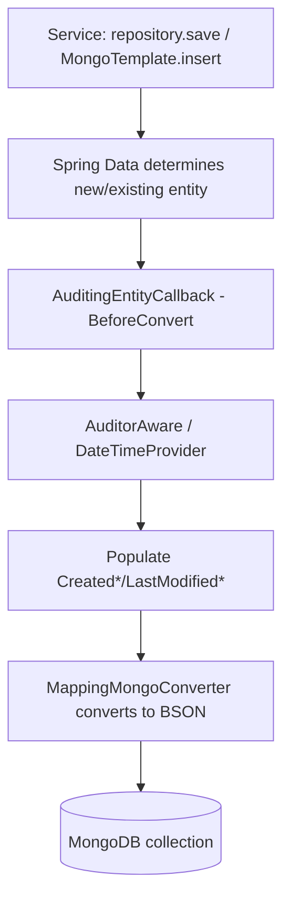

# Enabling @EnableMongoAuditing

In a **Spring Data MongoDB** application, developers often want to know who created a document, when it was created, who last modified it, and when it was last modified. Manually assigning these fields in every service is easy to miss when adding a new write path. Spring Data provides **auditing** to populate metadata at the entity mapping layer.

For the **imperative** flow, the `@EnableMongoAuditing` annotation registers the auditing infrastructure. On the entity, use `@CreatedDate`, `@LastModifiedDate`, `@CreatedBy`, and `@LastModifiedBy`. If you want to record the actor performing the operation, provide an `AuditorAware<T>` that retrieves the identity from the authenticated security context. Recording dates alone does not require an auditor provider.

This lesson belongs to the **Auditing** chapter of the `SPRING_DATA_MONGODB` module. The module covers connecting to MongoDB, document mapping, operating via `MongoTemplate` or repositories, as well as designing queries, aggregations, indexes, transactions, reactive access, testing, and performance diagnostics. The focus of this lesson is **enabling auditing properly**, not building a comprehensive change history store.

> **Keep in mind:** `@EnableMongoAuditing` operates through Spring Data **entity callbacks**. It does not automatically apply to every `updateFirst`, `findAndModify`, raw driver call, bulk write, or `mongosh` script. Nor does it replace `@Version`, authorization, transactions, or an immutable audit log.

## 1. Learning Objectives

After this lesson, you will be able to:

1. Distinguish auditing metadata from application logs, change streams, and revision history.
2. Enable `@EnableMongoAuditing` in a Spring-scanned `@Configuration`.
3. Map the `@CreatedDate`, `@LastModifiedDate`, `@CreatedBy`, and `@LastModifiedBy` fields.
4. Understand that time-only auditing does not require `AuditorAware`.
5. Implement `AuditorAware<String>` based on Spring Security `Authentication`.
6. Configure `auditorAwareRef` and `dateTimeProviderRef`.
7. Explain the `setDates` and `modifyOnCreate` options along with their default values.
8. Understand that `AuditingEntityCallback` runs during the `BeforeConvertCallback` phase.
9. Distinguish `insert`/`save` from query updates/bulk writes that do not go through entity auditing.
10. Handle actors for authenticated requests, anonymous requests, and background jobs.
11. Distinguish imperative `@EnableMongoAuditing` from reactive `@EnableReactiveMongoAuditing`.
12. Write integration tests for insert/save auditing and verify metadata read back from MongoDB.
13. Design a `Clock`/`DateTimeProvider` so time tests do not rely on `sleep`.
14. Prevent clients from modifying `createdBy`/`createdAt` or forging actors.
15. Understand that `@Version`, optimistic locking, and transactions are independent of audit metadata.
16. Evaluate limitations regarding change history, security, and migrating legacy data.

## 2. What Is Auditing Metadata?

Example order MongoDB document:

```javascript
{
  _id: "ORDER-1001",
  tenant_id: "tenant-a",
  status: "PAID",
  total_cents: NumberLong("120000"),
  createdAt: ISODate("2026-11-20T08:00:00Z"),
  createdBy: "user-17",
  lastModifiedAt: ISODate("2026-11-20T08:15:00Z"),
  lastModifiedBy: "user-28"
}
```

The four audit fields show the **latest state** of the metadata, but they do not store the entire transition from `DRAFT` to `PAID` or the previous values of each field.

| Goal | Mechanism | Result |
| --- | --- | --- |
| Who created | `@CreatedBy` + `AuditorAware` | Actor at creation time |
| When created | `@CreatedDate` | Creation timestamp supplied by provider |
| Who last modified | `@LastModifiedBy` | Actor of the latest modification |
| When last modified | `@LastModifiedDate` | Latest modification timestamp |
| Prevent overwriting stale data | `@Version` / CAS | Optimistic conflict detection |
| Store every change | History/event store/outbox | Sequence of changes |
| Observe server changes | MongoDB change streams | Configurable event stream |
| Restrict who can edit | Authorization and tenant filters | Access security |

**`createdAt` is not synonymous with `paidAt` or commit time.** Auditing generates values on the application side before the document is saved. Business milestones such as payment or approval should have dedicated fields with clear semantics.

## 3. Lifecycle from Repository to Callback



Modern Spring Data MongoDB uses `AuditingEntityCallback`, a `BeforeConvertCallback` with a default order of **100**. It modifies or returns the entity populated with metadata **before conversion to BSON**.

Consequences:

- `MongoTemplate.insert(entity)`, `MongoTemplate.save(entity)`, and CRUD repositories go through the appropriate mapping callbacks.
- Driver `MongoCollection<Document>.insertOne(...)` operates directly on BSON and has no knowledge of annotations.
- `updateFirst(Query, Update, Entity.class)` and `findAndModify` are direct update commands and do not execute the full auditing lifecycle like `save(entity)`.
- `MongoTemplate.remove` or repository delete does not mean creating a deletion audit log.
- In the reactive stack, there is a separate `ReactiveAuditingEntityCallback`.

### 3.1. EntityCallback Differs from ApplicationEvent

`AbstractMongoEventListener` can listen to `BeforeConvertEvent` and `BeforeSaveEvent`, but you should not write an event listener to manually assign metadata and assume it behaves like the auditing framework. Entity callbacks are recommended by Spring Data to **mutate entities in a deterministic order**, including immutable types.

If you register another callback that also modifies audit fields, you must check its ordering and avoid overwriting information already populated by auditing.

## 4. Dependencies and Environment

With Maven and imperative Spring Boot:

```xml
<dependency>
    <groupId>org.springframework.boot</groupId>
    <artifactId>spring-boot-starter-data-mongodb</artifactId>
</dependency>
```

With Gradle:

```groovy
dependencies {
    implementation "org.springframework.boot:spring-boot-starter-data-mongodb"
}
```

If resolving identity via Spring Security, add the appropriate security starter:

```xml
<dependency>
    <groupId>org.springframework.boot</groupId>
    <artifactId>spring-boot-starter-security</artifactId>
</dependency>
```

Let the Spring Boot BOM manage Spring Data and MongoDB Driver versions. Do not arbitrarily mix major versions. **Connecting to MongoDB successfully does not automatically turn on auditing**: configuration and annotations are required; if actor fields are present, a provider must be supplied.

## 5. Simplest @EnableMongoAuditing Setup

For an imperative application **recording timestamps only**:

```java
package dev.learning.orders.config;

import org.springframework.context.annotation.Configuration;
import org.springframework.data.mongodb.config.EnableMongoAuditing;

@Configuration
@EnableMongoAuditing
public class MongoAuditingConfiguration {
}
```

Place the configuration class within the component scan scope or import it intentionally. The annotation belongs to:

```java
org.springframework.data.mongodb.config.EnableMongoAuditing
```

Do not confuse it with `@EnableJpaAuditing` for JPA, or `@EnableReactiveMongoAuditing` for reactive MongoDB.

### 5.1. Boot Autoconfiguration and Auditing Are Not the Same

`@SpringBootApplication` can auto-configure repositories and `MongoTemplate` when dependencies are present, but you should not assume it automatically enables auditing metadata. `@EnableMongoAuditing` is an explicit declaration.

`@EnableMongoRepositories` controls repository discovery; `@EnableMongoAuditing` registers the auditing infrastructure. An application using `MongoTemplate` without repositories may still need auditing.

### 5.2. Date-Only Auditing Does Not Need AuditorAware

Spring Data Commons states: if only `@CreatedDate` and `@LastModifiedDate` are used, the entity **does not require** an `AuditorAware`. When enabling actor fields `@CreatedBy`/`@LastModifiedBy`, a provider is needed to obtain the current actor.

### 5.3. Avoid Duplicate Activation

Do not copy three configuration classes all annotated with `@EnableMongoAuditing` into a single application context at the same time. Choose **one policy** with the right bean references; multiple auditing registrars or multiple contexts make diagnostics difficult.

## 6. Example Entity Using Four Annotations

```java
package dev.learning.orders.domain;

import java.time.Instant;

import org.springframework.data.annotation.CreatedBy;
import org.springframework.data.annotation.CreatedDate;
import org.springframework.data.annotation.Id;
import org.springframework.data.annotation.LastModifiedBy;
import org.springframework.data.annotation.LastModifiedDate;
import org.springframework.data.annotation.Version;
import org.springframework.data.mongodb.core.mapping.Document;
import org.springframework.data.mongodb.core.mapping.Field;

@Document("audited_orders")
public class AuditedOrder {

    @Id private String id;
    @Field("tenant_id") private String tenantId;
    private String status;
    @Field("total_cents") private long totalCents;

    @CreatedDate private Instant createdAt;
    @LastModifiedDate private Instant lastModifiedAt;
    @CreatedBy private String createdBy;
    @LastModifiedBy private String lastModifiedBy;

    @Version private Long version;

    protected AuditedOrder() {}

    public AuditedOrder(String id, String tenantId,
                        String status, long totalCents) {
        this.id = id;
        this.tenantId = tenantId;
        this.status = status;
        this.totalCents = totalCents;
    }

    public String getId() { return id; }
    public String getTenantId() { return tenantId; }
    public String getStatus() { return status; }
    public long getTotalCents() { return totalCents; }
    public Instant getCreatedAt() { return createdAt; }
    public Instant getLastModifiedAt() { return lastModifiedAt; }
    public String getCreatedBy() { return createdBy; }
    public String getLastModifiedBy() { return lastModifiedBy; }
    public Long getVersion() { return version; }

    public void setStatus(String status) { this.status = status; }
}
```

Spring Data mapping can work with private fields through supported configuration. Public setters for audit fields are not needed in this model; callers should not have control over identity/timestamps.

### 6.1. Four Audit Fields on Insert and Save

| Field | Insert | Saving an existing document |
| --- | --- | --- |
| `createdAt` / `@CreatedDate` | Sets creation timestamp | Usually preserved |
| `createdBy` / `@CreatedBy` | Sets current actor if available | Usually preserved |
| `lastModifiedAt` / `@LastModifiedDate` | Sets if `modifyOnCreate=true` | Sets modification timestamp |
| `lastModifiedBy` / `@LastModifiedBy` | Sets if `modifyOnCreate=true` | Sets modifying actor |
| `version` / `@Version` | Initializes version | Checks/increments version if operation supports it |

`@Version` is a **concurrency control mechanism separate from auditing**. It is not required for auditing to work; it is included in the example to remind you that an entity can both be audited and guard against stale saves.

### 6.2. Use Instant and Understand BSON Date

`Instant` is the right type for an absolute timestamp; MongoDB BSON Date typically stores milliseconds since epoch. `Instant.now()` may contain nanosecond precision, but when read back via BSON Date, sub-millisecond fractions may not be preserved. Tests should not assert nanosecond precision if the converter/driver truncates or rounds.

Do not use `LocalDateTime` without clarifying the timezone. Do not store a timestamp as a local string when consistent comparison, range queries, or TTL are needed.

## 7. AuditorAware<T>: Where Does the Actor Come From?

`AuditorAware<T>` is a Spring Data Commons SPI:

```java
import java.util.Optional;
import org.springframework.data.domain.AuditorAware;

// Conceptual contract:
// Optional<T> getCurrentAuditor();
```

If the entity declares `@CreatedBy String createdBy` and `@LastModifiedBy String lastModifiedBy`, the bean should be `AuditorAware<String>`. If the provider returns a `User` object while the field is `String`, the types and conversion may be incompatible.

### 7.1. Fixed Provider for Test Examples

```java
import org.springframework.context.annotation.Bean;
import org.springframework.context.annotation.Configuration;
import org.springframework.data.domain.AuditorAware;

@Configuration
public class TrainingActorConfiguration {

    @Bean("fixedAuditor")
    AuditorAware<String> fixedAuditor() {
        return () -> java.util.Optional.of("training-user");
    }
}
```

Corresponding auditing configuration:

```java
@Configuration
@EnableMongoAuditing(auditorAwareRef = "fixedAuditor")
public class TrainingAuditingConfiguration {
}
```

**This is an alternative to the configuration in section 5**, not a second `@EnableMongoAuditing` class to add alongside it. A fixed auditor is suitable for demos or tests; do not use a fixed identity for all production HTTP requests.

### 7.2. Actor Is a User ID, Not Self-Reported Data

A `createdBy` field storing a stable user ID is usually easier to trace than a display name or email that can change. Do not copy `createdBy` from request JSON, and do not trust an arbitrary `X-User-ID` header unless verified by a trusted gateway and clear policy.

## 8. Using Spring Security in AuditorAware

An imperative Spring MVC application can read `SecurityContextHolder`:

```java
package dev.learning.orders.config;

import java.util.Optional;

import org.springframework.context.annotation.Bean;
import org.springframework.context.annotation.Configuration;
import org.springframework.data.domain.AuditorAware;
import org.springframework.security.authentication.AnonymousAuthenticationToken;
import org.springframework.security.core.Authentication;
import org.springframework.security.core.context.SecurityContextHolder;

@Configuration
public class SecurityAuditorConfiguration {

    @Bean("securityAuditor")
    AuditorAware<String> securityAuditor() {
        return () -> Optional.ofNullable(
                SecurityContextHolder.getContext()
                    .getAuthentication())
            .filter(Authentication::isAuthenticated)
            .filter(a -> !(a instanceof AnonymousAuthenticationToken))
            .map(Authentication::getName);
    }
}
```

`Authentication.getName()` is an illustrative choice; production may need to map to a stable actor ID from a custom principal. The actor must come from an **authenticated context**, not a username supplied by the client.

### 8.1. Anonymous Can Have isAuthenticated=true

An `AnonymousAuthenticationToken` created by Spring Security may still be considered authenticated according to the API. Filtering only by `Authentication::isAuthenticated` does not guarantee filtering out anonymous requests. The example also checks the token type; depending on your actual security configuration, a different policy may be needed.

### 8.2. What If There Is No Authentication?

`AuditorAware.getCurrentAuditor()` returns `Optional.empty()` when there is no valid principal. In that case, the actor fields may remain unpopulated. If the business logic **requires an actor**, the service/controller must authenticate and authorize **before writing**, rather than expecting auditing to reject all anonymous writes.

For background jobs, use a **service identity** with a clear provenance, rather than defaulting to `"admin"` when Authentication is missing.

## 9. Enabling with Explicit Bean References

When there are multiple `AuditorAware` beans or you want a custom timestamp provider, specify the exact beans:

```java
package dev.learning.orders.config;

import org.springframework.context.annotation.Configuration;
import org.springframework.data.mongodb.config.EnableMongoAuditing;

@Configuration
@EnableMongoAuditing(
    auditorAwareRef = "securityAuditor",
    dateTimeProviderRef = "auditDateTimeProvider",
    setDates = true,
    modifyOnCreate = true
)
public class ProductionAuditingConfiguration {
}
```

The `securityAuditor` bean comes from section 8. The `auditDateTimeProvider` bean is defined in section 10. Within a single application context, **use only one class to enable auditing** for the chosen policy; `ProductionAuditingConfiguration` is an alternative to the classes in section 5 or 7.

| `@EnableMongoAuditing` Attribute | Type | Default | Purpose |
| --- | --- | --- | --- |
| `auditorAwareRef` | `String` | Empty string | Specifies the `AuditorAware` bean name used to resolve the principal |
| `dateTimeProviderRef` | `String` | Empty string | Specifies the `DateTimeProvider` bean name |
| `setDates` | `boolean` | `true` | Allows the framework to populate date fields automatically |
| `modifyOnCreate` | `boolean` | `true` | Also marks modified metadata when creating an entity |

When there is only **one** matching `AuditorAware` bean, the auditing infrastructure can locate it automatically. However, if there are multiple implementations, do not rely on incidental bean ordering: declare `auditorAwareRef` explicitly.

### 9.1. Do Not Confuse Bean Name with Actor Value

`auditorAwareRef = "securityAuditor"` is the **Spring bean name**, not the value stored in `createdBy`. The actual actor is returned by `AuditorAware<String>.getCurrentAuditor()` at operation time. For example, one bean can return `"user-17"` for request A and `"user-28"` for request B.

### 9.2. Does Not Alter MongoClient or Transaction Manager

Enabling auditing **does not alter** the MongoDB URI, database name, `MongoClientSettings`, write concern, indexes, or transaction boundaries. If the application has multiple Mongo templates/factories, verify that the callback and actor provider belong to the **exact application context** used to write entities.

## 10. Creating DateTimeProvider and Clock

Spring Data's `DateTimeProvider` supplies the timestamp for `@CreatedDate` and `@LastModifiedDate`. When unspecified, the framework uses its default provider. To make testing with fixed time possible, declare an explicit `Clock` and provider:

```java
package dev.learning.orders.config;

import java.time.Clock;
import java.time.Instant;
import java.time.temporal.ChronoUnit;
import java.time.temporal.TemporalAccessor;
import java.util.Optional;

import org.springframework.context.annotation.Bean;
import org.springframework.context.annotation.Configuration;
import org.springframework.data.auditing.DateTimeProvider;

@Configuration
public class AuditTimeConfiguration {

    @Bean
    Clock auditClock() {
        return Clock.systemUTC();
    }

    @Bean("auditDateTimeProvider")
    DateTimeProvider auditDateTimeProvider(Clock auditClock) {
        return () -> Optional.<TemporalAccessor>of(
            Instant.now(auditClock)
                .truncatedTo(ChronoUnit.MILLIS));
    }
}
```

`DateTimeProvider#getNow()` returns `Optional<TemporalAccessor>`. `Instant` implements `TemporalAccessor`, so the example passes a value that Spring Data uses to set fields of type `Instant`.

### 10.1. Why Truncate to Milliseconds?

MongoDB BSON Date commonly stores timestamps at millisecond precision. Java `Instant` can be more precise, but sub-millisecond nanoseconds are not always preserved when written and read via BSON. `truncatedTo(MILLIS)` makes comparing expected timestamps in tests straightforward.

Truncation to milliseconds is not strictly required if the model and converter intentionally use different precision; what matters is having a clear **time contract** for stored data.

### 10.2. Testing with Fixed Time

In a dedicated test context, you can inject `Clock.fixed(...)` to produce deterministic results:

```java
Clock fixed = Clock.fixed(
    Instant.parse("2026-11-20T08:00:00Z"),
    java.time.ZoneOffset.UTC
);
```

If you need to prove `lastModifiedAt` **changes** across two saves, create a test clock that can advance step by step. Do not use `Thread.sleep` to wait past millisecond resolution.

### 10.3. Auditing Time Differs from Commit Time

The provider is invoked on the application side before converting the entity to BSON. A transaction may roll back after the callback sets the timestamp; the timestamp is not proof that the transaction committed at that exact moment. If business logic requires a server-side event timestamp, define it separately and handle the appropriate write paths.

## 11. modifyOnCreate: Why Do New Records Also Have lastModified?

By default `modifyOnCreate=true`, so when creating a new entity, auditing can populate **both created and last-modified fields**:

```text
Insert (modifyOnCreate=true)
  createdAt       = 08:00
  createdBy       = user-17
  lastModifiedAt  = 08:00
  lastModifiedBy  = user-17

Save existing document at 08:15
  createdAt       = 08:00
  createdBy       = user-17
  lastModifiedAt  = 08:15
  lastModifiedBy  = user-28
```

This is a reasonable policy if "creating a document" is also considered its first modification.

If you want **last-modified fields to remain empty on insert**, choose:

```java
@Configuration
@EnableMongoAuditing(
    auditorAwareRef = "securityAuditor",
    modifyOnCreate = false
)
public class CreatedOnlyAuditingConfiguration {
}
```

In that case, on a new entity, `lastModifiedAt`/`lastModifiedBy` may remain unpopulated until an update occurs. The configuration above is an **alternative option** and should not be declared simultaneously with `ProductionAuditingConfiguration`.

### 11.1. Do Not Test the Default Incorrectly

A test asserting `lastModifiedAt == null` after insert will fail when `modifyOnCreate=true`. Conversely, if business code treats `lastModifiedAt != null` as a sign of "modified after creation", the `true` default makes that assumption wrong. Compare version or business status instead of inferring from nullness.

## 12. setDates: Enabling or Disabling Time Management

By default `setDates=true`. If you want auditing to populate the actor but **not generate timestamps automatically**, configure:

```java
@EnableMongoAuditing(
    auditorAwareRef = "securityAuditor",
    setDates = false
)
```

Now `createdAt` and `lastModifiedAt` are not populated automatically by auditing. This **does not make MongoDB server generate timestamps automatically**. If database-side timestamps are needed, you must configure/execute corresponding operations in another write path.

### 12.1. Do Not Mix Multiple Timestamp Sources Carelessly

One service might use entity `save` with application-time timestamps while another uses `$currentDate` with MongoDB server time. Looking solely at `lastModifiedAt`, the two write paths can exhibit clock skew. Define a clear policy and monitor clock drift.

### 12.2. setDates=false Does Not Disable Actor Auditing

`setDates=false` only controls setting creation/last-modification dates. `@CreatedBy` and `@LastModifiedBy` can still be populated when `AuditorAware` is present and the callback runs according to policy. If you want to disable auditing completely, do not mistake `setDates=false` for a global off switch.

## 13. Insert and Save with MongoTemplate

Suppose `@EnableMongoAuditing` with `securityAuditor` is active and the request has Authentication `user-17`.

```java
import org.springframework.data.mongodb.core.MongoTemplate;

AuditedOrder newOrder = new AuditedOrder(
    "ORDER-1001", "tenant-a", "DRAFT", 120_000L);

AuditedOrder inserted = mongoTemplate.insert(newOrder);

System.out.println(inserted.getCreatedBy());     // user-17
System.out.println(inserted.getLastModifiedBy()); // user-17 if modifyOnCreate
System.out.println(inserted.getCreatedAt());     // timestamp from provider
```

After insert, the document has audit metadata without the service **assigning it manually**. Later when `user-28` updates it:

```java
AuditedOrder existing = mongoTemplate.findById(
    "ORDER-1001", AuditedOrder.class);

if (existing == null) {
    throw new IllegalStateException("Order not found");
}

existing.setStatus("PAID");

AuditedOrder saved = mongoTemplate.save(existing);

System.out.println(saved.getLastModifiedBy()); // user-28
```

**Example separating two requests**: the `user-17`/`user-28` identities must come from the respective SecurityContext when each operation executes. Running sequentially on the same thread with the same Authentication will not switch the auditor to a different user automatically.

### 13.1. Why Does insert Differ from save?

- `insert(entity)` expresses the intent to **create new**, failing if the ID already exists.
- `save(entity)` relies on newness detection/mapping to insert or update.
- `@Version Long version` in the example affects new-entity detection and optimistic locking.
- Audit fields are set according to Spring Data's **new/existing semantics**, not solely whether `id` is null.

An entity with a pre-assigned ID and a null version should be tested for proper `insert/save` behavior in the Spring Data version in use.

### 13.2. Auditing Does Not Change Tenant Logic

`mongoTemplate.findById(id, AuditedOrder.class)` **does not automatically add a tenant filter**. In a multi-tenant API, queries must include a `tenantId`/authorization predicate to prevent accessing another tenant's orders even if the entity has auditing.

## 14. Through a Repository: Where Does Auditing Happen?

Basic repository:

```java
package dev.learning.orders.data;

import org.springframework.data.mongodb.repository.MongoRepository;

public interface AuditedOrderRepository
        extends MongoRepository<AuditedOrder, String> {
}
```

Usage:

```java
AuditedOrder inserted = repository.insert(
    new AuditedOrder(
        "ORDER-1002", "tenant-a", "DRAFT", 10_000L));

AuditedOrder loaded = repository.findById(
    inserted.getId()).orElseThrow();

loaded.setStatus("CONFIRMED");

AuditedOrder updated = repository.save(loaded);
```

`insert`/`save` through Spring Data mapping triggers the corresponding callbacks. `findById` **does not** modify `lastModifiedAt` or `lastModifiedBy` simply because a document was read.

### 14.1. Do Not Use save as a "Read-Only Refresh"

`repository.save(entity)` is a **write command**; auditing can update `lastModifiedAt` even if business fields did not actually change. Therefore:

- Do not call `save` after a GET just to "refresh".
- Do not treat every audit timestamp change as proof that business state changed.
- Distinguish write semantics, version, and modified count if the business logic needs to know whether a real change occurred.

### 14.2. Do Not Let Clients Send the Whole Entity

An endpoint that accepts full JSON into `AuditedOrder` and calls `save` can allow clients to choose fields they should not control, such as `tenantId` or audit timestamps. Use a **request DTO** containing only editable fields, load the entity with authorization verified, and then update the necessary business fields.

## 15. Query Update Is Not the Same as Entity Save

An important misconception:

```java
import org.springframework.data.mongodb.core.query.Criteria;
import org.springframework.data.mongodb.core.query.Query;
import org.springframework.data.mongodb.core.query.Update;

Query q = Query.query(
    Criteria.where("id").is("ORDER-1001"));

Update u = new Update()
    .set("status", "SHIPPED");

var result = mongoTemplate.updateFirst(
    q, u, AuditedOrder.class);
```

This is a **query-based update**; it does not take an audited entity and run `AuditingEntityCallback` along the same path as `save(entity)`. Therefore, **do not assume `lastModifiedAt`/`lastModifiedBy` are updated automatically**.

`@Version` may auto-increment in typed update operations supported by Spring Data, but **version auto-increment does not mean the auditing callback ran**. These are two separate mechanisms.

### 15.1. Manually Updating lastModifiedAt When Needed

If the project accepts database server time and the actor is taken from trusted authentication:

```java
Update change = new Update()
    .set("status", "SHIPPED")
    .set("lastModifiedBy", authorizedActorId)
    .currentDate("lastModifiedAt");

var result = mongoTemplate.updateFirst(
    Query.query(Criteria.where("id").is(orderId)
        .and("tenantId").is(authorizedTenant)),
    change,
    AuditedOrder.class);
```

`authorizedActorId` and `authorizedTenant` must come from the security context, not user-controlled strings. `Update.currentDate` sets a BSON date using server time, whereas `DateTimeProvider` in `save` typically sets application time; if both write paths coexist, you must have rules for reconciling clock skew.

If the business logic requires compare-and-set, add the expected `@Version` to the Query and check `matchedCount`. The pattern above does not yet enforce an expected version.

### 15.2. Do Not Overwrite Created Metadata

`createdAt` and `createdBy` should reflect original provenance. If Query-style updates are allowed to alter these two fields without restriction, auditing metadata can be forged. Restrict write permissions, authenticate actors, validate service logic, and use an independent audit event source if stronger tamper resistance is needed.

## 16. Write Paths That Bypass the Auditing Callback

| Operation | Does auditing entity callback run automatically? | Required Action |
| --- | --- | --- |
| `MongoTemplate.insert(entity)` | Yes in the mapping pipeline | Verify configuration |
| `MongoTemplate.save(entity)` | Yes in the mapping pipeline | Mind version and newness |
| `MongoRepository.insert/save(entity)` | Yes via mapped entity path | Write integration tests |
| `MongoTemplate.updateFirst(Query, Update, Class)` | **Not the same entity save callback** | Explicitly set audit fields if needed |
| `MongoTemplate.updateMulti` | Does not auto-audit per entity like `save` | Design an update policy |
| `MongoTemplate.findAndModify` | Does not auto-audit like full save | Add audit updates if needed |
| `BulkOperations.updateOne/updateMulti` | Does not handle per-entity auditing like save | Use explicit write models/metadata |
| Driver `MongoCollection.updateOne/replaceOne` | Unaware of Spring annotations | Manage audit fields manually |
| `mongosh db.collection.updateOne` | No Spring context | Manage audit fields manually |
| MongoDB aggregation `$merge`/`$out` | Server-side pipeline | No Spring entity auditing |
| Repository custom query `@Update` | Not synonymous with entity save | Review actual execution path |

If a collection is written to by multiple services and batch scripts, **enabling `@EnableMongoAuditing` in one service alone does not guarantee audit fields are always accurate**. A shared contract across all writers is required.

### 16.1. Using Bulk Operations with Attention to Actor

A batch import might be processed using `insertAll` on mapped entities or direct bulk writes. These paths have different callback semantics; tests must prove which fields are populated for each path. Do not guess just because a method name contains "insert".

### 16.2. Why Is Raw BSON Not Audited?

The raw driver and MongoDB Server do not understand the Java `@CreatedBy` annotation. There are no Spring callbacks in the raw write path. If server-side metadata is needed for all language clients, you must apply a server-side strategy or an audit event/log adhered to by all writers; do not expect Java annotations to affect other clients.

## 17. Reactive Auditing Is a Separate Configuration

In reactive Spring Data MongoDB, use:

```java
package dev.learning.orders.config;

import org.springframework.context.annotation.Configuration;
import org.springframework.data.mongodb.config.EnableReactiveMongoAuditing;

@Configuration
@EnableReactiveMongoAuditing(
    auditorAwareRef = "reactiveSecurityAuditor"
)
public class ReactiveAuditingConfiguration {
}
```

The provider must be `ReactiveAuditorAware<String>`, not `AuditorAware<String>`:

```java
import org.springframework.context.annotation.Bean;
import org.springframework.data.domain.ReactiveAuditorAware;
import org.springframework.security.authentication.AnonymousAuthenticationToken;
import org.springframework.security.core.Authentication;
import org.springframework.security.core.context.ReactiveSecurityContextHolder;
import reactor.core.publisher.Mono;

@Bean("reactiveSecurityAuditor")
ReactiveAuditorAware<String> reactiveSecurityAuditor() {
    return () -> ReactiveSecurityContextHolder.getContext()
        .map(ctx -> ctx.getAuthentication())
        .filter(Authentication::isAuthenticated)
        .filter(a -> !(a instanceof AnonymousAuthenticationToken))
        .map(Authentication::getName);
}
```

The `@Bean` method here belongs in an appropriate Spring `@Configuration` (for example, inside `ReactiveAuditingConfiguration`). `ReactiveSecurityContextHolder` retrieves authentication from the **Reactor Context**, suitable for WebFlux.

### 17.1. Do Not Use SecurityContextHolder as the Reactive Default

In WebFlux, the Reactive Context can move between threads. Thread-context-based `SecurityContextHolder` does not automatically reflect the identity of a reactive subscription across every scheduler. Use `ReactiveAuditorAware` and `ReactiveSecurityContextHolder` instead of reading arbitrary `ThreadLocal` state.

### 17.2. Do Not Enable Both Annotations Carelessly in the Same Context

A purely imperative application uses `@EnableMongoAuditing`; a purely reactive application uses `@EnableReactiveMongoAuditing`. A mixed application may need both, but you must control auditing registrars/callbacks and actor providers in each pipeline. Do not assume **one annotation** applies to both operation styles.

### 17.3. Reactive Publishers Execute Only Upon Subscription

`ReactiveMongoRepository.save(...)` returns a `Mono`. Creating a `Mono` does not mean the entity has been audited or written to MongoDB. Reactive callbacks execute according to the lifecycle **when the Publisher is subscribed**. Calling `subscribe()` recklessly in a service can lose authentication/transaction context; return or compose Publishers for the framework instead.

## 18. Embedded Metadata, Immutable Entities, and Auditable

Audit fields do not have to live on the root entity; Spring Data Commons allows modeling metadata inside an embedded object depending on store mapping:

```java
import java.time.Instant;
import org.springframework.data.annotation.CreatedDate;
import org.springframework.data.annotation.LastModifiedDate;

public class AuditMetadata {
    @CreatedDate
    private Instant createdAt;

    @LastModifiedDate
    private Instant lastModifiedAt;

    public Instant getCreatedAt() { return createdAt; }
    public Instant getLastModifiedAt() { return lastModifiedAt; }
}
```

In the entity:

```java
@Document("audited_catalog")
public class CatalogItem {
    @Id private String id;
    private String name;
    private AuditMetadata audit;
}
```

Spring Data auditing supports embedded metadata according to mapping capabilities; however, traditional lifecycle events are emitted for root entities, not necessarily for each embedded object. When using immutable objects or Java records, check constructor mapping, nested object creation, and callback support. If `audit` is `null`, do not assume the framework will instantiate the entire object graph for every Java type.

### 18.1. The Auditable Interface

Spring Data Commons also provides the `Auditable<U, ID, T>` interface as an alternative to annotations, allowing the framework to access auditing metadata setters/getters via a contract. This form is useful for shared base classes/contracts, though it couples the domain more tightly to Spring Data. For a simple entity, the annotation-based approach is usually easier to understand.

### 18.2. Java Records and Withers

Immutable entities can work with Spring Data mapping when constructors/withers are designed properly. However, do not copy a mutable class example into a Java record and arbitrarily expect callbacks to mutate private final fields without verifying support. Test readback on your specific Spring Data version, especially with nested auditing metadata.

## 19. Integration Testing: Auditing on Insert

To prove that the configuration actually works, you must **insert and read back BSON through Spring Data** in a dedicated MongoDB test database. Tests should not merely assert that an `AuditorAware` bean exists.

Add the Spring Security test dependency if using `@WithMockUser`:

```groovy
dependencies {
    testImplementation "org.springframework.boot:spring-boot-starter-test"
    testImplementation "org.springframework.security:spring-security-test"
}
```

Assuming the test application loads `ProductionAuditingConfiguration`, `SecurityAuditorConfiguration`, `AuditTimeConfiguration` from the previous sections, along with `AuditedOrderRepository`:

```java
package dev.learning.orders;

import static org.assertj.core.api.Assertions.assertThat;
import java.util.UUID;

import org.junit.jupiter.api.Test;
import org.springframework.beans.factory.annotation.Autowired;
import org.springframework.boot.test.context.SpringBootTest;
import org.springframework.security.test.context.support.WithMockUser;

@SpringBootTest
class MongoAuditingIntegrationTest {

    @Autowired
    AuditedOrderRepository repository;

    private AuditedOrder newOrder() {
        String key = UUID.randomUUID().toString();
        return new AuditedOrder(
            "ORDER-" + key,
            "tenant-test-" + key,
            "DRAFT",
            120_000L);
    }

    @Test
    @WithMockUser(username = "alice")
    void insertPopulatesAuditFields() {
        AuditedOrder inserted = repository.insert(newOrder());

        assertThat(inserted.getCreatedAt()).isNotNull();
        assertThat(inserted.getCreatedBy()).isEqualTo("alice");

        // When modifyOnCreate=true (default):
        assertThat(inserted.getLastModifiedAt()).isNotNull();
        assertThat(inserted.getLastModifiedBy())
            .isEqualTo("alice");

        AuditedOrder reloaded = repository.findById(
            inserted.getId()).orElseThrow();

        assertThat(reloaded.getCreatedAt())
            .isEqualTo(inserted.getCreatedAt());
        assertThat(reloaded.getCreatedBy()).isEqualTo("alice");
    }
}
```

The `AuditedOrder`/`AuditedOrderRepository` classes must be imported from their actual project packages. Use UUID IDs and a **MongoDB test database**, never connecting to production. Test both the returned value and the reloaded value to prove callbacks did not merely mutate an in-memory object.

### 19.1. Tests Must Not Delete Shared Data

Do not call `repository.deleteAll()` or `mongoTemplate.dropCollection(AuditedOrder.class)` to clean up after tests if the collection might be shared. Use an isolated test database or clean up **only the IDs created by the test** per fixture policy.

### 19.2. Why Not Test Only DateTimeProvider?

Unit testing the provider proves the clock works, but it does not prove the auditing callback is registered in the Spring context or that the entity maps to BSON properly. Real integration tests are necessary.

## 20. Testing Save: Preserving Created Metadata and Changing Modified Actor

In the same test class from section 19, add a method using mock authentication Alice before insert, then switching to Bob before save:

```java
import java.util.List;

import org.springframework.security.authentication
    .UsernamePasswordAuthenticationToken;
import org.springframework.security.core.Authentication;
import org.springframework.security.core.authority.SimpleGrantedAuthority;
import org.springframework.security.core.context.SecurityContextHolder;

@Test
@WithMockUser(username = "alice")
void saveChangesModificationActor() {
    AuditedOrder inserted = repository.insert(newOrder());
    var initialCreatedAt = inserted.getCreatedAt();

    Authentication alice =
        SecurityContextHolder.getContext().getAuthentication();

    try {
        Authentication bob =
            new UsernamePasswordAuthenticationToken(
                "bob", "N/A",
                List.of(new SimpleGrantedAuthority("ROLE_USER")));

        SecurityContextHolder.getContext()
            .setAuthentication(bob);

        AuditedOrder current = repository.findById(
            inserted.getId()).orElseThrow();

        current.setStatus("CONFIRMED");
        repository.save(current);

    } finally {
        SecurityContextHolder.getContext()
            .setAuthentication(alice);
    }

    AuditedOrder reloaded = repository.findById(
        inserted.getId()).orElseThrow();

    assertThat(reloaded.getCreatedBy()).isEqualTo("alice");
    assertThat(reloaded.getCreatedAt())
        .isEqualTo(initialCreatedAt);

    assertThat(reloaded.getLastModifiedBy()).isEqualTo("bob");
    assertThat(reloaded.getLastModifiedAt())
        .isAfterOrEqualTo(initialCreatedAt);
}
```

In production, the actor comes from the authenticated request; **do not manually mutate `SecurityContext` in services**. Switching the context here is only to simulate two users on a single test thread; `finally` restores the original Authentication.

### 20.1. Why Not Assert That lastModifiedAt Must Be Greater?

Two saves can occur within the **same millisecond**. BSON Date does not guarantee they differ. If you want to test strictly increasing timestamps reliably, use a `DateTimeProvider` backed by a controlled clock and advance the clock between saves.

### 20.2. What If Save Encounters an Optimistic Conflict?

If the entity has `@Version` and a stale read is rejected with `OptimisticLockingFailureException`, **do not treat audit fields on the stale object as committed records**. The callback may have touched the object before the write failed; read back from MongoDB to see the actual persisted state.

## 21. Testing That Query Update Does Not Auto-Populate lastModified

Using the inserted entity, run:

```java
Query query = Query.query(
    Criteria.where("id").is(inserted.getId()));

Update update = new Update()
    .set("status", "SHIPPED");

var result = mongoTemplate.updateFirst(
    query, update, AuditedOrder.class);
```

`inserted` and `mongoTemplate` are fixture/beans in the configured test class. Query updates generally do not go through `AuditingEntityCallback` like `save(entity)`. Therefore, tests should verify that `lastModifiedAt` **is not assumed to have updated automatically**; if the project requires it, add explicit audit fields to `Update` and test that behavior.

### 21.1. Explicit Update Pattern

```java
Update change = new Update()
    .set("status", "SHIPPED")
    .set("lastModifiedBy", authorizedActorId)
    .currentDate("lastModifiedAt");

var outcome = mongoTemplate.updateFirst(
    Query.query(Criteria.where("id").is(orderId)
        .and("tenantId").is(authorizedTenant)),
    change, AuditedOrder.class);
```

Both `authorizedActorId` and `authorizedTenant` must come from an authenticated principal. `currentDate` uses MongoDB Server time rather than the application `Clock`, so the time source policy may differ from entity saves.

### 21.2. Do Not Omit the Optimistic Version Check

If the operation needs protection against stale updates, add the expected version to the query and check `matchedCount`. Whether typed `Update` increments `@Version` is separate from ensuring the auditor callback ran or the request carried the right version.

## 22. Testing DateTimeProvider Deterministically

You can test the provider directly without MongoDB:

```java
import static org.assertj.core.api.Assertions.assertThat;

import java.time.Clock;
import java.time.Instant;
import java.time.ZoneOffset;
import java.time.temporal.ChronoUnit;

import org.junit.jupiter.api.Test;

@Test
void providerUsesClock() {
    Instant fixed = Instant.parse("2026-11-20T08:00:00Z");
    Clock clock = Clock.fixed(fixed, ZoneOffset.UTC);

    var provider = new AuditTimeConfiguration()
        .auditDateTimeProvider(clock);

    assertThat(provider.getNow())
        .contains(fixed.truncatedTo(ChronoUnit.MILLIS));
}
```

This method belongs in a test class with the appropriate imports and JUnit context. If you want to verify a mapped entity with a fixed time, create a **test application context** using a fixed `Clock` and `dateTimeProviderRef`; do not alter a production runtime clock between requests.

### 22.1. Date-Only Auditing Also Needs Integration Tests

Create a separate context with only `@EnableMongoAuditing` and an entity using `@CreatedDate`/`@LastModifiedDate`. Insert a new entity and assert dates are populated **without requiring `AuditorAware`**. This is an alternative configuration test and should not be loaded alongside conflicting `@EnableMongoAuditing` policies.

### 22.2. Avoid Tests Dependent on Real Time

Do not use `Thread.sleep` and then assert server timestamps to nanosecond precision, or treat an application timestamp as a transaction commit timestamp. Read back BSON Date and test at the stored resolution.

## 23. Securing Audit Metadata and Tenant

An HTTP request must not be allowed to send:

```json
{
  "status": "CONFIRMED",
  "lastModifiedBy": "admin",
  "createdAt": "2020-01-01T00:00:00Z"
}
```

If the controller maps the entire request directly into an entity and calls `save`, callers can inject fields they are not authorized to modify. Use a DTO containing only business fields:

```java
public record ChangeOrderStatusRequest(String status) {}
```

The service looks up the document by ID **and authenticated tenant**, checks modification permissions, sets the status, and saves. Auditing resolves the actor from `AuditorAware` on the server side. Do not trust raw `X-User-ID` headers or unverified actors in the request body.

### 23.1. Auditing Does Not Replace Authorization

Having `createdBy="alice"` does not automatically stop another user from modifying the document. Authorization and tenant-scoped queries remain mandatory. `@EnableMongoAuditing` also does not prove the actor was permitted to perform the operation; it only records **what the identity provider returned**.

### 23.2. Not a Tamper-Proof History Store

Users with MongoDB update permissions or raw scripts can alter `createdBy`/`lastModifiedBy` or delete documents. If audit evidence is required:

- Write append-only audit events or a transactional outbox.
- Include actor, tenant, request ID, action, timestamps, and controlled event payload.
- Separate permissions on history from primary data CRUD.
- Design retention, backup, modification/deletion monitoring, and reconciliation.
- Do not use the four current-state fields as a substitute for full history.

### 23.3. Do Not Log Tokens or Sensitive Data

`AuditorAware` has access to the authentication principal, but it should not log raw JWTs, session cookies, credentials, or the entire user object. Log a stable actor ID and correlation ID according to privacy/security policies.

## 24. Background Jobs and Legacy Data Migration

A scheduled job usually lacks a Spring Security HTTP `Authentication`. `AuditorAware` may return `Optional.empty()`, leaving actor fields unpopulated contrary to expectations.

Approaches:

1. Assign a traceable **service identity** to the job.
2. Establish a policy distinguishing interactive users from machine actors.
3. Never fall back globally to `admin` unconditionally.
4. For batch imports, define explicit write paths and audit policies for each data type.

### 24.1. Legacy Documents Are Not Backfilled Automatically

Adding `@CreatedDate` today does not retroactively give a million existing documents historical creation dates. Those documents may be read with `createdAt=null`.

Do not run `repository.save` in bulk just to "fix missing audit metadata" and accidentally stamp the migration date as the original creation date. Backfill from trusted sources, record separate provenance, or mark as unknown when the true timestamp cannot be determined.

### 24.2. Indexes and TTL Are Separate Steps

If the business filters or sorts by `lastModifiedAt`, design indexes based on actual queries, usually paired with `tenant_id`. Do not blindly attach a TTL index to `createdAt` on orders subject to retention obligations. `@EnableMongoAuditing` **does not automatically create indexes** or enable schema validators.

### 24.3. Multi-Service Writers

If only service A enables auditing while service B updates the collection via the raw driver, metadata can become inconsistent. Write down a **shared contract** for actor, time source, and required fields across all writers, and test on real write paths.

## 25. Observability and Operations

Metrics or signals to monitor:

- Percentage of documents missing `createdAt`/`createdBy`.
- Percentage of null `lastModifiedAt` relative to the `modifyOnCreate` policy.
- Missing actors in background jobs or anonymous requests.
- Startup failures due to `AuditorAware` or `DateTimeProvider` bean ambiguity.
- Mapping errors for Java `Instant`/actor types into BSON.
- Clock skew between service instances and the server.
- Ratio of entity saves vs. raw/query/bulk writes.
- Write failures, version conflicts, and transaction aborts.
- Query performance when filtering or sorting by audit timestamps.

`AuditingEntityCallback` runs on the Spring Data side. If created fields are null, inspect the application context, annotations, bean registration, and write path before searching for a nonexistent MongoDB trigger.

## 26. Common Pitfalls

| Symptom | Likely Cause | Fix |
| --- | --- | --- |
| `createdAt` is always null | `@EnableMongoAuditing` not loaded | Place config within component scan |
| `createdBy` is null | Missing `AuditorAware` or Authentication | Configure provider and security |
| Cannot resolve which provider to use | Multiple `AuditorAware` beans | Use `auditorAwareRef` |
| Cannot find date provider | Incorrect `dateTimeProviderRef` name | Match bean name |
| Insert sets lastModified fields | Default `modifyOnCreate=true` | Choose appropriate policy |
| `setDates=false` leaves dates empty | Dates were explicitly disabled | Re-enable or apply another policy |
| Query update leaves lastModifiedAt unchanged | Entity callback did not run | Include audit fields in `Update` |
| Raw driver/bulk not audited | Bypasses Spring mapping | Enforce explicit policy across writers |
| Reactive repository not audited | Only imperative auditing enabled | Enable `@EnableReactiveMongoAuditing` |
| Reactive actor is empty | Using ThreadLocal in WebFlux | Use `ReactiveAuditorAware` |
| Anonymous becomes a fake actor | Filtering only on `isAuthenticated` | Exclude anonymous per policy |
| Background job has no actor | Missing service principal | Assign workload identity |
| Client overwrites createdAt | Mapping whole request to entity | Use dedicated DTO, restrict fields |
| Old documents lack metadata | Not migrated | Backfill with provenance |
| Timestamp does not advance between two saves | Same BSON millisecond | Use fixed/mutable clock in tests |
| `@Version` increments while modifiedAt stays unchanged | Query update does not auto-audit | Handle metadata explicitly |
| Callback ran but save failed | Write/transaction did not commit | Read back DB to verify |
| `createdBy` insufficient for traceability | Only stores latest state | Use append-only audit events |
| Another tenant can read order | ID-only query | Add authorization + tenant predicate |

### 26.1. Debugging Workflow

1. Is the right configuration class loaded?
2. Does the entity have valid annotations and field types?
3. Is the write path entity `insert/save` or raw/query update?
4. Does `AuditorAware` return an authenticated identity?
5. Does the request have an anonymous principal or background job context?
6. Are you using a reactive repository with only imperative auditing enabled?
7. What are `setDates` and `modifyOnCreate` set to?
8. Are `DateTimeProvider` and timezone configured appropriately?
9. Is the entity considered new or existing?
10. Is a custom callback overwriting metadata?
11. Did you read back BSON after the write rather than inspecting only the local object?
12. Are other writers modifying fields without following policy?

## 27. Hands-On Exercises

**Exercise 1.** Create `@Configuration @EnableMongoAuditing` and an entity using only `@CreatedDate Instant`; insert and verify in MongoDB.

**Exercise 2.** Add all four auditing annotations and a fixed `AuditorAware<String>` for tests. Distinguish the actor ID from the bean name.

**Exercise 3.** Register two providers and select one with `auditorAwareRef`. Explain the error when none is explicitly selected.

**Exercise 4.** Test `modifyOnCreate=true` and `false` separately, comparing lastModified fields after insert.

**Exercise 5.** Use `Clock.fixed` for `DateTimeProvider` and assert timestamps down to milliseconds.

**Exercise 6.** Insert with `@WithMockUser("alice")`, switch the test actor to Bob on save, and assert created metadata remains unchanged.

**Exercise 7.** Explain why `AnonymousAuthenticationToken` should not become the auditor of an authenticated request.

**Exercise 8.** Use `updateFirst` to change status, verify the callback does not behave like `save`, and add `Update.currentDate` if policy requires.

**Exercise 9.** Migrate an MVC auditing app to reactive: replace `@EnableMongoAuditing`/`AuditorAware` with the matching reactive components.

**Exercise 10.** Why does the raw driver not see auditing annotations? Write a policy for batch imports.

**Exercise 11.** Design a migration that does not assign false creation dates to legacy documents.

**Exercise 12.** Combine `@Version` and auditing to test stale save rejection and verify the document read back from DB.

**Exercise 13.** Design an update DTO without `createdAt`/`createdBy`; query by tenant from the authenticated principal.

**Exercise 14.** Analyze why four audit fields are insufficient as tamper-proof history and design an audit event store.

**Exercise 15.** Evaluate clock skew, query plans, and index impact when sorting by `lastModifiedAt`.

## 28. Checklist and Official Documentation

- [ ] `@EnableMongoAuditing` present in the proper imperative Spring context.
- [ ] Not confused with `@EnableJpaAuditing`/`@EnableReactiveMongoAuditing`.
- [ ] Created/modified date/by annotations applied as required.
- [ ] Appropriate time type chosen, understanding BSON Date milliseconds and UTC.
- [ ] `AuditorAware<T>` provided when actor is needed, matching field type.
- [ ] Actor comes from authenticated principal, not request body.
- [ ] Policy defined for anonymous/background jobs.
- [ ] Bean selected via `auditorAwareRef` when multiple providers exist.
- [ ] `dateTimeProviderRef` and clock configured for deterministic testing.
- [ ] Aware that `setDates=true` and `modifyOnCreate=true` are defaults.
- [ ] No conflicting auditing configurations registered.
- [ ] Mapped entity `insert/save` distinguished from raw/query/bulk writes.
- [ ] Separate audit policy defined for write paths bypassing entity callbacks.
- [ ] `@Version` not confused with auditing or vice versa.
- [ ] Reactive uses `ReactiveAuditorAware` and security Reactor Context.
- [ ] DTOs, tenant authorization, and write permissions enforced.
- [ ] Migration planned for legacy data lacking metadata.
- [ ] Four fields not treated as tamper-proof history.
- [ ] Integration tests for insert/save/readback on a dedicated test MongoDB.
- [ ] No `Thread.sleep` or production DB used in tests.
- [ ] Indexes/retention/monitoring aligned with business requirements.
- [ ] `WRITTEN` is only the document authoring status, not Content QA/publish.

### Official Documentation

1. [Spring Data MongoDB — Auditing](https://docs.spring.io/spring-data/mongodb/reference/mongodb/auditing.html): enabling imperative/reactive auditing.
2. [Spring Data MongoDB — EnableMongoAuditing API](https://docs.spring.io/spring-data/mongodb/docs/current/api/org/springframework/data/mongodb/config/EnableMongoAuditing.html): `auditorAwareRef`, `dateTimeProviderRef`, `setDates`, and `modifyOnCreate`.
3. [Spring Data Commons — Auditing](https://docs.spring.io/spring-data/commons/reference/auditing.html): annotations and `AuditorAware`/`ReactiveAuditorAware`.
4. [Spring Data MongoDB — Lifecycle Events](https://docs.spring.io/spring-data/mongodb/reference/mongodb/lifecycle-events.html): callbacks in the before-convert phase.
5. [Spring Data MongoDB — AuditingEntityCallback](https://docs.spring.io/spring-data/mongodb/docs/current/api/org/springframework/data/mongodb/core/mapping/event/AuditingEntityCallback.html): auditing callback.
6. [Spring Data MongoDB — MongoTemplate CRUD](https://docs.spring.io/spring-data/mongodb/reference/mongodb/template-crud-operations.html): save, update, and optimistic locking.
7. [Spring Data MongoDB — Reactive Template](https://docs.spring.io/spring-data/mongodb/reference/mongodb/template-api.html): reactive CRUD and callbacks.
8. [Spring Data MongoDB — Repositories](https://docs.spring.io/spring-data/mongodb/reference/mongodb/repositories/repositories.html): repository mapping.
9. [Spring Data Commons — AuditorAware API](https://docs.spring.io/spring-data/commons/docs/current/api/org/springframework/data/domain/AuditorAware.html): `Optional<T> getCurrentAuditor()`.
10. [Spring Data Commons — ReactiveAuditorAware API](https://docs.spring.io/spring-data/commons/docs/current/api/org/springframework/data/domain/ReactiveAuditorAware.html): reactive auditor.
11. [Spring Security — Servlet Authentication](https://docs.spring.io/spring-security/reference/servlet/authentication/architecture.html): `Authentication` and `SecurityContextHolder`.
12. [Spring Security — Reactive Authentication](https://docs.spring.io/spring-security/reference/reactive/authentication/index.html): reactive security context.
13. [MongoDB Manual — BSON Date](https://www.mongodb.com/docs/manual/reference/bson-types/#date): UTC/milliseconds.
14. [MongoDB Manual — Change Streams](https://www.mongodb.com/docs/manual/changeStreams/): observing server-side changes.
15. [MongoDB Manual — Schema Validation](https://www.mongodb.com/docs/manual/core/schema-validation/): server validation distinct from auditing.
16. [Spring Data MongoDB — Index Management](https://docs.spring.io/spring-data/mongodb/reference/mongodb/mapping/mapping-index-management.html): independent index management.

**Conclusion:** Enable auditing with `@EnableMongoAuditing` in a valid `@Configuration`, annotate entities with `@CreatedDate`, `@LastModifiedDate`, `@CreatedBy`, and `@LastModifiedBy`, and supply an `AuditorAware` when an actor is needed. `auditorAwareRef`/`dateTimeProviderRef` select providers; `setDates` and `modifyOnCreate` define policies for timestamps and creation time. Auditing executes at the **before-convert entity callback**, so it does not automatically apply to raw driver calls, query updates, or bulk writes. Verify via insert/save/readback, protect actor/tenant identities, keep a consistent time source, and use a separate audit trail when full change history is required.

