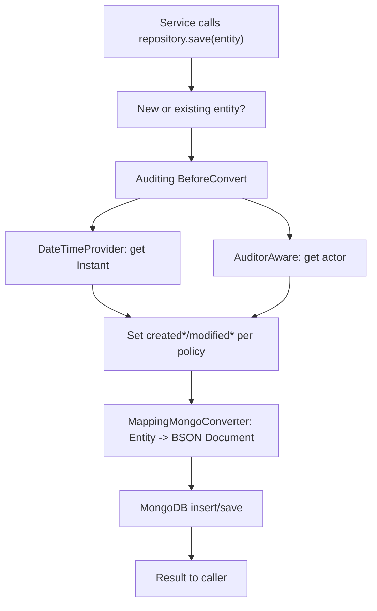
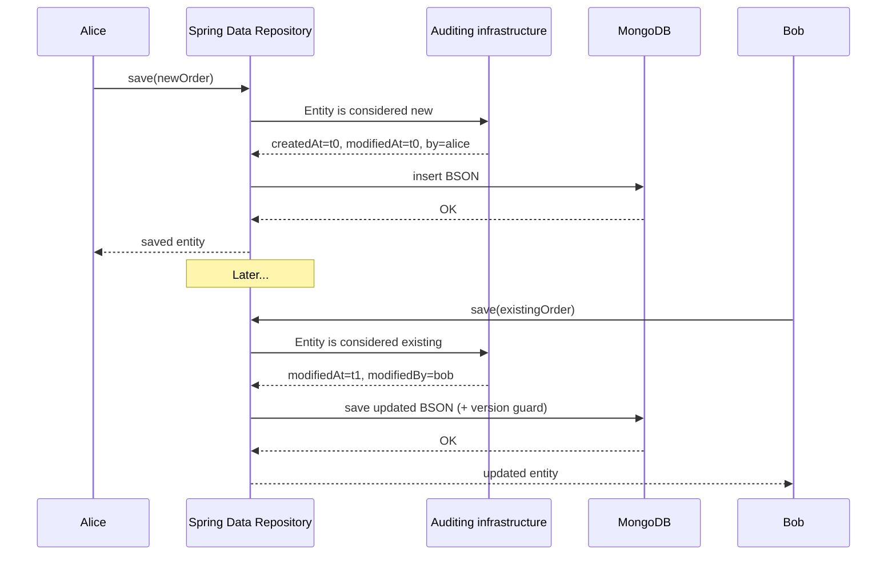

# @CreatedDate, @LastModifiedDate, @CreatedBy, and @LastModifiedBy

In **Spring Data MongoDB**, *auditing* is a mechanism that automatically populates metadata answering two questions: **who** created/modified an entity and **when** the creation/modification occurred. Instead of having every service manually assign `createdAt`, `updatedAt`, `createdBy`, and `updatedBy` before calling `save(...)`, we can declare four annotations:

- `@CreatedDate`: timestamp when the entity was created.
- `@LastModifiedDate`: timestamp when the entity was last modified through a supported persistence path.
- `@CreatedBy`: identifier of the actor that created the entity.
- `@LastModifiedBy`: identifier of the actor that last modified the entity.

Crucially, Spring Data auditing **is not a trigger attached directly to MongoDB Server**. It operates inside **Spring Data's entity mapping/saving path**, requires proper configuration to enable, needs sources to resolve the actor and time, and has clear boundaries regarding partial updates, bulk operations, native drivers, or writes from other applications.

This lesson belongs to the **Auditing** chapter of the **SPRING_DATA_MONGODB** module: using Spring Data MongoDB to connect and map documents, perform operations via `MongoTemplate`/repositories, design queries, aggregations, and indexes, handle transactions, reactive access, testing, and performance diagnostics. Here we learn how to configure and verify all four annotations for systems with HTTP requests, background jobs, and reactive APIs.

**Goal:** properly configure `@EnableMongoAuditing` or `@EnableReactiveMongoAuditing`, implement `AuditorAware`/`ReactiveAuditorAware`, understand insert/update behavior and metadata limitations, and verify real BSON with integration tests.

## 1. The Four Annotations and Their Business Meaning

| Annotation | Meaning | Common Java Type | Value Source |
| --- | --- | --- | --- |
| `@CreatedDate` | Timestamp when the entity is considered **new** and saved for the first time | `Instant`, `Date`, framework-supported date/time types | `DateTimeProvider` or default provider |
| `@LastModifiedDate` | Most recent timestamp when the entity was saved through an auditing path | `Instant` | `DateTimeProvider` |
| `@CreatedBy` | Actor that created the entity | `String`, stable user ID, or compatible domain type | `AuditorAware<T>` / `ReactiveAuditorAware<T>` |
| `@LastModifiedBy` | Actor that last modified the entity | Same auditor type as configuration | `AuditorAware<T>` / `ReactiveAuditorAware<T>` |

Example with an order:

```javascript
{
  _id: ObjectId("674000000000000000008001"),
  tenant_id: "T1",
  order_key: "ORD-2026-001",
  status: "PAID",
  created_at: ISODate("2026-11-20T02:00:00Z"),
  modified_at: ISODate("2026-11-20T02:15:00Z"),
  created_by: "user:alice",
  modified_by: "user:bob"
}
```

`created_by` and `modified_by` here are **verified application identities**, not a MongoDB database user account supplied by the driver. If a user is not logged in, the framework cannot infer who performed the action unless you define an actor policy for system jobs or anonymous operations.

**Do not confuse auditing with full change history.** The four fields tell you **creation** and **latest modification**, but they do not record all previous versions, who edited each individual field, or before/after values for each change.

## 2. Where Does Auditing Happen in the Lifecycle?

Spring Data MongoDB implements auditing via a **pre-conversion Entity Callback**, typically `AuditingEntityCallback` in the entity save path. A high-level timeline:



Main sequence:

1. `@EnableMongoAuditing` registers the auditing infrastructure.
2. Entity metadata identifies properties marked with the four annotations.
3. The framework determines whether the entity is **new** or **existing**.
4. Obtains the current time and appropriate actor.
5. Populates auditing properties before the converter writes BSON.
6. MongoDB stores the document along with auditing metadata in the same entity write operation.

There is no separate network command per annotation. Audit fields are included in the regular document. **However, a callback running before the write does not prove the write committed**; if MongoDB rejects the command or a transaction rolls back, metadata may have been mutated on the Java object without any corresponding record committed.

## 3. Sample Entity: OrderDocument with Four Auditing Fields

We use an entity with a MongoDB `ObjectId` key, tenant ID, order key, status, and version:

```java
import java.time.Instant;

import org.bson.types.ObjectId;
import org.springframework.data.annotation.CreatedBy;
import org.springframework.data.annotation.CreatedDate;
import org.springframework.data.annotation.Id;
import org.springframework.data.annotation.LastModifiedBy;
import org.springframework.data.annotation.LastModifiedDate;
import org.springframework.data.annotation.Version;
import org.springframework.data.mongodb.core.mapping.Document;
import org.springframework.data.mongodb.core.mapping.Field;

@Document(collection = "orders")
public class OrderDocument {

    @Id
    private ObjectId id;

    @Field("tenant_id")
    private String tenantId;

    @Field("order_key")
    private String orderKey;

    private String status;

    @Version
    private Long version;

    @CreatedDate
    @Field("created_at")
    private Instant createdAt;

    @LastModifiedDate
    @Field("modified_at")
    private Instant modifiedAt;

    @CreatedBy
    @Field("created_by")
    private String createdBy;

    @LastModifiedBy
    @Field("modified_by")
    private String modifiedBy;

    public OrderDocument() {}

    public OrderDocument(
            ObjectId id, String tenantId,
            String orderKey, String status) {
        this.id = id;
        this.tenantId = tenantId;
        this.orderKey = orderKey;
        this.status = status;
    }

    public ObjectId getId() { return id; }
    public String getTenantId() { return tenantId; }
    public String getOrderKey() { return orderKey; }
    public String getStatus() { return status; }
    public Long getVersion() { return version; }
    public Instant getCreatedAt() { return createdAt; }
    public Instant getModifiedAt() { return modifiedAt; }
    public String getCreatedBy() { return createdBy; }
    public String getModifiedBy() { return modifiedBy; }

    public void setStatus(String status) {
        this.status = status;
    }
}
```

Notes:

- `@Field("created_at")` determines the **BSON field name**; `@CreatedDate` determines **how metadata is populated**. These are two separate concerns.
- `Instant` represents an absolute point in time; it is better suited than `LocalDateTime` when data crosses multiple timezones.
- `@Version Long` supports optimistic locking and helps distinguish new entities from existing ones when version is `null`.
- Actor uses `String`: e.g. `"user:alice"`, `"service:payment-worker"`. If using `@CreatedBy User`, then `AuditorAware<User>` and field mapping must be compatible; do not assume the framework will fetch a principal and turn it into `User` automatically.
- Audit getters have no setters to restrict application tampering; Spring Data can still write fields via appropriate mapping/access strategies. When code uses an immutable domain model, design constructors/withers matching the mapping capabilities of your version.

If legacy documents lack audit fields, adding annotations **does not automatically backfill history** for documents already stored in MongoDB.

## 4. Enabling Auditing on the Synchronous Path

Spring Data MongoDB supports `@EnableMongoAuditing` on a configuration class:

```java
import org.springframework.context.annotation.Configuration;
import org.springframework.data.mongodb.config.EnableMongoAuditing;

@Configuration
@EnableMongoAuditing(
    auditorAwareRef = "mongoUserAuditor",
    dateTimeProviderRef = "mongoAuditDateProvider",
    setDates = true,
    modifyOnCreate = true
)
public class MongoAuditingConfig {
}
```

Two attributes to understand:

- `setDates=true`: enables populating `@CreatedDate`/`@LastModifiedDate` fields, which is the **default**.
- `modifyOnCreate=true`: when a **new** entity is created, the framework also sets `LastModified*` per auditing policy, which is the **default**.

`auditorAwareRef` and `dateTimeProviderRef` point to **bean names**, not class names. The concrete beans are defined in the following sections. In Spring Data MongoDB, auditing has existed since early versions (documentation notes 1.4); check API details against your Spring Data version.

**Do not assume Spring Boot enables auditing automatically just because `spring-boot-starter-data-mongodb` is present.** To be certain, declare the configuration annotation and test the resulting BSON.

## 5. AuditorAware<String>: Getting the Actor from Spring Security

`@CreatedBy` and `@LastModifiedBy` require an actor source. In a Spring MVC/imperative application, `AuditorAware<String>` can be used:

```java
import java.util.Optional;

import org.springframework.data.domain.AuditorAware;
import org.springframework.security.authentication.AnonymousAuthenticationToken;
import org.springframework.security.core.Authentication;
import org.springframework.security.core.context.SecurityContextHolder;
import org.springframework.stereotype.Component;

@Component("mongoUserAuditor")
public class SecurityMongoAuditorAware
        implements AuditorAware<String> {

    @Override
    public Optional<String> getCurrentAuditor() {

        Authentication authentication =
            SecurityContextHolder.getContext()
                .getAuthentication();

        if (authentication == null
                || !authentication.isAuthenticated()
                || authentication instanceof AnonymousAuthenticationToken) {
            return Optional.empty();
        }

        // Prefer a stable ID taken from a trusted principal.
        return Optional.of("user:" + authentication.getName());
    }
}
```

Spring Security is only **one way to obtain an actor source**. You can use a user ID from your organization's principal, a service account, or a trusted managed request context.

Do not take `createdBy`/`modifiedBy` directly from an HTTP body:

```json
{
  "orderKey": "ORD-2026-001",
  "status": "NEW",
  "createdBy": "admin"
}
```

If clients are allowed to specify the actor themselves, they can impersonate someone else. **Auditing fields must be derived from a security context or a verified backend source**, not user input.

### Why Is Optional.empty() a Valid Signal?

If there is no authenticated principal, `getCurrentAuditor()` can return `Optional.empty()`. Then `@CreatedBy`/`@LastModifiedBy` fields **are not automatically populated with a trusted actor**.

For workflows that require an actor, design an explicit policy: require authentication before writing, or specify a system actor for background workers. Do not blindly assign `"admin"` to all anonymous requests just to avoid empty fields.

## 6. DateTimeProvider and Clock: Controlling Audit Time

By default, Spring Data can supply auditing timestamps. When deterministic timestamps across tests or alignment with a clock policy are needed, provide a `DateTimeProvider`:

```java
import java.time.Clock;
import java.time.Instant;
import java.time.temporal.TemporalAccessor;
import java.util.Optional;

import org.springframework.context.annotation.Bean;
import org.springframework.context.annotation.Configuration;
import org.springframework.data.auditing.DateTimeProvider;

@Configuration
public class MongoAuditTimeConfig {

    @Bean
    public Clock mongoAuditClock() {
        return Clock.systemUTC();
    }

    @Bean("mongoAuditDateProvider")
    public DateTimeProvider mongoAuditDateProvider(
            Clock mongoAuditClock) {
        return () -> Optional.<TemporalAccessor>of(
            Instant.now(mongoAuditClock)
        );
    }
}
```

`@EnableMongoAuditing(dateTimeProviderRef="mongoAuditDateProvider")` uses this provider to supply values for creation/modification dates.

Benefits:

- **Deterministic tests**: replace `Clock` with a fake/test clock at the desired instant.
- **UTC**: independent of the JVM's default timezone when choosing `Instant`.
- **Single time source** for created/modified audits.
- **Explicit configuration** when the service runs across multiple replicas.

**Note on bean names:** the example above works together with `MongoAuditingConfig` in section 4. Keep only one `@EnableMongoAuditing` for a given mapping context; avoid registering multiple auditing handlers simultaneously.

## 7. If Only Timestamps Are Needed, Is AuditorAware Required?

**No.** If an entity only has `@CreatedDate` and `@LastModifiedDate`, Spring Data does not need `AuditorAware` to populate those two timestamp values.

Minimal configuration example, **replacing** the configuration in section 4:

```java
@Configuration
@EnableMongoAuditing
class DateOnlyAuditingConfig {
}
```

If the entity later starts using `@CreatedBy` and `@LastModifiedBy`, you must add an actor source if you want those fields populated. Do not register both `DateOnlyAuditingConfig` and `MongoAuditingConfig` in the same application context: the two configurations illustrate **two different choices**.

Conversely, when only the actor is needed without auditing auto-generating timestamps, you can use `setDates=false` on the enable annotation, though you must decide on an alternative time source and document why.

## 8. modifyOnCreate: What Data Exists Immediately After Insert?

With the default `@EnableMongoAuditing(modifyOnCreate=true)`, a new entity is typically assigned:

```text
createdAt  = t0
modifiedAt = t0
createdBy  = "user:alice"
modifiedBy = "user:alice"
```

If configured as:

```java
@Configuration
@EnableMongoAuditing(
    auditorAwareRef = "mongoUserAuditor",
    modifyOnCreate = false
)
class MongoAuditingNoModifyOnCreate {
}
```

then auditing **does not actively set last-modified metadata on creation**. The state may be:

```text
createdAt  = t0
modifiedAt = null  (if initially unset)
createdBy  = "user:alice"
modifiedBy = null  (if initially unset)
```

This option is a **product policy**:

- `modifyOnCreate=true`: "creating" also counts as a modification, convenient for filtering by `modifiedAt`.
- `modifyOnCreate=false`: "never modified since creation" is represented by a null `modifiedAt`.

**Do not deploy both configurations simultaneously.** Once chosen, keep it consistent across all replicas; changing the policy between deployments can cause old and new data to differ.

## 9. Timeline of Two Saves

Suppose the repository has auditing configured and the initial actor is `user:alice`.



Expected values after two saves through the entity path:

| Field | After creation (Alice) | After edit (Bob) |
| --- | --- | --- |
| `createdAt` | `t0` | **Keeps `t0`** |
| `modifiedAt` | `t0` if modifyOnCreate=true | `t1` |
| `createdBy` | `user:alice` | **Keeps `user:alice`** |
| `modifiedBy` | `user:alice` if modifyOnCreate=true | `user:bob` |

Values are governed by **auditing policy**. If a caller deliberately modifies `createdAt`/`createdBy` before saving, the annotations do not enforce immutability inside MongoDB: Spring Data may persist bad data into the document. Do not expose setters to clients and do not map requests directly onto the full audited entity.

## 10. Proper CRUD Repository: Keeping Audit Fields Outside Input DTOs

Repository:

```java
import org.bson.types.ObjectId;
import org.springframework.data.mongodb.repository.MongoRepository;

public interface OrderRepository
        extends MongoRepository<OrderDocument, ObjectId> {

    java.util.Optional<OrderDocument> findByIdAndTenantId(
        ObjectId id, String tenantId
    );
}
```

Service creating orders:

```java
import org.bson.types.ObjectId;
import org.springframework.stereotype.Service;

@Service
public class OrderService {
    private final OrderRepository repository;

    public OrderService(OrderRepository repository) {
        this.repository = repository;
    }

    public OrderDocument create(
            String authenticatedTenant, String orderKey) {

        if (orderKey == null || orderKey.isBlank()) {
            throw new IllegalArgumentException("orderKey is required");
        }

        OrderDocument newOrder = new OrderDocument(
            new ObjectId(), authenticatedTenant,
            orderKey.trim(), "NEW"
        );

        // Do not pass createdAt/createdBy from the request.
        return repository.save(newOrder);
    }

    public OrderDocument markPaid(
            ObjectId id, String authenticatedTenant) {
        OrderDocument order = repository
            .findByIdAndTenantId(id, authenticatedTenant)
            .orElseThrow(() ->
                new IllegalArgumentException("Not found")
            );

        order.setStatus("PAID");
        return repository.save(order);
    }
}
```

In a multi-tenant system, `authenticatedTenant` must come from the backend authentication context, not from arbitrary client-supplied headers or JSON. With `@Version`, concurrent saves of the same entity can result in an optimistic-lock failure; auditing **does not replace** concurrency control.

When using `MongoTemplate.insert(...)`/`save(entity)`, auditing can operate on the entity mapping path similarly. However, verify that the `MongoTemplate` bean uses Spring Data infrastructure with the auditing callback registered.

## 11. When Is an Entity Considered "New"?

Auditing must distinguish between `markCreated(...)` and `markModified(...)`. Spring Data typically determines whether an entity is new based on metadata:

- If there is a **wrapper** `@Version` such as `Long`, a `null` version usually indicates a new entity.
- If there is no version, a `null` `@Id` usually indicates not yet persisted.
- When an entity implements `Persistable`, `isNew()` can decide the state according to the entity's policy.
- Custom entity information/`isNew` strategies must be tested.

Example using a pre-assigned ID:

```java
OrderDocument order = new OrderDocument(
    new ObjectId(), "T1", "ORD-2026-002", "NEW"
);

// Initial version is null -> newness is detected by Spring Data.
repository.save(order);
```

If an entity has **no `@Version`** yet already has a manually assigned `_id`, the repository may treat it as existing and take the other branch; `@CreatedDate` may not be populated as expected, depending on strategy and API.

**Do not "fix" this by assigning `createdAt` in the controller.** Determine entity newness properly and write integration tests. For imports/migrations with pre-existing IDs, clarify whether the operation is a **new insert**, an **upsert**, or a **historical data restore** so old audit metadata is not overwritten.

## 12. @Version and Auditing Complement, Not Replace, Each Other

The `@Version` field protects optimistic concurrency on supported save paths. Auditing answers who/when—two independent concerns:

```text
T0: Alice reads Order version=0, status=NEW.
T1: Bob   reads Order version=0, status=NEW.

T2: Alice save(status=PAID) -> version=1,
    modifiedBy=alice, modifiedAt=t2.

T3: Bob save(status=CANCELLED, stale version=0)
    -> OptimisticLockingFailureException.
```

At T3, the auditing callback may have recomputed metadata on Bob's Java object **before the write failed**; that does not mean MongoDB saved `modifiedBy=bob`. Reading BSON after the error should still show the metadata of the successfully committed write.

When handling optimistic locking failures, the service must return a conflict or re-read and reapply the intent on fresh data; do not blindly retry the stale object. **Auditing does not automatically merge concurrent changes.**

## 13. Instant, UTC, and BSON Date Precision

In Java, `Instant` has nanosecond precision. MongoDB **BSON Date** stores **milliseconds since Unix epoch**.

```java
Instant created = Instant.parse(
    "2026-11-20T02:00:00.123456789Z"
);

// After a round-trip through BSON Date, precision may
// be normalized to milliseconds.
Instant normalized =
    created.truncatedTo(java.time.temporal.ChronoUnit.MILLIS);
```

Things to keep in mind:

- Use `Instant` instead of `LocalDateTime` when absolute timestamps across regions are needed.
- Documentation/tests should distinguish **UTC time**, UI timezone formatting, and clock synchronization policies.
- Tests with timestamps from `Instant.now()` should not compare using nanosecond equality after a MongoDB round-trip.
- Multiple application replicas have clock skew; a `modifiedAt` taken from instance A's clock can be earlier than instance B's clock even if write B occurred later on the server.
- If an **immutable sequential order** of mutations is required, audit timestamps are insufficient; use version, monotonic sequence, event log, or business causal ordering.

**`@CreatedDate`/`@LastModifiedDate` do not capture MongoDB Server "commit time" by default.** They use `DateTimeProvider` during the application mapping lifecycle.

## 14. What Should @CreatedBy Contain?

There are several common options:

| Field Content | Pros | Risks / Considerations |
| --- | --- | --- |
| Stable user ID like `user:8d3f` | Easy to reconcile, unchanged if username changes | Requires lookup for display info later |
| Username | Readable in logs | Can be renamed, may expose PII |
| Email | Easy to contact | PII, mutable, potentially sensitive |
| Full `User` entity | Access to extra domain info | Complex mapping, stale data, leaks nested fields |
| System actor like `service:billing-worker` | Transparent for background jobs | Must ensure actor is backend-verified |
| Generic `anonymous` | Low integration effort | Insufficient audit accountability for business rules |

**Recommendation:** store a non-sensitive **stable subject identifier**, tied to a trusted backend principal; display names are resolved in the presentation/authorization layer.

If the field type is `String`, `AuditorAware<String>` returns an appropriate string. If the field is `UserRef`, the provider must return `UserRef` or have a consistent converter/mapper. Do not force a raw Java Principal object into a BSON document without designing the schema.

## 15. Background Jobs, Scheduled Tasks, and System Actors

`SecurityContextHolder` is typically bound to an HTTP request thread. A job running in a scheduler or consumer may **have no authenticated principal**.

Example system with three actor types:

```text
HTTP user:
  user:alice

Kafka consumer:
  service:order-events-consumer

Scheduled reconciliation:
  service:nightly-reconcile
```

You should not default all jobs to `user:admin` merely to avoid empty fields. You can build a `CurrentActorProvider` abstraction that uses:

1. The principal from Spring Security when it is an authenticated user.
2. An actor identity assigned by the worker lifecycle/backend in the job context.
3. If neither is available, fail fast for operations requiring audit, or record a dedicated `service:unknown` actor under an approved policy.

**Beware of thread-local leakage:** `ThreadLocal` from request A must not leak into job B or another async task when an executor reuses threads. If using context propagation, ensure formal mechanisms and explicit cleanup.

In multi-tenant systems, an auditor ID does not replace `tenant_id`/authorization; do not infer tenant from `modifiedBy`.

## 16. Async, @Async, and Preserving the Principal

An `@Async` method may execute on another thread pool where the Spring Security context is not automatically present.

```java
@Async
public void enrichAndSaveOrder(ObjectId id) {
    // If SecurityContextHolder is not propagated,
    // AuditorAware may return Optional.empty().
}
```

In this case:

- Avoid accepting raw `Authentication` from the client.
- Use appropriate Spring Security context propagation/delegating executors if user identity truly needs to cross threads.
- Or pass a backend-verified **stable authenticated actor ID** as business context with a clear scope.
- When code runs outside an HTTP request, use a registered system actor rather than trusting an empty ThreadLocal.
- Test the actor identity after the async task completes; do not just assert the entity was saved.

**Do not conclude auditing has a bug just because the four annotations are right while `@CreatedBy` is null in a scheduler.** Inspect what `AuditorAware` returns on the thread executing the save.

## 17. Reactive Auditing: Configuration Without ThreadLocal

With `ReactiveMongoTemplate` or `ReactiveMongoRepository`, use `@EnableReactiveMongoAuditing` and `ReactiveAuditorAware<T>`.

```java
import org.springframework.context.annotation.Configuration;
import org.springframework.data.mongodb.config.EnableReactiveMongoAuditing;

@Configuration
@EnableReactiveMongoAuditing(
    auditorAwareRef = "reactiveMongoUserAuditor",
    setDates = true,
    modifyOnCreate = true
)
public class ReactiveMongoAuditingConfig {
}
```

This is a **separate setup** for reactive infrastructure. It does not convert synchronous `MongoTemplate` into the reactive driver; if an application uses both persistence paths, configure and test both according to your Spring Data version.

The reactive actor source should use **Reactor Context/Spring Security reactive context**, not the `SecurityContextHolder` ThreadLocal of Servlet applications.

## 18. ReactiveAuditorAware<String> with ReactiveSecurityContextHolder

```java
import org.springframework.data.domain.ReactiveAuditorAware;
import org.springframework.security.authentication.AnonymousAuthenticationToken;
import org.springframework.security.core.Authentication;
import org.springframework.security.core.context.ReactiveSecurityContextHolder;
import org.springframework.stereotype.Component;
import reactor.core.publisher.Mono;

@Component("reactiveMongoUserAuditor")
public class ReactiveSecurityMongoAuditorAware
        implements ReactiveAuditorAware<String> {

    @Override
    public Mono<String> getCurrentAuditor() {
        return ReactiveSecurityContextHolder.getContext()
            .flatMap(ctx ->
                Mono.justOrEmpty(ctx.getAuthentication())
            )
            .filter(auth ->
                auth.isAuthenticated()
                && !(auth instanceof AnonymousAuthenticationToken)
            )
            .map(auth -> "user:" + auth.getName());
    }
}
```

`Mono.empty()` indicates no authenticated auditor was found; it does not automatically substitute `"anonymous"`. Spring Data reactive auditing uses the returned Publisher to populate audit metadata when an entity is saved.

**Do not call `block()` inside `getCurrentAuditor()`.** Blocking on a Netty event-loop can cause Reactor to throw a blocking exception or degrade throughput. Also do not manually `subscribe()` hoping audit fields will update later: the framework needs the Publisher as part of the same pipeline.

## 19. Reactive Flow: Subscribe Once at the WebFlux Boundary

Reactive repository:

```java
import org.bson.types.ObjectId;
import org.springframework.data.mongodb.repository.ReactiveMongoRepository;
import reactor.core.publisher.Mono;

public interface ReactiveOrderRepository
        extends ReactiveMongoRepository<OrderDocument, ObjectId> {

    Mono<OrderDocument> findByIdAndTenantId(
        ObjectId id, String tenantId
    );
}
```

Service:

```java
public Mono<OrderDocument> createReactive(
        String authorizedTenant, String orderKey) {

    return Mono.defer(() -> {
        OrderDocument order = new OrderDocument(
            new ObjectId(), authorizedTenant,
            orderKey, "NEW"
        );
        return reactiveOrderRepository.save(order);
    });
}
```

The WebFlux controller must **return the `Mono`** so the framework manages the subscription:

```java
@PostMapping("/orders")
public Mono<OrderResponse> create(@RequestBody CreateOrderRequest body) {
    return service.createReactive(
        authenticatedTenantId(), body.orderKey()
    ).map(OrderResponse::fromEntity);
}
```

`CreateOrderRequest` and `OrderResponse` are illustrative DTOs, while `authenticatedTenantId()` must be implemented against a real security context. If tenant lookup is reactive, compose the `Mono` with `flatMap` instead of reading a ThreadLocal.

**Do not do:** `reactiveRepository.save(order).subscribe(); return Mono.just(response);`. That can return HTTP 200 before the MongoDB write and auditing finish, while also losing security/transaction context.

## 20. Testing Reactor Context Has the Correct Auditor

In a unit test, you can verify `ReactiveAuditorAware` using a Spring Security context:

```java
import static org.assertj.core.api.Assertions.assertThat;

import java.util.List;
import org.junit.jupiter.api.Test;
import org.springframework.security.authentication.UsernamePasswordAuthenticationToken;
import org.springframework.security.core.authority.SimpleGrantedAuthority;
import org.springframework.security.core.context.ReactiveSecurityContextHolder;
import reactor.test.StepVerifier;

class ReactiveAuditorAwareTest {

    @Test
    void resolvesActorFromReactiveSecurityContext() {
        var authentication = new UsernamePasswordAuthenticationToken(
            "alice",
            "not-a-real-credential",
            List.of(new SimpleGrantedAuthority("ROLE_USER"))
        );

        var provider = new ReactiveSecurityMongoAuditorAware();

        StepVerifier.create(
            provider.getCurrentAuditor()
                .contextWrite(
                    ReactiveSecurityContextHolder
                        .withAuthentication(authentication)
                )
        )
            .assertNext(actor ->
                assertThat(actor).isEqualTo("user:alice")
            )
            .verifyComplete();
    }
}
```

This is a **unit test for the provider**; it does not yet prove MongoDB actually persists the `created_by` field. Integration tests in later sections must verify saving entities via `ReactiveMongoRepository`/`ReactiveMongoTemplate` with the same Reactor Context.

Also add a test without authentication expecting `Mono.empty()`, and a test with an anonymous token expecting no authenticated user actor.

## 21. Auditing and Write Paths Other Than Entity Save

Annotations are not a global database filter. Compare:

| Operation Path | Auto-audits like entity save? | Things to Watch |
| --- | --- | --- |
| `MongoRepository.save(entity)` | **Yes**, if configured and callback active | Created vs. modified depends on `isNew` |
| `MongoTemplate.insert(entity)` | **Yes** via entity mapping path | Check exceptions and transactions |
| `MongoTemplate.save(entity)` | **Yes** | `@Version` and metadata before convert |
| `ReactiveMongoRepository.save(entity)` | **Yes** when reactive auditing is enabled | Must subscribe with proper Reactor Context |
| `MongoTemplate.updateFirst(...)` | **Does not auto-populate all four audit fields like `save(entity)`** | Must add `modifiedAt`/`modifiedBy` to update |
| `MongoTemplate.updateMulti(...)` | **Does not follow entity save auditing** | Every matched document may need updated metadata |
| `MongoTemplate.findAndModify(...)` | **Does not run save callback like entity save** | Design `Update` explicitly |
| `BulkOperations` | **Does not rely on per-save lifecycle callbacks** | Imports/bulk need explicit audit policy |
| Native `MongoCollection.updateOne/replaceOne/insertOne` | **Does not** go through Spring auditing | Raw BSON/driver does not read annotations |
| `$merge`/`$out` in aggregation | **Does not** apply Spring entity auditing | Separate data migration/output path |
| Admin shell/database migration | **No** | Write metadata deliberately when needed |

Having `@LastModifiedDate` on an entity **does not guarantee** every document update command changes `modified_at`. Teams must inventory all writers: HTTP services, consumers, ETLs, batch jobs, native drivers, and external systems.

## 22. Partial Update: Explicitly Setting modifiedAt and modifiedBy

If you want an atomic update without reading and then `save`-ing the entire entity:

```java
import java.time.Clock;
import java.time.Instant;

import com.mongodb.client.result.UpdateResult;
import org.bson.types.ObjectId;
import org.springframework.data.mongodb.core.MongoOperations;
import org.springframework.data.mongodb.core.query.Criteria;
import org.springframework.data.mongodb.core.query.Query;
import org.springframework.data.mongodb.core.query.Update;

public UpdateResult markPaid(
        MongoOperations operations,
        Clock clock, ObjectId id,
        String tenantId, String trustedActorId) {

    Query filter = Query.query(
        Criteria.where("id").is(id)
            .and("tenantId").is(tenantId)
            .and("status").is("NEW")
    );

    Update update = new Update()
        .set("status", "PAID")
        .set("modifiedAt", Instant.now(clock))
        .set("modifiedBy", trustedActorId);

    return operations.updateFirst(
        filter, update, OrderDocument.class
    );
}
```

With `OrderDocument.class`, the Java fields `modifiedAt`/`modifiedBy` are mapped by Spring Data to BSON `modified_at`/`modified_by`.

Because `updateFirst` does not go through `AuditingEntityCallback` like `save(entity)`, the three `set` calls above are **intentional**. `matchedCount=0` could mean not found, tenant mismatch, or status already changed; the caller must handle this per business rules.

**Warning about version:** Spring Data may auto-increment `@Version` in some template update APIs if `Update` does not specify the version. However, **auto-incrementing version does not mean auto-populating `modifiedBy`/`modifiedAt`**, nor does it perform a CAS against the client's expected version. If an optimistic precondition is required, add the version to the filter and increment it exactly once in the same update.

## 23. Server Time vs. Application Time on Update

If you want to use server time for a partial update (MongoDB update operator):

```javascript
db.orders.updateOne(
  {
    _id: ObjectId("674000000000000000008001"),
    tenant_id: "T1",
    status: "NEW"
  },
  {
    $set: {
      status: "PAID",
      modified_by: "service:payment-worker"
    },
    $currentDate: {
      modified_at: true
    }
  }
);
```

`$currentDate` uses time from the MongoDB Server for the update. This differs from `@LastModifiedDate`, which takes time from `DateTimeProvider` in the JVM.

A system with both update paths can receive timestamps from two different sources; define a clear policy and synchronize clocks. Do not casually mix server time and application time and assume every `modifiedAt` forms a strict sequential order.

In Java Spring Data, `new Update().currentDate("modifiedAt")` can generate the corresponding `$currentDate` via typed mapping; verify the API/version and resulting BSON for your version.

## 24. Partial Upsert: Do Not Assume CreatedDate Will Be Populated

An upsert via `updateFirst(..., upsert=true)` or `MongoTemplate.upsert(...)` is an **update command**, unlike entity `save` where `AuditingEntityCallback` evaluates newness.

`mongosh` example intending to set created metadata only on insert:

```javascript
db.orders.updateOne(
  { tenant_id: "T1", order_key: "ORD-2026-003" },
  {
    $set: {
      status: "NEW",
      modified_by: "service:order-worker"
    },
    $currentDate: {
      modified_at: true
    },
    $setOnInsert: {
      tenant_id: "T1",
      order_key: "ORD-2026-003",
      created_by: "service:order-worker"
    }
  },
  { upsert: true }
);
```

The example does not populate `created_at` automatically: if you want a creation timestamp **only on insert** from the same time source, design an update/upsert pipeline or use an application timestamp, `$setOnInsert`, or a dedicated entity insert flow.

`$setOnInsert` applies in the insert branch of an upsert, but it is unaware of Spring's actor or auditing logic. Do not put `created_at` inside `$set` if you want to avoid overwriting the creation timestamp on every upsert.

## 25. Why Not Write Audit Metadata in AfterSaveCallback?

In Spring Data MongoDB, `AuditingEntityCallback` prepares fields before conversion so they are included in the BSON on save.

A callback running **after save** is too late if the goal is to persist fields in the same save command:

```java
// WRONG if you think modifiedAt will be persisted automatically.
class WrongAfterSave implements
        org.springframework.data.mongodb.core.mapping.event
            .AfterSaveCallback<OrderDocument> {

    @Override
    public OrderDocument onAfterSave(
            OrderDocument entity,
            org.bson.Document document,
            String collection) {

        // Save has already occurred; only mutates the Java object.
        return entity;
    }
}
```

If custom audit values are needed on the save path, use `AuditorAware`, `DateTimeProvider`, or a `BeforeConvertCallback` with a clear policy. Do not call `save(...)` again inside after-save to "write extra audit": that easily causes callback recursion, lost updates, or unintended side effects.

In particular, **`AfterSaveCallback` is not equivalent to after transaction commit**. If the service rolls back after `save`, the callback ran even though the MongoDB write inside the transaction will not commit.

## 26. Auditing and MongoDB Transactions

Suppose a service creates an order and writes a receipt in the same transaction:

```java
import org.springframework.stereotype.Service;
import org.springframework.transaction.annotation.Transactional;

@Service
public class OrderTransactionService {
    private final OrderRepository orders;
    private final ReceiptRepository receipts;

    public OrderTransactionService(
            OrderRepository orders, ReceiptRepository receipts) {
        this.orders = orders;
        this.receipts = receipts;
    }

    @Transactional(transactionManager = "mongoTransactionManager")
    public OrderDocument createOrderAndReceipt(
            OrderDocument order, Receipt receipt) {

        OrderDocument saved = orders.save(order);
        receipts.save(receipt);

        return saved;
    }
}
```

`Receipt` and `ReceiptRepository` here are **illustrative domain dependencies** that must be defined and use the same MongoDB infrastructure.

Within a transaction:

- Auditing assigns fields **before the save command**.
- If the transaction rolls back, audit metadata already lives in the **Java object**, but MongoDB writes in the transaction do not commit.
- When the transaction commits successfully, audit fields are persisted alongside the document.
- If a commit timeout or unknown commit result occurs, `createdAt` on the object **does not prove** data committed; use idempotency keys/receipts and reconciliation.
- Actor and timestamp cannot substitute for a transaction manager or write concern.

Synchronous code requires `MongoTransactionManager` and a supporting MongoDB replica set/sharded cluster; reactive code requires `ReactiveMongoTransactionManager` and proper Reactor Context.

## 27. Auditing Does Not Replace Change History (Change Log)

The four annotations only keep **current metadata**, not an immutable event history.

Suppose an order went through:

```text
09:00 Alice created NEW
09:10 Bob changed to PAID
09:20 Carol changed to SHIPPED
```

The final document can only show:

```javascript
{
  status: "SHIPPED",
  created_by: "user:alice",
  created_at: ISODate("2026-11-20T02:00:00Z"),
  modified_by: "user:carol",
  modified_at: ISODate("2026-11-20T02:20:00Z")
}
```

The fact that "Bob changed from NEW to PAID at 09:10" **is no longer in the four fields**.

If the business requires legal history or reconciliation, you can use:

- An `order_audit_events` collection with immutable records describing actor, event, before/after, or diff.
- A transactional outbox written in the same transaction as the business document.
- MongoDB Change Streams or a CDC pipeline, with appropriate consumer idempotency and retention.
- An event sourcing system when the domain truly needs full events.

**Do not call `@LastModifiedBy` a full audit log.** It is **last editor metadata**. Do not use these fields to prove every action was immutably recorded.

## 28. Embedded AuditMetadata: Grouping Four Fields in a Value Object

Spring Data Commons supports auditing annotations inside an embedded metadata object depending on store mapping capabilities; with MongoDB you can use a value object:

```java
import java.time.Instant;
import org.springframework.data.annotation.CreatedBy;
import org.springframework.data.annotation.CreatedDate;
import org.springframework.data.annotation.LastModifiedBy;
import org.springframework.data.annotation.LastModifiedDate;

public class AuditMetadata {

    @CreatedDate
    private Instant createdAt;

    @LastModifiedDate
    private Instant modifiedAt;

    @CreatedBy
    private String createdBy;

    @LastModifiedBy
    private String modifiedBy;

    public Instant getCreatedAt() { return createdAt; }
    public Instant getModifiedAt() { return modifiedAt; }
    public String getCreatedBy() { return createdBy; }
    public String getModifiedBy() { return modifiedBy; }
}
```

Entity:

```java
@Document("orders_embedded_audit")
public class EmbeddedAuditOrder {
    @Id
    private ObjectId id;

    private String orderKey;

    private AuditMetadata audit = new AuditMetadata();

    // Constructors/getters per mapping conventions...
}
```

Resulting BSON may look like:

```javascript
{
  _id: ObjectId("674000000000000000008003"),
  orderKey: "ORD-2026-004",
  audit: {
    createdAt: ISODate("2026-11-20T02:00:00Z"),
    modifiedAt: ISODate("2026-11-20T02:00:00Z"),
    createdBy: "user:alice",
    modifiedBy: "user:alice"
  }
}
```

This reduces field duplication across domain models, but you must **verify in practice**: constructor mapping, null audit objects, property access, converters, and the Spring Data version can affect how auditing traverses nested metadata.

If `audit == null` on a legacy document, you need an initialization/repair strategy; do not assume auditing automatically instantiates every intermediate object.

## 29. Auditable Interface vs. Annotations

Spring Data Commons also supports the `Auditable<U, ID, T>`/`AbstractAuditable` interface (generic details vary by version) so the domain provides getters/setters for auditing metadata.

| Declaration Style | Pros | Cons |
| --- | --- | --- |
| Four annotations on fields | Low coupling to Spring Data APIs in domain behavior, flexible | Must declare four properties and getters if needed |
| `Auditable` interface | Consistent metadata access contract | Domain class is coupled to a Spring Data interface |
| Embedded `AuditMetadata` with annotations | Reusable, groups fields cleanly | Must ensure mapping/access/nested traversal |

Usually, **four annotations directly on the entity** is the easiest option to learn, read, and test. Consider embedding or interfaces when a shared domain library or many entities need standardized metadata.

## 30. Multi-Tenant Auditing and Authorization Responsibilities

A multi-tenant system should store:

```text
tenant_id   = "T1"
created_by  = "user:alice"
modified_by = "service:order-worker"
```

Each field answers a separate question:

- `tenant_id`: which tenant scope the document belongs to.
- `created_by`: the actor that created it.
- `modified_by`: the actor that last modified it.

One actor may operate across multiple tenants (admin/support), which **does not mean every query by that actor is automatically allowed to read all tenants**. Always scope queries by tenant from the authentication/authorization context:

```java
repository.findByIdAndTenantId(
    orderId, authenticatedTenantId
);
```

Do not derive the tenant from `createdBy` or `modifiedBy`. And do not put tokens, secrets, or sensitive PII in the audit actor ID to prevent exposure via logs/exports.

## 31. Protecting createdAt/createdBy from Arbitrary Modification

Helpful design practices:

1. Do not accept `createdAt`/`createdBy` from clients in input DTOs.
2. Entities should not expose public setters for created fields.
3. Services only modify business fields or modified fields per policy.
4. Migrations creating legacy data must have dedicated permissions and log provenance.
5. DB schema validation can enforce the **types** of audit fields if appropriate, though it cannot guarantee `createdAt` is immutable across all updates.
6. To enforce immutability across every write path, use a versioned schema/workflow or controlled update rules; MongoDB documents do not prevent a raw driver with write permissions from running `$set` on `created_at`.

**Audit annotations are not a server-side security constraint.** Any client with sufficient write privileges can alter raw fields unless additional database/application policies exist.

## 32. Indexes for Audit Queries: Create Only for Real Workloads

If backoffice frequently queries "tenant T1 orders modified by Bob in the past week", consider:

```javascript
db.orders.createIndex(
  {
    tenant_id: 1,
    modified_by: 1,
    modified_at: -1
  },
  {
    name: "ix_orders_tenant_modifier_time"
  }
);
```

Query:

```javascript
db.orders.find({
  tenant_id: "T1",
  modified_by: "user:bob",
  modified_at: { $gte: ISODate("2026-11-13T00:00:00Z") }
}).sort({ modified_at: -1 }).limit(50);
```

Adding four annotations does not mean you must index all four fields. Indexes increase write and storage costs; choose based on **filters, sorts, and selectivity** and verify with `explain("executionStats")`.

Audit timestamps do not give queries stronger consistency: `readPreference`/`readConcern`, secondary lag, and write concern still govern observed data.

## 33. Synchronous Testing: Controllable Audit Providers

To keep tests independent of CI machine clocks or real HTTP authentication, create a test config with controllable actor/time. Example for a Spring Boot test against an isolated MongoDB:

```java
import java.time.Instant;
import java.time.temporal.TemporalAccessor;
import java.util.Optional;

import org.springframework.boot.test.context.TestConfiguration;
import org.springframework.context.annotation.Bean;
import org.springframework.data.auditing.DateTimeProvider;
import org.springframework.data.domain.AuditorAware;
import org.springframework.data.mongodb.config.EnableMongoAuditing;

final class TestAuditState {
    private String actor = "user:alice";
    private Instant now = Instant.parse(
        "2026-11-20T02:00:00Z"
    );

    String actor() { return actor; }
    Instant now() { return now; }

    void setActor(String value) { actor = value; }
    void setNow(Instant value) { now = value; }
}

@TestConfiguration
@EnableMongoAuditing(
    auditorAwareRef = "testMongoAuditor",
    dateTimeProviderRef = "testMongoDateProvider",
    modifyOnCreate = true
)
public class TestAuditConfiguration {

    @Bean
    TestAuditState testAuditState() {
        return new TestAuditState();
    }

    @Bean("testMongoAuditor")
    AuditorAware<String> testMongoAuditor(TestAuditState state) {
        return () -> Optional.of(state.actor());
    }

    @Bean("testMongoDateProvider")
    DateTimeProvider testMongoDateProvider(TestAuditState state) {
        return () -> Optional.<TemporalAccessor>of(state.now());
    }
}
```

**This test config replaces the production config** and should not be loaded alongside production `@EnableMongoAuditing` or production auditor providers.

In practice, you can split `TestAuditState`, `TestAuditConfiguration`, and the test class into separate Java files depending on project conventions. Do not use shared mutable test state if parallel tests share a Spring context; use `@DirtiesContext` or provide isolated state per test fixture.

## 34. Integration Test: First Insert Populates All Four Fields

```java
import static org.assertj.core.api.Assertions.assertThat;

import java.time.Instant;
import org.bson.types.ObjectId;
import org.junit.jupiter.api.Test;
import org.springframework.beans.factory.annotation.Autowired;
import org.springframework.boot.test.autoconfigure.data.mongo.DataMongoTest;
import org.springframework.context.annotation.Import;

@DataMongoTest
@Import(TestAuditConfiguration.class)
class OrderAuditingIntegrationTest {

    @Autowired OrderRepository repository;
    @Autowired TestAuditState audit;

    @Test
    void firstSaveSetsCreationAndModificationMetadata() {
        ObjectId id = new ObjectId();
        Instant t0 = Instant.parse("2026-11-20T02:00:00Z");

        audit.setActor("user:alice");
        audit.setNow(t0);

        OrderDocument created = repository.save(
            new OrderDocument(
                id, "test-T1", "ORD-101", "NEW"
            )
        );

        assertThat(created.getCreatedAt()).isEqualTo(t0);
        assertThat(created.getModifiedAt()).isEqualTo(t0);
        assertThat(created.getCreatedBy())
            .isEqualTo("user:alice");
        assertThat(created.getModifiedBy())
            .isEqualTo("user:alice");

        OrderDocument loaded = repository.findById(id)
            .orElseThrow();

        assertThat(loaded.getCreatedAt()).isEqualTo(t0);
        assertThat(loaded.getModifiedAt()).isEqualTo(t0);
        assertThat(loaded.getCreatedBy())
            .isEqualTo("user:alice");
        assertThat(loaded.getModifiedBy())
            .isEqualTo("user:alice");
    }
}
```

The test uses `@DataMongoTest` from the corresponding Spring Boot package and a dedicated database; never run on production. `TestAuditConfiguration` supplies the controlled clock/auditor; `OrderRepository` and `OrderDocument` must lie in packages recognized by test scanning.

If you omit `@Version` and assign IDs manually, newness results may differ; the sample entity here has a `@Version Long` that is null before insert. Because the test timestamp has millisecond precision, the test avoids BSON Date precision mismatches.

## 35. Integration Test: Editing by Another Actor Preserves Created Metadata

In the same test context as the previous section, you can add a method:

```java
@Test
void secondSaveUpdatesOnlyLastModifiedMetadata() {
    ObjectId id = new ObjectId();
    Instant t0 = Instant.parse("2026-11-20T02:00:00Z");
    Instant t1 = Instant.parse("2026-11-20T02:15:00Z");

    audit.setActor("user:alice");
    audit.setNow(t0);

    OrderDocument created = repository.save(
        new OrderDocument(
            id, "test-T1", "ORD-202", "NEW"
        )
    );

    Instant originalCreatedAt = created.getCreatedAt();
    String originalCreatedBy = created.getCreatedBy();

    audit.setActor("user:bob");
    audit.setNow(t1);

    created.setStatus("PAID");
    repository.save(created);

    OrderDocument reloaded =
        repository.findById(id).orElseThrow();

    assertThat(reloaded.getCreatedAt())
        .isEqualTo(originalCreatedAt);
    assertThat(reloaded.getCreatedBy())
        .isEqualTo(originalCreatedBy);

    assertThat(reloaded.getModifiedAt()).isEqualTo(t1);
    assertThat(reloaded.getModifiedBy()).isEqualTo("user:bob");
    assertThat(reloaded.getStatus()).isEqualTo("PAID");
}
```

This is an **additional method inside `OrderAuditingIntegrationTest`**, not a standalone Java file. Make sure the `audit` field and `repository` are injected as in the previous test.

These assertions prove the **`repository.save` path** updates last-modified metadata. To verify that MongoDB stores the exact BSON field names, read the raw `Document`:

```java
Document bson = mongoTemplate.getCollection("orders")
    .find(new Document("_id", id)).first();

assertThat(bson).isNotNull();
assertThat(bson.getString("created_by"))
    .isEqualTo("user:alice");
assertThat(bson.getString("modified_by"))
    .isEqualTo("user:bob");
assertThat(bson.containsKey("created_at")).isTrue();
assertThat(bson.containsKey("modified_at")).isTrue();
```

The additional readback snippet requires injecting `MongoTemplate mongoTemplate` and importing `org.bson.Document`. When using `@Field` or custom converters, checking raw BSON is more reliable than inspecting the Java entity alone.

## 36. Testing modifyOnCreate=false and setDates=false

These two settings are easily misunderstood from the annotation names alone. Write **separate test contexts**:

### Case modifyOnCreate=false

```java
@Configuration
@EnableMongoAuditing(
    auditorAwareRef = "testMongoAuditor",
    dateTimeProviderRef = "testMongoDateProvider",
    modifyOnCreate = false
)
class OnlyCreationOnFirstInsertConfig {}
```

After inserting a new entity without prior audit metadata:

```text
createdAt != null
createdBy != null
modifiedAt == null
modifiedBy == null
```

After an update via `save(entity)`, the modified fields are populated.

### Case setDates=false

```java
@Configuration
@EnableMongoAuditing(
    auditorAwareRef = "testMongoAuditor",
    setDates = false
)
class ActorOnlyAuditConfig {}
```

Here auditing does not auto-assign timestamps; actor fields can still be populated if a valid auditor provider exists.

**Each configuration above must be tested in its own ApplicationContext.** Do not combine three `@EnableMongoAuditing` classes in the same context and try to guess which one wins.

## 37. Integration Test: updateFirst Does Not Auto-Change Modified Fields

Example verifying a partial update path:

```java
import java.time.Instant;
import com.mongodb.client.result.UpdateResult;
import org.springframework.data.mongodb.core.query.Criteria;
import org.springframework.data.mongodb.core.query.Query;
import org.springframework.data.mongodb.core.query.Update;

// Setup: repository.save() created OrderDocument in MongoDB
// with modifiedAt=t0 and modifiedBy="user:alice".
Instant beforeModifiedAt = saved.getModifiedAt();
String beforeModifiedBy = saved.getModifiedBy();

UpdateResult changed = mongoTemplate.updateFirst(
    Query.query(Criteria.where("id").is(saved.getId())),
    new Update().set("status", "PAID"),
    OrderDocument.class
);

assertThat(changed.getMatchedCount()).isEqualTo(1L);

OrderDocument after =
    repository.findById(saved.getId()).orElseThrow();

assertThat(after.getModifiedAt())
    .isEqualTo(beforeModifiedAt);
assertThat(after.getModifiedBy())
    .isEqualTo(beforeModifiedBy);
```

**This is a snippet inside an integration test**, requiring variables `saved`, `mongoTemplate`, `repository`, and real imports/fixtures. Deliberately, `modifiedAt`/`modifiedBy` are omitted from `Update`. After `updateFirst`, `@Version` may be auto-incremented per Spring Data template update semantics; the test does not assert that version stays unchanged.

This test proves why you must design **a single audit policy across all write paths**. If business logic uses `updateFirst`, the service should add `set("modifiedAt", now)` and `set("modifiedBy", actor)` as in section 22, or define a shared update builder.

## 38. Testing Native Driver: Annotations Do Not Run Outside Spring Data

```java
var collection = mongoTemplate.getCollection("orders");

collection.updateOne(
    new Document("_id", id),
    new Document("$set",
        new Document("status", "CANCELLED"))
);
```

This is the direct MongoDB Java Sync Driver API; it **does not read** `@LastModifiedDate`/`@LastModifiedBy` on the entity. If metadata is needed in a native update:

```java
collection.updateOne(
    new Document("_id", id),
    new Document("$set",
        new Document("status", "CANCELLED")
            .append("modified_by", "service:migration")
            .append("modified_at", java.util.Date.from(
                Instant.parse("2026-11-20T02:30:00Z")
            ))
    )
);
```

**Do not use this native example to bypass tenant authorization in production.** Real filters should include `tenant_id` and appropriate conditions, and all migrations must be separately authorized and restricted.

## 39. Testing Reactive Auditing with StepVerifier and Real MongoDB

Example test structure (requires an application context with `ReactiveMongoAuditingConfig`, `ReactiveSecurityMongoAuditorAware`, and a reactive MongoDB repository):

```java
import static org.assertj.core.api.Assertions.assertThat;

import java.util.List;
import org.bson.types.ObjectId;
import org.junit.jupiter.api.Test;
import org.springframework.beans.factory.annotation.Autowired;
import org.springframework.boot.test.context.SpringBootTest;
import org.springframework.security.authentication.UsernamePasswordAuthenticationToken;
import org.springframework.security.core.authority.SimpleGrantedAuthority;
import org.springframework.security.core.context.ReactiveSecurityContextHolder;
import reactor.test.StepVerifier;

@SpringBootTest
class ReactiveOrderAuditingIntegrationTest {

    @Autowired ReactiveOrderRepository repository;

    @Test
    void createUsesAuditorFromReactorContext() {
        var authentication = new UsernamePasswordAuthenticationToken(
            "alice", "not-a-real-credential",
            List.of(new SimpleGrantedAuthority("ROLE_USER"))
        );

        OrderDocument order = new OrderDocument(
            new ObjectId(), "test-T1",
            "ORD-REACTIVE-101", "NEW"
        );

        StepVerifier.create(
            repository.save(order)
                .contextWrite(
                    ReactiveSecurityContextHolder
                        .withAuthentication(authentication)
                )
        )
            .assertNext(saved -> {
                assertThat(saved.getCreatedBy())
                    .isEqualTo("user:alice");
                assertThat(saved.getModifiedBy())
                    .isEqualTo("user:alice");
                assertThat(saved.getCreatedAt()).isNotNull();
                assertThat(saved.getModifiedAt()).isNotNull();
            })
            .verifyComplete();
    }
}
```

Key testing points:

- Do not manually call `subscribe()` inside the service.
- The same subscription carries the Reactor Context to `ReactiveAuditorAware`.
- The provider returns only authenticated principals.
- The repo uses reactive MongoDB infrastructure, not a sync repository wrapped in `Mono.just(...)`.
- Test MongoDB is isolated from production, and the test context does not register duplicate auditing configurations.

If the application uses reactive `@Transactional`, you must also configure `ReactiveMongoTransactionManager` and verify the auditor context is not lost across proxies or operators.

## 40. Diagnosing Populated Annotations with Null Fields

Check in order:

1. **Is auditing enabled?** Is `@EnableMongoAuditing` or `@EnableReactiveMongoAuditing` present in the real context?
2. **Right template/repository?** Does the Spring-managed bean in use have auditing callbacks?
3. **Right I/O path?** Sync or reactive? Are you calling the native driver/`updateFirst`/bulk instead of entity save?
4. **Right entity type?** Are the annotations on the converted entity rather than a JSON-serialized DTO?
5. **Correct newness?** Is the entity's `@Version`/`@Id` or `Persistable.isNew` recognized properly?
6. **Is the AuditorAware bean present?** Does `auditorAwareRef` match the bean name? Are there multiple providers of the same type?
7. **Is Authentication present?** HTTP context, anonymous request, scheduler, `@Async`, message consumer?
8. **Was Reactive Context lost?** Is there a detached `subscribe()`, `block()`, or sync provider in a reactive flow?
9. **What does DateTimeProvider return?** Is it returning `Optional.empty()` or a fixed clock in that environment?
10. **setDates/modifyOnCreate?** Did someone set them to `false`?
11. **BSON field name mapping?** `@Field("created_at")` or Java field `createdAt`? What does the raw document show?
12. **Did a transaction roll back?** Did the callback run while data failed to commit?
13. **Was there a write error after auditing?** Could `DuplicateKeyException`/`OptimisticLockingFailureException` have occurred after the callback?
14. **Did another job overwrite it?** Did an import or native writer alter audit fields after the save?
15. **Legacy data?** Are old documents simply missing backfilled audit metadata?
16. **MongoDB Date precision?** Might a nanosecond equality test fail even though the millisecond timestamp is right?
17. **Serialization?** Might the API response hide audit fields even though MongoDB stored them, or vice versa?

Do not "fix" this by writing `created_by="admin"` in every controller. Verify the data flow, auditing callback registration, and principal at the actual save point.

## 41. Common Mistakes and Fixes

| Mistake | Consequence | Fix |
| --- | --- | --- |
| Adding annotations but forgetting `@EnableMongoAuditing` | Audit fields are not auto-populated | Enable auditing and test BSON |
| Missing `AuditorAware` when using `@CreatedBy` | Actor is null/empty | Configure provider from auth/system context |
| Taking actor directly from request body | Actor impersonation | Use server-side trusted principal |
| Using email as auditor ID without PII policy | Sensitive info / hard to change | Use stable subject ID |
| Pre-assigning ID before save and forgetting newness detection | Wrong branch: modified instead of created | Use `@Version Long` or `Persistable` properly |
| Assuming `@LastModifiedDate` runs on `updateFirst` | `modifiedAt` stays unchanged | Add explicit update fields |
| Bulk/native driver bypasses audit | Missing/stale metadata | Shared write policy/migration |
| Putting auditing updates in `AfterSaveCallback` | Too late for persisted BSON | Audit before-convert |
| Treating auditing as after-transaction-commit | Emits events for rolled-back transactions | Use outbox/after-commit mechanism |
| Relying on ThreadLocal auditor in WebFlux | Lost actor, context leakage | Use `ReactiveAuditorAware`/Reactor Context |
| Calling `subscribe()` in a reactive service | Write detached from security/tx context | Return/compose Publisher |
| Using Instant nanos in BSON equality | Test fails due to BSON ms precision | Use fixed millis Clock/truncate |
| Treating `modifiedAt` as global total order | Clock skew across replicas | Use version/sequence/event log |
| Not backfilling legacy data | `createdAt` empty on old records | Perform data migration with provenance |
| Allowing client mapping into created fields | History can be overwritten | DTO allowlist/deny setters |
| Using 4 fields instead of event history | Intermediate changes lost | Audit event collection/outbox |
| Indexing every audit field | Wastes disk and write throughput | Query-driven indexes |
| Testing only by Mockito-mocking the provider | Does not prove MongoDB mapping | Integration test with real BSON |

## 42. Production Deployment Checklist

- [ ] Entity marks all four fields properly and maps BSON names via `@Field` where needed.
- [ ] `Instant`/UTC chosen, with timestamp precision and clock policy defined.
- [ ] `@EnableMongoAuditing` or `@EnableReactiveMongoAuditing` enabled for the right infrastructure.
- [ ] `AuditorAware`/`ReactiveAuditorAware` resolves stable ID from **trusted authentication**.
- [ ] System actor policy exists for scheduled jobs, consumers, and imports.
- [ ] `auditorAwareRef` points to the right bean; `dateTimeProviderRef` is set if using a custom clock.
- [ ] `modifyOnCreate` and `setDates` chosen to match data semantics.
- [ ] Entity newness tested with `@Id`/`@Version`/`Persistable`.
- [ ] Created/modified metadata not accepted from DTO inputs outside separately authorized admin APIs.
- [ ] All write paths inventoried: `save`, `updateFirst`, `updateMulti`, upsert, bulk, native, aggregation writes.
- [ ] Partial/native writes explicitly assign appropriate modified fields.
- [ ] Audit metadata not confused with an immutable change log; outbox/event history added if needed.
- [ ] On WebFlux, no ThreadLocal or manual subscribe/block is used to resolve the auditor.
- [ ] Integrated with `MongoTransactionManager`/`ReactiveMongoTransactionManager` if business requires multi-document atomicity.
- [ ] Insert, update, rollback, conflict, and legacy documents tested on a dedicated test MongoDB.
- [ ] BSON Date precision and multi-instance clock skew checked.
- [ ] Read permissions on audit fields enforced and retention/PII policies followed.
- [ ] Monitoring/logging does not emit credentials or sensitive audit payloads.

## 43. Self-Assessment Questions

**1.** Where does `@CreatedDate` obtain its timestamp?  
**Answer:** From the auditing `DateTimeProvider` (default or configured), not automatically from MongoDB Server commit time.

**2.** Does `@CreatedBy` automatically read the HTTP header `X-User`?  
**Answer:** No. `AuditorAware`/`ReactiveAuditorAware` using a trusted principal source is required.

**3.** Is `@LastModifiedBy` automatically populated when native `MongoCollection.updateOne` is called?  
**Answer:** No; the native driver bypasses Spring auditing.

**4.** Which annotation enables auditing for synchronous Spring Data MongoDB?  
**Answer:** `@EnableMongoAuditing`.

**5.** Which auditor interface does reactive use?  
**Answer:** `ReactiveAuditorAware<T>`.

**6.** What is the default of `modifyOnCreate`?  
**Answer:** `true`; modified metadata is populated on creation when an appropriate provider exists.

**7.** What does `setDates=false` do?  
**Answer:** Disables automatic population of created/modified dates by auditing; actor auditing can still operate.

**8.** With `@CreatedDate` and a pre-assigned ID, why might the creation date not be populated?  
**Answer:** If the entity is detected as existing, auditing takes the modified branch; check `@Version`/`isNew` strategy.

**9.** If a `repository.save` write fails with an optimistic locking error, does `modifiedBy` on the Java object prove the DB saved it?  
**Answer:** No. The write can fail after the auditing callback has modified the in-memory object.

**10.** Should `@LastModifiedDate` be used to determine the strict total order of all writes across replicas?  
**Answer:** No; application clocks can skew. Use version/sequence/event logs per invariants.

**11.** Do the four annotations record every previous modification?  
**Answer:** No, only creation and latest modification metadata.

**12.** In WebFlux, how should the auditor obtain the security context?  
**Answer:** `ReactiveSecurityContextHolder` inside `ReactiveAuditorAware`.

**13.** Why must `@Transient` not be used on auditing fields?  
**Answer:** `@Transient` excludes fields from MongoDB mapping; audit fields meant to persist must be mapped.

**14.** When wanting to update `modifiedAt` in `updateFirst`, what should you do?  
**Answer:** Include `set("modifiedAt", ...)` or `$currentDate` and a trusted actor in the same atomic update.

**15.** Does a transaction rollback automatically revert audit fields on the Java object to their old values?  
**Answer:** Not necessarily. The object was mutated by the auditing callback prior to the write/commit; read the committed DB state to verify the outcome.

## 44. Hands-On Lab and Official Documentation

**Hands-on lab:** On a dedicated test MongoDB, create `OrderDocument` with all four annotations, `@Version Long`, and `@Field` for BSON names. Enable `@EnableMongoAuditing` with `AuditorAware<String>` and a `DateTimeProvider` backed by a fake clock. Create an order with actor Alice, verify created/modified fields on the entity and raw BSON; then switch the actor to Bob, advance the clock to `t1`, update status via `repository.save`, and verify `created*` stayed unchanged while `modified*` updated. Use `MongoTemplate.updateFirst` to prove auditing does not auto-update last-modified fields, then add `$set`/`$currentDate`. Run a transaction rollback to distinguish callbacks from commits. Finally, enable `@EnableReactiveMongoAuditing` in a separate test context, using `ReactiveSecurityContextHolder` and `StepVerifier` to verify the auditor actor is preserved across the Reactor Context.

**Official references:**

- [Spring Data MongoDB — Auditing](https://docs.spring.io/spring-data/mongodb/reference/mongodb/auditing.html).
- [Spring Data Commons — Auditing](https://docs.spring.io/spring-data/mongodb/reference/data-commons/auditing.html).
- [Spring Data MongoDB — EnableMongoAuditing API](https://docs.spring.io/spring-data/mongodb/reference/api/java/org/springframework/data/mongodb/config/EnableMongoAuditing.html).
- [Spring Data MongoDB — EnableReactiveMongoAuditing API](https://docs.spring.io/spring-data/mongodb/reference/api/java/org/springframework/data/mongodb/config/EnableReactiveMongoAuditing.html).
- [Spring Data Commons — AuditorAware API](https://docs.spring.io/spring-data/commons/docs/current/api/org/springframework/data/domain/AuditorAware.html).
- [Spring Data Commons — ReactiveAuditorAware API](https://docs.spring.io/spring-data/commons/docs/current/api/org/springframework/data/domain/ReactiveAuditorAware.html).
- [Spring Data MongoDB — Lifecycle Events and Entity Callbacks](https://docs.spring.io/spring-data/mongodb/reference/mongodb/lifecycle-events.html).
- [Spring Data MongoDB — Template CRUD Operations](https://docs.spring.io/spring-data/mongodb/reference/mongodb/template-crud-operations.html).
- [Spring Data MongoDB — Sessions and Transactions](https://docs.spring.io/spring-data/mongodb/reference/mongodb/client-session-transactions.html).
- [MongoDB Manual — BSON Date](https://www.mongodb.com/docs/manual/reference/bson-types/#date).

**Conclusion:** The four annotations `@CreatedDate`, `@LastModifiedDate`, `@CreatedBy`, and `@LastModifiedBy` help Spring Data MongoDB populate **entity creation/modification metadata** when auditing is enabled and appropriate time/actor sources are provided. `@EnableMongoAuditing` and `AuditorAware` serve the synchronous path, while `@EnableReactiveMongoAuditing` with `ReactiveAuditorAware` serves the reactive path. Auditing depends on **entity newness**, the clock, and the security context, executes **before persistence** in the lifecycle, and **does not automatically apply** to native drivers, bulk operations, update operators, or aggregation writes. Therefore, auditing must be complemented by field protection policies, partial-update handling, concurrency/versioning, transactions, business idempotency, and—when full history is needed—audit events/outbox. Use integration tests reading **real BSON** to confirm both created and modified metadata rather than merely checking annotations on Java classes.

