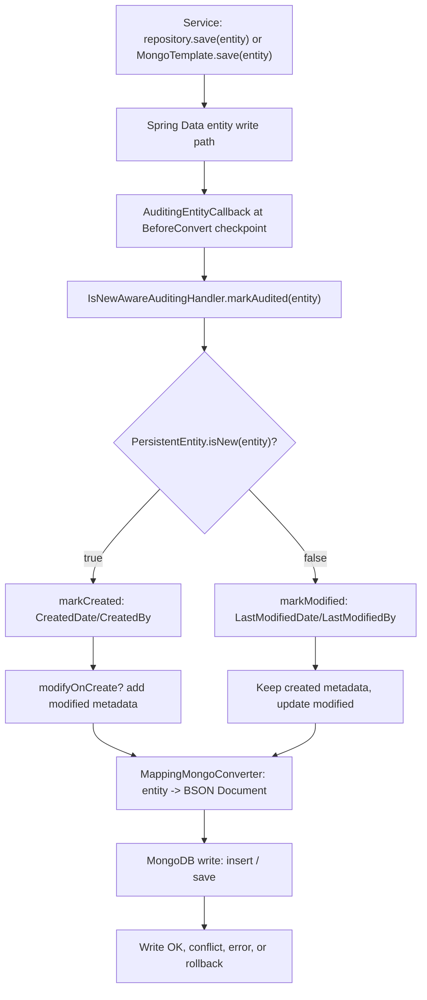
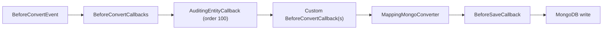

# Impact of New-Entity Detection on Creation and Modification Metadata

## 1. The Problem: A Document "New in the Database" Is Not Always Considered New by Spring Data

In Mini Commerce, we want to accurately record **who created, when it was created, who modified, and when it was modified** for `Product`, `Customer`, and `Order`. Spring Data MongoDB supports automatically populating this metadata through:

- `@CreatedDate` and `@CreatedBy` for **creation** metadata.
- `@LastModifiedDate` and `@LastModifiedBy` for **modification** metadata.
- `@EnableMongoAuditing` or `@EnableReactiveMongoAuditing` to register the infrastructure.

However, one question is easily overlooked: **how does Spring Data know the entity being persisted is "new"?** This is not merely a question for `repository.save(...)`; it also determines whether auditing takes the **markCreated** or **markModified** branch. If detected wrongly, a document appearing in MongoDB for the first time might have `updatedAt` yet **lack `createdAt`**, or an existing record might be treated as new.

Suppose an order uses an ID pre-assigned by a payment gateway:

```java
Order order = new Order();
order.setId("ord-external-2026-001");
order.setStatus("PLACED");
repository.save(order);
```

If the entity only has `@Id` without `@Version` or `Persistable`, Spring Data generally considers `id != null` as **not new**, even if that ID does not yet exist on the server. On an unversioned `save` path, MongoDB may still **upsert** a new document; auditing, meanwhile, may take the **modified** branch. Unexpected business outcome:

```javascript
{
  _id: "ord-external-2026-001",
  status: "PLACED",
  // createdAt may not be populated by the auditing branch.
  updatedAt: ISODate("2026-11-20T10:00:00Z")
}
```

The bug is not in MongoDB's clock. **Auditing decides "created vs. modified" from the entity's state before writing, not by querying the database to check if `_id` already exists.**

This lesson belongs to the **Auditing** chapter of the `SPRING_DATA_MONGODB` module: using Spring Data MongoDB to connect, map documents, and perform operations via `MongoTemplate` or repositories, while practicing queries, indexes, transactions, reactive access, testing, and data diagnostics.

### Learning Objectives

After this lesson, you will be able to:

1. Describe the chain `AuditingEntityCallback → IsNewAwareAuditingHandler → PersistentEntity.isNew(...)`.
2. Distinguish newness rules based on `@Id`, `@Version`, and `Persistable.isNew()`.
3. Understand the critical difference between **`Long version = null`** and **`long version = 0`**.
4. Predict `createdAt/createdBy/updatedAt/updatedBy` on insert, save, replace, and save of an entity with a pre-assigned ID.
5. Explain the `modifyOnCreate=true/false` and `setDates=true/false` settings.
6. Structure `AuditorAware` and `DateTimeProvider` with proper identity/clock sources.
7. Avoid DTOs with missing fields or direct updates dropping or failing to update audit metadata.
8. Use `Persistable` for pre-assigned business IDs; synchronize new/post-load state without leaking the flag into BSON.
9. Write integration tests reading raw BSON for new/existing, versioned/unversioned, imperative, and reactive auditing scenarios.
10. Know the limitations of auditing regarding transactions, retries, raw driver writes, bulk operations, and history tracking.

**Prerequisites:** Java 17+, Spring Boot with `spring-boot-starter-data-mongodb`, a dedicated test MongoDB, understanding of `@Document`, `@Id`, `MongoRepository`, `MongoTemplate`, and `@Version`. The reactive section requires the reactive starter and Reactor.

## 2. Auditing Flow Before the BSON Document Is Built

In the **entity write path through Spring Data mapping**:



Components involved:

| Component | Role |
| --- | --- |
| `@EnableMongoAuditing` | Registers the imperative auditing infrastructure |
| `AuditingEntityCallback` | `BeforeConvertCallback<Object>` callback for the entity about to be written |
| `IsNewAwareAuditingHandler` | Branches `markCreated`/`markModified` according to `PersistentEntity.isNew(entity)` |
| `PersistentEntity.isNew(entity)` | Returns a boolean based on the state-detection strategy (`@Version`, `@Id`, `Persistable`) |
| `AuditorAware<T>` | Supplies the current actor to populate `@CreatedBy`/`@LastModifiedBy` |
| `DateTimeProvider` | Supplies the Java instant used for `@CreatedDate`/`@LastModifiedDate` |
| `MappingMongoConverter` | Maps the audited entity into BSON fields |

**Key point:** the new/existing check happens **in the JVM from entity metadata and values**, without a default `findById` lookup before every audit. Whether MongoDB actually inserts or replaces happens **afterward**, so the two concepts can diverge.

### 2.1. Newness and Database Existence Are Two Different Axes

| Spring Data `isNew` | Does `_id` already exist? | What auditing does | Risk |
| --- | --- | --- | --- |
| `true` | No | Marks created; may also set modified on create | Normal if insert succeeds |
| `false` | Yes | Marks modified, keeps created metadata | Normal on updates |
| `false` | **No** | Marks modified even though write may upsert a new doc | Missing `createdAt/createdBy` |
| `true` | **Yes** | Marks created, though insert may fail duplicate key or save/version check | Cannot assume created was committed |

No standard auditing mechanism automatically turns this table into a race-free existence check between concurrent threads. Unique indexes, optimistic locking, transactions, and business operation IDs solve different problems.

### 2.2. "Auditing Ran" Does Not Mean "Committed"

Auditing runs before BSON conversion. Afterward, the write can be rejected due to duplicate key, optimistic-lock conflict, schema validation, network failure, or transaction rollback. Callbacks **can also run multiple times** if the command is retried.

Never send emails, call payment gateways, or emit external audit events outside MongoDB directly inside an auditing callback. If durable history logs are needed, use a transactionally coordinated **outbox/append-only event log**.

## 3. New-Entity Detection Rules: Precedence Order

Spring Data Commons describes the entity-state detection strategies:

1. **`Persistable`**: if the domain entity implements `Persistable<ID>`, Spring Data delegates the decision to `isNew()`.
2. **`@Version`**: if the entity has a version property, `null` (boxed) or `0` (primitive) is treated as new; any other value is not new.
3. **`@Id`**: if there is no version, an ID equal to `null` (or `0` for primitive IDs) is new; a non-null ID is not new.

These are rules of **entity-state detection**, not a MongoDB read query. When using custom strategies or special entity metadata, verify behavior against your application's Spring Data version.

### 3.1. Without @Version: Inspects @Id

```java
@Document("customers")
class CustomerWithoutVersion {
    @Id String id;
    @CreatedDate Instant createdAt;
    @LastModifiedDate Instant updatedAt;
}
```

| ID | Default `isNew` | Auditing Branch |
| --- | --- | --- |
| `null` | `true` | Created |
| `"cus-001"` | `false` | Modified |
| `""` (empty string) | `false` per null rule | Modified; an empty ID may also violate policy |

If MongoDB generates the ID and you leave `id=null` until insert, the first write is treated as new. However, a client-assigned business ID makes the entity **not new** under the ID-only rule.

### 3.2. With Boxed @Version Long: Checks Null First

```java
@Version
private Long version;
```

| Boxed Version | ID | `isNew` | Explanation |
| --- | --- | --- | --- |
| `null` | `null` | `true` | No version yet |
| `null` | `"order-assigned"` | `true` | **Pre-assigned ID is still considered new** |
| `0L` | `"order-assigned"` | `false` | Boxed **zero differs from null** |
| `1L` | `null` | `false` per version | Version metadata dominates; inconsistent state needs handling |

**Major trap:** with `Long`, initializing `version = 0L` inside a constructor or DTO turns a new entity into **"already existing"** before persistence. On inserting a new entity, Spring Data MongoDB typically initializes boxed numeric versions to `0`; after a successful insert, that `0` signals an **existing entity** on the next save.

### 3.3. With Primitive @Version long: Checks Zero

```java
@Version
private long version;
```

| Primitive Version | `isNew` | Branch |
| ---: | --- | --- |
| `0L` | `true` | Created |
| `1L` | `false` | Modified |
| `2L` | `false` | Modified |

Primitive `long` cannot be null, so Spring Data uses `0` as the "new" sentinel. Spring Data MongoDB typically initializes **primitive numeric versions at 1** upon insert. If an entity with `long version=0` read from a legacy DB is passed to `save`, it may still be classified as **new**: migrate and test rather than assuming every `0` is existing.

### 3.4. Summary Comparison Table

| Entity | Values | `isNew` Verdict |
| --- | --- | --- |
| `@Id String id` only | `id=null` | New |
| `@Id String id` only | `id="manual-001"` | Not new |
| `@Id` + `@Version Long version` | `id="manual-001", version=null` | New |
| `@Id` + `@Version Long version` | `id="manual-001", version=0L` | Not new |
| `@Id` + `@Version long version` | `id="manual-001", version=0L` | New |
| `@Id` + `@Version long version` | `id="manual-001", version=1L` | Not new |
| Implements `Persistable<ID>` | `isNew()=true` | New, regardless of pre-assigned ID |
| Implements `Persistable<ID>` | `isNew()=false` | Not new, per explicit strategy |

**Do not guess the auditing branch solely from whether `save()` or `insert()` was called.** Check the entity state **at the auditing checkpoint**.

## 4. Standard Auditing Configuration for MongoDB

### 4.1. Enabling Imperative Auditing

```java
package com.example.minicommerce.config;

import org.springframework.context.annotation.Configuration;
import org.springframework.data.mongodb.config.EnableMongoAuditing;

@Configuration
@EnableMongoAuditing(
    auditorAwareRef = "currentActorProvider",
    modifyOnCreate = true,
    setDates = true
)
public class MongoAuditingConfig {
}
```

`modifyOnCreate=true` and `setDates=true` are **defaults** in current Spring Data MongoDB versions, declared explicitly here to highlight their effect. If only storing `@CreatedDate` and `@LastModifiedDate`, the application **does not require** an `AuditorAware`.

### 4.2. AuditorAware in an Imperative Application

```java
package com.example.minicommerce.config;

import java.util.Optional;

import org.springframework.context.annotation.Bean;
import org.springframework.context.annotation.Configuration;
import org.springframework.data.domain.AuditorAware;
import org.springframework.security.core.Authentication;
import org.springframework.security.core.context.SecurityContextHolder;

@Configuration
public class AuditorConfig {

    @Bean("currentActorProvider")
    AuditorAware<String> currentActorProvider() {
        return () -> {
            Authentication auth = SecurityContextHolder
                .getContext()
                .getAuthentication();

            if (auth == null || !auth.isAuthenticated() ||
                    "anonymousUser".equals(auth.getPrincipal())) {
                return Optional.of("system");
            }
            return Optional.of(auth.getName());
        };
    }
}
```

This example uses imperative Spring Security; the application needs the matching dependency and configuration. `"system"` is only appropriate when policy explicitly defines an actor for scheduled/import jobs. **Never let an HTTP user submit an actor/tenant and trust it directly.** For operations without a principal, you can return `Optional.empty()` per contract and explicitly decide whether empty audit actors are permitted.

### 4.3. @CreatedBy and @LastModifiedBy

```java
@CreatedBy
private String createdBy;

@LastModifiedBy
private String lastModifiedBy;
```

These fields are **declarations inside the entity**, requiring imports:

```java
import org.springframework.data.annotation.CreatedBy;
import org.springframework.data.annotation.LastModifiedBy;
```

The property type (e.g., `String`) must be compatible with the return type of `AuditorAware<String>`. If using a domain `UserId` object, the provider must return that compatible/mappable type; do not force an unconvertible object into a BSON string.

## 5. Order Model for the Hands-On Lab

### 5.1. Entity with Boxed @Version Long

```java
package com.example.minicommerce.domain;

import java.time.Instant;
import org.springframework.data.annotation.Id;
import org.springframework.data.annotation.Version;
import org.springframework.data.annotation.CreatedDate;
import org.springframework.data.annotation.CreatedBy;
import org.springframework.data.annotation.LastModifiedDate;
import org.springframework.data.annotation.LastModifiedBy;
import org.springframework.data.mongodb.core.mapping.Document;
import org.springframework.data.mongodb.core.mapping.Field;

@Document(collection = "orders")
public class Order {

    @Id
    private String id;

    @Field("tenant_id")
    private String tenantId;

    private String customerId;
    private String status;

    @Version
    private Long version; // Intentionally null when entity is unpersisted.

    @CreatedDate
    private Instant createdAt;

    @LastModifiedDate
    private Instant updatedAt;

    @CreatedBy
    private String createdBy;

    @LastModifiedBy
    private String lastModifiedBy;

    public Order() {}

    public Order(String id, String tenantId,
                 String customerId, String status) {
        this.id = id;
        this.tenantId = tenantId;
        this.customerId = customerId;
        this.status = status;
        // Do not initialize version=0L in the constructor.
    }

    public String getId() { return id; }
    public String getTenantId() { return tenantId; }
    public String getCustomerId() { return customerId; }
    public String getStatus() { return status; }
    public Long getVersion() { return version; }
    public Instant getCreatedAt() { return createdAt; }
    public Instant getUpdatedAt() { return updatedAt; }
    public String getCreatedBy() { return createdBy; }
    public String getLastModifiedBy() { return lastModifiedBy; }

    public void setId(String id) { this.id = id; }
    public void setTenantId(String tenantId) {
        this.tenantId = tenantId;
    }
    public void setCustomerId(String customerId) {
        this.customerId = customerId;
    }
    public void setStatus(String status) { this.status = status; }
    public void setVersion(Long version) {
        this.version = version;
    }
    public void setCreatedAt(Instant createdAt) {
        this.createdAt = createdAt;
    }
    public void setUpdatedAt(Instant updatedAt) {
        this.updatedAt = updatedAt;
    }
    public void setCreatedBy(String createdBy) {
        this.createdBy = createdBy;
    }
    public void setLastModifiedBy(String actor) {
        this.lastModifiedBy = actor;
    }
}
```

**Do not** call `new Order(...).setVersion(0L)` on a new entity. When `@Version Long` is null, even if `id` is pre-assigned by a gateway, Spring Data treats the entity as **new**, auditing selects `created`, and the repository follows the new-entity path. After a successful insert, `version` is typically initialized to `0`, and the next save sees it as existing.

### 5.2. BSON Fields and Metadata

```javascript
{
  _id: "ord-2026-001",
  tenant_id: "shop-a",
  customerId: "cus-001",
  status: "PLACED",
  version: NumberLong(0),
  createdAt: ISODate("2026-11-20T10:00:00Z"),
  updatedAt: ISODate("2026-11-20T10:00:00Z"),
  createdBy: "operator-a",
  lastModifiedBy: "operator-a"
}
```

This is an **illustrative BSON sample when `modifyOnCreate=true` and an auditor is present**; exact timestamps and actors come from providers at runtime. `@Field("tenant_id")` maps property `tenantId` to BSON key `tenant_id`. Changing to `modifyOnCreate=false` can leave `updatedAt`/`lastModifiedBy` unpopulated upon creation.

### 5.3. Order Repository

```java
package com.example.minicommerce.repository;

import org.springframework.data.mongodb.repository.MongoRepository;
import com.example.minicommerce.domain.Order;

public interface OrderRepository
        extends MongoRepository<Order, String> {
}
```

From here on, most examples use `OrderRepository` and `MongoTemplate` with this entity. Both are created/injected by Spring Boot from the **same MongoDB configuration**.

## 6. Two Saves: Created Then Modified

### 6.1. First Save: Version Is Null

```java
Order order = new Order(
    "ord-2026-001", "shop-a", "cus-001", "PLACED");

// order.getVersion() == null
Order first = repository.save(order);
```

Before write: `isNew=true` because boxed `@Version` is null. `AuditingEntityCallback` invokes **markCreated**. If `modifyOnCreate=true`, both created and modified groups are populated on creation.

When save succeeds, the server stores the new Order, and `@Version Long` usually starts at `0`. `createdAt`/`createdBy` record the time/actor **when prepared for writing**, not the exact transaction commit time.

### 6.2. Second Save: Version Exists

```java
Order loaded = repository.findById("ord-2026-001")
    .orElseThrow();

loaded.setStatus("PAID");
Order second = repository.save(loaded);
```

With an existing boxed version (e.g., `0`), `isNew=false`. Auditing invokes **markModified**:

- `createdAt` and `createdBy` are preserved from the loaded entity.
- `updatedAt` and `lastModifiedBy` receive the new timestamp/actor when providers supply them.
- `@Version` participates in optimistic locking; version increments `0 → 1`.

If code **does not load** the entity and instead builds a fresh object with the same `_id` and a null version, it is treated as **new** again. When `repository.save` attempts an insert, the existing ID can cause a duplicate key error. That is an entity-state usage bug, not a reason to assign arbitrary versions manually.

### 6.3. Timeline

```text
T0  new Order(id="ord-2026-001", version=null)
    isNew=true
    CreatedDate=T0; CreatedBy=operator-a
    LastModifiedDate=T0; LastModifiedBy=operator-a (default)
    INSERT -> version=0

T1  load Order(id=..., version=0)
    change status PLACED -> PAID
    isNew=false
    createdAt/createdBy preserved
    updatedAt=T1; lastModifiedBy=operator-b
    SAVE with expected version 0 -> version=1
```

Do not assume `T1 > T0` always yields two distinct BSON Dates if operations run rapidly or share clock resolution; tests should prioritize **preserving created metadata**, verifying version, and checking modified metadata presence rather than using `Thread.sleep`.

## 7. Common Bug: Pre-Assigned ID Without @Version

Many payment systems generate an Order ID or transaction reference before saving to MongoDB. If the entity only has `@Id`, `isNew` inspects the ID value:

```java
package com.example.minicommerce.domain;

import java.time.Instant;
import org.springframework.data.annotation.Id;
import org.springframework.data.annotation.CreatedDate;
import org.springframework.data.annotation.LastModifiedDate;
import org.springframework.data.mongodb.core.mapping.Document;

@Document("legacy_orders")
public class LegacyOrder {

    @Id
    private String id;

    private String status;

    @CreatedDate
    private Instant createdAt;

    @LastModifiedDate
    private Instant updatedAt;

    public LegacyOrder() {}
    public LegacyOrder(String id, String status) {
        this.id = id;
        this.status = status;
    }

    public String getId() { return id; }
    public String getStatus() { return status; }
    public Instant getCreatedAt() { return createdAt; }
    public Instant getUpdatedAt() { return updatedAt; }
    public void setStatus(String value) { status = value; }
}
```

Suppose this runs against `legacy_orders` where the ID does not yet exist:

```java
LegacyOrder incoming = new LegacyOrder(
    "external-order-001", "PLACED");

LegacyOrder written = mongoTemplate.save(incoming);
```

Because `id != null` and there is no `@Version` or `Persistable`, the entity is considered **not new**. Auditing sets modified metadata. Meanwhile, unversioned `MongoTemplate.save` can perform a **replacement with upsert** when `_id` does not exist, leaving a newly inserted document with `createdAt` blank.

| Event | Perceived Newness | What Can Happen |
| --- | --- | --- |
| Object built with pre-assigned ID | `false` | Auditing picks modified |
| Server lacks that ID | Not queried by auditing | Save may upsert a new document |
| Save succeeds | Auditing branch already ran earlier | `updatedAt` present yet `createdAt` uninitialized |

**Do not fix this by forcing auditing to always call `markCreated`.** When updating an actually existing document, created metadata must be preserved.

### 7.1. Three Better Solutions

1. **Add `@Version Long`, leaving it null on new entities**, and follow proper optimistic-locking repository save/insert protocols.
2. **Implement `Persistable<String>`** and maintain the `isNew()` flag accurately, especially with pre-generated IDs.
3. **Separate create/update APIs explicitly**: create through a controlled insert path initializing audit metadata in the service; update using direct CAS while updating modified metadata intentionally.

Never assume an existing `@Id` guarantees the document exists on the server. Conversely, never use a separate existence query followed by insert as a concurrency guard: two writers can both see "not found". A unique index on `_id` is still needed.

## 8. Long Version, long Version, and State Initialization Mistakes

### 8.1. Boxed Long Has Two Distinct States

```java
@Version
private Long version; // Default null: new.
```

**Correct for a new entity:**

```java
Order first = new Order(
    "ord-automatic-001", "shop-a", "cus-001", "PLACED");

assert first.getVersion() == null;
repository.save(first);
```

**Latent bug:**

```java
Order wrong = new Order(
    "ord-automatic-002", "shop-a", "cus-001", "PLACED");
wrong.setVersion(0L); // Boxed zero is treated as EXISTING.
repository.save(wrong);
```

The second entity has `isNew=false` for auditing and repository routing; if the database has no document with expected version `0`, the versioned write path can throw an optimistic-lock failure instead of inserting. **Do not use `version=0L` as a default in a create DTO** merely because MongoDB stores the first boxed version as `0`.

### 8.2. Primitive Version Uses Sentinel = 0

```java
@Document("primitive_orders")
public class PrimitiveVersionOrder {

    @Id
    private String id;

    @Version
    private long version;

    @CreatedDate
    private Instant createdAt;

    @LastModifiedDate
    private Instant updatedAt;

    public PrimitiveVersionOrder() {}
    public PrimitiveVersionOrder(String id) { this.id = id; }

    public String getId() { return id; }
    public long getVersion() { return version; }
    public Instant getCreatedAt() { return createdAt; }
    public Instant getUpdatedAt() { return updatedAt; }
}
```

This is a separate entity in `PrimitiveVersionOrder.java`, with imports for `Id`, `Version`, `CreatedDate`, `LastModifiedDate`, `Document`, and `Instant`.

When a new object is instantiated, primitive `long version` defaults to `0` and `isNew=true`. MongoDB/Spring Data typically initializes primitive versions at **1** after insert (whereas boxed `Long` typically starts at `0`). Therefore:

```text
Long version=null -> NEW
    insert -> Long version=0 -> EXISTING

long version=0 -> NEW
    insert -> long version=1 -> EXISTING
```

Check the exact contract of your Spring Data MongoDB version and inspect raw BSON in integration tests. **Never mix legacy documents containing non-standard `0`/`1` versions** and assume numeric values alone will save auditing.

### 8.3. Avoid Copying Version from Client Create DTOs

Inputs must not let clients dictate versions:

```java
public record CreateOrderRequest(
    String customerId,
    String status
) {}
```

The service creates new entities with `null` (boxed) or `0` (primitive) version rather than mapping `version` arbitrarily from the HTTP body. Update commands should obtain version from the **existing entity/ETag or expected version** and enforce it on write.

### 8.4. Metadata vs. Actual Document Mismatches

| Scenario | Risk |
| --- | --- |
| Boxed `@Version Long=0L` before insert | Auditing treats as existing; repository may take update path |
| Primitive `@Version long=0L` on existing legacy entity | Auditing treats as new; save may try insert and fail |
| Entity loaded from projection missing `version` | May be misclassified as new even though ID exists |
| Raw driver updates without bumping version | Stale entities hard to detect; auditing acts on stale state |
| Client sends fresh `createdAt` in update DTO | Overwrites creation timestamp on replacement saves |

**Takeaway:** new-entity detection is not an arbitrary null/zero convention for convenience. It directly governs insert/update routing, optimistic locking, and auditing.

## 9. When Pre-Assigning IDs Is Required: Persistable.isNew()

`Persistable<ID>` lets an entity explicitly declare its new/existing state:

```java
import org.springframework.data.domain.Persistable;
```

This is useful when:

- IDs are generated by the service/UUID/ULID or an external system **before insert**.
- You do not want a `@Version` field on an append-only document type.
- You have a clear strategy to flip the flag from new → existing **after saving or loading from MongoDB**.

### 9.1. OrderNote Example with Self-Assigned ID

```java
package com.example.minicommerce.domain;

import java.time.Instant;

import org.springframework.data.annotation.Id;
import org.springframework.data.annotation.CreatedDate;
import org.springframework.data.annotation.LastModifiedDate;
import org.springframework.data.annotation.Transient;
import org.springframework.data.domain.Persistable;
import org.springframework.data.mongodb.core.mapping.Document;

@Document("order_notes")
public class OrderNote implements Persistable<String> {

    @Id
    private String id;

    private String message;

    @CreatedDate
    private Instant createdAt;

    @LastModifiedDate
    private Instant updatedAt;

    @Transient
    private boolean newEntity = true;

    public OrderNote() {}

    public OrderNote(String id, String message) {
        this.id = id;
        this.message = message;
    }

    @Override
    public String getId() { return id; }

    @Override
    public boolean isNew() { return newEntity; }

    public void markNotNew() { newEntity = false; }

    public String getMessage() { return message; }
    public void setMessage(String value) { message = value; }
    public Instant getCreatedAt() { return createdAt; }
    public Instant getUpdatedAt() { return updatedAt; }
}
```

Here, `@Transient` ensures `newEntity` **is not persisted into BSON**. It is strictly JVM lifecycle state. When entities use property access, ensure `isNew()` is not treated as a persistent property; apply `@Transient` consistent with your access strategy and verify BSON.

### 9.2. Marking Not New Once Loaded or Saved

Creating `OrderNote("note-001", "...")` gives `isNew=true` even when `id != null`. However, when loaded back from MongoDB, the class is constructed with `newEntity=true` by default; **without flipping the flag**, the next save may try inserting an already existing document.

One explicit approach:

```java
package com.example.minicommerce.callback;

import org.bson.Document;
import org.springframework.data.mongodb.core.mapping.event.AfterConvertCallback;
import org.springframework.data.mongodb.core.mapping.event.AfterSaveCallback;
import org.springframework.stereotype.Component;

import com.example.minicommerce.domain.OrderNote;

@Component
public class OrderNoteStateCallbacks
        implements AfterConvertCallback<OrderNote>,
                   AfterSaveCallback<OrderNote> {

    @Override
    public OrderNote onAfterConvert(
            OrderNote entity,
            Document document,
            String collection) {
        entity.markNotNew();
        return entity;
    }

    @Override
    public OrderNote onAfterSave(
            OrderNote entity,
            Document document,
            String collection) {
        entity.markNotNew();
        return entity;
    }
}
```

Thanks to `AfterConvertCallback`, instances loaded from the DB have `isNew=false`. Thanks to `AfterSaveCallback`, instances after a successful write are marked existing. These callbacks **do not replace** error handling or uncertain outcomes: if insert throws before after-save, the flag stays true; if a response is lost, the caller must not assume the transaction never committed.

### 9.3. Persistable Changes Both Routing and Auditing

| Instance State | `id` | `isNew()` | Auditing | Repository Save Path |
| --- | --- | --- | --- | --- |
| Newly created `OrderNote` | `"note-001"` | `true` | Created | Typically insert |
| After successful save | `"note-001"` | `false` | Modified next time | Existing save |
| Loaded from MongoDB | `"note-001"` | `false` via callback | Modified next time | Existing save |
| Another instance keeping flag true for existing ID | `"note-001"` | `true` | Wrongly created | May raise duplicate key |

**Never** use `Persistable.isNew()` to bypass unique indexes, and never hardcode `isNew() { return true; }` permanently. Overriding it alters insert/update routing and auditing across repository methods.

### 9.4. Choosing Persistable vs. @Version?

- For aggregates with concurrent updates like `Product` or `Order`, `@Version Long` provides both null-based newness and optimistic locking.
- For append-only documents with pre-assigned IDs, `Persistable` expresses newness directly without a version field.
- For complex workflows maintaining lifecycle flags on immutable entities, design consistent factory/with-methods; sometimes using `@Version Long null` on new entities is simpler.

Do not add `Persistable` just to "fix a `createdAt` test" if the project already uses `@Version`/mapping and the real bug is a misconstructed DTO.

## 10. modifyOnCreate: Does Creating Count as Being Modified?

`@EnableMongoAuditing` has the attribute:

```java
@EnableMongoAuditing(modifyOnCreate = true)
```

**Default `true`:** when a new entity is audited, both creation and modification metadata are populated. Thus the initial insert produces:

```text
createdAt      = 2026-11-20T10:00:00Z
updatedAt      = 2026-11-20T10:00:00Z
createdBy      = operator-a
lastModifiedBy = operator-a
```

**When `false`:** creation only populates created metadata; modified metadata can stay null/unset:

```java
@Configuration
@EnableMongoAuditing(
    auditorAwareRef = "currentActorProvider",
    modifyOnCreate = false
)
public class CreateOnlyAuditConfig {
}
```

`CreateOnlyAuditConfig` is an **alternative to `MongoAuditingConfig` in section 4**; do not enable both simultaneously. When saving an existing entity, auditing takes the modified branch so `updatedAt`/`lastModifiedBy` are populated on modification.

### 10.1. Created/Modified Matrix

| `isNew` | `modifyOnCreate` | Created Metadata | Modified Metadata |
| --- | --- | --- | --- |
| `true` | `true` (default) | Populated | Populated on create |
| `true` | `false` | Populated | Not auto-populated on create |
| `false` | Any | **Preserved** from existing entity | Populated/updated |

Preconditions: auditing is enabled, entity has proper annotations, `DateTimeProvider`/`AuditorAware` supply values, and no other callback overwrites them. "Preserved created metadata" means **not overwriting it** in the modified branch; if the passed-in entity already dropped `createdAt`, auditing does not restore it from the DB.

### 10.2. API Expectations Must Be Explicit

If the frontend expects `updatedAt` to always be non-null on every Order, keeping `modifyOnCreate=true` makes sense. If business semantics dictate "`updatedAt` exists only after the first modification", pick `false` and allow null in DTO/BSON schemas.

Do not define a MongoDB JSON Schema requiring `updatedAt` on create and then set `modifyOnCreate=false` without another mechanism populating the field, or inserts will fail schema validation.

## 11. setDates and DateTimeProvider

### 11.1. setDates=true/false

```java
@EnableMongoAuditing(setDates = true)
```

`setDates=true` is the default: auditing automatically populates Java timestamps from `DateTimeProvider`. With:

```java
@EnableMongoAuditing(setDates = false)
```

auditing **does not auto-populate dates**, though that does not necessarily disable actor auditing. Choose `setDates=false` only when you have a clearly contracted time source (e.g., filled by the service or server-side timestamps on another write path).

### 11.2. Injectable Clock for Testing

```java
package com.example.minicommerce.config;

import java.time.Clock;
import java.time.Instant;
import java.time.temporal.TemporalAccessor;
import java.util.Optional;

import org.springframework.context.annotation.Bean;
import org.springframework.context.annotation.Configuration;
import org.springframework.data.auditing.DateTimeProvider;

@Configuration
public class AuditClockConfig {

    @Bean
    Clock auditClock() {
        return Clock.systemUTC();
    }

    @Bean("auditDateTimeProvider")
    DateTimeProvider auditDateTimeProvider(
            Clock auditClock) {
        return () -> Optional.<TemporalAccessor>of(
            Instant.now(auditClock));
    }
}
```

Select the provider in the annotation:

```java
@EnableMongoAuditing(
    dateTimeProviderRef = "auditDateTimeProvider",
    auditorAwareRef = "currentActorProvider"
)
```

This annotation snippet is **how you adjust the existing configuration**, not a second `@EnableMongoAuditing` class to create alongside it. Tests can inject a `Clock.fixed(...)` or a controllable `Clock` to verify creation/modification times without `Thread.sleep`.

### 11.3. Auditing Timestamp Differs from Commit Time

Auditing captures the time when the callback processes the entity. In a long transaction:

```text
10:00:00.001  BeforeConvert auditing -> createdAt
10:00:00.010  MongoDB insert inside transaction
10:00:02.000  MongoDB commits transaction
```

`createdAt` is when Spring prepared the entity for writing, not when MongoDB acknowledged the commit. When **official legal/transaction timestamps** are required, establish an explicit timestamp source and protocol; never assume auditing timestamps prove commit timing.

### 11.4. UTC Time and Data Formatting

`Instant` represents an absolute instant; MongoDB stores BSON Date in epoch milliseconds. Displaying Vietnam time is the **presentation layer's responsibility**. Never call timezone-less `LocalDateTime.now()` and treat BSON Date as local time when an API runs across regions.

## 12. Actor Auditing: CreatedBy and LastModifiedBy Also Depend on isNew

Given the same `AuditorAware<String>`, the current timestamp and identity are applied differently depending on `isNew`:

```text
isNew=true, modifyOnCreate=true:
    createdBy      = currentActor
    lastModifiedBy = currentActor

isNew=true, modifyOnCreate=false:
    createdBy      = currentActor
    lastModifiedBy = null (if unset previously)

isNew=false:
    createdBy      = preserved from entity
    lastModifiedBy = currentActor
```

This applies when the entity has both annotations and the actor provider supplies a value. If `AuditorAware` returns `Optional.empty()` or custom callbacks exist, verify the resulting output.

### 12.1. Actor Must Come from a Trusted Source

```java
@CreatedBy
private String createdBy;

@LastModifiedBy
private String lastModifiedBy;
```

Do not let clients set these two fields via create/update DTOs. If a request sends:

```json
{
  "createdBy": "admin",
  "lastModifiedBy": "admin",
  "status": "PAID"
}
```

the service must **ignore** both actor fields from the body and resolve the actor from `SecurityContext`/service principal. `AuditorAware` is invoked by Spring Data in the callback; security authorization must still be enforced at the service and in query filters by tenant/Customer.

### 12.2. Async and Scheduled Jobs

Imperative `SecurityContextHolder` is thread-local by default. A scheduled job or worker switching threads may lack a request security context. Never read a previous request's actor leaked through shared mutable state.

For imports/schedulers, use a well-defined service identity like `"catalog-importer"` or `"order-reconciler"`. That is a technical workload identity, not impersonating an end user.

### 12.3. Auditing Cannot Replace an Event Log

`lastModifiedBy="operator-b"` shows who was recorded as the **latest** modifier; it does not show when each change happened, which fields changed, old values, or intermediate steps. If Order status transition history is needed, maintain `order_events`/append-only audit logs or a transactional outbox.

## 13. Differences Between repository.save, MongoTemplate.save, and insert

Auditing classifies an entity as new/existing **before the BSON write**; the actual routing of the write API depends on the operation.

### 13.1. Repository.save

```java
Order newOrder = new Order(
    "ord-assigned-001", "shop-a", "cus-001", "PLACED");

Order saved = repository.save(newOrder);
```

Repository `save` uses Spring Data entity information to decide insert vs. update based on newness. With `Order.version=null`, it takes the **new entity path**, auditing marks created, and inserts. With `version != null`, it takes the existing path; version-aware MongoDB save checks the version for optimistic locking.

### 13.2. MongoTemplate.insert

```java
Order inserted = mongoTemplate.insert(new Order(
    "ord-insert-001", "shop-a", "cus-001", "PLACED"));
```

`insert` expresses intent to **create new and reject duplicate `_id`**, yet auditing still checks the entity's `isNew` at the callback. Do not instantiate an object with `version=0L` and assume calling `insert` forces auditing onto the created branch.

### 13.3. MongoTemplate.save

```java
Order saved = mongoTemplate.save(order);
```

`save` can insert or replace depending on metadata, version, and server state. Without `@Version`, `save` with an ID can replace or upsert a document. Because auditing does not query the database, an unversioned entity with a pre-assigned ID can be **marked modified even as upsert creates a new document**.

Do not treat "server inserted" and "`isNew=true` in the callback" as the same assertion.

### 13.4. Upsert via Update Bypasses Entity Auditing

```java
Query filter = Query.query(
    Criteria.where("id").is(orderId)
        .and("tenantId").is(tenantId));

Update change = new Update()
    .set("status", "PLACED")
    .setOnInsert("createdAt", Instant.now(clock))
    .setOnInsert("createdBy", verifiedActor)
    .currentDate("updatedAt")
    .set("lastModifiedBy", verifiedActor);

var result = mongoTemplate.upsert(
    filter, change, Order.class);
```

This is a **service-body snippet** where `clock` and `verifiedActor` come from trusted sources; it is not a complete idempotent upsert implementation. Direct `upsert` sends a query/update to MongoDB and **does not pass an `Order` entity through `AuditingEntityCallback`**. If metadata is needed:

- Use `$setOnInsert` for `createdAt/createdBy` only when the server actually inserts.
- Use `$set`/`$currentDate` for `updatedAt/lastModifiedBy` per contract.
- Use unique indexes to protect business keys; evaluate races and versions.

**Caution:** `$setOnInsert` and `$currentDate` on different fields, as shown, are valid; never apply both operators to the **same field** (which causes conflicting update paths). If modified metadata on create must match **the exact same timestamp** as created metadata, compute one timestamp beforehand for both fields or use an update pipeline per policy.

### 13.5. Careless Replacement Can Wipe Out createdAt

When saving an entity constructed from only a subset of DTO fields:

```java
Order patch = new Order(
    "ord-existing-001", "shop-a", "cus-001", "PAID");

// On other unversioned entities or naive replacement code,
// this patch can wipe out createdAt on the existing document.
mongoTemplate.save(patch);
```

On the versioned `Order` entity from section 5, `version=null` causes an insert attempt and duplicate-key error, **not necessarily a replacement**. This is a general warning for unversioned save/replace paths or raw documents: **the modified branch does not fetch `createdAt` from the database automatically**. To patch partial fields, use `Query/Update` with CAS and explicit modified metadata, or load the full entity with version intact before saving.

## 14. DTOs, Mapping, and Unintentionally Resetting New State

### 14.1. Never Include Version in Create DTOs

```java
package com.example.minicommerce.api;

public record CreateOrderRequest(
    String customerId,
    String status
) {}
```

In the service:

```java
Order order = new Order(
    generatedOrderId,
    verifiedTenantId,
    request.customerId(),
    "PLACED");

return orderRepository.save(order);
```

`generatedOrderId` is a stable ID for the use case, and `verifiedTenantId` comes from the security context. `request.status()` is ignored because the server controls state transitions; the snippet shows that a new entity **never accepts version or audit metadata from the client**.

### 14.2. Update DTOs Should Contain Only Editable Fields

```java
package com.example.minicommerce.api;

public record UpdateOrderRequest(
    String desiredStatus,
    long expectedVersion
) {}
```

Never map `UpdateOrderRequest` into `new Order(id, ..., status)` and save an object missing `createdAt`. Safe patterns:

- Load the full entity, verify tenant and version, then `save`.
- Or run an atomic `updateFirst` matching `_id + tenantId + expectedVersion`, setting `status` and modified metadata explicitly.

### 14.3. Object Mapping Can Make an Entity "New Again"

With an immutable DTO mapper:

```java
Order copy = new Order(
    old.getId(),
    old.getTenantId(),
    old.getCustomerId(),
    "PAID");

// Forgot to copy version, createdAt, createdBy:
// copy.version == null -> isNew == true.
```

Calling `repository.save(copy)` sends `copy` down the **new branch** even though it represents an existing Order. With immutable entities, use constructors/copy methods preserving all metadata or use a non-replacement update operation; never replace an aggregate with a stripped DTO.

## 15. Immutable Entities and Auditing

The auditing infrastructure can handle immutable/constructor-bound entities depending on mapping support. However, **when an immutable entity is reconstructed**, you must preserve:

- `id` and version/expected version.
- `createdAt` and `createdBy` from the persisted document.
- Unpatched domain fields.
- Immutable identity/tenant.

### 15.1. Record Illustrating the Concept

```java
@Document("order_receipts")
public record OrderReceipt(
    @Id String id,
    @Version Long version,
    @CreatedDate Instant createdAt,
    @LastModifiedDate Instant updatedAt,
    String orderId,
    String status
) {}
```

This snippet is **a Java record** importing `Id`, `Version`, `CreatedDate`, `LastModifiedDate`, `Document`, and `Instant`.

When creating a fresh receipt:

```java
OrderReceipt fresh = new OrderReceipt(
    "receipt-001", null, null, null,
    "order-001", "ISSUED");
```

`version=null` signals new to auditing. When cloning to update:

```java
OrderReceipt changed = new OrderReceipt(
    stored.id(),
    stored.version(),
    stored.createdAt(),
    stored.updatedAt(),
    stored.orderId(),
    "SENT");
```

The clone preserves **version and created metadata**. Still, never assume every record/constructor across every Spring Data version gets audited identically to a mutable POJO; write integration tests creating and updating, verifying both the returned object and raw BSON.

### 15.2. Why Not Use a Fresh Entity as a "Patch"?

`new OrderReceipt(id, null, null, null, ..., "SENT")` is not a modification of the old receipt semantically; `version=null` marks a **new entity**. For stateful aggregates, treat ID/version/audit metadata as core state, not optional details.

## 16. How Auditing and Other Entity Callbacks Interact

Spring Data MongoDB supports multiple callbacks/event checkpoints:



The diagram **illustrates ordering for the callbacks in this example**: a custom callback with order `50` runs **before** auditing order `100`, while order `200` runs after. Do not assume all custom callbacks always execute after auditing.

### 16.1. AuditingEntityCallback

In Spring Data MongoDB, `AuditingEntityCallback` implements `BeforeConvertCallback<Object>` with a **default order of 100**. Right before saving an entity, it uses `IsNewAwareAuditingHandler` to decide new vs. modified.

```java
@Component
@Order(200)
public class ProductNormalization
        implements BeforeConvertCallback<Product> {

    @Override
    public Product onBeforeConvert(
            Product entity, String collection) {
        // Normalize Product before mapping to BSON.
        return entity;
    }
}
```

This illustrative class assumes imports for `Component`, `Order`, `BeforeConvertCallback`, and `Product`. With order `200`, auditing at order `100` runs first (when both apply).

### 16.2. Do Not Arbitrarily Mutate Version/ID in Callbacks

If a custom callback at order `50` modifies `id` or `version` before auditing, `isNew` can flip. For example:

```text
BeforeConvertCallback(order 50):
    version=null -> version=0
AuditingEntityCallback(order 100):
    sees version=0 (boxed) -> isNew=false
```

Thus a custom callback can make auditing **mistake creation for modification**. Never use `BeforeConvert` to initialize boxed version to `0`; let Spring Data manage version per protocol. If your app uses an ID-assigning callback, check its ordering for entities relying solely on `@Id` for newness.

### 16.3. BeforeConvertEvent Differs from EntityCallback

`AbstractMongoEventListener` relies on `ApplicationEventMulticaster`; if the multicaster is async, mutating state inside an event listener can race with conversion. `EntityCallback` is recommended by Spring Data for mutating entities at deterministically ordered checkpoints. **Do not rely on `BeforeConvertEvent` to "patch up" inconsistent `isNew` state.**

### 16.4. BeforeSave Is Too Late to Decide the Auditing Branch

`BeforeSaveCallback` runs after the BSON `Document` has already been mapped. Auditing's `markCreated`/`markModified` already ran at the `BeforeConvert` checkpoint, so changes inside `BeforeSaveCallback` do not re-trigger Spring Data auditing.

When you need to force metadata for domain exceptions (such as backfilling `createdAt`), write a tested migration/explicit service update instead of silently altering `createdAt` in `BeforeSave` expecting everything to stay in sync.

## 17. Direct Updates Do Not Trigger Entity Auditing

The following write paths **do not automatically invoke `AuditingEntityCallback` for an updated entity**:

| Write Path | Why Is It Not Auto-Audited? |
| --- | --- |
| `MongoTemplate.updateFirst(Query, Update, Order.class)` | Update modifiers, no entity instance converted |
| `MongoTemplate.findAndModify(...)` | `Query` + `Update`; not `save(entity)` |
| Repository `@Update` | Direct update method |
| `BulkOperations` | Does not guarantee full lifecycle callbacks |
| Raw `MongoCollection<Document>` | Bypasses Spring Data mapping callbacks |
| MongoDB aggregation `$merge`/`$out` | Server-side write pipeline |
| Migrations run via `mongosh` | No Spring application context |

### 17.1. Updating Status with Proper Version and Modified Metadata

```java
public boolean markPaid(
        String tenantId, String orderId,
        long expectedVersion, String verifiedActor) {

    Query filter = Query.query(
        Criteria.where("id").is(orderId)
            .and("tenantId").is(tenantId)
            .and("version").is(expectedVersion)
            .and("status").is("PLACED"));

    Update update = new Update()
        .set("status", "PAID")
        .set("lastModifiedBy", verifiedActor)
        .inc("version", 1L)
        .currentDate("updatedAt");

    var result = mongoTemplate.updateFirst(
        filter, update, Order.class);

    if (!result.wasAcknowledged()) {
        throw new IllegalStateException(
            "Acknowledged write required");
    }
    return result.getMatchedCount() == 1;
}
```

This is a **service method** with `MongoTemplate` injected and imports for `Query`, `Criteria`, `Update`, and `Order`. `verifiedActor` comes from the security context. The query guards tenant, expected version, and current Order status; `$inc version`/`$set lastModifiedBy`/`$currentDate updatedAt` execute in **one atomic update** on a single document.

### 17.2. Direct Updates Must Not Overwrite Created Metadata

For update operations:

```java
Update update = new Update()
    .set("status", "SHIPPED")
    .set("lastModifiedBy", actor)
    .currentDate("updatedAt");
```

**Do not** add `.set("createdAt", Instant.now())` or `.set("createdBy", actor)`. In normal updates, creation metadata must remain immutable. If migration genuinely needs to correct created metadata, treat it as a special operation with a dedicated audit/migration log.

### 17.3. Repository @Update

```java
@Query("""
    { '_id': ?0, 'tenant_id': ?1, 'version': ?2,
      'status': 'PLACED' }
    """)
@Update("""
    {
      '$set': {
        'status': 'PAID',
        'lastModifiedBy': ?3
      },
      '$inc': { 'version': 1 },
      '$currentDate': { 'updatedAt': true }
    }
    """)
long markPaid(String orderId, String tenantId,
              long expectedVersion, String actor);
```

This illustrative method belongs inside a `MongoRepository<Order, String>` interface importing `org.springframework.data.mongodb.repository.Query` and `org.springframework.data.mongodb.repository.Update`. Do not assume `@LastModifiedDate` automatically applies to repository `@Update`: metadata is declared explicitly in the BSON update.

### 17.4. findAndModify Returns a Document Yet Skips Audit Callbacks

```java
Order after = mongoTemplate.findAndModify(
    filter,
    new Update()
        .set("status", "PAID")
        .inc("version", 1L)
        .set("lastModifiedBy", verifiedActor)
        .currentDate("updatedAt"),
    FindAndModifyOptions.options().returnNew(true),
    Order.class);
```

This service snippet assumes `filter` and `verifiedActor` are defined, importing `FindAndModifyOptions`. `returnNew(true)` returns the post-update entity (or null if unmatched), **not** because the entity passed back through `AuditingEntityCallback`.

## 18. Bulk, Raw Driver, and Historical Data Imports

A Mini Commerce batch import might write thousands of `Product`/`Order` records using `BulkOperations` or the Java driver. Those paths **must not be assumed to fire full entity lifecycle callbacks**, even when the Java model has `@CreatedDate` and `@LastModifiedDate`.

### 18.1. Bulk Imports Do Not Auto-Infer Creators

```java
var operations = mongoTemplate.bulkOps(
    BulkOperations.BulkMode.ORDERED,
    Order.class);

operations.insert(ordersToImport);
operations.execute();
```

This is a service snippet with prepared/validated `ordersToImport` and `BulkOperations` imported. With bulk operations, **prepare audit metadata** per the import policy:

- `createdAt`, if backed by a trusted legacy source, must retain its original timestamp.
- `createdBy` can be the historical actor (if verified) or `migration-service`, never fabricated.
- `updatedAt` reflects the last modification from source data or import time **under an explicit definition**.
- `version` is initialized/restored consistently if entities will later be saved with `@Version` optimistic locking.
- Bulk validation/index conflicts are logged and reconciled per ID.

**Never stamp today's migration timestamp as "when the Order was placed"** if business requirements need accurate history from a year ago.

### 18.2. Raw BSON Does Not Know About @CreatedDate

```javascript
db.orders.updateOne(
  { _id: "ord-manual-001" },
  {
    $setOnInsert: {
      createdAt: ISODate("2026-11-20T10:00:00Z"),
      createdBy: "migration-service"
    },
    $set: {
      status: "PLACED",
      lastModifiedBy: "migration-service"
    },
    $currentDate: { updatedAt: true }
  },
  { upsert: true }
);
```

MongoDB does not read Java annotations. `$setOnInsert` applies **only if the upsert actually inserts a document**, while `$currentDate` applies on every write. Choose realistic actors, timestamps, and business keys; this MongoDB operation alone does not guarantee full end-to-end idempotency if request IDs change across runs.

### 18.3. Nested AuditMetadata Fields

Spring Data Commons supports auditing metadata inside embedded value objects depending on store mapping. For example:

```java
public class AuditMetadata {
    @CreatedDate
    private Instant createdAt;
    @LastModifiedDate
    private Instant updatedAt;
}
```

This is an illustrative type importing `Instant`, `CreatedDate`, and `LastModifiedDate`. If `AuditMetadata` is a property on root `Order`, auditing still uses **the newness of the root entity being persisted**, rather than maintaining independent create/update lifecycles per embedded subdocument.

## 19. Migration: Adding Auditing and @Version to a Legacy Database

Suppose `orders` has been running for years with documents like:

```javascript
{
  _id: "ord-legacy-001",
  tenant_id: "shop-a",
  customerId: "cus-001",
  status: "DELIVERED"
  // Missing version, createdAt, updatedAt.
}
```

If you deploy an `Order` entity with `@Version Long` today, reading a document without `version` yields Java `version=null`; by the newness rule, it can be treated as **new** even though `_id` exists. Calling `repository.save(...)` may attempt an insert and throw duplicate key instead of updating. Auditing may also take the created branch when editing an old Order.

### 19.1. Safe Migration Plan

1. **Inspect data**: how many Orders lack `version`, `createdAt`, `createdBy`; check existing BSON types.
2. **Choose migration cutoff**: can legacy writers pause, or use a phased version-aware rollout?
3. **Establish historical timestamps**: does Order have a reliable `placedAt`/payment timestamp? Can unknown values be marked explicitly instead of faking `createdAt`?
4. **Backfill version** consistently with the `Long` entity and optimistic locking. Commonly missing versions are initialized to BSON Int64 `0` on existing documents once all writers agree.
5. **Backfill created metadata** from verified sources or mark a distinct migration approximation; never impersonate original users.
6. **Test saving existing documents** post-migration to verify version CAS and the `markModified` branch.
7. **Roll out** auditing/constraints, monitoring duplicate keys and optimistic locking conflicts.
8. **Reconcile** raw BSON and report unmigrated counts; prepare a rollback plan beforehand.

### 19.2. Version Backfill Example with Approved Scope

Run on a test database first:

```javascript
db.orders.updateMany(
  {
    version: { $exists: false }
  },
  {
    $set: { version: NumberLong(0) }
  }
);
```

This command bypasses auditing callbacks and leaves `createdAt` untouched. Do not run it in production while multiple writers use incompatible version protocols without a migration plan: the new version values must match every active write path.

### 19.3. Backfilling createdAt Requires a Provenance Source

Common scenarios:

| Historical Data | Action |
| --- | --- |
| Has `placedAt` accurately reflecting Order creation | Can populate `createdAt` if domain approves |
| Has original audit/event log | Use verified timestamps and actors from the log |
| Has only latest `updatedAt` | Cannot infer accurate `createdAt` |
| Has no timestamp at all | Keep unknown or record `createdAtSource="legacy_unknown"` per schema |

Do not rely on enabling auditing to "fill in historical data": callbacks only run when entities flow through a specific write path, and `markCreated`/`markModified` still depends on `isNew` at that time.

### 19.4. Avoid Calling save on Every Legacy Entity to Backfill

Loading a million unversioned Orders and calling `repository.save` one by one just to add `createdAt` can misclassify every entity as new and trigger duplicate keys. A raw BSON/`updateMulti` migration with explicit filters and careful version handling is far easier to control than abusing lifecycle callbacks for backfills.

## 20. Transactions, Retries, and Boundaries of Audit Metadata

### 20.1. Auditing Runs Before Commit

In a MongoDB transaction:

```java
@Transactional(transactionManager = "mongoTransactionManager")
public void placeOrder(Order order) {
    orderRepository.save(order);
    outboxRepository.save(
        new OrderCreatedEvent(order.getId()));
}
```

This is an **illustrative skeleton** requiring separate definitions for `outboxRepository` and `OrderCreatedEvent`. If the transaction rolls back, neither Order nor outbox write commits; however, auditing already ran **in the JVM** and mutated the Java instance. Thus an instance inspected after an exception is not proof the DB persisted anything.

### 20.2. Retries Can Change Timestamps

```text
Attempt 1: markCreated(createdAt=T0)
           write conflict -> rollback

Attempt 2: markCreated(createdAt=T1)
           commit succeeds
```

If the whole transaction retries, the callback can run again. The final persisted creation timestamp may be `T1`, not necessarily `T0`. With mutable `Persistable`, make sure the `isNew` flag and ID/version are reset/reconciled properly after a failed attempt rather than reusing an internally mutated entity or assuming it definitely committed.

### 20.3. Unknown Commit Results

If the client loses the response after commit, never assume the transaction rolled back and create an Order **with a new ID**. Idempotency keys/unique Order IDs, ledgers, and tenant-scoped readbacks are how you resolve uncertain outcomes.

Auditing `createdAt` or `lastModifiedBy` alone **does not prove** this specific request committed; two requests can share an actor, and timestamps can collide within millisecond resolution.

### 20.4. Optimistic Locking and Audit Data

With `@Version`, a stale save can throw `OptimisticLockingFailureException`. The auditing callback may have populated `updatedAt` on the stale instance before MongoDB reported the conflict; **do not treat that instance as successfully persisted**.

In Mini Commerce, require acknowledged write concerns for optimistic locking. For direct CAS, put the expected version in the filter and update timestamp/actor **in the same command**, avoiding two separate writes ("set audit first, business update second").

## 21. Reactive Auditing Also Depends on New-Entity Detection

Reactive Spring Data MongoDB uses:

- `@EnableReactiveMongoAuditing`.
- `ReactiveAuditingEntityCallback`.
- `ReactiveIsNewAwareAuditingHandler` to classify created/modified from metadata.
- `ReactiveAuditorAware<T>` to emit the actor via a reactive publisher.

The `@Id`/`@Version`/`Persistable` logic still applies; the main differences are **context propagation and asynchronous execution**.

### 21.1. Enabling Reactive Auditing

```java
package com.example.minicommerce.config;

import org.springframework.context.annotation.Bean;
import org.springframework.context.annotation.Configuration;
import org.springframework.data.domain.ReactiveAuditorAware;
import org.springframework.data.mongodb.config.EnableReactiveMongoAuditing;
import reactor.core.publisher.Mono;

@Configuration
@EnableReactiveMongoAuditing(
    auditorAwareRef = "reactiveActorProvider",
    modifyOnCreate = true
)
public class ReactiveMongoAuditingConfig {

    @Bean("reactiveActorProvider")
    ReactiveAuditorAware<String> reactiveActorProvider() {
        // Example for internal worker/importer.
        // HTTP identity requires Reactor security context.
        return () -> Mono.just("mini-commerce-worker");
    }
}
```

This is a **reactive-stack configuration**; do not add it to an imperative app unless both stacks are genuinely used. Fixed actors are appropriate only for authenticated service accounts. WebFlux user identities should use `ReactiveAuditorAware` reading from Reactor/Spring Security context instead of blocking or reading servlet thread-local `SecurityContextHolder`.

### 21.2. Reactive Repository

```java
package com.example.minicommerce.repository;

import org.springframework.data.mongodb.repository.ReactiveMongoRepository;
import com.example.minicommerce.domain.Order;

public interface ReactiveOrderRepository
        extends ReactiveMongoRepository<Order, String> {
}
```

```java
Mono<Order> created = reactiveOrderRepository.save(
    new Order("ord-reactive-001",
              "shop-a", "cus-001", "PLACED"));
```

When the publisher is subscribed, Spring Data executes save and reactive auditing; if `Order.version=null`, the created branch is chosen. Resubscribing to a publisher holding **the same mutated entity instance** after save can find its state flipped to existing, causing the second run to update or fail. Reactive publishers **do not guarantee exactly-once** across multiple subscriptions.

### 21.3. Do Not Wrap Publishers in TransactionTemplate

`TransactionalOperator`/`ReactiveMongoTransactionManager` must be used for reactive transactions. Imperative `TransactionTemplate` binds thread-local sessions; it cannot guarantee a `Mono` subscribed after callback execution shares the same transaction.

To atomically create an Order and an Outbox event:

```java
Mono<Void> work = reactiveOrderRepository.save(order)
    .flatMap(saved ->
        reactiveOutboxRepository.save(
            new OrderCreatedEvent(saved.getId())))
    .then();

return transactionalOperator.transactional(work);
```

This is a **conceptual skeleton**; define your application's entity/outbox repositories and ensure the transaction manager and reactive factory share the same session. Do not treat `createdAt` on the Order as exact commit time or proof that an event reached the broker.

### 21.4. ReactiveAuditorAware from Context

Example in an application with reactive Spring Security:

```java
@Bean("reactiveActorProvider")
ReactiveAuditorAware<String> reactiveActorProvider() {
    return () -> ReactiveSecurityContextHolder.getContext()
        .map(SecurityContext::getAuthentication)
        .filter(auth -> auth != null && auth.isAuthenticated())
        .map(Authentication::getName);
}
```

This is an **alternative to the fixed actor bean** in section 21.1; do not register both beans under the same name. Import `ReactiveSecurityContextHolder`, `SecurityContext`, `Authentication`, and `ReactiveAuditorAware`. When the security context has no actor, the publisher completes empty; define an explicit policy for scheduled tasks rather than defaulting to impersonation.

## 22. Unit Testing: Proving isNew Relies on Metadata, Not the Database

No MongoDB server is needed to verify entity classification from mapping metadata. Once `MongoMappingContext` exists in a Spring context, you can test `PersistentEntity.isNew(...)`:

```java
package com.example.minicommerce;

import static org.junit.jupiter.api.Assertions.*;

import org.junit.jupiter.api.Test;
import org.springframework.beans.factory.annotation.Autowired;
import org.springframework.boot.test.context.SpringBootTest;
import org.springframework.data.mongodb.core.mapping.MongoMappingContext;
import org.springframework.data.mongodb.core.mapping.MongoPersistentEntity;

import com.example.minicommerce.domain.Order;
import com.example.minicommerce.domain.LegacyOrder;
import com.example.minicommerce.domain.PrimitiveVersionOrder;

@SpringBootTest
class EntityNewnessMetadataTest {

    @Autowired
    MongoMappingContext mappingContext;

    @Test
    void assignedIdAndNullBoxedVersionIsNew() {
        Order candidate = new Order(
            "order-manual-001", "shop-a",
            "cus-001", "PLACED");

        MongoPersistentEntity<?> metadata =
            mappingContext.getRequiredPersistentEntity(
                Order.class);

        assertTrue(metadata.isNew(candidate));

        candidate.setVersion(0L);
        assertFalse(metadata.isNew(candidate));
    }

    @Test
    void noVersionFallsBackToIdInspection() {
        LegacyOrder candidate = new LegacyOrder(
            "legacy-manual-001", "PLACED");

        var metadata = mappingContext
            .getRequiredPersistentEntity(LegacyOrder.class);

        assertFalse(metadata.isNew(candidate));
    }

    @Test
    void primitiveZeroVersionMeansNew() {
        PrimitiveVersionOrder candidate =
            new PrimitiveVersionOrder("primitive-manual-001");

        var metadata = mappingContext
            .getRequiredPersistentEntity(
                PrimitiveVersionOrder.class);

        assertTrue(metadata.isNew(candidate));
    }
}
```

These tests read `MongoMappingContext` created by Spring Boot without hitting a repository or database write. This **verifies the precondition of auditing**, not that a document actually inserted/updated or that audit metadata persisted. Tests against a MongoDB server are still required.

### 22.1. Testing Persistable

```java
OrderNote fresh = new OrderNote(
    "note-assigned-001", "First time");

assertTrue(fresh.isNew());
fresh.markNotNew();
assertFalse(fresh.isNew());
```

This is a **test body snippet** inside a class importing `OrderNote` and JUnit. When `OrderNote` implements `Persistable`, audit/repository callbacks can rely on `isNew()`. Metadata tests should combine:

```java
var meta = mappingContext
    .getRequiredPersistentEntity(OrderNote.class);

assertFalse(meta.isNew(fresh));
```

To test `isNew()=true`, instantiate a new `OrderNote` with a non-existing ID. Do not reuse an instance after calling `markNotNew()` expecting the new strategy to revert.

## 23. Imperative Integration Tests: Created/Modified and Raw BSON

Unit tests cannot prove Spring actually registered `AuditingEntityCallback` or that MongoDB persisted the right fields. Integration tests must:

1. Run on **real MongoDB or Testcontainers**.
2. Have `@EnableMongoAuditing` and actor/time providers configured.
3. Read raw `Document` after each write.
4. Not wrap the test in a surrounding transaction and read before commit claiming persistence succeeded.
5. Use isolated IDs, clean up those exact IDs, and **never drop a production collection**.

### 23.1. Boxed Version null → 0 → 1

```java
package com.example.minicommerce;

import static org.junit.jupiter.api.Assertions.*;

import java.util.Date;
import java.util.UUID;

import org.bson.Document;
import org.junit.jupiter.api.Test;
import org.springframework.beans.factory.annotation.Autowired;
import org.springframework.boot.test.context.SpringBootTest;
import org.springframework.data.mongodb.core.MongoTemplate;

import com.example.minicommerce.domain.Order;
import com.example.minicommerce.repository.OrderRepository;

@SpringBootTest
class AuditingNewnessIntegrationTest {

    @Autowired
    OrderRepository repository;

    @Autowired
    MongoTemplate template;

    @Test
    void assignedIdWithNullBoxedVersionHasCreationMetadata() {
        String id = "audit-it-" + UUID.randomUUID();
        var collection = template.getCollection("orders");

        try {
            Order order = new Order(
                id, "test-audit-tenant",
                "cus-test-001", "PLACED");

            assertNull(order.getVersion());

            Order first = repository.save(order);
            assertNotNull(first.getCreatedAt());
            assertNotNull(first.getUpdatedAt());
            assertNotNull(first.getCreatedBy());
            assertNotNull(first.getLastModifiedBy());

            Document created = collection
                .find(new Document("_id", id)).first();
            assertNotNull(created);
            assertEquals(0L,
                ((Number) created.get("version"))
                    .longValue());

            Date originalCreatedAt =
                created.getDate("createdAt");
            String originalCreator =
                created.getString("createdBy");

            assertNotNull(originalCreatedAt);
            assertNotNull(originalCreator);
            assertNotNull(created.getDate("updatedAt"));
            assertNotNull(created.getString("lastModifiedBy"));
            assertEquals(
                "test-audit-tenant",
                created.getString("tenant_id"));

            Order loaded = repository.findById(id)
                .orElseThrow();
            assertEquals(0L, loaded.getVersion());

            loaded.setStatus("PAID");
            repository.save(loaded);

            Document modified = collection
                .find(new Document("_id", id)).first();
            assertNotNull(modified);

            // Created metadata preserved.
            assertEquals(originalCreatedAt,
                modified.getDate("createdAt"));
            assertEquals(originalCreator,
                modified.getString("createdBy"));

            // Modified metadata populated.
            assertNotNull(modified.getDate("updatedAt"));
            assertNotNull(
                modified.getString("lastModifiedBy"));
            assertEquals("PAID",
                modified.getString("status"));
            assertEquals(1L,
                ((Number) modified.get("version"))
                    .longValue());

        } finally {
            collection.deleteOne(new Document("_id", id));
        }
    }
}
```

**Test conditions:**

- Section 4's config (`modifyOnCreate=true`) is active in the test context.
- Bean `currentActorProvider` returns an actor, e.g. `"system"` when tests have no user identity.
- Collection `orders` schema allows/requires fields matching the entity; add fixtures if validators require others.
- Write concern must be acknowledged for optimistic locking to work meaningfully.
- Avoid brittle `updatedAt > createdAt` assertions due to clock resolution.
- The test prefixes IDs with `audit-it-` so String `@Id` is not auto-interpreted as a 24-char ObjectId by Spring.
- If a production callback overwrites created metadata, the test should catch and report the policy violation rather than relaxing assertions.

### 23.2. Pre-Assigned ID Without @Version

Add a test to the class above:

```java
@Test
void assignedIdWithoutVersionCanSkipCreatedAuditBranch() {
    String id = "audit-legacy-" + UUID.randomUUID();
    var collection = template.getCollection("legacy_orders");

    try {
        LegacyOrder legacy = new LegacyOrder(
            id, "PLACED");

        template.save(legacy);

        Document raw = collection
            .find(new Document("_id", id)).first();

        assertNotNull(raw);
        assertEquals("PLACED",
            raw.getString("status"));

        // Entity already has ID -> isNew=false in auditing.
        // MongoTemplate.save (unversioned) may still
        // upsert a new document.
        assertNull(raw.getDate("createdAt"));
        assertNotNull(raw.getDate("updatedAt"));

    } finally {
        collection.deleteOne(new Document("_id", id));
    }
}
```

This snippet needs `LegacyOrder` imported. **This test demonstrates an intentionally flawed design configuration**, not a recommended policy. Verify results on your running Spring Data MongoDB version; if project contracts/versions differ, inspect raw BSON rather than assuming auditing populates created dates when metadata looks existing.

### 23.3. Primitive Version 0 to 1

```java
@Test
void primitiveZeroVersionIsNewThenInitialized() {
    String id = "audit-primitive-" + UUID.randomUUID();
    var collection = template
        .getCollection("primitive_orders");

    try {
        PrimitiveVersionOrder order =
            new PrimitiveVersionOrder(id);

        assertEquals(0L, order.getVersion());
        template.insert(order);

        Document raw = collection
            .find(new Document("_id", id)).first();

        assertNotNull(raw);
        assertNotNull(raw.getDate("createdAt"));
        assertEquals(1L,
            ((Number) raw.get("version")).longValue());

    } finally {
        collection.deleteOne(new Document("_id", id));
    }
}
```

This snippet needs `PrimitiveVersionOrder` imported. It catches bugs where code copies primitive version `0` from a legacy document and treats it as existing. Across MongoDB/Spring Data versions, verify `@Version` initialization contracts in the current documentation.

### 23.4. Boxed Version 0L When ID Does Not Exist Yet

```java
@Test
void boxedZeroDoesNotMeanNew() {
    String id = "audit-wrong-version-" + UUID.randomUUID();
    Order candidate = new Order(
        id, "test-audit-tenant", "cus-1", "PLACED");
    candidate.setVersion(0L);

    try {
        assertThrows(
            org.springframework.dao.OptimisticLockingFailureException.class,
            () -> repository.save(candidate));

        assertNull(template.getCollection("orders")
            .find(new Document("_id", id)).first());
    } finally {
        template.getCollection("orders")
            .deleteOne(new Document("_id", id));
    }
}
```

This tests the version-aware path with acknowledged writes; it demonstrates that boxed `0L` means **existing** and cannot be casually used as a default on create requests.

### 23.5. Created Metadata on Entities Missing Fields

An additional test should:

1. Seed a valid `Order` with `createdAt/createdBy/version`.
2. Build a replacement object keeping only ID/status while **retaining version** to enter the existing path.
3. Call save on the test database.
4. Read BSON and verify created metadata **is not automatically restored** when the submitted object omits those fields.

This is a **negative test** proving the hazard of saving partial entities, not a pattern to repeat in production. Clean up fixtures afterward. Safe fixes are loading the full entity or using `updateFirst` with an expected version.

## 24. Integration Tests for Persistable and Reactive Auditing

### 24.1. Persistable with Pre-Assigned ID

With `OrderNote` from section 9, declare a repository:

```java
package com.example.minicommerce.repository;

import org.springframework.data.mongodb.repository.MongoRepository;
import com.example.minicommerce.domain.OrderNote;

public interface OrderNoteRepository
        extends MongoRepository<OrderNote, String> {
}
```

Test:

```java
String id = "note-it-" + UUID.randomUUID();
try {
    OrderNote fresh = new OrderNote(
        id, "Initial note");

    assertTrue(fresh.isNew());
    OrderNote saved = orderNoteRepository.save(fresh);

    assertFalse(saved.isNew());
    assertNotNull(saved.getCreatedAt());

    OrderNote loaded = orderNoteRepository.findById(id)
        .orElseThrow();
    assertFalse(loaded.isNew());
    assertNotNull(loaded.getCreatedAt());

    loaded.setMessage("Updated note");
    orderNoteRepository.save(loaded);

    Document raw = mongoTemplate
        .getCollection("order_notes")
        .find(new Document("_id", id))
        .first();

    assertNotNull(raw);
    assertNotNull(raw.getDate("createdAt"));
    assertNotNull(raw.getDate("updatedAt"));
    assertFalse(raw.containsKey("newEntity"));

} finally {
    mongoTemplate.getCollection("order_notes")
        .deleteOne(new Document("_id", id));
}
```

This is a **test body** inside a class with `OrderNoteRepository` and `MongoTemplate` injected, importing `OrderNote`, `Document`, `UUID`, and JUnit. It requires `OrderNoteStateCallbacks` from section 9 to be registered. It proves the runtime new/not-new flag **does not persist** into BSON.

### 24.2. Reactive Auditing Test with StepVerifier

In a test app with `ReactiveMongoAuditingConfig` enabled:

```java
package com.example.minicommerce;

import static org.junit.jupiter.api.Assertions.*;

import java.util.UUID;

import org.junit.jupiter.api.Test;
import org.springframework.beans.factory.annotation.Autowired;
import org.springframework.boot.test.context.SpringBootTest;
import org.springframework.data.mongodb.core.ReactiveMongoTemplate;
import org.springframework.data.mongodb.core.query.Criteria;
import org.springframework.data.mongodb.core.query.Query;

import reactor.core.publisher.Mono;
import reactor.test.StepVerifier;

import com.example.minicommerce.domain.Order;
import com.example.minicommerce.repository.ReactiveOrderRepository;

@SpringBootTest
class ReactiveAuditingNewnessTest {

    @Autowired ReactiveOrderRepository repository;
    @Autowired ReactiveMongoTemplate template;

    @Test
    void createsThenModifiesWithReactiveAuditing() {
        String id = "reactive-audit-" + UUID.randomUUID();

        Order candidate = new Order(
            id, "reactive-test-tenant",
            "cus-test", "PLACED");

        Mono<Order> sequence = repository.save(candidate)
            .flatMap(created -> {
                assertNotNull(created.getCreatedAt());
                assertNotNull(created.getUpdatedAt());
                assertNotNull(created.getCreatedBy());
                assertNotNull(created.getVersion());
                created.setStatus("PAID");
                return repository.save(created);
            })
            .flatMap(saved -> repository.findById(id));

        try {
            StepVerifier.create(sequence)
                .assertNext(loaded -> {
                    assertEquals("PAID",
                        loaded.getStatus());
                    assertNotNull(loaded.getCreatedAt());
                    assertNotNull(loaded.getUpdatedAt());
                    assertNotNull(loaded.getLastModifiedBy());
                    assertEquals(1L,
                        loaded.getVersion().longValue());
                })
                .verifyComplete();

        } finally {
            StepVerifier.create(
                    template.remove(
                        Query.query(
                            Criteria.where("id").is(id)),
                        Order.class).then())
                .verifyComplete();
        }
    }
}
```

**Requirements:** reactive starter, `reactor-test`, entity mapping, reactive actor provider, isolated test MongoDB, and reactive auditing configured. `StepVerifier` executes **one subscription** for the create/update chain; resubscribing to a write publisher can rerun the operation and mutate instance newness/version.

### 24.3. Testing modifyOnCreate=false in a Separate Context

This is a **separate test case** that must run in an application context enabling only:

```java
@EnableMongoAuditing(
    modifyOnCreate = false,
    auditorAwareRef = "currentActorProvider"
)
```

Expectations immediately after inserting a new entity:

```java
assertNotNull(created.getCreatedAt());
assertNotNull(created.getCreatedBy());

// When these fields were not pre-assigned:
assertNull(created.getUpdatedAt());
assertNull(created.getLastModifiedBy());
```

After loading that entity and saving an update:

```java
assertNotNull(modified.getUpdatedAt());
assertNotNull(modified.getLastModifiedBy());
assertEquals(originalCreatedAt,
    modified.getCreatedAt());
```

These assertions are a **test body snippet** requiring `created`, `modified`, and `originalCreatedAt` from the fixture. Do not enable both `@EnableMongoAuditing(modifyOnCreate=true)` and `false` in the same context hoping one overrides the other.

## 25. Regression Test Matrix for Creation/Modification Metadata

| Scenario | Expected `isNew` | `createdAt` | `updatedAt` | Extra Verification |
| --- | --- | --- | --- | --- |
| Null ID, no version | `true` | Populated | Populated if `modifyOnCreate=true` | ID generated by driver/mapper |
| Pre-assigned ID, no version | `false` | May remain unpopulated | Populated | Server may actually upsert new doc |
| Pre-assigned ID, `Long version=null` | `true` | Populated | Per `modifyOnCreate` | BSON version usually starts at 0 |
| Pre-assigned ID, `Long version=0L` | `false` | Not auto-populated as new | Populated if write succeeds | May fail optimistic lock if absent in DB |
| `long version=0L` | `true` | Populated | Per `modifyOnCreate` | Primitive version usually initializes to 1 |
| `long version=1L` | `false` | Kept from input | Updated | Existing state |
| `Persistable.isNew()=true` | `true` | Populated | Per `modifyOnCreate` | Inserts only if business ID is unique |
| `Persistable.isNew()=false` | `false` | Kept from input | Updated | Runtime flag not persisted |
| Save loaded versioned Order | `false` | Preserved | Updated | Version increment and CAS |
| Save patch DTO missing `createdAt` | Depends on version/ID | Can be lost | Updated | Do not treat auditing as a field merge |
| `updateFirst`/`@Update` | Skips entity auditing | Unchanged unless set in update | Unchanged unless set in update | Set modified fields inside update |
| Upsert `$setOnInsert` | Skips entity auditing | Per operator | Per operator | Do not misuse `$set` on `createdAt` |
| Transaction rollback after auditing | Callback ran | **Not committed** | **Not committed** | Do not treat Java object as DB state |
| Retry with same business ID | May re-run branch per instance | Valid only if protocol state is sound | Per actual write | Idempotency/readback |
| Reactive save entity `version=null` | `true` | Populated at subscription | Per `modifyOnCreate` | Single `StepVerifier` subscription |

This is an **expectation matrix for the policy presented here**, not a substitute for testing on your actual Spring Data/MongoDB versions. If integration tests diverge, inspect raw BSON, bean configurations, and input state before blaming the framework.

## 26. Common Error Diagnostics

| Symptom | Common Cause | Resolution |
| --- | --- | --- |
| New doc has `updatedAt` but lacks `createdAt` | Assigned ID + no version makes `isNew=false` | Add `@Version Long null`/`Persistable` or explicit create path |
| `@CreatedBy` missing despite `createdAt` present | Missing `AuditorAware` or empty provider | Register proper bean, choose actor policy |
| `createdAt` changes on edit | Replacement DTO carries new `createdAt`/custom callback overwrites | Load full entity, keep created metadata immutable |
| `updatedAt` unchanged on `updateFirst` | Direct update skips auditing callback | Explicit `$currentDate`/`$set` |
| `createdAt` null after versioned save | Entity classified as existing or callback disabled | Check boxed version, auditing config, and raw BSON |
| New insert throws `OptimisticLockingFailureException` | `@Version Long` set to `0L` before insert | Leave boxed version null on create |
| `Long version=0L` treated as new in custom code | Confusing boxed zero with primitive zero | Follow typed version rules |
| Legacy Order has `version=null` despite existing ID | Old data lacks backfilled version | Migrate before enabling version-aware saves |
| Primitive `long version=0` on legacy entity | Sentinel `0` treated as new | Normalize versions and test lifecycle |
| `Persistable.isNew()` stays true forever | Flag not flipped after load/save | Add `AfterConvertCallback` and `AfterSaveCallback` |
| Saving loaded `Persistable` fails duplicate key | Loaded entity still flagged new | Mark not-new after load |
| `newEntity` appears in BSON | Not marked transient for access mode | Apply `@Transient` and check raw document |
| `modifyOnCreate=false` leaves `updatedAt` null | Configured policy | Accept null or enable `true` per contract |
| UI shows wrong day for datetime | Comparing timezone/local time | Store UTC `Instant`, format per locale |
| Flaky test asserting `updatedAt > createdAt` | Same clock millisecond | Avoid sleeping; use fixed Clock/metadata checks |
| Auditing callback ran yet no document exists | Write failure or transaction rollback | Check write result / transaction commit |
| Audit fields mutated after failed save | Callback mutated Java entity pre-error | Reload/readback; do not blindly reuse |
| Low-order custom callback sets version | Auditing sees unexpected `isNew` | Never set `@Version` manually; control callback order |
| Two auditing configs loaded together | Duplicate/conflicting registrars/beans | One explicit config per stack |
| Reactive `modifiedBy` empty | Reading `SecurityContextHolder` instead of Reactor context | Use `ReactiveAuditorAware` |
| Raw MongoDB driver ignores `@CreatedDate` | No Spring mapping lifecycle | Set audit fields in driver/update protocol |
| Bulk import lacks metadata | Bulk does not guarantee lifecycle callbacks | Pre-populate audit/clock/actor prior to bulk |
| Audit fails to distinguish two retry requests | Metadata is not an idempotency key | Use operation ID, ledger/outbox |
| `createdBy` belongs to actor outside tenant | Unverified authorization | Enforce security/service tenant and actor checks |
| Version conflict silently swallowed | Unacknowledged write concern | Require acknowledged writes |

### 26.1. Checklist When Investigating Missing createdAt

1. Identify the **write path**: repository save/insert, template, bulk, or raw driver?
2. Check whether the `@EnableMongoAuditing` bean is actually loaded.
3. Check that the entity has `@CreatedDate` and valid constructors/getters/setters/mapping.
4. **Before the callback**, what are the ID, boxed/primitive version, and `Persistable.isNew()`?
5. Check whether any custom `BeforeConvertCallback` mutates ID or version before auditing.
6. Verify `DateTimeProvider` and `setDates`.
7. Inspect raw BSON to see if the field is **truly** missing or merely hidden by a DTO/Jackson.
8. Confirm the operation actually committed rather than inspecting a mutated Java object.
9. If the document is legacy, check version migration and historical data.
10. Add a regression test covering the exact failing branch.

## 27. Hands-On Exercises

**Exercise 1 — State classification.** Build an `isNew` table for 8 combinations of ID/version/`Persistable`. Compare against `MongoMappingContext.getRequiredPersistentEntity(...).isNew(...)`.

**Exercise 2 — Assigned ID without version.** Write `LegacyOrder` with a gateway-assigned ID and no `@Version`. Call `MongoTemplate.save` on an empty collection. Inspect raw BSON and explain why creation date can be missing.

**Exercise 3 — Fix with boxed @Version.** Add `@Version Long` and keep it null on create. Prove auditing takes the created branch even with a pre-assigned ID on insert.

**Exercise 4 — Boxed zero.** Intentionally pass `version=0L` into a new entity. Predict `isNew`, the save path, and the exception under acknowledged writes; strip version from the create DTO.

**Exercise 5 — Primitive long.** Insert `@Version long=0`, compare initial BSON version against boxed `Long`. Simulate a legacy entity with primitive version `0`.

**Exercise 6 — modifyOnCreate.** Use two separate application contexts: `true` and `false`. Inspect created/modified dates and actors after insert, then after edit.

**Exercise 7 — DateTimeProvider.** Inject `Clock.fixed(...)` to test creation time. Switch to another clock before updating and confirm `createdAt` stays unchanged while `updatedAt` adopts the new clock.

**Exercise 8 — AuditorAware.** Configure an import worker and API user to use proper actor sources. Verify `createdBy`/`lastModifiedBy` and reject arbitrary actors from HTTP bodies.

**Exercise 9 — Persistable.** Create `OrderNote` with pre-assigned ID, transient `newEntity=true`, marking false after save/load. Test one insert and one update without duplicate key errors.

**Exercise 10 — Immutable record.** Create an immutable `OrderReceipt` with `@Version Long`; update via a copy keeping full version/created metadata. Compare with a copy missing version and explain the failure.

**Exercise 11 — Direct CAS.** Transition Order `PLACED → PAID` via `updateFirst` matching expected version, updating `$currentDate updatedAt` and `$set lastModifiedBy`. Keep created metadata immutable.

**Exercise 12 — Upsert.** Use `$setOnInsert` to set created metadata when the server creates a new document; use `$currentDate` for `updatedAt`. Retry the same key and verify `createdAt` is untouched.

**Exercise 13 — Migration.** Seed legacy Orders lacking `version`/`createdAt`. Write a non-destructive backfill plan using raw driver/`updateMany` on a test database, then verify saves post-migration.

**Exercise 14 — Callback order.** Write custom `BeforeConvertCallback` beans with orders 50 and 200. Observe the impact when a callback alters version before `AuditingEntityCallback` (order 100); fix it so version is never set manually.

**Exercise 15 — Reactive.** Enable `@EnableReactiveMongoAuditing`, use `ReactiveAuditorAware`, and run create then update with `ReactiveMongoRepository` and `StepVerifier`; never call `block()` on the WebFlux event loop.

**Exercise 16 — Transaction rollback.** Write an Order inside a MongoDB transaction and deliberately roll back. Prove the Java entity may already carry `createdAt` even though MongoDB has no Order. Design an outbox if durable audit events are needed.

**Exercise 17 — Idempotency.** For a checkout losing its commit response, use a stable Order ID/operation ID and readback to avoid creating a second Order and corrupting audit data. Explain why comparing timestamps is insufficient.

**Exercise 18 — Performance.** Measure latency of `save`, `updateFirst`, auditing callbacks, and unique indexes on a test database. Do not assume updating audit fields changes query plans on its own; measure both update paths and index cost.

### Self-Check Questions

1. Does Spring Data determine `isNew` from database existence or entity metadata?
2. Which two branches does `IsNewAwareAuditingHandler.markAudited(...)` choose between?
3. Without `@Version`, is a pre-assigned String ID treated as new?
4. How do `@Version Long version=null` and `version=0L` differ?
5. Is `@Version long version=0L` identical to boxed `Long version=0L`?
6. Why can a newly upserted Order lack `createdAt`?
7. When should `Persistable.isNew()` be used?
8. Why should the newness flag in `Persistable` have `@Transient`?
9. Why must the flag be updated after load and after save?
10. What is the default of `modifyOnCreate`, and which fields does it affect?
11. Does `setDates=false` turn off all actor auditing as well?
12. At what point does `DateTimeProvider` supply timestamps?
13. Is `createdAt` guaranteed to equal the exact commit timestamp?
14. Why can saving from a partial DTO lose created metadata?
15. Does auditing run automatically on `MongoTemplate.updateFirst`?
16. How does upsert `$setOnInsert` differ from auditing's `markCreated` branch?
17. How can a custom `BeforeConvertCallback` modifying version alter `isNew`?
18. What order does `AuditingEntityCallback` typically have?
19. Why do audit values on an entity after rollback not prove data committed?
20. How do imperative and reactive Spring Security auditors retrieve principals from different contexts?
21. If you add `@Version Long` to legacy data lacking versions, what risk arises?
22. Why cannot `lastModifiedBy` replace an immutable change history?
23. Which test proves actor/date persisted as BSON rather than only on the Java object?
24. What constitutes a trusted data source for backfilling historical `createdAt`?

**Expected Outcome:** learners can explain and control **the relationship between new-entity detection and creation/modification metadata** in Spring Data MongoDB; choose properly among `@Id`, `@Version`, and `Persistable`; configure `modifyOnCreate`, actors, and clocks; avoid mismatches across DTOs, direct updates, bulk writes, and migrations; verify via imperative and reactive unit/integration tests; and distinguish auditing fields from transaction commits, idempotency, and event histories.

## References

- [Spring Data MongoDB — Auditing](https://docs.spring.io/spring-data/mongodb/reference/mongodb/auditing.html): configuring `@EnableMongoAuditing` and `@EnableReactiveMongoAuditing`.
- [Spring Data MongoDB — EnableMongoAuditing API](https://docs.spring.io/spring-data/mongodb/docs/current/api/org/springframework/data/mongodb/config/EnableMongoAuditing.html): `modifyOnCreate`, `setDates`, `auditorAwareRef`, and `dateTimeProviderRef`.
- [Spring Data MongoDB — EnableReactiveMongoAuditing API](https://docs.spring.io/spring-data/mongodb/docs/current/api/org/springframework/data/mongodb/config/EnableReactiveMongoAuditing.html): equivalent options for reactive.
- [Spring Data Commons — Core Concepts, Entity State Detection Strategies](https://docs.spring.io/spring-data/mongodb/reference/repositories/core-concepts.html): `@Id`, `@Version`, and `Persistable.isNew()` rules.
- [Spring Data Commons — Auditing](https://docs.spring.io/spring-data/mongodb/reference/data-commons/auditing.html): `CreatedDate`/`LastModifiedDate` and `CreatedBy`/`LastModifiedBy` metadata.
- [Spring Data Commons — IsNewAwareAuditingHandler API](https://docs.spring.io/spring-data/commons/docs/current/api/org/springframework/data/auditing/IsNewAwareAuditingHandler.html): branching `markCreated`/`markModified` via `PersistentEntity.isNew`.
- [Spring Data Commons — AuditingHandlerSupport API](https://docs.spring.io/spring-data/commons/docs/current/api/org/springframework/data/auditing/AuditingHandlerSupport.html): `setModifyOnCreation` and `DateTimeProvider`.
- [Spring Data MongoDB — Lifecycle Events](https://docs.spring.io/spring-data/mongodb/reference/mongodb/lifecycle-events.html): auditing callback order 100 and `BeforeConvert` checkpoint.
- [Spring Data MongoDB — Saving, Updating, and Removing Documents](https://docs.spring.io/spring-data/mongodb/reference/mongodb/template-crud-operations.html): `save`/`insert`, version initialization, and optimistic locking.
- [Spring Data MongoDB — Repository Query and Update Methods](https://docs.spring.io/spring-data/mongodb/reference/mongodb/repositories/modifying-methods.html): repository `@Update` bypassing entity save lifecycle.
- [Spring Data MongoDB — Sessions and Transactions](https://docs.spring.io/spring-data/mongodb/reference/mongodb/client-session-transactions.html): commit/rollback and reactive transaction boundaries.
- [MongoDB Manual — $setOnInsert](https://www.mongodb.com/docs/manual/reference/operator/update/setOnInsert/): metadata set only when upsert inserts.
- [MongoDB Manual — BSON Types](https://www.mongodb.com/docs/manual/reference/bson-types/): BSON Date, numeric version, and ID types.
- [MongoDB Manual — Write Operations Atomicity](https://www.mongodb.com/docs/manual/core/write-operations-atomicity/): single-document updates and concurrency conditions.
