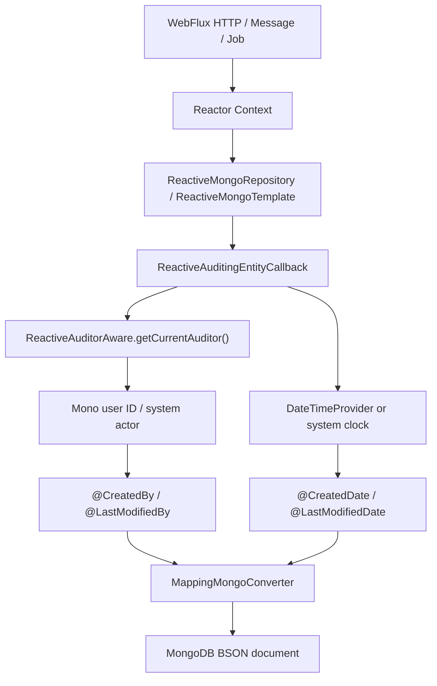
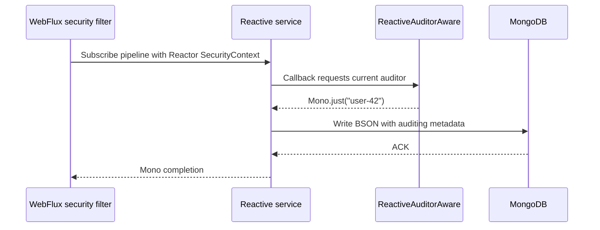
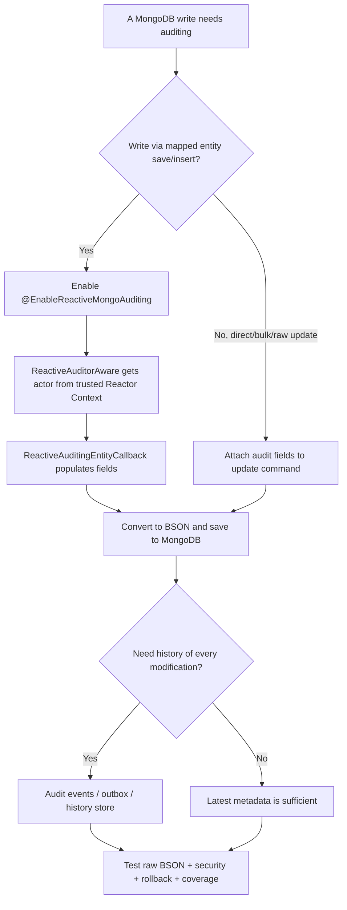

# @EnableReactiveMongoAuditing and ReactiveAuditorAware in Spring Data MongoDB

## 1. The Problem: Who Created, Who Modified, and When in a Reactive Application?

In a Spring Data MongoDB system, an order document may be created by an end user, edited by an operations staff member, updated by a message consumer, or processed by a scheduled job. Common questions arise:

- Who created the document and when?
- Who last updated the document?
- Is metadata attached **before saving**, or must it be passed manually from the controller?
- When handling requests in WebFlux, where does user identity live when execution switches threads?
- Can one auditing configuration serve both `ReactiveMongoTemplate` and `ReactiveMongoRepository`?
- Do `updateFirst`, `findAndModify`, or raw driver updates automatically populate `lastModifiedBy`?

Spring Data provides **auditing metadata** on entities through annotations:

| Annotation | Purpose | Common Java Type |
|---|---|---|
| `@CreatedBy` | Identity of the actor that created the entity | `String`, user ID / compatible value object |
| `@LastModifiedBy` | Actor that last modified the entity | Same type as `ReactiveAuditorAware<T>` |
| `@CreatedDate` | Creation timestamp of the entity | `Instant`, `Date`, and supported temporal types |
| `@LastModifiedDate` | Latest modification timestamp | `Instant` or matching temporal type |

In **reactive MongoDB**, two core components are:

1. `@EnableReactiveMongoAuditing`: enables the reactive auditing infrastructure.
2. `ReactiveAuditorAware<T>`: provides **who the current actor is** via `Mono<T>`, usually from the Reactor / Spring Security context.

This content belongs to the **Auditing** chapter within the **SPRING_DATA_MONGODB** module: connecting and mapping BSON documents, accessing data via templates/repositories, reactive access, transactions, testing, and performance. The main goal is **recording accurate audit metadata for entity save operations in a reactive pipeline**; metadata auditing must not be equated with a full audit history or security enforcement.

### 1.1. Learning Objectives

By the end of this lesson, learners will be able to:

1. Declare entities with auditing annotations and enable reactive auditing.
2. Properly implement `ReactiveAuditorAware<String>` using `ReactiveSecurityContextHolder`.
3. Explain why ThreadLocal-based `SecurityContextHolder` is unsuitable for resolving principals in a reactive chain.
4. Select `auditorAwareRef` when multiple auditing providers exist, and configure `setDates`, `modifyOnCreate`, and `dateTimeProviderRef`.
5. Understand `ReactiveAuditingEntityCallback` and the boundary between `insert/save` and update/bulk/raw commands.
6. Handle background jobs, message consumers, tenant isolation, and anonymous/missing context cases.
7. Test using `StepVerifier`, Spring Security test contexts, and real MongoDB.
8. Design transactions/retries, prevent metadata overwriting, and distinguish auditing from an append-only audit log.

## 2. How Reactive Auditing Works

### 2.1. High-Level Data Flow



When an entity is persisted through a supported mapping/callback path, the auditing infrastructure determines whether the entity is **new or existing**, obtains the auditor from `ReactiveAuditorAware`, computes timestamps, and populates metadata **before converting the entity to BSON**.

Key takeaways:

- **Auditing lives in the Spring Data layer**, not as a MongoDB server trigger.
- `@CreatedBy`/`@LastModifiedBy` require a matching auditor provider.
- `@CreatedDate`/`@LastModifiedDate` remain useful even without storing a principal; date fields do not strictly require `ReactiveAuditorAware`.
- Metadata is attached during operations that run **entity lifecycle callbacks**; not every MongoDB write invokes callbacks.
- Auditing infrastructure does not authenticate users, check authorization, or produce a complete history of all updates.

### 2.2. How Does Reactive Differ from Imperative?

| Component | Imperative MongoDB | Reactive MongoDB |
|---|---|---|
| Enable auditing | `@EnableMongoAuditing` | `@EnableReactiveMongoAuditing` |
| Current principal SPI | `AuditorAware<T>` | `ReactiveAuditorAware<T>` |
| SPI return type | `Optional<T>` | `Mono<T>` |
| Data access API | `MongoTemplate`, `MongoRepository` | `ReactiveMongoTemplate`, `ReactiveMongoRepository` |
| Typical security context | `SecurityContextHolder` | `ReactiveSecurityContextHolder` |
| Transaction context | Thread-bound resource with `MongoTransactionManager` | Reactor Context with `ReactiveMongoTransactionManager` |
| Auditing callback | `AuditingEntityCallback` | `ReactiveAuditingEntityCallback` |

Do not merely swap `MongoRepository` for `ReactiveMongoRepository` while still relying on a ThreadLocal user context inside an old `AuditorAware`. A reactive request can execute across multiple threads, carrying its context through the **Reactor Context**.

### 2.3. Data Before and After Auditing

Application creates entity:

```java
OrderDocument order = new OrderDocument("O-101", "NEW");
```

After `repository.save(order)` completes successfully, illustrative BSON:

```javascript
{
  _id: "O-101",
  status: "NEW",
  createdBy: "user-42",
  lastModifiedBy: "user-42",
  createdAt: ISODate("2026-11-20T03:00:00Z"),
  lastModifiedAt: ISODate("2026-11-20T03:00:00Z")
}
```

Timestamp and actor values here are **illustrative only**. Both last-modified fields are populated on creation under the default `modifyOnCreate = true`. Physical BSON field names can differ if using `@Field` or custom converters; do not guess mapping output solely from Java field names.

## 3. Declaring an Entity with Four Auditing Annotations

### 3.1. Persistable Entity Example

```java
import java.time.Instant;
import org.springframework.data.annotation.CreatedBy;
import org.springframework.data.annotation.CreatedDate;
import org.springframework.data.annotation.Id;
import org.springframework.data.annotation.LastModifiedBy;
import org.springframework.data.annotation.LastModifiedDate;
import org.springframework.data.annotation.Version;
import org.springframework.data.mongodb.core.mapping.Document;

@Document(collection = "orders")
public class OrderDocument {

    @Id
    private String id;

    private String tenantId;

    private String status;

    @CreatedBy
    private String createdBy;

    @LastModifiedBy
    private String lastModifiedBy;

    @CreatedDate
    private Instant createdAt;

    @LastModifiedDate
    private Instant lastModifiedAt;

    @Version
    private Long version;

    protected OrderDocument() {
    }

    public OrderDocument(String id, String status) {
        this.id = id;
        this.status = status;
    }

    public OrderDocument(
            String id, String tenantId, String status) {
        this.id = id;
        this.tenantId = tenantId;
        this.status = status;
    }

    public String getId() { return id; }
    public String getTenantId() { return tenantId; }
    public String getStatus() { return status; }
    public void setStatus(String status) {
        this.status = status;
    }
    public String getCreatedBy() { return createdBy; }
    public String getLastModifiedBy() { return lastModifiedBy; }
    public Instant getCreatedAt() { return createdAt; }
    public Instant getLastModifiedAt() { return lastModifiedAt; }
    public Long getVersion() { return version; }
}
```

In this example:

- `@Id` identifies the order; illustrative IDs like `O-101` avoid confusion between `String` and `ObjectId` when discussing BSON. The two-arg constructor is for minimal examples only; in real multi-tenant systems, use a constructor with a trusted `tenantId` and validate tenant scope before every write.
- `@Version` is optimistic-locking/version metadata **distinct** from auditing. It helps Spring Data mapping determine new/existing state and manage concurrent updates in supported operations.
- `createdBy`/`createdAt` represent creation metadata and are normally preserved when updating an entity properly recognized as existing.
- `lastModifiedBy`/`lastModifiedAt` update when saving an existing entity through auditing callbacks.
- Avoid exposing public setters for audit fields in normal API/domain flows; clients must not supply creator/modifier values.

### 3.2. Why Choosing the Right Auditor Type Matters

The generic type `T` of `ReactiveAuditorAware<T>` must match the `@CreatedBy`/`@LastModifiedBy` properties.

If the provider is:

```java
ReactiveAuditorAware<String>
```

then the audit properties should be `String`, or use an explicitly configured and tested conversion. If storing a `UUID` user ID or an `ActorRef` value object, use `ReactiveAuditorAware<UUID>`/`ReactiveAuditorAware<ActorRef>` with matching field types and mapping.

Never return an `Authentication` or JWT object when the entity only declares `String createdBy` expecting the framework to guess which property to persist. Never store raw security principals or tokens holding sensitive details inside documents.

### 3.3. Embedded Audit Metadata

Auditing fields can be grouped inside an embedded object, for example:

```java
import java.time.Instant;
import org.springframework.data.annotation.CreatedBy;
import org.springframework.data.annotation.CreatedDate;
import org.springframework.data.annotation.LastModifiedBy;
import org.springframework.data.annotation.LastModifiedDate;

public class AuditMetadata {
    @CreatedBy
    private String createdBy;
    @CreatedDate
    private Instant createdAt;
    @LastModifiedBy
    private String lastModifiedBy;
    @LastModifiedDate
    private Instant lastModifiedAt;

    protected AuditMetadata() {}
    // Getters; constructors/withers if using immutable mapping.
}
```

```java
import org.springframework.data.annotation.Id;
import org.springframework.data.mongodb.core.mapping.Document;

@Document("customer_profiles")
public class CustomerProfile {
    @Id
    private String id;
    private String displayName;
    private AuditMetadata audit;

    protected CustomerProfile() {}
    // Constructors, getters, and required business setters.
}
```

If using embedded metadata, instantiate/initialize the object in a way mapping/auditing actually supports in your Spring Data version. With immutable value objects or Java records, test mapping/callback copying instead of assuming the framework can mutate immutable objects. Physical BSON paths will look like `audit.createdBy` rather than top-level fields.

### 3.4. Auditing Does Not Rely on Property Names

`createdBy` or `updatedAt` are application-chosen names. Auditing relies on annotations or the corresponding SPI/interface, not MongoDB guessing field names. Simply declaring:

```java
private Instant updatedAt;
```

without `@LastModifiedDate` or manual callbacks gives **no reason** to expect Spring Data will update it automatically.

## 4. Enabling @EnableReactiveMongoAuditing

### 4.1. Basic Configuration

```java
import org.springframework.context.annotation.Configuration;
import org.springframework.data.mongodb.config.EnableReactiveMongoAuditing;

@Configuration
@EnableReactiveMongoAuditing
public class ReactiveAuditingConfiguration {
}
```

This annotation activates reactive auditing components in the Spring `ApplicationContext`. If entities only use date/time annotations, a user provider may not be required; however, when `@CreatedBy` or `@LastModifiedBy` is present, a matching actor source must be supplied for those fields to be populated.

`@EnableReactiveMongoAuditing` does not enable Spring Security or authentication filters, does not create MongoDB collections/indexes, and does not force driver-level writes to trigger callbacks.

### 4.2. Registering a ReactiveAuditorAware Bean

A practical configuration naming the bean explicitly:

```java
import org.springframework.context.annotation.Bean;
import org.springframework.context.annotation.Configuration;
import org.springframework.data.domain.ReactiveAuditorAware;
import org.springframework.data.mongodb.config.EnableReactiveMongoAuditing;

@Configuration
@EnableReactiveMongoAuditing(
    auditorAwareRef = "reactiveAuditorAware")
public class ReactiveAuditingConfiguration {

    @Bean("reactiveAuditorAware")
    ReactiveAuditorAware<String> reactiveAuditorAware() {
        return new SecurityContextReactiveAuditorAware();
    }
}
```

`SecurityContextReactiveAuditorAware` is implemented in section 5. The bean name in `auditorAwareRef` must match the registered bean name exactly. When only one provider exists, Spring Data can auto-detect it; specifying the name explicitly prevents ambiguity if additional providers are later added for jobs or tenants.

Do not declare two configurations both enabling reactive auditing without controlling bean definitions/callbacks. Maintain **a single clear configuration entry point** and test the active profiles.

### 4.3. Available Attributes

```java
@EnableReactiveMongoAuditing(
    auditorAwareRef = "reactiveAuditorAware",
    dateTimeProviderRef = "auditingDateTimeProvider",
    setDates = true,
    modifyOnCreate = true
)
```

| Attribute | Default Value | Purpose |
|---|---|---|
| `auditorAwareRef` | `""` | Selects a `ReactiveAuditorAware<?>` bean by name |
| `dateTimeProviderRef` | `""` | Selects a `DateTimeProvider` bean to supply timestamps |
| `setDates` | `true` | Allows auditing infrastructure to auto-populate creation/modification dates |
| `modifyOnCreate` | `true` | Also sets last-modified metadata when an entity is initially created |

These are properties on the **auditing configuration annotation**, not a MongoDB JSON Schema structure. Setting `setDates=false` stops auditing infrastructure from setting date fields even if the entity has `@CreatedDate`/`@LastModifiedDate`; the application must supply its own values if needed.

### 4.4. @EnableMongoAuditing Differs from @EnableReactiveMongoAuditing

```java
@EnableMongoAuditing
// For imperative auditing + AuditorAware.

@EnableReactiveMongoAuditing
// For reactive auditing + ReactiveAuditorAware.
```

If an application uses both `MongoTemplate` and `ReactiveMongoTemplate`, never assume enabling only one annotation activates auditing across both paths. Each stack has its own callbacks and providers. Configure both **only when both write paths genuinely exist** and test each separately to avoid inconsistent metadata.

## 5. Implementing ReactiveAuditorAware with Spring Security

### 5.1. Reading Authentication from ReactiveSecurityContextHolder

```java
import org.springframework.data.domain.ReactiveAuditorAware;
import org.springframework.security.authentication.AnonymousAuthenticationToken;
import org.springframework.security.core.Authentication;
import org.springframework.security.core.context.ReactiveSecurityContextHolder;
import reactor.core.publisher.Mono;

public final class SecurityContextReactiveAuditorAware
        implements ReactiveAuditorAware<String> {

    @Override
    public Mono<String> getCurrentAuditor() {
        return ReactiveSecurityContextHolder.getContext()
            .flatMap(context ->
                Mono.justOrEmpty(context.getAuthentication()))
            .filter(auth ->
                auth.isAuthenticated()
                && !(auth instanceof AnonymousAuthenticationToken))
            .flatMap(auth ->
                Mono.justOrEmpty(auth.getName()))
            .filter(name -> !name.isBlank());
    }
}
```

`ReactiveSecurityContextHolder.getContext()` retrieves the security context from the active subscription's **Reactor Context**. When no context or valid principal exists, the pipeline returns `Mono.empty()` instead of throwing an NPE or substituting an arbitrary user.

**Note on actor selection:** `Authentication.getName()` depends on the authentication mechanism; with JWT it may be `sub` or a mapped claim, whereas username/password login yields the username. For long-term auditing, normalize to a **stable ID immutable across display-name changes**. Avoid storing raw access tokens, full JWTs, or unnecessary email/PII.

### 5.2. Why Not Use SecurityContextHolder.getContext()?

In imperative MVC, `SecurityContextHolder` normally uses `ThreadLocal`:

```java
// ANTI-PATTERN in a reactive auditor:
Authentication auth =
    SecurityContextHolder.getContext().getAuthentication();
```

A reactive pipeline can hop between threads, and a single thread serves many subscriptions over time. `ThreadLocal` does not represent the subscriber's context reliably. Failures manifest **intermittently**: empty, wrong, or lost actors across scheduler/async boundaries.

Never stash the security principal into a global static variable or manual `ThreadLocal` to "hold onto the user"—that creates cross-request and cross-tenant security leaks.

### 5.3. isAuthenticated Alone Does Not Exclude Anonymous

In certain Spring Security configurations, an anonymous authentication token reports `authenticated=true` for some API checks. If a provider filters only by `Authentication::isAuthenticated`, an anonymous request can unexpectedly record `createdBy = "anonymousUser"`.

The provider above excludes `AnonymousAuthenticationToken`. Business policy must decide whether anonymous writes are rejected, attributed to a guest actor like `GUEST`, or given timestamps only. **`AuditorAware` is not a substitute for authorization**; controllers and security filters must still protect endpoints.

### 5.4. What If the User Lacks Write Permission?

An authenticated principal does not imply permission to modify every order. `ReactiveAuditorAware` only reports **who is authenticated**, not which `orderId`/`tenantId` they may update.

```text
Authentication succeeds
         ↓
Authorization: tenant + role + ownership
         ↓
Business mutation
         ↓
Auditing callback records the actual actor
```

Never trust `createdBy`, `lastModifiedBy`, or `tenantId` sent by the client in the body; map only validated business DTOs and take the authenticated tenant from a trusted source.

## 6. Reactor Context: Propagating the Actor Properly Across Subscriptions

### 6.1. Read from the Subscriber Context, Not at Mono Creation Time

Reactive code has two distinct phases:

1. **Assembly:** constructing the `Mono` or `Flux` pipeline.
2. **Subscription:** a subscriber triggers execution, operators read the Reactor Context, and the MongoDB driver actually runs.

Auditing must resolve the principal **at subscription time**. For example:

```java
Mono<OrderDocument> save =
    repository.save(new OrderDocument(null, "NEW"));

// At Mono assembly time we do not yet know which user
// the subscription runs for, and no database write has occurred.
```

When subscribed inside an authenticated WebFlux request, Spring Security populates the Reactive SecurityContext via its filter mechanism. `ReactiveAuditorAware` reads that context when the auditing callback executes.



Never capture a static `currentUser` when the controller constructs the publisher; if the publisher is retried, shared, or subscribed in another context, that static value can attribute the wrong user.

### 6.2. publishOn and subscribeOn Do Not Drop the Reactor Context

Example:

```java
import reactor.core.scheduler.Schedulers;

Mono<OrderDocument> flow =
    repository.save(new OrderDocument(null, "NEW"))
        .publishOn(Schedulers.parallel());
```

Reactor Context flows upstream along the reactive subscriber chain; switching schedulers with `publishOn` does not discard the context. Problems occur when:

- Calling an independent `subscribe()` inside a callback without passing context.
- Offloading work to a non-Reactor thread pool, `CompletableFuture`, or library outside the Reactor chain.
- Reading ThreadLocal `SecurityContextHolder` instead of `ReactiveSecurityContextHolder`.
- Sharing a hot publisher across multiple users/tenants without proper isolation.

Best practice is to **compose MongoDB operations with `flatMap`, `then`, `concatMap`** inside one reactive chain with a single subscription owned by the WebFlux/runtime boundary.

### 6.3. contextWrite in Tests and Trusted Tasks

In tests, you can build an `Authentication` and attach the security context:

```java
import java.util.List;
import org.springframework.security.authentication.UsernamePasswordAuthenticationToken;
import org.springframework.security.core.Authentication;
import org.springframework.security.core.authority.SimpleGrantedAuthority;
import org.springframework.security.core.context.ReactiveSecurityContextHolder;

Authentication auth =
    UsernamePasswordAuthenticationToken.authenticated(
        "user-42",
        "N/A",
        List.of(new SimpleGrantedAuthority("ROLE_USER"))
    );

Mono<OrderDocument> flow =
    repository.save(new OrderDocument(null, "NEW"))
        .contextWrite(
            ReactiveSecurityContextHolder.withAuthentication(auth));
```

This is **how you attach context cleanly in tests or a verified internal entrypoint**. Never fabricate an `Authentication` from a client header in production: if clients can arbitrarily pick `"user-42"`, auditing becomes forged data.

### 6.4. Background Jobs and Message Consumers Lack Security Context by Default

A nightly scheduled job or Kafka consumer **typically has no WebFlux SecurityContext**. When `getCurrentAuditor()` returns `Mono.empty()`, actor fields may remain unpopulated or unchanged per callback semantics, even while timestamps are still populated.

To record a system actor, resolve a **trusted job identity** at the service boundary (e.g., `"system:nightly-reconciliation"`) and propagate it via a Reactor Context key or service-account authentication mechanism.

Never default every missing user to `"system"`, as that hides context propagation bugs on authenticated user routes.

### 6.5. Reactor Context-Based Auditor for Background Jobs

An alternative provider can read the actor from an internally populated context key:

```java
import org.springframework.data.domain.ReactiveAuditorAware;
import reactor.core.publisher.Mono;

public final class ContextKeyReactiveAuditorAware
        implements ReactiveAuditorAware<String> {

    public static final String AUDIT_ACTOR_KEY = "audit.actor";

    @Override
    public Mono<String> getCurrentAuditor() {
        return Mono.deferContextual(ctx ->
            Mono.justOrEmpty(
                ctx.<String>getOrEmpty(AUDIT_ACTOR_KEY)));
    }
}
```

A **trusted internal** caller can attach:

```java
Mono<OrderDocument> job =
    repository.save(new OrderDocument(null, "PENDING_REVIEW"))
        .contextWrite(ctx ->
            ctx.put(ContextKeyReactiveAuditorAware.AUDIT_ACTOR_KEY,
                "system:nightly-reconciliation"));
```

When `ContextKeyReactiveAuditorAware` is configured, auditing uses this context key. In systems handling both WebFlux requests and background jobs, a provider can check **SecurityContext first, service actor second**; however, enforce strict boundaries so request inputs can never spoof the context key to impersonate another user.

### 6.6. When Actor Is Mandatory, Do Not Silently Skip It

A system may require every write to carry a valid actor. Here, `Mono.empty()` should be treated as an **application error** rather than silently allowed.

Example:

```java
public Mono<String> requireAuditor(
        ReactiveAuditorAware<String> auditorAware) {
    return auditorAware.getCurrentAuditor()
        .switchIfEmpty(Mono.error(
            new IllegalStateException(
                "Missing trusted audit actor")));
}
```

However, calling `requireAuditor` in one service **does not automatically enforce it across all MongoDB write paths**. To enforce a mandatory rule, establish a consistent service/callback policy, test negative cases, and optionally add a **MongoDB `$jsonSchema` validator** requiring those fields. Database validators check **field presence/type**, though they cannot verify that the actor was actually authorized.

## 7. Auditing Timestamps: @CreatedDate and @LastModifiedDate

### 7.1. Where Do Default Timestamps Come From?

Auditing obtains the current timestamp via `DateTimeProvider`. When no custom provider is configured, Spring Data auditing uses its default time mechanism per version/configuration.

`@CreatedDate` is set for new entities; `@LastModifiedDate` is set for modified entities and, under the default `modifyOnCreate=true`, is also set on initial insert.

Do not treat the automatic audit timestamp as **MongoDB server commit time**. The auditing callback executes **before the write**, typically capturing time on the application side. Between callback execution and commit there may be latency, transaction retries, or network delays.

### 7.2. Using DateTimeProvider with a Controllable Clock

```java
import java.time.Clock;
import java.time.Instant;
import java.time.temporal.TemporalAccessor;
import java.util.Optional;
import org.springframework.context.annotation.Bean;
import org.springframework.context.annotation.Configuration;
import org.springframework.data.auditing.DateTimeProvider;
import org.springframework.data.mongodb.config.EnableReactiveMongoAuditing;

@Configuration
@EnableReactiveMongoAuditing(
    auditorAwareRef = "reactiveAuditorAware",
    dateTimeProviderRef = "auditingDateTimeProvider")
public class AuditingClockConfiguration {

    @Bean
    Clock auditingClock() {
        return Clock.systemUTC();
    }

    @Bean("auditingDateTimeProvider")
    DateTimeProvider auditingDateTimeProvider(Clock clock) {
        return new DateTimeProvider() {
            @Override
            public Optional<TemporalAccessor> getNow() {
                return Optional.of(Instant.now(clock));
            }
        };
    }
}
```

This example assumes a `reactiveAuditorAware` bean is **already registered** elsewhere. In practice, do not declare multiple `@EnableReactiveMongoAuditing` configurations that register duplicate infrastructure; consolidate beans/providers into **one** primary configuration.

Crucially, `dateTimeProviderRef` references a `DateTimeProvider` (a synchronous SPI returning `Optional<TemporalAccessor>`), **not another `ReactiveAuditorAware`**. Reading the clock is instantaneous; never perform blocking network I/O inside the provider.

### 7.3. setDates and modifyOnCreate

Two examples:

```java
@EnableReactiveMongoAuditing(
    auditorAwareRef = "reactiveAuditorAware",
    modifyOnCreate = true)
// On create: populates created and lastModified metadata.
```

```java
@EnableReactiveMongoAuditing(
    auditorAwareRef = "reactiveAuditorAware",
    modifyOnCreate = false)
// On create: does not count as "modified" to populate lastModified.
```

If business rules require `lastModifiedAt` to appear **only after an update following creation**, `modifyOnCreate=false` makes sense. If audit queries expect a valid latest timestamp immediately upon creation, keep the default `true`.

`setDates=false` stops auditing from auto-populating date fields; `@CreatedBy`/`@LastModifiedBy` can still be populated. Never toggle these arbitrarily across services sharing a collection without a clear migration/contract.

### 7.4. Instant, BSON Date, and Precision

`Instant` typically maps to BSON Date at **millisecond** precision. Java `Instant.now()` may hold nanoseconds; when read back from BSON, sub-millisecond digits may be truncated.

In tests, avoid writing:

```java
assertThat(saved.getCreatedAt())
    .isEqualTo(Instant.now());
```

because a subsequent `Instant.now()` call always differs and precision may be truncated. Instead, assert a reasonable window or use `Clock.fixed(...)` truncated to BSON millisecond precision.

### 7.5. Timezones and Chronological Ordering

Store an **absolute instant** rather than a timezone-less local date/time for audit events. Convert to the user's timezone at display time. However, never treat auditing timestamps as a **global total order** across services: clocks can skew and callbacks run prior to commit.

When strict event ordering is needed, use aggregate versions, event sequences, MongoDB transaction semantics, event IDs, or logical ordering.

## 8. When Does the Auditing Callback Execute?

### 8.1. ReactiveAuditingEntityCallback Runs Before Conversion

Spring Data MongoDB uses `ReactiveAuditingEntityCallback`, a `ReactiveBeforeConvertCallback<Object>`. The callback populates audit metadata on the entity **before the entity is converted into a BSON document**.

```text
reactiveMongoRepository.save(entity)
                  |
                  v
Reactive EntityCallbacks
  └─ ReactiveAuditingEntityCallback (order 100)
                  |
                  v
MappingMongoConverter
                  |
                  v
MongoDB insert / save
```

Thus auditing is part of the **entity mapping lifecycle**. MongoDB itself knows nothing of the Java `@CreatedBy` annotation; the server simply receives mapped BSON fields.

### 8.2. insert and save on Mapped Entities

Operations that normally pass through the callback:

```java
Mono<OrderDocument> created =
    reactiveMongoTemplate.insert(new OrderDocument(null, "NEW"));

Mono<OrderDocument> saved =
    reactiveMongoTemplate.save(existingOrder);

Mono<OrderDocument> viaRepository =
    orderRepository.save(existingOrder);
```

Note these are **separate** operations; only a subscribed operation actually runs. Use `StepVerifier` or the WebFlux runtime as the subscriber. Never call `subscribe()` ad-hoc in a service just to "trigger auditing".

### 8.3. updateFirst Is Not Like save

The command:

```java
Mono<UpdateResult> result =
    reactiveMongoTemplate.updateFirst(
        Query.query(Criteria.where("id").is("O-101")),
        new Update().set("status", "PAID"),
        OrderDocument.class);
```

is a direct **update command**; it does not pass a full `OrderDocument` through `ReactiveAuditingEntityCallback` like `save(entity)`. Therefore **do not expect** `lastModifiedBy`/`lastModifiedAt` to populate automatically from annotations.

Check these paths similarly:

- `findAndModify` updating directly with `Update`.
- `updateMulti`, `upsert`, and `bulkOps`.
- Raw reactive MongoDB Java Driver `MongoCollection.updateOne`/`replaceOne`.
- MongoDB shell scripts or aggregation pipelines writing via `$merge`.
- Other services writing directly to the same collection outside Spring Data.

Not every operation flows through the domain entity lifecycle. **Audit coverage must be verified per actual write path**, not by inspecting annotations on a class.

### 8.4. Bulk Operations and Entity Lifecycle Events

Bulk operations are optimized to send batched commands and generally **do not emit entity lifecycle callbacks** like single-entity `save`. If using:

```java
reactiveMongoTemplate.bulkOps(
    org.springframework.data.mongodb.core.BulkOperations.BulkMode.UNORDERED,
    OrderDocument.class);
```

do not assume `@LastModifiedBy` handles every row automatically. Design bulk updates to attach audit fields explicitly, or apply a dedicated batch auditing strategy.

### 8.5. Callback Ordering and Custom Callbacks

Spring Data allows registering multiple `ReactiveBeforeConvertCallback` beans; the auditing callback has its own order, documented as **100** in lifecycle event docs. A custom callback running before or after can inadvertently overwrite audit fields.

If custom callbacks set metadata or transform state, specify explicit orderings and test the final raw BSON. Avoid HTTP calls or blocking I/O inside callbacks that would stall save transactions.

### 8.6. Do Not Confuse Auditing with Event Sourcing

`lastModifiedBy`/`lastModifiedAt` only record the **latest modification** under the current write mechanism, not prior versions or field diffs. A document edited 10 times holds only the latest metadata unless a separate history model exists.

If you need a history of "who changed which field, from what to what, under which request", design audit events/append-only logs/change streams/outbox with dedicated retention, tamper evidence, and access controls. Reactive auditing annotations are **insufficient** for forensic/compliance needs on their own.

## 9. Attaching Audit Fields to updateFirst and findAndModify

### 9.1. Two Strategies for Entity Mutation

When modifying an existing entity, there are two operation patterns:

**Approach A — load → modify → save.**

```java
public Mono<OrderDocument> markPaid(
        ReactiveMongoRepository<OrderDocument, String> repository,
        String orderId) {

    return repository.findById(orderId)
        .switchIfEmpty(Mono.error(
            new IllegalArgumentException("Order not found")))
        .flatMap(order -> {
            order.setStatus("PAID");
            return repository.save(order);
        });
}
```

This is an illustrative method requiring imports and external dependencies. Because it calls `save(entity)`, the auditing callback populates `lastModifiedBy` and `lastModifiedAt`. With `@Version`, optimistic locking detects concurrent updates on supported entity save paths.

Limitation: requires **at least one read and one write**; business authorization/tenant guards must still be enforced. Reading by ID alone is not proof that the user is allowed to edit it.

**Approach B — atomic update by predicate.**

```java
reactiveMongoTemplate.updateFirst(
    Query.query(Criteria.where("id").is(orderId)),
    new Update().set("status", "PAID"),
    OrderDocument.class);
```

Approach B avoids a read round-trip for the full entity and enforces atomic conditions, yet `save`'s `ReactiveAuditingEntityCallback` does not run automatically on update commands; you must supply actor/time explicitly or wrap updates in an application-level abstraction.

### 9.2. Example Atomic Update with Actor from ReactiveAuditorAware

```java
import org.springframework.data.domain.ReactiveAuditorAware;
import org.springframework.data.mongodb.core.ReactiveMongoTemplate;
import org.springframework.data.mongodb.core.query.Criteria;
import org.springframework.data.mongodb.core.query.Query;
import org.springframework.data.mongodb.core.query.Update;
import org.springframework.stereotype.Service;
import reactor.core.publisher.Mono;
import com.mongodb.client.result.UpdateResult;

@Service
public class ReactiveOrderUpdateService {
    private final ReactiveMongoTemplate template;
    private final ReactiveAuditorAware<String> auditorAware;

    public ReactiveOrderUpdateService(
            ReactiveMongoTemplate template,
            ReactiveAuditorAware<String> auditorAware) {
        this.template = template;
        this.auditorAware = auditorAware;
    }

    public Mono<UpdateResult> markPaid(
            String orderId, String trustedTenantId) {
        return auditorAware.getCurrentAuditor()
            .switchIfEmpty(Mono.error(
                new IllegalStateException(
                    "Trusted audit actor required")))
            .flatMap(actor -> {
                Query query = Query.query(
                    Criteria.where("id").is(orderId)
                        .and("tenantId").is(trustedTenantId)
                        .and("status").is("NEW"));

                Update update = new Update()
                    .set("status", "PAID")
                    .set("lastModifiedBy", actor)
                    .currentDate("lastModifiedAt");

                return template.updateFirst(
                    query, update, OrderDocument.class);
            });
    }
}
```

Here:

- `trustedTenantId` comes from an authenticated context/domain authorization, **never** from an arbitrary request header.
- The `status = "NEW"` predicate guards the transition; `getMatchedCount() == 0` must be interpreted carefully: missing document, wrong tenant, or status already changed.
- `lastModifiedBy` comes from the reactive provider, while `currentDate` tells **MongoDB server** to assign BSON Date at write time. That time can differ from `save`'s `DateTimeProvider` (typically app clock).
- `updateFirst` **does not populate `@CreatedDate`/`@CreatedBy`**, and here we intentionally avoid overwriting them.
- If `version` is used, a raw `updateFirst` does not necessarily apply the exact same optimistic-lock check as `save`. Add version predicates and increments explicitly in active write paths.

### 9.3. Updating with a Unified Clock Instead of $currentDate

If update commands should take time from the application's `Clock` (matching a custom `DateTimeProvider`), use:

```java
import java.time.Clock;
import java.time.Instant;

Instant modificationTime = Instant.now(clock);

Update update = new Update()
    .set("status", "PAID")
    .set("lastModifiedBy", actor)
    .set("lastModifiedAt", modificationTime);
```

`clock` and `actor` are trusted dependencies/values prepared beforehand. Account for clock skew across app nodes; server-side `$currentDate` aligns with the node executing the write, though it still is not a global commit timestamp across all systems.

### 9.4. Upsert Must Populate Created Metadata Too

An `upsert` can **create a new document or update an existing one**, without necessarily running an entity auditing callback. When behavior requires:

- On insert: populate `createdBy`/`createdAt`.
- On update: populate `lastModifiedBy`/`lastModifiedAt`.

use `$setOnInsert` for creation fields and `$set`/`$currentDate` for modified fields:

```java
Update update = new Update()
    .set("status", "NEW")
    .set("lastModifiedBy", actor)
    .currentDate("lastModifiedAt")
    .setOnInsert("createdBy", actor)
    .setOnInsert("createdAt", now);

Mono<UpdateResult> result =
    reactiveMongoTemplate.upsert(
        Query.query(
            Criteria.where("id").is(orderId)
                .and("tenantId").is(trustedTenantId)),
        update,
        OrderDocument.class);
```

`now` is an `Instant` provided by the application clock, computed prior to the operation. This only illustrates **an audited upsert**, not a full order state design: populate `tenantId`/required business fields, check unique indexes, and understand how the query predicate behaves when inserting.

To make `createdAt` and `lastModifiedAt` match on insert, use the same instant or server expressions with compatible semantics instead of mixing app clock and server clock blindly.

### 9.5. Bulk Updates Need Their Own Abstraction

A job updating 10,000 documents with bulk operations may not invoke `ReactiveAuditingEntityCallback` per entity. Therefore:

1. Define the job's actor (`system:cleanup-job`, from a trusted source).
2. Attach modified metadata to **each update command**.
3. Preserve `createdBy`/`createdAt`.
4. Handle unmatched documents caused by optimistic version guards.
5. Inspect raw BSON post-bulk and verify error/partial-success semantics.

Do not simply add `@LastModifiedDate` and claim bulk updates are fully audited.

### 9.6. When to Choose save vs. update?

| Need | Approach | Things to Note |
|---|---|---|
| Mutate entity through domain model with callbacks | `findById → modify → save` | Handle concurrency and tenant guards |
| Update a few fields atomically by predicate | `updateFirst`/`findAndModify` | Attach audit fields explicitly |
| Upsert to create or modify | `upsert` + `setOnInsert` | Separate create vs. modify metadata |
| Bulk migration | Bulk commands + explicit audit fields | Do not assume callbacks run |
| Raw MongoDB driver/`mongosh` | Update BSON fields directly | No Spring auditing |
| Full history of all changes required | Audit events/outbox/change stream | Four annotations are not enough |

## 10. Auditing in Reactive Transactions

### 10.1. Transactions Do Not Create Principals

`ReactiveMongoTransactionManager` coordinates multiple MongoDB operations within one session/transaction context. It **does not** know who the authenticated actor is unless `ReactiveAuditorAware` can resolve the principal from Reactor/Security context.

A transaction can commit successfully with a null audit actor if no principal exists and the model permits nulls. Treat this as a **coverage gap** if the product requires every write to have an actor.

### 10.2. Configuring the Transaction Manager and Operator

```java
import com.mongodb.ReadConcern;
import com.mongodb.TransactionOptions;
import com.mongodb.WriteConcern;
import org.springframework.beans.factory.annotation.Qualifier;
import org.springframework.context.annotation.Bean;
import org.springframework.context.annotation.Configuration;
import org.springframework.data.mongodb.ReactiveMongoDatabaseFactory;
import org.springframework.data.mongodb.ReactiveMongoTransactionManager;
import org.springframework.transaction.ReactiveTransactionManager;
import org.springframework.transaction.reactive.TransactionalOperator;

@Configuration
public class MongoTransactionConfiguration {

    @Bean("reactiveMongoTransactionManager")
    ReactiveMongoTransactionManager transactionManager(
            ReactiveMongoDatabaseFactory factory) {
        TransactionOptions options = TransactionOptions.builder()
            .readConcern(ReadConcern.SNAPSHOT)
            .writeConcern(WriteConcern.MAJORITY)
            .build();
        return new ReactiveMongoTransactionManager(factory, options);
    }

    @Bean("mongoTx")
    TransactionalOperator mongoTx(
            @Qualifier("reactiveMongoTransactionManager")
            ReactiveTransactionManager manager) {
        return TransactionalOperator.create(manager);
    }
}
```

This is an illustrative transaction configuration requiring a MongoDB deployment that supports transactions. Spring Boot may already configure the client/factory; avoid creating duplicate transaction managers unnecessarily. `ReadConcern.SNAPSHOT` and majority writes illustrate consistency choices, not mandatory settings for all auditing updates.

### 10.3. Two Entity Saves in the Same MongoDB Transaction

Suppose you must persist an order and a custom audit intent document on the **same deployment**:

```java
import org.springframework.data.mongodb.core.ReactiveMongoTemplate;
import org.springframework.transaction.reactive.TransactionalOperator;
import reactor.core.publisher.Mono;

public Mono<OrderDocument> createWithAuditIntent(
        ReactiveMongoTemplate template,
        TransactionalOperator mongoTx,
        OrderDocument order,
        AuditIntent intent) {

    return template.insert(order)
        .flatMap(saved ->
            template.insert(intent).thenReturn(saved))
        .as(mongoTx::transactional);
}
```

`AuditIntent` is a custom entity designed and defined by the application for that workflow, not a Spring Data annotation. Significance of this example:

- `insert(order)` passes through the entity auditing callback.
- `insert(intent)` is another write in the same MongoDB transaction.
- If inserting `intent` fails and aborts the transaction, the order insert does not commit either.
- The audit actor comes from Reactor Context when propagated to the subscription.
- Never place HTTP calls or Kafka publishes inside a transaction expecting MongoDB to roll back their side effects.

### 10.4. Transaction Retries Can Re-Run Auditing Callbacks

If a write conflict aborts the first attempt, retrying the whole transaction **re-executes auditing callbacks** on the next attempt. Consequences:

- `lastModifiedAt` may change between attempts because the callback grabs a fresh timestamp.
- `ReactiveAuditorAware` is invoked again against the subscription context.
- Never trigger external HTTP/Kafka messages inside an audit callback, since an aborted attempt may have already produced external side effects.
- If business logic needs a stable event ID across retries, generate the idempotency key **in the business command**, not inside a per-attempt callback.

Retrying after an **`UnknownTransactionCommitResult`** is not automatically safe just because transactions carry audit fields; reconcile via command IDs and unique keys.

### 10.5. Never Manually Subscribe in Parallel Inside a Transaction

```java
// ANTI-PATTERN:
template.save(order)
    .doOnNext(x -> template.insert(intent).subscribe())
    .as(mongoTx::transactional);
```

A side `subscribe()` creates an independent pipeline with no guarantee of sharing the session, is not awaited by the transaction operator, and may execute outside/after commit. Chain sequentially using `flatMap` or `then` as in section 10.3.

Do not use `Mono.when(saveOrder, saveIntent)` to run MongoDB writes **in parallel** on the same transaction session if the driver/server does not support concurrent operations per session; prefer sequential composition.

### 10.6. Reactive and Imperative Managers Are Not Interchangeable

| Operation | Matching Transaction Manager |
|---|---|
| `ReactiveMongoTemplate`/reactive repository | `ReactiveMongoTransactionManager` |
| `MongoTemplate`/imperative repository | `MongoTransactionManager` |
| Reactive SQL (R2DBC) | `R2dbcTransactionManager` or matching R2DBC manager |
| Imperative JDBC/SQL | `DataSourceTransactionManager`/`JdbcTransactionManager` |

Using `@Transactional` with the wrong manager does not make a reactive MongoDB pipeline transactional. Local MongoDB transactions also do not span SQL or Kafka. When coordinating multiple resources, use outbox/saga/idempotency rather than relying on auditing annotations for distributed consistency.

## 11. Auditing, Optimistic Locking, and Protecting Correctness

### 11.1. Auditing Does Not Prevent Lost Updates

Two requests read the same order in state `NEW`:

```text
Request A: NEW -> PAID
Request B: NEW -> CANCELLED
```

If both call `save` without a concurrency guard, the later update can overwrite the earlier one; `lastModifiedBy` simply shows whoever wrote last, hiding the conflict. `@Version` detects stale entities on supported mapping operations.

### 11.2. How @Version Works Alongside Auditing

The entity in section 3 declares:

```java
@Version
private Long version;
```

During `save`, Spring Data MongoDB includes the version in the query/update to detect optimistic locking failures. On mismatch, it throws `OptimisticLockingFailureException` and the operation is rejected.

Do not mistake `@Version` for an audit history log; it is solely **concurrent-update metadata**. Nor do audit fields replace optimistic lock predicates.

### 11.3. updateFirst Must Check Version Explicitly When Needed

Example:

```java
Query optimistic = Query.query(
    Criteria.where("id").is(orderId)
        .and("tenantId").is(trustedTenantId)
        .and("version").is(expectedVersion));

Update update = new Update()
    .set("status", "PAID")
    .set("lastModifiedBy", actor)
    .currentDate("lastModifiedAt")
    .inc("version", 1L);
```

This only builds `Query`/`Update`; the caller must execute `template.updateFirst(...)` and assert `matchedCount == 1`. Never update version inconsistently across write paths, or optimistic-locking semantics break.

### 11.4. createdBy Is Not a Default Owner/Authorization Field

`createdBy` records **who created the document**; it does not necessarily mean current owner. An order might be created by a customer, assisted by an agent, or transferred through an approved workflow. Never use:

```java
Criteria.where("createdBy").is(currentUser)
```

as a blanket authorization rule unless your domain strictly defines "creator is always sole owner". Maintain `tenantId`, `ownerId`, and independent access policies; use auditing to record **the acting principal**, not to define access control.

### 11.5. Last Modified Metadata Does Not Guarantee Business State Actually Changed

`save(entity)` can be called even when no business fields changed; the audit callback still updates modified timestamp/actor. Therefore `lastModifiedAt` does not prove a meaningful field changed.

If you only want audit fields updated when business state genuinely changes, enforce that at the domain/service layer (dirty checking, change detection, versions, or conditional updates) and test explicitly. Do not assume MongoDB auditing diffs objects and skips no-op saves.

## 12. Testing ReactiveAuditorAware with StepVerifier

### 12.1. Unit Test: Principal Present in Reactor SecurityContext

Test the provider independently before wiring a database:

```java
import java.util.List;
import org.junit.jupiter.api.Test;
import org.springframework.security.authentication.UsernamePasswordAuthenticationToken;
import org.springframework.security.core.Authentication;
import org.springframework.security.core.authority.SimpleGrantedAuthority;
import org.springframework.security.core.context.ReactiveSecurityContextHolder;
import reactor.test.StepVerifier;

class SecurityContextReactiveAuditorAwareTest {

    private final SecurityContextReactiveAuditorAware provider =
        new SecurityContextReactiveAuditorAware();

    private static Authentication auth(String userId) {
        return UsernamePasswordAuthenticationToken.authenticated(
            userId,
            "N/A",
            List.of(new SimpleGrantedAuthority("ROLE_USER")));
    }

    @Test
    void resolvesAuthenticatedUserFromReactorContext() {
        StepVerifier.create(
                provider.getCurrentAuditor()
                    .contextWrite(
                        ReactiveSecurityContextHolder
                            .withAuthentication(auth("user-42"))))
            .expectNext("user-42")
            .verifyComplete();
    }

    @Test
    void hasNoAuditorWhenSecurityContextIsAbsent() {
        StepVerifier.create(provider.getCurrentAuditor())
            .verifyComplete();
    }
}
```

This test confirms the provider **reads Reactor Context properly**, not that MongoDB actually wrote fields to a document. Nor does it prove the user is authorized to edit any document; test authorization separately.

### 12.2. Testing Anonymous Actors

In an environment with Spring Security:

```java
import org.springframework.security.authentication.AnonymousAuthenticationToken;
import org.springframework.security.core.authority.AuthorityUtils;

var anonymous = new AnonymousAuthenticationToken(
    "test-key",
    "anonymousUser",
    AuthorityUtils.createAuthorityList("ROLE_ANONYMOUS"));

StepVerifier.create(
        provider.getCurrentAuditor()
            .contextWrite(
                ReactiveSecurityContextHolder
                    .withAuthentication(anonymous)))
    .verifyComplete();
```

This is a **test method body** reusing `provider` from section 12.1. Because the provider filters out anonymous tokens, it returns `Mono.empty()`. If the product wants to audit anonymous actions, design a dedicated actor policy instead of removing the filter to grant anonymous writes implicitly.

### 12.3. Testing Context Key for Jobs

```java
import reactor.test.StepVerifier;

ContextKeyReactiveAuditorAware jobAuditor =
    new ContextKeyReactiveAuditorAware();

StepVerifier.create(
        jobAuditor.getCurrentAuditor()
            .contextWrite(ctx ->
                ctx.put(
                    ContextKeyReactiveAuditorAware.AUDIT_ACTOR_KEY,
                    "system:reconciliation")))
    .expectNext("system:reconciliation")
    .verifyComplete();
```

Never populate this key from an unauthenticated request header. A context key is a **data-transport mechanism**, not an identity credential.

## 13. Integration Test: Audit Fields Actually Saved in BSON

### 13.1. Infrastructure Setup

An integration test should use:

- A dedicated test MongoDB with the reactive driver.
- A Spring test context with `@EnableReactiveMongoAuditing` and the right `ReactiveAuditorAware<String>` bean.
- A real, non-mocked `OrderRepository`.
- `ReactiveMongoTemplate` to read raw BSON.
- `StepVerifier` as the subscriber for `Mono`/`Flux`.

Repository:

```java
import org.springframework.data.mongodb.repository.ReactiveMongoRepository;

public interface OrderRepository
        extends ReactiveMongoRepository<OrderDocument, String> {
}
```

In tests, generate fresh IDs per run to avoid wiping shared data. Never run `dropCollection` on production or shared development databases. If a Spring Boot test slice does not auto-scan reactive auditing config, `@Import` the configuration explicitly or use `@SpringBootTest` with a test profile.

### 13.2. Testing Repository Insert with Actor user-42

```java
import java.util.Date;
import java.util.List;
import java.util.UUID;

import com.mongodb.client.model.Filters;
import org.bson.Document;
import org.junit.jupiter.api.Test;
import org.springframework.beans.factory.annotation.Autowired;
import org.springframework.boot.test.context.SpringBootTest;
import org.springframework.data.mongodb.core.ReactiveMongoTemplate;
import org.springframework.security.authentication.UsernamePasswordAuthenticationToken;
import org.springframework.security.core.Authentication;
import org.springframework.security.core.authority.SimpleGrantedAuthority;
import org.springframework.security.core.context.ReactiveSecurityContextHolder;
import reactor.core.publisher.Mono;
import reactor.test.StepVerifier;

import static org.assertj.core.api.Assertions.assertThat;

@SpringBootTest
class ReactiveAuditingIntegrationTest {

    @Autowired
    OrderRepository orders;

    @Autowired
    ReactiveMongoTemplate template;

    private static Authentication auth(String id) {
        return UsernamePasswordAuthenticationToken.authenticated(
            id,
            "N/A",
            List.of(new SimpleGrantedAuthority("ROLE_USER")));
    }

    private Mono<Document> raw(String id) {
        return template.getCollection("orders")
            .flatMap(collection ->
                Mono.from(
                    collection.find(Filters.eq("_id", id))
                        .first()));
    }

    @Test
    void savePopulatesActorAndDates() {
        String orderId = "AUD-" + UUID.randomUUID();
        OrderDocument order = new OrderDocument(
            orderId, "T-TEST", "NEW");

        StepVerifier.create(
                orders.save(order)
                    .contextWrite(
                        ReactiveSecurityContextHolder
                            .withAuthentication(auth("user-42"))))
            .assertNext(saved -> {
                assertThat(saved.getCreatedBy())
                    .isEqualTo("user-42");
                assertThat(saved.getLastModifiedBy())
                    .isEqualTo("user-42");
                assertThat(saved.getCreatedAt()).isNotNull();
                assertThat(saved.getLastModifiedAt()).isNotNull();
            })
            .verifyComplete();

        StepVerifier.create(raw(orderId))
            .assertNext(doc -> {
                assertThat(doc.getString("createdBy"))
                    .isEqualTo("user-42");
                assertThat(doc.getString("lastModifiedBy"))
                    .isEqualTo("user-42");
                assertThat(doc.get("createdAt"))
                    .isInstanceOf(Date.class);
                assertThat(doc.get("lastModifiedAt"))
                    .isInstanceOf(Date.class);
            })
            .verifyComplete();
    }

    @Test
    void secondSaveKeepsCreatorAndUpdatesModifier() {
        String orderId = "AUD-" + UUID.randomUUID();

        Mono<OrderDocument> firstSave =
            orders.save(new OrderDocument(
                    orderId, "T-TEST", "NEW"))
                .contextWrite(
                    ReactiveSecurityContextHolder
                        .withAuthentication(auth("creator-1")));

        Mono<OrderDocument> secondSave =
            firstSave.flatMap(saved -> {
                saved.setStatus("PAID");
                return orders.save(saved)
                    .contextWrite(
                        ReactiveSecurityContextHolder
                            .withAuthentication(auth("agent-7")));
            });

        StepVerifier.create(secondSave)
            .assertNext(saved -> {
                assertThat(saved.getStatus())
                    .isEqualTo("PAID");
                assertThat(saved.getCreatedBy())
                    .isEqualTo("creator-1");
                assertThat(saved.getLastModifiedBy())
                    .isEqualTo("agent-7");
                assertThat(saved.getCreatedAt()).isNotNull();
                assertThat(saved.getLastModifiedAt())
                    .isNotNull();
            })
            .verifyComplete();
    }
}
```

These tests assume the **default auditing configuration** (`setDates=true`, `modifyOnCreate=true`). If the project sets `modifyOnCreate=false`, the insert test should expect last-modified metadata to be absent. If a custom `ReactiveAuditorAware` uses a type other than `String`, adjust assertions accordingly.

**Important note:** this example checks fields immediately after save. Never treat an in-memory `OrderDocument` mutated by a callback as sole proof of BSON; that is why the test adds `raw(orderId)` via the reactive driver's `MongoCollection.find`. Raw BSON field names here omit `@Field`; if `@Field("created_by")` is added, query the actual physical field name.

### 13.3. Testing Whether the Callback Runs on updateFirst

After creating an order with `creator-1` auditing metadata, execute:

```java
Mono<UpdateResult> update =
    template.updateFirst(
        Query.query(Criteria.where("id").is(orderId)),
        new Update().set("status", "PAID"),
        OrderDocument.class);
```

This code runs **inside a test or service** with `template`, `orderId`, and appropriate `UpdateResult`/`Query`/`Criteria`/`Update` imports. Upon subscribing and reading raw BSON, you will see the command itself **does not declare** updating `lastModifiedBy`/`lastModifiedAt`; the entity auditing callback does not fire as it does on `save`.

For stricter testing:

1. Seed an order with `lastModifiedBy = "creator-1"`.
2. Run `updateFirst` with only `$set status` under `agent-7`'s context.
3. Read the raw doc; verify `lastModifiedBy` remains `creator-1` (did not auto-switch to `agent-7`).
4. Run `ReactiveOrderUpdateService.markPaid` on a similar order and verify audit fields populated by the **explicit update command**.

Asserting only that `status` changed without inspecting audit fields misses auditing coverage gaps.

### 13.4. Testing Missing Reactor SecurityContext

```java
StepVerifier.create(
        orders.save(new OrderDocument(
            "AUD-" + UUID.randomUUID(),
            "T-TEST", "NEW")))
    .assertNext(saved -> {
        // With provider returning Mono.empty() when context is absent,
        // it must not infer "user-42".
        assertThat(saved.getCreatedBy()).isNull();
        assertThat(saved.getCreatedAt()).isNotNull();
    })
    .verifyComplete();
```

In setups requiring a mandatory actor (per custom policy/callback), the right expectation is **onError/rollback**, not saving a document without `createdBy`. Tests reflect **the policy chosen by the project**; there is no single universal rule for every domain.

### 13.5. Choosing the Right Test MongoDB

- Standalone MongoDB may suffice for basic create/save auditing tests, though it cannot verify transactions or failovers.
- To test reactive transactions with auditing, use a compatible test replica set deployment.
- `DateTimeProvider` tests should use `Clock.fixed` in a test-specific config and compare milliseconds against BSON Date.
- Spring Security test context can be injected via `ReactorContextTestExecutionListener` or `contextWrite` depending on test type and framework version.
- Never use `Thread.sleep(...)` to "wait for auditing to finish": publisher completion is the proper synchronization signal unless custom background side effects exist.

## 14. Security and Limitations of Audit Metadata

### 14.1. Whoever Supplies the Auditor Is the Trust Boundary

`ReactiveAuditorAware` returns an actor, without verifying the request is legitimate. Never use directly:

```java
// ANTI-PATTERN:
Mono.just(request.getHeader("X-Actor-Id"));
```

if the header comes from an untrusted client. That allows callers to write `createdBy = "admin"`. The actor must originate from an authenticated principal, trusted service account, or a context produced by a trusted security/worker layer.

### 14.2. Actor ID, Tenant ID, and Permissions Are Three Separate Concepts

| Attribute | Question Answered | Example |
|---|---|---|
| `actorId` / `createdBy` | Who created/modified? | `user-42` |
| `tenantId` | Which tenant owns the data? | `T-A` |
| Role / authorization | Is the actor permitted to perform this action? | `ORDER_WRITE` |

A valid audit actor does not mean the actor is allowed to write every document. Update queries must scope by tenant/ownership and protect business invariants; auditing provides identity attribution, not access control.

### 14.3. Avoid Storing Sensitive Information in Audit Fields

Never store:

- Raw JWTs, access tokens, or refresh tokens.
- Passwords, OAuth client secrets, or credentials.
- Serialized `Authentication` or `SecurityContext` objects.
- Emails, addresses, or IPs unless strictly required with a clear legal/retention basis.

Prefer a stable user or service ID. When IP or device metadata is needed for security auditing, store it in a dedicated **audit event model** with explicit policies instead of attaching it to every business document.

### 14.4. Do Not Treat createdBy as Immutable Data

Spring auditing is purely application-layer logic. Anyone with raw MongoDB write access or services bypassing callbacks can modify `createdBy`/`createdAt` unless database-level policies and restrictions exist.

For strict forensic/compliance requirements, consider:

- Least-privilege roles for database users.
- Append-only audit events with retention and restricted edit/delete permissions.
- Write-once/immutable storage or tamper-evident hashing where necessary.
- Separating read permissions for audit logs from regular business data access.
- Log retention/backup, clock synchronization, and event correlation.

MongoDB JSON Schema can require audit fields to be present with specific types, yet it cannot verify real user identity or block all post-creation metadata alterations.

### 14.5. Handling Deleted or Renamed Users

If `createdBy` stores a mutable username, tracing becomes difficult over time. If a user is deleted, an embedded user object becomes stale or retains PII past retention rules.

Prefer stable actor IDs with a lookup/tombstone policy. Consider legal requirements around erasing or anonymizing personal identifiers while preserving audit trails as required. Never embed full user profiles inside every document merely to display the modifier's name.

## 15. Advanced: Multiple Auditor Providers, Immutable Entities, and Context Lifecycle

### 15.1. When Multiple ReactiveAuditorAware Beans Exist

An application might define:

```java
@Bean("securityReactiveAuditor")
ReactiveAuditorAware<String> securityReactiveAuditor() {
    return new SecurityContextReactiveAuditorAware();
}

@Bean("jobReactiveAuditor")
ReactiveAuditorAware<String> jobReactiveAuditor() {
    return new ContextKeyReactiveAuditorAware();
}
```

If both live in the same context, specify:

```java
@EnableReactiveMongoAuditing(
    auditorAwareRef = "securityReactiveAuditor")
```

`auditorAwareRef` picks **one provider** for the auditing infrastructure. It **does not** route provider A for HTTP requests and provider B for jobs based on request type. If combined logic is needed, write a single `ReactiveAuditorAware` with explicit actor precedence, or separate configurations/processes by allowed boundary.

Never create a broad `"system"` fallback that masks missing SecurityContexts for real user requests.

### 15.2. ReactiveAuditorAware Returns Mono<T>, Never Block

```java
// ANTI-PATTERN in reactive auditor:
User user = reactiveUserRepository.findById(userId).block();
return Mono.just(user.getId());
```

Blocking inside a reactive callback risks deadlocks, high latency, or exceptions on non-blocking event loops. If you truly must look up actor metadata, **compose with reactive operators** while watching performance and avoiding recursive callbacks:

```java
return ReactiveSecurityContextHolder.getContext()
    .flatMap(context ->
        Mono.justOrEmpty(context.getAuthentication()))
    .filter(Authentication::isAuthenticated)
    .flatMap(auth -> Mono.justOrEmpty(auth.getName()))
    .flatMap(actorId ->
        identityRepository.findStableId(actorId));
```

`identityRepository` here is an illustrative application API. This query adds an extra read **on every save**; apply safe caching, timeouts, and resilience in case the identity store slows down. If resolving the actor also saves an audited entity, it can create an **auditing cycle**. A cleaner design is placing the stable user ID inside the trusted authentication principal rather than hitting a database during every audit.

### 15.3. Immutable Classes, Java Records, and Withers

If an entity uses a Java record or immutable fields:

```java
@Document("read_models")
public record ReadModel(
    @Id String id,
    String value,
    @CreatedBy String createdBy,
    @CreatedDate Instant createdAt
) {}
```

Spring Data supports several immutable mapping patterns depending on version, yet auditing must **produce a new entity instance** or use compatible property access/constructors to populate values. Never assume every record, Lombok `@Value`, or custom constructor gets audited merely because the Java compiles.

Write integration tests to verify:

- Audit fields are populated before conversion.
- The repository returns the audited entity (or updated instance).
- Raw BSON holds the values.
- No errors occur in constructor binding, `with...` methods, or accessors.

For domain models heavy on immutable types, isolate audit metadata in a type compatible with constructor mapping and test against your specific Spring Data version.

### 15.4. Reactive Auditing and Multiple Publishers in One HTTP Request

A single request might execute:

```java
Mono<OrderDocument> create =
    repository.save(order);

Mono<OrderDocument> modify =
    create.flatMap(saved -> {
        saved.setStatus("PAID");
        return repository.save(saved);
    });
```

If `modify` is subscribed under one consistent security context, both callbacks record **the same actor**. If code attaches a different context to one branch, the actor can differ even within the same HTTP request. Use such context overrides deliberately, never letting the repository layer switch actors arbitrarily.

**Every subscription has its own context.** Never hold a DB-writing `Mono` in a singleton bean shared/cached across different users; that risks cross-tenant leaks and inaccurate auditing metadata.

### 15.5. Transaction Retries and Idempotency Differ from Auditing

When a reactive transaction wraps `retryWhen` outside the transaction boundary, entity save callbacks can re-run. Consequently:

- Audit dates can change across retries; that does not mean two commits occurred.
- The audit actor is re-resolved from context; never source user identity from mutable global state.
- A fresh event ID generated inside a callback on each attempt is not a stable idempotency key.
- `@CreatedDate` does not replace unique request keys/`@Version` for deduplication.
- `UnknownTransactionCommitResult` errors must be handled using transaction guidance and idempotent outcome lookups, rather than assuming the workflow never committed.

Auditing is designed to **attach metadata**, not to resolve commit ambiguity or provide exactly-once event delivery.

### 15.6. Clock Providers and Multi-Region Deployments

Across multiple regions or pods, `Clock.systemUTC()` standardizes the timezone yet **does not guarantee all hosts have synchronized clocks**. Manage clock synchronization and monitor drift. Distinguish between:

- `createdAt` generated by the app's auditing callback.
- `lastModifiedAt` set by server-side `$currentDate` in atomic updates.
- `operationTime`/cluster timestamps from MongoDB.
- `businessOccurredAt` inside business events.

These timestamps carry different semantics; never compare them naively to declare an ordering violation over a few milliseconds of clock skew or I/O latency.

## 16. Performance and Observability of Reactive Auditing

### 16.1. Expensive Auditor Lookups Slow Down Every Save

If every `ReactiveAuditorAware.getCurrentAuditor()` call hits an external identity API, all saves become coupled to that service's latency. Auditing callbacks sit directly on the hot write path.

Prefer an authenticated principal already carrying a stable actor ID. If lookup is unavoidable:

- Use a truly non-blocking reactive API.
- Cache with TTL and proper tenant isolation.
- Enforce deadlines and a clear fallback/failure policy if the identity service is unavailable.
- Never return a fabricated actor when identity cannot be verified.
- Avoid circular dependencies where identity lookups trigger auditing themselves.

### 16.2. Metrics to Monitor

| Metric | Meaning |
|---|---|
| `audit_actor_resolve_count` | Number of auditor resolutions |
| `audit_actor_missing_count` | Saves lacking a valid actor |
| `audit_actor_latency_p95` | Provider latency, especially for remote lookups |
| `audit_callback_error_count` | Errors thrown inside callbacks |
| `mongo_save_duration_p95` | Overall save latency |
| `audit_raw_update_without_metadata_count` | Update paths requiring audit that omitted fields |
| `audit_background_actor_count` | Saves attributed to service accounts/jobs |
| `audit_clock_skew_warnings` | Alerts for anomalous timestamps |
| `audit_history_delivery_lag` | Lag if running a separate outbox/change-stream audit history |
| `audit_tenant_mismatch_attempts` | Writes targeting the wrong tenant scope or failing access guards |

Metric names are illustrative. More importantly, distinguish **missing-auditor errors** from **MongoDB save errors**. When an auditor silently returns `Mono.empty()`, looking only at error rates can hide low audit coverage.

### 16.3. Never Log Raw Authentication or Entities on Failure

When an auditing callback fails, logs should include:

```text
requestId / traceId
operation: INSERT / SAVE / UPDATE
collection
actorResolution: PRESENT / MISSING / ERROR
actorType: USER / SERVICE / JOB (if trusted)
tenantScope: permitted token or ID per policy
errorClass
elapsedMs
```

Never log raw JWTs, passwords, full user profiles, or full BSON documents containing personal data. Apply redaction/tokenization for sensitive tenant details.

### 16.4. Do Not Indiscriminately Index Auditing Metadata

Having `createdBy`/`lastModifiedAt` on a collection does not mean every field should be indexed. Indexes add overhead to writes, storage, and replication.

Only when dashboards genuinely filter by user and time:

```javascript
db.orders.createIndex(
  { tenantId: 1, lastModifiedBy: 1, lastModifiedAt: -1 },
  { name: "ix_tenant_actor_modified" }
);
```

Benchmark with `explain("executionStats")` on realistic workloads, considering cardinality, index size, and tenant filtering. `@EnableReactiveMongoAuditing` **does not auto-create indexes** for audit fields.

### 16.5. Retries Do Not Fix Principal Failures

`ReactiveAuditorAware` may fail because the security context was dropped or the identity service is down. Retrying the entire Mongo transaction only adds load without making a principal appear.

Classify errors:

- **Missing authenticated context:** usually a wiring/security-boundary bug; do not retry the MongoDB save endlessly.
- **Temporary identity service failure:** bounded retries on the lookup may help if allowed, without holding a MongoDB transaction open across remote calls.
- **Database transient transaction error:** retry the whole transaction per guidelines with idempotency/commit-ambiguity policies.
- **Business authorization failure:** reject immediately without retrying.

### 16.6. Auditing Callbacks Are on the Hot Path, Not the Sole Security Hook

Applications often have multiple write paths: repositories, templates, raw drivers, batches, scripts, aggregation `$merge`. If compliance requires an actor on every write:

1. Inventory all writers.
2. Standardize repository/service APIs for operations needing auditing.
3. Add integration tests for each write type.
4. Consider schema validators and database permissions.
5. Monitor non-callback write paths explicitly.

Never treat an auditing callback as an **unbypassable security reference monitor**.

## 17. Common Auditing Troubleshooting

### 17.1. Symptom Table

| Symptom | Common Cause | How to Check / Fix |
|---|---|---|
| `createdBy` always null while `createdAt` is populated | Missing provider, provider returns `Mono.empty()`, or missing security context | Check bean and context at subscription time |
| `@EnableReactiveMongoAuditing` present yet actor still null | Wrong provider type (`AuditorAware`), wrong `auditorAwareRef`, or callback skipped | Verify bean type and lifecycle |
| Actor becomes `anonymousUser` | Checked `isAuthenticated` without excluding anonymous | Filter out `AnonymousAuthenticationToken` |
| Actor works in controller yet null in service | Lost Reactor Context from detached subscription | Compose chain; use `ReactiveSecurityContextHolder` |
| Actor occasionally wrong under load | Unsafe static/ThreadLocal/shared context | Remove mutable global state; test concurrent users |
| Background job lacks actor | No HTTP SecurityContext | Use trusted service identity and dedicated context key |
| `lastModifiedAt` unchanged after `updateFirst` | Update command bypasses save callbacks | Attach audit fields inside `Update` |
| Bulk update lacks actor | Bulk API skips save-style entity callbacks | Explicitly set audit fields per bulk update |
| `lastModifiedAt` populated immediately on insert | `modifyOnCreate=true` default | Set `modifyOnCreate=false` if undesired |
| Dates are not populated automatically | `setDates=false`, wrong provider, or unsupported field type | Inspect configuration and time mapping |
| Millisecond mismatch on readback | BSON Date millisecond precision | Normalize precision; use fixed Clock in tests |
| Wrong provider picked or ambiguous | Multiple `ReactiveAuditorAware` beans | Specify `auditorAwareRef` explicitly |
| Immutable entity does not receive audit values | Incompatible mapping/constructor/wither | Test entity callback and raw BSON |
| `save` fails with optimistic-lock error | `@Version` mismatch due to concurrent writer | Reload and resolve conflict safely |
| `createdBy` overwritten during update | Entity misclassified as new or manually overwritten | Check `@Id`, `@Version`, `isNew` detection, and code |
| Audit dates valid yet user accessed wrong tenant | Authorization skipped tenant check | Enforce tenant scope before updating |
| Audit actor present yet no history of edits | Four metadata fields keep only latest values | Use append-only audit events/change stream/outbox |
| `@EnableMongoAuditing` only works on imperative writes | Wrong auditing mode for reactive stack | Enable `@EnableReactiveMongoAuditing` and test reactive |
| `@Transactional` saves Mongo doc yet raw driver write lacks context | Raw driver/session not wired into transaction | Use template/repository in transaction or wire session |
| Audit callbacks slow down every save | Provider lookup makes HTTP/DB calls each time | Resolve stable actor ID from security principal |

### 17.2. Layer-by-Layer Debugging Process

1. **Entity metadata:** are `@CreatedBy`/`@LastModifiedBy`/`@CreatedDate`/`@LastModifiedDate` from the right package? Do types match the provider?
2. **Configuration:** is `@EnableReactiveMongoAuditing` component-scanned? Does `auditorAwareRef` match the bean name? What are `setDates`/`modifyOnCreate`?
3. **Security context:** does the request have an authenticated principal? Does `ReactiveSecurityContextHolder` hold a context inside the active subscription?
4. **Write path:** is code calling `save/insert` via mapping callbacks or `updateFirst`/bulk/raw driver?
5. **Entity newness:** how does Spring Data determine new vs. existing? Could `@Id`, `@Version`, or custom `Persistable` mislead it?
6. **Persistence layer:** does raw BSON hold the expected field names and types? Did `@Field` or custom converters change representation?
7. **Concurrency/transactions:** was there an optimistic-lock conflict, transaction abort, or retry where callbacks ran before commit failed?
8. **Coverage monitoring:** do jobs/batches set their own audit fields? Are external writers modifying the collection?

Never try to fix everything by adding `@EnableMongoAuditing` or defaulting `createdBy="system"`. First pinpoint which layer dropped the actor or bypassed the callback.

### 17.3. Distinguishing "Null Field" from "Wrong Write"

`createdBy = null` can occur because:

- The domain did not require an actor on legacy imported data.
- `AuditorAware` deliberately returned `Mono.empty()` for an unauthenticated request.
- Callbacks did not run.
- The entity was immutable and mapping could not populate it.
- A raw update unset or replaced the document without the field.

All produce the same symptom with very different meanings. To fix the right issue, inspect the operation path, logs/metrics, and raw BSON rather than assuming "MongoDB auditing is broken" on seeing null.

## 18. Hands-On Lab: Tracking Actors Across WebFlux, Repositories, Jobs, and Updates

### 18.1. Scenario

An e-commerce system uses Spring WebFlux + Spring Security + reactive Spring Data MongoDB. The `orders` collection needs metadata:

```javascript
{
  _id: "O-101",
  tenantId: "T-A",
  status: "NEW",
  createdBy: "user-42",
  createdAt: ISODate("2026-11-20T08:00:00Z"),
  lastModifiedBy: "user-42",
  lastModifiedAt: ISODate("2026-11-20T08:00:00Z"),
  version: NumberLong(0)
}
```

This is illustrative BSON; `version` type/value follows your active mapping/version configuration and should be verified via integration tests. Never hardcode a single timestamp across documents.

Business flow:

1. Customer `user-42` creates an order.
2. Agent `agent-7` transitions the order to `PAID` via repository `save`.
3. Scheduled job `system:reconciliation` moves an overdue order to `REVIEW_REQUIRED` via an update command.
4. A batch migration updates legacy data via the raw driver.

### 18.2. Part A — Enabling Auditing

1. Create a Spring Boot project with compatible WebFlux, Reactive Spring Data MongoDB, and Reactive Spring Security versions.
2. Declare `OrderDocument` with `@CreatedBy`, `@CreatedDate`, `@LastModifiedBy`, `@LastModifiedDate`, and `@Version`.
3. Enable `@EnableReactiveMongoAuditing(auditorAwareRef = "reactiveAuditorAware")`.
4. Implement `SecurityContextReactiveAuditorAware` using `ReactiveSecurityContextHolder`, excluding anonymous tokens.
5. Define actor as a **stable user ID**, not email or request-supplied name.
6. Write provider tests using `StepVerifier` covering present and absent Reactor SecurityContexts.

### 18.3. Part B — Testing Repository Save

1. Attach `Authentication` for `user-42` to the test subscription.
2. Insert a new order via `repository.save(...)` and verify all four audit fields.
3. Read raw BSON via `ReactiveMongoTemplate.getCollection("orders")` to verify Date and actor String types.
4. Attach `agent-7` authentication for the next `save`; update `status`.
5. Verify `createdBy`/`createdAt` stayed unchanged, `lastModifiedBy` switched to `agent-7`, and `lastModifiedAt` is populated.
6. Experiment with `modifyOnCreate=false` and update expectations for last-modified fields on insert.
7. Test `@Version` with two concurrently loaded copies of the entity and handle stale-update semantics cleanly.

### 18.4. Part C — Testing updateFirst and Upsert

1. Create an order with actor `user-42`.
2. Call `updateFirst` setting only `status` under `agent-7`'s context.
3. Read back BSON and prove `lastModifiedBy` **did not change automatically**.
4. Modify `Update` to set `lastModifiedBy` from `ReactiveAuditorAware` and `currentDate("lastModifiedAt")`.
5. For `upsert`, use `setOnInsert` for creation fields and `set`/`currentDate` for modification fields.
6. Compare `DateTimeProvider`/app-clock timestamps against server-side `$currentDate`.
7. Inspect Mongo update results: `matchedCount`, `modifiedCount`, and `upsertedId` to distinguish unmatched predicates, no-ops, and inserts.

### 18.5. Part D — Scheduled Job with System Actor

1. Write `ContextKeyReactiveAuditorAware` or a controlled composite provider.
2. Attach `"system:reconciliation"` to Reactor Context from the internal job entrypoint.
3. Call `repository.save(...)` on a test entity and verify `lastModifiedBy` records the system actor.
4. Run a job without context and observe `Mono.empty()` or policy error per design.
5. Ensure the context key can never be populated from an HTTP header.
6. Run two concurrent jobs with different actors and verify no actor leaks across subscriptions.

### 18.6. Part E — MongoDB Transactions and Rollback

1. Configure `ReactiveMongoTransactionManager` on a test replica set.
2. Inside `TransactionalOperator`, insert an order and a custom audit intent document.
3. Inject an exception between the two writes and assert the transaction aborts.
4. Verify no new business document exists in the database after rollback.
5. Run a successful transaction and read the committed order's metadata.
6. Simulate retrying a transient error, verifying callbacks may re-run while only the final transaction commits.
7. Never trigger external email/Kafka side effects inside callbacks or transaction retries.

### 18.7. Part F — Security and Auditing Coverage

1. Send an unauthenticated request; the endpoint must reject if authentication is required.
2. Have `user-42` try modifying an order belonging to another tenant; it must be rejected or fail to match the update filter.
3. Send a payload containing `createdBy="admin"`; domain mapping must ignore it.
4. Test updating `lastModifiedBy` via the raw driver to understand database permission boundaries.
5. Define a separate audit event history if business requires retaining **every** modification.
6. Inventory all writers: `save`/`insert`/`updateFirst`/`findAndModify`/bulk/raw scripts/consumers.
7. Maintain a test matrix covering auditing behavior for every write path.

### 18.8. Completion Criteria

Learners must demonstrate that:

- `@EnableReactiveMongoAuditing` and `ReactiveAuditorAware` use the proper types and bean wiring.
- The reactive auditor extracts the principal accurately from Reactor SecurityContext.
- `@CreatedBy` and `@CreatedDate` are distinct from `@LastModifiedBy`/`@LastModifiedDate`.
- `modifyOnCreate`/`setDates` alter semantics as configured.
- `save`/`insert` populate metadata via callbacks, whereas `updateFirst` requires explicit audit fields.
- Background jobs use trusted actors without impersonating end users.
- BSON Date precision and actor types are verified against real MongoDB.
- Auditing, optimistic locking, authorization, and transactions address distinct concerns.
- Concurrent requests and no-context cases are tested alongside happy paths.
- When full history is required, an event/history model is used instead of four fields alone.

## 19. Reactive Auditing Deployment Checklist

### 19.1. Configuration and Mapping

- [ ] `@EnableReactiveMongoAuditing` placed on a component-scanned configuration class.
- [ ] `ReactiveAuditorAware<T>` bean matches entity audit field types.
- [ ] If multiple providers exist, `auditorAwareRef` points to the exact bean.
- [ ] `dateTimeProviderRef`/`setDates`/`modifyOnCreate` align with the data contract.
- [ ] Entity declares required `@CreatedBy`/`@CreatedDate`/`@LastModifiedBy`/`@LastModifiedDate`.
- [ ] `@Field`/custom converters and immutable constructors are tested.
- [ ] `@Version` is used where stale-write protection is needed and not confused with audit metadata.

### 19.2. Security and Actor

- [ ] WebFlux security populates Reactive SecurityContext properly.
- [ ] Auditor reads `ReactiveSecurityContextHolder`, never ThreadLocal.
- [ ] Anonymous and unauthenticated cases follow an explicit policy.
- [ ] Actor is a stable, trusted ID; no raw tokens or unnecessary PII stored.
- [ ] Jobs/consumers use dedicated service identities rather than ambiguous fallbacks.
- [ ] Tenant authorization is checked before writes; `createdBy` is not treated as default owner.
- [ ] No client-supplied actor header is trusted unconditionally.

### 19.3. Lifecycle and Correctness

- [ ] `insert`/`save` tested through repositories/templates.
- [ ] `updateFirst`/`findAndModify`/`upsert` and bulk paths tested.
- [ ] Direct updates explicitly set `lastModifiedBy`/`lastModifiedAt` when required.
- [ ] Creation fields are never overwritten during normal updates.
- [ ] Raw BSON Date/String types and field name mappings verified.
- [ ] Transaction errors/rollbacks are never treated as committed audits.
- [ ] Retries do not cause duplicate external side effects or duplicate business commands.
- [ ] Separate audit history protection designed if required for forensics/compliance.

### 19.4. Operations

- [ ] Missing actor rates and callback failures measured.
- [ ] Actor provider and save latencies monitored.
- [ ] Clocks synchronized and app time vs. MongoDB server time clearly documented.
- [ ] Audit fields not indexed without a proven query workload.
- [ ] Logs never leak credentials or sensitive data.
- [ ] Integration tests run against an isolated test DB; no destructive tests on production.
- [ ] Every write path has an owner accountable for audit coverage.

## 20. Quick Reference and Decision Flow

### 20.1. Quick Lookup Table

| Question | Answer |
|---|---|
| How to enable reactive auditing? | `@EnableReactiveMongoAuditing` |
| How to resolve the current user principal? | `ReactiveAuditorAware<T>.getCurrentAuditor()` |
| What does the interface return? | `Mono<T>` |
| Which context to use in WebFlux/Spring Security? | `ReactiveSecurityContextHolder` and Reactor Context |
| Field recording creator? | `@CreatedBy` |
| Field recording last modifier? | `@LastModifiedBy` |
| Field recording creation time? | `@CreatedDate` |
| Field recording modification time? | `@LastModifiedDate` |
| Selecting one provider among several? | `auditorAwareRef` |
| Customizing time from a Clock? | `DateTimeProvider` + `dateTimeProviderRef` |
| Does insert populate last-modified too? | Yes by default when `modifyOnCreate=true` |
| Can automatic timestamping be turned off? | `setDates=false` |
| Which phase runs the auditing callback? | Reactive before convert (`ReactiveAuditingEntityCallback`) |
| Does `repository.save` apply auditing? | Yes, if infrastructure/mapping/callbacks are wired |
| Does `updateFirst` run the callback like `save`? | No; set audit fields inside the update command |
| Does `bulkOps` auto-fill audit fields per entity? | Do not assume so; handle explicitly |
| Scheduled job without user context? | Use a trusted service actor per policy |
| Does auditing prevent concurrent updates? | No; use `@Version`/conditional writes |
| Does auditing verify user write permissions? | No; use separate authorization |
| Does auditing store full change history? | No; latest metadata only—use separate audit events/history |
| Can mocks alone verify it accurately? | Not sufficient; test real MongoDB + raw BSON + Reactor Context |

### 20.2. Decision Flowchart



### 20.3. Five Quick Principles

1. **Reactive auditing resolves the actor via Reactor Context**, not a global `ThreadLocal` variable.
2. **`@EnableReactiveMongoAuditing` activates the infrastructure; `ReactiveAuditorAware` supplies the principal**—both work together with entity annotations.
3. **`save`/`insert` and direct updates are different write paths**; never assume `@LastModifiedDate` is set on `updateFirst`/bulk operations automatically.
4. **Auditing does not replace authorization, optimistic locking, transactions, or immutable history.** They protect different invariants.
5. **Test at the raw BSON and real subscription level** to catch missing contexts, wrong actors, wrong field types, and bypassed callbacks.

**Conclusion:** `@EnableReactiveMongoAuditing` allows Spring Data MongoDB to automatically populate creation and modification metadata when mapped entities are persisted through reactive callbacks. `ReactiveAuditorAware<T>` determines **who the actor is**, ideally from an authenticated Reactor SecurityContext or trusted service context; `DateTimeProvider` supplies the time source if customized. Proper setup improves data consistency, but it delivers real value only when the application also **enforces permissions, guards non-callback update paths, handles transactions/retries cleanly, and tests against real MongoDB**.

### 20.4. Official References

- [Spring Data MongoDB — Auditing](https://docs.spring.io/spring-data/mongodb/reference/mongodb/auditing.html): enabling imperative/reactive auditing and choosing providers.
- [Spring Data Commons — Auditing](https://docs.spring.io/spring-data/commons/reference/auditing.html): metadata annotations, `AuditorAware`, and `ReactiveAuditorAware`.
- [Spring Data MongoDB — Lifecycle Events](https://docs.spring.io/spring-data/mongodb/reference/mongodb/lifecycle-events.html): `ReactiveAuditingEntityCallback`, `ReactiveBeforeConvertCallback`, and callback ordering.
- [Spring Data MongoDB — EnableReactiveMongoAuditing Javadoc](https://docs.spring.io/spring-data/mongodb/docs/current/api/org/springframework/data/mongodb/config/EnableReactiveMongoAuditing.html): `auditorAwareRef`, `dateTimeProviderRef`, `setDates`, `modifyOnCreate`.
- [Spring Data MongoDB — ReactiveMongoTemplate Javadoc](https://docs.spring.io/spring-data/mongodb/docs/current/api/org/springframework/data/mongodb/core/ReactiveMongoTemplate.html): `getCollection`, save, insert, update, and direct operations.
- [Spring Data MongoDB — Sessions & Transactions](https://docs.spring.io/spring-data/mongodb/reference/mongodb/client-session-transactions.html): reactive transaction manager and Reactor Context.
- [Spring Security — Reactive Authentication](https://docs.spring.io/spring-security/reference/reactive/authentication/index.html): reactive principals and security context.
- [Project Reactor — Context](https://projectreactor.io/docs/core/release/reference/advancedFeatures/context.html): `contextWrite`/`deferContextual` and subscriber context.
- [Project Reactor — Testing](https://projectreactor.io/docs/core/release/reference/testing.html): `StepVerifier` and testing publishers.

**Version note:** APIs, immutable/constructor auditing mapping, exception translation, Spring Security context handling, and Spring Data entity callback behavior can vary across versions of Spring Boot, Spring Data MongoDB, Spring Security, and Reactor. Snippets serve as instructional guides; verify against your actual dependency Javadocs and run integration tests before deploying to production.
