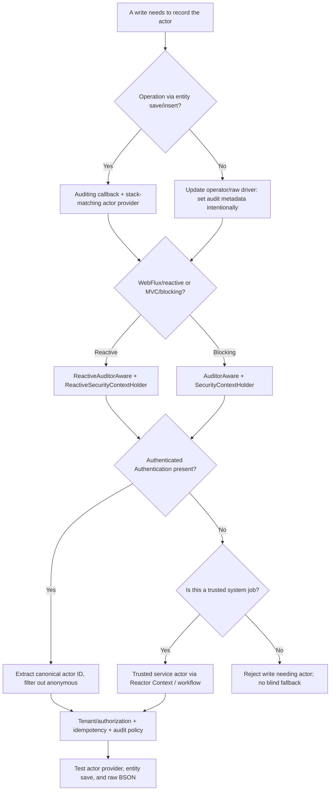

# Resolving the Actor from the Appropriate Security Context

An order is created by user `user-123` and later updated by staff member `staff-456`. To trace changes, MongoDB can store `createdBy` and `lastModifiedBy` alongside `createdAt` and `lastModifiedAt`. However, **Spring Data MongoDB cannot automatically guess the actor from an arbitrary HTTP request, JWT, or thread**. The application must supply a **trusted** way to resolve identity from the authentication context corresponding to its execution model.

In a Spring MVC application using the blocking driver, the context is typically read via `SecurityContextHolder` and integrated with `AuditorAware<T>`. In a WebFlux application using **Spring Data MongoDB Reactive**, the security context lives inside the **Reactor Context**, and auditing must use `ReactiveAuditorAware<T>` combined with `ReactiveSecurityContextHolder`. Mixing these two models can leave actor fields empty, record the wrong account, or even capture another request's identity.

Example of desired data:

```javascript
{
  _id: ObjectId("..."),
  tenantId: "T1",
  externalId: "ORDER-100",
  status: "PAID",
  createdBy: "idp:user-123",
  lastModifiedBy: "idp:staff-456",
  createdAt: ISODate("2026-11-20T09:00:00Z"),
  lastModifiedAt: ISODate("2026-11-20T09:05:00Z")
}
```

The `createdBy` and `lastModifiedBy` values above are **stable identifiers**, not display names, bearer tokens, passwords, or IP addresses. The exact identifier convention depends on the identity provider and application design; if multiple issuers or tenants exist, normalize them to prevent identity collisions.

This lesson belongs to the **Auditing** chapter of the **SPRING_DATA_MONGODB** module: using Spring Data MongoDB to connect, map documents, and perform operations via `MongoTemplate` or repositories; practicing queries, aggregations, indexes, transactions, reactive access, testing, and data diagnostics. The focus here is **resolving the right actor at auditing time** across both synchronous and reactive flows, not merely adding annotations to an entity.

After this lesson, you will be able to:

1. Distinguish the roles of `@CreatedBy`, `@LastModifiedBy` from `@CreatedDate`, `@LastModifiedDate`.
2. Properly use `AuditorAware<T>`/`@EnableMongoAuditing` for **imperative** and `ReactiveAuditorAware<T>`/`@EnableReactiveMongoAuditing` for **reactive**.
3. Understand identity sourcing from `SecurityContextHolder` vs. `ReactiveSecurityContextHolder`, and why `ThreadLocal` is unstable in WebFlux pipelines.
4. Distinguish real users, anonymous authentication, JWT subjects, usernames, and service accounts.
5. Produce trustworthy `createdBy`/`lastModifiedBy` values without reading directly from client-editable request bodies/headers.
6. Design behavior when **no security context exists** in batch jobs, message consumers, or background tasks.
7. Identify `insert/save` write paths that run auditing vs. `updateFirst/updateMulti/raw driver` paths that bypass entity auditing callbacks.
8. Test distinct creator/modifier transitions, Reactor Context propagation, missing auditors, multiple tenants, and real BSON data.

## 1. What Data Does Auditing Store?

### 1.1. The Four Common Fields

Spring Data provides metadata annotations in the `org.springframework.data.annotation` package:

| Annotation | Typical Java Field | Meaning |
| --- | --- | --- |
| `@CreatedBy` | `String createdBy` | Who created the document/aggregate |
| `@LastModifiedBy` | `String lastModifiedBy` | Who performed the most recent recorded modification |
| `@CreatedDate` | `Instant createdAt` | Creation timestamp per auditing |
| `@LastModifiedDate` | `Instant lastModifiedAt` | Update timestamp per auditing |

`@CreatedBy` and `@LastModifiedBy` **do not know** identity by themselves. They simply mark fields to be populated with the value provided by `AuditorAware<T>` or `ReactiveAuditorAware<T>` when the auditing infrastructure runs.

### 1.2. Distinguishing Audit Actor from Audit Time

Timestamps can come from `DateTimeProvider`/clock when auditing is configured; the actor requires an **identity source**. Having timestamps with an empty `createdBy` does not necessarily mean nobody acted: the actor provider might not be registered, the security context might be absent in the subscription, or the write operation might have bypassed entity callbacks.

Conversely, a populated `createdBy` field **does not prove by itself** that Spring Security created it; any script with write privileges can insert a field with that name unless the database enforces appropriate controls. Auditing is useful traceability metadata, not an immutable forensic log just from adding annotations.

### 1.3. The Actor Name Should Be a Stable Identity

Avoid storing:

- `authentication.toString()`: may contain internal/unstable details.
- Full JWTs or the `Authorization` header: leaks bearer credentials.
- `password`, `credentials`, session IDs.
- Display names or emails as permanent keys if they can change.
- `"anonymousUser"` as if it were an authenticated user.
- `tenantId` instead of user ID: tenant is a **scope**, not the acting individual.

Prefer a normalized identifier, such as `"user:internal-42"`, or a verified `issuer + subject` pair. If using `Authentication.getName()`, understand **what `getName` means per `Authentication` type** and system policy. In some mechanisms it is a username, in JWT it may be `sub` or a reconfigured claim, rather than an invariant definition across all providers.

## 2. Data Sources: Entities, HTTP Requests, and Authentication Contexts

### 2.1. Never Take the Actor from the Request Body

Unsafe API example:

```json
{
  "externalId": "ORDER-100",
  "status": "NEW",
  "createdBy": "admin"
}
```

Clients can submit any `createdBy` they wish. Even if `@NotBlank` validates the string, they can still spoof the actor.

An order creation DTO should contain only client-permitted fields:

```java
public record CreateOrderRequest(
    String externalId,
    java.math.BigDecimal totalAmount
) {}
```

The service builds the entity using the **authenticated tenant/identity**, while `createdBy` is filled by auditing from the security context on actual save.

### 2.2. Role of `Authentication`

After Spring Security authenticates a request, `Authentication` describes the principal, authorities, and authentication status. Attributes of interest:

| API / Information | Purpose | Caveat |
| --- | --- | --- |
| `isAuthenticated()` | Indicates authentication is marked authenticated | Anonymous authentication can also default to `true` |
| `getName()` | Representative identifier per implementation | Not always an internal user ID |
| `getPrincipal()` | Principal object | May be `UserDetails`, an OAuth principal, or another object |
| `getAuthorities()` | Permissions/roles | Roles are not identity |
| JWT `sub` | Subject claim issued by issuer | May need pairing with issuer to avoid collisions |
| JWT `iss` | Issuer claim | Trust only after token **authentication/verification** |

**Never manually parse an unverified JWT and use `sub` as the auditor.** Only use details from an `Authentication` verified by properly configured Spring Security, or an equivalent trust boundary.

### 2.3. Information Flow Diagram

```text
HTTP request / message / scheduled command
                  │
                  ▼
Authentication / trusted execution boundary
                  │
       ┌──────────┴──────────┐
       │                     │
       ▼                     ▼
Servlet SecurityContext    Reactor SecurityContext
Common ThreadLocal         Subscriber Context
       │                     │
       ▼                     ▼
AuditorAware<T>         ReactiveAuditorAware<T>
       │                     │
       ▼                     ▼
Mongo auditing           Reactive Mongo auditing
       └──────────┬──────────┘
                  ▼
          createdBy / lastModifiedBy
                  │
                  ▼
        BSON written to MongoDB
```

These branches represent **two different application architectures**; enabling both auditor types at once just because a project uses Spring Security is not recommended.

## 3. Imperative: `AuditorAware<T>` and `SecurityContextHolder`

### 3.1. The `AuditorAware<T>` Contract

For Spring MVC apps or services using blocking `MongoTemplate`/`MongoRepository`, Spring Data Commons provides:

```java
import java.util.Optional;
import org.springframework.data.domain.AuditorAware;

public interface AuditorAware<T> {
    Optional<T> getCurrentAuditor();
}
```

`Optional.empty()` means **no identity was found** by the provider on that call. It must not be turned automatically into `"SYSTEM"` for every HTTP request, as that masks security misconfigurations or unauthorized actions.

### 3.2. Implementation Reading from Spring Security

```java
package com.example.audit.imperative;

import java.util.Optional;
import org.springframework.data.domain.AuditorAware;
import org.springframework.security.authentication.AnonymousAuthenticationToken;
import org.springframework.security.core.Authentication;
import org.springframework.security.core.context.SecurityContextHolder;
import org.springframework.stereotype.Component;

@Component("mvcAuditorAware")
public class SecurityAuditorAware
        implements AuditorAware<String> {

    @Override
    public Optional<String> getCurrentAuditor() {
        Authentication authentication =
            SecurityContextHolder.getContext()
                .getAuthentication();

        if (authentication == null
                || !authentication.isAuthenticated()
                || authentication instanceof AnonymousAuthenticationToken) {
            return Optional.empty();
        }

        String name = authentication.getName();
        if (name == null || name.isBlank()) {
            return Optional.empty();
        }

        return Optional.of("user:" + name);
    }
}
```

In this example, `"user:" + name` is appropriate only **if your application's authentication setup guarantees `getName()` is a stable internal user ID**. When supporting multiple identity providers, JWTs, OAuth2 logins, or mutable usernames, replace it with a canonical actor ID mapping as in section 6.

### 3.3. Enabling Auditing for Imperative MongoDB

```java
package com.example.audit.imperative;

import org.springframework.context.annotation.Configuration;
import org.springframework.data.mongodb.config.EnableMongoAuditing;

@Configuration
@EnableMongoAuditing(auditorAwareRef = "mvcAuditorAware")
public class MongoAuditingConfiguration {
}
```

`auditorAwareRef` picks the exact bean supplying the actor. If multiple `AuditorAware` beans exist without explicit selection, configuration becomes ambiguous; name it deliberately.

### 3.4. Why Is This Insufficient for WebFlux?

`SecurityContextHolder` binds context to **`ThreadLocal`** by default. In reactive pipelines, execution can switch threads or be scheduled asynchronously by subscribers. A reactive MongoDB callback reading `ThreadLocal` is not guaranteed to see the same authentication as the HTTP request that initiated the work.

Bad example:

```java
// DO NOT use in ReactiveAuditorAware for WebFlux:
Authentication auth = SecurityContextHolder
    .getContext().getAuthentication();
```

Even if this "appears to work" in a simple test, it violates the Reactor security context contract. For WebFlux, switch to `ReactiveSecurityContextHolder` and `ReactiveAuditorAware<T>`.

## 4. Reactive: `ReactiveAuditorAware<T>` and `ReactiveSecurityContextHolder`

### 4.1. Reactive Contract

In Spring Data Commons, `ReactiveAuditorAware<T>` supplies the actor as a Publisher:

```java
import org.springframework.data.domain.ReactiveAuditorAware;
import reactor.core.publisher.Mono;

public interface ReactiveAuditorAware<T> {
    Mono<T> getCurrentAuditor();
}
```

Unlike imperative `Optional<T>`, `Mono<T>` resolves identity **at subscription time**, aligning with Reactor Context. Important signals:

| Publisher | Meaning |
| --- | --- |
| `Mono.just(actorId)` | A trusted actor is present |
| `Mono.empty()` | No auditor for this call |
| `Mono.error(error)` | Failed to resolve identity due to a real error |

**`Mono.empty()` is not `Mono.just(null)`.** Reactor forbids emitting `null` as an `onNext` signal. When context is absent, the provider completes empty; if business logic requires a mandatory actor, the service/boundary must turn that into an explicit error before writing.

### 4.2. Retrieving Security Context from Reactor

`ReactiveSecurityContextHolder.getContext()` returns `Mono<SecurityContext>`. Security context is stored inside the **Reactor subscriber Context**, not a static thread-local variable shared across pipelines.

Minimal implementation:

```java
package com.example.audit.reactive;

import org.springframework.data.domain.ReactiveAuditorAware;
import org.springframework.security.authentication.AnonymousAuthenticationToken;
import org.springframework.security.core.Authentication;
import org.springframework.security.core.context.ReactiveSecurityContextHolder;
import org.springframework.security.core.context.SecurityContext;
import org.springframework.stereotype.Component;
import reactor.core.publisher.Mono;

@Component("securityAuditorAware")
public class SecurityReactiveAuditorAware
        implements ReactiveAuditorAware<String> {

    @Override
    public Mono<String> getCurrentAuditor() {
        return ReactiveSecurityContextHolder.getContext()
            .flatMap(ctx ->
                Mono.justOrEmpty(ctx.getAuthentication())
            )
            .filter(auth -> auth.isAuthenticated()
                && !(auth instanceof AnonymousAuthenticationToken))
            .map(Authentication::getName)
            .filter(name -> !name.isBlank())
            .map(name -> "user:" + name);
    }
}
```

The sample above illustrates **how to read the context**, though it is not yet full canonical identity mapping for JWTs, multiple issuers, or service accounts. Checking `isAuthenticated()` **alone is insufficient**: Spring Security can represent anonymous users with an `AnonymousAuthenticationToken` having `isAuthenticated() == true`. When supporting multiple auth methods or custom authentications, use `AuthenticationTrustResolver` or an equivalent anonymous-detection policy.

### 4.3. Enabling Reactive MongoDB Auditing

```java
package com.example.audit.reactive;

import org.springframework.context.annotation.Configuration;
import org.springframework.data.mongodb.config.EnableReactiveMongoAuditing;

@Configuration
@EnableReactiveMongoAuditing(
    auditorAwareRef = "securityAuditorAware"
)
public class ReactiveMongoAuditingConfiguration {
}
```

This configures **reactive MongoDB infrastructure**; it is not an "async mode" of `@EnableMongoAuditing`. Depending on your app and Spring Data version, you must have a `ReactiveMongoTemplate` or `ReactiveMongoRepository` backed by the reactive MongoDB driver, and a matching `ReactiveAuditorAware<String>` bean.

**Pick the matching pair:**

| App / Persistence Style | Annotation Enabling Auditing | Provider |
| --- | --- | --- |
| Blocking `MongoTemplate`, `MongoRepository` | `@EnableMongoAuditing` | `AuditorAware<T>` |
| `ReactiveMongoTemplate`, `ReactiveMongoRepository` | `@EnableReactiveMongoAuditing` | `ReactiveAuditorAware<T>` |

Do not declare `AuditorAware<String>` expecting reactive auditing to invoke it automatically. Likewise, `ReactiveAuditorAware` does not replace the imperative provider.

### 4.4. Keep the Provider in the Pipeline; Do Not Subscribe Manually

Wrong:

```java
@Override
public Mono<String> getCurrentAuditor() {
    ReactiveSecurityContextHolder.getContext()
        .subscribe(ctx -> log.debug(
            "Authentication: {}", ctx.getAuthentication()
        ));
    return Mono.just("SYSTEM");
}
```

This fires off an unlinked subscription without preserving the Reactor Context of the audited flow and returns a hardcoded `SYSTEM` value. Auditing ends up recording the wrong actor.

Right:

```java
@Override
public Mono<String> getCurrentAuditor() {
    return ReactiveSecurityContextHolder.getContext()
        .flatMap(ctx ->
            Mono.justOrEmpty(ctx.getAuthentication())
        )
        .filter(Authentication::isAuthenticated)
        .flatMap(auth -> Mono.justOrEmpty(
            actorIdFromTrustedAuthentication(auth)
        ));
}
```

`actorIdFromTrustedAuthentication` is an application-supplied helper that checks for anonymous/valid identities as in section 6. **Return the Publisher** to Spring Data; never call `block()` or `subscribe()` inside the provider.

## 5. Audited Entity and the `insert/save` Flow

### 5.1. Entity with Explicit Actor Type

```java
package com.example.audit.domain;

import java.math.BigDecimal;
import java.time.Instant;
import org.bson.types.ObjectId;
import org.springframework.data.annotation.CreatedBy;
import org.springframework.data.annotation.CreatedDate;
import org.springframework.data.annotation.Id;
import org.springframework.data.annotation.LastModifiedBy;
import org.springframework.data.annotation.LastModifiedDate;
import org.springframework.data.annotation.Version;
import org.springframework.data.mongodb.core.mapping.Document;
import org.springframework.data.mongodb.core.mapping.Field;
import org.springframework.data.mongodb.core.mapping.FieldType;

@Document(collection = "orders_auditing_lab")
public class OrderDocument {

    @Id
    private ObjectId id;

    private String tenantId;
    private String externalId;
    private String status;

    @Field(targetType = FieldType.DECIMAL128)
    private BigDecimal totalAmount;

    @CreatedBy
    private String createdBy;

    @LastModifiedBy
    private String lastModifiedBy;

    @CreatedDate
    private Instant createdAt;

    @LastModifiedDate
    private Instant lastModifiedAt;

    @Version
    private Long version;

    protected OrderDocument() {}

    public OrderDocument(
            String tenantId,
            String externalId,
            BigDecimal totalAmount) {
        this.tenantId = tenantId;
        this.externalId = externalId;
        this.totalAmount = totalAmount;
        this.status = "NEW";
    }

    public ObjectId getId() { return id; }
    public String getTenantId() { return tenantId; }
    public String getExternalId() { return externalId; }
    public String getStatus() { return status; }
    public BigDecimal getTotalAmount() { return totalAmount; }
    public String getCreatedBy() { return createdBy; }
    public String getLastModifiedBy() { return lastModifiedBy; }
    public Instant getCreatedAt() { return createdAt; }
    public Instant getLastModifiedAt() { return lastModifiedAt; }
    public Long getVersion() { return version; }

    public void markPaid() {
        if (!"NEW".equals(status)) {
            throw new IllegalStateException(
                "Order is no longer in NEW status"
            );
        }
        status = "PAID";
    }
}
```

The example uses `String` for actor IDs; therefore the provider must be `ReactiveAuditorAware<String>` or `AuditorAware<String>` matching the stack. Do not use `ReactiveAuditorAware<User>` to supply a `User` object for a `String` field without an explicit converter/mapping.

`@Version` enables Spring Data optimistic locking on supported entity save paths; it is **unrelated to resolving the actor**. New/update behavior must be tested with your entity-newness detection strategy: `id`, version, and `Persistable` (if used) govern creation vs. update auditing.

### 5.2. Flow When Creating a New Document

In a WebFlux application with auditing configured:

```text
HTTP request from user-123
        │
        ▼
Spring Security authenticates → Reactive SecurityContext
        │
        ▼
Controller/service calls repository.insert(order)
        │
        ▼
Subscriber triggers reactive save pipeline
        │
        ▼
Reactive auditing callback at before-convert
        │
        ├─ ReactiveAuditorAware.getCurrentAuditor()
        │      → "user:user-123"
        │
        ├─ createdBy = "user:user-123"
        └─ createdAt = auditing timestamp
        │
        ▼
MappingMongoConverter → BSON → MongoDB insert
        │
        ▼
Subscriber receives saved entity / completion
```

Depending on `modifyOnCreate` and version, `lastModifiedBy`/`lastModifiedAt` may also be populated during **insert**. Therefore avoid asserting they must be `null` right after insert unless that exact policy is configured.

### 5.3. Flow When Editing

```text
Update request from staff-456
        │
        ▼
Reactive SecurityContext contains staff-456
        │
        ▼
Repository find → entity (with createdBy user-123)
        │
        ▼
Service changes state → repository.save(entity)
        │
        ▼
Auditing detects update via isNew/version mapping
        │
        ├─ Preserves original createdBy/createdAt
        ├─ lastModifiedBy = "user:staff-456"
        └─ lastModifiedAt = update timestamp
        │
        ▼
MongoDB write → updated entity
```

Never assume every `save` call is automatically an update: if an object is classified as **new** due to ID/version/mapping, auditing takes the created branch. For edits, load the existing document and preserve its version to avoid unintended inserts or overwrites.

### 5.4. Auditing Is Not Complete History of All Changes

`lastModifiedBy` records only the latest actor under the current write mechanism. It does not recall earlier edits, show which fields changed, or explain **why** the actor was allowed to perform the action.

When immutable history is required:

- Persist dedicated audit events with command IDs and intentional change details.
- Clarify the roles of application logs, outbox, and MongoDB change streams.
- Consider retention, access permissions, PII masking, and reconciliation policies.
- Never treat `lastModifiedBy` as complete evidence of every system operation.

## 6. Choosing a Canonical Actor ID from JWTs and Principal Types

### 6.1. Why `getName()` May Not Be Enough

In a basic system, `Authentication.getName()` may be an internal username. Yet in an OAuth2 resource server:

- `JwtAuthenticationToken` carries a JWT with `sub` and `iss` claims.
- `getName()` may map to a different claim when converters are customized.
- Two identity providers can both issue `sub = "123"` for two completely different individuals.
- Usernames/display names can change over time.
- A service-to-service JWT may identify a **service account** rather than a human employee.

Define an explicit **identity policy**. For example, with multi-issuer JWTs, the identifier can combine a namespace and a verified `(issuer, subject)` pair, or map to an internal user ID via a trusted service.

### 6.2. Reactive Provider Checking Anonymous and JWT

```java
package com.example.audit.reactive;

import java.net.URI;
import org.springframework.data.domain.ReactiveAuditorAware;
import org.springframework.security.authentication.AuthenticationTrustResolver;
import org.springframework.security.authentication.AuthenticationTrustResolverImpl;
import org.springframework.security.core.Authentication;
import org.springframework.security.core.context.ReactiveSecurityContextHolder;
import org.springframework.security.core.context.SecurityContext;
import org.springframework.security.oauth2.server.resource.authentication.JwtAuthenticationToken;
import org.springframework.stereotype.Component;
import reactor.core.publisher.Mono;

@Component("securityAuditorAware")
public final class SecurityReactiveAuditorAware
        implements ReactiveAuditorAware<String> {

    private final AuthenticationTrustResolver trustResolver =
        new AuthenticationTrustResolverImpl();

    @Override
    public Mono<String> getCurrentAuditor() {
        return ReactiveSecurityContextHolder.getContext()
            .flatMap(ctx ->
                Mono.justOrEmpty(ctx.getAuthentication())
            )
            .filter(auth -> auth.isAuthenticated()
                && !trustResolver.isAnonymous(auth))
            .flatMap(auth -> Mono.justOrEmpty(
                canonicalActorId(auth)
            ));
    }

    private String canonicalActorId(Authentication auth) {
        if (auth instanceof JwtAuthenticationToken jwtAuth) {
            String subject = jwtAuth.getToken().getSubject();
            URI issuer = jwtAuth.getToken().getIssuer();

            if (subject == null || subject.isBlank()
                    || issuer == null) {
                return null;
            }

            // Illustrative example: normalize namespace/issuer
            // per the application's identity policy.
            return "jwt:" + issuer + "#sub=" + subject;
        }

        // Use only with authentication providers where the app
        // confirms getName() is a stable internal principal ID.
        String name = auth.getName();
        if (name == null || name.isBlank()) {
            return null;
        }
        return "local:" + name;
    }
}
```

This is a **more complete version** of the minimal implementation in section 4.2. Pick **one** provider class in a real project—never register both under the same bean name `securityAuditorAware`.

For JWTs:

1. `sub` and `iss` must only be read from a `JwtAuthenticationToken` already **verified by Spring Security**.
2. `issuer` distinguishes identical subjects across different token issuers. If the app permits only one issuer, the format can be simpler yet still explicit.
3. String concatenation is illustrative. In production, use collision-free encoding/canonical mapping and bound actor ID length.
4. When a principal represents a **service account**, store a distinct actor type rather than presenting it as an end user.
5. When using `OAuth2AuthenticationToken`, opaque-token authentication, or a custom `Authentication`, add dedicated mappings matching your verified authentication types.

### 6.3. Email, Username, Subject, and Internal ID

| Candidate Actor ID | Pros | Risks |
| --- | --- | --- |
| Display name | Human-readable | Collides and changes |
| Email | Easy to cross-reference | Mutable, contains PII |
| Username | Easy from `getName` | Not globally unique across providers |
| JWT `sub` | Typically stable within an issuer | Must distinguish issuers |
| `(issuer, sub)` | Distinguishes identity sources | Needs canonical encoding and issuer validation |
| Internal immutable user ID | Best for long-term domain stability | Requires trusted mapping from principal |
| Service account ID | Clear machine/task actor | Does not represent an end user |

A strong choice in many systems is storing an **internal immutable user ID** plus source metadata as needed. Without internal IDs, verified `(issuer, sub)` is viable; never store raw tokens.

### 6.4. Multiple Issuers and Tenants

`tenantId`, `userId`, `issuer`, and `role` serve different purposes:

```text
issuer   = authentication source
subject  = principal identifier within the issuer
userId   = canonical domain ID (if applicable)
tenantId = data/resource scope accessible to the user
role     = set of permissions
```

Auditing can record the actor ID, yet write operations **must still verify tenant scope** from authentication/authorization. One user may access multiple tenants; conversely, two people with the same display email are not the same actor if their identities differ.

## 7. When Security Context Is Absent: Empty, Error, or System Actor?

A Spring Data MongoDB system has multiple write paths:

```text
HTTP request with JWT / session     → end user
Scheduled reconciliation            → service account
Kafka/RabbitMQ consumer             → event initiator or service account
Controlled data migration           → migration actor
Integration test                    → test actor
Admin script / mongosh              → outside Spring Data auditing
```

If you only call `ReactiveSecurityContextHolder.getContext()`, a batch job usually **has no HTTP SecurityContext**. That does not make every batch job "anonymous"; it may be a **system-authorized operation** needing its own actor.

### 7.1. Three Valid Policies with Different Meanings

| Scenario | Approach to Consider | Why |
| --- | --- | --- |
| User-facing write API missing authentication | **Reject** at security/service boundary | Do not blindly write as `SYSTEM` |
| Public read flow needing no audit actor | `Mono.empty()` may be acceptable | Not every read needs an auditor |
| Authorized background system job | Pass an **identifiable** system actor | Distinguish `svc:reconciliation` from users |
| Consumer acting on behalf of a user from a message | Verify message source and authorized subject | Never trust an `actorId` field from an untrusted producer |
| Admin migration | Attach migration actor in a dedicated workflow | Support future change investigations |

Never write:

```java
// Dangerous if applied globally to all WebFlux requests:
return securityActor.defaultIfEmpty("SYSTEM");
```

A misconfigured route missing its security context would silently record `SYSTEM`, corrupting audit accuracy.

### 7.2. Requiring an Actor at the Service Boundary

Suppose every HTTP order creation requires an authenticated actor. The service can enforce it early:

```java
package com.example.audit.reactive;

import java.math.BigDecimal;
import com.example.audit.domain.OrderDocument;
import org.springframework.data.domain.ReactiveAuditorAware;
import org.springframework.security.access.AccessDeniedException;
import org.springframework.stereotype.Service;
import reactor.core.publisher.Mono;

@Service
public class ReactiveOrderWriteService {

    private final ReactiveOrderRepository repository;
    private final ReactiveAuditorAware<String> auditorAware;

    public ReactiveOrderWriteService(
            ReactiveOrderRepository repository,
            ReactiveAuditorAware<String> auditorAware) {
        this.repository = repository;
        this.auditorAware = auditorAware;
    }

    public Mono<OrderDocument> create(
            String trustedTenantId,
            String externalId,
            BigDecimal amount) {

        if (trustedTenantId == null || trustedTenantId.isBlank()
                || externalId == null || externalId.isBlank()
                || amount == null || amount.signum() < 0) {
            return Mono.error(
                new IllegalArgumentException("Invalid payload")
            );
        }

        return auditorAware.getCurrentAuditor()
            .switchIfEmpty(Mono.error(
                new AccessDeniedException(
                    "An authenticated actor is required"
                )
            ))
            .flatMap(ignoredAuditor ->
                repository.insert(
                    new OrderDocument(
                        trustedTenantId, externalId, amount
                    )
                )
            );
    }
}
```

`ReactiveOrderRepository` is an illustrative interface:

```java
package com.example.audit.reactive;

import com.example.audit.domain.OrderDocument;
import org.bson.types.ObjectId;
import org.springframework.data.mongodb.repository.ReactiveMongoRepository;

public interface ReactiveOrderRepository
        extends ReactiveMongoRepository<OrderDocument, ObjectId> {
}
```

**Two auditor lookups can happen:** the service calls `getCurrentAuditor()` to enforce actor presence, and the auditing callback calls it again during `insert`. Since both share the same valid **reactive subscriber context**, they should resolve the same authentication. If your identity resolver queries an external source or could change between calls, snapshot/propagate a stable canonical actor per command instead of reading two inconsistent sources.

The service never sets `createdBy` from a user parameter. It relies on the auditing callback to pull the official actor from context. Also, `trustedTenantId` must originate from a **trusted tenant resolver** in the security layer; naming a variable "trusted" does not make an arbitrary `String` safe.

### 7.3. Avoiding Blind Reliance on Audit Fields Self-Enforcing NOT NULL

If a collection requires `createdBy` on every document, you can configure a MongoDB `$jsonSchema` validator (e.g., non-blank string) after handling legacy data migration. However:

- MongoDB schema checks BSON fields only; it **does not prove** the actor passed authentication.
- A script with write permissions could still supply `createdBy = "admin"`.
- Setting `validationAction: "warn"` does not block non-compliant writes.
- The API must still authenticate and authorize before writing.

Thus **service authentication + auditor provider + DB validation/permissions** are complementary layers, not substitutes for one another.

## 8. Background Tasks: Deliberately Passing a System Actor via Reactor Context

For batch jobs lacking an HTTP security context, attach a system actor from **trusted internal code**, letting the reactive auditor read from the Reactor Context when no authenticated principal exists.

### 8.1. Context Key Is Not a Request Header

```java
package com.example.audit.reactive;

import reactor.util.context.Context;
import java.util.function.Function;

public final class AuditActorContext {

    public static final String KEY =
        AuditActorContext.class.getName() + ".actorId";

    private AuditActorContext() {}

    public static Function<Context, Context> systemActor(
            String actorId) {
        if (actorId == null
                || !actorId.startsWith("svc:")
                || actorId.length() <= 4
                || actorId.isBlank()) {
            throw new IllegalArgumentException(
                "Invalid system actor ID"
            );
        }
        return context -> context.put(KEY, actorId);
    }
}
```

`KEY` must only be set by orchestration code authorized to perform system operations. **Never** copy an actor value from an HTTP header or body directly into this context. `Reactor Context` transports in-process metadata; it **does not authenticate values**.

### 8.2. Provider Prioritizing Security Actor with Conditional Fallback

Replace the single-source provider in section 6 with this variant **only when the system genuinely needs a batch actor policy**:

```java
package com.example.audit.reactive;

import java.net.URI;
import org.springframework.data.domain.ReactiveAuditorAware;
import org.springframework.security.authentication.AuthenticationTrustResolver;
import org.springframework.security.authentication.AuthenticationTrustResolverImpl;
import org.springframework.security.core.Authentication;
import org.springframework.security.core.context.ReactiveSecurityContextHolder;
import org.springframework.security.core.context.SecurityContext;
import org.springframework.security.oauth2.server.resource.authentication.JwtAuthenticationToken;
import org.springframework.stereotype.Component;
import reactor.core.publisher.Mono;

@Component("securityAuditorAware")
public final class ContextAwareReactiveAuditorAware
        implements ReactiveAuditorAware<String> {

    private final AuthenticationTrustResolver trustResolver =
        new AuthenticationTrustResolverImpl();

    @Override
    public Mono<String> getCurrentAuditor() {
        return authenticatedActor()
            .switchIfEmpty(Mono.deferContextual(context -> {
                if (!context.hasKey(AuditActorContext.KEY)) {
                    return Mono.empty();
                }

                String actorId = context.get(
                    AuditActorContext.KEY
                );
                if (!actorId.startsWith("svc:")
                        || actorId.length() <= 4) {
                    return Mono.error(
                        new IllegalStateException(
                            "Invalid system actor context"
                        )
                    );
                }
                return Mono.just(actorId);
            }));
    }

    private Mono<String> authenticatedActor() {
        return ReactiveSecurityContextHolder.getContext()
            .flatMap(ctx ->
                Mono.justOrEmpty(ctx.getAuthentication())
            )
            .filter(auth -> auth.isAuthenticated()
                && !trustResolver.isAnonymous(auth))
            .flatMap(auth ->
                Mono.justOrEmpty(mapActor(auth))
            );
    }

    private String mapActor(Authentication auth) {
        if (auth instanceof JwtAuthenticationToken jwt) {
            String subject = jwt.getToken().getSubject();
            URI issuer = jwt.getToken().getIssuer();
            if (issuer == null || subject == null
                    || subject.isBlank()) {
                return null;
            }
            return "jwt:" + issuer + "#sub=" + subject;
        }

        String name = auth.getName();
        return name == null || name.isBlank()
            ? null
            : "local:" + name;
    }
}
```

Notes:

1. This is an **alternative implementation**—**do not** register it alongside `SecurityReactiveAuditorAware` from section 6 under the same bean name.
2. `authenticatedActor()` takes precedence. When an authenticated user exists, a system actor marker in context cannot silently override the principal.
3. Fallback triggers only when the security actor emits nothing, and only when the context holds a marker set by trusted code.
4. It does not enforce *who may set the marker*. Setting the marker must be restricted by module boundaries and code review; untrusted requests must never reach the marker-setting path.
5. If two actor sources are unnecessary, the simpler provider in section 6 is easier to reason about.

### 8.3. Passing an Actor to a Job

```java
package com.example.audit.reactive;

import reactor.core.publisher.Flux;
import reactor.core.publisher.Mono;
import com.example.audit.domain.OrderDocument;

public Mono<Void> importOrders(
        ReactiveOrderRepository repository,
        Iterable<OrderDocument> preparedOrders) {

    return Flux.fromIterable(preparedOrders)
        .concatMap(repository::insert)
        .then()
        .contextWrite(
            AuditActorContext.systemActor("svc:nightly-import")
        );
}
```

This is an illustrative method inside a job service where `preparedOrders` comes from verified data. `concatMap` processes sequentially for predictability; for high throughput, evaluate concurrency/transactions/idempotency accordingly. **Returning `Mono<Void>` does not run the job yet**: an eligible scheduler/worker runtime must own the subscription and handle errors/completion rather than firing and forgetting recklessly.

When the publisher is subscribed, `contextWrite` attaches `"svc:nightly-import"` to the chain's context. With no user security authentication present, `ContextAwareReactiveAuditorAware` resolves this system actor. Inserted records get `createdBy = "svc:nightly-import"`, distinguishing them from HTTP user actions.

### 8.4. Message Consumers Must Distinguish Current Actor vs. Original Initiator

A message may have been requested by `user-123` yet processed by `svc:order-consumer`. Two distinct meanings:

```text
initiatedBy = user-123          // who originally requested the action
executedBy  = svc:order-consumer // which process actually wrote it
```

A single `createdBy` field cannot express both if the system supports **delegation/impersonation**. Consider storing `initiatedBy`, `executedBy`, `onBehalfOf`, and command/correlation IDs per policy, accepting original actors only from **authenticated, signed, or broker-authorized** messages. Never blindly trust any `actor` string in a queue payload.

### 8.5. Migration Tasks and Machine Identities

When a migration has elevated privileges to update millions of documents:

- Assign a specific actor such as `svc:schema-migration-2026-11`.
- Preserve a separate run ID and change-request ID for investigations.
- Apply least privilege, scoped to specific collections/tenants.
- Never lump all migrations under a generic `"SYSTEM"` actor that destroys traceability.
- When migrations use `updateMany` or the raw driver, `@LastModifiedBy` **is not auto-populated**; set fields intentionally or keep a separate migration log.

## 9. WebFlux Controllers and Services: Keeping Authentication Through Save

### 9.1. Controllers Do Not Accept `createdBy` from Clients

A controller accepts business input and gets the tenant from the **authenticated identity**:

```java
package com.example.audit.reactive;

import java.math.BigDecimal;
import org.springframework.web.bind.annotation.PostMapping;
import org.springframework.web.bind.annotation.RequestBody;
import org.springframework.web.bind.annotation.RequestMapping;
import org.springframework.web.bind.annotation.RestController;
import reactor.core.publisher.Mono;

public record CreateOrderRequest(
    String externalId,
    BigDecimal totalAmount
) {}

public record CreatedOrderResponse(
    String id,
    String externalId,
    String createdBy
) {}

public interface TrustedTenantResolver {
    Mono<String> requireTenant();
}

@RestController
@RequestMapping("/api/orders")
public class ReactiveOrderController {

    private final TrustedTenantResolver tenantResolver;
    private final ReactiveOrderWriteService writeService;

    public ReactiveOrderController(
            TrustedTenantResolver tenantResolver,
            ReactiveOrderWriteService writeService) {
        this.tenantResolver = tenantResolver;
        this.writeService = writeService;
    }

    @PostMapping
    public Mono<CreatedOrderResponse> create(
            @RequestBody Mono<CreateOrderRequest> request) {

        return Mono.zip(
                tenantResolver.requireTenant(),
                request
            )
            .flatMap(tuple -> writeService.create(
                tuple.getT1(),
                tuple.getT2().externalId(),
                tuple.getT2().totalAmount()
            ))
            .map(saved -> new CreatedOrderResponse(
                saved.getId().toHexString(),
                saved.getExternalId(),
                saved.getCreatedBy()
            ));
    }
}
```

**This code illustrates structure.** The `record` and `interface` declarations are top-level types, so in a real Java project place them in appropriate files. `TrustedTenantResolver` must be implemented by your application using verified authentication/authorization; it is not a built-in Spring Data bean. Add DTO validation and proper error mapping as needed.

### 9.2. Never Read the Principal via `ThreadLocal` in a Reactive Service

Wrong:

```java
String username = SecurityContextHolder
    .getContext().getAuthentication().getName();

return repository.insert(order);
```

Right in principle:

```java
return auditorAware.getCurrentAuditor()
    .switchIfEmpty(Mono.error(
        new AccessDeniedException("Missing authenticated actor")
    ))
    .flatMap(actor -> repository.insert(order));
```

The provider runs inside the chain and Spring Data reactive auditing reads the same subscription security context on insert. If calling a separate blocking service, design clear boundaries and test authentication propagation; never force `SecurityContextHolder` to guess threads in a Reactor pipeline.

### 9.3. When Identity Comes from a Remote Profile Service

Sometimes the JWT `sub` is an external ID and the app needs to resolve an internal user ID. If mapping calls MongoDB or another service, watch performance:

```java
return ReactiveSecurityContextHolder.getContext()
    .flatMap(ctx ->
        Mono.justOrEmpty(ctx.getAuthentication())
    )
    .flatMap(authentication ->
        userIdentityService.resolveCanonicalId(authentication)
    );
```

`userIdentityService` is an **application-provided** service assumed to return a truly non-blocking `Mono<String>`. Still, putting a network lookup inside **every audit** risks N+1 calls, higher latency, coupling DB writes to the identity service, and infinite recursion if the lookup hits an audited repository.

Better practices:

- Normalize the principal during request authentication when sufficient claims exist.
- Cache/memoize identity per security context or command with explicit TTL/policies.
- Use an immutable internal ID directly from the verified token/identity store.
- Call remote mappings only when strictly required, with timeouts, observability, and no fake fallback actors.

### 9.4. Reactive Context Travels with the Subscriber

Pipeline:

```java
return tenantResolver.requireTenant()
    .flatMap(tenant ->
        writeService.create(tenant, externalId, amount)
    )
    .map(saved -> saved.getCreatedBy());
```

When subscribed by WebFlux with Spring Security active, Reactor operators preserve `Context` across the chain, even when `publishOn`/`subscribeOn` switch schedulers per Reactor semantics. This **differs** from `SecurityContextHolder`'s `ThreadLocal`.

If you spawn a `CompletableFuture`, an unmanaged thread, or call `subscribe()` in a detached branch, context propagation **is not automatic**. Keep operations inside one Publisher chain or use official framework context propagation.

## 10. Auditing Lifecycle: When Are `@CreatedBy` and `@LastModifiedBy` Populated?

### 10.1. Inside the MongoDB Entity Lifecycle

Spring Data MongoDB auditing hooks into entity lifecycle callbacks, typically at **before-convert** for entity save operations:

```text
Reactive repository/template insert/save
          │
          ▼
Reactive auditing entity callback
          │ resolve current actor from ReactiveAuditorAware
          │ set createdBy / lastModifiedBy per isNew
          │ set audit dates per configuration
          ▼
Java entity → BSON Document
          │
          ▼
MongoDB write
          │
          ▼
Saved entity / completion
```

Auditing requires:

1. Annotations on entity fields or a recognized audited metadata model.
2. Auditing enabled (`@EnableReactiveMongoAuditing` or imperative counterpart).
3. Registered auditor provider matching the selected bean name.
4. Write path flowing through the **entity mapping pipeline**.
5. Available security context/actor if actor values are desired.
6. Accurate `isNew`/version state distinguishing creation from updates.

### 10.2. Ordering with Custom Callbacks

When multiple `ReactiveBeforeConvertCallback` beans exist, Spring uses `Ordered`/`@Order` to determine execution order **within the same phase**. Spring Data MongoDB documentation lists `ReactiveAuditingEntityCallback` in before-convert with a default order of **100** in covered versions.

```text
@Order(50) normalize externalId
      ↓
ReactiveAuditingEntityCallback (default order 100)
      ↓
@Order(150) validate fields
      ↓
MappingMongoConverter → BSON
```

This helps if validation needs to inspect audited fields; however, do not hardcode assumptions around `100` across every version/customization without testing. When logic strictly depends on order, **test with the real configuration**. Also note that `@Order(1)` on a `ReactiveAfterSaveCallback` **cannot run before** before-convert merely due to a lower number: they belong to different lifecycle phases.

### 10.3. When an Entity Is Considered New

Spring Data determines newness from mapping metadata such as ID, `@Version`, and `Persistable.isNew()` when implemented. An entity with a client-assigned ID behaves differently for newness detection than one with a null ID.

Implications:

- Do not design create/update auditing solely around `createdAt == null`.
- When using `repository.save` as an upsert, verify `isNew` behavior in integration tests.
- For creations, prefer `insert` with unique business keys where appropriate to prevent accidental overwrites.
- For updates, load the existing entity, retain `@Version`, and follow optimistic locking.
- Never allow clients to overwrite `createdBy` by passing a full entity into `save`.

### 10.4. `modifyOnCreate` and Modified Field Consistency

Configuration lets you control whether modified metadata is set **upon initial creation**, typically via `modifyOnCreate`. When enabled, a new entity receives:

```text
createdBy      = user-123
lastModifiedBy = user-123
createdAt      = T0
lastModifiedAt = T0
```

When disabled, modified fields remain unset on creation. Establish your project's policy and **test against that configuration**, rather than writing generic tests expecting modified fields to always be null or always equal created fields.

### 10.5. Not Every Operation Automatically Updates the Auditor

| API / Write Path | Auto-audits via entity lifecycle? | Required Action |
| --- | --- | --- |
| `MongoRepository.insert/save(entity)` | Applies when imperative auditing is enabled | Verify `AuditorAware` and context |
| `ReactiveMongoRepository.insert/save(entity)` | Applies when reactive auditing is enabled | Verify `ReactiveAuditorAware` and subscriber context |
| `MongoTemplate.insert/save(entity)` | Yes, on the entity mapping path | Verify with real BSON tests |
| `ReactiveMongoTemplate.insert/save(entity)` | Yes, on the entity mapping path | Test with `StepVerifier` |
| `updateFirst`/query update | **Does not run full entity auditing like `save`** | Set `lastModifiedBy`/time intentionally |
| `updateMulti`/`updateMany` | Not equivalent to N entity saves | Implement dedicated audit logic |
| `findAndModify`/update pipeline | Does not run before-convert entity auditing by default | Check API and explicitly update metadata |
| Repository `@Update` method | Query-based update; differs from `save` | Pass actor/time if contract requires |
| Raw MongoDB Java Driver | Does not invoke Spring Data auditing callbacks | Enforce DB invariants / custom logs |
| `mongosh`/ETL/other languages | No Spring callbacks | Write fields explicitly from producer |
| `deleteById`/`remove` | Cannot write `lastModifiedBy` onto a deleted doc | Use audit events/tombstones if needed |

### 10.6. Special Case: Reads Have No New "Last Modifier"

Reading via `findById` or an aggregation does not mutate the entity. Auditing never updates `lastModifiedBy` on reads; it is **write metadata**, not "who viewed this record". If you need to track who accessed data, build a dedicated access log/audit event under privacy/security policies instead of misusing `@LastModifiedBy`.

### 10.7. Annotations Alone Do Not Guarantee Immutability

If code accepts an entity from a client with a forged `createdBy`, auditing may not scrub it out the way you expect, especially on update paths preserving existing values. Therefore:

- Exclude audit fields from write DTOs.
- Never map DTO audit fields onto entities.
- Preserve `createdBy` on existing records across updates.
- Use permissions and tests to stop unauthorized scripts or services from overwriting audit fields.
- When independent historical proof is needed, use append-only audit events/reconciliation and restricted write privileges.

## 11. Query-Based Updates: Resolve Auditor and Set Fields Explicitly

A common mistake is assuming `ReactiveMongoTemplate.updateFirst` calls `ReactiveAuditorAware` just like `repository.save(entity)`. In reality, query updates send **MongoDB update operators**, skipping the full entity conversion and reactive auditing callback cycle.

### 11.1. Updates That Omit the Actor

```java
Query scope = Query.query(
    Criteria.where("_id").is(orderId)
        .and("tenantId").is(trustedTenantId)
        .and("status").is("NEW")
);

Update update = new Update().set("status", "PAID");

Mono<UpdateResult> result =
    reactiveMongoTemplate.updateFirst(
        scope, update, OrderDocument.class
    );
```

This updates `status` yet **must not be assumed to record `lastModifiedBy`** via `@LastModifiedBy`. When update paths require audit metadata, the service must explicitly resolve the actor and include it in the update.

### 11.2. Update with Actor Resolved from Reactive Provider

```java
package com.example.audit.reactive;

import com.mongodb.client.result.UpdateResult;
import com.example.audit.domain.OrderDocument;
import org.bson.types.ObjectId;
import org.springframework.data.domain.ReactiveAuditorAware;
import org.springframework.data.mongodb.core.ReactiveMongoTemplate;
import org.springframework.data.mongodb.core.query.Criteria;
import org.springframework.data.mongodb.core.query.Query;
import org.springframework.data.mongodb.core.query.Update;
import org.springframework.security.access.AccessDeniedException;
import reactor.core.publisher.Mono;

public class ScopedOrderUpdateService {

    private final ReactiveMongoTemplate template;
    private final ReactiveAuditorAware<String> auditorAware;

    public ScopedOrderUpdateService(
            ReactiveMongoTemplate template,
            ReactiveAuditorAware<String> auditorAware) {
        this.template = template;
        this.auditorAware = auditorAware;
    }

    public Mono<UpdateResult> markPaid(
            String trustedTenantId, ObjectId orderId) {

        if (trustedTenantId == null || trustedTenantId.isBlank()
                || orderId == null) {
            return Mono.error(
                new IllegalArgumentException("Invalid tenant/ID")
            );
        }

        return auditorAware.getCurrentAuditor()
            .switchIfEmpty(Mono.error(
                new AccessDeniedException("Missing auditor")
            ))
            .flatMap(actorId -> {
                Query scoped = Query.query(
                    Criteria.where("_id").is(orderId)
                        .and("tenantId").is(trustedTenantId)
                        .and("status").is("NEW")
                );

                Update change = new Update()
                    .set("status", "PAID")
                    .set("lastModifiedBy", actorId)
                    .currentDate("lastModifiedAt");

                return template.updateFirst(
                    scoped, change, OrderDocument.class
                );
            });
    }
}
```

Here:

- `actorId` comes from the provider reading security/Reactor Context, never the request body.
- `tenantId` and `status` are enforced inside the filter per business/security requirements.
- `currentDate("lastModifiedAt")` uses MongoDB server time for the update; it may differ from `@LastModifiedDate`'s application clock. If your app requires one unified clock policy, design and test consistently.
- `UpdateResult.getMatchedCount() == 0` can mean missing record, wrong tenant, or status no longer `NEW`; do not treat it automatically as a MongoDB failure.
- Network errors or `wtimeout` represent an **unknown write outcome**; do not assume the update never applied.

### 11.3. Soft Delete Requires a Trusted Actor Source

When not hard-deleting immediately:

```java
Update softDelete = new Update()
    .set("deleted", true)
    .set("deletedBy", actorId)
    .currentDate("deletedAt");
```

`actorId` here is resolved from `ReactiveAuditorAware` in an authenticated service. The query must restrict tenant, ID, and non-deleted state, e.g.:

```java
Query scope = Query.query(
    Criteria.where("_id").is(orderId)
        .and("tenantId").is(trustedTenantId)
        .and("deleted").ne(true)
);
```

This is a **dedicated deletion policy**: `@LastModifiedBy` cannot tell "who deleted" once a document is physically removed. If hard deletion must be traceable, persist an audit event/tombstone prior to or within the same safe workflow.

### 11.4. Multi-Document Transactions and Consistency

A workflow updating an order, writing an audit event, and committing must preserve:

```text
Trusted actor
  │
  ▼
Transaction (if deployment supports it)
  ├─ Conditional update order + lastModifiedBy
  ├─ Insert audit event with actor/commandId
  └─ Commit
```

When the event and order update share a MongoDB transaction, they commit or roll back atomically per transaction semantics. External emails or message brokers **do not roll back** with MongoDB. When publishing external events, use a transactional outbox and idempotent consumers.

## 12. Complex Actor Scenarios: Services, Delegated Actions, and Impersonation

### 12.1. Executing Actor Differs from Initiating User

Suppose user `U1` requests a transition, yet batch processor `S1` executes it minutes later. Two distinct roles:

| Attribute | Value | Meaning |
| --- | --- | --- |
| `initiatedBy` | `user:U1` | Who initiated the business request |
| `executedBy` | `svc:S1` | Which process executed the write |
| `lastModifiedBy` | Per chosen audit policy | Actor recorded as the modifier |
| `commandId` | `cmd-123` | Correlates steps of the same business operation |
| `correlationId` | `trace-xyz` | Assists end-to-end observability |

If company policy defines "actor" as the **initiator**, never grab a user ID out of an unverified message and blindly treat it as the current auditor. Messages must be signed/verified or authorized across a trust boundary, and the audit schema must specify which actor semantics a field carries.

### 12.2. Admin Acting on Behalf of a User

Suppose `admin-7` performs an action "on behalf of" `customer-19`:

```javascript
{
  lastModifiedBy: "user:admin-7",
  onBehalfOf: "user:customer-19",
  reasonCode: "SUPPORT_APPROVED_CHANGE"
}
```

Recording only `lastModifiedBy = customer-19` makes history falsely look as if the customer edited it directly. Record both the **real acting principal** and **`onBehalfOf`**, backed by permissions and an explicit reason code.

### 12.3. Resource Server, OAuth2 Login, and Opaque Tokens

Not every request yields a `JwtAuthenticationToken`:

- JWT resource servers typically yield `JwtAuthenticationToken`.
- Opaque token introspection may use a different authentication/principal class.
- OAuth2 Login yields `OAuth2AuthenticationToken`.
- Username/password yields `UsernamePasswordAuthenticationToken`.
- API keys/service identities may use custom `Authentication` types.

A robust `ReactiveAuditorAware` matches the **authentication providers actually enabled**. Never blindly cast every principal to `JwtAuthenticationToken`. Dispatch by authentication type/identity source, returning empty or error intentionally for unsupported types instead of stamping `"unknown"` and allowing writes through.

### 12.4. Multi-Tenant Auditing Principles

Every critical audit record should be able to answer:

1. **Who** performed it (canonical actor ID)?
2. **In which tenant** and under what verified permission?
3. **When** and under which clock policy?
4. **What action** (command ID / operation type)?
5. **Which target** changed?
6. **To what extent did it succeed** (ACK / transaction commit / side effect)?
7. **Who requested it** if different from the executing actor?

`@CreatedBy`/`@LastModifiedBy` primarily answer **who** on the current entity; do not force those two annotations to handle the entire audit/compliance lifecycle.

## 13. Security Context in Reactor: Correctness and Timing Traps

### 13.1. `contextWrite` Attaches Context to a Subscription

In tests or trusted orchestration:

```java
import org.springframework.security.authentication.UsernamePasswordAuthenticationToken;
import org.springframework.security.core.authority.AuthorityUtils;
import org.springframework.security.core.context.ReactiveSecurityContextHolder;

var authentication = new UsernamePasswordAuthenticationToken(
    "user-123",
    "N/A",
    AuthorityUtils.createAuthorityList("ROLE_USER")
);

Mono<OrderDocument> operation = repository.insert(order)
    .contextWrite(
        ReactiveSecurityContextHolder
            .withAuthentication(authentication)
    );
```

Creating this token directly is only for **tests or trusted internal contexts**, never for production HTTP authentication by taking a username from a request and building an authenticated token. In production, Spring Security must verify credentials/tokens through the filter chain and populate the context.

When a subscriber such as `StepVerifier.create(operation)` runs, the reactive auditor pulls `Authentication` from the context and maps `"user-123"` per policy.

### 13.2. `publishOn` Must Not Drop Context

```java
Mono<OrderDocument> result = repository.insert(order)
    .publishOn(reactor.core.scheduler.Schedulers.parallel())
    .map(saved -> saved);
```

Standard Reactor operators propagate subscriber context according to their semantics even across scheduler switches. That does not mean **`ThreadLocal`** in `SecurityContextHolder` crosses schedulers. If external non-Reactor libraries spawn threads or manage callbacks without context, use official context propagation rather than guessing.

### 13.3. Manual `subscribe()` in Services Loses Context

Wrong:

```java
public Mono<OrderDocument> create(OrderDocument order) {
    repository.insert(order).subscribe();
    return repository.findById(order.getId());
}
```

The `insert` subscription is detached from the returned publisher, losing authentication/transaction context and racing on ID/ACK. The service may trigger side effects while the caller never sees insert failures.

Right:

```java
public Mono<OrderDocument> create(OrderDocument order) {
    return repository.insert(order);
}
```

One continuous chain carries the Spring Security context into the auditing callback and lets the caller control errors/completion. Never call `block()` inside a WebFlux service to "keep" the security context.

### 13.4. `Mono.defer` and Actor Resolution Timing

```java
Mono<String> actorPublisher =
    auditorAware.getCurrentAuditor();
```

This Publisher describes a reactive lookup; in a proper design, the actor resolves at **subscription time** from the subscriber's context. Reading `SecurityContextHolder.getContext()` outside the Publisher and wrapping in `Mono.just(...)` snapshots the assembly thread's `ThreadLocal`, **not necessarily the subscriber's context later**.

Explicit deferral example:

```java
Mono<String> actor = Mono.defer(
    auditorAware::getCurrentAuditor
);
```

`Mono.defer` helps when constructing a Publisher depends on subscription-time state; however, `ReactiveSecurityContextHolder.getContext()` is already reactive. Do not wrap `defer` everywhere needlessly.

### 13.5. Do Not Confuse Reactor Context with Authorization

Reactor Context can hold `actorId` or `tenantId`, yet **any in-process code allowed to attach Context can overwrite values**. Therefore:

- Only trust boundaries may populate identity into context.
- Never map an unverified `X-Actor-Id` HTTP header into audit identity.
- Never take a client-sent `tenantId` straight into queries.
- Never use a client-provided JSON `createdBy` field as a fallback.
- Enforce permissions in services/database, not solely in the auditor provider.

Auditing records the actor **chosen by a trust boundary**; Reactor Context itself is not a cryptographic signature and does not verify data provenance.

## 14. Errors, Retries, Transactions, and Auditing Under Uncertain Write Outcomes

### 14.1. Do Not Equate "Auditing Callback Ran" with "Document Persisted"

On a reactive save, auditing updates the entity at the **before-convert** checkpoint. Mapping, validation, MongoDB write, write concern, and transaction commit all follow afterward. Therefore:

```text
ReactiveAuditorAware → "local:alice"
       │
       ▼
Auditing sets lastModifiedBy=local:alice
       │
       ▼
MongoDB write may SUCCEED / FAIL / BE UNKNOWN
```

Resolving an actor does not prove MongoDB persisted anything. On network or write-concern timeouts, never assume the write definitely failed and reissue a **new business operation** simply because auditing touched the Java object.

### 14.2. Pre-Write Errors vs. Post-Write Errors Differ

A custom `ReactiveBeforeConvertCallback` can reject data **before** MongoDB writes. A `ReactiveAfterSaveCallback` can emit an error **after** the server processed the write. Both surface on the caller's `Mono.onError`, yet carry totally different business meanings.

If a service writes:

```java
// Do not blindly put retry(3) on every write.
return repository.insert(order).retry(3);
```

An insert that succeeded on the server followed by a dropped ACK or after-save error can make the retry re-insert, causing duplicate key errors or repeated side effects. Use stable command IDs, unique indexes, and reconciliation. `ReactiveAuditorAware` does not provide exactly-once semantics.

### 14.3. Auditing Inside Reactive Transactions

Suppose a transaction executes:

```text
start transaction
  ├─ save Order → auditing callback sets lastModifiedBy
  ├─ save AuditEvent → event metadata
  └─ commit transaction
```

A `save` auditing callback runs **before the transaction finally commits**. If the transaction aborts, BSON written inside the transaction is rolled back. An email fired inside a callback does not roll back with the transaction.

When using `TransactionalOperator` or reactive `@Transactional`, keep all related publishers within **the same reactive transaction context**. Never call `subscribe()` manually inside an auditor or callback.

### 14.4. Actor Must Remain Stable Across Retries of the Same Command

An order creation command has identity:

```text
tenantId   = T1
commandId  = checkout-123
actorId    = user:alice
```

When retrying after a timeout, preserve the same business command ID. In long-running workflows, the original HTTP request's security context may no longer exist when a worker retries; store the **verified, authorized actor details** on the command/outbox instead of pulling a random request's actor or stamping `"SYSTEM"` to paper over missing data.

If a user's display name changed, the canonical actor ID still identifies the same person. If the user's permissions were revoked mid-flight, the worker needs an explicit policy deciding whether to **re-validate authorization** at execution time or complete a previously authorized command.

### 14.5. Never Use Audit Fields to Infer Final Commit Certainty

After an ambiguous write, reading back a document with `lastModifiedBy = "user:alice"` observes **the current stored state**, yet:

- You must match command/version/tenant to verify it came from the write in question.
- Another request from Alice could have modified the same record.
- Reading from a secondary can reflect replication lag.
- With transactions/outboxes, update metadata alone does not confirm the entire end-to-end workflow finished.

For critical workflows, rely on command IDs, versions/conditional updates, and appropriate read/write concerns—not `lastModifiedBy` alone—to determine which attempt committed.

## 15. `mongosh` Lab: Observing Auditing Data as Plain BSON

`mongosh` **has no access to Spring Security Context** and does not invoke `AuditorAware`/`ReactiveAuditorAware`. This lab reinforces that audit fields are **persisted BSON values**, not proof of how they were generated.

Use a **test MongoDB** only; never run scripts against production. Commands generate a **random collection per session** to prevent collisions.

### 15.1. Creating an Isolated Collection

In one `mongosh` session:

```javascript
use spring_data_training

const labName = "auditing_007_lab_" +
  new ObjectId().toHexString();
const tenantId = "T1-" + new ObjectId().toHexString();

db.createCollection(labName);

const lab = db.getCollection(labName);
const orderId = new ObjectId();

printjson({ labName, tenantId, orderId });
```

### 15.2. Manually Inserting a Document with Audit Fields

```javascript
lab.insertOne({
  _id: orderId,
  tenantId,
  externalId: "ORDER-100",
  status: "NEW",
  totalAmount: NumberDecimal("100.00"),
  createdBy: "user:alice",
  lastModifiedBy: "user:alice",
  createdAt: ISODate("2026-11-20T09:00:00Z"),
  lastModifiedAt: ISODate("2026-11-20T09:00:00Z")
});

printjson(lab.findOne({ _id: orderId }));
```

MongoDB only sees the BSON sent to it. **No Spring authentication was checked** in this `insertOne`; `createdBy` is simply a string supplied by the script. That is why audit fields alone cannot replace write permissions, authentication, or immutable audit logs.

### 15.3. Raw `$set` Does Not Auto-Update `lastModifiedBy`

```javascript
lab.updateOne(
  { _id: orderId, tenantId, status: "NEW" },
  { $set: { status: "PAID" } }
);

printjson(lab.findOne({ _id: orderId }));
// status becomes PAID while lastModifiedBy remains user:alice.
```

This illustrates raw driver behavior; similarly, with `ReactiveMongoTemplate` query updates, do not expect an entity auditing callback to populate `lastModifiedBy` as `save(entity)` would.

### 15.4. Explicitly Updating Audit Fields

```javascript
lab.updateOne(
  { _id: orderId, tenantId, status: "PAID" },
  {
    $set: {
      status: "CANCELLED",
      lastModifiedBy: "svc:order-reconciliation"
    },
    $currentDate: {
      lastModifiedAt: true
    }
  }
);

printjson(lab.findOne({ _id: orderId }));
```

Here `"svc:order-reconciliation"` is written directly because this is a **lab with a simulated service actor**. In production, the actor must come from a trusted execution boundary, never arbitrarily from an HTTP body/header.

### 15.5. Checking BSON Types and Field Presence

```javascript
printjson(lab.aggregate([
  { $match: { _id: orderId } },
  {
    $project: {
      _id: 0,
      createdBy: 1,
      lastModifiedBy: 1,
      createdByType: { $type: "$createdBy" },
      modifiedByType: { $type: "$lastModifiedBy" },
      createdAtType: { $type: "$createdAt" },
      modifiedAtType: { $type: "$lastModifiedAt" },
      amountType: { $type: "$totalAmount" }
    }
  }
]).toArray());
```

In this dataset, actor fields have BSON type `string`, timestamps are `date`, and amount is `decimal`. However, type checking **does not prove** the actor passed authentication; type validation and identity trust are separate concerns.

### 15.6. Simulating "Spoofing" to Understand Boundaries

```javascript
lab.insertOne({
  tenantId,
  externalId: "ORDER-UNTRUSTED",
  status: "NEW",
  totalAmount: NumberDecimal("20.00"),
  createdBy: "user:administrator",
  createdAt: new Date()
});

printjson(lab.findOne({
  tenantId,
  externalId: "ORDER-UNTRUSTED"
}));
```

If a collection grants broad write access without additional controls, MongoDB cannot tell whether `"user:administrator"` sent by a script represents a real identity. **This does not mean untrusted clients should ever write directly to the DB.** It underscores enforcing security in the application, scoping DB permissions, and recording trustworthy audit events.

### 15.7. Cleanup

```javascript
printjson({
  labName,
  documents: lab.countDocuments({})
});

// Run only after confirming this collection was
// created specifically by this lab session in section 15.1.
lab.drop();
```

`drop()` deletes the entire collection; it is safe only for random collections created during this lab. **Never** drop `orders` or any shared/production collection.

## 16. Testing: Unit Testing Actor Mapping and Integration Testing Auditing

A test calling `getCurrentAuditor()` with a mock username does not prove MongoDB persisted `createdBy`. Conversely, a test reading `createdBy` without simulating two distinct identities can miss Reactor Context bugs.

Separate your tests into:

1. **Provider unit tests:** present/absent/anonymous/JWT/system contexts yield expected `Mono<String>`.
2. **Integration tests:** reactive Spring Data entity insert/save writes accurate audit fields to MongoDB.
3. **Negative tests:** `updateFirst` does not auto-run entity auditing; actor must be set explicitly when needed.
4. **Concurrency tests:** two concurrent subscriptions with different security contexts never leak actors.
5. **Failure tests:** missing actor at the HTTP boundary rejects before writing instead of silently stamping `SYSTEM`.

### 16.1. Test Matrix

| Case | Context Source | Expected Result |
| --- | --- | --- |
| Authenticated HTTP user | Authentication `user-123` | `Mono.just("local:user-123")` per demo policy |
| Missing context | No Authentication | `Mono.empty()` from provider |
| Anonymous token | `AnonymousAuthenticationToken` | `Mono.empty()` |
| JWT with issuer + subject | Test-constructed `JwtAuthenticationToken` | `jwt:<issuer>#sub=<sub>` |
| JWT missing subject or issuer | Incomplete identity token | Does not fabricate an identity |
| Batch with service marker | Reactor Context from trusted job | `svc:nightly-import` |
| Both auth user and service marker | Both present in context | User actor takes precedence per policy |
| Insert via repository as Alice | Reactive auditing enabled | `createdBy = local:alice` |
| Save update as Bob | Existing entity | `createdBy` keeps Alice, `lastModifiedBy` becomes Bob |
| Query update setting status only | No actor field set | `lastModifiedBy` stays unchanged |
| Query update with auditor | Service resolves actor then `$set` | New actor/time recorded |
| Two concurrent requests | Separate Alice and Bob contexts | No actor leakage across documents |
| Raw MongoDB insert | No Spring callbacks | No auto-generated actor |

### 16.2. Unit Test: Resolving a User from Reactor Context

The snippet below uses `SecurityReactiveAuditorAware` from section 6 and Reactor Test. No MongoDB is needed to verify the publisher:

```java
package com.example.audit.reactive;

import static org.junit.jupiter.api.Assertions.*;

import org.junit.jupiter.api.Test;
import org.springframework.security.authentication.UsernamePasswordAuthenticationToken;
import org.springframework.security.core.Authentication;
import org.springframework.security.core.authority.AuthorityUtils;
import org.springframework.security.core.context.ReactiveSecurityContextHolder;
import reactor.test.StepVerifier;

class SecurityReactiveAuditorAwareTest {

    private final SecurityReactiveAuditorAware provider =
        new SecurityReactiveAuditorAware();

    private Authentication user(String name) {
        return new UsernamePasswordAuthenticationToken(
            name,
            "TEST_ONLY",
            AuthorityUtils.createAuthorityList("ROLE_USER")
        );
    }

    @Test
    void authenticatedUserComesFromSubscriberContext() {
        StepVerifier.create(
            provider.getCurrentAuditor()
                .contextWrite(
                    ReactiveSecurityContextHolder
                        .withAuthentication(user("alice"))
                )
        )
        .expectNext("local:alice")
        .verifyComplete();
    }

    @Test
    void absentSecurityContextProducesEmptyMono() {
        StepVerifier.create(provider.getCurrentAuditor())
            .verifyComplete();
    }
}
```

**Explanation:** this test builds an in-memory **test-only** `Authentication`, not a production login mechanism. `UsernamePasswordAuthenticationToken` with the three-argument constructor containing authorities marks it authenticated for testing. In production, only configured security filters/authentication managers may construct and populate trusted contexts.

### 16.3. Unit Test: Anonymous Is Not Treated as a Real User

```java
import org.springframework.security.authentication.AnonymousAuthenticationToken;

@Test
void anonymousIsNotAnAuditingUser() {
    Authentication anonymous = new AnonymousAuthenticationToken(
        "test-anonymous-key",
        "anonymousUser",
        AuthorityUtils.createAuthorityList("ROLE_ANONYMOUS")
    );

    StepVerifier.create(
        provider.getCurrentAuditor()
            .contextWrite(
                ReactiveSecurityContextHolder
                    .withAuthentication(anonymous)
            )
    )
    .verifyComplete();
}
```

This method belongs to the test class in section 16.2. It demonstrates why **`isAuthenticated()` alone cannot establish a valid user principal**: `AnonymousAuthenticationToken` must be filtered out via trust resolver/policy.

### 16.4. Unit Test: JWT Subject Paired with Issuer

```java
import org.springframework.security.oauth2.jwt.Jwt;
import org.springframework.security.oauth2.server.resource.authentication.JwtAuthenticationToken;

@Test
void jwtActorUsesIssuerAndSubject() {
    Jwt testJwt = Jwt.withTokenValue("test-only-not-a-real-token")
        .header("alg", "none")
        .claim("iss", "https://identity.example.test")
        .claim("sub", "account-123")
        .build();

    Authentication jwtAuth =
        new JwtAuthenticationToken(testJwt);

    StepVerifier.create(
        provider.getCurrentAuditor()
            .contextWrite(
                ReactiveSecurityContextHolder
                    .withAuthentication(jwtAuth)
            )
    )
    .expectNext(
        "jwt:https://identity.example.test#sub=account-123"
    )
    .verifyComplete();
}
```

**Crucial:** this is a manually constructed test `Jwt` object verifying **provider mapping**. It is **not cryptographically signed or validated like a real bearer token** and must never be used for production HTTP authentication. In production, JWTs must pass through Spring Security resource server or an approved validator verifying signature, issuer, audience, expiry, and claims.

### 16.5. Unit Test: Service Actor Comes Only from Trusted Context

This tests the **`ContextAwareReactiveAuditorAware` variant from section 8**; never register both providers at once:

```java
package com.example.audit.reactive;

import org.junit.jupiter.api.Test;
import org.springframework.security.authentication.UsernamePasswordAuthenticationToken;
import org.springframework.security.core.authority.AuthorityUtils;
import org.springframework.security.core.context.ReactiveSecurityContextHolder;
import reactor.test.StepVerifier;

class ContextAwareReactiveAuditorAwareTest {

    private final ContextAwareReactiveAuditorAware provider =
        new ContextAwareReactiveAuditorAware();

    @Test
    void trustedBatchContextSuppliesSystemActor() {
        StepVerifier.create(
            provider.getCurrentAuditor()
                .contextWrite(
                    AuditActorContext.systemActor(
                        "svc:nightly-import"
                    )
                )
        )
        .expectNext("svc:nightly-import")
        .verifyComplete();
    }

    @Test
    void authenticatedUserWinsOverSystemMarker() {
        var authentication =
            new UsernamePasswordAuthenticationToken(
                "alice", "TEST_ONLY",
                AuthorityUtils.createAuthorityList("ROLE_USER")
            );

        StepVerifier.create(
            provider.getCurrentAuditor()
                .contextWrite(
                    ReactiveSecurityContextHolder
                        .withAuthentication(authentication)
                )
                .contextWrite(
                    AuditActorContext.systemActor(
                        "svc:nightly-import"
                    )
                )
        )
        .expectNext("local:alice")
        .verifyComplete();
    }
}
```

Both cases verify the policy: **security actor first, trusted system actor second**. They do not make client-sent headers trustworthy; controlling who can set `AuditActorContext.KEY` remains an architectural responsibility.

### 16.6. Reactive MongoDB Integration Test Setup

The following integration tests use **Spring Data MongoDB Reactive, JUnit 5, Reactor Test, and a test MongoDB instance** (e.g., Testcontainers). The code serves as a learning example and **was not executed during authoring**; adjust dependency imports and bootstrap configuration to match your Spring Boot/Spring Data version.

```java
package com.example.audit.reactive;

import com.example.audit.domain.OrderDocument;
import java.math.BigDecimal;
import java.util.UUID;
import java.util.function.Function;
import org.junit.jupiter.api.AfterEach;
import org.junit.jupiter.api.BeforeEach;
import org.junit.jupiter.api.Test;
import org.springframework.beans.factory.annotation.Autowired;
import org.springframework.boot.test.autoconfigure.data.mongo.DataMongoTest;
import org.springframework.context.annotation.Import;
import org.springframework.data.mongodb.core.ReactiveMongoTemplate;
import org.springframework.data.mongodb.core.query.Criteria;
import org.springframework.data.mongodb.core.query.Query;
import org.springframework.security.authentication.UsernamePasswordAuthenticationToken;
import org.springframework.security.core.Authentication;
import org.springframework.security.core.authority.AuthorityUtils;
import org.springframework.security.core.context.ReactiveSecurityContextHolder;
import reactor.test.StepVerifier;
import reactor.util.context.Context;

@DataMongoTest
@Import({
    ReactiveMongoAuditingConfiguration.class,
    SecurityReactiveAuditorAware.class
})
class ReactiveMongoAuditingIntegrationTest {

    @Autowired
    ReactiveOrderRepository repository;

    @Autowired
    ReactiveMongoTemplate template;

    @Autowired
    SecurityReactiveAuditorAware provider;

    private String tenant;

    @BeforeEach
    void setup() {
        tenant = "auditing-007-" + UUID.randomUUID();
    }

    @AfterEach
    void cleanup() {
        Query query = Query.query(
            Criteria.where("tenantId").is(tenant)
        );

        StepVerifier.create(
            template.remove(query, OrderDocument.class)
        )
        .expectNextCount(1)
        .verifyComplete();
    }

    private Function<Context, Context> asUser(String name) {
        Authentication auth =
            new UsernamePasswordAuthenticationToken(
                name,
                "TEST_ONLY",
                AuthorityUtils.createAuthorityList("ROLE_USER")
            );
        return ReactiveSecurityContextHolder
            .withAuthentication(auth);
    }
}
```

**The snippets below are test methods placed inside the test class from section 16.6**, with matching imports. If the test slice fails to locate repositories or beans, configure `@Import`, package scanning, or `@EnableReactiveMongoRepositories` for your project. Do not enable `ContextAwareReactiveAuditorAware` at the same time, as both providers share the same bean name in these examples.

The test uses a random tenant marker and cleans up **only documents belonging to that tenant**; never `drop()` a production or shared collection.

### 16.7. Case 1 — Insert Under Alice's Context

Add imports:

```java
import static org.junit.jupiter.api.Assertions.*;
import org.bson.Document;
import org.bson.types.ObjectId;
import reactor.core.publisher.Mono;
import java.util.concurrent.atomic.AtomicReference;
```

Test:

```java
@Test
void insertPersistsCreatedByFromReactiveSecurityContext() {
    OrderDocument input = new OrderDocument(
        tenant, "ORDER-A", new BigDecimal("100.00")
    );

    AtomicReference<ObjectId> id = new AtomicReference<>();

    StepVerifier.create(
        repository.insert(input).contextWrite(asUser("alice"))
    )
    .assertNext(saved -> {
        assertNotNull(saved.getId());
        id.set(saved.getId());
        assertEquals("local:alice", saved.getCreatedBy());
        assertNotNull(saved.getCreatedAt());
    })
    .verifyComplete();

    // Raw MongoDB read: does not invoke Spring Data entity auditing.
    Mono<Document> raw = template
        .getCollection("orders_auditing_lab")
        .flatMap(collection -> Mono.from(
            collection.find(
                new Document("_id", id.get())
            ).first()
        ));

    StepVerifier.create(raw)
        .assertNext(document -> {
            assertEquals(
                "local:alice", document.getString("createdBy")
            );
            assertNotNull(document.getDate("createdAt"));
        })
        .verifyComplete();
}
```

Significance:

- `asUser("alice")` binds Authentication to the **Reactor subscriber context of that insert publisher**.
- `ReactiveAuditorAware` reads the actor and Spring Data auditing sets `createdBy`.
- Reading raw BSON proves the value **persisted**, not merely existing on the Java object.
- The test does not assert `lastModifiedBy` is null or non-null on creation, as that depends on the configured `modifyOnCreate`.

### 16.8. Case 2 — Alice Creates, Bob Updates

```java
@Test
void updateKeepsCreatorAndChangesLastModifier() {
    OrderDocument input = new OrderDocument(
        tenant, "ORDER-B", new BigDecimal("250.00")
    );

    AtomicReference<OrderDocument> created =
        new AtomicReference<>();

    StepVerifier.create(
        repository.insert(input).contextWrite(asUser("alice"))
    )
    .assertNext(created::set)
    .verifyComplete();

    assertEquals(
        "local:alice", created.get().getCreatedBy()
    );

    StepVerifier.create(
        Mono.defer(() -> {
            created.get().markPaid();
            return repository.save(created.get());
        }).contextWrite(asUser("bob"))
    )
    .assertNext(updated -> {
        assertEquals("PAID", updated.getStatus());
        assertEquals("local:alice", updated.getCreatedBy());
        assertEquals("local:bob", updated.getLastModifiedBy());
        assertNotNull(updated.getLastModifiedAt());
    })
    .verifyComplete();
}
```

**Checkpoint:** `createdBy` preserves the original creator through valid entity updates, while `lastModifiedBy` reflects Bob as the actor of the new save. If code maps `createdBy` from update requests or breaks `isNew`/version, results differ—which is precisely why integration testing is essential.

### 16.9. Case 3 — Service Rejects Write When Actor Is Missing

Uses the `@Autowired SecurityReactiveAuditorAware provider;` field declared in the test class in section 16.6:

```java
@Test
void httpWriteWithoutAuditorMustFailBeforeInsert() {
    var service = new ReactiveOrderWriteService(
        repository, provider
    );

    StepVerifier.create(
        service.create(
            tenant,
            "ORDER-UNAUTHENTICATED",
            new BigDecimal("10.00")
        )
    )
    .expectError(
        org.springframework.security.access.AccessDeniedException.class
    )
    .verify();

    StepVerifier.create(
        template.count(
            Query.query(
                Criteria.where("tenantId").is(tenant)
            ),
            OrderDocument.class
        )
    )
    .expectNext(0L)
    .verifyComplete();
}
```

This test **does not** expect Spring Data auditing to reject contextless writes on its own. It verifies the **service's policy**: requiring an authenticated auditor before creating the document. Calling `repository.insert` directly without context leaves audit field behavior up to infrastructure/mapping/validators; do not equate that with the service policy above.

### 16.10. Case 4 — Two Subscriptions Never Mix Actors

```java
import reactor.core.publisher.Flux;
import java.util.Map;
import java.util.stream.Collectors;

@Test
void parallelSubscriptionsKeepActorsSeparated() {
    Mono<OrderDocument> byAlice = repository.insert(
        new OrderDocument(
            tenant, "ALICE-ORDER",
            new BigDecimal("10.00")
        )
    ).contextWrite(asUser("alice"));

    Mono<OrderDocument> byBob = repository.insert(
        new OrderDocument(
            tenant, "BOB-ORDER",
            new BigDecimal("20.00")
        )
    ).contextWrite(asUser("bob"));

    StepVerifier.create(
        Flux.merge(byAlice, byBob).collectList()
    )
    .assertNext(saved -> {
        assertEquals(2, saved.size());

        Map<String, String> actors = saved.stream()
            .collect(Collectors.toMap(
                OrderDocument::getExternalId,
                OrderDocument::getCreatedBy
            ));

        assertEquals(
            "local:alice", actors.get("ALICE-ORDER")
        );
        assertEquals(
            "local:bob", actors.get("BOB-ORDER")
        );
    })
    .verifyComplete();
}
```

Do not assert completion ordering between Alice and Bob, because `Flux.merge` emits items as each publisher finishes. The test verifies **each document gets the right actor**, not global ordering. This is also why storing the current user in a mutable field on a singleton auditor bean is fatal.

### 16.11. Case 5 — Query Update Does Not Auto-Change `lastModifiedBy`

```java
import com.mongodb.client.result.UpdateResult;
import org.springframework.data.mongodb.core.query.Update;

@Test
void queryUpdateDoesNotUseEntityAuditorAutomatically() {
    AtomicReference<OrderDocument> created =
        new AtomicReference<>();

    StepVerifier.create(
        repository.insert(
            new OrderDocument(
                tenant, "ORDER-QUERY",
                new BigDecimal("80.00")
            )
        ).contextWrite(asUser("alice"))
    )
    .assertNext(created::set)
    .verifyComplete();

    String originalModifiedBy =
        created.get().getLastModifiedBy();

    Query scope = Query.query(
        Criteria.where("_id").is(created.get().getId())
            .and("tenantId").is(tenant)
    );

    StepVerifier.create(
        template.updateFirst(
            scope,
            new Update().set("status", "PAID"),
            OrderDocument.class
        ).contextWrite(asUser("bob"))
    )
    .assertNext(result ->
        assertEquals(1L, result.getMatchedCount())
    )
    .verifyComplete();

    StepVerifier.create(
        template.getCollection("orders_auditing_lab")
            .flatMap(collection -> Mono.from(
                collection.find(
                    new Document("_id", created.get().getId())
                ).first()
            ))
    )
    .assertNext(raw -> {
        assertEquals("PAID", raw.getString("status"));
        assertEquals(
            originalModifiedBy,
            raw.getString("lastModifiedBy")
        );
    })
    .verifyComplete();
}
```

Here, Bob is in the Reactor Context yet **the query update does not invoke the entity auditing callback to change `lastModifiedBy`**. To record Bob on this update path, invoke the service from section 11.2 or set audit metadata intentionally in the update.

### 16.12. Case 6 — Query Update Explicitly Supplying Audit Actor

```java
@Test
void scopedUpdateServiceWritesActorExplicitly() {
    AtomicReference<OrderDocument> created =
        new AtomicReference<>();

    StepVerifier.create(
        repository.insert(
            new OrderDocument(
                tenant, "ORDER-C",
                new BigDecimal("10.00")
            )
        ).contextWrite(asUser("alice"))
    )
    .assertNext(created::set)
    .verifyComplete();

    var scopedService = new ScopedOrderUpdateService(
        template, provider
    );

    StepVerifier.create(
        scopedService.markPaid(
            tenant, created.get().getId()
        ).contextWrite(asUser("bob"))
    )
    .assertNext(result ->
        assertEquals(1L, result.getMatchedCount())
    )
    .verifyComplete();

    StepVerifier.create(
        template.getCollection("orders_auditing_lab")
            .flatMap(collection -> Mono.from(
                collection.find(
                    new Document("_id", created.get().getId())
                ).first()
            ))
    )
    .assertNext(raw -> {
        assertEquals("PAID", raw.getString("status"));
        assertEquals(
            "local:bob", raw.getString("lastModifiedBy")
        );
        assertNotNull(raw.getDate("lastModifiedAt"));
    })
    .verifyComplete();
}
```

This test confirms a critical principle: **the query update's actor comes from a trusted provider and must be placed into `Update` explicitly**, rather than expecting `@LastModifiedBy` on the entity to fire when update operators skip entity callbacks.

### 16.13. Limitations of This Test Suite

These snippets were not executed when authoring the lesson. When integrating them:

- Match Java/JUnit/Spring Boot/Spring Data MongoDB versions to your project.
- Ensure `@DataMongoTest` provides reactive repository/template beans and an active, isolated test DB.
- Register **one** reactive provider matching your auditing setup, avoiding duplicate beans.
- Run against a real test MongoDB or Testcontainers; mocked publishers cannot verify BSON persistence.
- When using `@Version`, preserve entity state cleanly between insert and save.
- Avoid parallel tests mutating shared global configuration in a single singleton test context.
- For multi-issuer setups, test JWTs from every accepted identity provider.
- If changing `modifyOnCreate`, update assertions to match the approved contract.

## 17. Common Pitfalls and Diagnostics

| Symptom | Likely Cause | How to Check and Fix |
| --- | --- | --- |
| `createdBy` always `null` | Auditing not enabled or missing auditor bean | Verify `@EnableMongoAuditing`/`@EnableReactiveMongoAuditing` and `auditorAwareRef` |
| Spring cannot find `AuditorAware` | Provider registered with wrong type or wrong bean name | Check interface/type and configured bean name |
| Reactive Mongo uses `SecurityContextHolder`, empty actor | Reading `ThreadLocal` instead of Reactor Context | Switch to `ReactiveSecurityContextHolder` and `ReactiveAuditorAware` |
| MVC uses `ReactiveAuditorAware`, no actor found | Wrong provider type for imperative auditing | Use `AuditorAware<T>` for blocking paths |
| `isAuthenticated=true` yet actor is `anonymousUser` | Anonymous tokens can be marked authenticated | Use `AuthenticationTrustResolver`/anonymous check |
| Actor unexpectedly `anonymousUser` | Code simply calls `auth.getName()` | Filter out anonymous before reading name |
| JWT actor is email instead of internal ID | `getName()` mapped from another claim | Use canonical mapping/subject/issuer per policy |
| Two IdPs share actor `123` and collide | Storing `sub` without issuer | Distinguish `(issuer, sub)` pair or internal ID |
| Actor contains tokens/credentials | Using `Authentication.toString()` or logging raw principal | Extract approved identifier only; redact logs |
| Request gets another request's audit actor | Shared mutable field or leaked `ThreadLocal` | Avoid singleton state; read context per subscription |
| Audit empty on batch jobs | Batches lack HTTP SecurityContext | Set system actor from trusted orchestration |
| Every request stamped `SYSTEM` | Global fallback `defaultIfEmpty("SYSTEM")` | Reject unauthorized HTTP separately from batch system actors |
| Actor spoofed from HTTP header | Trusting client `X-Actor-Id` | Read actor from verified `Authentication` |
| Saved order's `createdBy` changed | DTO mapper/save code overwrote audit field | Exclude audit fields from write DTOs; test creator preservation |
| `lastModifiedBy` unchanged after `updateFirst` | Query update bypasses entity auditing callback | Resolve actor and set in `Update`, enforce tenant |
| `@LastModifiedBy` unchanged after `updateMany` | No full entity passed to save callbacks | Explicitly write audit metadata in batch updates |
| Hard delete leaves no `deletedBy` | Document removed so field disappears | Soft delete or audit event/tombstone |
| `@CreatedDate` filled, `@CreatedBy` empty | Actor provider empty or missing Authentication | Separate date provider from auditor provider |
| `lastModifiedBy` set immediately on create | `modifyOnCreate` or default auditing policy | Verify configuration; do not assume null |
| `@CreatedBy` populated as "update" on new entity | Broken `isNew`/`@Version`/`Persistable` logic | Test ID and newness determination |
| `save` performs unintended insert/upsert | Unexpected entity ID/version/newness | Use `insert` for create; add version/unique index and test |
| Auditor network lookup slows every save | Identity lookup executed per entity | Normalize ID at auth time; minimize I/O and N+1 calls |
| Actor empty after manual `subscribe()` | Subscription detached from original context | Return Publisher; let WebFlux/scheduler own subscription |
| Actor empty after `CompletableFuture` | Context not propagated outside Reactor threads | Use supported context propagation or redesign |
| Provider unit test passes yet BSON lacks field | Auditing callback disabled or raw driver used | Add `@DataMongoTest` integration test with raw BSON read |
| `@DataMongoTest` cannot find auditor bean | Test slice did not import component | `@Import` config/provider and check package scanning |
| Duplicate bean named `securityAuditorAware` | Registered two provider variants | Register only one policy provider |
| Provider configured yet raw script skips auditing | `mongosh` bypasses Spring Data callbacks | Scripts must write explicitly; protect DB permissions |
| `lastModifiedBy` shows Bob yet status stayed unchanged | Update filter `matchedCount=0` or write error | Distinguish matched/modified counts and exceptions |
| Consumer actor shows executor instead of initiator | Confusing executor with initiator | Store `initiatedBy`/`executedBy` under trust policy |
| `lastModifiedBy` shows service account in job | Job ran under system actor | Expected when matching workflow actor contract |
| Post-save exception assumed not written | Callback/transport can fail after write | Reconcile via command ID and write concern |

### 17.1. Debugging Workflow When `createdBy` Is Unpopulated

1. Verify the entity has `@CreatedBy` on the **exact field** with a type matching the provider.
2. Verify the config bean uses `@EnableReactiveMongoAuditing` or `@EnableMongoAuditing` matching the stack.
3. Verify `auditorAwareRef` matches the bean name with no duplicate beans.
4. Check whether the operation flows through `repository.insert/save` or template entity save rather than a query update or raw driver.
5. Check `isNew`, ID, `@Version`, and create/update flows.
6. Verify the publisher was subscribed within the **right security context**.
7. Invoke `auditorAware.getCurrentAuditor()` with `StepVerifier` and a known test context to isolate security bugs from MongoDB issues.
8. Inspect raw BSON after insert to verify whether the actor actually persisted.
9. Check server validators, exceptions, transactions, and write acknowledgments if the write failed.

### 17.2. Debugging Workflow When the Actor Differs from Expected

Ask in order:

- What kind of `Authentication` is really present: JWT, OAuth2 Login, opaque token, or service principal?
- Is `isAuthenticated` true and could an anonymous token be present?
- Which claim does `getName` map from? Were `sub` and `iss` validated?
- Should the actor be the executing user or the initiating user of the business command?
- Do multiple identity providers or tenants share overlapping IDs?
- Did a callback/thread call `subscribe()` independently, dropping context, or use mutable singleton state?
- Did entity-mapping code from a request overwrite `createdBy`/`lastModifiedBy`?
- Did double-subscribing or retrying the same command alter the actor between attempts?

Never patch around this with `Principal.toString()` or a global `SYSTEM` fallback. That makes fields look populated while destroying audit integrity.

### 17.3. Debugging When `lastModifiedBy` Does Not Update

For an update operation:

1. Identify the exact API: `repository.save(entity)` or `template.updateFirst(query, update)`?
2. If `save`: check auditing enabled, provider, and newness/`@Version`.
3. If query update: check whether `Update` explicitly includes `set("lastModifiedBy", actorId)` and a timestamp.
4. Check whether `tenantId`, ID, status, and version match in the filter.
5. Inspect `UpdateResult.matchedCount`/`modifiedCount` and write errors.
6. Inspect actual BSON rather than only the in-memory Java entity.
7. If inside a transaction, verify commit outcome rather than merely callback execution.

## 18. Decision Flow for Resolving a Write's Actor Source



This flowchart is an **architectural decision guide**, not source code that authenticates actors automatically. For query updates/raw driver writes, you can still call the same trusted identity resolver, yet metadata must be applied explicitly. For trusted jobs, system actors require clear provenance and authorization.

### 18.1. Code Review Checklist

1. **Stack:** does the app use imperative or reactive MongoDB?
2. **Enable:** is `@EnableMongoAuditing` or `@EnableReactiveMongoAuditing` matched to the stack?
3. **Provider:** does the `AuditorAware`/`ReactiveAuditorAware` bean match the generic type and `auditorAwareRef`?
4. **Trust:** does the actor come from verified authentication, never request body/headers?
5. **Anonymous:** are anonymous tokens excluded even when `isAuthenticated()` is true?
6. **Identity:** is a stable ID stored, with an issuer/sub/internal-ID policy?
7. **Privacy:** are tokens, credentials, and unnecessary PII kept out of audit fields?
8. **Tenant:** are authorization and tenant-scoped query filters enforced?
9. **Service accounts:** do background jobs use dedicated actors instead of impersonating end users?
10. **Delegation:** do initiator and executor need separate fields?
11. **Context:** does the pipeline preserve the Reactor subscriber Context without manual `subscribe()`/`block()`?
12. **Registration:** is the provider free of duplicate beans and properly scanned in tests?
13. **Entity:** do `@CreatedBy`, `@LastModifiedBy`, dates, and `@Version` follow a clear contract?
14. **Newness:** does `isNew` logic work accurately when IDs are pre-set?
15. **Create policy:** is `modifyOnCreate` understood and tested as configured?
16. **Update API:** do query-based updates explicitly set `lastModifiedBy`/dates?
17. **Delete:** are audit events/tombstones recorded when deletions must be traced?
18. **Transactions:** are auditing callbacks distinguished from transaction commits?
19. **Retries:** are command IDs and unknown-outcome reconciliation handled safely?
20. **Tests:** are `StepVerifier`, JWT/anonymous cases, two-actor transitions, and raw BSON reads covered?
21. **Migration:** are legacy documents missing actors covered by an explicit rollout/backfill plan?
22. **Observability:** are errors/callbacks/actor mappings logged safely without leaking credentials?

### 18.2. What Not to Expect from Auditing Annotations

`@CreatedBy`/`@LastModifiedBy` **do not**:

- Authenticate an HTTP request.
- Check whether a user is allowed to edit another tenant's document.
- Prevent actor IDs from being altered/forged if another producer holds write access.
- Execute across `updateMany`, raw drivers, or `mongosh`.
- Guarantee multi-collection transactions committed.
- Store field-level history across every edit.
- Guarantee external events are published exactly once.

They are **useful metadata hooks** that belong inside a comprehensive security and data-consistency model.

## 19. Hands-On Exercises

**Exercise 1 — Four auditing annotations.** Explain the difference between `@CreatedBy`, `@LastModifiedBy`, `@CreatedDate`, and `@LastModifiedDate`. Which require the current auditor, and which rely on a time provider?

**Exercise 2 — Choosing the provider by stack.** A project has WebFlux controllers, `ReactiveMongoRepository`, and the reactive MongoDB driver. Choose `AuditorAware` or `ReactiveAuditorAware`? `SecurityContextHolder` or `ReactiveSecurityContextHolder`? Explain why rather than just naming the APIs.

**Exercise 3 — Imperative configuration.** Write `@EnableMongoAuditing(auditorAwareRef="mvcAuditorAware")` and an `AuditorAware<String>` bean extracting a stable username from Spring MVC requests. Test null principal and anonymous token cases.

**Exercise 4 — Reactive configuration.** Write `@EnableReactiveMongoAuditing(auditorAwareRef="securityAuditorAware")` and a `ReactiveAuditorAware<String>` bean backed by Reactor SecurityContext. Explain why it returns `Mono<String>` instead of `Optional<String>`.

**Exercise 5 — Anonymous is not an authenticated user.** An `AnonymousAuthenticationToken` returns `isAuthenticated() == true`. If a provider filters only on `isAuthenticated()`, what value might `createdBy` receive? Fix it using `AuthenticationTrustResolver` or an equivalent anonymous check.

**Exercise 6 — Missing SecurityContext.** Invoke `getCurrentAuditor()` outside a security context. Write a `StepVerifier` test asserting an empty publisher. Why must HTTP requests not default to `"SYSTEM"`?

**Exercise 7 — Security Context at subscription time.** Create `Mono<OrderDocument> insertPublisher` without subscribing. Then attach `contextWrite(ReactiveSecurityContextHolder.withAuthentication(...))` and execute with `StepVerifier`. Prove the actor is resolved at subscription from the attached context.

**Exercise 8 — Fixing a ThreadLocal bug.** A `ReactiveAuditorAware` reads `SecurityContextHolder.getContext().getAuthentication()`. List at least three scenarios where the actor becomes empty or wrong, and rewrite it using `ReactiveSecurityContextHolder.getContext()`.

**Exercise 9 — JWT subject.** One verified token has `iss = https://idp-a.example.test` and `sub = 123`. Another has `iss = https://idp-b.example.test` and the same `sub = 123`. Design a collision-free canonical actor ID across both accounts.

**Exercise 10 — Principal name policy.** One app sets `Authentication.getName()` to email, while another uses an internal user ID. If both write to the same audited collection, what goes wrong? Propose a unified identity policy.

**Exercise 11 — Never store tokens.** A developer sets `createdBy = authentication.toString()`. Identify the security, PII, and stability risks. Write a mapping to an approved canonical identifier.

**Exercise 12 — Creator and modifier.** Alice creates an order; Bob transitions its status from `NEW` to `PAID`. Use `StepVerifier` to verify `createdBy` stays Alice and `lastModifiedBy` becomes Bob after `save`.

**Exercise 13 — `modifyOnCreate`.** An integration test always expects `lastModifiedBy == null` right after insert. Why might that assertion fail? Explain how to verify the configuration and write matching tests.

**Exercise 14 — Newness detection.** An entity has a pre-set `@Id` before calling `save` and a nullable `@Version`. Investigate how Spring Data determines `isNew` in your version; test create/update to ensure auditing picks the right branch.

**Exercise 15 — Spoofed request body.** A client sends JSON containing `createdBy = "administrator"`. Design DTOs, mappers, and security boundaries so that value can never become the audit actor.

**Exercise 16 — Scheduled job system actor.** A job creates orders without an HTTP SecurityContext. Design how trusted scheduling code attaches `svc:nightly-import` to the Reactor Context and test that `getCurrentAuditor()` resolves it.

**Exercise 17 — No fallback for unauthorized HTTP.** An unauthenticated HTTP request hits a write service. Write `switchIfEmpty(Mono.error(new AccessDeniedException(...)))` and test that no document is inserted.

**Exercise 18 — User and system marker coexisting.** A context holds both Alice's authentication and the `svc:nightly-import` marker. Under `ContextAwareReactiveAuditorAware`'s policy, which wins? Why must a service marker never hide an authenticated user's identity?

**Exercise 19 — Consumer acting on behalf of a user.** User U1 initiates a workflow, and a message is processed by S1 after the user goes offline. Propose separate `initiatedBy` and `executedBy` fields, how to verify message provenance, and how `lastModifiedBy` is decided under an audit contract.

**Exercise 20 — Update operator bypass.** Alice creates an order. Bob runs `ReactiveMongoTemplate.updateFirst` with only `$set(status="PAID")`. Does `@LastModifiedBy` automatically switch to Bob? Fix it by resolving the actor and setting `set("lastModifiedBy", actorId)`.

**Exercise 21 — Soft delete.** Design `deletedBy`, `deletedAt`, and tenant/version filters for soft deletes. If hard-deleting, how do you preserve evidence of who deleted it?

**Exercise 22 — Two subscribers.** Use `Flux.merge` across two inserts, each with a different `Authentication` in `contextWrite`. Write a `StepVerifier` test proving neither actor leaks into the other's document. Why cannot a singleton provider use a `lastUsername` field?

**Exercise 23 — Lost-context bug.** A service builds a Publisher, calls `subscribe()` manually, and the controller returns a different Publisher. Point out the race/context mismatch, refactor into a single chain, and identify who owns the subscription.

**Exercise 24 — Transactions.** A transaction updates an order, writes an audit event, and commits. If the auditing callback ran yet the final commit times out, can you assume the write committed? Design command-ID reconciliation.

**Exercise 25 — Raw MongoDB.** Insert a document via `mongosh` with `createdBy="admin"` bypassing Spring. Does that prove a real admin performed it? Propose database permissions, audit events, and trusted identity boundaries.

**Exercise 26 — Audit metadata is not authorization.** Authenticated actor Alice has access only to tenant `T1`. Alice tries updating a `T2` order. Even if `createdBy` might hold Alice, is the request valid? Design tenant-scoped queries and permission checks.

**Exercise 27 — Performance.** A bulk import saves 100,000 entities, with the provider calling an external identity service per entity. Analyze the N+1 network lookup and propose batching, identity caching, or context snapshots under a sound policy.

**Exercise 28 — Three-tier testing.** Write separate test plans for (a) `ReactiveAuditorAware`, (b) entity auditing callbacks, and (c) raw query updates. For each tier, state what it proves and what it does **not** prove.

**Exercise 29 — Legacy migration.** An older collection has two million documents lacking `createdBy`. A new JSON Schema wants the field required. Propose discovery, choosing an intentional migration actor, controlled backfilling, validator rollout, and error monitoring. Why must you never attribute all old documents to whoever happens to be logged in?

**Exercise 30 — End-to-end design.** A system has an admin Spring MVC API, a user WebFlux API, Kafka consumers, MongoDB repositories, and query updates. Tabulate actor sources, auditing configurations, identity policies, authorization, manual update metadata, transactions/outbox, and mandatory tests for every write path.

### Solution Hints

- **Exercise 2:** reactive MongoDB uses `ReactiveAuditorAware<T>` with `ReactiveSecurityContextHolder`; blocking MongoDB uses `AuditorAware<T>` and the imperative security context.
- **Exercise 5:** anonymous authentication can have `authenticated=true`; apply an anonymous trust policy.
- **Exercise 6:** the provider can return `Mono.empty()`, while critical HTTP writes should fail at the security/service layer instead of falling back unconditionally to `SYSTEM`.
- **Exercise 9:** `sub` is unique only within an issuer; store a verified `(issuer, sub)` pair or an internal immutable ID.
- **Exercise 12:** creator preserves Alice; last modifier updates to Bob during an audited entity save recognized as an update.
- **Exercise 16:** system actors must be put into Reactor Context by **trusted code**, never from arbitrary request inputs.
- **Exercise 20:** `updateFirst` does not run the same entity auditing callback as `save(entity)`; the service must include audit metadata inside `Update`.
- **Exercise 22:** two independent subscriptions require two independent contexts; never store the current user in a singleton field.
- **Exercise 24:** a callback or lost ACK does not confirm commit; use transaction outcome checks and command-level reconciliation.
- **Exercise 25:** a BSON String does not prove verified identity.
- **Exercise 30:** separate authentication, authorization, auditing fields, DB invariants, and workflow consistency; never expect one annotation to handle every requirement.

## 20. Summary

**Resolving the right actor** in Spring Data MongoDB requires connecting **auditing metadata** to the **security context matching your execution model**.

For **imperative MongoDB**, configure `@EnableMongoAuditing` and `AuditorAware<T>`, typically reading authentication from `SecurityContextHolder` inside servlet/blocking threads managed by Spring Security. For **Reactive MongoDB**, configure `@EnableReactiveMongoAuditing` and `ReactiveAuditorAware<T>`, reading context from `ReactiveSecurityContextHolder` and keeping the Publisher chain intact from service to subscriber.

Never rely solely on `Authentication.isAuthenticated()` to exclude anonymous requests, never take actors from client-editable JSON or headers, and never store bearer tokens or mutable display names as canonical audit keys. For JWTs, specify `issuer + subject` or map to a trusted internal immutable ID; for batches, use an **identifiable service actor** in a trusted Reactor Context rather than an unconditional `SYSTEM` fallback.

`@CreatedBy` and `@LastModifiedBy` operate on **audited entity save paths**. Query updates, the raw driver, `mongosh`, deletions, and message side effects need dedicated policies. A running auditing callback also does not prove a transaction committed or an entire workflow completed. For critical data, combine **authorization, tenant-scoped queries, unique indexes, transactions/outbox, idempotency, and reconciliation**.

**Core takeaway:** *The actor must come from a verified identity source, flow in the exact context of the write operation, and be verified against real BSON.* Neither the `ReactiveAuditorAware` signature, the `@CreatedBy` annotation, nor a non-empty `createdBy` field alone can substitute for those three steps.


