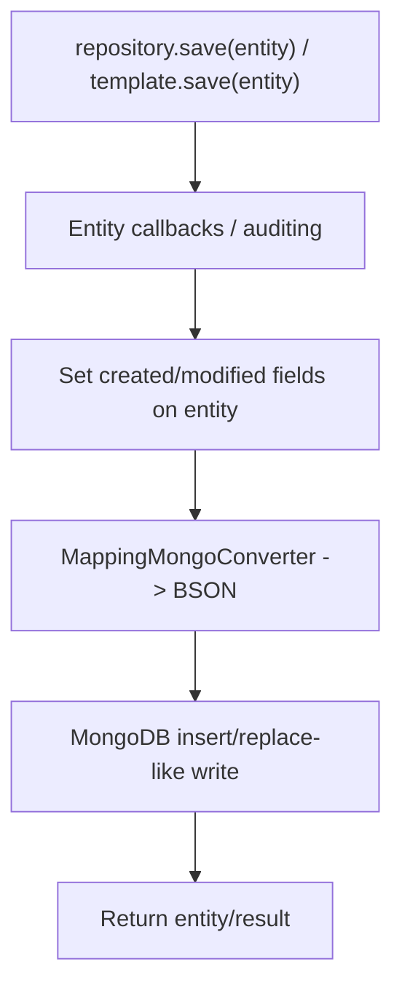
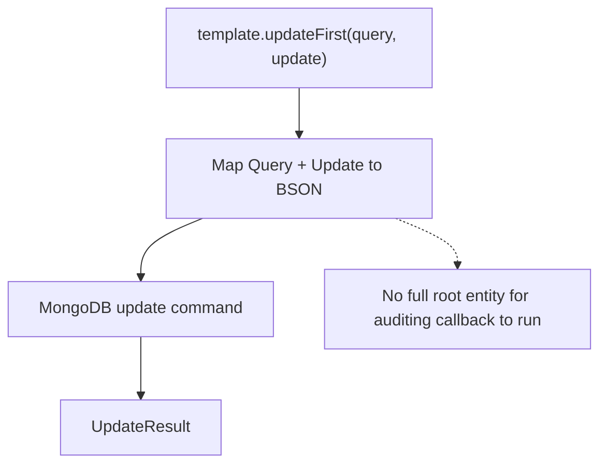
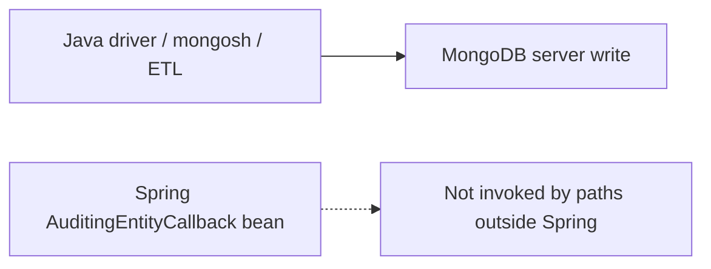
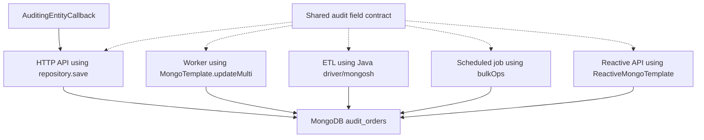

# Limitations of Auditing When Writing via Updates or the Direct Driver

## 1. The Problem: Status Updates Succeed Yet updatedAt Stays Unchanged

A Spring Data MongoDB application configures `@EnableMongoAuditing` and the four annotations:

- `@CreatedDate`: timestamp when the entity was created.
- `@LastModifiedDate`: timestamp when the entity was last modified via auditing.
- `@CreatedBy`: person/actor that created the entity.
- `@LastModifiedBy`: person/actor that modified the entity via auditing.

When calling `repository.save(order)`, auditing fields are normally populated properly. However, a high-throughput update flow uses:

```java
mongoTemplate.updateFirst(
    Query.query(Criteria.where("id").is(orderId)),
    new Update().set("status", "PAID"),
    AuditOrder.class
);
```

After this command, `status` in MongoDB is `PAID`, yet `lastModifiedAt` and `lastModifiedBy` **keep their old values**. Monitoring systems watching `lastModifiedAt` assume the order has not changed.

This is not necessarily an `@EnableMongoAuditing` configuration bug. The reason is that **entity auditing callbacks run when Spring Data processes an entity through the appropriate mapping lifecycle; a `Query + Update` command does not load, convert, and re-save the entire entity**.

Another write path that bypasses Java auditing:

```javascript
db.audit_orders.updateOne(
  { _id: "order-101" },
  { $set: { status: "PAID" } }
);
```

`mongosh` and applications using the MongoDB driver directly do not execute Spring Data callback beans inside the JVM.

**Lesson objectives** in the **Auditing** chapter of the **SPRING_DATA_MONGODB** module: understand auditing boundaries across repositories, `MongoTemplate`, partial updates, bulk/upsert, the direct driver, reactive access, and transactions; design **explicit, consistent** metadata writes; and test modifier tracking, timestamps, concurrency, and operational failures. Spring Data MongoDB remains the tool for connecting, document mapping, queries, aggregations, indexes, transactions, reactive access, testing, and performance diagnostics, yet auditing does not automatically cover every MongoDB command.

## 2. Distinguishing Entity Auditing from a Business Audit Trail

The word "audit" can refer to several distinct layers:

| Concept | Recorded Data | Questions It Can Answer |
| --- | --- | --- |
| **Entity auditing** | `createdAt`, `createdBy`, `lastModifiedAt`, `lastModifiedBy` on the current document | Who created/modified and when along audited write paths? |
| **Audit trail** | Before/after events, actions, reasons, correlation IDs | How did state transition from one value to another over time? |
| **Database change stream** | Change events emitted by MongoDB when supported | How did documents/collections change at the DB layer? |
| **Application logs/traces** | Requests, actors, endpoints, latency, errors | Which execution path triggered the operation? |
| **Authorization** | Allow/deny access decisions | Was this actor allowed to edit the document? |

Entity auditing stores only **current metadata state**. If a document is edited five times, a single `lastModifiedBy` field does not retain all five editors.

More importantly: **metadata is not automatically generated on every write path**. If even one producer bypasses auditing, the "last modifier" field may no longer reflect the actual latest change.

### 2.1. Three Statements Never to Equate

1. "The Java class has `@LastModifiedDate`" **does not mean** MongoDB updates the timestamp on every `updateOne`.
2. "The update command succeeded" **does not mean** Spring Data executed `AuditingEntityCallback`.
3. "The document shows `lastModifiedBy="alice"`" **does not prove** Alice performed the most recent operation if raw/bulk updates ran without setting metadata.

If the system needs immutable compliance evidence, design a dedicated audit trail with access controls, retention, integrity, and reconciliation. Never rely on the four auditing fields as sole proof.

## 3. How Auditing Works in Spring Data MongoDB

Spring Data MongoDB integrates Spring Data Commons auditing. When enabled and registered with callbacks, the framework determines new/existing state, resolves time and auditor details, and populates the annotated fields.

### 3.1. Declaring an Entity with Audit Fields

```java
package example.auditing;

import java.time.Instant;
import org.springframework.data.annotation.CreatedBy;
import org.springframework.data.annotation.CreatedDate;
import org.springframework.data.annotation.Id;
import org.springframework.data.annotation.LastModifiedBy;
import org.springframework.data.annotation.LastModifiedDate;
import org.springframework.data.annotation.Version;
import org.springframework.data.mongodb.core.mapping.Document;

@Document(collection = "audit_orders")
public class AuditOrder {

    @Id
    private String id;

    // Allows Spring Data to detect a new entity even when
    // the application pre-assigns the ID before insert.
    @Version
    private Long version;

    private String tenantId;
    private String status;

    @CreatedDate
    private Instant createdAt;

    @CreatedBy
    private String createdBy;

    @LastModifiedDate
    private Instant lastModifiedAt;

    @LastModifiedBy
    private String lastModifiedBy;

    protected AuditOrder() {}

    public AuditOrder(
            String id, String tenantId, String status) {
        this.id = id;
        this.tenantId = tenantId;
        this.status = status;
    }

    public String getId() { return id; }
    public Long getVersion() { return version; }
    public String getTenantId() { return tenantId; }
    public String getStatus() { return status; }
    public Instant getCreatedAt() { return createdAt; }
    public String getCreatedBy() { return createdBy; }
    public Instant getLastModifiedAt() { return lastModifiedAt; }
    public String getLastModifiedBy() { return lastModifiedBy; }
}
```

This is a mutable entity for mapping illustration. Real applications can add controlled constructors/setters, validation, and immutable entity rules. `@Version Long version` **starts as null**, allowing Spring Data to detect a new entity even if the ID is pre-assigned before calling `insert`; it also supports optimistic locking on supported write paths. If you have only a pre-assigned `@Id` without a newness strategy, the entity may be treated as **existing** when auditing evaluates created fields. Placing `@CreatedDate`/`@LastModifiedDate` on an entity **does not create any server-side trigger**.

### 3.2. Enabling Auditing and Providing AuditorAware

```java
package example.auditing;

import java.util.Optional;
import org.springframework.context.annotation.Bean;
import org.springframework.context.annotation.Configuration;
import org.springframework.data.domain.AuditorAware;
import org.springframework.data.mongodb.config.EnableMongoAuditing;

@Configuration
@EnableMongoAuditing(auditorAwareRef = "currentAuditor")
public class MongoAuditConfiguration {

    @Bean("currentAuditor")
    AuditorAware<String> currentAuditor() {
        return () -> Optional.of("service-batch");
    }
}
```

`"service-batch"` is a **fixed actor for demonstration**, not a recommendation to record every production change under one identity. When users log in, the auditor must be resolved from a **server-side authenticated security context**; for system jobs, use a well-defined service identity.

### 3.3. Where Does the Time Come From?

Auditing uses a `DateTimeProvider`/clock configured in Spring Data, or a default time source depending on version. It is **application-layer time per configuration**, not automatically the time MongoDB Server commits the document.

If multiple JVMs experience clock drift, application timestamps can diverge. Conversely, using `$currentDate` or `$$NOW` on MongoDB Server records server time. Choose a consistent policy defining what `lastModifiedAt` means.

### 3.4. When Are Created and Last-Modified Fields Populated?

| Mapped Entity Operation | Typical Auditing Expectation |
| --- | --- |
| Insert root entity without audit metadata | `createdAt`/`createdBy` populated if configured |
| Save existing root entity | Last-modified fields updated |
| Create new entity with default `modifyOnCreate` | Last-modified fields may also populate at creation |
| Raw BSON update | Does not run Java callbacks |
| Partial update via Query + Update | Does not auto-update auditing fields from annotations alone |

The default for `modifyOnCreate` and how "new entity" is determined depend on Spring Data configuration and ID/version state. Do not write tests asserting `lastModifiedAt` is always `null` right after insert if your config enables setting last-modified on create.

## 4. Execution Paths: Saving an Entity vs. Sending an Update Command

### 4.1. Root Entity Save



On the entity save path, auditing processes the **root entity** during the conversion lifecycle.

### 4.2. Query + Update



`Update` can use mapping metadata to translate Java field names into MongoDB field names, yet it is **not** a `save(AuditOrder)`. The framework does not load the old entity to learn its creator or current last-modified metadata, so annotations cannot be assumed to execute.

### 4.3. Raw Driver or mongosh



MongoDB Server enforces write concerns, validators, indexes, transactions, and authorization—yet it **knows nothing about the Java `@LastModifiedDate` annotation**. Mapping callbacks exist only inside the Spring application using them.

## 5. Matrix of Write Paths and Auditing Scope

| API / Write Path | Runs root entity conversion/auditing callback? | What to do if audit updates are required? |
| --- | --- | --- |
| `MongoRepository.save(entity)` | Usually yes when auditing is enabled | Verify bean, entity newness, auditor |
| `MongoTemplate.insert(entity)` | Usually yes | Verify created fields |
| `MongoTemplate.save(entity)` | Usually yes | Check last-modified and lost updates |
| `MongoTemplate.updateFirst(Query, Update, …)` | **Not an entity save** | Explicitly set `lastModifiedAt`/`By` |
| `MongoTemplate.updateMulti(...)` | **Does not** audit per entity | Audit all matched docs via update fields |
| `MongoTemplate.upsert(...)` | **Does not** audit the upserted entity | `$setOnInsert` + `$set`/`$currentDate` |
| `MongoTemplate.findAndModify(...)` | Update command; no save-side auto-auditing | Include fields in `Update` |
| `BulkOperations.updateOne/updateMulti` | No per-document entity save cycle | Standardize audit fields in each operation |
| `BulkOperations.insert(...)` | Do not assume full `template.insert(entity)` auditing | Populate metadata before queuing bulk; test your version |
| Repository method using `@Update` | Repository emits direct update query | Declare audit in update or go through service |
| `MongoCollection<Document>.updateOne` | Does not run Spring Data entity auditing | Write fields via driver |
| `mongosh`/ETL/other microservice | Unaware of Java callbacks | Establish shared writer/audit metadata contract |
| `ReactiveMongoTemplate.updateFirst` | Does not pass through root reactive auditing | Compose actor + timestamp in the update |
| `ReactiveMongoRepository.save(entity)` | Passes through reactive auditing callbacks when configured | Check `ReactiveAuditorAware`, context, subscription |

**Version note:** complex operations, custom converters, and callbacks may vary across Spring Data MongoDB versions. This matrix shows the **core boundary**: passing `entityClass` to an API does not mean it executes the `save(entity)` lifecycle.

## 6. Baseline: repository.save Updates Auditing

### 6.1. Repository

```java
package example.auditing;

import org.springframework.data.mongodb.repository.MongoRepository;

public interface AuditOrderRepository
        extends MongoRepository<AuditOrder, String> {
}
```

### 6.2. Creating an Order via save

```java
AuditOrder order = new AuditOrder(
    "order-101", "shop-a", "PENDING"
);

AuditOrder saved = repository.save(order);

System.out.println(saved.getCreatedAt());
System.out.println(saved.getCreatedBy());
System.out.println(saved.getLastModifiedAt());
System.out.println(saved.getLastModifiedBy());
```

With auditing properly configured, Spring Data populates created/modified metadata per active policy. The example entity keeps `@Version Long version` as `null` to clarify **newness** despite a pre-assigned ID. For other entities, confirm what makes an **"entity new"**: pre-assigned IDs, `@Version`, custom `Persistable.isNew()`, and mapping `isNew` strategies directly govern create vs. update auditing.

### 6.3. Saving an Entity After Editing

```java
AuditOrder existing =
    repository.findById("order-101").orElseThrow();

// This example entity omits a status setter.
// In a real app, use a state-transition method
// or an immutable entity with explicit copy-with.

AuditOrder resaved = repository.save(existing);
```

This snippet illustrates the lifecycle rather than a real status edit: `existing` was unmodified, yet saving updates audit metadata despite no business change. Production designs should avoid needless saves and handle concurrency.

**Important note:** converting every partial update into `find → modify → save` merely to trigger auditing is simple yet risks **lost updates**, larger payloads, and extra round-trips. Do not make it the blanket default in multi-writer systems.

## 7. updateFirst: Auditing Annotations Do Not Auto-Update lastModified*

### 7.1. Code That Looks Valid Yet Skips Auditing

```java
Query target = Query.query(
    Criteria.where("id").is("order-101")
        .and("tenantId").is("shop-a")
);

Update statusOnly = new Update()
    .set("status", "PAID");

UpdateResult result = template.updateFirst(
    target, statusOnly, AuditOrder.class
);
```

This updates `status` to `PAID` **without** updating `lastModifiedAt` or `lastModifiedBy`. `@LastModifiedDate` on `AuditOrder` is not enforced by MongoDB Server.

### 7.2. The Right Path: Set Audit Fields Explicitly

```java
String authorizedTenant = "shop-a";
String authenticatedActor = "user-42";
String orderId = "order-101";

Query target = Query.query(
    Criteria.where("id").is(orderId)
        .and("tenantId").is(authorizedTenant)
        .and("status").is("PENDING")
);

Update withAudit = new Update()
    .set("status", "PAID")
    .set("lastModifiedBy", authenticatedActor)
    .currentDate("lastModifiedAt");

UpdateResult result = template.updateFirst(
    target, withAudit, AuditOrder.class
);

if (result.getMatchedCount() != 1) {
    throw new IllegalStateException(
        "Order missing, wrong tenant, or status already changed"
    );
}
```

`Update.currentDate("lastModifiedAt")` emits the `$currentDate` operator asking MongoDB Server to assign BSON Date when executing the update. `lastModifiedBy` comes from a **server-side verified auth source**, never arbitrarily from request JSON.

### 7.3. Corresponding BSON

```javascript
db.audit_orders.updateOne(
  {
    _id: "order-101",
    tenantId: "shop-a",
    status: "PENDING"
  },
  {
    $set: {
      status: "PAID",
      lastModifiedBy: "user-42"
    },
    $currentDate: {
      lastModifiedAt: true
    }
  }
);
```

`$set` and `$currentDate` apply in **a single update on a single document**. This is far better than "update status in command 1, update audit in command 2", which suffers partial failures and races.

### 7.4. Understanding Write Results

`UpdateResult.getMatchedCount()` indicates whether a document matched the criteria, while `getModifiedCount()` indicates whether a document was modified per MongoDB semantics. If nothing matched, never claim the actor modified the order; handle write errors and write-concern errors explicitly.

Putting audit fields into the **same update** guarantees a document never gets a new business status with stale audit fields due to split commands. It **does not** replace permission checks, idempotency, transactions, or business validation.

### 7.5. Should You Use currentDate or Instant.now()?

Both are useful with slightly different semantics:

| Time Source | Origin | Consideration |
| --- | --- | --- |
| `new Update().currentDate("lastModifiedAt")` | MongoDB server clock | Written atomically with command; differs from default Java auditing source |
| `new Update().set("lastModifiedAt", Instant.now(clock))` | Application clock | Aligns easily with `DateTimeProvider`; JVMs can have clock skew |
| `$$NOW` in aggregation update pipeline | Server time inside pipeline | Fits pipelines; verify server semantics and version |

Never assume timestamps from all three approaches can be compared to nanosecond precision. BSON Date has millisecond resolution whereas Java `Instant` can carry nanoseconds; mapping/drivers round/truncate to what BSON supports.

## 8. updateMulti: Multiple Documents Changed Without Individual Auditing Callbacks

Suppose we want to cancel all `PENDING` orders for a tenant:

```java
Query query = Query.query(
    Criteria.where("tenantId").is("shop-a")
        .and("status").is("PENDING")
);

Update update = new Update()
    .set("status", "CANCELLED")
    .set("lastModifiedBy", "system-expiration-job")
    .currentDate("lastModifiedAt");

UpdateResult result = template.updateMulti(
    query, update, AuditOrder.class
);
```

Matched documents are updated by a single MongoDB command, **not** by Spring Data loading each entity, running `AuditingEntityCallback`, and saving back. Therefore:

- You cannot rely on `AuditorAware` executing once per document.
- Every matched document receives the same actor `system-expiration-job` (appropriate if that job is the true actor).
- `$currentDate` assigns server timestamps while processing the update; it does not emit a separate audit event per document.
- `getModifiedCount` does not return the list of modified IDs.
- If a per-order audit trail is required, design dedicated event/outbox/reconciliation records.

### 8.1. Security Criteria for System Actors

A nightly job can use a registered service identity like `"system-expiration-job"`. Never use `"admin"` to obscure the real writer. Include a job run ID or correlation ID in audit trails or logs when batch traceability is required.

### 8.2. Do Not Confuse updateMulti with a Transaction

MongoDB updates are atomic at the single-document level, yet `updateMulti` is not automatically a **multi-document transaction**. On error, depending on MongoDB behavior and operation, partial updates across a subset of documents can remain. When all-or-nothing is required, evaluate transactions and their operational cost.

## 9. findAndModify: Returning the Updated Entity Does Not Mean Entity Auditing

`findAndModify` combines a query, an update, and returning the old or new document in one operation:

```java
Query query = Query.query(
    Criteria.where("id").is("order-101")
        .and("tenantId").is("shop-a")
        .and("status").is("PENDING")
);

Update update = new Update()
    .set("status", "PAID")
    .set("lastModifiedBy", "user-42")
    .currentDate("lastModifiedAt");

FindAndModifyOptions options =
    FindAndModifyOptions.options().returnNew(true);

AuditOrder updated = template.findAndModify(
    query, update, options, AuditOrder.class
);
```

This snippet requires imports for `Query`, `Criteria`, `Update`, and `FindAndModifyOptions` from Spring Data. Returning a mapped `AuditOrder` **does not prove** the root entity passed through before-convert auditing like `save(entity)`. In this example, audit fields updated only because **`Update` declared them explicitly**.

`findAndModify` can return `null` when unmatched depending on `upsert`/`returnNew`; always check before assuming business success.

### 9.1. @Query + @Update on Repositories

MongoDB repositories support query update methods depending on version, such as combining `@Query` with `@Update`. They issue **update commands**, rather than turning into `repository.save(entity)` just because the method lives on a repository interface.

With query-update methods, declare `lastModifiedAt`/`By` explicitly if needed, and never pass an unverified client-supplied actor string into the binding. When binding actors into annotations becomes awkward, a custom repository or service using `MongoTemplate` is cleaner and easier to test.

## 10. Upsert: Distinguishing Creation from Modification of Existing Entities

`upsert` means **update the matching document, or insert a new document if none matches**. Unlike `save(entity)`, Spring Data does not necessarily have a root entity to run `@CreatedDate`/`@LastModifiedDate`.

### 10.1. The Problem to Solve

For a new document:

- `createdAt` = creation timestamp.
- `createdBy` = creator.
- `lastModifiedAt` = current write timestamp.
- `lastModifiedBy` = current modifier.

For an existing document:

- **Do not overwrite** `createdAt` or `createdBy`.
- Update only `lastModifiedAt` and `lastModifiedBy` alongside business fields.

### 10.2. Using $setOnInsert

```java
Instant now = clock.instant();
String actor = authenticatedActor;

Query key = Query.query(
    Criteria.where("id").is(orderId)
        .and("tenantId").is(authorizedTenantId)
);

Update update = new Update()
    .setOnInsert("createdAt", now)
    .setOnInsert("createdBy", actor)
    .set("status", "PENDING")
    .set("lastModifiedBy", actor)
    .currentDate("lastModifiedAt");

UpdateResult result = template.upsert(
    key, update, AuditOrder.class
);
```

`clock`, `authenticatedActor`, `orderId`, and `authorizedTenantId` are supplied by the service. `setOnInsert` applies only when the operation actually inserts a new document. `$set` and `$currentDate` apply in both the insert and update branches.

### 10.3. Illustrative BSON

```javascript
db.audit_orders.updateOne(
  {
    _id: "order-101",
    tenantId: "shop-a"
  },
  {
    $setOnInsert: {
      createdAt: ISODate("2026-11-20T09:00:00Z"),
      createdBy: "user-42"
    },
    $set: {
      status: "PENDING",
      lastModifiedBy: "user-42"
    },
    $currentDate: {
      lastModifiedAt: true
    }
  },
  { upsert: true }
);
```

This sample command uses a simulated timestamp. In production, never hardcode timestamps; use a proper clock or server operator.

### 10.4. Watch Out for Field Path Conflicts

Never put `$setOnInsert` and `$set`/`$currentDate` on **the same field** inside a classic update expecting MongoDB to resolve an order:

```javascript
// Wrong: conflicting field path createdAt across two operators.
{
  $setOnInsert: { createdAt: ISODate("2026-11-20") },
  $set:         { createdAt: ISODate("2026-11-21") }
}
```

Duplicate field paths are rejected by MongoDB as update path conflicts. Keep `createdAt` solely in `$setOnInsert`, and `lastModifiedAt` solely in `$currentDate`/`$set`.

### 10.5. Upsert Without Identity Verification

An actor taken from an HTTP request body is not a trusted audit actor. `createdBy` must be resolved by the server; when an admin acts on behalf of a user, separate **acting principal** and **target subject** if business requires it. These fields never replace permission checks in the query.

## 11. Raw MongoDB Java Driver: No Spring Callbacks

When using synchronous `MongoClient` and `MongoCollection<Document>` directly:

```java
import com.mongodb.client.MongoCollection;
import com.mongodb.client.model.Filters;
import com.mongodb.client.model.Updates;
import org.bson.Document;

MongoCollection<Document> collection =
    mongoClient.getDatabase("store")
        .getCollection("audit_orders");

collection.updateOne(
    Filters.and(
        Filters.eq("_id", "order-101"),
        Filters.eq("tenantId", "shop-a")
    ),
    Updates.set("status", "PAID")
);
```

`@LastModifiedDate` on a Java entity elsewhere **cannot affect** this command: the driver sends BSON operations straight to MongoDB.

### 11.1. Driver Update with Full Audit Metadata

```java
import static com.mongodb.client.model.Filters.and;
import static com.mongodb.client.model.Filters.eq;
import static com.mongodb.client.model.Updates.combine;
import static com.mongodb.client.model.Updates.currentDate;
import static com.mongodb.client.model.Updates.set;

var result = collection.updateOne(
    and(
        eq("_id", "order-101"),
        eq("tenantId", "shop-a"),
        eq("status", "PENDING")
    ),
    combine(
        set("status", "PAID"),
        set("lastModifiedBy", "user-42"),
        currentDate("lastModifiedAt")
    )
);

if (result.getMatchedCount() != 1) {
    throw new IllegalStateException(
        "Order not found in transitionable state"
    );
}
```

This shows the application **explicitly** maintaining metadata in the raw driver. `"user-42"` is illustrative; the actor source must be authenticated.

### 11.2. Driver Inserts Also Need Audit Fields

```java
Instant now = clock.instant();
Document doc = new Document("_id", orderId)
    .append("tenantId", authorizedTenantId)
    .append("status", "PENDING")
    .append("createdAt", java.util.Date.from(now))
    .append("createdBy", authenticatedActor)
    .append("lastModifiedAt", java.util.Date.from(now))
    .append("lastModifiedBy", authenticatedActor);

collection.insertOne(doc);
```

With `Document`, the MongoDB driver stores `java.util.Date` as BSON Date. It **never invokes** `AuditorAware`, `BeforeConvertCallback<AuditOrder>`, or `MongoTemplate`'s converter like root saves.

The upside is explicit control; the downside is **every producer must adhere to the exact same audit contract** so fields are never missed.

## 12. BulkOperations: Do Not Mistake Batch Optimization for Full Auditing

A bulk update batches multiple commands and reduces round-trips:

```java
BulkOperations bulk = template.bulkOps(
    BulkOperations.BulkMode.ORDERED,
    AuditOrder.class
);

bulk.updateOne(
    Query.query(Criteria.where("id").is("order-101")),
    new Update()
        .set("status", "PAID")
        .set("lastModifiedBy", "system-import")
        .currentDate("lastModifiedAt")
);

bulk.updateOne(
    Query.query(Criteria.where("id").is("order-102")),
    new Update()
        .set("status", "CANCELLED")
        .set("lastModifiedBy", "system-import")
        .currentDate("lastModifiedAt")
);

BulkWriteResult result = bulk.execute();
```

In real code, import `BulkOperations`, `Query`, `Criteria`, `Update`, and `com.mongodb.bulk.BulkWriteResult`. When a bulk batch consists of update commands, per-entity auditing callbacks **do not automatically run**. Each operation needs explicit metadata.

### 12.1. Never Assume Bulk Insert Behaves Like repository.save

`BulkOperations.insert(entity)` must not be assumed identical to `MongoTemplate.insert(entity)` with full auditing/entity callbacks across all versions. With bulk operations, **explicitly populate created/modified metadata before queuing into bulk** and write integration tests verifying raw BSON.

This matters especially when importing 10 million documents: a missing `createdBy` field makes tracing data provenance across the entire import difficult.

### 12.2. Ordered, Unordered, and Partial Success

A bulk batch of updates does not automatically form a **multi-document transaction**. In ordered mode, MongoDB stops the sequence on the first error per bulk semantics; in unordered mode, remaining operations may still execute.

If the third operation fails, the first two documents may already carry the new status and audit fields. Inspect `BulkWriteResult` and exceptions rather than relying on a simple `success=true` flag.

If all-or-nothing across multiple documents is mandatory, use a transaction on a supported topology or design compensating workflows. Even inside a transaction, audit metadata must be **explicitly written in each operation**.

### 12.3. Do All Documents Share the Same Timestamp?

If each operation uses `$currentDate`, the server sets timestamps as each command executes; never assume all documents in the bulk receive identical timestamps.

If business logic wants a shared `jobStartedAt` timestamp, store a separate field from **a job-defined clock** rather than conflating it with when each document was actually updated.

## 13. Aggregation Pipeline Updates: Recording Time with $$NOW

MongoDB supports updates via aggregation pipelines. Inside a pipeline, the system variable `$$NOW` evaluates to the current server time for supported operations.

### 13.1. mongosh Example

```javascript
const actor = "user-42"; // Server-authenticated.

db.audit_orders.updateOne(
  {
    _id: "order-101",
    tenantId: "shop-a",
    status: "PENDING"
  },
  [
    {
      $set: {
        status: "PAID",
        lastModifiedAt: "$$NOW",
        lastModifiedBy: { $literal: actor }
      }
    }
  ]
);
```

`$$NOW` is interpreted by MongoDB as an **aggregation expression variable**, not stored as a literal string. For string fields that might start with `$`, wrap them in `$literal` inside pipelines so they are not evaluated as field path expressions.

### 13.2. How Pipeline Updates Differ from Classic Updates

| Classic Update | Pipeline Update |
| --- | --- |
| `$set`, `$inc`, `$currentDate`, `$setOnInsert` | Stages like `$set`/`$unset` with aggregation expressions |
| `$currentDate` assigns server timestamp | `$$NOW` used in expressions |
| Convenient for independent field sets | Useful when deriving fields from existing document fields |
| Upsert supports `$setOnInsert` | Upsert with pipeline must handle create/update branches via expressions and real data |

**Never copy classic `$setOnInsert` verbatim into a pipeline assuming identical semantics.** The two update forms have different operator contracts. When implementing upserts with pipelines, test both the insert and update branches, especially `createdAt`/`By` preservation.

### 13.3. Protecting the createdAt Field

If a pipeline wants to populate `createdAt` when absent, `$ifNull` can act as a default:

```javascript
db.audit_orders.updateOne(
  { _id: "order-101", tenantId: "shop-a" },
  [
    {
      $set: {
        createdAt: { $ifNull: ["$createdAt", "$$NOW"] },
        lastModifiedAt: "$$NOW"
      }
    }
  ],
  { upsert: true }
);
```

However, this is a **backfill-missing-field policy**, not strictly "set only on insert". An **existing legacy document missing `createdAt`** would also get stamped with the current update time. If business rules require `createdAt` to reflect historical creation time, this behavior **corrupts data**. Prefer `$setOnInsert` with classic updates or a verified migration rather than treating `$$NOW` as historical truth.

## 14. Reactive Auditing: Reactor Context Does Not Auto-Fix Partial Updates

### 14.1. Enabling Reactive Auditing

Reactive Spring Data MongoDB provides auditing and auditor providers through reactive APIs:

```java
package example.auditing;

import org.springframework.context.annotation.Bean;
import org.springframework.context.annotation.Configuration;
import org.springframework.data.domain.ReactiveAuditorAware;
import org.springframework.data.mongodb.config.EnableReactiveMongoAuditing;
import org.springframework.security.core.context.ReactiveSecurityContextHolder;

@Configuration
@EnableReactiveMongoAuditing(
    auditorAwareRef = "reactiveCurrentAuditor"
)
public class ReactiveAuditConfiguration {

    @Bean("reactiveCurrentAuditor")
    ReactiveAuditorAware<String> reactiveCurrentAuditor() {
        return () -> ReactiveSecurityContextHolder
            .getContext()
            .flatMap(context ->
                reactor.core.publisher.Mono.justOrEmpty(
                    context.getAuthentication()
                )
            )
            .filter(authentication ->
                authentication != null
                    && authentication.isAuthenticated()
            )
            .map(authentication ->
                authentication.getName()
            );
    }
}
```

This is a sample config for **Spring Security WebFlux**. Add anonymous authentication filtering, impersonation rules, and authorization per system policy. `ReactiveAuditorAware` supplies the actor to auditing callbacks when reactive entities are saved; **it does not make `ReactiveMongoTemplate.updateFirst` auto-populate audit fields**.

### 14.2. Reactive Updates Must Compose the Actor into the Command

```java
package example.auditing;

import com.mongodb.client.result.UpdateResult;
import org.springframework.data.mongodb.core.ReactiveMongoTemplate;
import org.springframework.data.mongodb.core.query.Criteria;
import org.springframework.data.mongodb.core.query.Query;
import org.springframework.data.mongodb.core.query.Update;
import org.springframework.security.core.context.ReactiveSecurityContextHolder;
import org.springframework.stereotype.Service;
import reactor.core.publisher.Mono;

@Service
public class ReactiveAuditOrderUpdateService {

    private final ReactiveMongoTemplate template;

    public ReactiveAuditOrderUpdateService(
            ReactiveMongoTemplate template) {
        this.template = template;
    }

    public Mono<UpdateResult> markPaid(
            String orderId, String authorizedTenantId) {

        if (orderId == null || orderId.isBlank()
                || authorizedTenantId == null
                || authorizedTenantId.isBlank()) {
            return Mono.error(
                new IllegalArgumentException("Missing ID/tenant")
            );
        }

        return ReactiveSecurityContextHolder.getContext()
            .flatMap(ctx ->
                Mono.justOrEmpty(ctx.getAuthentication())
            )
            .filter(auth -> auth != null
                && auth.isAuthenticated())
            .switchIfEmpty(Mono.error(
                new IllegalStateException(
                    "Authenticated actor not found"
                )
            ))
            .flatMap(auth -> {
                Query query = Query.query(
                    Criteria.where("id").is(orderId)
                        .and("tenantId").is(authorizedTenantId)
                        .and("status").is("PENDING")
                );

                Update update = new Update()
                    .set("status", "PAID")
                    .set("lastModifiedBy", auth.getName())
                    .currentDate("lastModifiedAt");

                return template.updateFirst(
                    query, update, AuditOrder.class
                );
            })
            .flatMap(result -> {
                if (result.getMatchedCount() != 1) {
                    return Mono.error(
                        new IllegalStateException(
                            "Order did not match conditions"
                        )
                    );
                }
                return Mono.just(result);
            });
    }
}
```

In WebFlux, Spring Security authentication/authorization must actively supply the context. `authorizedTenantId` is a **server-authenticated tenant**, never a client-supplied tenant trusted blindly. Production code still needs business rules, error mapping, and idempotency before handling real payments.

### 14.3. Why Not Use ThreadLocal for All Reactive Writes?

Reactive pipelines can switch threads between operators. An auditor reading `ThreadLocal` on the current thread may miss the originating request's actor. For reactive security/transactions, always use **Reactor Context** or official framework mechanisms.

```java
Mono<UpdateResult> update = service.markPaid(id, tenant);

// Do not manually subscribe inside WebFlux service/controller.
return update;
```

Calling `subscribe()` inside a callback can detach the query from active security context, transaction, and error propagation. Return Publishers to WebFlux or compose with `flatMap`.

### 14.4. Auditing Does Not Execute Before Subscription

`ReactiveMongoTemplate.save(entity)` builds a Publisher; mapping and writing occur only upon subscription. Partial updates like `ReactiveMongoTemplate.updateFirst(...)` are also lazy, yet when subscribed they still do not become root-entity save callbacks.

**Lazy execution and auditing eligibility are separate concerns.** Never assume "subscribing makes `@LastModifiedDate` run automatically" across all MongoDB Publishers.

## 15. Utility Patterns: Avoiding Forgotten Audits Across Write Services

### 15.1. A Helper for Modified Metadata

```java
package example.auditing;

import java.time.Clock;
import org.springframework.data.mongodb.core.query.Update;

public final class AuditUpdates {

    private final Clock clock;

    public AuditUpdates(Clock clock) {
        this.clock = clock;
    }

    public Update markModified(
            Update businessUpdate,
            String authenticatedActor) {

        if (authenticatedActor == null
                || authenticatedActor.isBlank()) {
            throw new IllegalArgumentException(
                "Invalid audit actor"
            );
        }

        return businessUpdate
            .set("lastModifiedBy", authenticatedActor)
            .set("lastModifiedAt", clock.instant());
    }
}
```

This helper uses the **application clock**, fitting systems wanting manual updates to match `DateTimeProvider`'s time source. If the entire system prefers **server time**, replace the last two calls with `.set("lastModifiedBy", actor).currentDate("lastModifiedAt")` and document the difference.

**Never share a single `Update` instance across concurrent operations** mutating it with different actors. `Update` is a stateful builder; create a fresh instance per operation.

### 15.2. Example Service Calling the Helper

```java
Update business = new Update().set("status", "PAID");

Update audited = auditUpdates.markModified(
    business, authenticatedActor
);

UpdateResult result = template.updateFirst(
    Query.query(
        Criteria.where("id").is(orderId)
            .and("tenantId").is(authorizedTenant)
            .and("status").is("PENDING")
    ),
    audited,
    AuditOrder.class
);
```

Benefit: multiple services share the same actor/timestamp update rule. Limitation: the helper **cannot force** writers that bypass it to comply. Across all producers, combine code reviews, API boundaries, tests, and optionally MongoDB validators for required fields.

### 15.3. Never Store the Actor in a Mutable Singleton Field

```java
// Anti-pattern:
@Service
class SharedAuditContext {
    private String currentActor;
}
```

A singleton serving concurrent requests can overwrite request B's document with request A's actor. Actors must be **local to the use case or resolved accurately per subscription context**.

### 15.4. When Is a Shared Data-Access Boundary Needed?

If multiple services update `audit_orders`, expose dedicated business command methods:

```java
interface AuditOrderCommands {
    UpdateResult markPaid(
        String orderId,
        String authorizedTenant,
        String authenticatedActor
    );

    UpdateResult cancelPending(
        String orderId,
        String authorizedTenant,
        String systemActor
    );
}
```

This is an application interface, not a built-in Spring Data API. It centralizes **tenant filters, state transitions, actors, and audit metadata**. Never expose an unrestricted arbitrary-field update method expecting callbacks to protect everything.

## 16. Concurrency: Accurate Metadata Does Not Prevent Overwrites

Suppose two writers both read `status=PENDING`:

```text
T1: service A reads PENDING
T2: service B reads PENDING
T3: service A saves status=PAID, updatedBy=A
T4: service B saves status=CANCELLED, updatedBy=B
```

Ultimately, the document ends up `CANCELLED` with `lastModifiedBy=B`. Auditing recorded the last modifier's identity, yet **did not prevent the lost update** or protect the business transition.

### 16.1. Conditional Update on State

```java
Query query = Query.query(
    Criteria.where("id").is(orderId)
        .and("tenantId").is(authorizedTenant)
        .and("status").is("PENDING")
);

Update update = new Update()
    .set("status", "PAID")
    .set("lastModifiedBy", authenticatedActor)
    .currentDate("lastModifiedAt");

UpdateResult result = template.updateFirst(
    query, update, AuditOrder.class
);
```

If one writer already transitioned the status, the second writer gets `matchedCount=0` instead of overwriting. This is a state-based optimistic conditional write.

### 16.2. @Version and the Raw Driver

`@Version` is Spring Data's optimistic locking mechanism on supported operations. However, **the raw driver knows nothing about the Java `@Version` annotation**. For version-checked optimistic updates in the raw driver, specify both the version filter and increment explicitly:

```java
var result = collection.updateOne(
    com.mongodb.client.model.Filters.and(
        com.mongodb.client.model.Filters.eq("_id", orderId),
        com.mongodb.client.model.Filters.eq(
            "tenantId", authorizedTenant
        ),
        com.mongodb.client.model.Filters.eq(
            "version", expectedVersion
        )
    ),
    com.mongodb.client.model.Updates.combine(
        com.mongodb.client.model.Updates.set(
            "status", "PAID"
        ),
        com.mongodb.client.model.Updates.set(
            "lastModifiedBy", authenticatedActor
        ),
        com.mongodb.client.model.Updates.currentDate(
            "lastModifiedAt"
        ),
        com.mongodb.client.model.Updates.inc(
            "version", 1L
        )
    )
);

if (result.getMatchedCount() != 1) {
    throw new OptimisticConflictException(
        "Document has changed"
    );
}
```

`expectedVersion` is a reliably read/passed version value; `OptimisticConflictException` is a **custom business exception**, not a built-in MongoDB type.

**Note:** some mapped update operations in Spring Data have their own `@Version` management depending on version/API. Never blindly add a manual `$inc("version", 1)` to a `MongoTemplate.updateFirst` on an `@Version` entity without checking if the framework already auto-increments version; you could double-increment or break semantics. The raw driver example above **does not use** Spring's mapping layer.

### 16.3. Transactions Do Not Auto-Generate Audit Metadata

Inside a MongoDB transaction, two updates commit or roll back together. Yet if both omit `lastModifiedAt`/`By`, using a transaction **does not make metadata appear automatically**. Write audit fields into every update command even inside transactions.

## 17. Multi-Writer Systems: Designing Consistent Metadata

### 17.1. Mapping Real Producers



Here, the repository's auditing callback covers only part of the system. **The single source of truth for data** is MongoDB; every writer must honor the audit field contract.

### 17.2. Recommended Metadata Conventions

| Field | BSON Type | Rule |
| --- | --- | --- |
| `createdAt` | Date | Set once initially; never modified in normal business updates |
| `createdBy` | String/service actor | Set once initially; never impersonated |
| `lastModifiedAt` | Date | Updated when business operations actually modify the document |
| `lastModifiedBy` | String/service actor | Updated alongside business changes |
| `revision` or `version` | Int32/Int64 per contract | Conditionally updated for concurrency |
| `sourceSystem` | String when needed | Records import/job origin when useful |
| `correlationId` | String when needed | Supports tracing; govern retention/PII |

Standardize whether timestamps come from the **server** or **app clock**, how job actors are named, and how missing authenticated principals fail. A system stamping `"unknown"` on every auth error cannot produce trustworthy audits.

### 17.3. Do Not Equate lastModifiedAt with All Write Traffic

A document may undergo technical updates (e.g., TTL markers, cache fields, metadata backfills) without any business state change. Define `lastModifiedAt` clearly as either:

- **Last physical write**: updated on every write touching the document.
- **Last business modification**: updated only on business changes.

These carry different meanings. Never let default callbacks and raw updates implement conflicting definitions on the same field.

## 18. MongoDB JSON Schema Validators: Enforcing Shape, Not Auto-Populating Metadata

If audit fields must always exist at the server level, a MongoDB collection validator can reject malformed documents, e.g.:

```javascript
const auditSchema = {
  bsonType: "object",
  required: [
    "tenantId",
    "status",
    "createdAt",
    "createdBy",
    "lastModifiedAt",
    "lastModifiedBy"
  ],
  properties: {
    tenantId: { bsonType: "string" },
    status: { bsonType: "string" },
    createdAt: { bsonType: "date" },
    createdBy: { bsonType: "string" },
    lastModifiedAt: { bsonType: "date" },
    lastModifiedBy: { bsonType: "string" }
  }
};
```

After inventorying legacy data and following proper governance, a `$jsonSchema` validator can require these fields on writes.

**However, a validator is not an auditing trigger**:

- It does not generate `createdAt` or `lastModifiedAt`.
- It does not know who the real authenticated user is.
- It cannot verify `lastModifiedAt` actually advanced when `status` changed if the schema only checks types/required fields.
- It does not store prior value history.
- With `validationLevel: "moderate"`, invalid legacy documents can still be updated without strict checks.

Thus validators act as a **schema safety net**, not a substitute for service/driver code populating audit metadata.

### 18.1. Rolling Out Validators When Legacy Data Lacks Fields

Never enable `strict + error` in production while ignoring legacy documents missing `createdAt`, because updates on those documents will be rejected. Instead:

1. Inventory documents missing or mis-typed for audit fields.
2. Identify which fields can be recovered from historical data.
3. Distinguish verified historical data from **estimated** backfill values.
4. Upgrade all producers and ETLs.
5. Run migrations and reconcile before tightening validation.

If the historical creation date is unknown, never set `createdAt=now()` claiming it is the real creation date. Use a separate `auditBackfilledAt` field to record when the backfill ran.

## 19. Auditing and Audit Trails: Do Change Streams Solve Everything?

MongoDB **change streams** allow applications to observe changes across supported collections, databases, or clusters. They can drive read models, search indexes, or audit pipelines, yet:

1. They do not know the **request's logged-in user** unless the application stored the actor metadata.
2. They do not guarantee **before-values** unless pre-images/history are configured and within retention.
3. They impose requirements on resume tokens, topology, error handling, deduplication, and operations.
4. They cannot recover historical events already expired from oplog retention.
5. Consumers can lag or replay events, requiring idempotent audit sinks.

### 19.1. Why Not Emit Audit Events from AfterSave Callbacks?

Spring Data's `AfterSave` does not mean a transaction has **committed**. If a listener publishes an event externally and the MongoDB transaction later rolls back, that event describes a change **that never committed**.

### 19.2. Outbox When High-Durability History Is Needed

One pattern:

```text
Inside the same MongoDB transaction:
  update order (status + audit fields)
  insert outbox event (actor, action, orderId, version)
  commit

After commit:
  worker reads outbox
  publishes to audit sink / message broker
  marks/retries idempotently
```

An outbox still requires proper **synchronization, retries, transactions, and retention**; however, it avoids mistaking a mapping callback for a "post-commit exactly-once event guarantee".

### 19.3. Soft Delete vs. Physical Delete

If a document is physically deleted, the four audit fields inside it are gone from direct queries. When traceability is needed:

- Use **soft delete**: `deletedAt`, `deletedBy`, status flags, and index/TTL policies.
- Or record deletion events in a separately managed audit trail/outbox.

Deleting via `collection.deleteOne` does not generate an automatic `@LastModifiedBy` on a vanished document.

## 20. Integration Testing: Proving Save Audits While Update Does Not

A meaningful integration test verifies **raw BSON stored in MongoDB**, not just the Java object returned by callbacks.

### 20.1. Test Configuration with AuditorAware and Fixed Clock

```java
package example.auditing;

import java.time.Instant;
import java.util.Optional;
import org.springframework.boot.test.context.TestConfiguration;
import org.springframework.context.annotation.Bean;
import org.springframework.data.auditing.DateTimeProvider;
import org.springframework.data.domain.AuditorAware;
import org.springframework.data.mongodb.config.EnableMongoAuditing;

@TestConfiguration
@EnableMongoAuditing(
    auditorAwareRef = "testAuditor",
    dateTimeProviderRef = "testDateTimeProvider",
    modifyOnCreate = true
)
public class TestAuditConfiguration {

    @Bean("testAuditor")
    AuditorAware<String> testAuditor() {
        return () -> Optional.of("auditor-test");
    }

    @Bean("testDateTimeProvider")
    DateTimeProvider testDateTimeProvider() {
        return () -> Optional.of(
            Instant.parse("2024-01-01T00:00:00Z")
        );
    }
}
```

`modifyOnCreate=true` populates last-modified fields on insert, giving the test baseline timestamps **before** and **after** partial updates.

### 20.2. Test: MongoTemplate.insert Audits, updateFirst Does Not

```java
package example.auditing;

import static com.mongodb.client.model.Filters.eq;
import static org.junit.jupiter.api.Assertions.*;

import com.mongodb.client.MongoCollection;
import java.util.Date;
import java.util.UUID;
import org.bson.Document;
import org.junit.jupiter.api.Test;
import org.springframework.beans.factory.annotation.Autowired;
import org.springframework.boot.test.autoconfigure.data.mongo.DataMongoTest;
import org.springframework.context.annotation.Import;
import org.springframework.data.mongodb.core.MongoTemplate;
import org.springframework.data.mongodb.core.query.Criteria;
import org.springframework.data.mongodb.core.query.Query;
import org.springframework.data.mongodb.core.query.Update;

@DataMongoTest
@Import(TestAuditConfiguration.class)
class AuditWritePathsIntegrationTest {

    @Autowired MongoTemplate template;

    private MongoCollection<Document> collection() {
        return template.getCollection("audit_orders");
    }

    @Test
    void saveHasAuditButPartialUpdateDoesNotRefreshIt() {
        String id = "order-" + UUID.randomUUID();

        template.insert(new AuditOrder(
            id, "shop-a", "PENDING"
        ));

        Document before = collection()
            .find(eq("_id", id)).first();
        assertNotNull(before);
        assertEquals("auditor-test",
            before.getString("createdBy"));
        assertNotNull(before.getDate("createdAt"));
        assertEquals("auditor-test",
            before.getString("lastModifiedBy"));

        Date originalModifiedAt =
            before.getDate("lastModifiedAt");
        assertNotNull(originalModifiedAt);

        var updateResult = template.updateFirst(
            Query.query(
                Criteria.where("id").is(id)
            ),
            new Update().set("status", "PAID"),
            AuditOrder.class
        );
        assertEquals(1L,
            updateResult.getMatchedCount());

        Document after = collection()
            .find(eq("_id", id)).first();
        assertNotNull(after);
        assertEquals("PAID",
            after.getString("status"));

        // @LastModifiedDate/@LastModifiedBy are not
        // automatically invoked by partial updates.
        assertEquals(originalModifiedAt,
            after.getDate("lastModifiedAt"));
        assertEquals("auditor-test",
            after.getString("lastModifiedBy"));
    }

    @Test
    void explicitAuditUpdateChangesActorAndServerTimestamp() {
        String id = "order-" + UUID.randomUUID();

        template.insert(new AuditOrder(
            id, "shop-a", "PENDING"
        ));

        var result = template.updateFirst(
            Query.query(
                Criteria.where("id").is(id)
                    .and("status").is("PENDING")
            ),
            new Update()
                .set("status", "PAID")
                .set("lastModifiedBy", "payment-service")
                .currentDate("lastModifiedAt"),
            AuditOrder.class
        );
        assertEquals(1L, result.getMatchedCount());

        Document raw = collection()
            .find(eq("_id", id)).first();
        assertNotNull(raw);
        assertEquals("payment-service",
            raw.getString("lastModifiedBy"));
        assertEquals("PAID", raw.getString("status"));

        // Fixed auditing clock is 2024; $currentDate is
        // set by server, so assert Date presence only.
        assertNotNull(raw.getDate("lastModifiedAt"));
        assertEquals("auditor-test",
            raw.getString("createdBy"));
    }
}
```

**Requirements:** `@DataMongoTest` needs a real MongoDB test instance; use MongoDB Testcontainers or an isolated test database per your Spring Boot version. Never run destructive tests against production. With multiple writers, use random IDs and proper teardown.

### 20.3. Test: Raw Driver Does Not Auto-Populate Audit Fields

Add to `AuditWritePathsIntegrationTest`:

```java
@Test
void directDriverInsertDoesNotRunSpringAuditing() {
    String id = "raw-" + UUID.randomUUID();

    collection().insertOne(
        new Document("_id", id)
            .append("tenantId", "shop-a")
            .append("status", "PENDING")
    );

    Document raw =
        collection().find(eq("_id", id)).first();
    assertNotNull(raw);
    assertFalse(raw.containsKey("createdAt"));
    assertFalse(raw.containsKey("createdBy"));
    assertFalse(raw.containsKey("lastModifiedAt"));
    assertFalse(raw.containsKey("lastModifiedBy"));
}
```

Purpose: prove **the direct write path** bypasses mapping auditing, even within the same database and Spring test context holding an `AuditorAware` bean. If the collection has a MongoDB validator requiring audit fields, **this insert must fail**; test against a fixture collection allowing unaudited docs or verify rejection rather than assuming callbacks ran.

## 21. Testing Upsert: Created Fields Stay Unchanged on Update

This is a critical invariant: `createdAt`/`By` must never change when a later upsert matches an existing document.

### 21.1. First Insert Case

```java
String id = "upsert-" + UUID.randomUUID();
Instant createdAt = Instant.parse(
    "2025-03-01T10:00:00Z"
);

Query target = Query.query(
    Criteria.where("id").is(id)
        .and("tenantId").is("shop-a")
);

Update first = new Update()
    .setOnInsert("createdAt", createdAt)
    .setOnInsert("createdBy", "import-job-v1")
    .set("status", "PENDING")
    .set("lastModifiedBy", "import-job-v1")
    .currentDate("lastModifiedAt");

template.upsert(target, first, AuditOrder.class);
```

### 21.2. Upserting Again with the Same Key

```java
Update second = new Update()
    .setOnInsert("createdAt", Instant.parse(
        "2026-11-20T12:00:00Z"))
    .setOnInsert("createdBy", "new-job")
    .set("status", "PAID")
    .set("lastModifiedBy", "new-job")
    .currentDate("lastModifiedAt");

template.upsert(target, second, AuditOrder.class);

Document raw = template.getCollection("audit_orders")
    .find(new Document("_id", id))
    .first();

assertNotNull(raw);
assertEquals("import-job-v1",
    raw.getString("createdBy"));
assertEquals(java.util.Date.from(createdAt),
    raw.getDate("createdAt"));
assertEquals("new-job",
    raw.getString("lastModifiedBy"));
```

This is an **additional test snippet** using `template`, `UUID`, `Instant`, and `assert*` inside a test context with imports ready. It proves `$setOnInsert` does not re-apply to existing documents while modified fields update.

### 21.3. Upsert Query Lacking a Unique Key

Without a matching unique index, multiple writers concurrently upserting on an unprotected business key can insert duplicate documents. Each record's created fields look fine individually, yet **the business now has duplicates**.

Enforce `_id`/unique indexes, atomic conditional updates, and idempotency keys; auditing does not replace uniqueness or concurrency safeguards.

## 22. Cases Where Auditing Is Wrong Even Though Code "Set the Fields"

### 22.1. Actor Comes from an Untrusted Parameter

```java
// Wrong if caller controls request body.userId:
Update update = new Update()
    .set("status", "PAID")
    .set("lastModifiedBy", request.userId());
```

A forged request can stamp someone else's actor ID. Take the actor from an **authenticated principal**, check permissions on the tenant/document, and allow impersonation only through an explicit protocol.

### 22.2. Splitting Metadata Updates into Two Commands

```java
template.updateFirst(query,
    new Update().set("status", "PAID"),
    AuditOrder.class);

template.updateFirst(query,
    new Update().set("lastModifiedBy", actor)
        .currentDate("lastModifiedAt"),
    AuditOrder.class);
```

If the second command fails or the document changes in between, audit fields no longer match actual state. **Combine metadata and business changes into one single-document update** whenever possible.

### 22.3. Upsert Overwriting createdAt

```java
// Wrong for existing records:
new Update().set("createdAt", Instant.now());
```

Use `setOnInsert` or a separate creation path; never treat import/replay time as the original data creation date.

### 22.4. Swapping @CreatedBy and @LastModifiedBy

The created actor is who **created it initially**; the modified actor is who **made the current modification**. A system job migrating legacy v1 to v2 does not become the original creator of the order. Unrecoverable historical creators should be marked by convention, not forged.

### 22.5. Retries Shifting Timestamps

A retry of `$currentDate` updates the timestamp again if the query still matches. If retries need an **idempotent business operation**, use status/condition guards or versions rather than relying on audit fields.

### 22.6. Last Modified Time Is Insufficient as a Concurrency Token

Two updates can share the same millisecond timestamp due to BSON Date resolution. Never use `lastModifiedAt` comparisons as your sole optimistic locking mechanism when conflicts must be caught; use `version`/conditional updates.

## 23. Checklist for Troubleshooting Production Auditing Bugs

| Symptom | Likely Cause | Fix |
| --- | --- | --- |
| `repository.save` missing `createdAt` | Auditing disabled, bean unregistered, or wrong newness | Check `@EnableMongoAuditing`, model, context |
| `createdBy` blank on save | `AuditorAware` returns empty or missing security context | Check actor provider, job fallback policy |
| `updateFirst` updates status yet `lastModifiedAt` unchanged | Partial update skips entity auditing callback | Add `$set`/`$currentDate` |
| `findAndModify` returns new entity missing audit | Confusing returned entity mapping with write-side auditing | Declare audit inside `Update` |
| `updateMulti` leaves records out of sync | Only some write paths set audit | Enforce shared contract and backfill data |
| `BulkOperations` omits created metadata | Assuming bulk insert equals `repository.save` | Pre-populate and inspect raw BSON |
| Raw driver insert lacks audit | No Spring mapping callbacks | Add fields in driver; consider validator |
| `@Update` repository leaves actor unchanged | Query update method skips entity auditing | Include actor in update/service |
| `$setOnInsert` skips `createdBy` on second run | Expected semantics on existing documents | Not a bug |
| Upsert raises field path conflict | Same field in `$set` and `$setOnInsert` | Separate field paths |
| `$currentDate` differs from Java clock | Different time sources or server clock skew | Standardize time policy; check NTP |
| Reactive actor shows another user | Misused `ThreadLocal` or shared state | Use Reactor Context and authenticated principal |
| Transaction commits yet audit missing | Transactions do not auto-fill fields | Include audit in every write command |
| `AfterSave` emits message despite transaction rollback | Mapping hook is not an after-commit hook | Outbox/transaction-aware workflow |
| `@Version` mismatch on raw updates | Driver ignores annotations | Explicit CAS filter + version increment |
| Change stream lacks user identity | Server events omit app actor by default | Persist actor in document/outbox |
| Legacy `createdAt` equals migration date | Backfill overwrote creation date | Use `auditBackfilledAt` and source timestamps |
| Two edits cause lost update despite valid `updatedBy` | Auditing is not optimistic locking | Use version/conditional updates |
| `$currentDate` does not run when `matchedCount=0` | No document matched filter | Check query/tenant/state |

### 23.1. Eight-Step Investigation Workflow

1. **Identify the write path**: `save`, `updateFirst`, `upsert`, `findAndModify`, bulk, raw driver, `mongosh`, or ETL?
2. **Inspect raw BSON** before/after; never rely solely on Java objects or DTOs.
3. **Inspect auditing config**: auditing enabled, auditor provider, clock, and bean lifecycle.
4. **Inspect actual commands** via driver command monitoring/tests: are `$set.lastModifiedBy` and `$currentDate.lastModifiedAt` sent?
5. **Verify actor trust**: authenticated principal, service identity, tenant filter, impersonation.
6. **Inspect write results**: matched/modified counts, errors, write concern, transaction commit.
7. **Inspect concurrency/retries**: conditional state, version, idempotency, and conflicts.
8. **Reconcile historical data**: backfill only from verified sources; measure missing-metadata rates post-migration.

### 23.2. Monitoring Metrics Without Exposing Sensitive Data

- Write command counts by source: repository/entity save, partial update, bulk, raw.
- Percentage of documents missing `createdAt`/`By` and `lastModifiedAt`/`By` per tenant/collection.
- Count of unresolved/unknown audit actor errors.
- Count of optimistic conflicts, duplicate idempotency keys, and failed upserts.
- p95/p99 update latency when including audit fields.
- Count of migration/reconciliation jobs and documents awaiting verification.

Never log full PII or access tokens just to prove actor identity. Use correlation IDs, redaction, and appropriate retention.

## 24. Hands-On Exercises

### Exercise 1 — Comparing save and updateFirst

Enable `@EnableMongoAuditing` with a fixed `AuditorAware<String>` in a test. Insert an `AuditOrder`, then update status using `template.updateFirst` with `$set.status` only. Inspect raw BSON before/after and explain why `lastModifiedAt`/`By` stayed unchanged.

### Exercise 2 — Adding Audit Fields to Updates

Write a single update combining `$set.status`, `$set.lastModifiedBy`, and `$currentDate.lastModifiedAt`. Verify `matchedCount` and fields in MongoDB. Test a non-matching status to confirm no "phantom" audit is written.

### Exercise 3 — Upsert Without Overwriting Created Fields

Write an `upsert` with `$setOnInsert.createdAt`/`createdBy`, `$set.lastModifiedBy`, and `$currentDate.lastModifiedAt`. Run twice with different actors and prove created fields remain preserved.

### Exercise 4 — Direct Driver Write

Obtain a raw `MongoCollection<Document>` in an integration test. Insert a document with only `_id`, `tenantId`, and `status` and observe missing audit fields. Add fields using driver insert/update and explain MongoDB validator roles.

### Exercise 5 — Batch Update

Use `MongoTemplate.bulkOps` to update three orders. In the second operation, deliberately omit `lastModifiedBy`. Write a query detecting documents with missing or stale audits, then fix the bulk builder so every operation obeys the contract.

### Exercise 6 — Reactive Actor

Write a `ReactiveAuditorAware<String>` backed by Reactor Security Context and a `ReactiveMongoTemplate.updateFirst` that attaches the actor explicitly. Using `StepVerifier`, prove reactive save audits when configured while partial updates still omit fields automatically.

### Exercise 7 — Optimistic Conflict

Create a document with `version=1`. Two clients concurrently attempt updates matching `version=1` with `$inc.version`. Only one should match; explain why auditing does not prevent lost updates.

### Exercise 8 — Transactions and Audit Trails

Write a transaction updating an order and inserting an outbox event. Simulate a rollback and confirm no outbox event commits. Compare with an `AfterSave` listener sending messages directly.

### Exercise 9 — Truthful Legacy Backfill

There are 100,000 documents missing `createdAt`. Half have original creation times in another system, while the other half are unknown. Design a grouped migration plan recovering verified dates, recording `auditBackfilledAt`, and avoiding fabricated creation dates.

### Exercise 10 — Server Time vs. App Time

Compare `DateTimeProvider`/`Clock` against `$currentDate`/`$$NOW`. Write tests verifying BSON type Date, millisecond resolution, and the difference between a job-start timestamp and actual per-document update timestamps.

### Self-Check Questions

- Why does `@EnableMongoAuditing` not make `updateFirst` update `lastModifiedAt` automatically?
- How does `save(entity)` differ from `updateFirst(Query, Update)` regarding root entity processing?
- Why does `@CreatedDate` on a Java class not execute inside `mongosh`?
- Is `AuditorAware` invoked for each document in `updateMulti`?
- Does `findAndModify` returning an updated entity prove the before-convert callback ran?
- How does `$setOnInsert` differ from `$set` on the existing-document branch of an upsert?
- Should `createdAt` be placed in both `$setOnInsert` and `$set`?
- Does `Update.currentDate(...)` take time from the app or MongoDB Server?
- Why cannot an actor in a request body be trusted as `lastModifiedBy`?
- Do bulk operations automatically commit/roll back all documents atomically?
- Can `lastModifiedAt` serve as a reliable version token when two writes occur under one millisecond apart?
- Does the raw driver understand `@Version`?
- How does `ReactiveAuditorAware` differ from `AuditorAware`?
- In WebFlux, why must you never store the actor in a mutable singleton field?
- Does `@Transactional` auto-populate audit fields on raw updates?
- Why does a MongoDB JSON Schema validator not replace auditing?
- Do change streams automatically know the HTTP request principal that updated a document?
- Does `AfterSave` mean the transaction committed?
- Why can backfilling `createdAt=now()` corrupt history?
- How do you prove a write actually stored audit metadata in BSON?

## Key Takeaways

**Spring Data MongoDB auditing is tied to the entity mapping lifecycle and does not automatically cover every write command.** `@CreatedDate`, `@LastModifiedDate`, `@CreatedBy`, and `@LastModifiedBy` work when `MongoRepository.save`/`MongoTemplate.save`/`insert` pass through configured auditing callbacks, whereas **`updateFirst`, `updateMulti`, `findAndModify`, `upsert`, bulk operations, repository `@Update` queries, and the raw Java driver/`mongosh` do not run root-entity auditing automatically**. For partial updates, include `lastModifiedAt`/`By` **inside the update command itself** via `$set` and `$currentDate`/a consistent clock; for upserts, place `createdAt`/`By` only in `$setOnInsert` to preserve creation values. For reactive access, resolve actors from verified context and compose them into commands; `ReactiveAuditorAware` does not auto-populate raw updates. Finally, **auditing is not an audit trail, authorization, transaction, or optimistic locking**: combine idempotency, concurrency controls, raw BSON tests, multi-producer contracts, and event/outbox histories whenever full traceability is required.

## References

- [Spring Data MongoDB Reference — Auditing](https://docs.spring.io/spring-data/mongodb/reference/mongodb/auditing.html)
- [Spring Data MongoDB Reference — Entity Callbacks](https://docs.spring.io/spring-data/mongodb/reference/mongodb/entity-callbacks.html)
- [Spring Data MongoDB Reference — Template CRUD Operations](https://docs.spring.io/spring-data/mongodb/reference/mongodb/template-crud-operations.html)
- [Spring Data MongoDB Reference — Template Update Operations](https://docs.spring.io/spring-data/mongodb/reference/mongodb/template-crud-operations.html#mongodb-template-update)
- [Spring Data MongoDB Reference — Reactive MongoDB Operations](https://docs.spring.io/spring-data/mongodb/reference/mongodb/template-api.html)
- [Spring Data MongoDB Reference — MongoDB Transactions](https://docs.spring.io/spring-data/mongodb/reference/mongodb/client-session-transactions.html)
- [Spring Data MongoDB API — Update](https://docs.spring.io/spring-data/mongodb/docs/current/api/org/springframework/data/mongodb/core/query/Update.html)
- [Spring Data MongoDB API — BulkOperations](https://docs.spring.io/spring-data/mongodb/docs/current/api/org/springframework/data/mongodb/core/BulkOperations.html)
- [Spring Data Commons Reference — Auditing](https://docs.spring.io/spring-data/commons/reference/auditing.html)
- [MongoDB Manual — $currentDate](https://www.mongodb.com/docs/manual/reference/operator/update/currentDate/)
- [MongoDB Manual — $setOnInsert](https://www.mongodb.com/docs/manual/reference/operator/update/setOnInsert/)
- [MongoDB Manual — Updates with Aggregation Pipeline](https://www.mongodb.com/docs/manual/tutorial/update-documents-with-aggregation-pipeline/)
- [MongoDB Manual — Change Streams](https://www.mongodb.com/docs/manual/changeStreams/)
- [MongoDB Manual — Schema Validation](https://www.mongodb.com/docs/manual/core/schema-validation/)
- [MongoDB Java Sync Driver — Update Documents](https://www.mongodb.com/docs/drivers/java/sync/current/crud/update-documents/)
