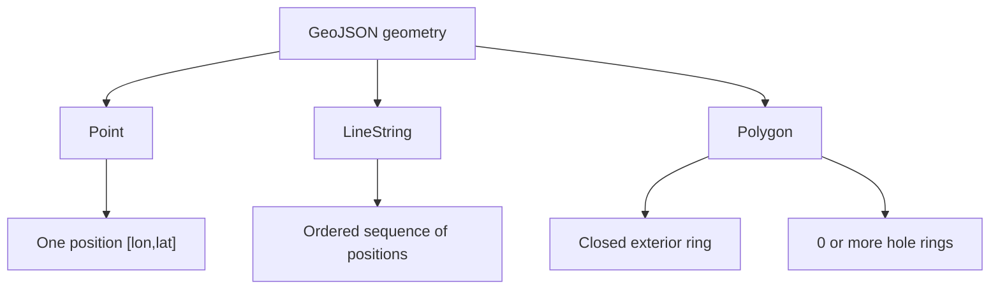

# GeoJSON and Point, LineString, and Polygon Types

A delivery application needs to store store locations, drivers' planned routes, and serviceable areas. If you only store a string like `"District 1, Ho Chi Minh City"`, MongoDB can hardly answer questions directly such as "which stores are within 2 km of the customer?", "which route segments intersect a restricted zone?", or "which delivery zone contains the pickup point?". **GeoJSON** provides a standard spatial data format to describe these objects with explicit coordinates and geometry types.

In the `SPRING_DATA_MONGODB` module—which covers using Spring Data MongoDB to connect, map documents, and access data via `MongoTemplate` or repositories, along with practicing queries, aggregation, indexes, transactions, reactive access, testing, and performance diagnostics—the **Geospatial Queries** chapter starts from the foundation: **GeoJSON and the three types `Point`, `LineString`, and `Polygon`**. Understanding geometry and coordinate systems properly is a prerequisite before creating `2dsphere` indexes or writing geospatial queries.

After this lesson, you will be able to:

1. Read and construct GeoJSON following the `type` and `coordinates` structure, with the WGS84 geographic coordinate system.
2. Distinguish `Point` (location), `LineString` (line), and `Polygon` (region), along with their minimum coordinate constraints.
3. Map GeoJSON objects via `GeoJsonPoint`, `GeoJsonLineString`, and `GeoJsonPolygon` in Spring Data MongoDB.
4. Understand how to create a `2dsphere` index, and when to use `$geoWithin`, `$geoIntersects`, or `$near`.
5. Avoid confusing **longitude/latitude**, degree/meter units, polygon ring ordering, regions with holes, and data edge cases at the antimeridian.
6. Validate spatial data in services/ETL, test real queries on MongoDB, and read `explain("executionStats")`.
7. Distinguish GeoJSON from a raw coordinate array or from the planar `Point`/`Polygon` types inherited from Spring Data Commons.

## 1. What Is GeoJSON and What Does MongoDB Use It For?

GeoJSON is a JSON-based format for describing geometry, features, and feature collections, standardized in **RFC 7946**. At the simplest geometry level:

```json
{
  "type": "Point",
  "coordinates": [106.700981, 10.776889]
}
```

A geometry has two important fields:

- `type` specifies the geometry type, such as `Point`, `LineString`, or `Polygon`.
- `coordinates` holds coordinates with a nesting structure **that depends on the geometry type**.

MongoDB understands GeoJSON objects and supports **geospatial query operators** together with **`2dsphere` indexes** to search by location, distance, and geometric relationships on Earth's near-spherical surface.

### 1.1. Choosing a Geometry Type by Business Requirement

| Need | GeoJSON Type | Example |
| --- | --- | --- |
| Location of a store, drop-off point, charging station | `Point` | Current location of a shop |
| Planned delivery route, survey line | `LineString` | Sequence of GPS coordinates describing a route |
| Delivery zone boundary, restricted area, administrative boundary | `Polygon` | Area eligible for delivery |
| A single object made of multiple disjoint parts | `MultiPoint`/`MultiLineString`/`MultiPolygon` | Multiple separate delivery zones |

**A geometry is not a complete business entity.** A `DeliveryZone` document also needs `tenantId`, `zoneCode`, `active`, rule version, and other fields. GeoJSON only describes the **geometric** part; it does not determine delivery permissions, operating hours, revision history, or pricing policies.

### 1.2. Geometry, Feature, and FeatureCollection

RFC 7946 also defines two metadata-wrapping structures:

```json
{
  "type": "Feature",
  "geometry": {
    "type": "Point",
    "coordinates": [106.700981, 10.776889]
  },
  "properties": {
    "label": "Point A"
  }
}
```

A `FeatureCollection` is a set of multiple `Feature` objects. However, a MongoDB field queried with `$geometry` typically expects a **GeoJSON geometry** with a `type` such as `Point`/`Polygon`, not the entire `Feature` wrapper.

In Spring Data MongoDB, you should **place the geometry in an explicit field**, such as `location` or `boundary`; business attributes are stored in other fields of the document. When importing data from an external GeoJSON `FeatureCollection`, the ETL should extract `feature.geometry` and map `feature.properties` intentionally.

## 2. Coordinate System: WGS84 and `[longitude, latitude]` Order

This is the most common and dangerous mistake when working with GeoJSON. Per RFC 7946, GeoJSON uses the **WGS84** geographic coordinate system, where the first two elements of each position are:

```text
coordinates = [longitude, latitude]
             = [x,         y]
```

Example illustrating a coordinate in Ho Chi Minh City:

```json
{
  "type": "Point",
  "coordinates": [106.700981, 10.776889]
}
```

**Do not swap them to `[10.776889, 106.700981]`.** Longitude comes before latitude, even though GPS UIs or some APIs often display "latitude, longitude". If the two values are swapped, a latitude of `106.700981` falls outside the valid range.

### 2.1. Ranges and Units

| Component | Meaning | Common Domain | Unit |
| --- | --- | --- | --- |
| `longitude` | East/west longitude | From -180 to +180 | **Degrees** |
| `latitude` | North/south latitude | From -90 to +90 | **Degrees** |
| `altitude` (if present) | Elevation relative to chosen datum | Depends on data source | Typically meters per RFC, requires clear convention |
| `distance` in `$near` with GeoJSON/`2dsphere` | Surface distance queried | Non-negative number | **Meters** |

In GeoJSON, a position may have a third element such as `[longitude, latitude, altitude]`. However, **do not assume `2dsphere` indexes and all MongoDB geospatial operators automatically compute 3D distance using altitude**. Applications must distinguish 2D Earth-surface problems from 3D elevation measurements.

### 2.2. Degrees Are Not Meters

If two points differ by `0.01` degrees of longitude, you cannot conclude the distance is `0.01 m`, `0.01 km`, or any fixed number of meters. The length of one degree of longitude varies with latitude; Earth is not a Cartesian plane with a fixed scale.

To search within **1.5 km**, use a geospatial query with a unit of **1,500 meters** when working with GeoJSON and `2dsphere`, rather than adding `0.015` to longitude and calling it a 1.5 km radius.

### 2.3. Validating Input Values

Example of basic boundary validation:

```java
public static void validateLonLat(
        double longitude, double latitude
) {
    if (!Double.isFinite(longitude)
            || !Double.isFinite(latitude)
            || longitude < -180 || longitude > 180
            || latitude < -90 || latitude > 90) {
        throw new IllegalArgumentException(
                "Invalid WGS84 coordinates");
    }
}
```

This prevents `NaN`, `Infinity`, and out-of-range coordinates, **but does not by itself prove the user entered them in the right order**. A pair of numbers falling within both valid ranges can still be swapped without validation catching it. When integrating APIs, you must know exactly whether the source uses `lat/lon` or `lon/lat`.

### 2.4. Things You Should Not Infer from GeoJSON

GeoJSON does not by itself guarantee:

- That a point lies within an authorized territory; `[0,0]` can be completely valid arithmetically.
- That GPS coordinates are accurate to the centimeter; collected data has error and jitter.
- That a line connecting two points is a drivable road for motorbikes.
- That a Polygon is a legally certified boundary.
- That geometry is non-self-intersecting, gap-free, and topologically valid when drawn manually by users.

Validation may also need GIS rules, road network maps, trusted data sources, and business approval.

## 3. `Point`: A Geographic Location

`Point` is the simplest geometry: **a single position**.

```json
{
  "type": "Point",
  "coordinates": [106.701, 10.777]
}
```

A store document:

```javascript
db.stores.insertOne({
  _id: "STORE-001",
  tenantId: "T-A",
  name: "Central Store",
  active: true,
  location: {
    type: "Point",
    coordinates: [106.701, 10.777]
  }
});
```

### 3.1. Mapping `GeoJsonPoint` in Spring Data MongoDB

`org.springframework.data.mongodb.core.geo.GeoJsonPoint` represents a GeoJSON Point. Although this class is related to `org.springframework.data.geo.Point`, **do not mistakenly use `new Point(longitude, latitude)` and assume the mapper will definitely persist it as GeoJSON with `type: "Point"`**.

```java
import org.springframework.data.mongodb.core.geo.GeoJsonPoint;

GeoJsonPoint location =
        new GeoJsonPoint(106.701, 10.777);

double longitude = location.getX();
double latitude = location.getY();
```

Corresponding BSON:

```json
{
  "type": "Point",
  "coordinates": [106.701, 10.777]
}
```

**The method names `getX()`/`getY()` do not change GeoJSON order:** x is longitude, y is latitude. In code using DTOs named `latitude` and `longitude`, always construct `new GeoJsonPoint(longitude, latitude)`.

### 3.2. From Form/Map to Entity

```java
public record SetLocationRequest(
        double latitude,
        double longitude
) {}

public GeoJsonPoint toGeoJsonPoint(SetLocationRequest request) {
    validateLonLat(
            request.longitude(), request.latitude());
    return new GeoJsonPoint(
            request.longitude(), request.latitude());
}
```

The DTO intentionally accepts `latitude` before `longitude` like some UI forms; the mapping step **reorders them to the proper order** in GeoJSON. Code should use clear names rather than contextless `x`/`y` variables.

### 3.3. Which Queries Work with Point?

- `$near`: find stores near a query point; results are typically sorted by proximity.
- `$geoWithin`: find points inside a geometric region.
- `$geoIntersects`: determine whether a point intersects a geometry, including when the point lies inside a region.

For efficient queries at scale, choose a `2dsphere` index on the `location` field when storing GeoJSON with a suitable geospatial workload.

## 4. `LineString`: A Path Made of Multiple Positions

`LineString` describes **an ordered sequence of positions**, commonly used to store planned routes, survey paths, road segments, or linear boundaries.

```json
{
  "type": "LineString",
  "coordinates": [
    [106.697, 10.775],
    [106.702, 10.778],
    [106.709, 10.782]
  ]
}
```

The start and end points **do not have to match**. A valid GeoJSON `LineString` requires **at least two positions**. If you only have a single GPS sample, use `Point` or wait until enough data is collected to form a path.

### 4.1. Position Order Represents the Path

The order in the array carries meaning:

```text
A [106.697,10.775]
      |
      v
B [106.702,10.778]
      |
      v
C [106.709,10.782]
```

Two LineStrings with the same set of coordinates in different orders can describe **different paths**. Do not sort points by longitude or latitude to "normalize" a LineString; doing so can break the route.

### 4.2. Mapping `GeoJsonLineString`

Spring Data MongoDB provides `GeoJsonLineString` to preserve the GeoJSON line structure:

```java
import org.springframework.data.geo.Point;
import org.springframework.data.mongodb.core.geo.GeoJsonLineString;

GeoJsonLineString route = new GeoJsonLineString(
        new Point(106.697, 10.775),
        new Point(106.702, 10.778),
        new Point(106.709, 10.782)
);
```

The example uses `Point` as **the vertices** in the `GeoJsonLineString` constructor; this does not mean the route field is stored as an arbitrary legacy location array. Spring Data converts the geometry to the corresponding BSON:

```json
{
  "type": "LineString",
  "coordinates": [
    [106.697, 10.775],
    [106.702, 10.778],
    [106.709, 10.782]
  ]
}
```

If your project uses a Spring Data version with different overloads, check the `GeoJsonLineString` API in the dependency you are using, or pass `List<Point>` matching the constructor supported by that version. What matters is creating a geometry that Spring Data maps to **`type: "LineString"`** and testing the resulting BSON instead of guessing the structure.

### 4.3. A Line Does Not Automatically Become a Road Network Route

A LineString only connects vertices with geometric segments; it **does not contain**:

- One-way street rules, prohibition signs, or road widths.
- Traffic-dependent speeds and travel times.
- Street names, intersections, turn restrictions, or congestion.
- Travel policies for motorbikes versus trucks.

Therefore, do not use the geometric length of a LineString as the "distance the driver must travel" when the data only has start and end points. For real-world routing, you need a road map system or a proper routing service.

### 4.4. Self-Intersecting Lines or Duplicate Vertices

A LineString may revisit a previous vertex, self-intersect, or have very short segments; not all such cases are invalid JSON. However, for business cases like an optimized transport route, applications often need **their own quality rules**: filtering GPS jitter, consecutive duplicate points, abnormally long jumps, or segments passing through restricted zones.

**Do not automatically delete all duplicate points**: there are cases where a vehicle makes a U-turn or repeats a segment with temporal significance. If you want to model movement, add separate timestamps; core RFC GeoJSON LineString does not store a timestamp per position.

### 4.5. Distinguishing `LineString` and `MultiLineString`

A disconnected route does not necessarily require creating a LineString that bridges the gap with a straight line. `MultiLineString` represents multiple separate line sequences:

```json
{
  "type": "MultiLineString",
  "coordinates": [
    [
      [106.697, 10.775],
      [106.702, 10.778]
    ],
    [
      [106.716, 10.788],
      [106.720, 10.790]
    ]
  ]
}
```

Choose the geometry type based on data semantics, not just whichever array shape is easiest to write.

## 5. `Polygon`: A Region with a Closed Boundary

`Polygon` describes a region using **one or more linear rings**. The first ring is the **exterior boundary**; any subsequent rings (if present) are **holes** inside it.

Example of a small rectangle illustrating a delivery zone:

```json
{
  "type": "Polygon",
  "coordinates": [
    [
      [106.690, 10.770],
      [106.720, 10.770],
      [106.720, 10.790],
      [106.690, 10.790],
      [106.690, 10.770]
    ]
  ]
}
```

Inspect the array nesting levels:

```text
Polygon.coordinates
  └── [ exterior ring, hole ring 1, hole ring 2, ... ]
        └── [ position 1, position 2, ..., position 1 ]
              └── [ longitude, latitude ]
```

### 5.1. Why Must a Ring Be Closed?

A **linear ring** has at least **four positions**, and the first position equals the last position. Three distinct vertices forming a triangle require four elements because the first point must be repeated:

```json
{
  "type": "Polygon",
  "coordinates": [
    [
      [106.700, 10.770],
      [106.720, 10.770],
      [106.710, 10.790],
      [106.700, 10.770]
    ]
  ]
}
```

A ring with only three unclosed elements, or four collinear elements, **should not be considered geometrically valid as a region**. Beyond shape/schema, you must validate positive area, non-self-intersection, and other topology rules.

### 5.2. Creating `GeoJsonPolygon` in Spring Data

`org.springframework.data.mongodb.core.geo.GeoJsonPolygon` is the corresponding type for mapping a polygon. For a single boundary:

```java
import org.springframework.data.geo.Point;
import org.springframework.data.mongodb.core.geo.GeoJsonPolygon;

GeoJsonPolygon zone = new GeoJsonPolygon(
        new Point(106.690, 10.770),
        new Point(106.720, 10.770),
        new Point(106.720, 10.790),
        new Point(106.690, 10.790),
        new Point(106.690, 10.770)
);
```

The example intentionally **closes the ring**. Do not confuse `new org.springframework.data.geo.Polygon(...)` (the base geometric type from Spring Data Commons) with `GeoJsonPolygon` when you want to persist a proper GeoJSON object with `type`/`coordinates`.

### 5.3. Regions with Holes

A Polygon can have an area *excluded from being considered inside*, such as a delivery zone minus a restricted area:

```json
{
  "type": "Polygon",
  "coordinates": [
    [
      [106.690, 10.760],
      [106.730, 10.760],
      [106.730, 10.800],
      [106.690, 10.800],
      [106.690, 10.760]
    ],
    [
      [106.705, 10.775],
      [106.705, 10.785],
      [106.715, 10.785],
      [106.715, 10.775],
      [106.705, 10.775]
    ]
  ]
}
```

The second ring describes a **hole**, so a point at `[106.710, 10.780]` lies inside the exterior boundary but **is not part of the covered area**. Conversely, `[106.700, 10.770]` lies inside the outer region and outside the hole.

### 5.4. Right-Hand Rule and Ring Winding Order

RFC 7946 specifies the **right-hand rule**: when viewed on a standard longitude–latitude plane, **the exterior ring runs counter-clockwise (CCW)** and **hole rings run clockwise (CW)**. On existing data, many parsers may accept different orientations for backward compatibility, but **you should not rely on that leniency**.

In MongoDB, how large-area polygons and ring winding are interpreted can be affected by GeoJSON/`2dsphere` rules, especially for polygons larger than a hemisphere and the `$geometry` operator. For large areas or regions crossing the **antimeridian**, check server documentation on strict winding/CRS and test with real data rather than blindly applying simple 2D rules.

### 5.5. Self-Intersecting Polygons Are a Major Business Bug

"Bowtie" example:

```json
{
  "type": "Polygon",
  "coordinates": [
    [
      [106.70, 10.77],
      [106.72, 10.79],
      [106.70, 10.79],
      [106.72, 10.77],
      [106.70, 10.77]
    ]
  ]
}
```

The boundary crosses itself. "Point inside" evaluation may be rejected or behave unexpectedly depending on engine/version. **Do not work around it by changing `2dsphere` to `2d`**; validate/repair topology before storing it in a system used for delivery decisions.

### 5.6. Is the Boundary Part of the Region?

When checking a point **lying exactly on the polygon boundary**, the semantics of each operator, index type, and floating-point precision can matter. For pricing or delivery eligibility at zone borders, do not rely solely on visual inspection or float equality.

Define a clear policy: whether boundary points are allowed, whether tolerance or a buffer is used, and who resolves overlapping zones. Write **integration tests for points inside, outside, inside a hole, on an edge, and at a vertex** against the MongoDB Server version in use.

## 6. Comparing the Three Geometries and `coordinates` Nesting Levels

| Type | Coordinate Shape | Minimum Constraints | Practical Question |
| --- | --- | --- | --- |
| `Point` | `[lon, lat]` | One valid position | Where is the customer? |
| `LineString` | `[[lon,lat],[lon,lat],...]` | At least 2 positions | Where does the route go? |
| `Polygon` | `[[[lon,lat],...closed...], [hole...]]` | Closed exterior ring, at least 4 positions | Is the point inside the region? |

### 6.1. Mental Model



### 6.2. A JSON Array Alone Does Not Tell You the Geometry Type

`[[106.70,10.77],[106.71,10.78]]` could be the coordinates of a LineString, a segment of an unclosed polygon, or a set of points missing a wrapper. The `type` field defines the meaning and how MongoDB processes it.

Do not store:

```json
{
  "location": [106.701, 10.777]
}
```

and claim it is completely equivalent to:

```json
{
  "location": {
    "type": "Point",
    "coordinates": [106.701, 10.777]
  }
}
```

MongoDB has a legacy coordinate pair format supported by certain operators/indexes, but **its semantics, units, limits, and mapping do not match GeoJSON defaults**. Choose one consistent schema per field.

## 7. Document Models for Stores, Routes, and Delivery Zones

In a multi-tenant application, the three geometry types may live in three separate collections: `stores` storing points, `deliveryRoutes` storing lines, and `deliveryZones` storing polygons.

### 7.1. Store Entity with `GeoJsonPoint`

```java
import org.springframework.data.mongodb.core.geo.GeoJsonPoint;
import org.springframework.data.mongodb.core.index.GeoSpatialIndexType;
import org.springframework.data.mongodb.core.index.GeoSpatialIndexed;
import org.springframework.data.mongodb.core.mapping.Document;
import org.springframework.data.mongodb.core.mapping.MongoId;

@Document(collection = "stores")
public class Store {
    @MongoId
    private String id;
    private String tenantId;
    private String name;
    private boolean active;

    @GeoSpatialIndexed(type = GeoSpatialIndexType.GEO_2DSPHERE)
    private GeoJsonPoint location;

    protected Store() {}

    public Store(
            String id, String tenantId, String name,
            boolean active, GeoJsonPoint location
    ) {
        this.id = id;
        this.tenantId = tenantId;
        this.name = name;
        this.active = active;
        this.location = location;
    }

    public String getId() { return id; }
    public String getTenantId() { return tenantId; }
    public String getName() { return name; }
    public boolean isActive() { return active; }
    public GeoJsonPoint getLocation() { return location; }
}
```

`@GeoSpatialIndexed(type = GeoSpatialIndexType.GEO_2DSPHERE)` declares **index metadata**; it does not prove a physical index already exists on the server. Depending on your Spring Data MongoDB configuration, **automatic index creation** may be disabled; in that case, use bootstrap/migration to create the proper index before serving traffic.

### 7.2. Route Entity with `GeoJsonLineString`

```java
import org.springframework.data.mongodb.core.geo.GeoJsonLineString;
import org.springframework.data.mongodb.core.index.GeoSpatialIndexType;
import org.springframework.data.mongodb.core.index.GeoSpatialIndexed;
import org.springframework.data.mongodb.core.mapping.Document;
import org.springframework.data.mongodb.core.mapping.MongoId;

@Document(collection = "deliveryRoutes")
public class DeliveryRoute {
    @MongoId
    private String id;
    private String tenantId;
    private String routeCode;

    @GeoSpatialIndexed(type = GeoSpatialIndexType.GEO_2DSPHERE)
    private GeoJsonLineString path;

    protected DeliveryRoute() {}

    public DeliveryRoute(
            String id, String tenantId, String routeCode,
            GeoJsonLineString path
    ) {
        this.id = id;
        this.tenantId = tenantId;
        this.routeCode = routeCode;
        this.path = path;
    }

    public String getId() { return id; }
    public String getTenantId() { return tenantId; }
    public String getRouteCode() { return routeCode; }
    public GeoJsonLineString getPath() { return path; }
}
```

A geospatial index on `path` is useful if the workload asks **"which routes intersect this region?"**. Do not create a `2dsphere` index just because a field holds geometry: indexes consume storage and write overhead; if the application only displays a known route by ID, querying by `_id` may be enough.

### 7.3. Zone Entity with `GeoJsonPolygon`

```java
import org.springframework.data.mongodb.core.geo.GeoJsonPolygon;
import org.springframework.data.mongodb.core.index.GeoSpatialIndexType;
import org.springframework.data.mongodb.core.index.GeoSpatialIndexed;
import org.springframework.data.mongodb.core.mapping.Document;
import org.springframework.data.mongodb.core.mapping.MongoId;

@Document(collection = "deliveryZones")
public class DeliveryZone {
    @MongoId
    private String id;
    private String tenantId;
    private String zoneCode;
    private boolean active;

    @GeoSpatialIndexed(type = GeoSpatialIndexType.GEO_2DSPHERE)
    private GeoJsonPolygon boundary;

    protected DeliveryZone() {}

    public DeliveryZone(
            String id, String tenantId, String zoneCode,
            boolean active, GeoJsonPolygon boundary
    ) {
        this.id = id;
        this.tenantId = tenantId;
        this.zoneCode = zoneCode;
        this.active = active;
        this.boundary = boundary;
    }

    public String getId() { return id; }
    public String getTenantId() { return tenantId; }
    public String getZoneCode() { return zoneCode; }
    public boolean isActive() { return active; }
    public GeoJsonPolygon getBoundary() { return boundary; }
}
```

For complex systems, you may need `MultiPolygon` if a zone consists of disconnected parts. **Do not draw fake connecting corridors across unserviced areas** just to merge multiple zones into a single Polygon.

### 7.4. Repositories Do Not Automatically Derive Every GIS Query

```java
import java.util.List;
import org.springframework.data.mongodb.repository.MongoRepository;

public interface StoreRepository
        extends MongoRepository<Store, String> {

    List<Store> findByTenantIdAndActive(
            String tenantId, boolean active);
}
```

Repositories handle standard queries well, but a query such as "find `Store` inside a `Polygon`" often requires an explicitly designed **`MongoTemplate`/`@Query`/Geo API**. Do not invent a guessed derived method name and assume Spring Data will definitely translate it into `$geoWithin` with the right geometry type and units.

## 8. The `2dsphere` Index: Using the Right Index Type for GeoJSON

MongoDB has several geospatial index types, two of which are easily confused:

| Index | Purpose | When to Choose |
| --- | --- | --- |
| `2dsphere` | Geographic coordinates on a near-spherical surface, supporting GeoJSON geometries | **GeoJSON Point/LineString/Polygon** and geographic queries |
| `2d` | Coordinate pairs on a 2D plane, legacy geospatial | Only when data/semantics truly fit planar coordinates |

If you are storing WGS84 GeoJSON, prefer **`2dsphere`**. A `2d` index is not a "lightweight version" that can replace all GeoJSON semantics.

### 8.1. Creating Indexes with `mongosh`

```javascript
db.stores.createIndex(
  { location: "2dsphere" },
  { name: "ix_stores_location_geo" }
);

db.deliveryRoutes.createIndex(
  { path: "2dsphere" },
  { name: "ix_routes_path_geo" }
);

db.deliveryZones.createIndex(
  { boundary: "2dsphere" },
  { name: "ix_zones_boundary_geo" }
);
```

The field name here is the **name stored in BSON**. If the entity uses `@Field("geo_location")` instead of `location`, the manual index creation command must use the corresponding BSON path. Do not just read the Java property name and assume the server stores the same name.

### 8.2. Creating Indexes via the Java Driver in Spring

Example run **once during controlled migration/bootstrapping**:

```java
import com.mongodb.client.model.IndexOptions;
import com.mongodb.client.model.Indexes;
import org.springframework.data.mongodb.core.MongoTemplate;

public void ensureGeoIndexes(MongoTemplate template) {
    template.getCollection("stores").createIndex(
            Indexes.geo2dsphere("location"),
            new IndexOptions().name("ix_stores_location_geo"));

    template.getCollection("deliveryRoutes").createIndex(
            Indexes.geo2dsphere("path"),
            new IndexOptions().name("ix_routes_path_geo"));

    template.getCollection("deliveryZones").createIndex(
            Indexes.geo2dsphere("boundary"),
            new IndexOptions().name("ix_zones_boundary_geo"));
}
```

`getCollection(...).createIndex(...)` uses the **MongoDB Java Driver**. If an index with this name already exists with different keys/options, the server may report a conflict; do not use this snippet as a mechanism to fix index drift by arbitrarily dropping and recreating indexes on each replica.

### 8.3. Does a `2dsphere` Index Guarantee Every Shape Is Valid?

The index may reject some invalid coordinates/geometries during build or insert, but it **is not a complete GIS validator** for all business constraints. For example, the index does not know whether a delivery zone is allowed to cover a river, overlaps another zone, or whether a route's width suits trucks.

Validation should be layered:

```text
Input API → type/number/coordinate checks
         → geometry/topology validation
         → business/tenant rule checks
         → write to MongoDB with 2dsphere index
         → integration tests/query checks
```

### 8.4. Verifying That Indexes Exist

```javascript
db.stores.getIndexes();
db.deliveryRoutes.getIndexes();
db.deliveryZones.getIndexes();
```

Check fields, index type, name, and options. **Having `@GeoSpatialIndexed` in source code is not enough**: if the index does not exist on the server, many geospatial queries may run slowly or `$near` may fail due to a missing suitable index.

### 8.5. Compound Geospatial Indexes in Multi-Tenant Applications

When most queries include `tenantId` and `active`, you can evaluate a compound index such as:

```javascript
db.stores.createIndex(
  { tenantId: 1, location: "2dsphere" },
  { name: "ix_stores_tenant_location" }
);
```

However, do not assume adding `tenantId` to the index is always better. Choosing key/order, tenant cardinality, query shape, and `2dsphere` compound index limitations must be measured with `explain` on representative data.

**Important rule:** when enforcing tenant access control, **always include the tenant filter in the query**, even if a compound index has been created. Indexes are for performance optimization, not authorization.

## 9. Three Core Geospatial Queries: `$geoWithin`, `$geoIntersects`, `$near`

The GeoJSON format becomes useful when asking questions about **geometric relationships**. The three common spatial operators have distinct meanings:

| Operator | Question | Relevant Data Types |
| --- | --- | --- |
| `$geoWithin` | Is the stored geometry **inside** the query region? | Point/LineString/Polygon depending on structure and semantics |
| `$geoIntersects` | Does the stored geometry **intersect** the query geometry? | Point/LineString/Polygon |
| `$near` | Which locations are **closest** to a point and within the requested distance? | Typically searches Points by location |

Do not swap `$geoWithin` for `$geoIntersects` just because both contain "geo". For a route crossing through a polygon, **intersecting** and **lying completely within the region** produce different results.

### 9.1. `$geoWithin`: Finding Stores Inside a Polygon

Given `deliveryArea`:

```javascript
const deliveryArea = {
  type: "Polygon",
  coordinates: [[
    [106.690, 10.770],
    [106.720, 10.770],
    [106.720, 10.790],
    [106.690, 10.790],
    [106.690, 10.770]
  ]]
};

db.stores.find({
  tenantId: "T-A",
  active: true,
  location: {
    $geoWithin: {
      $geometry: deliveryArea
    }
  }
});
```

The query selects **Point locations** inside the region. `$geoWithin` can operate without a geospatial index in some cases, but for large datasets you should evaluate a `2dsphere` index for performance.

An application might ask for "within 1 km" rather than a polygon; in that case, do not construct a rectangle by adding/subtracting 0.01 degrees and pretending it is a 1 km circle.

### 9.2. `$geoIntersects`: Point Intersecting Regions Stored in a Collection

A reversed question: which delivery zones contain a customer at `[106.700, 10.775]`?

```javascript
db.deliveryZones.find({
  tenantId: "T-A",
  active: true,
  boundary: {
    $geoIntersects: {
      $geometry: {
        type: "Point",
        coordinates: [106.700, 10.775]
      }
    }
  }
});
```

Here **the stored geometry is a Polygon**, and the query geometry is a Point. Two geometries intersect when the point belongs to the region under the server's semantics.

For a polygon with a hole as in section 5, a point inside the hole should not be treated as a serviceable point. Write real tests instead of only drawing shapes in the UI.

### 9.3. `$geoIntersects`: Does a Route Cross a Restricted Area?

```javascript
const restrictedArea = {
  type: "Polygon",
  coordinates: [[
    [106.700, 10.775],
    [106.710, 10.775],
    [106.710, 10.785],
    [106.700, 10.785],
    [106.700, 10.775]
  ]]
};

db.deliveryRoutes.find({
  tenantId: "T-A",
  path: {
    $geoIntersects: {
      $geometry: restrictedArea
    }
  }
});
```

The line may only **cross a short portion** of the area and still match. If the requirement is "the entire route must stay inside an allowed zone", review `$geoWithin` and full-geometry semantics; do not use `$geoIntersects` as a substitute condition.

### 9.4. `$near`: Finding Stores Near a Customer

```javascript
db.stores.find({
  tenantId: "T-A",
  active: true,
  location: {
    $near: {
      $geometry: {
        type: "Point",
        coordinates: [106.700981, 10.776889]
      },
      $maxDistance: 1500
    }
  }
}).limit(20);
```

With a GeoJSON Point and `2dsphere`, `$maxDistance: 1500` is interpreted as **1,500 meters**, not 1,500 degrees or 1,500 km. A `$near` query requires a suitable geospatial index and typically returns results ordered nearest-first.

**Geographic distance is not ETA or driving distance.** A store 700 m away geometrically might require a 2 km drive on the road due to rivers, bridges, or one-way streets.

### 9.5. `$geoWithin` and `$geoIntersects` Differ at Boundaries

Suppose a `LineString` only touches a polygon edge and exits:

- `$geoIntersects` checks whether geometries **intersect** under the geometry model; it may match by touching/crossing the boundary.
- `$geoWithin` requires the stored geometry to lie inside the query region per MongoDB semantics; **merely crossing** a region does not mean lying completely within it.

With floating-point data and complex polygons, near-boundary points need integration tests; do not rely on two longitudes looking equal when printed to 3 decimal places.

### 9.6. Constraints on `$near` in Other Contexts

`$near` has its own index requirements and query planner rules. Do not combine it arbitrarily with other operators on the same field or put it into transactions/aggregations casually without reading the server version documentation. For **aggregations that need a distance field**, use `$geoNear` according to its rules; it is not simply a regular `$match` with `$near`.

## 10. Writing GeoJSON Queries via `MongoTemplate`

Spring Data MongoDB supports `GeoJson...` types and a query DSL. For simple queries, you can use the `Criteria` API; for complex GeoJSON queries, `BasicQuery` lets you express MongoDB operators accurately.

### 10.1. `BasicQuery` from Fixed JSON

```java
import java.util.List;
import org.springframework.data.mongodb.core.MongoTemplate;
import org.springframework.data.mongodb.core.query.BasicQuery;
import org.springframework.data.mongodb.core.query.Query;

public List<DeliveryZone> zonesCoveringExamplePoint(
        MongoTemplate template
) {
    Query query = new BasicQuery("""
        {
          "tenantId": "T-A",
          "active": true,
          "boundary": {
            "$geoIntersects": {
              "$geometry": {
                "type": "Point",
                "coordinates": [106.700, 10.775]
              }
            }
          }
        }
        """);

    return template.find(query, DeliveryZone.class);
}
```

This is a **sample query with fixed data**, using a Java text block (Java 15+). Do not build a JSON string by directly concatenating latitude, tenant ID, or HTTP request data into JSON: avoid injection and formatting bugs.

### 10.2. `BasicQuery` from `org.bson.Document` Is Safer for Dynamic Parameters

```java
import java.util.List;
import org.bson.Document;
import org.springframework.data.mongodb.core.MongoTemplate;
import org.springframework.data.mongodb.core.query.BasicQuery;
import org.springframework.data.mongodb.core.query.Query;

public List<DeliveryZone> findZonesForPoint(
        MongoTemplate template,
        String authorizedTenantId,
        double longitude,
        double latitude
) {
    if (authorizedTenantId == null
            || authorizedTenantId.isBlank()) {
        throw new IllegalArgumentException("Unauthenticated tenant");
    }
    validateLonLat(longitude, latitude);

    Document point = new Document("type", "Point")
            .append("coordinates", List.of(longitude, latitude));
    Document intersects = new Document("$geoIntersects",
            new Document("$geometry", point));

    Document filter = new Document(
            "tenantId", authorizedTenantId)
            .append("active", true)
            .append("boundary", intersects);

    Query query = new BasicQuery(filter);
    return template.find(query, DeliveryZone.class);
}
```

Passing a BSON `Document` to `BasicQuery` preserves the **numeric type** of coordinates and reduces errors from manual JSON string concatenation. `authorizedTenantId` must come from an authenticated security context, **not** directly from user input to determine permissions.

### 10.3. Proximity Query with Dynamic Parameters

```java
import java.util.List;
import org.bson.Document;
import org.springframework.data.mongodb.core.MongoTemplate;
import org.springframework.data.mongodb.core.query.BasicQuery;

public List<Store> findNearbyStores(
        MongoTemplate template,
        String authorizedTenantId,
        double longitude,
        double latitude,
        double radiusMeters
) {
    validateLonLat(longitude, latitude);
    if (authorizedTenantId == null
            || authorizedTenantId.isBlank()
            || !Double.isFinite(radiusMeters)
            || radiusMeters <= 0
            || radiusMeters > 50_000) {
        throw new IllegalArgumentException("Invalid search");
    }

    Document point = new Document("type", "Point")
            .append("coordinates", List.of(longitude, latitude));
    Document near = new Document("$near",
            new Document("$geometry", point)
                    .append("$maxDistance", radiusMeters));

    Document filter = new Document(
            "tenantId", authorizedTenantId)
            .append("active", true)
            .append("location", near);

    return template.find(
            new BasicQuery(filter).limit(20),
            Store.class);
}
```

This example proactively **caps the radius and result count** to prevent requests from scanning tens of thousands of kilometers. The 50,000 m limit is an example policy, not a mandatory MongoDB limit.

### 10.4. Mapper, BSON Names, and Input Queries

If an entity has `@Field("geo_boundary")`, verify how `BasicQuery` is mapped against the target entity in the Spring Data version you use; you may need to use the actual BSON name in raw criteria. Do not arbitrarily mix Java property names and MongoDB BSON names.

Passing dynamic parameters via `Document` does not replace **authorization** and input validation. A query with `tenantId` is only secure and performant when the tenant is verified at the application layer.

### 10.5. MongoDB Java Driver Can Be Used for Highly Specific Queries

Some systems need newer queries/operators without full DSL support. You can use the driver's `MongoCollection<Document>` or an aggregation pipeline with `Document`, but when doing so you are responsible for mapping, session/transaction propagation, and corresponding lifecycle behavior.

**Do not assume every raw driver call automatically uses Spring Data entity callbacks, auditing, or transaction managers.** For operations requiring transactions, pass the session properly and test on a replica set.

## 11. Aggregation `$geoNear`: Returning Distance Alongside Results

The `$near` operator is typically used in `find` to locate the nearest points. When you need a **`distanceMeters`** column alongside each result, MongoDB provides the **`$geoNear`** aggregation stage.

### 11.1. Aggregation Example Finding the 20 Nearest Stores

```javascript
db.stores.aggregate([
  {
    $geoNear: {
      near: {
        type: "Point",
        coordinates: [106.700981, 10.776889]
      },
      distanceField: "distanceMeters",
      maxDistance: 1500,
      spherical: true,
      key: "location",
      query: {
        tenantId: "T-A",
        active: true
      }
    }
  },
  {
    $project: {
      _id: 1,
      name: 1,
      location: 1,
      distanceMeters: 1
    }
  },
  { $limit: 20 }
]);
```

Key points to remember:

- `$geoNear` must appear at the stage position required by the server (typically **the first stage** in a top-level pipeline); do not put `$match` before it and hope the query still runs.
- `key: "location"` specifies the geographic field, which is especially useful if the collection has **multiple geospatial indexes**.
- `distanceField` is the output field name; with GeoJSON/`2dsphere`, distances are expressed in **meters** unless another multiplier is applied.
- `query` filters `tenantId` and `active` directly inside `$geoNear`.
- `$limit` caps the number of returned results; it cannot replace filtering by tenant.

### 11.2. `$near` and `$geoNear` Are Not Fully Interchangeable

| Criterion | `$near` in find | `$geoNear` in aggregation |
| --- | --- | --- |
| Primary goal | Query points by proximity | Geo query + distance output for further processing |
| Output distance as a field | Not directly like the stage's `distanceField` | Yes |
| Position in API | Field filter | Aggregation stage with positional rules |
| Geospatial index | Requires suitable index | Requires suitable geospatial index |
| Tenant condition | Fields in the same query | Stage's `query` option |

If the application needs to display "750 m away from you", clarify whether you want **geographic distance** or **actual route distance**. `distanceMeters` from `$geoNear` must not be treated as travel time.

### 11.3. Do Not Overuse Aggregation Just to Filter by Region

If you only need "stores inside the delivery zone", `find` with `$geoWithin` is usually clearer and simpler. Choose `$geoNear` when the problem truly requires **distance ranking or distance metadata**, and verify costs/constraints in your server version.

## 12. Geometry Validation: Valid JSON Does Not Guarantee Valid Geometry

An API can receive a syntactically valid JSON structure whose spatial data makes no sense, such as a self-intersecting polygon, a LineString with only one vertex, or swapped coordinates.

### 12.1. Validation Layers

| Layer | What to Check | Error Example |
| --- | --- | --- |
| JSON/schema | Correct `type`, correct array nesting depth | `Point.coordinates` is a string |
| WGS84 | Finite lon/lat, within valid ranges | Latitude = 106 |
| Line topology | At least two vertices, sensible path | Only one GPS point |
| Polygon topology | Closed exterior ring, at least 4 positions, non-self-intersecting | Bowtie shape, unclosed ring |
| Holes | Holes inside exterior region, no invalid intersections | Hole ring outside exterior |
| Winding | Ring orientation matches standard and server semantics | Inverted hole ring orientation |
| Business | Region belongs to tenant, valid area/length | Zone covers the whole Earth due to input error |
| Security | Do not trust tenant, prevent overly large geometry abuse | User submits polygon with millions of vertices |

### 12.2. Basic Ring Validation in Java

The following function is only a **minimal input validation layer** and does not replace a GIS library with topology checking:

```java
import java.util.List;
import org.springframework.data.geo.Point;

public static void validateLinearRing(List<Point> vertices) {
    if (vertices == null || vertices.size() < 4) {
        throw new IllegalArgumentException(
                "Polygon ring must have at least four positions");
    }

    for (Point point : vertices) {
        if (point == null) {
            throw new IllegalArgumentException(
                    "Must not contain null points");
        }
        validateLonLat(point.getX(), point.getY());
    }

    Point first = vertices.get(0);
    Point last = vertices.get(vertices.size() - 1);

    if (Double.compare(first.getX(), last.getX()) != 0
            || Double.compare(first.getY(), last.getY()) != 0) {
        throw new IllegalArgumentException(
                "Polygon ring must be closed");
    }
}
```

Checking **exact arithmetic equality** on first/last makes sense for GeoJSON rings created by the application itself, whereas when ingesting GPS/imported data with tolerance errors, you need a policy-driven normalization/ring-closing step. **Do not silently alter legal boundaries** just to make two "close" points match exactly.

### 12.3. What Is Still Missing from the Function Above?

It **does not yet check**:

- At least three **distinct non-collinear vertices**.
- Self-intersecting, touching, or overlapping segments.
- Whether hole rings lie completely inside the exterior boundary.
- Winding order of exterior and hole rings.
- Polygons that are too large, too complex, or cross the antimeridian.
- Business-approved area/length limits.

For serious GIS systems, you can use a geometry library supporting appropriate validation (and explicit coordinate conversion rules), or validate via a tested GIS/ETL pipeline. However, many topology libraries operate on a **2D plane**, whereas MongoDB `2dsphere` models geography on a near-spherical surface; understand the differences when using planar algorithms for wide areas.

### 12.4. Preventing Clients from Sending Huge Geometries

A Polygon containing hundreds of thousands of vertices increases:

- BSON size, parsing time, and validation overhead.
- Storage and write cost for `2dsphere` indexes.
- Latency of `$geoIntersects`/`$geoWithin`.
- CPU load and risk of resource-exhausting requests.

Cap **vertex count, ring count, payload length, area, and complexity** according to the use case. When geometry simplification is needed, test changes to regions and boundary points; do not run an arbitrary point-reduction algorithm and claim the result remains geographically/legally accurate.

## 13. Geographic Edge Cases Often Overlooked

### 13.1. Antimeridian: Regions Crossing the ±180° Meridian

A region around the International Date Line can have points at `179.8°` and `-179.8°` longitude that are geographically adjacent. On a naive x/y plane, these two numbers appear nearly 360 degrees apart.

RFC 7946 recommends handling geometries crossing the **antimeridian** via splitting or appropriate representation; in MongoDB, `2dsphere`/spherical semantics and large-polygon limits must be checked separately. Do not compute `min(longitude)` and `max(longitude)` to draw a simple rectangle and use it as a region near the Date Line.

### 13.2. The Poles and High Latitudes

At very high latitudes, the distance corresponding to one degree of longitude differs sharply from near the equator. If the application operates globally, any distance calculation using the approximation "1 degree ≈ 111 km" must be re-evaluated; use geospatial queries with explicit units or an appropriate geographic library.

### 13.3. Polygon Boundaries and GPS Error

Phone GPS can drift by several meters or more depending on the environment. A customer standing near a delivery zone border may be mapped inside or outside across two readings.

If fee calculation is boundary-sensitive, define a **buffer/tolerance** at the rules layer and explain it to the UI, rather than relying only on comparing two floating-point pairs. For legal decisions, use verified GIS data.

### 13.4. Polygons with Multiple Disjoint Parts

If a service area consists of two separate zones, use `MultiPolygon` instead of a single Polygon connected by an artificial narrow corridor. MongoDB supports GeoJSON `MultiPolygon` in queries/indexes; Spring Data mapping can use `GeoJsonMultiPolygon` depending on the dependency.

A transaction updating a zone does not automatically guarantee clients are using the latest polygon version; if GIS data is edited concurrently, consider **versioning** and recording the published geometry version for priced orders.

### 13.5. `GeometryCollection` Is Not `FeatureCollection`

`GeometryCollection` holds multiple geometries of different types, whereas `FeatureCollection` holds multiple `Feature` objects with properties. The two structures can look similar because both contain JSON arrays, but they **are not the same** and cannot be treated as a single simple geometry across all MongoDB operators.

When importing complex GIS datasets, transform them into records with a `geometry` field of a server-supported type rather than storing an entire FeatureCollection in `location` and expecting a `2dsphere` index to work like a Point.

### 13.6. CRS and Coordinate Systems from External Sources

GeoJSON per RFC 7946 has WGS84 longitude/latitude semantics. If source data was exported from a projected coordinate system (such as UTM in meters), **do not wrap Easting/Northing values with `type: "Point"`** and store them as WGS84. You must transform them into the proper geographic coordinate system.

MongoDB provides specialized CRS support in certain cases such as large polygons/strict winding, but that is not permission to mix legacy coordinate systems arbitrarily into RFC 7946 GeoJSON. Standardize CRS and preserve source metadata when traceability is truly required.

## 14. GeoJSON Integration Testing on a Real MongoDB Server

A unit test for `new GeoJsonPoint(106.7, 10.77)` only proves a Java object was created; it **does not prove** Spring Data persists BSON GeoJSON, MongoDB builds the index properly, or `$geoWithin`/`$geoIntersects` returns geometrically accurate results. Therefore, you should have integration tests against a dedicated MongoDB test instance.

### 14.1. Test and Index Setup

The example uses Spring Boot 3.x, Java 17, JUnit 5, and AssertJ. You need a **running MongoDB Server on an isolated test database**, such as Testcontainers. Never run fixtures against production.

```java
import static org.assertj.core.api.Assertions.assertThat;

import com.mongodb.client.model.IndexOptions;
import com.mongodb.client.model.Indexes;
import java.util.List;
import org.bson.Document;
import org.junit.jupiter.api.BeforeEach;
import org.junit.jupiter.api.Test;
import org.springframework.beans.factory.annotation.Autowired;
import org.springframework.boot.test.autoconfigure.data.mongo.DataMongoTest;
import org.springframework.data.geo.Point;
import org.springframework.data.mongodb.core.MongoTemplate;
import org.springframework.data.mongodb.core.geo.GeoJsonPoint;
import org.springframework.data.mongodb.core.geo.GeoJsonLineString;
import org.springframework.data.mongodb.core.geo.GeoJsonPolygon;
import org.springframework.data.mongodb.core.query.BasicQuery;

@DataMongoTest
class GeoJsonIntegrationTest {

    @Autowired
    MongoTemplate template;

    @BeforeEach
    void setUp() {
        // ONLY in an isolated test MongoDB database.
        template.getCollection("stores").deleteMany(new Document());
        template.getCollection("deliveryZones").deleteMany(new Document());
        template.getCollection("deliveryRoutes").deleteMany(new Document());

        template.getCollection("stores").createIndex(
                Indexes.geo2dsphere("location"),
                new IndexOptions().name("ix_stores_location_geo"));
        template.getCollection("deliveryZones").createIndex(
                Indexes.geo2dsphere("boundary"),
                new IndexOptions().name("ix_zones_boundary_geo"));
        template.getCollection("deliveryRoutes").createIndex(
                Indexes.geo2dsphere("path"),
                new IndexOptions().name("ix_routes_path_geo"));

        template.insert(new Store(
                "STORE-IN", "T-A", "Inside region", true,
                new GeoJsonPoint(106.701, 10.777)));
        template.insert(new Store(
                "STORE-OUT", "T-A", "Outside region", true,
                new GeoJsonPoint(106.750, 10.810)));
        template.insert(new Store(
                "STORE-OTHER-TENANT", "T-B", "Other tenant", true,
                new GeoJsonPoint(106.705, 10.775)));
    }

    private Document deliveryPolygon() {
        return Document.parse("""
            {
              "type": "Polygon",
              "coordinates": [[
                [106.690, 10.770],
                [106.720, 10.770],
                [106.720, 10.790],
                [106.690, 10.790],
                [106.690, 10.770]
              ]]
            }
            """);
    }

    // Tests in the following sections belong in this same class.
}
```

**Note:** The Spring Boot `@DataMongoTest` slice does not start a MongoDB Server automatically in every configuration. Supply a URI pointing to an independent test MongoDB instance. `deleteMany(new Document())` deletes the entire corresponding collection—**never** run it against a shared or production database.

### 14.2. Test 1 — Spring Data Actually Persists `GeoJsonPoint` as BSON

```java
@Test
void storePointIsPersistedAsGeoJson() {
    Document stored = template.getCollection("stores")
            .find(new Document("_id", "STORE-IN"))
            .first();

    assertThat(stored).isNotNull();

    Document location = stored.get(
            "location", Document.class);
    assertThat(location.getString("type"))
            .isEqualTo("Point");

    @SuppressWarnings("unchecked")
    List<Number> coordinates =
            (List<Number>) location.get("coordinates");

    assertThat(coordinates).hasSize(2);
    assertThat(coordinates.get(0).doubleValue())
            .isEqualTo(106.701);
    assertThat(coordinates.get(1).doubleValue())
            .isEqualTo(10.777);
}
```

This test reads raw `Document` objects via the MongoDB Driver so it **does not rely on the converter reading back what it just wrote using the same bug**. In particular, it catches longitude/latitude swaps at the DTO–entity layer.

### 14.3. Test 2 — `$geoWithin` Filters Points Inside the Region and Tenant

```java
@Test
void geoWithinReturnsOnlyStoresInsideTenantRegion() {
    Document filter = new Document(
            "tenantId", "T-A")
            .append("active", true)
            .append("location",
                    new Document("$geoWithin",
                            new Document(
                                    "$geometry", deliveryPolygon())));

    List<Store> found = template.find(
            new BasicQuery(filter), Store.class);

    assertThat(found)
            .extracting(Store::getId)
            .containsExactly("STORE-IN");
}
```

`STORE-OUT` is outside the region, and `STORE-OTHER-TENANT` is inside the region **but belongs to T-B**, so neither is returned. In a real application, the tenant filter must come from the authenticated user context.

### 14.4. Test 3 — Finding Zones Intersecting a Point

```java
@Test
void geoIntersectsFindsZoneCoveringPoint() {
    GeoJsonPolygon boundary = new GeoJsonPolygon(
            new Point(106.690, 10.770),
            new Point(106.720, 10.770),
            new Point(106.720, 10.790),
            new Point(106.690, 10.790),
            new Point(106.690, 10.770));

    template.insert(new DeliveryZone(
            "ZONE-1", "T-A", "CENTER", true, boundary));

    Document point = new Document("type", "Point")
            .append("coordinates",
                    List.of(106.700, 10.775));
    Document intersects = new Document("$geoIntersects",
            new Document("$geometry", point));
    Document filter = new Document("tenantId", "T-A")
            .append("active", true)
            .append("boundary", intersects);

    List<DeliveryZone> zones = template.find(
            new BasicQuery(filter), DeliveryZone.class);

    assertThat(zones)
            .extracting(DeliveryZone::getId)
            .containsExactly("ZONE-1");
}
```

This test verifies the full flow: **Java `GeoJsonPolygon` → BSON polygon → `2dsphere` index → `$geoIntersects` query → Java `DeliveryZone`**. It does not merely inspect JSON shape by eye.

### 14.5. Test 4 — LineString Intersecting a Polygon

```java
@Test
void lineCrossingPolygonIsFoundByGeoIntersects() {
    GeoJsonLineString path = new GeoJsonLineString(
            new Point(106.680, 10.780),
            new Point(106.730, 10.780));

    template.insert(new DeliveryRoute(
            "ROUTE-CROSS", "T-A", "CROSS-01", path));

    Document intersects = new Document("$geoIntersects",
            new Document("$geometry", deliveryPolygon()));
    Document query = new Document("tenantId", "T-A")
            .append("path", intersects);

    List<DeliveryRoute> routes = template.find(
            new BasicQuery(query), DeliveryRoute.class);

    assertThat(routes)
            .extracting(DeliveryRoute::getId)
            .containsExactly("ROUTE-CROSS");
}
```

The LineString has both endpoints outside the polygon, but **its connecting segment passes through the region**. Therefore, it matches `$geoIntersects`. If you change the operator to `$geoWithin`, make sure you understand whether the entire geometry lies inside the region before predicting the result.

### 14.6. Test 5 — A Point Inside a Polygon Hole Is Not Covered

For multi-ring polygons, testing directly with **raw BSON** separates checking MongoDB geometry semantics from how a given Spring Data version maps a `GeoJsonPolygon` with holes:

```java
@Test
void pointInPolygonHoleIsNotCovered() {
    Document zone = Document.parse("""
        {
          "_id": "ZONE-HOLE",
          "tenantId": "T-A",
          "active": true,
          "boundary": {
            "type": "Polygon",
            "coordinates": [
              [
                [106.690, 10.760],
                [106.730, 10.760],
                [106.730, 10.800],
                [106.690, 10.800],
                [106.690, 10.760]
              ],
              [
                [106.705, 10.775],
                [106.705, 10.785],
                [106.715, 10.785],
                [106.715, 10.775],
                [106.705, 10.775]
              ]
            ]
          }
        }
        """);
    template.getCollection("deliveryZones").insertOne(zone);

    Document inHole = new Document("type", "Point")
            .append("coordinates", List.of(106.710, 10.780));
    Document inCoveredArea = new Document("type", "Point")
            .append("coordinates", List.of(106.700, 10.770));

    Document holeQuery = new Document("tenantId", "T-A")
            .append("boundary", new Document("$geoIntersects",
                    new Document("$geometry", inHole)));

    Document coveredQuery = new Document("tenantId", "T-A")
            .append("boundary", new Document("$geoIntersects",
                    new Document("$geometry", inCoveredArea)));

    assertThat(template.getCollection("deliveryZones")
            .countDocuments(holeQuery)).isZero();

    assertThat(template.getCollection("deliveryZones")
            .countDocuments(coveredQuery)).isEqualTo(1);
}
```

The test checks both **inside the hole** and **inside the covered area**, rather than merely asserting MongoDB accepts the JSON. For complex geometries, add tests for boundary points and wrongly wound rings according to the server version.

### 14.7. Test 6 — `$near` Uses Meters and Filters by Tenant

```java
@Test
void nearFindsLocalStoreWithinOnePointFiveKm() {
    Document point = new Document("type", "Point")
            .append("coordinates",
                    List.of(106.700981, 10.776889));

    Document filter = new Document("tenantId", "T-A")
            .append("active", true)
            .append("location", new Document("$near",
                    new Document("$geometry", point)
                            .append("$maxDistance", 1500)));

    List<Store> found = template.find(
            new BasicQuery(filter).limit(20),
            Store.class);

    assertThat(found)
            .extracting(Store::getId)
            .containsExactly("STORE-IN");
}
```

The test avoids asserting **distance against an exact hardcoded float** because geographic calculations and display precision can vary at boundaries. It verifies that the nearby point is selected, distant points are excluded, and other tenants are not leaked.

### 14.8. Test 7 — Verifying the Actual Index on the Server

```java
import java.util.ArrayList;

@Test
void geoIndexesExistInMongoDb() {
    List<Document> indexes = template.getCollection("stores")
            .listIndexes()
            .into(new ArrayList<>());

    assertThat(indexes).anySatisfy(index -> {
        assertThat(index.getString("name"))
                .isEqualTo("ix_stores_location_geo");

        Document keys = index.get(
                "key", Document.class);
        assertThat(keys.getString("location"))
                .isEqualTo("2dsphere");
    });
}
```

Server index metadata is better proof than just looking at `@GeoSpatialIndexed`. When migrations change keys/index names/options, compare against the actual definition instead of auto-dropping indexes from a test running against production.

### 14.9. Testing Input Validation Without a Server

```java
import static org.assertj.core.api.Assertions.assertThatThrownBy;

@Test
void latitudeOutsideWgs84RangeIsRejected() {
    assertThatThrownBy(() ->
            validateLonLat(10.77, 106.70))
            .isInstanceOf(IllegalArgumentException.class);
}

@Test
void unclosedPolygonRingIsRejected() {
    assertThatThrownBy(() ->
            validateLinearRing(List.of(
                    new Point(106.69, 10.77),
                    new Point(106.72, 10.77),
                    new Point(106.72, 10.79),
                    new Point(106.69, 10.79))))
            .isInstanceOf(IllegalArgumentException.class);
}
```

`validateLonLat` and `validateLinearRing` from sections 2 and 12 must reside in a utility class or be imported accordingly when writing real Java tests; here they are presented together in the lesson so learners understand the validation flow. Unit tests only check input data; integration tests confirm MongoDB geometry/index behavior.

### 14.10. Additional Tests Needed in a Real System

| Scenario | Expectation |
| --- | --- |
| `Point` with swapped latitude/longitude | Caught by validation or source data tests |
| `LineString` with one position | Rejected for insufficient vertices |
| `Polygon` with unclosed ring | Rejected/normalized in a controlled way before saving |
| Self-intersecting `Polygon` | Rejected by topology validation |
| `Polygon` with hole | Point in hole is not counted as covered |
| Point on boundary | Follows server semantics and tested business policy |
| Route crossing restricted zone | `$geoIntersects` returns route |
| Route partially outside zone | Do not treat `$geoWithin` like `$geoIntersects` |
| Point farther from customer than radius | `$near` does not return result |
| Other tenant at the same coordinates | Never returned when filtering by tenant |
| Missing `2dsphere` index | Test detects missing query/index setup |
| Geometry imported as legacy pair | Not confused with GeoJSON types having `coordinates` |
| Data crossing antimeridian | Tested separately with actual geometry/conditions |
| Read/query differences across Spring versions | Verified via integration tests on the project's actual dependency |

**Isolation note:** tests whose `@BeforeEach` wipes entire collections will break each other if run in parallel against the same database. Use a separate test database, unique fixture IDs, or test coordination to prevent flakiness unrelated to geometry.

## 15. Inspecting Data Before Migrating to GeoJSON

A legacy application might store locations as:

```javascript
{
  _id: "OLD-001",
  location: [10.776889, 106.700981]
}
```

This is a legacy coordinate pair and is also **swapped** if GeoJSON is expected. You cannot simply rename/wrap the field:

```javascript
{
  location: {
    type: "Point",
    coordinates: [10.776889, 106.700981]
  }
}
```

because latitude in the second position is 106.700981—outside the allowed range. Migration must know **whether the actual input schema is `[lat,lon]` or `[lon,lat]`**, whether out-of-range values exist, and how to handle records lacking source metadata.

### 15.1. Data Inventory by Type

```javascript
db.stores.aggregate([
  {
    $project: {
      _id: 1,
      geometryType: "$location.type",
      coordinateType: { $type: "$location.coordinates" },
      legacyLocationType: { $type: "$location" }
    }
  }
]);
```

If `location` is a legacy array, `location.type` may be missing; if it is already a GeoJSON Point, `geometryType` is `"Point"`. From the inventory results, partition records for controlled migration rather than applying one coordinate swap across the whole collection if data comes from multiple sources.

### 15.2. Recommended Migration Process

1. Inventory existing data forms: legacy pair, GeoJSON, null, string, documents missing the field.
2. Determine the **coordinate system and order** of each source based on reliable metadata or provenance.
3. Write mappers to `GeoJsonPoint/LineString/Polygon` and corresponding validation.
4. Run a conversion pass on a test/staging dataset; have domain specialists inspect anomalous points on a map.
5. For polygons, validate rings, holes, winding, self-intersection, and area limits.
6. Provision `2dsphere` indexes once the schema is clean enough, accounting for index build cost and concurrent writes.
7. Deploy read/write code supporting the new schema, avoiding two inconsistent write paths running in parallel.
8. Measure `explain` and run integration tests for nearby, within-region, and intersection queries.
9. Keep a backup/checkpoint/rollback plan for the migration; do not arbitrarily run `dropIndex`/`dropCollection` when handling data errors.

### 15.3. Do Not Automatically "Fix" Every Coordinate That Looks Swapped

For example, `[10.7, 20.5]` has both values within valid ranges for longitude and latitude. No range-only algorithm can tell whether it is `[lon,lat]` or `[lat,lon]`.

You need source metadata, expected location, operating territory, or an agreed mapping rule; for unclassifiable records, flag them for human review instead of guessing and producing wrong GeoJSON.

## 16. Performance Analysis: `explain` and Geospatial Indexes

Adding a `2dsphere` index does not automatically make every geospatial query fast. Performance also depends on collection size, coordinate distribution, tenant filter selectivity, polygon complexity, and the number of candidate records examined.

### 16.1. Running `explain("executionStats")`

```javascript
const area = {
  type: "Polygon",
  coordinates: [[
    [106.690, 10.770],
    [106.720, 10.770],
    [106.720, 10.790],
    [106.690, 10.790],
    [106.690, 10.770]
  ]]
};

db.stores.find({
  tenantId: "T-A",
  active: true,
  location: {
    $geoWithin: {
      $geometry: area
    }
  }
}).explain("executionStats");
```

Observe:

- Does the query planner use the appropriate geospatial index?
- Is there a `COLLSCAN` or an expensive geo/index scan stage?
- How do `totalKeysExamined`, `totalDocsExamined`, and `nReturned` compare?
- Does it need to filter out many documents after scanning the index?
- How does the query behave on small tenants versus very large regions?
- Are the results verified by correctness tests before optimizing?

**Stage names in `winningPlan` vary across MongoDB Server versions and query engines**; do not write monitoring tied to one fixed stage string like `IXSCAN` if the deployment may use different geo operators/stages.

### 16.2. Do Not Benchmark on Only Three Documents

In a test fixture with three Stores, `COLLSCAN` may be fast enough and chosen by the planner. That does not prove the index is useless. Conversely, having an index on one million Stores does not guarantee huge Polygon queries are always cheap.

Benchmark on representative data:

| Workload | What to Measure |
| --- | --- |
| Find 20 Stores within 1.5 km | Latency p50/p95, keys/docs examined |
| Find Stores inside a wide region | Number of candidate geometries, region selectivity |
| Check Point against multi-vertex zone polygons | CPU/latency, matching zone count and geometry complexity |
| Find routes intersecting a polygon | LineString length, polygon complexity, index behavior |
| Insert/update Store with `2dsphere` | Write latency, index size/maintenance cost |
| Migrate large polygons | Index build time, geometry errors, storage |

### 16.3. Overly Large Radii Reduce Query Selectivity

A "stores near me" request with a radius of `500,000 m` can produce a huge number of candidates. Even with `$limit`, the DB still performs geospatial search under those criteria. Enforce **reasonable business radius caps**, use an appropriate pagination/search strategy, and do not allow users to submit arbitrarily massive GeoJSON payloads.

### 16.4. Overly Complex Polygons

A delivery zone with tens of thousands of vertices increases index and query costs. You can maintain a **simplified geometry** for suggestions/previews while keeping the exact version for legal/pricing decisions; never use a simplified geometry to answer a high-precision question without a tolerance policy.

### 16.5. Measure the Write Path Too

A `2dsphere` index has update costs whenever:

- A store updates `location`.
- A route is recorded with thousands of vertices.
- A delivery zone updates its boundary and holes.

If geometries change frequently, measure **write throughput, index size, lock contention, and latency of other queries**. Do not add numerous indexes just to make a single nearby endpoint faster.

### 16.6. Checking for Index Drift Across Environments

Dev environments might enable auto-index creation while production disables it, causing `$near` to succeed in dev and fail in production. Write migrations/index inventories and health checks:

```javascript
db.stores.getIndexes();
```

Verify `location: "2dsphere"`, index name, compound keys/options, and migration history. Do not let every replica automatically `dropIndex` and recreate when drift is detected, as that can cause downtime and slow writes.

## 17. Troubleshooting Common GeoJSON Issues

| Symptom | Common Cause | Resolution |
| --- | --- | --- |
| Point appears on the wrong continent | Swapped longitude/latitude | Verify `[lon,lat]` order, test DTO mapping |
| Server rejects coordinates | Latitude outside ±90 or longitude outside ±180 | Validate WGS84 before insert |
| `$near` reports missing index | Missing `2dsphere` on the target field | Create/verify index via migration |
| `$geoWithin` misses points clearly in region | Wrong polygon structure, winding, CRS, or swapped lat/lon | Inspect raw BSON, test geometry and index |
| `$geoIntersects` returns routes merely touching zone | Operator checks intersection rather than full containment | Check whether requirement is intersects or within |
| Point inside boundary is excluded | Hole present or invalid polygon topology | Inspect rings, orientation, and point-in-hole |
| Point inside hole is still matched | Hole lies outside exterior ring, wrong winding/topology | Validate rings/holes and test against server |
| `LineString` has only one point | Fewer than minimum positions | Wait for enough GPS samples or store a Point |
| Polygon fails index build | Unclosed ring/self-intersecting/invalid geometry | Repair geometry outside DB, re-save with validation |
| Route length does not match reality | LineString is not a road network route | Use a routing engine for real roads |
| Query distance is off by 1,000x | Confused meters and km | `$maxDistance` with GeoJSON/`2dsphere` uses meters |
| `$geoNear` fails on stage position | Stage placed in wrong position | Move `$geoNear` to start of pipeline |
| `$geoNear` does not know which index to use | Collection has multiple geo indexes | Specify `key`, inspect explain/indexes |
| `BasicQuery` does not match field | BSON name differs from Java property name | Check `@Field` and raw BSON |
| Query works in mongosh but returns empty in Java | Different data, tenant filter, mapping, index/connection across environments | Log PII-redacted filter, verify DB/collection |
| `@GeoSpatialIndexed` present but server lacks index | Auto index creation disabled | Bootstrap/migration and readback index metadata |
| Route comes out wrong because points reordered | Code sorted coordinates by longitude | Preserve position order in LineString |
| Polygon "covers the whole world" | Region crosses antimeridian or large polygon has different semantics | Analyze CRS/strict winding and test geographic edge cases |
| Map displays a different point than query | Map UI uses lat/lon, DB uses lon/lat | Normalize adapter at integration boundary |
| Query returns another tenant's locations | Missing `tenantId` filter | Enforce authorization in service, test tenant isolation |
| Inserted docs missing location, fewer index entries | `2dsphere` has special sparse semantics | Check null/missing values and server index rules |
| Slow index build or disk growth | High-vertex geometries or too many indexes | Limit complexity, benchmark on real data |
| GeoJSON read from FeatureCollection not indexed | Stored entire Feature instead of geometry field | ETL extracts `geometry`/`properties` per schema |
| Source UTM coordinates treated as WGS84 | Wrong coordinate reference system | Transform CRS before persistence |

### 17.1. Troubleshooting a `$geoWithin` Query Returning No Results

1. Fetch a real document from MongoDB with `findOne`, inspect `location.type` and `location.coordinates`.
2. Verify **longitude before latitude**, with no unexpected NaN/null/strings.
3. Print the query polygon showing the **two-level array** structure in `Polygon.coordinates` and a closed exterior ring.
4. Check whether the point lies inside the outer ring **and outside every hole**.
5. Run a minimal query in `mongosh` against the exact database/collection with the same coordinates.
6. Verify whether `tenantId`/`active` filters exclude the document before geometry is evaluated.
7. Verify the actual `2dsphere` index via `getIndexes()`.
8. Run `explain("executionStats")` to distinguish a non-match from a slow query plan.
9. If Java produces different results, check field mapping, converters/`@Field`, and JSON/query serialization.
10. Write an integration test reproducing the case and keep it as a regression test.

### 17.2. Fixing Swapped Coordinate Bugs

If the system ingests data from a source formatted as:

```json
{
  "latitude": 10.776889,
  "longitude": 106.700981
}
```

Do not pass arguments in declaration order:

```java
// WRONG: latitude in the x/longitude slot.
new GeoJsonPoint(
        request.latitude(), request.longitude());
```

Instead:

```java
// RIGHT: longitude comes before latitude.
new GeoJsonPoint(
        request.longitude(), request.latitude());
```

Write a unit test with a point whose **latitude and longitude are easily distinguishable**. At the same time, BSON integration tests must verify the pair of numbers in the right order, not just assert that GeoJSON `type: Point` exists.

### 17.3. When Points Have Valid Coordinates but Nearby Queries Return the Wrong "Distance"

Check:

- Does the query use `GeoJSON Point` and `2dsphere` or a legacy coordinate pair?
- Is `$maxDistance` passed in **meters**?
- Do source and query coordinates share the same CRS?
- Does the user want **straight-line geographic distance** or actual driving distance?
- Do tenant/active conditions or `$minDistance` alter the results?
- Does the UI format m/km with the right conversion step?

**Do not present MongoDB distance as "delivery travel distance"** without a routing engine or road map.

### 17.4. Why Checking Only for Valid JSON Is Insufficient

For instance, a self-intersecting polygon can still be syntactically valid JSON with every coordinate inside WGS84 bounds. Yet MongoDB may reject it during indexing/querying or produce business-invalid results. Validation must check **topology**, not just JSON schema.

Similarly, a Point `[106.700,10.770]` may be numerically valid yet outside the store's operating region; business validation must check territory, tenant authorization, and policy.

## 18. Case Study Exercise: Designing a "Delivery Within Zone" Feature

An e-commerce application has three requirements:

1. Each store has a registered **coordinate**.
2. Each store group has an admin-drawn **service area** on a map, possibly with a restricted area in the middle.
3. The system manages a **planned delivery route** and wants alerts when that route crosses a restricted area.

### 18.1. Geometry Classification

| Object | GeoJSON Type | Suggested Field |
| --- | --- | --- |
| Store | `Point` | `stores.location` |
| Delivery route | `LineString` | `deliveryRoutes.path` |
| Delivery zone | `Polygon` or `MultiPolygon` | `deliveryZones.boundary` |
| Restricted area | `Polygon` | `restrictedAreas.boundary` |

Choose `Point` for Store because a store has one representative location. `LineString` stores ordered route vertices. `Polygon` describes an area; if there are multiple disconnected zones, consider `MultiPolygon`.

### 18.2. Creating Sample Data

```javascript
db.stores.insertOne({
  _id: "EX-STORE",
  tenantId: "EX-TENANT",
  active: true,
  name: "Test store",
  location: {
    type: "Point",
    coordinates: [106.701, 10.777]
  }
});

db.deliveryRoutes.insertOne({
  _id: "EX-ROUTE",
  tenantId: "EX-TENANT",
  routeCode: "R-001",
  path: {
    type: "LineString",
    coordinates: [
      [106.680, 10.780],
      [106.730, 10.780]
    ]
  }
});

db.deliveryZones.insertOne({
  _id: "EX-ZONE",
  tenantId: "EX-TENANT",
  active: true,
  zoneCode: "CENTRAL",
  boundary: {
    type: "Polygon",
    coordinates: [[
      [106.690, 10.770],
      [106.720, 10.770],
      [106.720, 10.790],
      [106.690, 10.790],
      [106.690, 10.770]
    ]]
  }
});
```

Only run this fixture in an isolated test database and do not use `EX-*` IDs in real data. Create the `2dsphere` indexes before testing queries following the migration process covered earlier.

### 18.3. Question A — Is the Store Inside the Zone?

Choose the operator:

```javascript
db.stores.find({
  tenantId: "EX-TENANT",
  location: {
    $geoWithin: {
      $geometry: {
        type: "Polygon",
        coordinates: [[
          [106.690, 10.770],
          [106.720, 10.770],
          [106.720, 10.790],
          [106.690, 10.790],
          [106.690, 10.770]
        ]]
      }
    }
  }
});
```

Expected result: `EX-STORE` is returned because its coordinates lie inside the zone. You still need to check `active` if the requirement only considers active stores.

### 18.4. Question B — Which Zones Cover the Customer's Point?

```javascript
db.deliveryZones.find({
  tenantId: "EX-TENANT",
  active: true,
  boundary: {
    $geoIntersects: {
      $geometry: {
        type: "Point",
        coordinates: [106.705, 10.775]
      }
    }
  }
});
```

Expected result: `EX-ZONE`. If multiple zones overlap, the query **can return multiple zones**; the policy for selecting the priority zone or delivery fee must be decided by the application, not inferred from query return order.

### 18.5. Question C — Does the Route Cross the Zone?

```javascript
db.deliveryRoutes.find({
  tenantId: "EX-TENANT",
  path: {
    $geoIntersects: {
      $geometry: {
        type: "Polygon",
        coordinates: [[
          [106.690, 10.770],
          [106.720, 10.770],
          [106.720, 10.790],
          [106.690, 10.790],
          [106.690, 10.770]
        ]]
      }
    }
  }
});
```

`EX-ROUTE` has both endpoints outside the zone, but its segment crosses through the polygon, so it **intersects** the zone. If you only checked endpoints, you would draw the wrong conclusion. This is why a LineString is more valuable than just an origin/destination pair when spatial relationships matter.

### 18.6. Question D — What If the Customer Stands Inside a Zone Hole?

Update `EX-ZONE.boundary.coordinates` to a polygon with a valid hole ring, then query a Point inside the hole. Expected result: the zone **does not cover** that point. Use two tests:

- Point inside the hole: no match.
- Point inside the exterior ring but outside the hole: matches.

Do not just assert `coordinates` has two rings and assume point-in-polygon logic works.

### 18.7. Question E — What If the Store Is 1.2 km Away from the Customer?

For the requirement "1.5 km radius by geographic distance", use `$near` with `$maxDistance: 1500` and a GeoJSON Point. For "deliverable within 8 minutes", **the `$near` result is insufficient** because you must consider road networks, traffic, pickup prep time, and driver load.

### 18.8. Self-Check Questions

1. **Are GeoJSON positions ordered `[latitude,longitude]`?** No; they are `[longitude,latitude]`.
2. **How many array levels is `Point.coordinates`?** One position, typically `[lon,lat]`.
3. **What is the minimum number of positions for a LineString?** Two.
4. **Does a Polygon need to repeat the first point at the end of a ring?** Yes.
5. **What is the minimum number of elements in a triangular ring?** Four positions, because the first and last match.
6. **What is the first ring of a Polygon?** The exterior boundary.
7. **What are subsequent rings?** Holes, if any.
8. **Which geometry is used for a region with two disjoint parts?** `MultiPolygon`.
9. **Are `$geoWithin` and `$geoIntersects` synonymous?** No.
10. **Does `$near.maxDistance` use km for GeoJSON?** No; it uses meters.
11. **Is `2d` equivalent to `2dsphere` for GeoJSON?** No.
12. **Is `@GeoSpatialIndexed` alone enough to guarantee an index in production?** No; you must verify the actual index.
13. **Can `$geoNear` be used to return distance metadata?** Yes, subject to stage/index requirements.
14. **Do valid GPS coordinates guarantee the right street address?** No.
15. **Does a `LineString` between A and B know valid motorbike roads?** No.
16. **Is a point inside a Polygon hole considered inside the covered region?** No.
17. **Do points near boundaries need tests?** Yes, to verify semantics and tolerance.
18. **Does `BasicQuery` replace authorization?** No.
19. **Can a GeoJSON FeatureCollection be treated as a Point field?** No.
20. **During migration, can you reliably guess coordinate order from two values that are both in range?** No.

## 19. GeoJSON Implementation Checklist with Spring Data MongoDB

### 19.1. Data Design

1. **Did you choose the right geometry?** Point for a location, LineString for a route, Polygon for a region.
2. **Do all coordinates use WGS84 and `[lon,lat]`?** Avoid UI `lat/lon` confusion.
3. **Did you distinguish GeoJSON from legacy coordinate pairs?** Never mix two schemas in one field.
4. **Is the LineString vertex order preserved?** Do not sort points by longitude.
5. **Are Polygons closed with at least four positions per ring?** Avoid open rings.
6. **Have holes and ring winding order been checked?** Prevent restricted areas from being treated as covered.
7. **Did you use MultiPolygon for disjoint regions?** Do not connect them with fake corridors.
8. **Has data from other CRS systems been properly transformed?** Never treat planar coordinates as WGS84.

### 19.2. Mapping and Queries

9. **Are `GeoJsonPoint`/`GeoJsonLineString`/`GeoJsonPolygon` used properly?** Do not just store arbitrary arrays.
10. **Have you tested persisted BSON after mapping?** Check `type` and `coordinates` nesting levels.
11. **Does the `2dsphere` index exist on the actual BSON field?** Check `getIndexes()`.
12. **Did you choose the right operator among `$geoWithin`, `$geoIntersects`, or `$near`?** Match the business question.
13. **Are distance units in meters for GeoJSON/`2dsphere`?** Do not confuse degrees and km.
14. **If distance output is needed, did you use `$geoNear` with proper stage/index rules?** Do not force `find` to fake a `distanceField`.
15. **Do queries include valid tenant and status filters?** Indexes do not enforce access control.
16. **Did you avoid concatenating JSON queries from raw input?** Use `Document`/DSL and validation.

### 19.3. Validation, Security, and Operations

17. **Have numeric checks, geometry topology, and size limits been validated?** Valid JSON alone is not enough.
18. **Are boundary points, holes, and self-intersecting polygons tested?** Do not guess by eye.
19. **Is there a policy for GPS accuracy and tolerance?** Especially for pricing, insurance, or legal workflows.
20. **Are the antimeridian and large regions handled if operating globally?** Do not use simple bounding boxes everywhere.
21. **Is polygon/route complexity capped?** Prevent requests from exhausting CPU or storage.
22. **Is there versioning/approval for delivery zones?** Prevent later edits from changing the meaning of past orders.
23. **Does migration classify legacy schemas and include backups?** Never bulk-swap coordinates without provenance metadata.
24. **Have `explain("executionStats")` and write costs been measured?** `2dsphere` still carries overhead.

### 19.4. Testing and Monitoring

25. **Have integration tests run against real MongoDB?** Do not test only Java constructors.
26. **Have Points inside/outside zones and across tenants been tested?** Including authorization.
27. **Have LineStrings intersecting a zone with endpoints outside been tested?** Do not test only endpoints.
28. **Have Polygons with holes been tested?** Points inside holes must produce the right result.
29. **Has `$near` been tested with radius and meter units?** Verify far points are excluded.
30. **Have index metadata, query plans, and latency been checked?** Do not assume annotations create indexes.
31. **Are there metrics for geometry errors, query latency, and index drift?** Track trends without logging sensitive coordinates/tenants in labels.
32. **Is geographic distance distinguished from route/ETA?** Never use straight-line distance as a delivery SLA commitment.

**Key takeaway:** GeoJSON uses **`[longitude, latitude]`**. `Point` is **a location**; `LineString` is **a path with ordered vertices**; `Polygon` is **a region with closed rings and optional holes**. In Spring Data MongoDB, map them with **`GeoJsonPoint`, `GeoJsonLineString`, and `GeoJsonPolygon`**, use **`2dsphere`** for geospatial workloads, and pick the right query among **`$geoWithin` / `$geoIntersects` / `$near`**. Before trusting any result, verify **schema, topology, CRS, actual indexes, and queries on a real MongoDB instance**.

### Official References

- [RFC 7946 — The GeoJSON Format](https://www.rfc-editor.org/rfc/rfc7946): definitions of `Point`, `LineString`, `Polygon`, rings, the right-hand rule, WGS84 coordinates, and the antimeridian.
- [MongoDB Manual — GeoJSON Objects](https://www.mongodb.com/docs/manual/reference/geojson/): GeoJSON structure and MongoDB-supported geometry types.
- [MongoDB Manual — Geospatial Queries](https://www.mongodb.com/docs/manual/geospatial-queries/): geospatial operators, indexes, and query examples.
- [MongoDB Manual — `2dsphere` Indexes](https://www.mongodb.com/docs/manual/core/indexes/index-types/geospatial/2dsphere/): creating and designing geospatial indexes for GeoJSON.
- [MongoDB Manual — `$geoWithin`](https://www.mongodb.com/docs/manual/reference/operator/query/geoWithin/): geometry contained within a region.
- [MongoDB Manual — `$geoIntersects`](https://www.mongodb.com/docs/manual/reference/operator/query/geoIntersects/): intersecting geometries.
- [MongoDB Manual — `$near`](https://www.mongodb.com/docs/manual/reference/operator/query/near/): proximity search, distances, and indexes.
- [MongoDB Manual — `$geoNear`](https://www.mongodb.com/docs/manual/reference/operator/aggregation/geoNear/): aggregation returning distance and pipeline rules.
- [MongoDB Manual — `explain` Results](https://www.mongodb.com/docs/manual/reference/explain-results/): reading query plans, keys examined, and docs examined.
- [Spring Data MongoDB — Geospatial Queries](https://docs.spring.io/spring-data/mongodb/reference/mongodb/repositories/query-methods.html): repository queries and geometry support.
- [Spring Data MongoDB — Querying Documents](https://docs.spring.io/spring-data/mongodb/reference/mongodb/template-query-operations.html): `MongoTemplate`, `Query`, `Criteria`, and `BasicQuery`.
- [Spring Data MongoDB — Index Creation](https://docs.spring.io/spring-data/mongodb/reference/mongodb/mapping/mapping-index-management.html): `@GeoSpatialIndexed`, index metadata, and index management.
- [Spring Data MongoDB — `GeoJsonPoint` API](https://docs.spring.io/spring-data/mongodb/docs/current/api/org/springframework/data/mongodb/core/geo/GeoJsonPoint.html): Point type mapped by Spring Data MongoDB.
- [Spring Data MongoDB — `GeoJsonLineString` API](https://docs.spring.io/spring-data/mongodb/docs/current/api/org/springframework/data/mongodb/core/geo/GeoJsonLineString.html): LineString type.
- [Spring Data MongoDB — `GeoJsonPolygon` API](https://docs.spring.io/spring-data/mongodb/docs/current/api/org/springframework/data/mongodb/core/geo/GeoJsonPolygon.html): Polygon type.
