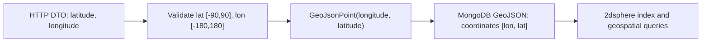

# Longitude–Latitude Order and Coordinate Systems

In **Spring Data MongoDB**, the most common geospatial bug is not `$near` syntax or a missing index, but **swapping the two coordinate values** or using coordinates from a **different reference system** without transforming them. MongoDB can accept a structurally valid GeoJSON point that sits halfway across the globe if the application writes `[latitude, longitude]` instead of **`[longitude, latitude]`**.

This lesson belongs to the **Geospatial Queries** chapter of the **SPRING_DATA_MONGODB** module, where you learn how to connect and map documents, operate through `MongoTemplate`/repositories, design queries and aggregations, manage indexes, transactions, reactive access, testing, and data performance diagnostics.

Focus areas:

- Distinguish **longitude (x)** and **latitude (y)**.
- Distinguish **GeoJSON/WGS84**, **legacy** coordinate pairs, **planar** coordinate systems, and **projected** systems such as Web Mercator.
- Choose the right `GeoJsonPoint`, `Point`, `2dsphere`/`2d` index, and distance units.
- Normalize data at the boundaries of HTTP, imports, frontend, and MongoDB.
- Write tests that catch **out-of-range axis swaps** as well as **in-range axis swaps that bypass validation**.

**Rule to remember:** for GeoJSON geographic data in MongoDB, use **`[longitude, latitude]`** — longitude first, latitude second — in **decimal degrees** on WGS84.

## 1. Two Numbers Do Not Explain What They Represent

A point in an application may be described across multiple APIs:

```text
Application input:
  latitude  = 10.776889
  longitude = 106.700981

GeoJSON stored in MongoDB:
  coordinates = [106.700981, 10.776889]

Spring Data MongoDB:
  new GeoJsonPoint(106.700981, 10.776889)
                     longitude    latitude
```

If code accidentally uses:

```java
// WRONG: swapped parameters.
new GeoJsonPoint(latitude, longitude);
```

MongoDB interprets **`x=latitude`**, **`y=longitude`**, without guessing the programmer's intent.



Getting the order wrong at **one** conversion point can corrupt the entire pipeline: stored data, radius searches, polygons, distances, nearest-first sorting, and reverse mapping back to the frontend.

## 2. Longitude and Latitude: Definitions, Signs, and Valid Ranges

| Concept | Symbol | Axis in GeoJSON | Value Range | Unit |
| --- | --- | --- | --- | --- |
| Longitude | lon, lng, λ | **x**, element 0 | **−180 to 180** | Decimal degrees |
| Latitude | lat, φ | **y**, element 1 | **−90 to 90** | Decimal degrees |
| Optional altitude | elevation, h | Element 2 if present in standard GeoJSON | Domain dependent | Meters on WGS84 per RFC 7946 |
| Projected coordinates | easting, northing | Planar x, y | CRS dependent | Typically meters, not degrees |

Directions and signs:

- **Positive longitude**: East of the Greenwich Prime Meridian.
- **Negative longitude**: West of the Prime Meridian.
- **Positive latitude**: North of the equator.
- **Negative latitude**: South of the equator.
- `0,0` is a valid geographic position, **not** a default for "no location".

MongoDB checks longitude/latitude ranges when using an appropriate geographic format such as GeoJSON on `2dsphere`. However, **two numbers being in range does not prove their order is right**.

## 3. Vietnam Example: Axis Swapping Can Fail Immediately

An illustrative point in Ho Chi Minh City:

```text
longitude = 106.700981
latitude  = 10.776889
```

Right:

```json
{
  "type": "Point",
  "coordinates": [106.700981, 10.776889]
}
```

Wrong:

```json
{
  "type": "Point",
  "coordinates": [10.776889, 106.700981]
}
```

If MongoDB interprets the second element as **latitude**, `106.700981` exceeds `90`, so the data can be rejected when building a `2dsphere` index or performing geospatial operations.

**But do not rely solely on the server catching errors:** coordinates in regions where both lon and lat fall within `[-90, 90]` can be **swapped and still pass validation**.

The numbers in this lesson are reference point coordinate examples for testing format, not a specific real-world pickup/delivery address.

## 4. Paris Example: Swapped Axes Remain Valid but Point to the Wrong Location

Illustrative point:

```text
longitude = 2.3522
latitude  = 48.8566
```

Correct GeoJSON:

```json
{ "type": "Point", "coordinates": [2.3522, 48.8566] }
```

Wrong GeoJSON that **still passes range checks**:

```json
{ "type": "Point", "coordinates": [48.8566, 2.3522] }
```

Both swapped numbers satisfy:

```text
−180 <= x <= 180
 −90 <= y <= 90
```

MongoDB has no way to know `[48.8566, 2.3522]` is wrong from looking at a single GeoJSON Point. Searches near Paris may **fail to return that document**, while queries in a completely different region find it.

**Lesson:** range validation is necessary, not sufficient. You need an **explicit ordering contract**, unit tests with known reference locations, and tests against a real database.

## 5. What Is a GeoJSON Point?

MongoDB supports GeoJSON as a subdocument containing:

```javascript
{
  type: "Point",
  coordinates: [longitude, latitude]
}
```

Business document example:

```javascript
db.geo_places.insertOne({
  tenant_id: "T1",
  name: "HCMC Demo Point",
  category: "demo",
  location: {
    type: "Point",
    coordinates: [106.700981, 10.776889]
  }
});
```

Characteristics:

1. `type` must be the exact geometry type, here `"Point"`.
2. `coordinates` is an **ordered array**, not two order-independent properties.
3. The first two numbers are **longitude, latitude**.
4. MongoDB interprets GeoJSON for geographic operations using a spherical Earth model with WGS84.
5. GeoJSON **does not store place names** or routes; it only represents geometry in the specified coordinate system.

Do not switch the order to `[lat,lon]` just because your frontend or a mapping library uses a different API convention.

## 6. The GeoJSON Standard and WGS84

**WGS84** (*World Geodetic System 1984*) is the geographic reference system commonly used for GPS and global maps. In the context of GeoJSON, we use:

- **Decimal degrees** for longitude/latitude, not meters.
- **Longitude before latitude** in every position.
- WGS84 reference expressed as **OGC CRS84** in **RFC 7946**.

MongoDB documentation describes GeoJSON with a default CRS of **EPSG:4326** in the context of `$geometry`. There is an important caveat when integrating GIS:

**Some GIS/CRS APIs express the formal axis order of EPSG:4326 as latitude–longitude, whereas GeoJSON/RFC 7946 and MongoDB require x=longitude, y=latitude.** Therefore, never infer array order from an **EPSG code** alone without checking the axis convention of the **specific API/format**.

| Label/System | Primary Meaning | Order When Writing MongoDB GeoJSON |
| --- | --- | --- |
| WGS84 geographic | Geographic coordinates on Earth, unit in degrees | **[lon, lat]** |
| OGC CRS84 / GeoJSON RFC 7946 | WGS84 convention with lon then lat axes | **[lon, lat]** |
| EPSG:4326 via a GIS API | Same datum/geographic system but API axis order may differ | **Verify and convert to [lon, lat] when creating GeoJSON** |
| EPSG:3857 / Web Mercator | Projected system, usually x/y in meters | **Must transform coordinates**, never write directly |
| Local engineering grid | Custom-defined planar x/y system | **Not geographic WGS84 GeoJSON** without transformation |

With modern RFC 7946 GeoJSON, do not attach an arbitrary `crs` field and expect MongoDB to convert Web Mercator to WGS84 automatically.

## 7. Projected Coordinates Are Not Longitude and Latitude

A projected coordinate such as EPSG:3857 might look like:

```text
x = 11800000  (meters, Web Mercator)
y =  1200000  (meters, Web Mercator)
```

It is invalid to use directly as:

```javascript
// WRONG: x/y are projected meters, not lon/lat degrees.
{ type: "Point", coordinates: [11800000, 1200000] }
```

This is **not a simple axis-swap error**. Swapping the two numbers will not fix it either. You must perform a **coordinate transformation** from the source CRS to WGS84/GeoJSON using a reliable GIS library with a confirmed source CRS code.

```text
Projected (EPSG:3857, meters)
        |
        | Explicitly defined coordinate transformation
        v
WGS84 longitude/latitude (degrees)
        |
        v
GeoJSON Point [lon, lat]
```

If the source is VN-2000, UTM, or a specialized map grid, you also need the exact zone/datum/axis units and transformation parameters. **Do not guess that large numbers are "longitude in meters" and divide by a constant yourself.**

## 8. Legacy Coordinate Pairs: Same Two Numbers, Different Representation

MongoDB also supports **legacy coordinate pairs**:

```javascript
// Legacy coordinates:
{ location: [106.700981, 10.776889] }
```

This is a **two-number array `[x, y]`**, without `type: "Point"`.

If the two numbers are geographic coordinates, the convention is:

```text
x = longitude
y = latitude
```

However, legacy pairs can also be used for a **Euclidean plane** with a `2d` index. When `x,y` are coordinates on a warehouse layout, engineering drawing, or game map, they do not necessarily mean longitude/latitude.

| Storage Form | BSON Example | Meaning | Typical Index |
| --- | --- | --- | --- |
| GeoJSON | `{type:"Point", coordinates:[lon,lat]}` | Geographic WGS84 on sphere | **`2dsphere`** |
| Legacy geographic pair | `[lon,lat]` | Two angles in x/y order | `2dsphere` for spherical geographic queries |
| Legacy planar pair | `[x,y]` | Two planar coordinates in custom units | **`2d`** |

`2dsphere` can index both GeoJSON and valid legacy geographic pairs. However, for new Earth coordinate data, **prefer GeoJSON Point** because the intent is clearer and unit/query mistakes are less likely.

## 9. Why `Point` and `GeoJsonPoint` in Java Are Not the Same

Spring Data has two easily confused types:

```java
import org.springframework.data.geo.Point;
import org.springframework.data.mongodb.core.geo.GeoJsonPoint;

Point legacy = new Point(106.700981, 10.776889);
GeoJsonPoint geoJson =
    new GeoJsonPoint(106.700981, 10.776889);
```

In Spring Data MongoDB:

- `Point` represents an x/y pair. In MongoDB geospatial queries, it is typically rendered as a legacy `[x,y]` pair.
- `GeoJsonPoint` represents GeoJSON `{type:"Point", coordinates:[x,y]}`.
- `GeoJsonPoint` extends `Point` semantics but **changes the BSON representation** and how query commands interpret distances.
- For both, when representing longitude/latitude, pass **`(longitude, latitude)`**.

```java
GeoJsonPoint p = new GeoJsonPoint(106.700981, 10.776889);

double longitude = p.getX(); // 106.700981
double latitude  = p.getY(); // 10.776889
```

**Do not infer that `getX()` is latitude just because a UI form puts the `lat` field first.** `x` is always the first axis of the data; for geographic GeoJSON, `x` is longitude.

## 10. Spring Data MongoDB Entity with `GeoJsonPoint`

Example for the `geo_places` collection:

```java
import org.bson.types.ObjectId;
import org.springframework.data.annotation.Id;
import org.springframework.data.mongodb.core.geo.GeoJsonPoint;
import org.springframework.data.mongodb.core.index.GeoSpatialIndexed;
import org.springframework.data.mongodb.core.index.GeoSpatialIndexType;
import org.springframework.data.mongodb.core.mapping.Document;
import org.springframework.data.mongodb.core.mapping.Field;

@Document("geo_places")
public class GeoPlace {

    @Id
    private ObjectId id;

    @Field("tenant_id")
    private String tenantId;

    private String name;

    @GeoSpatialIndexed(
        type = GeoSpatialIndexType.GEO_2DSPHERE,
        name = "ix_geo_places_location"
    )
    private GeoJsonPoint location;

    public GeoPlace() {}

    public GeoPlace(
            ObjectId id, String tenantId,
            String name, GeoJsonPoint location) {
        this.id = id;
        this.tenantId = tenantId;
        this.name = name;
        this.location = location;
    }

    public ObjectId getId() { return id; }
    public String getTenantId() { return tenantId; }
    public String getName() { return name; }
    public GeoJsonPoint getLocation() { return location; }
}
```

Use `GeoJsonPoint` on the `location` property for Spring Data mapping rather than maintaining a raw `List<Double>` when the domain concept is a geographic point.

Important: `@GeoSpatialIndexed` **defaults to `GEO_2D`**, not `2dsphere`. For GeoJSON data on Earth, explicitly declare **`type = GEO_2DSPHERE`**.

The annotation describes index metadata; it **does not prove the index already exists on the server**; automatic index creation is disabled by default since Spring Data MongoDB 3.0.

## 11. HTTP APIs Using `lat` First Are Fine—As Long as You Convert

An external API may name fields following map conventions:

```json
{
  "latitude": 10.776889,
  "longitude": 106.700981
}
```

There is nothing wrong with this if your code **explicitly converts** at the domain boundary:

```java
public record LocationRequest(
    double latitude,
    double longitude
) {}

public record Wgs84Position(
    double longitude,
    double latitude
) {

    public Wgs84Position {
        if (!Double.isFinite(longitude)
                || !Double.isFinite(latitude)) {
            throw new IllegalArgumentException(
                "Coordinates must be finite numbers"
            );
        }

        if (longitude < -180 || longitude > 180) {
            throw new IllegalArgumentException(
                "Longitude must be in [-180, 180]"
            );
        }

        if (latitude < -90 || latitude > 90) {
            throw new IllegalArgumentException(
                "Latitude must be in [-90, 90]"
            );
        }
    }

    public static Wgs84Position fromRequest(
            LocationRequest request) {
        return new Wgs84Position(
            request.longitude(), request.latitude()
        );
    }

    public GeoJsonPoint toGeoJsonPoint() {
        return new GeoJsonPoint(longitude, latitude);
    }
}
```

`Wgs84Position` creates a **clearly named data boundary**. Even though the HTTP DTO constructor order is `(latitude, longitude)`, the conversion only calls **named getters**.

Do not write `new GeoJsonPoint(request.latitude(), request.longitude())`. Both fields have type `double`, so the Java compiler **cannot detect the swap**.

## 12. Validation: Both Structural and Semantic Checks Are Needed

For a GeoJSON/WGS84 Point:

- Both `lon` and `lat` coordinates are present.
- Both are finite numbers: no `NaN` or `Infinity`.
- Longitude is in `[-180,180]`.
- Latitude is in `[-90,90]`.
- Both numbers are assigned to the **right meaning**.
- Do not use `[0,0]` as a substitute for a missing value.
- Do not accept projected x/y meters directly into GeoJSON.
- Maintain provenance or position conventions from import sources.

An invalid example caught by the validator:

```java
// Latitude 106.700981 is outside the valid range.
new Wgs84Position(10.776889, 106.700981);
```

Yet the swapped Paris example stays in range. Therefore, the system needs a **test suite with reference locations**, not just range validation.

**Do not apply this range check to planar `[x,y]` data**. A floor plan with x=2500, y=600 is completely valid in its own planar system; the issue is ensuring it is never promoted to geographic GeoJSON.

## 13. Type-Safe Conversion Across Input Sources

Four common source types:

| Source | Possible Representation | Required Conversion |
| --- | --- | --- |
| REST DTO | `{"latitude":10.77,"longitude":106.70}` | `new GeoJsonPoint(longitude, latitude)` |
| Browser Geolocation API | `coords.latitude` and `coords.longitude` | Read both properties **by name**, not by position |
| A map UI | May have APIs taking `(lat,lng)` or `[lat,lng]` arrays | Read the **specific library's** contract and convert to GeoJSON |
| Standard GeoJSON | `coordinates:[lon,lat]` | Preserve order, validate |
| CSV/GPS export | Could be `lat,lon`, `lon,lat`, or projected x/y | Read header/CRS metadata first, never guess |

For CSV, prefer explicitly named columns:

```csv
id,tenant_id,latitude,longitude
p1,T1,10.776889,106.700981
p2,T1,48.8566,2.3522
```

Import code should parse **by column name**, rather than grabbing columns 2 and 3 by assumption:

```java
double latitude = parseDouble(row.get("latitude"));
double longitude = parseDouble(row.get("longitude"));

GeoJsonPoint point = new Wgs84Position(
    longitude, latitude
).toGeoJsonPoint();
```

`row.get(...)` and `parseDouble(...)` illustrate the CSV parser API you choose. In production, the parser must handle locale (`.` vs `,`), empty cells, encoding, and negative signs.

## 14. Choosing `2dsphere` Over `2d` for Locations on Earth

MongoDB has two primary geospatial indexes:

| Index | Geometric Model | Data Format | When to Use |
| --- | --- | --- | --- |
| **`2dsphere`** | Spherical geometry | GeoJSON and valid legacy points | GPS, locations on Earth, geographic distances |
| **`2d`** | Euclidean plane | Legacy coordinate pairs | Floor plans, internal x/y spaces, planar data |

MongoDB provides some spherical operations with `2d`, but **you should not rely on `2d` for global geographic calculations**, especially near the poles or the ±180 meridian.

```javascript
// RIGHT for a GeoJSON Point field:
db.geo_places.createIndex(
  { location: "2dsphere" },
  { name: "ix_geo_places_location" }
);
```

If the application uses `@GeoSpatialIndexed`, ensure migration/auto-index creates the exact BSON index:

```javascript
db.geo_places.getIndexes();
```

Expect the key pattern:

```javascript
{ location: "2dsphere" }
```

A `2dsphere` index does not automatically convert Web Mercator data to WGS84. It uses the exact coordinates you insert.

## 15. Does the Index Annotation Actually Create the Index?

Since Spring Data MongoDB 3.0, **automatic index creation is disabled by default** to avoid unexpected impacts on collection lifecycle and performance.

```java
@GeoSpatialIndexed(type = GeoSpatialIndexType.GEO_2DSPHERE)
private GeoJsonPoint location;
```

This annotation **only declares index intent** when Spring Data reads mapping metadata.

A production workflow should be:

1. Migrations create the collection if needed.
2. Inspect legacy data for invalid or swapped coordinates.
3. Create the `2dsphere` index via migration or `IndexOperations`.
4. Verify actual `getIndexes()`.
5. Test geospatial queries using known data.
6. Only then open traffic that depends on `$near`/`$geoNear`.

If creating a `2dsphere` index on a collection containing out-of-range points, **the index build may fail**, exposing preexisting bad data. That is a signal to clean up data first, not a reason to skip validation.

## 16. `2dsphere` Sparse Behavior: Documents Missing a Location Are Not Indexed

MongoDB `2dsphere` indexes are **sparse**:

- If the indexed field is missing, `null`, or an empty array in specified cases, the document may **have no entry** in the geospatial index.
- Toggling the `sparse` option does not change the inherently sparse nature of `2dsphere`.
- For compound indexes containing a geospatial key, the geospatial field determines whether a document is included in the index.

This helps when some places lack coordinates yet, but also introduces a trap:

**No geospatial hit does not necessarily mean the document does not exist.** It might not be geocoded yet, have an empty location, or be stored with the wrong structure.

Store an explicit status instead:

```javascript
{
  tenant_id: "T1",
  name: "Location unconfirmed",
  geocoding_status: "PENDING",
  location: null
}
```

Never use `location:[0,0]` as a placeholder for missing data; `[0,0]` is a valid coordinate position, not "location unknown".

## 17. `$near` Queries with GeoJSON: Distance Measured in Meters

Once a `2dsphere` index exists:

```javascript
db.geo_places.find({
  tenant_id: "T1",
  location: {
    $near: {
      $geometry: {
        type: "Point",
        coordinates: [106.700981, 10.776889]
      },
      $maxDistance: 2000
    }
  }
});
```

In this command:

- `[106.700981,10.776889]` is **[longitude, latitude]**.
- `$near` with a GeoJSON Point on `2dsphere` uses **geographic distance**.
- `$maxDistance:2000` means **2,000 meters**, not 2,000 degrees or 2,000 kilometers.
- `$near` returns results ordered nearest-first under supported conditions.
- `tenant_id` filters by tenant; never use location as a substitute for authorization.

**Remember:** geographic distance calculated by MongoDB is not actual travel distance along the road network.

## 18. Spring Data `MongoTemplate`: `nearSphere` and `GeoJsonPoint`

Java equivalent:

```java
import java.util.List;

import org.springframework.data.mongodb.core.MongoOperations;
import org.springframework.data.mongodb.core.geo.GeoJsonPoint;
import org.springframework.data.mongodb.core.query.Criteria;
import org.springframework.data.mongodb.core.query.Query;

public List<GeoPlace> findNearby(
        MongoOperations operations,
        String tenantId,
        double longitude, double latitude,
        double radiusMeters) {

    Wgs84Position origin =
        new Wgs84Position(longitude, latitude);

    if (!Double.isFinite(radiusMeters)
            || radiusMeters <= 0
            || radiusMeters > 50_000) {
        throw new IllegalArgumentException("Invalid radius");
    }

    Query query = new Query(
        Criteria.where("location")
            .nearSphere(origin.toGeoJsonPoint())
            .maxDistance(radiusMeters)
    );

    query.addCriteria(
        Criteria.where("tenantId").is(tenantId)
    );

    return operations.find(query, GeoPlace.class);
}
```

Notes:

- `GeoJsonPoint` as the query point carries **GeoJSON semantics**.
- `Criteria.nearSphere(...)` explicitly requests spherical proximity search.
- When using `GeoJsonPoint`, `maxDistance` of `$nearSphere` is interpreted in **meters**.
- `Criteria.where("tenantId")` in a typed query maps to `tenant_id` via `@Field`.
- The 50,000-meter radius cap is an **illustrative policy** to prevent overly broad queries; products may choose a different cap.

**Do not replace `GeoJsonPoint` with `new Point(longitude,latitude)` and forget to recheck the unit.** Legacy pairs follow different distance rules in spherical queries.

## 19. `$geoNear` Aggregation: Returned Distance Is in Meters for GeoJSON

When you need both matching documents and their distances:

```javascript
db.geo_places.aggregate([
  {
    $geoNear: {
      near: {
        type: "Point",
        coordinates: [106.700981, 10.776889]
      },
      key: "location",
      query: { tenant_id: "T1" },
      distanceField: "distanceMeters",
      maxDistance: 3000,
      spherical: true
    }
  },
  {
    $project: {
      name: 1,
      location: 1,
      distanceMeters: 1
    }
  },
  { $limit: 20 }
]);
```

In MongoDB `$geoNear`:

- This stage must be the **first stage** of the pipeline per documented server versions.
- An appropriate geospatial index is required.
- `near` is a GeoJSON Point, so distances are in **meters**.
- `key` selects the right index if the collection has multiple geospatial indexes.
- `query` applies additional non-spatial or attribute filters, such as tenant.
- `$limit` should be set appropriately to avoid returning excessive data.

Starting in MongoDB 8.1, `distanceField` may no longer be mandatory on non-timeseries collections, but **specifying it explicitly** keeps examples clearer and more compatible.

## 20. Spring Data `NearQuery` and `Distance`: Controlling Metrics

In Spring Data MongoDB, `NearQuery` supports metrics to avoid unit mismatches:

```java
import org.springframework.data.geo.Distance;
import org.springframework.data.geo.GeoResults;
import org.springframework.data.geo.Metrics;
import org.springframework.data.mongodb.core.query.NearQuery;
import org.springframework.data.mongodb.core.query.Criteria;
import org.springframework.data.mongodb.core.query.Query;
import org.springframework.data.mongodb.core.geo.GeoJsonPoint;

GeoJsonPoint center =
    new GeoJsonPoint(106.700981, 10.776889);

NearQuery near = NearQuery.near(center)
    .maxDistance(new Distance(3, Metrics.KILOMETERS))
    .query(Query.query(
        Criteria.where("tenantId").is("T1")
    ))
    .spherical(true);

GeoResults<GeoPlace> hits =
    mongoTemplate.geoNear(near, GeoPlace.class);

// Depending on the selected Metric, the result can be read via:
// hits.getContent().get(0).getDistance()
```

This example uses an injected `mongoTemplate` in a service. `Distance` and `Metrics.KILOMETERS` express a **3 km** radius; Spring Data normalizes it to the unit actually required by the MongoDB command.

**Do not add or subtract distance numbers without checking `Metric`.** `GeoResults`/`GeoResult` may carry the configured unit (such as km), whereas raw `$geoNear` with GeoJSON returns meters unless a distance multiplier is used. Tests must understand which value is being displayed.

## 21. Unit Table: GeoJSON, Legacy, and Planar

| Command/Geometry | How Point Is Passed | Distance Input Unit |
| --- | --- | --- |
| `$near` with GeoJSON Point + `2dsphere` | `$geometry:{type:"Point",coordinates:[lon,lat]}` | **Meters** |
| `$nearSphere` with GeoJSON Point | GeoJSON `$geometry` | **Meters** |
| `$geoNear` with GeoJSON Point `near` | `{type:"Point",coordinates:[lon,lat]}` | **Meters** |
| `$nearSphere` with legacy pair | `[lon,lat]` | **Radians** for spherical distance |
| `$centerSphere` | `[[lon,lat], radius]` | **Radians** |
| `$near` with legacy pair and `2d` | `[x,y]` | **Planar coordinate units** of x/y |

This is an important practical difference:

```javascript
// GeoJSON: 2 km = 2000 meters.
{ $near: {
    $geometry: {
      type: "Point",
      coordinates: [106.700981, 10.776889]
    },
    $maxDistance: 2000
} }
```

Whereas a spherical search using a **legacy pair** may require the radius in **radians**, not 2000. Never copy literal values directly between the two query shapes.

## 22. Converting Meters to Radians When Needed

For spherical calculations:

\[
\theta_{\mathrm{rad}} = \frac{d_{\mathrm{meters}}}{R_{\mathrm{meters}}}
\]

Where `R` is the radius of the approximating sphere. For instance, taking `R≈6,378,100 m`:

```text
d = 2,000 meters
R = 6,378,100 meters

radiusRadians ≈ 2000 / 6378100
              ≈ 0.00031357 radians
```

Used with `$centerSphere`:

```javascript
const lon = 106.700981;
const lat = 10.776889;
const radiusMeters = 2000;
const earthRadiusMeters = 6378100; // approximate, illustrative

db.geo_places.find({
  location: {
    $geoWithin: {
      $centerSphere: [
        [lon, lat],
        radiusMeters / earthRadiusMeters
      ]
    }
  }
});
```

**Warning:** this division is only needed in operators that require **radians**, not for `$near`/`$geoNear` with a GeoJSON point expecting meters. Earth radius models and geographic calculations are not completely uniform; specialized surveying needs require an appropriate geodesic/ellipsoid model.

## 23. Degrees Are Not Meters: Do Not Measure Distance Using Longitude Delta Directly

Another mistake:

```java
double distance =
    Math.hypot(lon2 - lon1, lat2 - lat1);

// The value is in "degrees" of angular coordinates,
// NOT meters on the ground.
```

A **1-degree latitude** difference is roughly over 100 km, but **1 degree of longitude** varies with latitude: largest at the equator and shrinking toward the poles.

A simple approximation:

```text
length of 1° longitude ≈ 111 km × cos(latitude)
```

At high latitudes, two locations with a large longitude difference can still be close along a great-circle path. Therefore:

- Do not use `Math.hypot(lonDelta,latDelta)` and treat it as meters.
- Do not use a planar `2d` system for global GPS data.
- Use MongoDB `2dsphere` when Earth surface distances are needed.
- If you need **driving/walking distance**, use a dedicated routing system; straight-line distance does not replace road networks.

## 24. International Date Line: +179.9 and −179.9 Are Very Close

Two longitudes:

```text
A = [ 179.9, 10.0 ]
B = [-179.9, 10.0 ]
```

If subtracted directly:

```text
179.9 - (-179.9) = 359.8 degrees
```

They appear almost a full circumference apart. Yet on a sphere, they are only **0.2 degrees of longitude apart across the antimeridian** (a few dozen km depending on latitude).

MongoDB `2dsphere` interprets geographic positions with wrap-around across the ±180 meridian. This makes a **good test case** to distinguish spherical queries from buggy planar distance calculations.

For **LineStrings/Polygons** crossing the antimeridian, handle geometries per GeoJSON RFC 7946 and design the query region carefully. Do not assume a polygon with vertices at ±179 is a small rectangle like on a flat map; edge routing, winding, and geometry splitting can determine which side of Earth is selected.

## 25. Multi-Point, Line, and Polygon GeoJSON Keep the Same Order

The `[longitude, latitude]` rule repeats at **every position** in a geometry.

```javascript
const multipoint = {
  type: "MultiPoint",
  coordinates: [
    [106.700981, 10.776889],
    [106.710000, 10.780000]
  ]
};

const line = {
  type: "LineString",
  coordinates: [
    [106.700981, 10.776889],
    [106.705000, 10.778000],
    [106.710000, 10.780000]
  ]
};

const polygon = {
  type: "Polygon",
  coordinates: [[
    [106.69, 10.77],
    [106.71, 10.77],
    [106.71, 10.79],
    [106.69, 10.79],
    [106.69, 10.77]
  ]]
};
```

For `Polygon`:

- The `coordinates` array holds **linear rings**.
- The outer ring is the first element; subsequent rings may be **holes**.
- Rings are **closed**: the last element repeats the first element.
- Every vertex is still **`[lon,lat]`**.
- Winding/right-hand rule, antimeridian, and polygons larger than a hemisphere require consulting detailed MongoDB/GeoJSON docs.

Do not swap only certain coordinate pairs because a GIS library returns points as `(lat,lng)`; normalize **every position**, not just the first vertex.

## 26. Spring Data `GeoJsonPolygon`: Order and Ring Closure

Spring Data provides `GeoJsonPolygon`:

```java
import org.springframework.data.geo.Point;
import org.springframework.data.mongodb.core.geo.GeoJsonPolygon;

GeoJsonPolygon area = new GeoJsonPolygon(
    new Point(106.69, 10.77),
    new Point(106.71, 10.77),
    new Point(106.71, 10.79),
    new Point(106.69, 10.79),
    new Point(106.69, 10.77)
);
```

Here **`Point(x,y)` serves as the vertices of `GeoJsonPolygon`**; each point still follows **x=longitude, y=latitude**. `GeoJsonPolygon` handles rendering `$geometry` in GeoJSON format.

A query looks like:

```java
import org.springframework.data.mongodb.core.query.Criteria;
import org.springframework.data.mongodb.core.query.Query;

Query insideArea = Query.query(
    Criteria.where("location").within(area)
);
```

Use proper entity mapping to query `location` on a collection with a `2dsphere` index. Test polygons with points **known to be inside and outside**, rather than assuming success just because the query does not throw an exception.

**Do not confuse** legacy `org.springframework.data.geo.Polygon` with `GeoJsonPolygon`: they can generate different MongoDB operators.

## 27. A Special MongoDB CRS Does Not Replace Proper Coordinate Transformation

MongoDB supports a special CRS option related to GeoJSON polygons with **strict winding**:

```javascript
{
  type: "Polygon",
  coordinates: [
    // Ring with appropriate winding order.
  ],
  crs: {
    type: "name",
    properties: {
      name: "urn:x-mongodb:crs:strictwinding:EPSG:4326"
    }
  }
}
```

This format is only for documented MongoDB scenarios (particularly `$geoWithin`/`$geoIntersects` with single-ringed polygons); **it is not a tool that accepts EPSG:3857, UTM, or VN-2000 and converts them to WGS84**.

Distinguish two questions:

1. Which **CRS** is the data currently in, and what are its units?
2. Which **winding/interior** interpretation does the polygon use?

Solve question 1 with **coordinate transformation** backed by source metadata. Solve question 2 with MongoDB/GeoJSON rules for the appropriate geometry type.

## 28. 3D/Altitude GeoJSON: Do Not Expect 3D Spatial Distance Queries

RFC 7946 allows a position to contain a third element for **elevation**:

```json
{
  "type": "Point",
  "coordinates": [106.700981, 10.776889, 12.5]
}
```

However, standard MongoDB geospatial queries with `2dsphere` operate on a **two-dimensional geographic surface** for proximity/containment operations. Never assume an altitude of `12.5` will be included in 3D distance calculations or distinguish floor 1 from floor 20.

A clearer domain model when floor/altitude matters:

```javascript
{
  location: {
    type: "Point",
    coordinates: [106.700981, 10.776889]
  },
  floor: 20,
  altitude_meters: 75.0
}
```

After using a geo query to find nearby points, apply **separate business filters** for floor, elevation, accessibility, or real routes.

## 29. A Geospatial Index Cannot Replace Full Schema Validation

Creating a `2dsphere` index enables MongoDB to understand and query the geometry field, but it does not guarantee:

- `tenant_id` is present and valid.
- The address is accurate or non-fraudulent.
- The source is real GPS versus a guessed geocode.
- Axes are in the right order when both numbers are in range.
- Another writer does not overwrite `location` with stale data.
- The point is free of access-control or data-policy violations.

The system needs validation **at the input boundary**, optionally supplemented by **MongoDB JSON Schema validation** for structure, plus geographic testing. Basic MongoDB JSON Schema can validate types and array lengths of `coordinates`, but **cannot automatically tell** whether two in-range numbers have swapped meanings.

## 30. Multi-Tenant Queries and Compound Indexes

With multi-tenant data, queries should filter by the **authenticated tenant**.

```javascript
db.geo_places.find({
  tenant_id: "T1",
  location: {
    $nearSphere: {
      $geometry: {
        type: "Point",
        coordinates: [106.700981, 10.776889]
      },
      $maxDistance: 2000
    }
  }
});
```

Consider a compound geospatial index based on workload:

```javascript
db.geo_places.createIndex(
  { tenant_id: 1, location: "2dsphere" },
  { name: "ix_geo_places_tenant_location" }
);
```

Depending on query planner, data distribution, and MongoDB version, a compound index can help filter tenant along with geospatial operations. However:

- Choose indexes using `explain`/workload measurements rather than guessing compound is always better.
- Geospatial indexes do not replace **authorization**.
- The geospatial field in a compound `2dsphere` index governs sparse behavior.
- For sharded collections, geospatial indexes cannot be used as the **shard key**; design a separate shard key.
- Index migrations must run in a controlled way to avoid building unnecessary indexes.

## 31. `$geoNear` Results Are Not Road Travel Distances

If `$geoNear` returns `distanceMeters=1500`:

```text
MongoDB: two locations are about 1,500 meters apart
         according to geospatial measurement.

Do not infer:
  - driving is only 1.5 km,
  - there is a direct connecting road,
  - arrival takes 3 minutes,
  - both locations are on the same side of a river,
  - you can walk across barriers.
```

For logistics or delivery applications:

1. MongoDB `2dsphere` serves as a **preliminary filter** for nearby candidates.
2. A routing engine/GIS uses road networks and vehicle profiles to estimate ETA/distance.
3. Business rules check pricing, service zones, active status, and permissions.
4. UI displays distances with explicit units, never writing "2 km drive" if only spherical distance was computed.

Having accurate coordinates is a **necessary condition**; geospatial proximity does not replace route planning.

## 32. When Source Data Has Mixed Ordering: Never Bulk-Fix by Guessing

Suppose a legacy collection contains a mix:

```javascript
{ location: [106.700981, 10.776889] } // possibly [lon,lat]
{ location: [10.776889, 106.700981] } // clearly swapped lat/lon
{ location: [2.3522, 48.8566] }       // possibly valid
{ location: [48.8566, 2.3522] }       // still in range but wrong
```

You cannot write a safe migration like "if both numbers are below 90, leave them alone" and trust everything is right.

Process:

1. **Identify data sources**: endpoint, CSV schema, SDK, app version, import date.
2. Group records by **source version / ingestion path** and verify the actual coordinate order.
3. Flag records with `latitude > 90` as **suspicious**, without assuming all remaining records are valid.
4. Cross-check against geographic/address references if available, validating plausibility against business operating regions.
5. Run a **dry run** on staging/a snapshot copy.
6. Only transform groups **confirmed to be stored as `[lat,lon]`** into `[lon,lat]`.
7. Build/rebuild the `2dsphere` index after cleaning data per the migration plan.
8. Test queries before/after, preserving an audit trail and rollback capability.

If a legacy source uses a **projected CRS**, perform geometric coordinate transformation instead of swapping numbers.

## 33. Converting Legacy to GeoJSON: Know the Source Provenance First

Only when you have confirmed the **legacy source is `[longitude, latitude]`**:

```javascript
// Illustrated on a verified test document:
const source = [106.700981, 10.776889];

const geojson = {
  type: "Point",
  coordinates: [source[0], source[1]]
};

printjson(geojson);
```

If the legacy source has been confirmed as **`[latitude, longitude]`**:

```javascript
const oldLatLon = [10.776889, 106.700981];

const geojson = {
  type: "Point",
  coordinates: [oldLatLon[1], oldLatLon[0]]
};
```

**Do not run the scripts above across an entire production collection without knowing provenance.** After conversion, record source metadata/version audits in migration logs. Coordinates that are both in-range and swapped can only be caught using contextual data or reference testing.

## 34. Unit Test: Ensuring DTO → `GeoJsonPoint` Does Not Swap

JUnit 5 + AssertJ:

```java
import static org.assertj.core.api.Assertions.assertThat;
import static org.assertj.core.api.Assertions.assertThatThrownBy;

import org.junit.jupiter.api.Test;
import org.springframework.data.mongodb.core.geo.GeoJsonPoint;

class Wgs84PositionTest {

    @Test
    void convertsLatLonRequestToLongitudeFirst() {
        LocationRequest req =
            new LocationRequest(10.776889, 106.700981);

        GeoJsonPoint point = Wgs84Position
            .fromRequest(req)
            .toGeoJsonPoint();

        assertThat(point.getX()).isEqualTo(106.700981);
        assertThat(point.getY()).isEqualTo(10.776889);
    }

    @Test
    void swappedHcmCoordinatesAreRejected() {
        assertThatThrownBy(() ->
            new Wgs84Position(10.776889, 106.700981)
        ).isInstanceOf(IllegalArgumentException.class);
    }

    @Test
    void parisRequiresKnownExpectedOrder() {
        LocationRequest req =
            new LocationRequest(48.8566, 2.3522);

        GeoJsonPoint point = Wgs84Position
            .fromRequest(req)
            .toGeoJsonPoint();

        // Both values are valid when swapped.
        // Assert expected order to catch logic errors.
        assertThat(point.getX()).isEqualTo(2.3522);
        assertThat(point.getY()).isEqualTo(48.8566);
    }

    @Test
    void rejectsNaNAndInfinity() {
        assertThatThrownBy(() ->
            new Wgs84Position(Double.NaN, 10)
        ).isInstanceOf(IllegalArgumentException.class);

        assertThatThrownBy(() ->
            new Wgs84Position(106.7, Double.POSITIVE_INFINITY)
        ).isInstanceOf(IllegalArgumentException.class);
    }
}
```

These tests do not require MongoDB, run fast in CI, and catch bugs immediately at **boundary conversion**. However, they do not prove `MappingMongoConverter` writes proper BSON or that `2dsphere` queries work.

## 35. Integration Test: Checking Real BSON Coordinates

Use a MongoDB instance **dedicated to testing**, configuring Spring Data MongoDB for your project. Use the `GeoPlace` entity from section 10.

```java
import static org.assertj.core.api.Assertions.assertThat;

import java.util.List;
import org.bson.Document;
import org.bson.types.ObjectId;
import org.junit.jupiter.api.Test;
import org.springframework.beans.factory.annotation.Autowired;
import org.springframework.boot.test.autoconfigure.data.mongo.DataMongoTest;
import org.springframework.data.mongodb.core.MongoTemplate;

@DataMongoTest
class GeoJsonMappingIntegrationTest {
    @Autowired MongoTemplate template;

    @Test
    void storesLongitudeBeforeLatitudeInBson() {
        ObjectId id = new ObjectId();

        template.insert(new GeoPlace(
            id, "test-T1", "HCM-Demo",
            new GeoJsonPoint(106.700981, 10.776889)
        ));

        Document raw = template.getCollection("geo_places")
            .find(new Document("_id", id))
            .first();

        assertThat(raw).isNotNull();

        Document geometry =
            raw.get("location", Document.class);

        assertThat(geometry.getString("type"))
            .isEqualTo("Point");

        List<Double> coordinates =
            geometry.getList("coordinates", Double.class);

        assertThat(coordinates)
            .containsExactly(106.700981, 10.776889);
    }
}
```

Key verification point: **read raw BSON** via the MongoDB driver rather than only reading back the Java entity via the converter; if the converter both writes and reads swapped axes symmetrically, a Java-only round-trip would miss the bug.

## 36. Integration Test: `$near` Returns the Right Geographic Area

On test MongoDB, create the index explicitly instead of relying on auto-index:

```java
import static org.assertj.core.api.Assertions.assertThat;

import java.util.List;

import com.mongodb.client.model.IndexOptions;
import org.bson.Document;
import org.bson.types.ObjectId;
import org.junit.jupiter.api.BeforeEach;
import org.junit.jupiter.api.Test;
import org.springframework.beans.factory.annotation.Autowired;
import org.springframework.boot.test.autoconfigure.data.mongo.DataMongoTest;
import org.springframework.data.mongodb.core.MongoTemplate;
import org.springframework.data.mongodb.core.geo.GeoJsonPoint;
import org.springframework.data.mongodb.core.query.Criteria;
import org.springframework.data.mongodb.core.query.Query;

@DataMongoTest
class GeoNearIntegrationTest {
    @Autowired MongoTemplate template;

    @BeforeEach
    void ensureGeospatialIndex() {
        template.getCollection("geo_places")
            .createIndex(
                new Document("location", "2dsphere"),
                new IndexOptions()
                    .name("ix_geo_places_location")
            );
    }

    @Test
    void nearParisDoesNotReturnHcmPoint() {
        String tenant = "test-" + new ObjectId().toHexString();

        template.insert(new GeoPlace(
            new ObjectId(), tenant, "Paris-Demo",
            new GeoJsonPoint(2.3522, 48.8566)
        ));

        template.insert(new GeoPlace(
            new ObjectId(), tenant, "HCM-Demo",
            new GeoJsonPoint(106.700981, 10.776889)
        ));

        Query nearParis = new Query(
            Criteria.where("location")
                .nearSphere(
                    new GeoJsonPoint(2.3522, 48.8566)
                )
                .maxDistance(1_000)
        );

        nearParis.addCriteria(
            Criteria.where("tenantId").is(tenant)
        );

        List<GeoPlace> hits =
            template.find(nearParis, GeoPlace.class);

        assertThat(hits)
            .extracting(GeoPlace::getName)
            .contains("Paris-Demo")
            .doesNotContain("HCM-Demo");
    }
}
```

This is a **functional integration test**: the index exists, data is valid WGS84, the nearby point is found within 1,000 m, and the distant point is not falsely matched.

**Environment requirements:** dedicated test MongoDB, compatible version, index built, no shared production data. In newer Spring Boot major versions, test slice imports/packages may differ; adapt to your project while keeping the verification intent intact.

## 37. Simulating a Swap Bug That Still Passes Range Validation

A useful negative test: insert an axis-swapped Paris point that is **still valid**:

```java
GeoJsonPoint correctParis =
    new GeoJsonPoint(2.3522, 48.8566);

GeoJsonPoint swappedParis =
    new GeoJsonPoint(48.8566, 2.3522);
```

MongoDB `2dsphere` can index both because `48.8566` fits longitude bounds and `2.3522` fits latitude bounds. Insert both documents and query near `correctParis` with a small radius:

```text
Expected outcome:
  - Document correctParis appears.
  - Document swappedParis does not appear.

This is a data/business error, not an index syntax error.
```

Therefore:

- Use **reference locations** in your test suite.
- Test the HTTP contract when APIs accept `latitude` first.
- Test raw BSON when mapping GeoJSON.
- Test real geospatial query results after the index is created.
- Do not treat "MongoDB accepted the document without throwing" as proof that coordinates are right.

## 38. When Should Geospatial Indexes Be Used with Planar Data?

If an application measures distances on a warehouse floor plan:

```javascript
{
  aisle: "A1",
  position: [12.5, 8.0]
}
```

Then `[12.5,8.0]` may be meters in a local planar system. In that case:

```javascript
db.warehouse_bins.createIndex({
  position: "2d"
});
```

If you run a planar `$near`, the distance will be in units **matching your x/y coordinate system**, such as meters when x/y are defined in meters.

**Do not assign `GeoJsonPoint(12.5,8.0)` just because the class sounds like "point".** Doing so turns a warehouse bin into a geographic point at 12.5° longitude, 8° latitude—completely changing its meaning. Type names should reflect **CRS and units**.

## 39. Common Pitfalls When Integrating Frontend and Backend

| Situation | Mistake | How to Fix |
| --- | --- | --- |
| UI library uses `LatLng(lat,lng)` | Pass this array directly into GeoJSON | Map by field name, output `[lng,lat]` |
| Browser Geolocation | Read `latitude` into x | Construct `GeoJsonPoint(coords.longitude,coords.latitude)` |
| REST DTO has `latitude` first | Pass directly to `GeoJsonPoint(lat,lon)` | Explicit conversion and unit tests |
| Two-column CSV without header | Assume column 1 = longitude | Require metadata/source schema |
| EPSG:3857 input | Write meter x/y values as GeoJSON degrees | GIS coordinate transformation |
| Geographic point uses default `@GeoSpatialIndexed` | Creates `2d` index instead of `2dsphere` | Specify `GEO_2DSPHERE` |
| `GeoJsonPoint` changed to `Point` | Query distance unit changes | Keep GeoJSON or re-check metric |
| `$maxDistance:2` | Assume it means 2 km | With GeoJSON, must pass **2000 meters** |
| `$centerSphere` radius 2000 | Assume it means 2 km | Convert 2000 m to radians |
| Legacy array swapped in Paris | Still passes validation | Reference tests and import provenance |
| Place has no location | Store `[0,0]` | Use null/explicit status |
| Geospatial index not yet created | `$near`/`$geoNear` fails or unusable | Provision index beforehand |
| `tenant_id` omitted from query | Returns other tenants' data | Scope queries via authorization |
| Computing route distance with `$geoNear` | Wrong ETA | Use a routing engine |
| Region crosses antimeridian | Polygon behaves unexpectedly | Split/correct geometry per RFC |
| Altitude ignored | Matches same GPS point on wrong floor | Filter floor/altitude separately |
| Tests only round-trip objects | Misses BSON errors | Test raw Document and queries |
| Assume auto-index is ON by default | Index missing in production | Migration/readiness validation |

## 40. Diagnosing a Geospatial Query Returning Wrong Results

When a "places within 2 km" query returns incorrect results:

1. **Inspect raw BSON**: is `location` GeoJSON or a legacy array? Is `coordinates[0]` longitude?
2. **Check ranges**: longitude `[-180,180]`, latitude `[-90,90]`, finite.
3. **Check source CRS**: WGS84 decimal degrees or projected/UTM/Web Mercator?
4. **Check query point**: `new GeoJsonPoint(lon,lat)` or `new Point(...)`?
5. **Check indexes**: does `getIndexes()` show `2dsphere` on the exact field/path?
6. **Check distance units**: is `$maxDistance` in meters, radians, or planar units?
7. **Check tenant/filters**: is the query properly scoped and does real data belong to that tenant?
8. **Check missing/null data**: sparse `2dsphere` indexes may omit these documents.
9. **Check results near ±180/poles**: is client code computing longitude deltas wrongly?
10. **Check geometry shapes**: are polygons closed, properly wound, with valid holes/MultiPolygon format?
11. **Compare against reference points** from trusted geocodes/GPS.
12. **Use `explain`/command monitoring** to see query plans and keys/docs examined.
13. **Trace data from frontend to DB** using PII-redacted logs.
14. **Test against real MongoDB** instead of only mocking repositories.

In particular, **do not "fix" by swapping all documents** before knowing which data subset is wrong.

## 41. Production Deployment Checklist

- [ ] API documentation states inputs are `latitude`, `longitude`; GeoJSON output is always `[longitude,latitude]`.
- [ ] Use `GeoJsonPoint` for WGS84 geographic data, avoiding legacy `Point` without a clear reason.
- [ ] Do not put EPSG:3857/UTM/VN-2000 projected coordinates into GeoJSON without transformation.
- [ ] Maintain a shared conversion/validation module checking finite values and ranges.
- [ ] Never use `[0,0]` to represent missing data.
- [ ] Entity BSON mapping produces `location.type="Point"` and `coordinates:[lon,lat]`.
- [ ] `@GeoSpatialIndexed(type=GEO_2DSPHERE)` or equivalent `2dsphere` migration.
- [ ] Verify actual `getIndexes()`; do not just trust annotations.
- [ ] Use meters with GeoJSON `$near`/`$geoNear`; use radians when legacy operators require them.
- [ ] When using Spring `Distance/Metrics`, verify input and output metrics.
- [ ] Every geospatial query includes appropriate tenant/authorization filters.
- [ ] Test a point whose longitude is outside latitude bounds (HCMC) and a swapped point still in range (Paris).
- [ ] Test raw BSON and geospatial indexes against a real test MongoDB instance.
- [ ] Have a migration plan/provenance check when fixing axis-swapped source data.
- [ ] Handle cross-antimeridian geometries if the business requires global coverage.
- [ ] Do not treat spherical distance as driving distance/ETA.
- [ ] Cap radius/limit and monitor performance via `explain`.
- [ ] Classify sensitive GPS data, controlling precision/retention and access permissions.

## 42. Self-Assessment Questions

**1.** In MongoDB GeoJSON, in what order are coordinate pairs written?  
**Answer:** **`[longitude,latitude]`**.

**2.** What is `getX()` on `new GeoJsonPoint(106.700981,10.776889)`?  
**Answer:** longitude `106.700981`.

**3.** What is the valid range for latitude?  
**Answer:** `−90` to `90` degrees.

**4.** Why does a swapped Paris point still pass range checks?  
**Answer:** both `2.3522` and `48.8566` are within the valid bounds for both axes, even though their meanings were swapped.

**5.** Can MongoDB automatically tell that `[48.8566,2.3522]` is a swapped Paris coordinate?  
**Answer:** no; you need context and a reference test suite.

**6.** Are GeoJSON WGS84 coordinates stored in meters or degrees?  
**Answer:** longitude/latitude are **decimal degrees**; distances in GeoJSON `$near`/`$geoNear` commands are typically **meters**.

**7.** How do Spring Data's `Point` and `GeoJsonPoint` differ?  
**Answer:** how they render to BSON and the distance semantics of queries using them; `GeoJsonPoint` is a GeoJSON geometry.

**8.** What index type does `@GeoSpatialIndexed` default to if `type` is omitted?  
**Answer:** `GEO_2D`, so you must specify `GEO_2DSPHERE` for GeoJSON geographic data.

**9.** Is a `2d` index suitable for global GPS coordinates on Earth?  
**Answer:** not recommended; prefer `2dsphere` for spherical geographic geometry.

**10.** How far is `$maxDistance:2000` with GeoJSON `$near`?  
**Answer:** **2,000 meters**.

**11.** What unit does `$centerSphere` expect for radius?  
**Answer:** **radians**.

**12.** Can EPSG:3857 `x,y` values be passed straight into GeoJSON for MongoDB to transform automatically?  
**Answer:** no; you need a coordinate transformation using exact CRS metadata.

**13.** Is `[0,0]` a MongoDB representation for a missing location?  
**Answer:** no; it is a valid geographic point.

**14.** Why must a `2dsphere` index be created before `$near`?  
**Answer:** GeoJSON `$near` requires an appropriate geospatial index; annotations might not have created the index on the server.

**15.** Why is MongoDB `$geoNear` distance not driving distance?  
**Answer:** it calculates geographic distance, not road-network routing or ETA.

**16.** In a GeoJSON Polygon, what order does each vertex coordinate still follow?  
**Answer:** `[longitude,latitude]`; rings must also be closed with proper nesting structure.

## 43. Practice Exercises

**Part A — API Boundary:** build `LocationRequest(latitude,longitude)` and `Wgs84Position(longitude,latitude)`. Test HCMC data to verify code does not swap axes, and Paris data to catch silent bugs.

**Part B — MongoDB:** on a separate **test** database, create the `geo_places` collection with proper GeoJSON Points and run `createIndex({location:"2dsphere"})`. Run `$near` with a 2,000 m radius and `$geoNear` returning `distanceMeters`. Change `$maxDistance` to 2 to observe the radius shrink to just 2 m.

**Part C — Spring Data:** create `GeoPlace` with `GeoJsonPoint` and `@GeoSpatialIndexed(type=GEO_2DSPHERE)`. Insert with `MongoTemplate.insert`, read raw BSON, and run `Criteria.nearSphere` with `GeoJsonPoint`. Compare `NearQuery` with `Distance/Metrics.KILOMETERS`.

**Part D — Bad Data:** insert two Paris points `[2.3522,48.8566]` and `[48.8566,2.3522]` to see how both are valid yet not actually close to each other. Write an integration test proving a query around Paris returns only the first point.

**Part E — Coordinate Systems:** take a point from an EPSG:3857 or VN-2000 source in a **test dataset with CRS metadata**. Use a GIS library to transform it to WGS84 and compare against the reference coordinates. Do not guess axis order or unit conversions.

**Part F — Performance and Security:** measure `explain("executionStats")` with and without the `tenant_id` filter. Cap radius/limit and verify points of another tenant cannot be queried by altering the request body.

## 44. Official Documentation and Summary

Reference sources corresponding to your MongoDB/Spring Data version:

- [MongoDB Manual — Geospatial Queries](https://www.mongodb.com/docs/manual/geospatial-queries/).
- [MongoDB Manual — GeoJSON Objects](https://www.mongodb.com/docs/manual/reference/geojson/).
- [MongoDB Manual — Geospatial Indexes](https://www.mongodb.com/docs/manual/core/indexes/index-types/index-geospatial/).
- [MongoDB Manual — 2dsphere Indexes](https://www.mongodb.com/docs/manual/core/indexes/index-types/geospatial/2dsphere/).
- [MongoDB Manual — $near](https://www.mongodb.com/docs/manual/reference/operator/query/near/).
- [MongoDB Manual — $nearSphere](https://www.mongodb.com/docs/manual/reference/operator/query/nearsphere/).
- [MongoDB Manual — $geoNear Aggregation Stage](https://www.mongodb.com/docs/manual/reference/operator/aggregation/geonear/).
- [MongoDB Manual — $geometry and CRS](https://www.mongodb.com/docs/manual/reference/operator/query/geometry/).
- [MongoDB Manual — Convert Distance to Radians](https://www.mongodb.com/docs/manual/core/indexes/index-types/geospatial/2d/calculate-distances/).
- [Spring Data MongoDB — Querying Documents / GeoJSON Support](https://docs.spring.io/spring-data/mongodb/reference/mongodb/template-query-operations.html).
- [Spring Data MongoDB — Index Creation](https://docs.spring.io/spring-data/mongodb/reference/mongodb/mapping/mapping-index-management.html).
- [Spring Data MongoDB — GeoSpatialIndexed API](https://docs.spring.io/spring-data/mongodb/reference/api/java/org/springframework/data/mongodb/core/index/GeoSpatialIndexed.html).
- [Spring Data MongoDB — NearQuery API](https://docs.spring.io/spring-data/mongodb/reference/api/java/org/springframework/data/mongodb/core/query/NearQuery.html).
- [RFC 7946 — The GeoJSON Format](https://www.rfc-editor.org/rfc/rfc7946.html).

**Conclusion:** in Spring Data MongoDB, **get the axes right before thinking about the query**: GeoJSON stores and accepts WGS84 positions as **`[longitude,latitude]`**, and `GeoJsonPoint.getX()` is longitude while `getY()` is latitude. Geographic data requires **`2dsphere`**, whereas `2d` is mainly for planar coordinates; projected CRSs must be **genuinely transformed** rather than renamed or swapped. With GeoJSON `$near`/`$geoNear`, distance is typically in **meters**; legacy spherical operations such as `$centerSphere` use **radians**. Prevent "swapped-axis yet in-range" bugs through clearly named DTOs, validation, reference tests, raw BSON inspection, and geospatial integration tests on real MongoDB.
