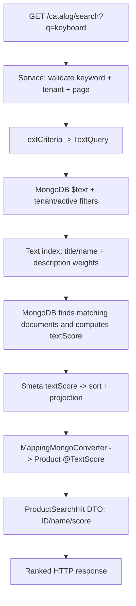

# `@TextScore` and Relevance Sorting

## 1. The Problem: Simply Finding Matching Products Is Not Enough

In Mini Commerce, a customer types **“keyboard”** into the search box. The `products` collection contains many Products with this keyword in their name or description. If we only filter for matching documents, results may appear in a confusing order: a product with the keyword right in its name ends up ranked below a product that only mentions the keyword once inside a long description.

For search, we usually need two **distinct** things:

1. **Matching:** which documents satisfy the text condition? MongoDB provides the `$text` operator over a **text index**.
2. **Ranking:** among matching documents, which ones are more relevant? MongoDB computes a `textScore` and allows sorting via `{ $meta: "textScore" }`.

Spring Data MongoDB provides `@TextIndexed` to declare fields participating in a text index and their weights, `@TextScore` to map the **server-computed score** to a Java property, and `TextCriteria`/`TextQuery.sortByScore()` to search by relevance.

The lesson **“`@TextScore` and Relevance Sorting”** belongs to the **“Advanced Search”** chapter of the `SPRING_DATA_MONGODB` module. The overarching context covers connecting and mapping MongoDB via `MongoTemplate`/repositories, practicing queries, indexes, transactions, reactive access, testing, and performance diagnostics.

### Learning Objectives

After this lesson, you will be able to:

1. Explain why `$text` and `textScore` are two separate concepts.
2. Use `@TextIndexed(weight=...)`, `@TextScore Float score`, and a text index with an appropriate language configuration.
3. Understand that `@TextScore` **does not compute scores itself, does not create indexes automatically, and does not persist scores into documents**.
4. Perform text search using `TextCriteria`/`TextQuery` and `sortByScore()` with `MongoTemplate`.
5. Use repositories with `TextCriteria`, `Sort.by("score")`, `Pageable`, and tenant scoping.
6. Compare results when filtering only, projecting score only, sorting by score, and adding a deterministic secondary sort key.
7. Distinguish server-computed text-index scores from business scores (price, sales volume, inventory).
8. Design indexes with field weights, `default_language`, text normalization, and Vietnamese text testing.
9. Paginate search results and manage rank shifts when data or indexes change.
10. Implement a reactive `Flux<Product>` version and test it with `StepVerifier`.
11. Diagnose queries/indexes using `explain("executionStats")` and recognize the limitations of MongoDB `$text` compared to MongoDB Search.

**Prerequisites:** Java 17+, Spring Boot with Spring Data MongoDB, running MongoDB instance, understanding of `@Document`, `@Id`, `@Field`, `MongoTemplate`, `MongoRepository`, `Query`, and indexes. All index-creation and fixture commands in this lesson are illustrated for a **dedicated test database**; never run them verbatim on production.

## 2. Architecture of a Relevance-Scored Query



In this diagram, `@TextScore` sits **after the server-side scoring step**. It only marks a Java property so Spring Data can receive the value from the query result; it is not a ranking formula executed in Java.

### 2.1. Three Conditions for a Meaningful Score

| Condition | If Missing |
| --- | --- |
| An appropriate text index exists | `$text` typically fails with a missing text index error |
| Query uses `$text` to search | Regular queries have no text-score metadata |
| Query projects or sorts by `$meta: "textScore"` | No guarantee `@TextScore` property gets populated and no relevance ordering |

Merely adding `@TextScore` to an entity does **not** make `findAll()` sort by score automatically. And `$text` by default **does not guarantee** results are sorted from highest to lowest: you must explicitly request sorting.

### 2.2. `textScore` Is the Score of the **Current Query**

A single Product may have different scores when a user searches `"keyboard"`, `"bluetooth"`, or `"wireless keyboard"`. The score depends on the query keywords, indexed fields, weights, term frequencies/text characteristics, and the server version/query engine.

Therefore:

- Do not persist `textScore` as a fixed field inside Product.
- Do not compare scores from **two different keyword queries** as if they were on the same business scale.
- Do not treat `score=0.8` as an 80% match probability.
- Do not use `textScore` as a financial value, star rating, or calibrated ML confidence score.

## 3. MongoDB `$text` and `$meta: "textScore"` in `mongosh`

The following examples assume `products` already has a text index on `name` and `description`. A query that only fetches matching documents:

```javascript
db.products.find({
  tenant_id: "shop-a",
  active: true,
  $text: { $search: "keyboard" }
});
```

The command above **filters**, but specifies no score ordering. To retrieve the score:

```javascript
db.products.find(
  {
    tenant_id: "shop-a",
    active: true,
    $text: { $search: "keyboard" }
  },
  {
    name: 1,
    description: 1,
    relevance: { $meta: "textScore" }
  }
);
```

The `relevance` field is a **transient metadata projection**, not an existing stored field on the database document.

To **sort** from most relevant first:

```javascript
db.products.find(
  {
    tenant_id: "shop-a",
    active: true,
    $text: { $search: "keyboard" }
  },
  {
    name: 1,
    description: 1,
    relevance: { $meta: "textScore" }
  }
).sort({
  relevance: { $meta: "textScore" },
  _id: 1
});
```

`$meta: "textScore"` in `sort` places higher scores first; `_id: 1` acts as a **tie-breaker** for deterministic ordering when scores match. MongoDB does not require the sort key name `relevance` to be a real field; it serves as a placeholder key for the metadata sort.

### 3.1. Four Commonly Confused Queries

| Query | Filters by text? | Returns score? | Sorts by score? |
| --- | --- | --- | --- |
| `find({active:true})` | No | No | No |
| `find({$text:{$search:"keyboard"}})` | Yes | Not necessarily | **Not automatically** |
| `find(query, {relevance:{$meta:"textScore"}})` | Yes | Yes | Not automatically |
| `find(...).sort({relevance:{$meta:"textScore"}})` | Yes | Score may not be projected | **Yes** |

A score can be used **for sorting without projecting** it to the client. However, if the frontend needs to explain or debug rankings, add the appropriate metadata projection and avoid displaying raw scores as a “percentage match”.

## 4. `@TextIndexed` and `@TextScore` on `Product`

### 4.1. Entity with Score as a Read-Only Search Result Property

```java
package com.example.minicommerce.domain;

import java.math.BigDecimal;
import java.time.Instant;

import org.springframework.data.annotation.Id;
import org.springframework.data.mongodb.core.index.TextIndexed;
import org.springframework.data.mongodb.core.mapping.Document;
import org.springframework.data.mongodb.core.mapping.Field;
import org.springframework.data.mongodb.core.mapping.FieldType;
import org.springframework.data.mongodb.core.mapping.TextScore;

@Document(collection = "products", language = "none")
public class Product {

    @Id
    private String id;

    @Field("tenant_id")
    private String tenantId;

    @TextIndexed(weight = 10)
    private String name;

    @TextIndexed(weight = 2)
    private String description;

    private boolean active;

    @Field(name = "unit_price", targetType = FieldType.DECIMAL128)
    private BigDecimal price;

    private int stock;
    private Instant updatedAt;

    @TextScore
    private Float score;

    public Product() {}

    public Product(String id, String tenantId,
                   String name, String description,
                   boolean active, BigDecimal price,
                   int stock) {
        this.id = id;
        this.tenantId = tenantId;
        this.name = name;
        this.description = description;
        this.active = active;
        this.price = price;
        this.stock = stock;
    }

    public String getId() { return id; }
    public String getTenantId() { return tenantId; }
    public String getName() { return name; }
    public String getDescription() { return description; }
    public boolean isActive() { return active; }
    public BigDecimal getPrice() { return price; }
    public int getStock() { return stock; }
    public Instant getUpdatedAt() { return updatedAt; }
    public Float getScore() { return score; }

    public void setId(String id) { this.id = id; }
    public void setTenantId(String tenantId) { this.tenantId = tenantId; }
    public void setName(String name) { this.name = name; }
    public void setDescription(String text) { this.description = text; }
    public void setActive(boolean active) { this.active = active; }
    public void setPrice(BigDecimal value) { this.price = value; }
    public void setStock(int value) { this.stock = value; }
    public void setUpdatedAt(Instant at) { this.updatedAt = at; }
}
```

**Exact role of each annotation:**

- `@TextIndexed(weight=10)` on `name`: marks the field as part of the text index with a high relative weight.
- `@TextIndexed(weight=2)` on `description`: gives keyword matches in the description less influence on score than matches in the name, all else being equal.
- `@Document(language="none")`: sets the text-index language to `none` in the mapping metadata. This policy **does not provide a smart Vietnamese tokenizer**; section 11 explains this.
- `@TextScore Float score`: receives `textScore` when the query includes score metadata; **not written to MongoDB on save**.
- `@Field("tenant_id")`: informs Spring mapping of the tenant BSON field name.
- `price` is stored as BSON Decimal128 and does not participate in `textScore`.

`Float` is a nullable object wrapper. Do not use primitive `float` for score if the entity is also used in ordinary `findById` or `findAll` calls, because **having no text score should not turn “unscored” into 0**.

### 4.2. `@TextScore` Does Not Make the Field Persistent

Official documentation states that properties annotated with `@TextScore` are **not persisted when saving an entity**. When calling:

```java
Product loaded = mongoTemplate.findById(
    "p-kbd-001", Product.class);

Float score = loaded == null ? null : loaded.getScore();
```

`score` is normally `null` because the query did not request text-score metadata. This does not mean the Product is irrelevant; it simply means **this query did not compute a score**.

Do not place `@TextScore` on `stock`/`price` or reuse the `score` field as a Product's “popularity score”. If the system needs a business score, create a dedicated `popularityScore` property or compute it from an explicit business source.

### 4.3. Field Weight Is Not a Fixed Score

`weight=10` does **not** mean a Product matching in `name` will always have a score of exactly 10 or 5 times that of a Product matching in `description`. MongoDB uses its own scoring algorithm combining multiple matches and term frequencies; weights only tune the relative importance of fields.

Tests should verify that results are **sorted in descending order by score**, rather than hard-coding exact floating-point score values across MongoDB versions or datasets.

## 5. Creating the Text Index Properly

### 5.1. One `$text`-Style Text Index per Collection

MongoDB allows **one text index per collection**, though that index can span multiple fields:

```javascript
db.products.createIndex(
  {
    name: "text",
    description: "text"
  },
  {
    name: "products_name_description_text",
    weights: {
      name: 10,
      description: 2
    },
    default_language: "none"
  }
);
```

This command is intended for a fresh test database or a planned migration. If the collection already has a different text index, do not create a second independent text index expecting MongoDB to keep both. Inspect existing indexes and **make controlled changes**, accounting for build time and write load.

### 5.2. Why Is a Real Index Still Needed Despite `@TextIndexed`?

`@TextIndexed` describes entity metadata; it **does not prove the index has been created in the database**. Modern Spring Data MongoDB releases disable automatic index creation by default in many configurations. You can:

- Manage text indexes via migrations (preferred in production).
- Configure auto-index creation appropriately in development once you understand the implications.
- Use `MongoTemplate.indexOps(Product.class).ensureIndex(...)` in a bootstrap/migration component.

After configuring, inspect:

```javascript
db.products.getIndexes();
```

In the actual index output, confirm the text index has the expected fields, weights, and `default_language`. `@TextScore` **does not create a text index**.

### 5.3. Index Creation via Spring Data

```java
import org.springframework.data.mongodb.core.index.TextIndexDefinition;

TextIndexDefinition index = TextIndexDefinition.builder()
    .named("products_name_description_text")
    .onField("name", 10F)
    .onField("description", 2F)
    .withDefaultLanguage("none")
    .build();

mongoTemplate.indexOps(Product.class).ensureIndex(index);
```

`mongoTemplate` is injected into a migration/bootstrap component. **Do not run `ensureIndex` on every search request**. This is an **alternative** to the `db.products.createIndex` command above; avoid creating duplicate index definitions with different names or options.

When `@Field` specifies a different BSON name, verify that the index definition's field names are mapped as expected; inspect `getIndexes()` instead of guessing. The two fields `name` and `description` in the example share identical Java and BSON names.

### 5.4. Text Indexes vs. Regular B-Tree Indexes

A text index serving `$text` does not replace:

- Unique index `{tenant_id:1, sku:1}` for product SKUs.
- Compound B-tree indexes for listing, filtering, and sorting by `updatedAt`.
- `2dsphere` indexes for geospatial queries.
- MongoDB Search indexes (a separate system from `$text` text indexes).

MongoDB also enforces restrictions on compound text indexes: index keys preceding the text fields generally require equality conditions for `$text` queries to use the index, and text indexes do not accelerate ordinary sorting. Create indexes per use case and verify with `explain` rather than trying to cram every need into one index.

## 6. Preparing the Mini Commerce Fixture

This example creates documents with varying relevance for the keyword **keyboard**:

```javascript
use mini_commerce

db.products.insertMany([
  {
    _id: "p-keyboard-001",
    tenant_id: "shop-a",
    name: "Bàn phím cơ keyboard",
    description: "Keyboard cơ với switch bền và LED",
    active: true,
    stock: 12,
    unit_price: NumberDecimal("129900.00")
  },
  {
    _id: "p-keyboard-002",
    tenant_id: "shop-a",
    name: "Bàn phím không dây",
    description: "Thiết kế keyboard không dây cho văn phòng",
    active: true,
    stock: 8,
    unit_price: NumberDecimal("249900.00")
  },
  {
    _id: "p-mouse-003",
    tenant_id: "shop-a",
    name: "Chuột máy tính",
    description: "Sản phẩm kết hợp tốt với keyboard và màn hình",
    active: true,
    stock: 20,
    unit_price: NumberDecimal("99000.00")
  },
  {
    _id: "p-keyboard-004",
    tenant_id: "shop-a",
    name: "Keyboard bản cũ",
    description: "Đã ngừng bán",
    active: false,
    stock: 0,
    unit_price: NumberDecimal("199900.00")
  },
  {
    _id: "p-keyboard-005",
    tenant_id: "shop-b",
    name: "Keyboard chuyên nghiệp",
    description: "Sản phẩm thuộc cửa hàng khác",
    active: true,
    stock: 4,
    unit_price: NumberDecimal("399900.00")
  },
  {
    _id: "p-monitor-006",
    tenant_id: "shop-a",
    name: "Màn hình đồ họa",
    description: "Màn hình độ phân giải cao",
    active: true,
    stock: 6,
    unit_price: NumberDecimal("4999000.00")
  }
]);
```

Run this only in a test database where the text index from section 5 is already set up. Letter-prefixed IDs avoid ambiguity between String `@Id` and BSON ObjectId. If the test collection enforces a JSON Schema or other unique indexes, seed all required valid fields. Never re-run inserts with the same `_id` without cleaning up first.

### 6.1. Expected Result Set

With the filter:

```javascript
{
  tenant_id: "shop-a",
  active: true,
  $text: { $search: "keyboard" }
}
```

The three Products `p-keyboard-001`, `p-keyboard-002`, and `p-mouse-003` are the matching candidates for the ASCII keyword. `p-keyboard-004` is excluded because it is inactive; `p-keyboard-005` is excluded due to tenant mismatch; `p-monitor-006` does not contain the keyword in the indexed fields.

Do not assert **specific numerical score values** or the tie-break order between two documents with identical scores in this guide. Those must be observed by executing actual queries against your MongoDB version, index options, and controlled dataset.

### 6.2. Comparing Results in `mongosh`

```javascript
// 1. Filter only.
db.products.find({
  tenant_id: "shop-a",
  active: true,
  $text: { $search: "keyboard" }
});

// 2. Filter + project score, without requesting sort.
db.products.find(
  {
    tenant_id: "shop-a",
    active: true,
    $text: { $search: "keyboard" }
  },
  { name: 1, score: { $meta: "textScore" } }
);

// 3. Filter + project score + relevance sort, with tie-breaker.
db.products.find(
  {
    tenant_id: "shop-a",
    active: true,
    $text: { $search: "keyboard" }
  },
  { name: 1, score: { $meta: "textScore" } }
).sort({ score: { $meta: "textScore" }, _id: 1 });
```

Compare the three outputs to see clearly: **score projection and score sorting are two separate requests**.

## 7. `MongoTemplate`: `TextCriteria` and `TextQuery.sortByScore()`

Spring Data MongoDB provides:

```java
import org.springframework.data.mongodb.core.query.TextCriteria;
import org.springframework.data.mongodb.core.query.TextQuery;
```

These two types encapsulate `$text` and `$meta` intent without manually concatenating BSON JSON strings in Java.

### 7.1. Basic Example

```java
TextCriteria terms = TextCriteria
    .forDefaultLanguage()
    .matchingAny("keyboard");

TextQuery query = TextQuery
    .queryText(terms)
    .sortByScore()
    .includeScore();

List<Product> products = mongoTemplate.find(
    query, Product.class);

for (Product product : products) {
    System.out.printf("%s : score=%s%n",
        product.getName(), product.getScore());
}
```

`TextCriteria.forDefaultLanguage()` lets MongoDB use the text index's default language, which is `none` in this example. `sortByScore()` requests sorting by score metadata. `includeScore()` requests returning that metadata so Spring Data maps it to `@TextScore`.

Current `TextQuery` documentation also notes that `sortByScore()` **adds the score to the projection as well**; calling `includeScore()` explicitly here makes the intent clear and stays consistent with Spring Data's documentation examples.

### 7.2. `TextCriteria` `matchingAny`, `matching`, `phrase`, and `notMatching`

```java
// One or more terms: follows text-search semantics.
TextCriteria any = TextCriteria.forDefaultLanguage()
    .matchingAny("keyboard", "bluetooth");

// Search for a single word/text expression.
TextCriteria single = TextCriteria.forDefaultLanguage()
    .matching("keyboard");

// Search for a consecutive phrase.
TextCriteria phrase = TextCriteria.forDefaultLanguage()
    .phrase("wireless keyboard");

// Search for keyboard while excluding documents containing "damaged".
TextCriteria withoutDamaged = TextCriteria.forDefaultLanguage()
    .matching("keyboard")
    .notMatching("damaged");
```

These methods do not carry SQL `LIKE` semantics:

- A single word `keyboard` does not automatically match arbitrary substrings like `keyb`.
- Multiple plain `$text` terms have **OR** semantics unless an exact phrase or extra constraint is specified.
- Phrases use full-text phrase syntax, not arbitrary substring matching.
- A `-` prefix before a term can be interpreted as a negation condition.

**Do not pass unsanitized text-search operators from user input** while assuming the user only requested a literal string. `TextCriteria` builds a query object rather than JSON concatenation, but text-search syntax inside the keyword value still carries special meaning. The service must decide whether users are allowed to enter phrases/negations or only plain keywords.

### 7.3. Scoping by Tenant and Active Status

In Mini Commerce, a search endpoint **must never** return another shop's data:

```java
TextCriteria criteria = TextCriteria.forDefaultLanguage()
    .matching("keyboard");

TextQuery query = TextQuery.queryText(criteria)
    .sortByScore()
    .includeScore();

query.addCriteria(
    Criteria.where("tenantId").is(verifiedTenantId)
        .and("active").is(true));

List<Product> hits = mongoTemplate.find(
    query, Product.class);
```

Because the query targets `Product.class`, Spring Data maps `tenantId` to BSON `tenant_id`. `verifiedTenantId` must come from an authenticated security context or service authorization layer, **never** blindly from a user-supplied JSON body.

MongoDB performs text matching and filtering inside the query; never fetch the whole collection and filter tenants with `Stream.filter` in the JVM. Post-query filtering wastes resources and risks data leaks through caching, logging, or broken pagination.

### 7.4. Returning Results as a DTO

```java
package com.example.minicommerce.service;

import java.math.BigDecimal;
import com.example.minicommerce.domain.Product;

public record ProductSearchHit(
    String productId,
    String name,
    BigDecimal price,
    Float relevance
) {
    public static ProductSearchHit from(Product product) {
        return new ProductSearchHit(
            product.getId(),
            product.getName(),
            product.getPrice(),
            product.getScore());
    }
}
```

Do not expose every `Product` field in a public API; for instance, wholesale cost, internal notes, and supplier details should not travel in a search response. `relevance` is a **technical value** for debugging or relative display, not a 0–100 score.

If the client only needs ordered results, you can **omit the score from the external API**. In that case, keep sorting by `$meta` on the server while the DTO contains only Product ID, name, and price.

## 8. Service for Searching Products by Relevance

### 8.1. Input Policy

Example policy enforced by the service:

- Keyword is non-null and non-blank after stripping whitespace.
- Length at most 120 Unicode code points.
- Zero-based page index, `pageSize` from 1 to 50.
- Disallow overly deep offsets; guide callers toward cursor or search-after patterns when needed.
- Tenant derived from the server/security context.
- If the UI only supports free-text keywords, block advanced query syntax outside the API contract.

These limits are **example application policies**, not hard MongoDB limits.

### 8.2. `MongoTemplate` Search Service

```java
package com.example.minicommerce.service;

import java.util.List;

import org.springframework.data.mongodb.core.MongoTemplate;
import org.springframework.data.mongodb.core.query.Criteria;
import org.springframework.data.mongodb.core.query.TextCriteria;
import org.springframework.data.mongodb.core.query.TextQuery;
import org.springframework.stereotype.Service;

import com.example.minicommerce.domain.Product;

@Service
public class ProductTextSearchService {

    private final MongoTemplate mongoTemplate;

    public ProductTextSearchService(MongoTemplate mongoTemplate) {
        this.mongoTemplate = mongoTemplate;
    }

    public List<ProductSearchHit> search(
            String verifiedTenantId,
            String keyword,
            int page,
            int size) {

        if (verifiedTenantId == null ||
                verifiedTenantId.isBlank()) {
            throw new IllegalArgumentException("Tenant required");
        }
        if (keyword == null || keyword.isBlank() ||
                keyword.codePointCount(0, keyword.length()) > 120) {
            throw new IllegalArgumentException(
                "Invalid keyword length");
        }
        if (page < 0 || size < 1 || size > 50) {
            throw new IllegalArgumentException(
                "Invalid page/size");
        }

        long offset = (long) page * size;
        if (offset > 10_000L) {
            throw new IllegalArgumentException(
                "Deep relevance paging is not supported");
        }

        String input = keyword.strip();

        // Advanced search mode: input follows MongoDB
        // $text syntax (term, phrase, exclusion).
        TextCriteria text = TextCriteria.forDefaultLanguage()
            .matching(input);

        TextQuery query = TextQuery.queryText(text)
            .sortByScore()
            .includeScore();

        query.addCriteria(
            Criteria.where("tenantId").is(verifiedTenantId)
                .and("active").is(true));

        query.skip(offset);
        query.limit(size);

        return mongoTemplate.find(query, Product.class)
            .stream()
            .map(ProductSearchHit::from)
            .toList();
    }
}
```

This is a synchronous service with explicit dependencies. If the API only allows **literal search terms**, the service must tokenize and validate the keyword before calling `TextCriteria` instead of passing raw `$text` syntax from the user. This example intentionally demonstrates **advanced search mode**, supporting MongoDB text-search syntax after length validation.

### 8.3. Limitations Around Score Ties

`TextQuery.sortByScore()` sorts in descending order of score. When multiple Products share **identical scores**, their relative order is not guaranteed without a secondary sort key. With `PageRequest`/`skip`, ties can cause duplicate or missing items across pages.

At the BSON level, you can specify:

```javascript
{ relevance: { $meta: "textScore" }, _id: 1 }
```

When combining `TextQuery` with an additional `Sort`, verify the **final BSON sort** produced by your Spring Data version, because `TextQuery` generates its own meta sort. Never blindly replace `sortByScore()` with `with(Sort.by("id"))` and lose score sorting. For APIs requiring stable pagination, use a tested template/aggregation or raw query that guarantees score as the primary key and `_id` as the secondary tie-breaker.

## 9. Repository: `TextCriteria` and `Sort.by("score")`

Spring Data MongoDB supports repository methods accepting `TextCriteria` as a special parameter alongside derived query conditions.

### 9.1. Repository Interface

```java
package com.example.minicommerce.repository;

import java.util.List;

import org.springframework.data.domain.Page;
import org.springframework.data.domain.Pageable;
import org.springframework.data.domain.Sort;
import org.springframework.data.mongodb.core.query.TextCriteria;
import org.springframework.data.mongodb.repository.MongoRepository;

import com.example.minicommerce.domain.Product;

public interface ProductSearchRepository
        extends MongoRepository<Product, String> {

    List<Product> findByTenantIdAndActiveTrue(
        String tenantId,
        TextCriteria criteria,
        Sort sort);

    Page<Product> findByTenantIdAndActiveTrue(
        String tenantId,
        TextCriteria criteria,
        Pageable pageable);
}
```

Spring Data appends `TextCriteria` as a `$text` condition combined via **AND** with `tenantId`/`active`. Two separate overloads accept `Sort` or `Pageable`; do not declare conflicting special parameters simultaneously on the same method.

### 9.2. Sorting by Score

```java
TextCriteria criteria = TextCriteria
    .forDefaultLanguage()
    .matchingAny("keyboard");

List<Product> hits = productSearchRepository
    .findByTenantIdAndActiveTrue(
        verifiedTenantId, criteria,
        Sort.by("score"));
```

In Spring Data MongoDB, when `Product.score` is annotated with `@TextScore`, `Sort.by("score")` on a repository text query is translated into a **meta sort by text score**, as shown in the official Spring Data examples. Do not confuse this with a previously persisted BSON field named `score`.

### 9.3. `Pageable` in a Repository

```java
import org.springframework.data.domain.Page;
import org.springframework.data.domain.PageRequest;
import org.springframework.data.domain.Pageable;
import org.springframework.data.domain.Sort;

Pageable pageable = PageRequest.of(
    0, 20, Sort.by("score"));

Page<Product> page = productSearchRepository
    .findByTenantIdAndActiveTrue(
        verifiedTenantId,
        TextCriteria.forDefaultLanguage().matching("keyboard"),
        pageable);

long total = page.getTotalElements();
List<Product> visible = page.getContent();
```

A synchronous repository returning `Page<Product>` may execute an extra count query to compute the total; with text search, counting can be expensive on large datasets. In reactive repositories, you cannot return `Mono<Page<Product>>` directly; see the reactive section below.

### 9.4. `Sort.by("score")` Requires Accurate Entity Mapping

If the property on `Product` is named `relevanceScore`:

```java
@TextScore
private Float relevanceScore;
```

then the repository should sort by this annotated property:

```java
Sort.by("relevanceScore");
```

Do not call `Sort.by("score")` on an entity lacking a `@TextScore` property and expect Spring Data to guess it means `textScore` metadata. Similarly, if an actual BSON field named `score` exists for another purpose, separate ranking metadata cleanly from persisted business fields.

## 10. `@TextScore` in Projections and Aggregation

### 10.1. MongoDB Projection

At the raw query level, score metadata is projected via:

```javascript
db.products.find(
  { $text: { $search: "keyboard" } },
  {
    _id: 1,
    name: 1,
    searchScore: { $meta: "textScore" }
  }
);
```

`searchScore` is just a **field name in the query result**, not a field required to exist in the stored BSON document.

### 10.2. `TextQuery.includeScore(fieldName)`

```java
TextQuery query = TextQuery
    .queryText(TextCriteria.forDefaultLanguage()
        .matching("keyboard"))
    .sortByScore()
    .includeScore("relevance");
```

`includeScore("relevance")` lets you customize the **projected score field name**. If mapping results directly into `Product` with `@TextScore Float score`, verify whether the metadata binding/field alias aligns; when renaming the score projection, a dedicated DTO or `Document` is often easier to control:

```java
List<org.bson.Document> raw = mongoTemplate.find(
    query, org.bson.Document.class, "products");
```

The raw `Document` example only illustrates the metadata field; because `Document.class` lacks `Product`'s `tenantId` property mapping, production queries must use exact BSON field names or typed queries that have been verified.

### 10.3. Aggregation Pipeline

In an aggregation pipeline, `$text` must reside inside a `$match` in the **first stage** when used; afterwards, you can project and sort by score:

```javascript
db.products.aggregate([
  {
    $match: {
      $text: { $search: "keyboard" },
      tenant_id: "shop-a",
      active: true
    }
  },
  {
    $addFields: {
      relevance: { $meta: "textScore" }
    }
  },
  {
    $sort: { relevance: -1, _id: 1 }
  },
  {
    $project: {
      _id: 1,
      name: 1,
      unit_price: 1,
      relevance: 1
    }
  },
  { $limit: 20 }
]);
```

This is a MongoDB pipeline example; placing `$match` first is mandatory for `$text`. When using Spring Data's Aggregation DSL, inspect stage serialization and field-name mapping instead of copying `$meta` syntax into an arbitrary stage. Aggregation helps attach business filters and projections, but **benchmark** its performance against `find` + `TextQuery`.

## 11. Languages, Vietnamese Text, and Using Text Indexes

### 11.1. Default English Is Not the Obvious Choice for Vietnamese Data

MongoDB text indexes have a `default_language` option; when omitted, it usually defaults to `english`. Language determines stop words and stemming. Vietnamese data in Mini Commerce may clash with English processing assumptions, and `$text` does not offer a full Vietnamese language analyzer comparable to a dedicated search engine.

To test simple Vietnamese keywords, this lesson uses:

```javascript
db.products.createIndex(
  { name: "text", description: "text" },
  { default_language: "none" }
);
```

`none` disables language-specific stop-word filtering and stemming, but it **does not turn MongoDB's text index into a semantic/contextual Vietnamese word segmenter**. Compound words like `“bàn phím”`, tone marks, the letter `đ`, and unaccented typing must be tested on real data.

### 11.2. Case and Diacritics

With text index version 3, `$text` defaults to case-insensitive and diacritic-insensitive behavior according to MongoDB's defined rules. You can enforce case or diacritic sensitivity when needed:

```javascript
db.products.find({
  $text: {
    $search: "Bàn phím",
    $caseSensitive: false,
    $diacriticSensitive: false
  }
});
```

**Do not conclude** that all Vietnamese text issues are solved: MongoDB index version, analyzer behavior, token boundaries, and the character `đ` must be tested on real data. Database strings mixing Vietnamese and English may not match users' semantic expectations.

### 11.3. Normalized Search Field

When business rules require typing `"ban phim"` to find `"bàn phím"`, you can maintain a **normalized field** on the write path:

```javascript
{
  name: "Bàn phím cơ",
  name_search: "ban phim co"
}
```

And text-index the designed source fields (remembering MongoDB allows only **one text index per collection**, so they must share the same index definition). If the system chooses to index `name_search`, `@TextIndexed` and migrations must point to that exact field rather than keeping an old index alongside it.

Normalization must apply identical logic across inserts, saves, direct updates, and bulk operations, ensuring `name_search` never goes stale when `name` changes. Avoid adding derived fields without a consistent update protocol.

### 11.4. When Advanced Search Is Needed

MongoDB currently recommends **MongoDB Search** (and MongoDB Vector Search for semantic search) over `$text` when advanced ranking and analyzers are required. MongoDB Search uses `$search`/`$searchMeta`, a dedicated search index, and different score metadata from `$text` text indexes.

**Do not conflate:**

- `$text` + `$meta: "textScore"` of native text indexes.
- `$search` + `searchScore` metadata/stages of MongoDB Search.

`@TextScore` in this lesson is tied to Spring Data MongoDB's **`$text`**. If migrating to MongoDB Search, design the pipeline, metadata mapping, and ranking specifically for that API.

## 12. Score, Weights, and Business Ranking Rules

### 12.1. Meaning of Weights

Suppose a user searches `keyboard`:

```text
Product A:
    name        = "Keyboard cơ cao cấp"
    description = "Switch bền"

Product B:
    name        = "Bàn phím cơ"
    description = "Keyboard cho người dùng văn phòng"
```

If the index has:

```javascript
weights: { name: 10, description: 2 }
```

then a match in `name` receives **higher relative priority**. However, there is no simple formula like `score = 10 × name_matches + 2 × description_matches` guaranteed across all cases. MongoDB computes scores using its text-index algorithm, where term frequency, multiple matches, and language analysis rules all play a role.

### 12.2. Score Is Not Business “Prominence”

A highly text-relevant Product might be:

- Out of stock.
- Discontinued.
- Over budget.
- Blocked by region or tenant policy.
- Poorly rated.

It is usually necessary to include **business filters** directly in the query:

```javascript
{
  tenant_id: "shop-a",
  active: true,
  stock: { $gt: 0 },
  $text: { $search: "keyboard" }
}
```

Note that `stock > 0` is only an **availability condition at query time**; it does not guarantee stock remains at checkout. Ordering still requires atomic inventory CAS or business transactions.

### 12.3. Relevance-First vs. Popularity-First

| Policy | Priority | Risk |
| --- | --- | --- |
| Score-first | Keywords matching content | High-scoring items with poor sales still rank first |
| Popularity-first | Best-selling products | Less relevant items may float to the top |
| Recent-first | Newest products | Ordering no longer reflects text relevance |
| Combined ranking | Relevance + popularity + stock + recency | Requires formula design, normalization, explainability, and A/B testing |

In this lesson, **score-first** is the target behavior to master. When a complex combined formula is needed, do not casually put `Sort.by("popularity")` ahead of `Sort.by("score")` and call it a “combined score”. You need an explicit ranking formula or pipeline and monitored data, which often fits MongoDB Search better.

## 13. Pagination by Relevance

An API `GET /products/search?q=keyboard&page=0&size=20` requires:

- Capping `page` and `size`.
- Running **server-side score sorting before skip/limit**.
- Avoiding `findAll()` followed by sorting a Java list: that only sorts the **loaded subset** and fails to guarantee collection-wide ranking.
- Ensuring identical tenant/active filters between content and count queries.
- Handling tied scores and data changes between page requests.

### 13.1. Score and Offset

```javascript
db.products.find(
  {
    tenant_id: "shop-a",
    active: true,
    $text: { $search: "keyboard" }
  },
  { name: 1, score: { $meta: "textScore" } }
)
.sort({ score: { $meta: "textScore" }, _id: 1 })
.skip(20)
.limit(20);
```

`skip(20)` discards the first 20 documents **after sorting**. Large offsets are expensive, especially when the query must score and sort many matches.

### 13.2. Count Is Not Score

A page's `totalElements` is the **count of Products matching the filter**, not a sum of scores or the count above an implicit score threshold.

```javascript
db.products.countDocuments({
  tenant_id: "shop-a",
  active: true,
  $text: { $search: "keyboard" }
});
```

If the system needs a `Page<Product>`, the count query must carry the **same text search terms and filters**, without `skip/limit`. Counting can consume substantial resources; consider `Slice` or “load more” when a total count is unnecessary.

### 13.3. Creating Two Separate `TextQuery` Objects in `MongoTemplate`

```java
TextCriteria textForContent = TextCriteria
    .forDefaultLanguage()
    .matching("keyboard");

TextQuery content = TextQuery
    .queryText(textForContent)
    .sortByScore()
    .includeScore();

content.addCriteria(
    Criteria.where("tenantId").is(tenantId)
        .and("active").is(true));
content.skip((long) page * size);
content.limit(size);

TextCriteria textForCount = TextCriteria
    .forDefaultLanguage()
    .matching("keyboard");

TextQuery count = TextQuery.queryText(textForCount);
count.addCriteria(
    Criteria.where("tenantId").is(tenantId)
        .and("active").is(true));

List<Product> items = mongoTemplate.find(
    content, Product.class);
long total = mongoTemplate.count(count, Product.class);
```

This is a **service snippet** assuming a verified `tenantId`, validated `page/size`, and an injected `mongoTemplate`. **The count query is a fresh object** without score projection, sorting, `skip`, or `limit` from the content query. Support for counting with `$text` can depend on MongoDB/Spring Data version specifics; verify with an integration test against the real index.

### 13.4. Ranking Shifts Between Requests

A page 0 request and a page 1 request with the same keyword may see different result sets when:

- Products are added or deleted.
- `name` or `description` is edited.
- The text index is rebuilt or weights/language change.
- Access permissions, stock, or `active` status change.
- Two Products share the same score without a deterministic secondary order.

Never claim that `Pageable` provides an immutable snapshot across HTTP requests. If business rules strictly require paging over a **fixed** result set, consider materializing an ID list with an expiration and tenant scope, or an explicit snapshot strategy. Score-based cursors are also tricky when scores shift with index or corpus changes, unlike cursors over immutable timestamps.

## 14. Score Sorting and a Deterministic Secondary Key

### 14.1. Why Can Products Duplicate Across Two Pages?

```text
Product A score = 2.5
Product B score = 1.8
Product C score = 1.8
Product D score = 1.8

Page 0 size=2: A, B
Page 1 size=2: C, D

If MongoDB has no deterministic order within the score=1.8 group:
Page 1 on a later request could return B again.
```

The BSON-level solution is:

```javascript
.sort({ score: { $meta: "textScore" }, _id: 1 })
```

Metadata score is the primary sort key; the unique `_id` serves as the tie-breaker. Never use `{_id:1, score:{$meta:"textScore"}}` when score-first ordering is desired, because sorting by ID first renders relevance ranking meaningless.

### 14.2. Note on Spring Data Repositories

```java
Sort relevance = Sort.by("score");
Sort relevanceThenId =
    relevance.and(Sort.by("id"));
```

With `@TextScore`, a repository can translate score sorting into metadata sorting; when appending `id`, verify the generated BSON sort order, including key precedence. `TextQuery.sortByScore()` generates its own meta sort, so combining `TextQuery` with `Sort` does not necessarily behave identically to repository methods.

**QA should run:** an integration test with at least three Products sharing the same score, requesting two pages and verifying overall ordering by `score DESC, _id ASC`. If your Spring Data version does not produce the right sort, use a controlled raw query or pipeline instead of assuming.

### 14.3. Do Not Compare Floating-Point Scores with `==`

Scores are floating-point numbers. When verifying sort order:

```java
for (int i = 1; i < products.size(); i++) {
    Float previous = products.get(i - 1).getScore();
    Float current = products.get(i).getScore();

    assertNotNull(previous);
    assertNotNull(current);
    assertTrue(previous >= current,
        "Scores must be non-increasing");
}
```

This is an **integration test body** requiring JUnit imports. Never assert `score == 1.234567`, as the scoring algorithm or query engine can vary across MongoDB versions and datasets.

## 15. A Safe REST API for Relevance Search

### 15.1. Response DTO

```java
package com.example.minicommerce.api;

import java.util.List;
import com.example.minicommerce.service.ProductSearchHit;

public record ProductSearchResponse(
    String query,
    int page,
    int size,
    List<ProductSearchHit> items
) {}
```

When the UI only needs name, price, and ordering, **returning `relevance` is not mandatory**. You can keep the field in internal DTOs and omit it from public JSON if you want to avoid users misinterpreting scores as probabilities or want freedom to change the algorithm without breaking API consumers.

### 15.2. Web Layer Receiving Keywords

```java
package com.example.minicommerce.api;

import org.springframework.web.bind.annotation.GetMapping;
import org.springframework.web.bind.annotation.RequestMapping;
import org.springframework.web.bind.annotation.RequestParam;
import org.springframework.web.bind.annotation.RestController;

import com.example.minicommerce.service.ProductTextSearchService;

@RestController
@RequestMapping("/api/catalog")
public class ProductSearchController {

    private final ProductTextSearchService service;
    private final TenantResolver tenantResolver;

    public ProductSearchController(
            ProductTextSearchService service,
            TenantResolver tenantResolver) {
        this.service = service;
        this.tenantResolver = tenantResolver;
    }

    @GetMapping("/search")
    public ProductSearchResponse search(
            @RequestParam String q,
            @RequestParam(defaultValue = "0") int page,
            @RequestParam(defaultValue = "20") int size) {

        String tenantId = tenantResolver.requireVerifiedTenant();
        return new ProductSearchResponse(
            q, page, size,
            service.search(tenantId, q, page, size));
    }
}
```

`TenantResolver` is an **application-defined abstraction** backed by Spring Security/JWT/authenticated session tenant claims. It is not a built-in Spring Data API; never accept `tenantId` unverified from a request body. Add `@RestControllerAdvice`/validation to translate invalid inputs into HTTP 400, handle timeouts cleanly, and avoid logging raw queries containing PII.

### 15.3. Query Syntax Contract

For a simple search box, choose between:

1. **Basic mode:** split keywords into controlled terms, cap term count and character length, and strip or escape user-entered phrase/negation syntax.
2. **Advanced mode:** allow `"exact phrase"` and `-exclude` per `$text` syntax, with clear UI guidance and validation.

`TextCriteria.matching(userInput)` prevents BSON operator injection via JSON string concatenation, but MongoDB **still interprets the contents of `$search`**. This is the difference between **BSON query injection** and **user-entered text-search syntax**; design an explicit contract for both.

## 16. `ReactiveMongoTemplate` and `Flux<Product>`

Reactive Spring Data MongoDB shares the exact same server-side text index and score semantics, except queries return reactive publishers instead of synchronous lists:

```java
package com.example.minicommerce.service;

import org.springframework.data.mongodb.core.ReactiveMongoTemplate;
import org.springframework.data.mongodb.core.query.Criteria;
import org.springframework.data.mongodb.core.query.TextCriteria;
import org.springframework.data.mongodb.core.query.TextQuery;
import org.springframework.stereotype.Service;

import reactor.core.publisher.Flux;

import com.example.minicommerce.domain.Product;

@Service
public class ReactiveProductTextSearchService {

    private final ReactiveMongoTemplate template;

    public ReactiveProductTextSearchService(
            ReactiveMongoTemplate template) {
        this.template = template;
    }

    public Flux<ProductSearchHit> search(
            String tenantId,
            String keyword,
            int limit) {

        if (tenantId == null || tenantId.isBlank() ||
                keyword == null || keyword.isBlank() ||
                limit < 1 || limit > 50) {
            return Flux.error(new IllegalArgumentException(
                "Invalid search request"));
        }

        // Each subscription creates a fresh Query instance.
        return Flux.defer(() -> {
            TextCriteria text = TextCriteria
                .forDefaultLanguage()
                .matching(keyword.strip());

            TextQuery query = TextQuery
                .queryText(text)
                .sortByScore()
                .includeScore();

            query.addCriteria(
                Criteria.where("tenantId").is(tenantId)
                    .and("active").is(true));
            query.limit(limit);

            return template.find(query, Product.class)
                .map(ProductSearchHit::from);
        });
    }
}
```

Publishers from reactive database operations are typically **cold**. `Flux.defer` constructs a fresh `Query` per subscription, avoiding accidental sharing of mutable `Query` state across subscriptions; however, each subscription still executes **a separate MongoDB query**.

### 16.1. Do Not Block in WebFlux

```java
Flux<ProductSearchHit> hits =
    reactiveService.search(
        verifiedTenantId, "keyboard", 20);
```

If an endpoint streams items, it can return `Flux`. If it needs **a single JSON object** containing metadata and items, `collectList()` is appropriate **after the query has already been limited in MongoDB**:

```java
Mono<List<ProductSearchHit>> items =
    reactiveService.search(
            verifiedTenantId, "keyboard", 20)
        .collectList();
```

Never call `block()` on a WebFlux event loop to turn a `Flux` into a `List`. Backpressure does not fix unbounded queries or deep pagination.

### 16.2. Reactive Repositories and `TextCriteria`

```java
package com.example.minicommerce.repository;

import org.springframework.data.domain.Sort;
import org.springframework.data.mongodb.core.query.TextCriteria;
import org.springframework.data.mongodb.repository.ReactiveMongoRepository;
import reactor.core.publisher.Flux;

import com.example.minicommerce.domain.Product;

public interface ReactiveProductSearchRepository
        extends ReactiveMongoRepository<Product, String> {

    Flux<Product> findByTenantIdAndActiveTrue(
        String tenantId,
        TextCriteria criteria,
        Sort sort);
}
```

Call:

```java
Flux<Product> ranked = reactiveRepository
    .findByTenantIdAndActiveTrue(
        verifiedTenantId,
        TextCriteria.forDefaultLanguage()
            .matching("keyboard"),
        Sort.by("score"));
```

Reactive repositories do not directly support `Mono<Page<Product>>` the way synchronous repositories support `Page<Product>`. To provide a total count, create a **separate count publisher** with identical text/filter semantics and combine them. When strict consistency is required, evaluate transaction/session requirements; an independent `Mono.zip` **does not** provide a consistent snapshot.

### 16.3. Proper Reactive Pagination

For a “load more” API needing only the first 20 results, `limit(20)` suffices. For page 2, apply `skip(offset)` and `limit(pageSize)` in **MongoDB**. Never do:

```java
// Anti-pattern: loading all matching Products and slicing later.
reactiveRepository.findAll()
    .filter(p -> p.getName().contains("keyboard"))
    .skip(1000)
    .take(20);
```

Reactor's `skip(1000)` in the snippet above **is not** a server-side index-aware query; it streams and inspects data in the application before emitting elements. Most importantly, never filter tenants **after** streaming from the database.

## 17. How Do Transactions and Sessions Relate to `@TextScore`?

Text search is predominantly **read-only** and does not require a MongoDB transaction merely to compute a score. When combining search with updates:

- `@TextScore` is computed at read time; it is not a Product version field.
- Score does not participate in optimistic locking and does not guarantee data remains unchanged at checkout.
- Multi-document transactions have lifetime limits and query/index constraints; never open long-running transactions just to paginate thousands of search pages.
- If reading scores alongside adjusting inventory, stock decrements must use conditional CAS (`stock >= quantity`) or the business transaction protocol.

### 17.1. A Search Result Is Not a Reservation

```text
T0: Search ranks Product A first, stock=3.
T1: Another customer buys 3 units.
T2: Current customer orders 1 unit.
=> T2 must verify current stock at write time.
```

Never allow a Product to be purchased solely because it had a high score or `stock > 0` at search time.

### 17.2. Do Not Store Scores in Audit Logs as Absolute Truth

If logging data to audit ranking behavior:

```text
query="keyboard"
productId="p-keyboard-001"
score=...
searchIndexVersion=...
timestamp=...
```

Mark the score as a **point-in-time evaluation**, dependent on index, dataset, and algorithm. Never use it as a permanent Product attribute or contractual financial figure. Avoid logging raw search terms containing sensitive data without retention and consent policies.

## 18. Limitations of MongoDB `$text`

`$text` is widely supported across MongoDB deployments, but understand its constraints before designing an API:

| Limitation | Impact in Mini Commerce |
| --- | --- |
| One text index per collection | Must plan all searchable fields together |
| Only one `$text` expression per query | Cannot combine multiple independent `$text` expressions |
| `$text` cannot be placed arbitrarily inside `$or`/`$not` | Must carefully design filter combinations |
| `$text` cannot be combined with incompatible special index operators like `$near` | Geo + text search requires a different architecture |
| Cannot `hint()` a text query with an arbitrary index | Cannot use query hints to fix index selection |
| In aggregation, `$match` with `$text` must be the first stage | Cannot put `$project`/`$lookup` before text matching |
| Text indexes do not accelerate ordinary sorts | Sorting by `updatedAt`/price may need a different index/query strategy |
| Text indexes support binary/simple collation | Do not treat ICU collation as a full-text search analyzer |
| Score has no normalized 0–1 range | Do not present scores as match probabilities |
| Stemming/stop words depend on language | Vietnamese requires testing and may need a dedicated search engine |

Some constraints and memory limits depend on **MongoDB version**; for example, newer releases introduced memory limits and spilling mechanisms for text sorting. Never copy hard numeric limits between versions without checking the MongoDB manual for your exact server version.

### 18.1. Avoid Combining `$text` with `$near` in One Query

```javascript
// Anti-pattern: do not expect MongoDB to allow two
// special index requirements like $text + $near in the same query.
db.products.find({
  $text: { $search: "keyboard" },
  location: {
    $near: {
      $geometry: {
        type: "Point",
        coordinates: [106.7, 10.8]
      }
    }
  }
});
```

If the product needs “find keyboards in nearby stores”, design a suitable search + geo architecture, such as pre-filtering by selected region or using a MongoDB Search pipeline supporting geospatial operators. Do not force a text index to do a geospatial index's job.

### 18.2. Only One `$text` at the Top Level of a Query

```javascript
// Correct: single $text, additional regular filters combined with AND.
db.products.find({
  tenant_id: "shop-a",
  active: true,
  $text: { $search: "keyboard" }
});
```

Do not build two separate `$text` clauses inside `$or` as a substitute for `matchingAny(...)`; MongoDB rejects that combination due to operator restrictions. Use valid text-search syntax or choose an appropriate pipeline/search platform.

## 19. Indexes and Performance: Inspect `explain` Instead of Guessing

### 19.1. Optimizing Begins with the Right Text Index

With:

```javascript
db.products.createIndex(
  { name: "text", description: "text" },
  {
    weights: { name: 10, description: 2 },
    default_language: "none"
  }
);
```

MongoDB indexes the terms extracted from those fields. Modifying a Product's `name` or `description` triggers index updates on write, so text indexes carry storage and write maintenance overhead.

Never create `{name:"text"}` and `{description:"text"}` separately on the same collection: those are **two text indexes**, violating the one-text-index limit.

### 19.2. Explaining a Text Query

```javascript
db.products.find(
  {
    tenant_id: "shop-a",
    active: true,
    $text: { $search: "keyboard" }
  },
  {
    name: 1,
    score: { $meta: "textScore" }
  }
)
.sort({ score: { $meta: "textScore" }, _id: 1 })
.limit(20)
.explain("executionStats");
```

Inspect:

- Whether `winningPlan` uses the text index.
- Stages related to `TEXT_MATCH`/`TEXT_OR`/score sort, as displayed by your server version.
- `totalKeysExamined`, `totalDocsExamined`, and `nReturned`.
- How many matches existed in the data before taking 20 Products.
- Latency, CPU, and memory across multi-term queries, score sorting, and deep offsets.

Stage names in `explain` can change across query engines and MongoDB versions. Never assert a specific `explain` JSON structure as an immutable public API.

### 19.3. Counting Can Become a Bottleneck

A page only returns 20 Products, yet `Page.getTotalElements()` may require counting every match. For a common keyword like `"keyboard"`, counting can still scan many index entries or do significant work.

Measure the **finder** and **counter** separately. If the UI only needs “Load more”, using `Slice` or `size + 1` avoids an expensive count while preserving server-side relevance sorting.

### 19.4. Do Not `hint()` a Text Index

MongoDB restricts `hint()` on queries containing `$text`. When a text query is slow, do not force `hint("products_name_description_text")` as a generic workaround. Instead:

1. Verify the text index exists with the right fields, weights, and language.
2. Measure how many terms match and their selectivity.
3. Reduce page size and eliminate deep offsets.
4. Inspect tenant, active, and business filter predicates.
5. Consider MongoDB Search for complex ranking workloads.

### 19.5. Production Monitoring

| Metric | Meaning |
| --- | --- |
| `text_search_latency_ms` | Relevance query duration |
| `text_search_count_latency_ms` | Cost of counting all matches |
| `text_search_result_count` | Number of results returned |
| `text_search_offset_bucket` | Whether deep offsets are being accessed |
| `text_search_timeout_rate` | Query timeout rate |
| `text_search_index_error_rate` | Missing text index or invalid options errors |
| `text_search_empty_rate` | Zero-result rate, potentially indicating analyzer/semantic gaps |
| `text_search_sort_cost` | Time/memory spent on score sorting |

Never use raw query strings or unbounded-cardinality tenant IDs as metric labels; that leaks information and causes time-series cardinality explosions. Use bucketing, sampling, and appropriate privacy policies.

## 20. Integration Testing Against Real MongoDB

Mocking `MongoTemplate` does not prove:

- `@TextIndexed` has a matching index in the database.
- `@TextScore` actually maps metadata scores to `Float`.
- MongoDB sorts `$meta` properly.
- `tenant_id` and `active` are applied before returning results.
- No `score` field is persisted in stored BSON.
- Scores descend across the result set.

Therefore, write an **integration test against real MongoDB** or Testcontainers using a **dedicated test database**. A replica set is not required purely for `$text` reads unless your tests also exercise MongoDB transactions.

### 20.1. Safe Fixture Pattern

Create three Products in a dedicated test tenant and add one Product in another tenant. Use a random suffix to prevent ID collisions. Ensure the `products` collection has the proper text index via test migration/bootstrap:

```javascript
db.products.getIndexes();
```

If the index is missing, **the test must fail with a clear error**, rather than silently “healing” it by creating the index on every request. In an isolated test suite, create the text index once during dedicated test database/collection setup.

### 20.2. Integration Test for Score, Sort, and Tenant Isolation

```java
package com.example.minicommerce;

import static org.junit.jupiter.api.Assertions.*;

import java.math.BigDecimal;
import java.util.ArrayList;
import java.util.List;
import java.util.Set;
import java.util.UUID;
import java.util.stream.Collectors;

import org.bson.Document;
import org.junit.jupiter.api.Test;
import org.springframework.beans.factory.annotation.Autowired;
import org.springframework.boot.test.context.SpringBootTest;
import org.springframework.data.mongodb.core.MongoTemplate;
import org.springframework.data.mongodb.core.query.Criteria;
import org.springframework.data.mongodb.core.query.TextCriteria;
import org.springframework.data.mongodb.core.query.TextQuery;

import com.example.minicommerce.domain.Product;

@SpringBootTest
class ProductTextScoreIntegrationTest {

    @Autowired
    MongoTemplate template;

    @Test
    void mapsScoresSortsAndKeepsTenantIsolation() {
        String suffix = UUID.randomUUID().toString();
        String tenant = "search-test-" + suffix;
        String otherTenant = tenant + "-other";

        String a = "s-a-" + suffix;
        String b = "s-b-" + suffix;
        String c = "s-c-" + suffix;
        String other = "s-other-" + suffix;

        List<String> ids = List.of(a, b, c, other);
        var collection = template.getCollection("products");

        try {
            template.insertAll(List.of(
                product(a, tenant, "Keyboard cơ",
                    "Switch bền, keyboard gọn", true),
                product(b, tenant, "Bàn phím văn phòng",
                    "Keyboard gọn cho công việc", true),
                product(c, tenant, "Chuột máy tính",
                    "Phụ kiện cho keyboard", true),
                product(other, otherTenant, "Keyboard khác",
                    "Keyboard chuyên nghiệp", true)
            ));

            TextQuery query = TextQuery
                .queryText(TextCriteria
                    .forDefaultLanguage()
                    .matching("keyboard"))
                .sortByScore()
                .includeScore();

            query.addCriteria(
                Criteria.where("tenantId").is(tenant)
                    .and("active").is(true));

            List<Product> matches = template.find(
                query, Product.class);

            assertEquals(3, matches.size());
            assertEquals(
                Set.of(a, b, c),
                matches.stream()
                    .map(Product::getId)
                    .collect(Collectors.toSet()));

            for (Product product : matches) {
                assertNotNull(product.getScore());
                assertTrue(Float.isFinite(product.getScore()));
            }

            // Compare ordering only; do not pin exact score values.
            for (int i = 1; i < matches.size(); i++) {
                assertTrue(
                    matches.get(i - 1).getScore()
                        >= matches.get(i).getScore());
            }

            // @TextScore is not persisted to stored BSON.
            Document raw = collection
                .find(new Document("_id", a)).first();
            assertNotNull(raw);
            assertFalse(raw.containsKey("score"));

            Product ordinary = template.findById(
                a, Product.class);
            assertNotNull(ordinary);
            assertNull(ordinary.getScore());

        } finally {
            collection.deleteMany(
                new Document("_id",
                    new Document("$in", ids)));
        }
    }

    private static Product product(
            String id, String tenant,
            String name, String description,
            boolean active) {
        return new Product(
            id, tenant, name, description, active,
            new BigDecimal("199900.00"), 10);
    }
}
```

**Test conditions and limitations:**

- The test uses a dedicated database and an index with `default_language="none"` or an equivalent configuration handling `keyboard`.
- `Product` must be scanned into Spring's mapping context with `@TextScore` and `@TextIndexed` as in section 4.
- If the collection enforces a JSON Schema requiring extra fields, update the fixture to satisfy the schema.
- The test generates UUID-suffixed `_id` and tenant values and cleans up only its own documents.
- Text engines generally match ASCII `keyboard` more predictably than complex Vietnamese diacritics or word segmentation cases.
- The test **does not assert a fixed relative order between Products** if scores tie; verify tie-breakers in a separate test.
- `template.insertAll(...)` uses Spring Data's entity write path; raw batch/bulk writes have different lifecycle behavior.

### 20.3. Testing BSON Score Sort with a Tie-Breaker

To verify exact `score DESC, _id ASC` sorting, use a raw query with full metadata:

```java
Document predicate = new Document(
    "tenant_id", tenant)
    .append("active", true)
    .append("$text",
        new Document("$search", "keyboard"));

Document projection = new Document("name", 1)
    .append("score",
        new Document("$meta", "textScore"));

Document ordering = new Document(
    "score", new Document("$meta", "textScore"))
    .append("_id", 1);

List<Document> sorted = collection
    .find(predicate)
    .projection(projection)
    .sort(ordering)
    .into(new ArrayList<>());
```

This is an **integration test body** assuming `tenant`/`collection` are seeded and `Document`, `ArrayList`, `List` are imported. You can compare consecutive pairs by score and assert ascending ID when scores match. The raw driver uses the BSON field `tenant_id`, not Java's `tenantId`.

### 20.4. Testing Repository Sorting by `@TextScore`

With a `ProductSearchRepository` bean:

```java
List<Product> ranked = repository
    .findByTenantIdAndActiveTrue(
        tenant,
        TextCriteria.forDefaultLanguage()
            .matching("keyboard"),
        Sort.by("score"));

assertEquals(3, ranked.size());
for (int i = 1; i < ranked.size(); i++) {
    assertNotNull(ranked.get(i - 1).getScore());
    assertNotNull(ranked.get(i).getScore());
    assertTrue(ranked.get(i - 1).getScore()
        >= ranked.get(i).getScore());
}
```

This is a **test body snippet** with an injected `repository`, fixture data, and `Sort`/`TextCriteria` imports. It confirms the repository actually uses metadata sorting rather than sorting by an ordinary BSON field. When adding `PageRequest` or secondary sorts, inspect the BSON sort generated by your Spring Data version.

### 20.5. Testing Count with the Same Filter

Testing against the same fixture:

```java
TextQuery countQuery = TextQuery.queryText(
    TextCriteria.forDefaultLanguage()
        .matching("keyboard"));

countQuery.addCriteria(
    Criteria.where("tenantId").is(tenant)
        .and("active").is(true));

long count = template.count(
    countQuery, Product.class);

assertEquals(3L, count);
```

Do not reuse the `query` that already has `sortByScore()`, `skip()`, or `limit()` for counting. Some Spring Data versions translate count queries in specific ways; integration tests must run against real MongoDB.

## 21. Reactive Testing with `StepVerifier`

Assuming the test app configures the reactive starter, `ReactiveProductTextSearchService` from section 16, and the same collection/index:

```java
import static org.junit.jupiter.api.Assertions.*;
import reactor.test.StepVerifier;

StepVerifier.create(
        reactiveSearchService
            .search(tenant, "keyboard", 10)
            .collectList())
    .assertNext(items -> {
        assertEquals(3, items.size());
        assertTrue(items.stream()
            .allMatch(hit -> hit.relevance() != null));

        for (int i = 1; i < items.size(); i++) {
            assertTrue(items.get(i - 1).relevance()
                >= items.get(i).relevance());
        }
    })
    .verifyComplete();
```

This is an **integration test body** run after seeding the tenant fixture via reactive or imperative Spring Data. `StepVerifier` verifies the publisher without calling `block()` on the event loop. Do not subscribe to the same cold `Flux` multiple times expecting identical outputs while Products or indexes may be changing.

### 21.1. Testing Missing Index Errors

To verify behavior when a text index is missing, create **a separate test collection** without a text index and run `$text`. Expect the server to throw an error; **never drop the text index on the shared `products` collection used by other tests or workers** just to verify a failure path.

### 21.2. Dedicated Vietnamese Text Tests

Include a diverse fixture:

```text
"Bàn phím cơ"
"Ban phim co"
"Đèn bàn học"
"den ban hoc"
"Chuột không dây"
"chuot khong day"
```

With `default_language="none"`, test accented and unaccented queries and evaluate the actual results. Do not assume tokenization, stemming, `đ/d` equivalence, or Vietnamese compound-word segmentation behaves like a dedicated language analyzer. If acceptance criteria demand high match recall, consider a normalized field or MongoDB Search.

## 22. Troubleshooting Common Errors

| Symptom | Possible Cause | Resolution |
| --- | --- | --- |
| `$text` reports missing text index | `@TextIndexed` declared but index never created in MongoDB | Run migration/`ensureIndex`, inspect `getIndexes()` |
| Search returns Products but not in relevance order | Only used `TextCriteria` without `sortByScore()` | Add metadata sort to the query |
| `Product.getScore()` returns null after `findById` | Regular queries carry no text-score metadata | Only expect scores from text-search projections |
| `getScore()` null even on text search | Query did not project score, or alias/mapping mismatch | Use `sortByScore().includeScore()`, inspect BSON |
| MongoDB contains a `score` field with stale values | A raw writer persisted score as an actual field | Never persist `textScore`; clean up data if policy requires |
| Score changes after editing name/description | Text index/ranking depends on current content | Never cache score as a permanent Product attribute |
| Products from another tenant leak through | Tenant filtered only in the JVM | Add `tenantId` predicate to the MongoDB query |
| Inactive Products appear | Missing `active:true` in query | Enforce business filters server-side |
| Unaccented Vietnamese search yields poor results | Unsuitable language/tokenization | Check `default_language`, normalization, or MongoDB Search |
| Creating a second text index fails | A collection cannot have two text indexes | Merge fields into a single index |
| Term search misses substrings | `$text` matches tokens/stems, not regex contains | Use appropriate autocomplete or prefix search |
| Phrase search does not behave as expected | Missing phrase call or wrong text syntax | Use `TextCriteria.phrase(...)` and test |
| Negated word drops Products unexpectedly | Input `-term` parsed as negation | Validate input per basic/advanced search contract |
| `Sort.by("score")` does not sort by `textScore` | Entity missing `@TextScore` or wrong mapping/sort | Annotate the right property and integration-test |
| Duplicate Products across two pages | Tied scores lack secondary ordering or dataset mutated | Score-first + unique ID tie-breaker, snapshot strategy if needed |
| Deep pages are very slow | Large `skip` and text sorting over many matches | Cap offset or switch to a suitable search strategy |
| `Page.totalElements` is unexpectedly high | Count missing tenant/active or using different text filter | Count with a separate query sharing exact semantics |
| `estimatedCount` returns total collection count | Estimated count ignores text filters | Use filtered count or `Slice` |
| `$text` fails with `$near` | Incompatible special index operations | Design search + geo separately |
| Query hint causes an error | `$text` disallows arbitrary index hints | Remove hint; check index and `explain` |
| Aggregation fails due to `$text` stage position | `$match` with `$text` is not first in pipeline | Move text `$match` to the first stage |
| Score displayed as 100% | UI misinterprets raw `textScore` | Label as “relative relevance” or hide from UI |
| Flaky test due to asserting exact score number | Score varies by engine, dataset, and index | Assert non-null and monotonic order, never pin values |
| Reactive query executes multiple times | Multiple subscriptions to a cold publisher | Each subscription is a separate operation; manage lifecycle |
| `collectList()` spikes RAM | `Flux` returns unbounded results from MongoDB | Limit on the server before collecting |
| Text search slows down after changing weights | Index rebuild or higher score-sort cost | Monitor `explain` and roll out index changes deliberately |
| Raw `Document` query ignores `tenant_id` filter | Used Java property name instead of BSON key | Use typed query or exact raw BSON field name |
| `Page` total mismatches content | Count and content read at two different moments | Accept eventual shifts or implement snapshot strategy |

### 22.1. Checklist When Score Is Missing

1. Does the entity have `@TextScore Float score` from the right package?
2. Does the collection actually have a text index? `db.products.getIndexes()`.
3. Does the query contain `$text`?
4. Is `sortByScore()` or projection `{score:{$meta:"textScore"}}` present?
5. Does the projected metadata field name match mapping/DTO expectations?
6. Is the method calling regular `findById`/`findAll` instead of text search?
7. Does the repository accept `TextCriteria` and `Sort.by("score")`?
8. Is a custom projection excluding the score field or selecting only specific fields?
9. Are you confusing `$text` `textScore` with `$search` `searchScore`?
10. Have you compared raw BSON output against the mapped Java result on the same query?

### 22.2. Checklist When Ranking Looks Wrong

1. Are user keywords being parsed into unexpected OR/phrase/negation terms?
2. Which exact fields are included in the text index?
3. Have `name`/`description` weights been applied to the **actual index**?
4. Do `default_language` and case/diacritic flags fit the dataset?
5. Are inactive or cross-tenant Products slipping into the results?
6. Is the query sorting by score first, or by price/ID first?
7. Are two scores tied without a tie-breaker?
8. Was the index updated after direct or bulk updates?
9. Is QA expecting fixed absolute score numbers?
10. Does the workload need MongoDB Search or semantic search instead of `$text`?

## 23. Pre-Production Test Matrix

| Scenario | Expected Behavior |
| --- | --- |
| `@TextIndexed` + created index | `$text` query succeeds with no missing index error |
| `@TextScore Float` | Receives score in text results; not persisted to document |
| Ordinary `findById` query | Score is normally null |
| `$text` query without sort | Does not automatically guarantee relevance ordering |
| `TextQuery.sortByScore()` | Scores are non-increasing |
| `includeScore()` | Metadata projected and mapped |
| Repository `Sort.by("score")` | Uses score metadata rather than a persisted field |
| `weight=10` vs `weight=2` | Index options accurate; ranking evaluated on dataset |
| Tenant and active filters | Only Products for the right tenant and `active=true` |
| Search with no matches | Returns empty with no bogus metadata |
| Keywords with phrases/negation | Matches basic/advanced contract semantics |
| Accented/unaccented Vietnamese | Results match real acceptance criteria |
| Multiple equal scores | Has tie-breaker or explicitly documented ordering |
| Content & count | Identical filters/text terms; count omits skip/limit |
| Deep page | Bounded or backed by an alternative strategy |
| `$near` with `$text` | Do not expect incompatible special index operators to combine |
| `$text` aggregation | `$match` placed first |
| DTO projection | No internal fields leaked |
| Reactive `TextScore` sort | `Flux` emits results in order without blocking |
| Index migration | Rollout causes no unplanned query disruption |
| Large benchmark | Measures p95/p99, keys/docs examined, count, and sort cost |

## 24. Practice Exercises

**Exercise 1 — Distinguish matching and ranking.** Use `mongosh` to run `$text` with and without `$meta:"textScore"`. Observe score projection and returned ordering.

**Exercise 2 — Create a text index.** Create a text index on `name` and `description` with weights 10/2 and `default_language="none"`. Verify configuration with `getIndexes()`.

**Exercise 3 — Annotations.** Declare `@TextIndexed` and `@TextScore Float` on `Product`. Insert a Product, inspect raw BSON, and prove `score` is not persisted.

**Exercise 4 — `TextQuery`.** Write `TextCriteria.forDefaultLanguage().matching("keyboard")` and `TextQuery.queryText(...).sortByScore().includeScore()`; print Product names and scores.

**Exercise 5 — Compare weights.** Create one Product matching only in `name` and another matching only in `description`. Observe rankings before and after a weight migration without hard-coding score numbers.

**Exercise 6 — Repository sort.** Write a method accepting `TextCriteria` and `Sort`; pass `Sort.by("score")`. Compare with `MongoTemplate` and raw BSON sorting.

**Exercise 7 — Tenant security.** Seed a Product containing the keyword in tenant B; searching under tenant A must exclude it in the **server query** and in the total count.

**Exercise 8 — Phrases and negation.** Test `matching("keyboard")`, `phrase("wireless keyboard")`, and `notMatching("damaged")`; explain OR, phrase, and exclusion semantics.

**Exercise 9 — Pagination.** Implement an API with page 0/1 size 2 sorted by score with tie-breaker `_id`. Add a new Product and observe how results shift across requests.

**Exercise 10 — Count.** Count Products matching all filters using a separate query without skip/limit; compare finder cost vs. count cost on a large dataset.

**Exercise 11 — Reactive.** Use `ReactiveMongoTemplate.find(TextQuery, Product.class)` with `StepVerifier`; assert scores are non-null and non-increasing.

**Exercise 12 — Vietnamese search.** Test `"bàn phím"` and `"ban phim"` with `default_language="none"`, comparing against a derived normalized field. Define acceptance criteria for compound words and `đ/d`.

**Exercise 13 — Explain.** Run `explain("executionStats")` on score-sorted search and count queries. Analyze index usage, documents examined, and page size impact.

**Exercise 14 — API contract.** Design basic mode vs. advanced mode, keyword length limits, page/size validation, and tenant enforcement from the security context.

**Exercise 15 — Business ranking.** Propose a policy prioritizing in-stock, relevant, and best-selling Products while keeping it separate from raw `textScore`. Explain when MongoDB Search becomes necessary.

**Exercise 16 — Regression.** Write an integration test verifying that search queries populate score metadata, scores are not persisted, and ordinary queries leave score null.

### Self-Check Questions

1. Does `$text` handle matching or relevance sorting?
2. Where does `$meta:"textScore"` come from?
3. Does `@TextScore` cause MongoDB to compute scores on `findAll`?
4. Why should `@TextScore` use `Float` instead of `float`?
5. What does `@TextIndexed(weight=10)` affect?
6. Does weight 10 mean the score equals exactly 10?
7. How many text indexes can MongoDB have on a single collection?
8. Does `@TextIndexed` guarantee the index already exists on the server?
9. How does `TextCriteria.matchingAny` differ from `phrase`?
10. Why must `-term` in user input be handled according to a search-mode contract?
11. How do `TextQuery.sortByScore()` and `includeScore()` differ in intent?
12. When can a `@TextScore` property be null?
13. Why does repository `Sort.by("score")` require the matching annotated property?
14. Why must tenant filters execute inside the MongoDB query?
15. Why must scores not be interpreted as probabilities?
16. Why add `_id` as a tie-breaker to score sorting?
17. What are the limitations of deep pagination with score sorting?
18. How must a count query differ from a content query?
19. Does `default_language="none"` provide complete Vietnamese word segmentation?
20. Why cannot `$match` with `$text` be placed after `$lookup` in aggregation?
21. Why should `$near` not be combined with `$text` in a single query?
22. How does `@TextScore` differ from MongoDB Search's `searchScore`?
23. Why does a reactive `Flux` not paginate in the database automatically?
24. Which metrics help evaluate score sorting and text query effectiveness?

**Expected outcome:** Learners properly use **`@TextScore` to read server-computed score metadata**, combine text indexes/weights, `TextCriteria`, and `TextQuery.sortByScore()` to search and rank Products; distinguish score projection from score sorting; protect tenant isolation; stabilize pagination; understand language and index restrictions; and test real MongoDB search behavior rather than relying on fixed score assumptions.

## References

- [Spring Data MongoDB — MongoDB-specific Query Methods](https://docs.spring.io/spring-data/mongodb/reference/mongodb/repositories/query-methods.html): `TextCriteria` in repositories, `@TextScore`, `Sort.by("score")`, and `Pageable`.
- [Spring Data MongoDB — Querying Documents](https://docs.spring.io/spring-data/mongodb/reference/mongodb/template-query-operations.html): `TextCriteria`, `TextQuery.sortByScore()`, `includeScore()`, phrases/negation.
- [Spring Data MongoDB — TextQuery API](https://docs.spring.io/spring-data/mongodb/docs/current/api/org/springframework/data/mongodb/core/query/TextQuery.html): `sortByScore`, `includeScore`, projection names, and BSON sorting.
- [Spring Data MongoDB — TextScore API](https://docs.spring.io/spring-data/mongodb/docs/current/api/org/springframework/data/mongodb/core/mapping/TextScore.html): property receiving server-computed score only, not persisted.
- [Spring Data MongoDB — TextIndexed API](https://docs.spring.io/spring-data/mongodb/docs/current/api/org/springframework/data/mongodb/core/index/TextIndexed.html): text field metadata and weights.
- [Spring Data MongoDB — Index Creation](https://docs.spring.io/spring-data/mongodb/reference/mongodb/mapping/mapping-index-management.html): text indexes, languages, index management.
- [Spring Data MongoDB — TextIndexDefinition API](https://docs.spring.io/spring-data/mongodb/docs/current/api/org/springframework/data/mongodb/core/index/TextIndexDefinition.html): builder, weights, index options.
- [MongoDB Manual — $text](https://www.mongodb.com/docs/manual/reference/operator/query/text/): text-search syntax, scores, case/diacritic options, and restrictions.
- [MongoDB Manual — $meta](https://www.mongodb.com/docs/manual/reference/operator/aggregation/meta/): metadata expressions used for `textScore`/`searchScore`.
- [MongoDB Manual — Text Indexes](https://www.mongodb.com/docs/manual/core/indexes/index-types/index-text/): creating and using native text indexes.
- [MongoDB Manual — Text Index Restrictions](https://www.mongodb.com/docs/manual/core/indexes/index-types/index-text/text-index-restrictions/): one-text-index, hint/collation/sort restrictions.
- [MongoDB Manual — Specify Language for Text Indexes](https://www.mongodb.com/docs/manual/core/indexes/index-types/index-text/specify-text-index-language/): `default_language` and `none`.
- [MongoDB Manual — Index Weights](https://www.mongodb.com/docs/manual/core/indexes/index-types/index-text/control-text-search-results/): impact of weights on relevance.
- [MongoDB Manual — Explain Results](https://www.mongodb.com/docs/manual/reference/explain-results/): query plans and execution statistics.
- [Project Reactor — Testing with StepVerifier](https://projectreactor.io/docs/core/release/reference/testing.html): testing reactive Publishers.
