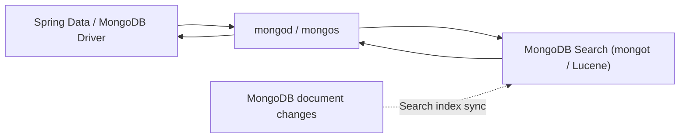
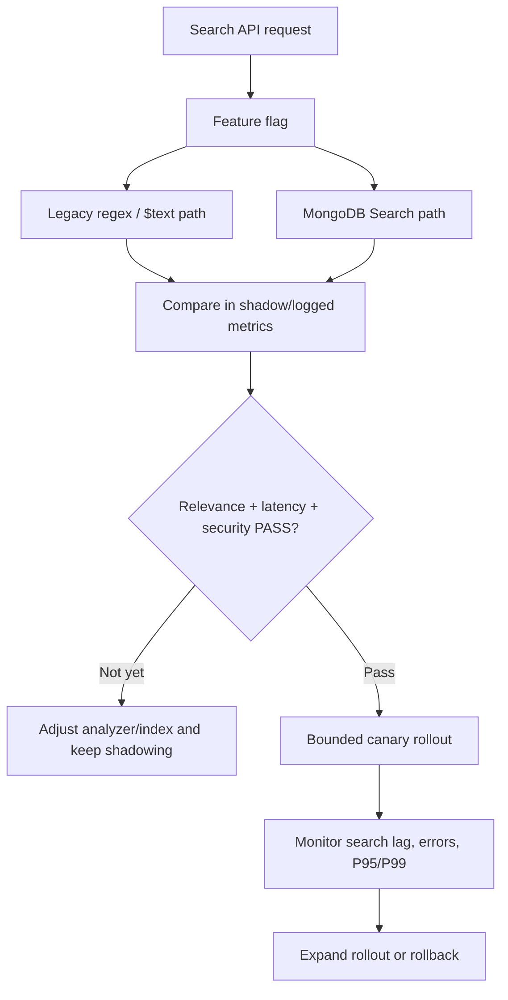
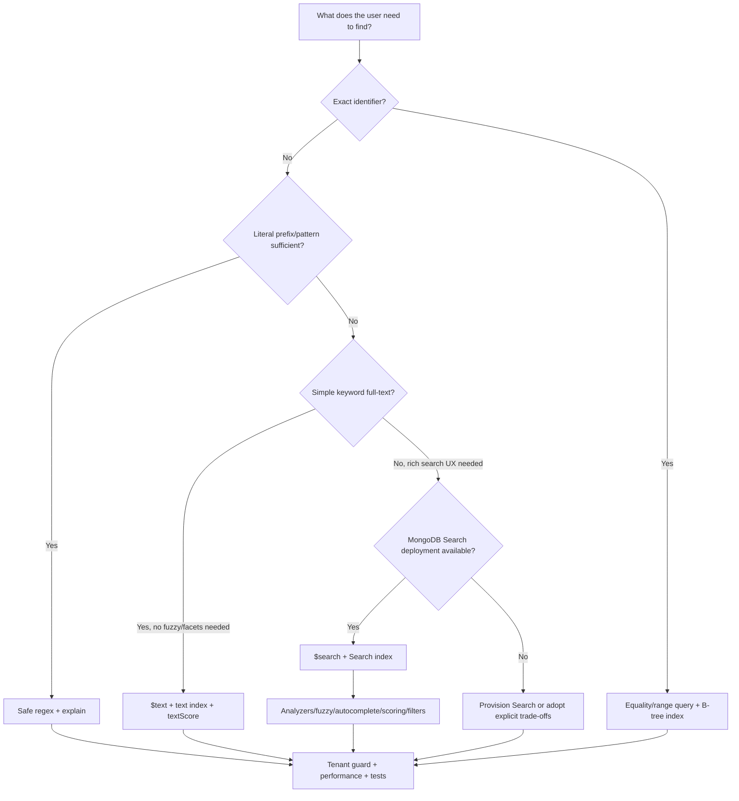

# Distinguishing Regex, `$text`, and MongoDB Search in Spring Data MongoDB

## 1. One Search Box, Three Very Different Mechanisms

Java applications using **Spring Data MongoDB** often start with a simple form: a user enters `"bàn phím"` and wants matching products. When implementing with `MongoTemplate` or a repository, a development team might consider:

1. **Regex** – character pattern matching on a BSON field value, e.g., name starts with `"Bàn"`.
2. **`$text`** – full-text search built into MongoDB queries, backed by a **text index** and processing keywords according to language rules.
3. **MongoDB Search** – a Lucene-powered search engine using a **Search index** and aggregation stages `$search`/`$searchMeta`, supporting relevance tuning, autocomplete, fuzzy matching, facets, and compound operators.

They differ across **what “match” means**, index types, text normalization, relevance scoring, scalability, operations, and post-write consistency. You cannot turn a regex query into `$text` or `$search` just by renaming the operator and expect identical results.

This lesson belongs to the **Advanced Search** chapter in the **SPRING_DATA_MONGODB** module: connecting and mapping documents, querying with `MongoTemplate`/repositories, aggregation, indexes, reactive access, testing, and performance diagnostics. The lesson focuses on **choosing a search mechanism** based on product requirements, without conflating them with vector similarity search or MongoDB Atlas SQL.

### 1.1. Objectives

After this lesson, you will be able to:

- Explain the difference between **substring/prefix matching** and **token-based full-text search**.
- Write and test `$regex`, `$text`, and `$search` using `mongosh`.
- Create the right **B-tree index**, **text index**, and **MongoDB Search index** for each use case.
- Use `Criteria.regex(...)`, `TextCriteria`/`TextQuery`, and raw `AggregationOperation` in Spring Data MongoDB.
- Understand stemming, stop words, diacritic handling, fuzzy matching, autocomplete, and relevance scores.
- Prevent regex injection/ReDoS, search index misconfiguration, and cross-tenant data leaks.
- Compare `explain`, P95/P99 latency, index size, freshness, and operational overhead.
- Plan a migration from regex or `$text` to MongoDB Search with regression tests and a rollback path.

### 1.2. Quick Comparison Table

| Criterion | MongoDB `$regex` | MongoDB `$text` | MongoDB Search |
|---|---|---|---|
| Core semantics | **Character pattern** matching | **Word/term** matching after text analysis | Queries a Search index with rich operators/analyzers |
| Runs in | `find`/`$match`, `Criteria` | `find` with `$text`, `TextQuery` | Aggregation `$search`/`$searchMeta` |
| Index | Standard B-tree index, helpful for some **anchored prefix** queries | MongoDB **text index** | Dedicated **Search index**, Lucene-backed |
| Substring matching | Possible with `.*term.*`; often costly | Not substring matching | Uses appropriate analyzers/operators; not substring by default |
| Prefix search | Regex `^prefix` | Not search-as-you-type | `autocomplete`, `wildcard`, or suitable analyzer |
| Stemming/stop words | Not built-in | Built-in per index/query language | Per configured analyzer |
| Fuzzy typos | Not built-in | No edit-distance fuzzy | `fuzzy` on supported operators |
| Relevance ranking | No built-in search score | `textScore` | `searchScore`, boosts, score details |
| Phrase search | Literal/expression regex | Quoted phrase, per text analyzer | `phrase` operator, analyzer/slop |
| Facets/highlights | Manual multi-step work | Limited; no Search-style facets | Built-in search facets and highlights |
| Index operations | B-tree and query planner | At most **one text index per collection** | Multiple Search indexes possible, separate lifecycle |
| Post-write freshness | Follows MongoDB read path/read concern | Follows MongoDB read path/read concern | Search index **syncs asynchronously**; has lag |
| Deployment requirement | Core MongoDB | MongoDB text index | Deployment with MongoDB Search capability/`mongot` |
| Best suited for | Patterns/prefixes/canonical identifiers | Basic full-text, simple infrastructure | Rich search UX, ranking/autocomplete |

**Warning:** This table does not mean regex is always fastest for prefixes or MongoDB Search is always faster for every query. Performance depends on selectivity, indexes, analyzers, cardinality, data volume, pipelines, and topology.

## 2. Unified Practice Dataset

### 2.1. The `products` Collection

Suppose an e-commerce site stores:

```javascript
use shop_search;

db.products.insertMany([
  {
    _id: "P-101",
    tenantId: "T-A",
    name: "Bàn phím Bluetooth cơ học",
    description: "Bàn phím không dây, kết nối Bluetooth",
    category: "accessories",
    price: 1500000,
    active: true
  },
  {
    _id: "P-102",
    tenantId: "T-A",
    name: "Chuột Bluetooth mini",
    description: "Chuột không dây cho laptop",
    category: "accessories",
    price: 450000,
    active: true
  },
  {
    _id: "P-103",
    tenantId: "T-A",
    name: "Cáp USB-C 2 mét",
    description: "Cáp sạc và truyền dữ liệu USB-C",
    category: "cables",
    price: 180000,
    active: true
  },
  {
    _id: "P-104",
    tenantId: "T-A",
    name: "Tai nghe chống ồn",
    description: "Tai nghe Bluetooth có chống ồn chủ động",
    category: "audio",
    price: 2200000,
    active: false
  },
  {
    _id: "P-201",
    tenantId: "T-B",
    name: "Bàn phím Bluetooth cho doanh nghiệp",
    description: "Phụ kiện dành cho một khách hàng khác",
    category: "accessories",
    price: 1100000,
    active: true
  }
]);
```

Throughout this lesson, **tenant T-A** is the authorized query scope. Document `P-201` deliberately belongs to `T-B` to test data isolation. Do not run `insertMany` repeatedly on a collection that already contains these `_id` values; use an isolated test database or controlled cleanup by ID.

### 2.2. Five Different User Request Types

| User Input / Request | Required Semantics | Recommended Choice |
|---|---|---|
| Enters code starting with `P-10` | Literal prefix on ID | Anchored regex or range/appropriate index |
| Searches names containing `Bluetooth` | Literal substring | Regex or a purpose-built substring-search mechanism |
| Searches products related to `bàn phím` | Word-based retrieval | `$text` or MongoDB Search `text` |
| Types `blueto` and expects instant suggestions | Autocomplete before finishing the word | MongoDB Search `autocomplete` |
| Mistypes `bluetoth` and still expects hits | Typo tolerance | MongoDB Search fuzzy operator |

A UI search box can combine multiple modes, but it needs a **clear contract**: exact/prefix matches can be prioritized ahead of full-text relevance. Do not expect a single `find` to satisfy every behavior automatically.

### 2.3. Notes on Vietnamese Data

Vietnamese uses diacritics, many space-separated compound words, and widespread unaccented typing. `"bàn phím"`, `"ban phim"`, and `"bàn-phím"` are **not equivalent by default** across all mechanisms. A regex with the `i` option does not strip diacritics; a text index with `default_language: "none"` lacks Vietnamese stemming and stop-word rules; MongoDB Search requires appropriate analyzers for accent folding, synonyms, or custom tokenization.

Build a **realistic Vietnamese query suite** rather than only demonstrating English words like `"running"`/`"runner"`.

## 3. Regex: Matching Character Patterns on BSON Strings

### 3.1. Basic Syntax

```javascript
// Name contains "Bluetooth" anywhere:
db.products.find({
  tenantId: "T-A",
  active: true,
  name: { $regex: "Bluetooth" }
});

// Name starts exactly with "Bàn phím":
db.products.find({
  tenantId: "T-A",
  name: { $regex: "^Bàn phím" }
});

// Case-insensitive:
db.products.find({
  tenantId: "T-A",
  name: { $regex: "bluetooth", $options: "i" }
});
```

`$regex` describes a **pattern**, not a full-text query. While a hyphen in literal `"USB-C"` is harmless outside a character class, many characters such as `.`, `+`, `?`, `[`, `(`, or `*` carry special meaning. For user input, **escape literals** rather than passing raw input straight as a regex program.

### 3.2. Anchors and Different Meanings

| Pattern | Meaning | Possible Matches |
|---|---|---|
| `^Bàn` | String starts with `Bàn` | `Bàn phím Bluetooth` |
| `Bluetooth$` | String ends with `Bluetooth` | `Chuột Bluetooth` |
| `Bluetooth` | Contains substring `Bluetooth` anywhere | `Bàn phím Bluetooth cơ học` |
| `^Bluetooth$` | Matches the entire string `Bluetooth` | Only documents with that exact name |
| `^Bàn.*Bluetooth` | Starts with `Bàn`, later followed by `Bluetooth` | `Bàn phím Bluetooth cơ học` |

Regex can validate business patterns such as code prefixes, formats, or trailing characters, but it does not **understand word boundaries or meaning**. `^Blu` is not equivalent to autocomplete matching a token mid-title.

### 3.3. Index for Anchored Prefixes

Create index:

```javascript
db.products.createIndex(
  { tenantId: 1, name: 1 },
  { name: "ix_tenant_name" }
);

db.products.find({
  tenantId: "T-A",
  name: { $regex: "^Bàn" }
}).explain("executionStats");
```

A **case-sensitive regex starting with a simple prefix** like `^Bàn` can produce an index range scan on `name`; combining with equality on `tenantId` narrows the scan. Verify in practice via `winningPlan`, `totalKeysExamined`, and `totalDocsExamined`.

Conversely:

```javascript
db.products.find({
  tenantId: "T-A",
  name: { $regex: ".*Bàn.*" }
});
```

has no useful prefix bound for the B-tree index on `name`. MongoDB may still use the `tenantId` portion of the compound index and scan/filter many keys/docs, so do not treat this as an index-accelerated substring search.

### 3.4. Why Regex Is Not a Full-Text Engine

Regex does not provide:

- Multi-field full-text tokenization by default.
- Language-aware stop words or stemming.
- Relevance ranking like `textScore`/`searchScore`.
- Automatic fuzzy matching for typos.
- Search-engine facets and highlights.
- Semantic similarity queries.

You can combine regex with aggregation and add manual business scores, but as rich search requirements and data sizes grow, complexity and cost escalate rapidly.

### 3.5. Case, Vietnamese Diacritics, and Collation

`$options: "i"` is **case-insensitive**, not “accent removal”:

```text
Bluetooth ≈ bluetooth in letter case
bàn phím ≠ ban phim merely because i is enabled
```

Case-insensitive `i` regexes in MongoDB are also **not collation-aware** in a way that lets them leverage case-insensitive indexes efficiently across arbitrary regexes. MongoDB docs note that case-insensitive regexes generally do not benefit the way equality queries do from collation-aware indexes. If the goal is **case-insensitive equality matching**, consider equality + an appropriate collation/index rather than forcing regex.

If the product needs `"ban phim"` to match `"bàn phím"`, you must implement a tested **normalization policy** or specialized analyzer. Never just toggle `i` and claim accent-insensitivity.

## 4. Safe Regex: Never Turn User Input into a Regex Program

### 4.1. Regex Injection

If a user types:

```text
.*
```

and it goes straight into:

```java
Criteria.where("name").regex(userInput);
```

then it becomes a **pattern** matching almost every name rather than searching for products containing the literal characters `.*`. Inputs like `^`, `(a+)+`, backreferences, or lookarounds can also alter semantics and execution cost.

Decide whether the API exposes **regex grammar** or **literal text search**. Most public search boxes need literal user input, not a regex playground.

### 4.2. Literal Escaping with `Pattern.quote`

```java
import java.util.regex.Pattern;
import org.springframework.data.mongodb.core.query.Criteria;
import org.springframework.data.mongodb.core.query.Query;

public Query findLiteralNameSubstring(
        String authenticatedTenantId,
        String rawInput) {
    if (rawInput == null || rawInput.isBlank()
            || rawInput.length() > 80) {
        throw new IllegalArgumentException(
            "Search term must contain 1..80 characters");
    }

    String literal = Pattern.quote(rawInput.trim());

    return Query.query(
        Criteria.where("tenantId").is(authenticatedTenantId)
            .and("active").is(true)
            .and("name").regex(Pattern.compile(literal)));
}
```

`Pattern.quote(...)` wraps the string so metacharacters are treated as **literals**. With the Java Driver targeting MongoDB's PCRE2 engine, Java `Pattern` syntax is translated to a regex pattern; most ordinary patterns work, but **do not assume** every Java regex feature maps 100% identically to server-side PCRE2.

The code above does **not** make substring regex fast: it only fixes **semantics and prevents regex injection**. Indexes and performance still require verification.

### 4.3. Bounded Literal Prefixes

```java
public Query findNamePrefix(
        String authenticatedTenantId,
        String prefix) {
    if (prefix == null || prefix.isBlank()
            || prefix.length() > 64) {
        throw new IllegalArgumentException("Invalid prefix");
    }

    String regex = "^" + Pattern.quote(prefix.trim());
    return Query.query(
        Criteria.where("tenantId").is(authenticatedTenantId)
            .and("name").regex(Pattern.compile(regex)));
}
```

Note: `Pattern.quote` may wrap literals with `\Q...\E`. An anchored pattern whose literal body is wrapped in quoting constructs might **not be recognized by MongoDB's optimizer as a simple prefix expression for optimal index bounds**. Therefore, after escaping properly, **always run `explain`**; if guaranteed prefix indexing is needed and input is constrained to a safe character set, consider a normalized shadow field + range strategy or dedicated index design.

### 4.4. Regular Expression Denial of Service

Patterns with heavy backtracking can burn excessive CPU on large datasets. If an API genuinely permits user-supplied regexes:

- Cap pattern length and target dataset scope.
- Restrict tenant scope and searchable fields.
- Enforce query `maxTimeMS` or Spring Data timeouts.
- Never allow a query to scan the entire collection just because a user entered an arbitrary pattern.
- Monitor P95/P99, scanned keys/docs, and timeout counts.
- Consider **disallowing arbitrary regexes** on public endpoints altogether.

Query timeouts cannot replace proper index design. An expensive regex can saturate database resources before timing out, especially under concurrent traffic.

## 5. Spring Data MongoDB: Regex via `Criteria` and `Query`

### 5.1. Sample Query

```java
import java.util.regex.Pattern;
import org.springframework.data.mongodb.core.MongoTemplate;
import org.springframework.data.mongodb.core.query.Criteria;
import org.springframework.data.mongodb.core.query.Query;

public class RegexProductSearch {
    private final MongoTemplate mongoTemplate;

    public RegexProductSearch(MongoTemplate mongoTemplate) {
        this.mongoTemplate = mongoTemplate;
    }

    public java.util.List<ProductDocument> byExactPrefix(
            String trustedTenantId, String prefix) {
        String safe = Pattern.quote(prefix);
        Query query = Query.query(
            Criteria.where("tenantId").is(trustedTenantId)
                .and("active").is(true)
                .and("name").regex(
                    Pattern.compile("^" + safe)));

        query.limit(20);
        query.maxTime(java.time.Duration.ofSeconds(2));
        return mongoTemplate.find(
            query, ProductDocument.class);
    }
}
```

`ProductDocument` is defined in section 16. This snippet focuses on the Spring Data API; production code also needs length validation, tenant verification, deterministic sorting, and structured error handling. `Query.maxTime(Duration)` applies the server-side timeout option supported in your Spring Data version.

### 5.2. Case-Insensitive Query

```java
Query query = Query.query(
    Criteria.where("tenantId").is(trustedTenantId)
        .and("name").regex(
            Pattern.compile(
                Pattern.quote(userTerm),
                Pattern.CASE_INSENSITIVE)));
```

**Do not** expect this case-insensitive regex to use a compound index as efficiently as an exact case-sensitive prefix. When the goal is accent-insensitive search UX, evaluate a MongoDB Search analyzer or an indexed normalized shadow field.

### 5.3. Reactive API

```java
import reactor.core.publisher.Flux;

public Flux<ProductDocument> prefixReactive(
        String trustedTenantId, String prefix) {
    Query q = Query.query(
        Criteria.where("tenantId").is(trustedTenantId)
            .and("name").regex(
                Pattern.compile("^" + Pattern.quote(prefix))));
    q.limit(20);
    return reactiveMongoTemplate.find(
        q, ProductDocument.class);
}
```

`reactiveMongoTemplate` is a service dependency (of type `ReactiveMongoTemplate`). Reactive execution does not alter `$regex` semantics or indexability; it only changes the I/O model. Never call `block()` inside a WebFlux request to turn a `Flux` into a `List`, or `subscribe()` inside a service and return before the query finishes.

### 5.4. Pagination Requires Clear Sorting

If search returns many results, never run:

```java
query.skip(100000).limit(20);
```

without measuring cost. Deep `skip` forces the engine to discard huge numbers of results; regex scans plus sorting make this even heavier. Use deterministic sorting and keyset pagination where appropriate. For relevance search, MongoDB Search provides sequence tokens/`searchAfter` in supported scenarios; do not replace it with unbounded `skip` without benchmarking.

### 5.5. Never Use Regex to Probe Sensitive Data Across the Collection

Search queries must include tenant/authorization predicates derived from the **security context**, never an unverified `tenantId` string passed by the client. When protecting sensitive data, restricting queries in the service/repository alone is insufficient; also verify database/field permissions and all other read/write paths.

## 6. `$text`: Built-In Full-Text Search on a MongoDB Text Index

### 6.1. Why Does `$text` Differ from Regex?

`$text` does not match arbitrary character substrings. MongoDB **tokenizes** indexed content into words, strips stop words, and applies stemming per configured language. Queries match those **terms**, not regex patterns.

For instance, with English index rules, singular/plural forms or related word forms may stem to the same root. Yet `"blue"` **does not match** `"blueberry"` by default merely by being a character prefix. Likewise, typing `"Bluet"` does not make `$text` act as autocomplete.

### 6.2. Creating a Multi-Field Text Index

In the practice database:

```javascript
db.products.createIndex(
  {
    name: "text",
    description: "text"
  },
  {
    name: "ix_product_text",
    default_language: "none",
    weights: {
      name: 10,
      description: 2
    }
  }
);
```

Explanation:

- The index extracts terms from `name` and `description`.
- `weights` boost matches in the product name relative to the description when computing `textScore`.
- `default_language: "none"` disables language-based stemming and stop-word removal; this serves as a **simplified baseline** for Vietnamese keywords, though it does not create a full Vietnamese analyzer.
- `name: "ix_product_text"` names the index for inspection via `getIndexes()` and migration tracking.

Each collection can have **at most one MongoDB text index**. To add another text field, adjust/rebuild the text index configuration or switch to MongoDB Search to maintain multiple Search indexes; you cannot simply create unlimited separate text indexes on one collection.

### 6.3. `$text` Query

```javascript
db.products.find({
  tenantId: "T-A",
  active: true,
  $text: { $search: "Bluetooth" }
});
```

Do not write regex syntax inside `$text`. For `$search: "Bluetooth"`, MongoDB looks up terms via the text index rather than scanning full strings for where `B` begins.

If you want to search only `name` while ignoring `description`, `$text`'s unified text index **does not support picking a different path per query like MongoDB Search `text.path`**. This is a major difference when designing product search features.

### 6.4. Text Queries Require a Text Index

```javascript
// Check indexes:
db.products.getIndexes();

// Without a supported text index, $text does not silently
// fall back to a regex scan and will raise an index-required error.
db.products.find({
  $text: { $search: "Bluetooth" }
});
```

MongoDB will not substitute a regular B-tree index on `name` for a text index when executing `$text`. The two index types have distinct structures and query semantics.

### 6.5. Default Language Is a Data Decision

When omitted, a text index usually defaults to `english` with English stop words and stemming. When indexing Vietnamese text inadvertently:

- Words colliding with English stop words may be dropped by index rules.
- Stemming does not reflect Vietnamese morphology.
- Accented/unaccented queries may yield unexpected matches or misses.

`default_language: "none"` removes stemming and stop words, **without** automatically solving Vietnamese word segmentation or accent-insensitive search. For deep Vietnamese processing, inspect MongoDB Search custom analyzers/token filters, or an external search pipeline if NLP requirements are highly specialized.

## 7. `$text`: OR, Phrase, Negation, Score, and Limitations

### 7.1. Multiple Words Default to OR

```javascript
db.products.find({
  tenantId: "T-A",
  $text: { $search: "Bluetooth cáp" }
});
```

Under `$text`'s default semantics, space-separated terms combine via **logical OR**: matching any term can return the document. **Never assume space-separated words default to AND.**

If the product requires **all words to be present**, use a search mechanism/query designed for AND semantics or add explicit constraints. MongoDB Search `compound.must` expresses that requirement far more cleanly.

### 7.2. Phrases Use Double Quotes Inside the Search Expression

```javascript
db.products.find({
  $text: { $search: '"bàn phím"' }
});
```

Here the string `'"bàn phím"'` contains **embedded** double quotes to request text-query phrase matching. It differs from:

```javascript
db.products.find({
  $text: { $search: "bàn phím" }
});
```

where terms match under OR semantics. Phrase matching still depends on text tokenization, language rules, and normalization; do not treat it as strictly identical to a substring regex on raw BSON.

### 7.3. Negation with a Minus Sign

```javascript
db.products.find({
  $text: { $search: "Bluetooth -chuột" }
});
```

This query matches documents containing `Bluetooth` while excluding documents containing the negated term `chuột` under text-search semantics. The minus sign is part of `$text` syntax, not Java string escaping.

Notes:

- A query containing only negated terms does not return all documents lacking that term; MongoDB `$text` does not work as a wildcard negative scan.
- Hyphenated strings inside content may be tokenized differently from a leading minus sign used for query negation.
- Define UI input rules clearly: are users intentionally entering advanced search syntax or plain literal text?

### 7.4. Scoring with `$meta: "textScore"`

```javascript
db.products.find(
  {
    tenantId: "T-A",
    active: true,
    $text: { $search: "Bluetooth" }
  },
  {
    name: 1,
    category: 1,
    score: { $meta: "textScore" }
  }
).sort({
  score: { $meta: "textScore" },
  _id: 1
});
```

`textScore` is MongoDB's text-index relevance score. Without sorting by score, `$text` results are not ordered from most relevant to least relevant by default.

**Score is not a probability.** `score=3.5` does not mean a 35% match or 3.5x higher likelihood of being “correct” than another search query. Score values depend on the query, corpus/index weights, and scoring logic; only use them to rank **documents within the same query**.

### 7.5. Case and Diacritic Sensitivity

```javascript
db.products.find({
  $text: {
    $search: "Bluetooth",
    $caseSensitive: false,
    $diacriticSensitive: false
  }
});
```

These flags adjust matching according to text index version and language behavior. They **do not turn MongoDB `$text` into a semantic Vietnamese analyzer** and do not fix all tokenization/normalization issues. For Vietnamese, test `"bàn"` vs. `"ban"`, Unicode NFC/NFD normalization, hyphens, compound nouns, and abbreviations.

### 7.6. Limitations to Remember

| Limitation | Design Consequence |
|---|---|
| One text index per collection | Difficult to maintain multiple analyzers or weight profiles |
| `$text` requires a text index | Plain B-tree indexes cannot substitute |
| `$text` is not prefix/substring search | Poor fit for search-as-you-type |
| `hint()` cannot be freely applied with `$text` | Cannot “force an index” like ordinary queries |
| Text index adds write and storage overhead | Avoid indexing every field blindly |
| Limited scoring vs. MongoDB Search | Lacks flexible boosts, fuzzy, highlights, and facets |
| Language-dependent stemming/stop words | `none` does not automatically solve Vietnamese |
| Text index does not optimize sorting by arbitrary fields | Inspect sort cost and query plan |
| Some special index/operator combinations are restricted | Check `$near`, geospatial, sort, and compound index rules |

### 7.7. Compound Text Indexes and Tenant Filtering

MongoDB supports compound text indexes with regular leading keys:

```javascript
// Example replacing the existing text index; DO NOT run simultaneously
// if the collection already has ix_product_text.
db.products.createIndex(
  { tenantId: 1, name: "text", description: "text" },
  { default_language: "none" }
);
```

With a compound text index having **prefix key** `tenantId`, queries using the text index need a matching equality predicate on the prefix key; this optimizes tenant-scoped searches while preventing global unscoped text searches across all tenants on that index.

**Do not run two text `createIndex` commands back-to-back** on the same collection expecting both to coexist: choose one definition or drop/rebuild via a migration plan. Production index creation must account for collection size, build windows, and live application traffic.

## 8. Spring Data MongoDB: `TextCriteria`, `TextQuery`, and `textScore`

### 8.1. `TextCriteria` Represents `$text`, Not MongoDB Search

```java
import java.util.List;
import org.bson.Document;
import org.springframework.data.mongodb.core.MongoTemplate;
import org.springframework.data.mongodb.core.query.Criteria;
import org.springframework.data.mongodb.core.query.TextCriteria;
import org.springframework.data.mongodb.core.query.TextQuery;

public class TextProductSearch {
    private final MongoTemplate template;

    public TextProductSearch(MongoTemplate template) {
        this.template = template;
    }

    public List<Document> search(
            String trustedTenantId, String term) {
        TextCriteria terms =
            new TextCriteria().matching(term);

        TextQuery query = TextQuery.queryText(terms)
            .sortByScore()
            .includeScore();

        query.addCriteria(
            Criteria.where("tenantId").is(trustedTenantId)
                .and("active").is(true));
        query.limit(20);

        return template.find(
            query, Document.class, "products");
    }
}
```

`TextCriteria`/`TextQuery` generate **`$text`** queries and `textScore` for **MongoDB text indexes**, **not** a `$search` stage. The matching text index must already exist on the collection.

This example uses `Document.class` so the `score` field is easy to inspect. With typed DTOs or domain entities, map score/metadata explicitly; never assume a `score` field populates unless declared and projected by the query.

### 8.2. Phrases and Excluded Terms

```java
TextCriteria phrase = new TextCriteria()
    .phrase("bàn phím");

TextCriteria includeExclude = new TextCriteria()
    .matching("Bluetooth")
    .notMatching("chuột");

TextQuery q1 = TextQuery.queryText(phrase);
TextQuery q2 = TextQuery.queryText(includeExclude)
    .sortByScore();
```

`TextCriteria.phrase(...)` and `notMatching(...)` express intent cleanly instead of assembling quotes and minus signs manually inside a string. Inspect the serialized query when debugging, especially with Vietnamese diacritics and multi-word phrases.

### 8.3. `matchingAny` and OR Semantics

```java
TextCriteria any = new TextCriteria()
    .matchingAny("Bluetooth", "cáp");

TextQuery query = TextQuery.queryText(any);
```

Here `matchingAny` fits OR semantics. Do not use it when the UI promises “must contain all words”. MongoDB Search `compound.must` offers cleaner control for AND/multi-constraint full-text search.

### 8.4. `ReactiveMongoTemplate` with `TextQuery`

```java
import reactor.core.publisher.Flux;

public Flux<Document> searchReactive(
        String trustedTenantId, String text) {
    TextQuery q = TextQuery.queryText(
            new TextCriteria().matching(text))
        .sortByScore()
        .includeScore();
    q.addCriteria(
        Criteria.where("tenantId").is(trustedTenantId));
    q.limit(20);

    return reactiveMongoTemplate.find(
        q, Document.class, "products");
}
```

`reactiveMongoTemplate` is an injected service bean. The reactive query returns a `Flux` and still targets a **MongoDB text index**; it does not connect to `mongot` or create a Search index.

### 8.5. Repository `@TextScore` / Derived Methods Need Query-Path Testing

Spring Data MongoDB supports full-text queries and text-score mapping in repositories (depending on version/API). However, never assume a derived repository method like `findByNameContains(...)` becomes `$text` or `$search`:

- `Containing`/`Regex` derived queries use regex/matching semantics via repository query derivation.
- `TextCriteria`/`TextQuery` use text-index semantics.
- `$search` uses an aggregation stage against a Search index.

When a codebase supports multiple search modes, name service methods explicitly—such as `findByNamePrefix`, `searchByTextTerms`, and `searchByRelevance`—instead of a generic `search` so the team never accidentally alters search contracts.

## 9. What Is MongoDB Search and Where Is It Deployed?

### 9.1. Search Index vs. Text Index

MongoDB Search runs **Apache Lucene** inside the `mongot` Search component. It maintains a **Search index** separate from `mongod`'s B-tree and text indexes, synchronizing document changes to serve queries such as:

- Tunable text relevance scoring.
- Fuzzy matching for typos.
- Autocomplete and wildcard/regex searches via **Search-specific operators**.
- Phrase queries and highlights/snippets.
- Compound conditions: `must`, `should`, `filter`, `mustNot`.
- Numeric/date ranges, facets, and metadata counts per index mappings.



**Architectural consequence:** Search indexes synchronize **asynchronously** and can lag briefly after a document changes. Never use a missing newly inserted document in search results to claim a write failed, and never treat a Search index as the source of truth over MongoDB documents for financial or security decisions.

### 9.2. No Longer Atlas-Only

The older name **Atlas Search** still appears in documentation and SDKs. Current MongoDB documentation refers to it broadly as **MongoDB Search**. Deployment options:

- **MongoDB Atlas**: Atlas manages the Search service/`mongot` and index lifecycle.
- **MongoDB Community 8.2+**: can deploy Search with `mongot` under documented product requirements, self-managed.
- **MongoDB Enterprise 8.2+ with Kubernetes Operator**: offers self-managed Search under documented criteria.
- **Atlas local** supports dev/testing; do not treat it as a production HA cluster by default.

Capabilities, support rules, and self-managed operations depend on version, edition, and topology. **Never** assume an older standalone MongoDB server can run `$search` simply by adding the pipeline stage.

References: [MongoDB Search deployment options](https://www.mongodb.com/docs/search/deployment/deployment-options/) and [Self-managed MongoDB Search](https://www.mongodb.com/docs/search/self-managed/current/).

### 9.3. `$search` Is an Aggregation Stage, Not a `$text` Alias

```javascript
db.products.aggregate([
  {
    $search: {
      index: "products_search",
      text: {
        query: "Bluetooth",
        path: ["name", "description"]
      }
    }
  },
  { $limit: 10 }
]);
```

`$search` must be the **first stage** of the aggregation pipeline where it appears per Search rules; never place `$match` before it expecting it to run:

```javascript
// WRONG: $search is not the first stage.
db.products.aggregate([
  { $match: { tenantId: "T-A" } },
  { $search: { text: { query: "Bluetooth", path: "name" } } }
]);
```

To filter tenants and business rules efficiently, use `compound.filter` inside `$search` with appropriately mapped fields. `$searchMeta` must also be the first stage of its pipeline.

### 9.4. Do Not Confuse `$search` with `$vectorSearch`

`$search` handles lexical/text search, fuzzy matching, autocomplete, filters, and Search scoring. `$vectorSearch` is the pipeline stage for vector similarity over vector indexes. While you can build **hybrid search**, that is a dedicated design involving fusion, ranking, and testing. Never refer to `$text`, `$search`, and `$vectorSearch` as interchangeable modes.

## 10. Creating a Search Index with Explicit Mappings

### 10.1. Experimental Search Index on `products`

On a deployment with MongoDB Search enabled and the `products` collection:

```javascript
db.products.createSearchIndex(
  "products_search",
  {
    mappings: {
      dynamic: false,
      fields: {
        name: {
          type: "string",
          analyzer: "lucene.standard"
        },
        description: {
          type: "string",
          analyzer: "lucene.standard"
        },
        tenantId: {
          type: "token"
        },
        category: {
          type: "token"
        },
        active: {
          type: "boolean"
        },
        price: {
          type: "number"
        }
      }
    }
  }
);
```

Explanation:

- `dynamic: false` indexes only declared fields, saving cost and preventing accidental indexing of sensitive fields added later.
- `string` mapping on `name` and `description` serves text operators and analyzers.
- `token` mapping on `tenantId` and `category` supports exact string `equals`, facets, and sorting without splitting into words.
- `boolean` for `active` and `number` for `price` enable filters and ranges.
- `index: "products_search"` in queries **must match the exact Search index name**, not a B-tree or text index name from `createIndex`.

A Search index definition **is not the same as**:

```javascript
db.products.createIndex({ name: "text" });
```

`createSearchIndex` creates a dedicated index for MongoDB Search; `createIndex` with `"text"` creates a regular text index for `$text`.

### 10.2. Why Use `token` for `tenantId`?

`tenantId = "T-A"` requires **exact** equality, not full-text tokenization. `type: "token"` enables Search `equals` on strings. Mapping `tenantId` only as analyzed `string` text can break exact semantics or be rejected by the operator.

`token` supports normalizers like `lowercase` when needed, but for IDs and tenant identifiers, use an immutable **canonical value** and exact comparison; never accidentally turn a case-sensitive tenant ID case-insensitive if authorization rules forbid it.

### 10.3. Check Index Status Before Querying

```javascript
db.products.getSearchIndexes("products_search");
```

Creating a Search index takes time to build. Never run a test query and conclude Search “found nothing” while the index is still building or syncing. Check `queryable`/status per your API/server version; add a readiness check in CI if tests exercise Search.

When modifying a Search index definition, the system may rebuild in the background. Monitor build progress, query latency, index version, `mongot` resources, and behavioral changes during rollout.

### 10.4. Static Mappings Help Control Cost

`dynamic: true` speeds up prototyping, but it can index unnecessary fields as schemas evolve and bloat storage/search overhead. In production:

1. Specify only fields the UI needs.
2. Choose exact types: `string`, `autocomplete`, `token`, `number`, `date`, `boolean`.
3. Never index tokens, password hashes, access keys, or raw PII.
4. Define the analyzer for each field.
5. Version-control the index definition as an artifact deployed via migrations.

### 10.5. Multiple Search Indexes Are Allowed

Unlike `$text`'s limit of **one text index per collection**, MongoDB Search allows multiple Search indexes on the same collection—for example, one for product search and another for autocomplete or testing a new analyzer.

The trade-off is **resources and cost**: more indexes consume more storage, build time, sync bandwidth, and Search node capacity. Never create an index per request or per tenant arbitrarily.

## 11. `$search` Text + `compound.filter`: Relevance Alongside Tenant Isolation

### 11.1. Query Filtering Tenant and Active Status

```javascript
db.products.aggregate([
  {
    $search: {
      index: "products_search",
      compound: {
        must: [
          {
            text: {
              query: "Bluetooth",
              path: ["name", "description"]
            }
          }
        ],
        filter: [
          { equals: { path: "tenantId", value: "T-A" } },
          { equals: { path: "active", value: true } }
        ]
      }
    }
  },
  {
    $project: {
      _id: 1,
      name: 1,
      category: 1,
      price: 1,
      score: { $meta: "searchScore" }
    }
  },
  { $limit: 20 }
]);
```

Points to remember:

- `compound.must`: conditions that must match and contribute to the relevance score.
- `compound.filter`: **mandatory** conditions that **do not contribute to score**, ideal for tenant, active status, and numeric ranges.
- `searchScore`: Search relevance metadata, **distinct** from `$text`'s `textScore`.
- `$project`: restricts returned fields to avoid exposing sensitive descriptions.
- `$limit`: protects endpoints from returning unbounded results.

Filtering `tenantId` from a trusted/authenticated context **does not solve system-wide authorization by itself**, but it is an indispensable layer in query design. Never trust a client-supplied tenant ID without validation and authorization.

### 11.2. `must`, `should`, `filter`, and `mustNot`

| Clause | Meaning |
|---|---|
| `must` | All clauses in the array must match; scores generally add to relevance |
| `should` | Optional/preferred matches; minimum match count configurable via `minimumShouldMatch` |
| `filter` | All clauses in the array must match; does not contribute to relevance score |
| `mustNot` | Excludes documents matching the negated conditions |

Example boosting product names containing `Bluetooth`:

```javascript
db.products.aggregate([
  {
    $search: {
      index: "products_search",
      compound: {
        must: [
          {
            text: {
              query: "Bluetooth",
              path: ["name", "description"]
            }
          }
        ],
        should: [
          {
            text: {
              query: "Bluetooth",
              path: "name",
              score: { boost: { value: 3 } }
            }
          }
        ],
        filter: [
          { equals: { path: "tenantId", value: "T-A" } },
          { equals: { path: "active", value: true } }
        ]
      }
    }
  },
  { $limit: 10 }
]);
```

`should` here is a **boosting signal**, not permission to bypass `must` or `filter`. When a `compound` contains only `should` and no `must` or `filter`, verify the minimum-match behavior under MongoDB Search `compound` rules.

### 11.3. Text Queries Across Multiple Paths

```javascript
text: {
  query: ["Bluetooth", "bàn phím"],
  path: ["name", "description"]
}
```

`text.query` accepts a string or an array of strings per the operator contract, but requirements like “must contain both words”, “exact phrase”, or “each word in a different path” must be **expressed explicitly** using `compound.must`, `phrase`, or other operators. Never treat an array input as an automatic guarantee of AND across every term.

### 11.4. Filtering Inside the Search Index Before Fetching Documents

Some code writes:

```javascript
[
  { $search: { index: "products_search", text: {
      query: "Bluetooth", path: "name" } } },
  { $limit: 20 },
  { $match: { tenantId: "T-A" } }
]
```

This is an **anti-pattern** if you expect 20 results for tenant T-A: `$limit` may take the global top 20 across the cluster, leaving `$match` with only a handful of results. If pagination counts or scores rely on cross-tenant totals, semantics break and ranking can leak side-channel info.

Place the tenant filter **inside `$search.compound.filter`** with proper Search index mappings. You may add a `$match` after `$search` for defense in depth, but never replace early candidate filtering with post-filtering.

### 11.5. Price and Category Filters

```javascript
db.products.aggregate([
  {
    $search: {
      index: "products_search",
      compound: {
        must: [
          { text: { query: "Bluetooth", path: "name" } }
        ],
        filter: [
          { equals: { path: "tenantId", value: "T-A" } },
          { equals: { path: "active", value: true } },
          { equals: { path: "category", value: "accessories" } },
          {
            range: {
              path: "price",
              gte: 300000,
              lte: 2000000
            }
          }
        ]
      }
    }
  },
  { $limit: 20 }
]);
```

`tenantId`/`category` require `token` mapping, and `price` requires `number` mapping. A `text` path or `range` field missing the proper mapping can fail or return unexpected matches.

## 12. Scoring in MongoDB Search: Different from `textScore`

### 12.1. Results Are Ordered by Relevance by Default

MongoDB Search computes `searchScore` for matching documents and returns hits sorted by relevance by default. Still define **explicit sort and tie-breaking rules** for pagination, and inspect the impact of score boosts and analyzer changes.

```javascript
db.products.aggregate([
  {
    $search: {
      index: "products_search",
      text: {
        query: "Bluetooth",
        path: ["name", "description"]
      }
    }
  },
  {
    $project: {
      name: 1,
      score: { $meta: "searchScore" }
    }
  },
  { $limit: 10 }
]);
```

Never write:

```javascript
score: { $meta: "textScore" }
```

inside a `$search` pipeline and claim it is MongoDB Search relevance. `$text`'s `textScore` and `$search`'s `searchScore` are **two different metadata expressions**.

### 12.2. Score Boosts and Quality Signals

Business requirements might specify:

- Name matches outweigh description matches.
- In-stock products rank higher when relevance is comparable.
- Exact SKU matches outrank fuzzy keyword matches.
- Hidden or inactive products must be excluded completely.

Designs typically combine **search relevance** with **business ranking** using `score.boost`, `compound.should`, or search score functions depending on the operator and index. Avoid hard-coding scores as probabilities or comparing raw scores across different queries.

### 12.3. Debugging with `scoreDetails`

```javascript
db.products.aggregate([
  {
    $search: {
      index: "products_search",
      text: { query: "Bluetooth", path: "name" },
      scoreDetails: true
    }
  },
  {
    $project: {
      name: 1,
      score: { $meta: "searchScore" },
      details: { $meta: "searchScoreDetails" }
    }
  },
  { $limit: 5 }
]);
```

`scoreDetails` helps investigate why a document ranked higher or lower, but it increases response size and cost and should not be enabled unconditionally on public APIs. Search scoring algorithms can change across operators, indexes, and versions; use regression fixtures rather than pinning absolute score values.

### 12.4. Score Is Not Authorization

A high-scoring document belonging to another tenant **must never be returned**. Never fetch global top-ranked results first and simply hide sensitive fields during serialization; entity existence, counts, and rankings still leak information.

Enforce tenancy/access filters during candidate selection and verify authorization at the service/security layer. Search results only provide **candidates**; they do not authorize mutations on those documents.

## 13. Autocomplete, Fuzzy Matching, and Search-as-You-Type

### 13.1. Autocomplete Is Not a Wildcard Regex

A user types `"blue"` and expects `"Bluetooth"` before finishing the word. You could write `"^Blue"` for fields starting with that word, but for `"Bàn phím Bluetooth"`, the prefix of the **field** is not the prefix of the **token Bluetooth**. Search autocomplete operates on analyzed/indexed tokens, not simple start-of-string anchors.

A Search index with an `autocomplete` field type is built for this behavior. To support both text search and autocomplete on the same `name` field, define multiple mapping types for that field within **a single Search index**.

### 13.2. Autocomplete Index

Example creating a **separate Search index** so we do not alter `products_search` from section 10:

```javascript
db.products.createSearchIndex(
  "products_autocomplete",
  {
    mappings: {
      dynamic: false,
      fields: {
        name: [
          { type: "string" },
          {
            type: "autocomplete",
            tokenization: "edgeGram",
            minGrams: 2,
            maxGrams: 15,
            foldDiacritics: true
          }
        ],
        tenantId: { type: "token" },
        active: { type: "boolean" }
      }
    }
  }
);
```

`edgeGram` creates short prefixes starting from the left edge of tokens (per the analyzer). `minGrams`/`maxGrams` bound gram length; setting `minGrams` too low inflates Search index size and false-positive candidates. `foldDiacritics` helps normalize accents per operator support, though real Vietnamese combinations still require testing.

This is a separate index; wait for it to become `queryable` before running the next example.

### 13.3. Autocomplete Query

```javascript
db.products.aggregate([
  {
    $search: {
      index: "products_autocomplete",
      compound: {
        must: [
          {
            autocomplete: {
              query: "blueto",
              path: "name"
            }
          }
        ],
        filter: [
          { equals: { path: "tenantId", value: "T-A" } },
          { equals: { path: "active", value: true } }
        ]
      }
    }
  },
  {
    $project: {
      name: 1,
      score: { $meta: "searchScore" }
    }
  },
  { $limit: 10 }
]);
```

Autocomplete returns documents matching **query prefix tokens per the mapping**. It does not automatically produce a list of standalone **keyword suggestions**; if the UI needs normalized suggestion strings (category names, popular queries), build dedicated projections, analytics, or a separate suggestion index.

### 13.4. `edgeGram`, `rightEdgeGram`, and `nGram`

| Tokenization | Concept | Cost / Application |
|---|---|---|
| `edgeGram` | Left-edge prefixes of tokens | Common search-as-you-type |
| `rightEdgeGram` | Right-edge suffixes of tokens | Matching trailing parts of words |
| `nGram` | Substrings anywhere inside tokens | Substring-like search; much larger indexes |

Never pick `nGram` just to “match every substring” without measuring index size, precision, query latency, and noise. Long Vietnamese product names generate many grams; across millions of documents, storage and index update costs grow substantially.

### 13.5. Fuzzy Typo Tolerance

The MongoDB Search `text` operator supports a `fuzzy` option:

```javascript
db.products.aggregate([
  {
    $search: {
      index: "products_search",
      compound: {
        must: [
          {
            text: {
              query: "Bluetoth",
              path: "name",
              fuzzy: {
                maxEdits: 1,
                prefixLength: 2,
                maxExpansions: 50
              }
            }
          }
        ],
        filter: [
          { equals: { path: "tenantId", value: "T-A" } },
          { equals: { path: "active", value: true } }
        ]
      }
    }
  },
  { $limit: 10 }
]);
```

`maxEdits` bounds edit distance (per operator contract), `prefixLength` requires an exact leading prefix, and `maxExpansions` caps candidate expansions. Never assume fuzzy matching always corrects typos safely; it can match unrelated words, especially on short words and SKU/code domains.

**Rule of thumb:** use fuzzy for **natural language text**, and exact matching for **order IDs, payment IDs, tenant IDs, and standard SKUs** unless the UI explicitly asks for suggestions. Never rely on fuzzy search to pick a document for mutation or payment.

### 13.6. Autocomplete + Fuzzy

MongoDB Search `autocomplete` also supports fuzzy options per its contract, for example:

```javascript
{
  autocomplete: {
    query: "blueto",
    path: "name",
    fuzzy: {
      maxEdits: 1,
      prefixLength: 2
    }
  }
}
```

However, do not enable unbounded fuzzy matching on every keystroke: on 1–2 characters, noisy matches explode. UIs typically combine debouncing, minimum query length, rate limits, and per-tenant caching to protect Search nodes.

## 14. Vietnamese Search: Analyzers and Normalization

### 14.1. Separating Three Distinct Issues

Consider `"Bàn phím cơ học"`:

1. **Case folding:** `"bàn"` vs. `"BÀN"`.
2. **Accent folding:** `"ban"` vs. `"bàn"`.
3. **Vietnamese word segmentation/phrase understanding:** `"bàn phím"` is a compound noun, not always two unrelated tokens.

Solving (1) does not solve (2), and neither solves (3). Regex `i` mainly helps (1); `$text` relies on language rules; MongoDB Search supports **custom analyzers** with folding capabilities, though deep Vietnamese NLP still needs testing and customization.

### 14.2. Custom Analyzer with Unicode Folding

Example creating a new Search index named `products_folded` for searching `name` and `description`:

```javascript
db.products.createSearchIndex(
  "products_folded",
  {
    analyzers: [
      {
        name: "folded_text",
        charFilters: [],
        tokenizer: { type: "standard" },
        tokenFilters: [
          { type: "icuFolding" }
        ]
      }
    ],
    mappings: {
      dynamic: false,
      fields: {
        name: {
          type: "string",
          analyzer: "folded_text",
          searchAnalyzer: "folded_text"
        },
        description: {
          type: "string",
          analyzer: "folded_text",
          searchAnalyzer: "folded_text"
        },
        tenantId: { type: "token" },
        active: { type: "boolean" }
      }
    }
  }
);
```

`icuFolding` performs Unicode folding, including case and accent normalization per ICU rules. This example **is not** a Vietnamese word segmentation model; it is an experimental option to make unaccented searches easier.

### 14.3. Querying with the Folded Analyzer

```javascript
db.products.aggregate([
  {
    $search: {
      index: "products_folded",
      compound: {
        must: [
          {
            text: {
              query: "ban phim",
              path: ["name", "description"]
            }
          }
        ],
        filter: [
          { equals: { path: "tenantId", value: "T-A" } },
          { equals: { path: "active", value: true } }
        ]
      }
    }
  },
  {
    $project: {
      name: 1,
      score: { $meta: "searchScore" }
    }
  },
  { $limit: 10 }
]);
```

On our sample data, `"ban phim"` is a test case against `"Bàn phím Bluetooth cơ học"`. However, if the UI requires **both words to match**, the default `text` operator may broaden matches; use separate `compound.must` clauses per term or `phrase` depending on the desired contract, and test word order and segmentation. Never claim every unaccented sentence maps 1-to-1 to accented text.

### 14.4. Unicode Composition and Input Data

Two visually identical strings may use different Unicode code-point encodings (NFC vs. NFD). A custom analyzer handles some normalization, yet user input, ingestion pipelines, database data hygiene, and frontends also need a consistent policy.

A Vietnamese test suite should cover:

| Accented Text | Input | What to Verify |
|---|---|---|
| `Bàn phím Bluetooth` | `ban phim` | Accent folding + token matching |
| `Chuột không dây` | `chuot khong day` | Multi-word folding |
| `Cáp USB-C` | `usb c` | Hyphens and tokenizer behavior |
| `Tai nghe chống ồn` | `tai nghe` | OR/AND semantics |
| `Bàn phím cơ học` | `bàn-phím` | Delimiter normalization |
| `Cáp USB-C 2 mét` | `2m` | Synonyms/units, not inferred automatically |
| `Bluetooth` | `Bluetoth` | Fuzzy edit distance |

When synonyms like `"tai nghe"` and `"headphone"` are required, manage synonyms using MongoDB Search's supported synonym feature or a curated synonym map rather than relying on `icuFolding`, since folding has no semantic understanding.

### 14.5. Analyzer Change = Search Behavior Change

Modifying an analyzer or index can:

- Change token boundaries.
- Change hit counts.
- Shift scores and rankings.
- Increase index size.
- Trigger an index rebuild.

Therefore, analyzer migrations require a **golden query set**, relevance acceptance criteria, shadow traffic if feasible, and a rollback plan; never treat it as a cosmetic change.

## 15. Highlights, `$searchMeta`, Counts, and Facets

### 15.1. Highlighting Matched Terms in Text

```javascript
db.products.aggregate([
  {
    $search: {
      index: "products_search",
      text: {
        query: "Bluetooth",
        path: ["name", "description"]
      },
      highlight: {
        path: ["name", "description"]
      }
    }
  },
  {
    $project: {
      name: 1,
      description: 1,
      score: { $meta: "searchScore" },
      highlights: { $meta: "searchHighlights" }
    }
  },
  { $limit: 10 }
]);
```

Highlights are metadata helping the UI render matched text snippets. They must **never** be rendered via unsanitized `innerHTML` as raw HTML. Frontends should construct safe DOM nodes or text spans so malicious strings in product names/descriptions cannot become executable scripts.

### 15.2. `$searchMeta` Returns Metadata, Not Product Lists

```javascript
db.products.aggregate([
  {
    $searchMeta: {
      index: "products_search",
      compound: {
        must: [
          { text: { query: "Bluetooth", path: "name" } }
        ],
        filter: [
          { equals: { path: "tenantId", value: "T-A" } },
          { equals: { path: "active", value: true } }
        ]
      },
      count: {
        type: "total"
      }
    }
  }
]);
```

`$searchMeta` serves counts, facets, and metadata without returning product documents like `$search`. `count.type="total"` computes the exact total according to the Search index view, which can be costlier than `lowerBound` on massive collections.

### 15.3. `lowerBound` Differs from `total`

```javascript
count: { type: "lowerBound" }
```

When using `lowerBound`, the returned metadata contains `count.lowerBound`, which must not be relabeled “exact total results” in the UI. For `total`, read `count.total`. If the index lags behind writes, both `total` and `lowerBound` reflect the **Search index state**, not an instant authoritative count on the primary MongoDB collection.

### 15.4. Faceting by Category

With `category: {type:"token"}` mapped:

```javascript
db.products.aggregate([
  {
    $searchMeta: {
      index: "products_search",
      facet: {
        operator: {
          compound: {
            must: [
              {
                text: {
                  query: "Bluetooth",
                  path: ["name", "description"]
                }
              }
            ],
            filter: [
              { equals: { path: "tenantId", value: "T-A" } },
              { equals: { path: "active", value: true } }
            ]
          }
        },
        facets: {
          categoryBuckets: {
            type: "string",
            path: "category"
          }
        }
      },
      count: {
        type: "total"
      }
    }
  }
]);
```

Facets let the UI display category groups and hit counts matching the Search query. Never compute facets across the entire collection and display them alongside a tenant-scoped query; that yields inaccurate numbers and leaks other tenants' distributions.

### 15.5. Faceting by Price Range

MongoDB Search also supports numeric and date facets with compatible index mappings. When designing price buckets:

- Keep a consistent currency and minor-unit integer representation.
- Avoid mixing cents with whole currency units when defining bucket bounds.
- Remember calculations reflect indexed prices, which can lag slightly behind primary document updates.
- If business logic needs final transactional prices, re-verify authoritative documents before checkout.

### 15.6. When Both Results and Metadata Are Needed

`$search` can populate the `$$SEARCH_META` variable for downstream stages per MongoDB Search constraints. When UX needs documents plus total count/facets together:

- Run `$search` and read `$$SEARCH_META` in a supported pipeline structure.
- Or run separate `$search` and `$searchMeta` queries, accepting minor drift if the index updates between requests.

Do not confuse regular aggregation `$facet`, Search's `facet` collector, and `$searchMeta`; they differ in **pipeline placement and output shape**.

## 16. Spring Data MongoDB: Integrating MongoDB Search via `AggregationOperation`

### 16.1. Entity for the Spring Examples

```java
import org.springframework.data.annotation.Id;
import org.springframework.data.mongodb.core.mapping.Document;

@Document(collection = "products")
public class ProductDocument {
    @Id
    private String id;

    private String tenantId;
    private String name;
    private String description;
    private String category;
    private long price;
    private boolean active;

    protected ProductDocument() {}

    public String getId() { return id; }
    public String getTenantId() { return tenantId; }
    public String getName() { return name; }
    public String getDescription() { return description; }
    public String getCategory() { return category; }
    public long getPrice() { return price; }
    public boolean isActive() { return active; }
}
```

Spring Data maps `@Id String id` to BSON `_id`. The remaining fields use Java names identical to the BSON keys in the sample data, so raw Search JSON needs no renaming here. If you later annotate `@Field("product_name")`, both the Search index definition and raw `$search.path` must use the **physical BSON field name**, not `getName()` automatically.

### 16.2. Why Not Use `TextQuery` for `$search`?

`TextCriteria`/`TextQuery` are built for `$text` and `textScore`. MongoDB Search executes inside an **aggregation pipeline**:

```javascript
{ $search: { index: "products_search", ... } }
```

Spring Data MongoDB lets you embed **raw aggregation stages** inside `Aggregation` via `AggregationOperation` when a Search-specific stage lacks a full fluent builder in your version.

### 16.3. DTO Returning Search Score

```java
public record ProductSearchHit(
    String id,
    String name,
    String category,
    long price,
    double score
) {}
```

The example maps from `org.bson.Document` rather than assuming `$text`'s `@TextScore` automatically binds MongoDB Search's `searchScore`.

### 16.4. Building the `$search` Stage Safely with `Document` Objects

```java
import java.util.List;
import org.bson.Document;
import org.springframework.data.mongodb.core.aggregation.Aggregation;
import org.springframework.data.mongodb.core.aggregation.AggregationOperation;

public final class ProductSearchAggregation {
    private static final String INDEX = "products_search";

    private ProductSearchAggregation() {}

    public static Aggregation build(
            String trustedTenantId,
            String text,
            int limit) {

        if (trustedTenantId == null || trustedTenantId.isBlank()) {
            throw new IllegalArgumentException("Tenant required");
        }
        if (text == null || text.isBlank() || text.length() > 120) {
            throw new IllegalArgumentException("Invalid search term");
        }
        if (limit < 1 || limit > 50) {
            throw new IllegalArgumentException("Invalid limit");
        }

        Document textClause = new Document("text",
            new Document("query", text.trim())
                .append("path", List.of("name", "description")));

        Document tenantFilter = new Document("equals",
            new Document("path", "tenantId")
                .append("value", trustedTenantId));
        Document activeFilter = new Document("equals",
            new Document("path", "active")
                .append("value", true));

        Document compound = new Document("must",
                List.of(textClause))
            .append("filter",
                List.of(tenantFilter, activeFilter));

        Document searchSpec = new Document("index", INDEX)
            .append("compound", compound);

        AggregationOperation searchStage =
            context -> new Document("$search", searchSpec);

        Document projection = new Document("_id", 1)
            .append("name", 1)
            .append("category", 1)
            .append("price", 1)
            .append("score",
                new Document("$meta", "searchScore"));

        AggregationOperation projectionStage =
            context -> new Document("$project", projection);

        // $search MUST precede all other stages.
        return Aggregation.newAggregation(
            searchStage,
            projectionStage,
            Aggregation.limit(limit));
    }
}
```

Benefits:

- `$search` is the first stage.
- User text enters only as the **query value**, never parsed as raw JSON syntax.
- `path`, `index`, and filter keys are constants controlled by server-side code.
- Tenant scope comes from the authentication context; clients cannot switch tenants via a query parameter.
- `limit` is bounded.

**Important:** `Document` contains raw BSON field paths. Spring Data's `AggregationOperationContext` maps field paths for supported DSL operations, but custom raw stages like this example **do not automatically translate** `tenantId` or `name` via `@Field` mappings. Whenever domain mappings change, update the Search index/query and test the raw pipeline.

### 16.5. Executing the Pipeline with `MongoTemplate.aggregate`

```java
import java.util.List;
import org.bson.Document;
import org.springframework.data.mongodb.core.MongoTemplate;
import org.springframework.stereotype.Service;

@Service
public class ProductMongoSearchService {
    private final MongoTemplate template;

    public ProductMongoSearchService(MongoTemplate template) {
        this.template = template;
    }

    public List<ProductSearchHit> find(
            String trustedTenantId,
            String text,
            int limit) {
        var aggregation = ProductSearchAggregation.build(
            trustedTenantId, text, limit);

        return template.aggregate(
                aggregation, "products", Document.class)
            .getMappedResults()
            .stream()
            .map(ProductMongoSearchService::toHit)
            .toList();
    }

    static ProductSearchHit toHit(Document doc) {
        return new ProductSearchHit(
            doc.getString("_id"),
            doc.getString("name"),
            doc.getString("category"),
            ((Number) doc.get("price")).longValue(),
            ((Number) doc.get("score")).doubleValue());
    }
}
```

This mapper assumes the index and documents contain `price` and `score` with compatible types. In production, add null/missing field checks or validated DTO mapping; if the collection stores BSON Decimal128 prices, avoid casting to `long` and use `Decimal128`/`BigDecimal` with explicit currency handling.

### 16.6. Never Use `Document.parse` with Unsanitized User Input

Error-prone pattern:

```java
// ANTI-PATTERN: rawInput may contain quotes or JSON operators
// altering the stage structure or causing JSON parse errors.
Document stage = Document.parse(
    "{ '$search': { 'text': { 'query': '" + rawInput
    + "', 'path': 'name' } } }");
```

Use `new Document("query", rawInput)` or a validated builder API. This **prevents JSON string-concatenation injection**, while you must still enforce length bounds, character validation, rate limits, and index cost controls.

### 16.7. Search Pipeline Errors Do Not Mean “No Products Found”

If the deployment does not support `$search`, the Search index is not `queryable`, the index name is wrong, or the Search service is unavailable, `aggregate(...)` throws an exception. Never catch every exception and return an empty list:

```java
// ANTI-PATTERN:
try {
    return searchService.find(tenant, text, 20);
} catch (Exception ex) {
    return List.of();  // Hides an infrastructure failure as "no products".
}
```

Define a controlled error/fallback policy: return `503 Search temporarily unavailable` or switch to an explicit fallback search path **while clearly indicating that semantics may differ**, never disguising Search outages as zero hits.

## 17. `ReactiveMongoTemplate` and MongoDB Search

### 17.1. Reusing the Same Aggregation Definition

```java
import org.bson.Document;
import org.springframework.data.mongodb.core.ReactiveMongoTemplate;
import org.springframework.stereotype.Service;
import reactor.core.publisher.Flux;

@Service
public class ReactiveProductMongoSearchService {
    private final ReactiveMongoTemplate template;

    public ReactiveProductMongoSearchService(
            ReactiveMongoTemplate template) {
        this.template = template;
    }

    public Flux<ProductSearchHit> search(
            String trustedTenantId,
            String text,
            int limit) {
        var aggregation = ProductSearchAggregation.build(
            trustedTenantId, text, limit);

        return template.aggregate(
                aggregation,
                "products",
                Document.class)
            .map(ProductMongoSearchService::toHit);
    }
}
```

Key takeaways:

- `ReactiveMongoTemplate.aggregate(...)` still requires a Search index and a Search-enabled deployment.
- `Flux` is a reactive stream, not a lighter query: the Search stage executes inside the database/Search service.
- Never call `block()` in a WebFlux controller if the system is designed end-to-end reactive.
- Never call `subscribe()` directly inside a service for “fire and forget”; let WebFlux/the runtime subscribe at the proper boundary.

### 17.2. Controllers Must Not Take `tenantId` from Query Params

```java
// Sketch: trustedTenantId comes from the authenticated principal.
public Flux<ProductSearchHit> searchProducts(
        String trustedTenantId,
        String userText) {
    return reactiveSearchService.search(
        trustedTenantId, userText, 20);
}
```

In a real WebFlux controller, derive `trustedTenantId` from the authentication/authorization context; never use:

```java
@RequestParam("tenantId") String tenantId
```

without authorization verification. The API must also enforce DTO field allowlists, rate-limit queries, and classify `SearchUnavailable`/timeouts explicitly.

### 17.3. Never Use MongoDB Search to Verify Transactional Invariants

Search indexes can lag behind document writes. When business rules require “once paid, immediately visible in order status” or “document currently holds spending authorization”, perform an authoritative MongoDB read and transaction/conditional update. Never use Search rankings or missing Search hits as proof that a write does not exist.

Separate responsibilities:

```text
Search UX → locate candidate IDs with $search
               |
               v
Domain operation → re-read/verify authoritative document
               |
               v
Authorization + invariant + update/transaction
```

This is especially crucial when Search indexes lag, concurrent updates occur, or a document was just disabled/deleted.

### 17.4. Search Score and DTO Mapping

`searchScore` is metadata from `$search`. For typed DTOs:

- Use `$project` to materialize score as a BSON field like `score`.
- Map the numeric type safely; avoid null unboxing.
- Do not annotate with `$text`'s `@TextScore` expecting automatic `searchScore` mapping.
- If returning highlights, model a DTO matching the metadata structure rather than parsing raw HTML.

### 17.5. Combining Reactive Backpressure with Query Limits

A `Flux` provides backpressure semantics in Java, but sending an unbounded search query and applying `take(10)` downstream does not always protect the server. **Cap the query/pipeline server-side** using `$limit` or Search result limits alongside pagination/cursor strategies.

For autocomplete, client-side debouncing/`switchMap` can discard stale UI requests; on the backend, enforce rate limits, max search term length, timeouts, and per-tenant quotas to protect Search nodes.

## 18. Performance: There Is No Single “Fastest” Mechanism in All Cases

### 18.1. Compare Equivalent Workloads, Not Just Identical Keywords

Because the three mechanisms have different logic, benchmarks must start with the **result contract**:

- Character prefix `^Bàn` vs. autocomplete `"Bàn"` can yield different hit sets.
- Regex `Bluetooth` matches substrings inside names, `$text` matches tokens, and `$search.text` matches analyzer-produced tokens.
- Regex has no default relevance score; `$text` and `$search` do.
- Search indexes can lag behind primary documents.

Therefore, never say “regex returned 5 hits while Search returned 4, so Search is slower/wrong” if the two queries do not share identical search semantics.

### 18.2. Benchmarking Regex

```javascript
db.products.find({
  tenantId: "T-A",
  name: { $regex: "^Bàn" }
}).explain("executionStats");
```

Monitor:

- `winningPlan`: `IXSCAN` vs. `COLLSCAN`, and whether the compound index is used.
- `totalKeysExamined` and `totalDocsExamined` relative to `nReturned`.
- Query latency after cache warmup and on cold cache.
- Whether `$regex` has a sufficiently selective anchored prefix.
- Whether the index puts the tenant filter in the right leading position.

Even a query using an index that scans hundreds of thousands of keys to return 10 hits may still violate your latency SLA.

### 18.3. Benchmarking `$text`

```javascript
db.products.find({
  tenantId: "T-A",
  active: true,
  $text: { $search: "Bluetooth" }
}).explain("executionStats");
```

Inspect the chosen text index, examined documents, and fetch/sort cost. Measure:

- High-frequency terms (`Bluetooth`) vs. rare terms.
- Phrases and negations.
- Combined tenant/category filters.
- Text index size and insert/update throughput.
- `textScore` sorting and pagination.

Never assume `$text` is always slower than Search or regex simply because MongoDB recommends MongoDB Search for advanced full-text. A simple text query on a small corpus can satisfy SLAs cleanly with minimal operational overhead.

### 18.4. Benchmarking MongoDB Search

```javascript
db.products.explain("executionStats").aggregate([
  {
    $search: {
      index: "products_search",
      compound: {
        must: [
          { text: { query: "Bluetooth", path: "name" } }
        ],
        filter: [
          { equals: { path: "tenantId", value: "T-A" } }
        ]
      }
    }
  },
  { $limit: 20 }
]);
```

Depending on MongoDB Server/Search version, `explain` surfaces Search execution and pipeline metrics at varying levels of detail; do not expect `IXSCAN`/`totalKeysExamined` fields **identical** to B-tree queries. Inspect Search explain metrics/logs alongside Search node CPU, memory, index size, and index build status.

Measure:

- P50/P95/P99 latency, error rate, and timeout rate.
- Search node/`mongot` utilization, query concurrency, and queueing.
- Index build/update cost, especially with `autocomplete nGram` and fuzzy expansions.
- Search index synchronization lag after MongoDB writes.
- Throughput under tenant/category filters and metadata counts/facets.
- Ranking stability after index or analyzer changes.

### 18.5. Search Lag Is a Characteristic Requiring an SLA

`mongot` updates Search indexes from MongoDB changes via a sync mechanism (such as change streams). There is no default guarantee that a majority-acknowledged write at T1 appears in every `$search` query at T1+1ms.

When the UI needs to see a newly created product immediately:

- Return the created object directly from the write response.
- Consider an authoritative lookup by `_id` immediately after creation.
- Display an `INDEXING`/pending-search indicator if product design calls for it.
- Monitor **write-to-search visibility lag** with synthetic probes.
- Never treat `$search` returning zero hits as proof an entity is absent from the database.

If business logic needs transaction snapshot or linearizable reads, never rely on an asynchronous Search index as the decision source. This does not mean MongoDB Search is “broken”; it simply has a **different consistency contract**.

### 18.6. Index Costs and Write Amplification

| Index | Common Overhead |
|---|---|
| B-tree `{tenantId:1,name:1}` | Storage and key updates whenever fields change |
| MongoDB text index | Tokenizing/stemming, posting lists, write/index build impact |
| MongoDB Search string | Lucene inverted index, sync, and update overhead |
| Search autocomplete `edgeGram` | More grams than standard string search |
| Search `nGram` | Can grow substantially larger on long fields |
| Multiple Search indexes | Extra storage, compute, and operational maintenance |

Every new search requirement should answer: “Is an extra index necessary? What are the update/replication/Search-node costs and rollback path?”

### 18.7. Query Limits, Deadlines, and Pagination

Enforce:

- Maximum search term length and minimum term length for autocomplete.
- Server-side `limit` and query timeouts.
- Keyset/`searchAfter` tokens for relevance pagination where supported by version and features.
- Rate limits per user, tenant, and API key.
- Tenant-scoped caching with Search index freshness policies.
- Error handling that distinguishes **zero results** from **SearchUnavailable**.

Deep `skip` can be very costly and expose shifting results due to corpus/relevance updates. Cursor/sequence tokens likewise do not turn a dynamic index into an immutable snapshot; set matching UX and consistency expectations.

## 19. Choosing the Right Tool from Product Requirements

### 19.1. Selection Matrix

| Requirement | First Choice to Try | Why |
|---|---|---|
| Exact SKU or order ID lookup | Equality + regular index | No text analysis needed |
| Case-sensitive standard code prefix | Regex `^prefix` + B-tree index/range | Simple and easy to benchmark |
| Literal substring on a small dataset | Escaped regex | No Search infrastructure needed |
| Basic text keywords across a few fields | `$text` and text index | Built-in token search + `textScore`, simple setup |
| Multi-path full-text ranking | MongoDB Search `text/compound` | Tunable analyzers, scoring, and filters |
| Search-as-you-type | MongoDB Search `autocomplete` | Token prefix indexing |
| Typo tolerance | MongoDB Search fuzzy | Edit-distance matching |
| Vietnamese accent-insensitive text | Search custom analyzer / field normalization | Supports Unicode folding; requires testing |
| Search facets + counts | MongoDB Search `facet/$searchMeta` | Integrated Search metadata |
| Highlighted snippets | MongoDB Search highlights | Returns matched context for UI |
| Queries needing strict transactions/current state | Authoritative MongoDB find/atomic query | Search index may lag |
| Semantic vector similarity | MongoDB Vector Search or equivalent | Not regex/`$text` |
| No Search deployment available | Regex/`$text` or provisioning plan | Avoid relying on unavailable stages |

### 19.2. “We Just Want to Search Bluetooth” Is Not a Complete Requirement

Before implementing, clarify:

1. Are we searching **name**, **description**, or both?
2. Do we need **whole words**, **prefixes**, **substrings**, or **phrases**?
3. Should **typos** be tolerated?
4. Do users type **without Vietnamese diacritics** expecting accented matches?
5. Do we need relevance ranking and business boosts?
6. Are there **tenant/authorization**, category, price, and availability filters?
7. What maximum Search index lag is acceptable to users?
8. What are the P95/P99 latency, throughput, and cost budgets?
9. Is the deployment MongoDB Atlas, Search-enabled self-managed, or a server without Search?
10. Do we need to audit or explain why a result ranked at the top?

The answers often lead to a hybrid flow: **exact ID lookup** first; otherwise **Search relevance**; and at submit/checkout time, always re-read the authoritative document.

### 19.3. Do Not Solve Ranking with an Unbounded Regex `$or`

An anti-pattern:

```javascript
db.products.find({
  tenantId: "T-A",
  $or: [
    { name: /bluetooth/i },
    { description: /bluetooth/i },
    { category: /bluetooth/i }
  ]
});
```

It may pass a 5-document demo, but it lacks ranking, typo tolerance, synonyms, and Search-index-accelerated filters/facets. As the corpus grows, unanchored regexes incur heavy scan costs. Determine whether UX needs `$text` or MongoDB Search and validate with performance tests.

### 19.4. Do Not Upgrade Search Mechanisms Just Because a Name Sounds Newer

MongoDB Search offers richer capabilities, yet it also introduces:

- Search-enabled infrastructure requirements.
- Index synchronization lag.
- Extra Search node, storage, and operational overhead.
- Index/analyzer lifecycle and relevance quality testing.
- Strict security/filtering discipline inside queries.

A simple code lookup `{_id: "O-101"}` does not get better by switching to fuzzy `$search`. Choose according to the **query contract**, not the most complex technology.

## 20. Migrating from Regex/`$text` to MongoDB Search

### 20.1. Inventory Existing Search Behavior

Catalog all endpoints:

```text
GET /products?prefix=...
GET /products?q=...
GET /products?category=...&priceMax=...
GET /products/suggest?q=...
```

For each endpoint, record:

- Current MongoDB query.
- Fields and indexes used.
- Match and sort semantics.
- Tenant/data access policy.
- Expected user-visible results.
- SLA, query volume, and latency.
- Vietnamese/Unicode/typo cases currently supported.

Never migrate blindly without noticing you are changing matching from **substring** to **token** or switching OR to AND.

### 20.2. Create the Search Index Alongside Without Breaking the Old Path

1. Provision a Search-enabled deployment.
2. Define `products_search_v1` with explicit mappings.
3. Deploy the Search index via scripts/infra migrations—never on each HTTP request.
4. Wait until `queryable`/synced per documentation before testing.
5. Keep the existing regex/`$text` endpoint serving production.
6. Add shadow queries or feature flags to compare results.

Because MongoDB Search allows multiple indexes, you can test a new analyzer on `products_search_v2` and switch code via a feature flag once quality and performance pass.

### 20.3. Golden Query Set

Build a representative query suite:

```text
Bluetooth
bàn phím
ban phim
Chuột không dây
blueto
Bluetoth
USB-C
P-101
cáp sạc
tai nghe chống ồn
```

For each query, record **expected relevant IDs / ranking bands** and forbidden results (cross-tenant, inactive, deleted). Never test a relevance system by requiring “every query returns an immutable exact score ordering” because scores shift with analyzers and corpus changes. Set acceptance criteria such as `recall@10`, `precision@10`, zero cross-tenant leaks, and maximum false positives for identifiers.

### 20.4. Shadowing and Rollout



Shadow queries must avoid logging payloads containing sensitive info; log controlled query IDs, hashed terms, or masked metrics as appropriate. Never double production query traffic without sizing Search nodes for the extra load.

### 20.5. Dual Indexes and Rollback

When migrating from a legacy text index to Search:

- Keep the legacy text index during the transition period if resource budgets allow.
- Do not drop the old index immediately when Search finishes building; complete readiness and regression checks first.
- When using a feature flag, ensure the rollback path accounts for semantic differences between legacy search and MongoDB Search.
- Index migrations must have an owner, monitoring, and cluster-level rollback plan.
- Schedule cleanup of unused indexes only after traffic stabilizes and SLAs are verified.

### 20.6. Search Lag and Result Differences During Rollout

During shadowing, legacy `find`/`$text` may see newly committed documents before Search does. Distinguish **differences caused by eventual consistency** from **differences caused by analyzers or query logic**. Record write timestamps, index status, search sync lag, and query correlation IDs when investigating.

Never dismiss every discrepancy as index lag, nor assume every difference is a Search bug: a misconfigured analyzer mapping can permanently drop hits.

## 21. Testing All Three Mechanisms and Result Boundaries

### 21.1. Four Testing Tiers

| Tier | What It Verifies | What It Does Not Prove |
|---|---|---|
| Unit test | Validation, regex escaping, query/`Document` builders, tenant guards | Real indexes, ranking, Search analyzers |
| MongoDB integration test | `$regex`/`$text`, B-tree/text indexes, BSON mapping, query planner | MongoDB Search if deployment lacks `mongot` |
| Search integration test | `$search`/`$searchMeta` on a Search-enabled deployment with built indexes | Business authorization if the service skips checks |
| Load/relevance/fault test | P95/P99, typo coverage, lag, failover/error handling | Cannot be replaced by a 5-document demo |

Never mock `MongoTemplate.aggregate` in a unit test and claim the Search index is compatible with the current analyzer. Mock tests only prove your code **called a method**, not that the MongoDB server accepts the Search query.

### 21.2. Literal Regex: Testing That Users Cannot Control Patterns

JUnit 5 example:

```java
import java.util.regex.Pattern;
import org.junit.jupiter.api.Test;

import static org.assertj.core.api.Assertions.assertThat;

class RegexEscapingTest {

    @Test
    void treatsMetaCharactersAsLiteral() {
        Pattern safe = Pattern.compile(Pattern.quote(".*"));

        assertThat(safe.matcher(".*").find()).isTrue();
        assertThat(safe.matcher("Bàn phím Bluetooth").find())
            .isFalse();
    }

    @Test
    void prefixDoesNotMatchMiddleOfString() {
        Pattern prefix = Pattern.compile(
            "^" + Pattern.quote("Bàn"));

        assertThat(prefix.matcher("Bàn phím Bluetooth").find())
            .isTrue();
        assertThat(prefix.matcher("Chuột Bàn phím").find())
            .isFalse();
    }
}
```

This is a **Java regex unit test**, not proof that MongoDB will use a B-tree index for the quoted regex. To verify index usage, run `explain("executionStats")` on a real server. Because PCRE2 and Java `Pattern` differ in edge cases, test any special Unicode or pattern features your application allows.

### 21.3. `$text` Integration Test

On a test database with sample data and a text index:

```java
import org.bson.Document;
import org.junit.jupiter.api.Test;
import org.springframework.beans.factory.annotation.Autowired;
import org.springframework.boot.test.context.SpringBootTest;
import org.springframework.data.mongodb.core.MongoTemplate;
import org.springframework.data.mongodb.core.query.TextCriteria;
import org.springframework.data.mongodb.core.query.TextQuery;

import static org.assertj.core.api.Assertions.assertThat;

@SpringBootTest
class MongoTextIndexIntegrationTest {

    @Autowired MongoTemplate template;

    @Test
    void textSearchReturnsScoreInDocuments() {
        TextQuery query = TextQuery.queryText(
                new TextCriteria().matching("Bluetooth"))
            .sortByScore()
            .includeScore();

        var docs = template.find(
            query, Document.class, "products");

        assertThat(docs).isNotEmpty();
        assertThat(docs)
            .allSatisfy(doc ->
                assertThat(doc.get("score"))
                    .isInstanceOf(Number.class));
    }
}
```

This test intentionally **checks only `$text` semantics on the fixture**; if the collection lacks a text index, the test must fail rather than skip silently. To test a multi-tenant API, add `Criteria.where("tenantId").is("T-A")` and assert T-B documents are absent. Prepare fixtures **before the test**; never run `createIndex` per request.

### 21.4. Spring MongoDB Search Integration Test

Once the `products_search` Search index is `queryable` and product fixtures exist:

```java
import org.junit.jupiter.api.Test;
import org.springframework.beans.factory.annotation.Autowired;
import org.springframework.boot.test.context.SpringBootTest;
import static org.assertj.core.api.Assertions.assertThat;

@SpringBootTest
class MongoSearchIntegrationTest {

    @Autowired
    ProductMongoSearchService searchService;

    @Test
    void searchFiltersInactiveAndOtherTenant() {
        var hits = searchService.find(
            "T-A", "Bluetooth", 20);

        assertThat(hits)
            .extracting(ProductSearchHit::id)
            .contains("P-101", "P-102")
            .doesNotContain("P-104", "P-201");

        assertThat(hits).allSatisfy(hit ->
            assertThat(hit.score()).isGreaterThan(0.0));
    }
}
```

Note that this test requires a **Search-enabled integration environment** (an Atlas test cluster or supported self-managed setup). Never run against a plain standalone MongoDB lacking `mongot` and fake `$search` passing with mocks. Because Search indexes sync asynchronously, wait for index visibility using a **bounded readiness condition** rather than arbitrary `Thread.sleep` calls.

### 21.5. Reactive Search with `StepVerifier`

```java
import org.junit.jupiter.api.Test;
import org.springframework.beans.factory.annotation.Autowired;
import org.springframework.boot.test.context.SpringBootTest;
import reactor.test.StepVerifier;

import static org.assertj.core.api.Assertions.assertThat;

@SpringBootTest
class ReactiveMongoSearchIntegrationTest {

    @Autowired
    ReactiveProductMongoSearchService searchService;

    @Test
    void reactiveSearchReturnsTenantScopedHits() {
        StepVerifier.create(
                searchService.search(
                    "T-A", "Bluetooth", 20)
                    .collectList())
            .assertNext(hits -> {
                assertThat(hits).isNotEmpty();
                assertThat(hits)
                    .extracting(ProductSearchHit::id)
                    .doesNotContain("P-201", "P-104");
            })
            .verifyComplete();
    }
}
```

`StepVerifier` subscribes and verifies reactive signals. It does not make Search indexing synchronous or wait for index builds; fixture setup must confirm deployment readiness beforehand.

### 21.6. Tests for Vietnamese Text and Query Semantics

| Test Query | Mechanism | What to Verify |
|---|---|---|
| `^Bàn` | Regex | Name prefix, no mid-string substring matches |
| `.*` as user literal | Escaped regex | Does not match all documents |
| `Bluetooth` | `$text` | Matches term, includes `textScore` |
| `"bàn phím"` | `$text` phrase | Proper phrase semantics |
| `Bluetooth -chuột` | `$text` | Exclusion per text-index terms |
| `ban phim` | Search `products_folded` | Accent folding, test recall/precision |
| `blueto` | Search autocomplete index | Search-as-you-type per gram mappings |
| `Bluetoth` | Search fuzzy | Typo tolerance within edit threshold |
| `category=accessories` | Search `filter` | Exact token filter |
| `price <= 500000` | Search `range` | Numeric range in correct units |
| `tenantId=T-A` | All three paths | Never returns T-B's P-201 |
| `active=true` | Search `filter` | Never returns P-104 |
| Search index still building | `$search` | Proper error/readiness status, no fake zero hits |
| Search right after a write | `$search` | Measure lag, bounded eventual visibility |

### 21.7. Never Assert Brittle Absolute Scores

Avoid:

```java
assertThat(hit.score()).isEqualTo(3.1415926);
```

when scores depend on analyzers, indexes, and corpus statistics and can change after an index rebuild. Instead, assert quality criteria such as:

- `P-101` appears in the top 3 for query `"bàn phím"`.
- Zero cross-tenant results.
- Exact matches outrank fuzzy matches per business ranking.
- Golden regression suite meets `recall@10` / `precision@10`.
- P95 query latency stays within budget.

If you must verify score tuning, use a **fixed test corpus and index definition** and check relative bands rather than a fixed decimal copied from production.

### 21.8. Fault Injection and Availability

In an isolated test deployment:

1. Take the Search service offline and confirm the API does not return a fake `[]`.
2. Create/update a Search index, wait for readiness, and verify the rollout path.
3. Insert a new product and measure write-to-search visibility lag.
4. Update `active=false` and verify the Search filter reflects it within SLA lag.
5. Verify the authoritative read path when a user clicks or selects a product.
6. Test limits, timeouts, rate limiting, and overly long queries.

Never stop `mongot` or drop indexes in production just to demonstrate a lesson.

## 22. Troubleshooting: Wrong or Slow Query Results

### 22.1. Incident Matrix

| Symptom | Common Cause | Resolution |
|---|---|---|
| Regex `.*term.*` is extremely slow | No index bounds for unanchored substring | Check `explain`; switch to Search, normalization, or dedicated index |
| `^prefix` still performs `COLLSCAN` | Pattern is not a simple prefix, case-insensitive regex, or wrong index field order | Inspect serialized regex and `explain`; adjust index/range policy |
| Regex `i` fails to match `ban` to `bàn` | Case-insensitive does not fold accents | Use custom analyzer or normalized field |
| User entering `.*` matches everything | Input interpreted as a regex program | Escape literals with `Pattern.quote` and bound terms |
| `$text` reports missing index | No MongoDB text index exists | Create text index on the collection or run migration |
| Cannot create second text index | Max one text index per collection | Merge/rebuild or use multiple Search indexes |
| Multi-word `$text` query matches too broadly | Default OR semantics | Use phrase or MongoDB Search `compound.must` |
| `$text` fails to match mid-word prefixes | Word-token matching, not substrings | Use prefix regex or Search autocomplete |
| `$text` ranking looks wrong | Missing `textScore` sort, or unsuitable weights/language | Use `TextQuery.sortByScore` and verify index weights |
| Vietnamese text search gives strange results | `english`/`none` default language, tokenizer/stemming | Golden tests, analyzers, or normalization |
| `$search` fails with unknown stage/index | Deployment lacks Search or wrong index name | Check version, topology, and `getSearchIndexes` |
| `$search` fails saying must be first stage | `$match`/`$project` placed before Search | Move filters into `compound.filter` |
| `$search` returns no hits even though `find` sees doc | Index not yet queryable, wrong mapping, sync lag | Check Search index readiness, field mapping, and lag |
| Search `equals` on `tenantId` errors or misses | `tenantId` not mapped as `token` | Fix Search index definition |
| Fuzzy returns too much noise | High `maxEdits`/`maxExpansions` or short terms | Reduce fuzziness and enforce min query length |
| Autocomplete index is huge | Small `minGrams`, `nGram` on many fields | Switch to `edgeGram`, limit fields, and measure size |
| Scores make no sense across two queries | `searchScore` is not a global probability | Rank within a single query and test relative regression |
| UI facet counts mismatch hits | Count/filter use different Search queries or index lag | Share tenant filters/definitions and measure sync lag |
| Raw Spring aggregation misses the path | Physical `@Field` name differs from raw `$search.path` | Use physical BSON paths and test pipeline |
| Search becomes slow when filtering tenant in `$match` | Search gathers global candidates before filtering | Move tenant filter into `compound.filter` |
| Results from another tenant appear | Missing trusted tenant filter/authorization | Enforce in service and index query; add security regression tests |
| Newly updated document missing in Search | Search index is eventually consistent | Design as-of/readiness UX; do not use for transactional state |
| Search outage shows “no products found” | Catch-all `Exception → []` | Classify errors and communicate fallback explicitly |
| Reactive endpoint times out despite `Flux` | Expensive Search index/query or pool pressure | Profile `mongot`/server, cap limits, rate-limit, tune index |

### 22.2. Six-Step Investigation Process

1. **User intent:** do they need prefix, substring, token, phrase, fuzzy, or autocomplete?
2. **Serialized query:** did the app actually send `$regex`, `$text`, or `$search`? Are literals escaped and paths/indexes exact?
3. **Indexes:** does the B-tree, text, or Search index exist with the right config, fields, language, mappings, and ready status?
4. **Security filters:** are tenant, active, and ownership/authorization predicates derived from a trusted source of truth?
5. **Performance:** check `explain`, examined keys/docs, Search node metrics, index sync lag, and P95/P99.
6. **Quality:** compare against golden queries, acceptance criteria, scores, rankings, and false positives/negatives.

Never “fix” a zero-hit query by removing the `tenantId` filter to inspect results; that risks exposing customer data in production.

### 22.3. Safe Search Logging

Recommended fields to log:

```text
requestId / traceId
searchMode: REGEX_PREFIX | TEXT_INDEX | MONGODB_SEARCH
queryLength
indexName (non-secret)
tenantScopeToken (if policy allows)
limit / duration / resultCount
errorCode / timeoutCategory
searchIndexReady / lagMetric (if available)
```

Never log full query text if it can contain personal names, PII, or confidential input. If logging quality samples for analysis, apply sampling, redaction, retention policies, and strict access controls.

### 22.4. Fallbacks Must Document Semantic Changes

When MongoDB Search is unavailable, falling back to regex or `$text` may:

- Drop fuzzy and autocomplete support.
- Return a different set of hits.
- Rank differently.
- Omit facets and highlights.
- Degrade primary database performance under redirected traffic.

When implementing a fallback, throttle traffic/rate limits and surface metadata to the UI per the API contract; never silently hammer B-tree or text indexes during a `mongot` outage and overload the primary database.

### 22.5. Never Use Search to Bypass Authorization

Even when `$search.compound.filter` filters by tenant, any endpoint acting on a search result—such as purchasing, updating prices, or transferring funds—must **re-read the authoritative document and verify authorization plus current status**. Search results can be stale and serve only for discovery.

## 23. Practice Project: Designing Multi-Tenant Product Search

### 23.1. Specification

Build a Spring Data MongoDB application exposing three APIs:

```text
GET /api/products/prefix?term=...
GET /api/products/text?q=...
GET /api/products/search?q=...&category=...
```

Requirements:

- Tenant derived from the authenticated principal, never trusted directly from a query param.
- `prefix` performs a **literal prefix** search on `name`.
- `text` uses MongoDB `$text` with a text index on `name`/`description`.
- `search` uses MongoDB Search relevance, filtering tenant, active, category, and price.
- Search supports autocomplete, fuzzy matching, and an unaccented Vietnamese test case.
- Never return inactive documents or documents belonging to another tenant.
- Include tests for zero results, unavailable index, and Search sync lag.

### 23.2. Part A — Regex and B-Tree Index

1. Use `insertMany` to insert sample products across two tenants.
2. Create index `{tenantId: 1, name: 1}`.
3. Write `Criteria.where("name").regex(...)` with an anchored prefix and `Pattern.quote`.
4. Run `explain("executionStats")` to inspect index bounds.
5. Pass `".*"` from UI input and prove it is treated **literally**.
6. Compare `^Bàn` against unanchored `Bàn` and `.*Bàn.*`.
7. Test case-insensitive `"bluetooth"`, recording `explain` and output.
8. Test `"ban phim"` and explain why `i` does not match `"bàn phím"`.

### 23.3. Part B — `$text` and `textScore`

1. Create a text index `{name:"text", description:"text"}` with appropriate weights.
2. Evaluate `default_language:"none"` for Vietnamese samples and document the trade-offs.
3. Write a `$text` query for `"Bluetooth"`.
4. Write a `$text` query for `"Bluetooth cáp"` and observe OR matching.
5. Write quoted phrase `'"bàn phím"'` and negation `"Bluetooth -chuột"`.
6. Project and sort by `textScore`, comparing order against an unsorted query.
7. Write `TextCriteria`/`TextQuery` in Spring Data.
8. Attempt to create a second text index and explain the one-text-index-per-collection restriction.
9. Benchmark index size, latency, and query plans on a sufficiently large dataset.

### 23.4. Part C — MongoDB Search

1. Provision an Atlas test cluster or self-managed deployment with MongoDB Search capability.
2. Create `products_search` index with `string` for name/description, `token` for tenantId/category, `boolean` for active, and `number` for price.
3. Wait until the Search index is queryable/synced.
4. Write `$search` as the first stage, filtering tenant and active in `compound.filter`.
5. Project `searchScore` and cap results at 20.
6. Add a `should` boost for `name`.
7. Add category and price filters.
8. Add `$searchMeta` count and category facets.
9. Add highlights and verify safe frontend rendering.
10. Create `products_autocomplete` and test `"blueto"`.
11. Create `products_folded` and test `"ban phim"`.
12. Test fuzzy `"Bluetoth"` and measure false positives and latency.

### 23.5. Part D — Spring Data Integration

1. Declare `ProductDocument` with matching BSON types.
2. Write `ProductSearchAggregation.build(...)` returning an `Aggregation` with the raw `$search` stage **first**.
3. Use `MongoTemplate.aggregate(...)` and map scores to a DTO.
4. Write an equivalent `ReactiveMongoTemplate.aggregate(...)` returning `Flux<ProductSearchHit>`.
5. Never use `TextQuery` to invoke `$search`.
6. Cap input length and result limits, and validate tenant scope.
7. Test `@Field` mapping differing from raw Search paths in an isolated branch/fixture.
8. Test error classification when the Search index is unready or the service is unavailable.

### 23.6. Part E — Quality and Operations

1. Define at least 30–50 golden queries covering accented/unaccented Vietnamese, English, SKUs, typos, and short words.
2. Measure `precision@10`/`recall@10` and top results by group.
3. Run load tests for P50/P95/P99 across regex, `$text`, and `$search` under **clearly documented semantics**.
4. Measure index storage/build time and write-to-Search lag.
5. Practice rollout via feature flags and shadow queries.
6. Simulate Search unavailability and verify whether fallback overloads the primary database.
7. Run security regressions: tenant T-A never sees P-201, and inactive items never appear.
8. Write a runbook for index rebuilds, lag spikes, Search node failures, and rollbacks.

### 23.7. Completion Criteria

A submission meets requirements when it:

- Clearly distinguishes prefix/substring, token, phrase, fuzzy, and autocomplete semantics.
- Uses the matching index type for each mechanism.
- Prevents regex injection when users supply metacharacters.
- Understands `$text` OR semantics, language/weights, and `textScore`.
- Uses explicit Search index mappings and places `$search` first in the pipeline.
- Enforces `compound.filter` derived from trusted tenant/authorization context.
- Implements autocomplete/fuzzy or documents why they are unneeded.
- Tests Vietnamese accent folding without assuming `i` folds accents.
- Runs MongoDB Search integration tests against an actual deployment with `mongot`.
- Defines relevance/latency/freshness acceptance criteria and a migration rollback path.
- Never uses potentially stale Search results as the source of truth for transactional decisions.

## 24. Checklists and Technical Decision Summary

### 24.1. Checklist Before Choosing Regex

- [ ] The problem truly requires pattern/substring/prefix matching, not full-text semantics.
- [ ] User input is literal-escaped unless regex grammar is intentionally allowed.
- [ ] Query length, timeouts, and result limits are enforced.
- [ ] B-tree index and anchored-prefix plans are verified via `explain`.
- [ ] Case-insensitive and diacritic requirements have been tested.
- [ ] Queries enforce valid tenant/authorization predicates.
- [ ] Unanchored collection-wide regexes are not run under heavy traffic without benchmarking.

### 24.2. Checklist Before Choosing `$text`

- [ ] Collection has a text index with the right fields and weights.
- [ ] No plan relies on creating a second text index on the same collection.
- [ ] OR term matching, quoted phrases, and negation are understood.
- [ ] `default_language`, stemming, and stop words have been reviewed.
- [ ] `textScore` is projected and sorted as required.
- [ ] Text indexes are not expected to handle prefix, substring, autocomplete, or fuzzy matching.
- [ ] Regression tests cover Vietnamese text, tenant filters, and query performance.

### 24.3. Checklist Before Choosing MongoDB Search

- [ ] The MongoDB deployment, edition, and version truly support MongoDB Search.
- [ ] Search indexes are deployed and queryable.
- [ ] Mappings specify accurate field types and analyzers without indexing unnecessary sensitive data.
- [ ] `$search` or `$searchMeta` is the first stage.
- [ ] `tenantId`/`active`/business filters are placed inside `compound.filter` where appropriate.
- [ ] `searchScore` and `textScore` are never confused.
- [ ] Autocomplete, fuzzy, and analyzer settings are backed by golden query tests.
- [ ] Search index eventual consistency has a defined SLA and UI behavior.
- [ ] Bounded pagination, timeouts, rate limiting, and Search node monitoring are in place.
- [ ] Load, relevance, security, and fault tests plus fallback/rollback plans exist.
- [ ] Domain operations re-read the authoritative MongoDB document before mutating state.

### 24.4. Mechanism Selection Flowchart



### 24.5. Five Things Never to Confuse

1. **`$regex` is pattern matching**, not a relevance-ranking search engine.
2. **`$text` uses a MongoDB text index** with token/language rules and `textScore`; it is not prefix or autocomplete search.
3. **`$search` uses a MongoDB Search index**, Lucene/analyzers, and `searchScore`; it requires a Search-enabled deployment and is not present on every MongoDB server.
4. **Index types are not interchangeable**: B-tree, text indexes, and Search indexes have different structures and capabilities.
5. **Search relevance does not replace business correctness**: Search data can lag, so tenant authorization and transactional mutations must rely on authoritative state.

**Conclusion:** With Spring Data MongoDB, choose the tool that matches **the exact search semantics your users need**. Regex fits bounded literal patterns and prefixes; `$text` fits basic full-text with one text index; MongoDB Search serves rich search UX needing custom analyzers, ranking, autocomplete, fuzzy matching, filters, and metadata. Use `Criteria`, `TextQuery`, or `AggregationOperation` appropriately, verify indexes and permissions, benchmark performance and freshness with real tests, and roll out against explicit quality criteria rather than merely swapping operators.

### 24.6. Official References

- [MongoDB — `$regex` operator](https://www.mongodb.com/docs/manual/reference/operator/query/regex/): regex syntax, prefix expressions, and index performance.
- [MongoDB — `$text` operator](https://www.mongodb.com/docs/manual/reference/operator/query/text/): term matching, phrases, negation, languages, and `textScore`.
- [MongoDB — Text Index Restrictions](https://www.mongodb.com/docs/manual/core/indexes/index-types/index-text/text-index-restrictions/): one text index per collection and query limitations.
- [MongoDB — Specify Text Index Language](https://www.mongodb.com/docs/manual/core/indexes/index-types/index-text/specify-text-index-language/): default language, stop words, and stemming.
- [MongoDB — MongoDB Search](https://www.mongodb.com/docs/search/): Search indexes, stages/operators, availability.
- [MongoDB — `$search` stage](https://www.mongodb.com/docs/search/query/aggregation-stages/search/): first-stage requirement, `searchScore`, `compound`, and query metadata.
- [MongoDB — `$searchMeta` stage](https://www.mongodb.com/docs/search/query/aggregation-stages/searchmeta/): Search counts/facets.
- [MongoDB — Search Indexes](https://www.mongodb.com/docs/search/indexes/): mappings, analyzers, and index lifecycle.
- [MongoDB — Token Field Type](https://www.mongodb.com/docs/search/indexes/field-types/token-type/): exact equals/facets on strings.
- [MongoDB — Autocomplete Field Type](https://www.mongodb.com/docs/search/indexes/field-types/autocomplete-type/): `edgeGram`, `nGram`, and `foldDiacritics`.
- [MongoDB — Custom Analyzers](https://www.mongodb.com/docs/search/indexes/analyzers/custom/): tokenizers, char filters, and token filters.
- [MongoDB — Search Token Filters](https://www.mongodb.com/docs/search/indexes/analyzers/token-filters/): `icuFolding`, `lowercase`, and normalization.
- [MongoDB — MongoDB Search Self-managed](https://www.mongodb.com/docs/search/self-managed/current/): `mongot`, deployment, and version-specific limitations.
- [Spring Data MongoDB — Querying Documents](https://docs.spring.io/spring-data/mongodb/reference/mongodb/template-query-operations.html): `Criteria.regex`, `TextCriteria`, `TextQuery`, text score.
- [Spring Data MongoDB — Aggregation Framework](https://docs.spring.io/spring-data/mongodb/reference/mongodb/aggregation-framework.html): custom `AggregationOperation` and stage mapping.
- [Spring Data MongoDB — Reactive MongoDB](https://docs.spring.io/spring-data/mongodb/reference/mongodb/reactive-mongodb.html): reactive queries and aggregations.

**Version note:** Examples reflect MongoDB Search capabilities published in MongoDB documentation at the time of writing, including Atlas and qualifying self-managed deployments starting from MongoDB 8.2. Index field type syntax, Search operators, score/pagination features, Spring Data APIs, and topology support can change across versions. Snippets are educational material rather than proof of compilation/execution on a specific cluster; verify version-specific docs and run real integration, relevance, and performance tests before production.
