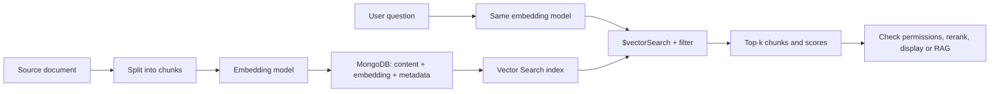

# Vector Index, Embeddings, and Similarity Metrics

> **Chapter:** Advanced Search  
> **Scope:** Spring Data MongoDB — connecting, mapping documents, and querying MongoDB via `MongoTemplate` or repositories. This lesson focuses on vector indexes, embedding representation, similarity measurement, executing `$vectorSearch`, and optimizing retrieval results.

## Learning Objectives

After this lesson, you will be able to:

1. Explain why semantic search requires embeddings and why MongoDB requires a dedicated vector index.
2. Design documents storing text, vectors, and metadata; ensure queries use the matching embedding model version.
3. Compare cosine similarity, dot product, and Euclidean distance; interpret returned scores.
4. Create a `vectorSearch` index, run ANN/ENN queries, apply pre-filters, and read `vectorSearchScore`.
5. Integrate vector search into Spring Data MongoDB via `MongoTemplate` or repositories, and measure recall, latency, and cost.

## 1. From Keyword Search to Semantic Search

Suppose a technical documentation system contains the passage: “Khôi phục kết nối MongoDB sau lỗi mạng bằng cơ chế retry” (Recovering MongoDB connections after network errors using retry mechanisms). A user asks: “Ứng dụng bị mất mạng thì có tự kết nối lại không?” (If the app loses network connectivity, will it reconnect automatically?). String-matching queries may miss this passage because the wording differs, whereas embeddings can place the two sentences close together in meaning.

An **embedding** is a floating-point vector generated from content by a model, such as `[0.12, -0.37, 0.81, ...]`. Each element is one dimension of the representation space; do not assign fixed meanings like “dimension 1 = MongoDB”. Related texts tend to sit near each other **under the chosen metric and model**, though this is a statistical result and does not guarantee two nearby sentences always answer the exact same question.

A common flow:



MongoDB stores and indexes vectors; with the **bring-your-own-embeddings (BYO)** approach in this lesson, MongoDB does not automatically convert text passages into vectors. The application generates embeddings at write time and at query time. Automated embedding generation features may exist in other deployment configurations, but they are outside the workflow illustrated here.

| Component | Responsibility | Common Mistake |
|---|---|---|
| Embedding model | Converts text into vectors with consistent dimensions | Switching models for queries without re-generating document vectors |
| MongoDB document | Stores content, vector, source ID, metadata | Wrong vector data type, missing tenant or version |
| Vector index | Serves nearest-neighbor search under chosen metric | Misdeclaring `path`, `numDimensions`, or `similarity` |
| `$vectorSearch` | Selects candidates, filters metadata, returns top-k | Omitting `numCandidates` for ANN; filtering after the search |
| Application layer | Enforces permissions, combines signals, measures quality | Treating score as correctness probability; leaking cross-tenant content |

**Distinction:** `$text`, regular expressions, and MongoDB Search serve different kinds of lexical search; `$vectorSearch` measures vector proximity. Applications often combine semantic search with keyword search when error codes, IDs, Java class names, or exact tokens matter.

## 2. Designing Embeddings and Input Data

### 2.1. Choosing the Storage Unit

For long documents, you rarely generate one vector for an entire manual. Instead, split them into **chunks** with sufficient context (paragraphs, sections), keeping links back to the source document and optionally overlapping adjacent chunks slightly. Chunks that are too small lose context; chunks that are too large mix topics and waste tokens.

A practical structure for the `knowledge_chunks` collection:

```json
{
  "_id": "mongo-retry#03",
  "tenantId": "acme",
  "docId": "mongo-retry",
  "chunkNo": 3,
  "title": "Khôi phục kết nối MongoDB",
  "content": "Cấu hình retry và timeout khi mạng gián đoạn...",
  "language": "vi",
  "published": true,
  "embedding": [0.12, -0.37, 0.81],
  "embeddingModel": "model-v1",
  "embeddingVersion": 1,
  "sourceUpdatedAt": "2026-01-15T10:00:00Z"
}
```

Three numbers are used here **for readability only**. Real vectors typically have hundreds or thousands of dimensions depending on the model configuration. In MongoDB, the vector field must have a supported array/numeric format; ensure all vectors under the same indexed path and in queries have compatible dimensions.

Operational principles:

- Use the **same model, version, preprocessing, and normalization** to generate vectors for both documents and queries. Two models that both output 768 dimensions do not necessarily share compatible embedding spaces.
- Store `embeddingModel` and `embeddingVersion` so you can build a new index and shift traffic cleanly during a model upgrade without mixing two representation spaces.
- Keep `docId`, `chunkNo`, source references, and access permissions to render citations and update/delete chunks alongside source documents.
- When content or permissions change, update the corresponding record and vector; establish a synchronization or re-sync mechanism if the pipeline fails.
- Include `tenantId`, `language`, `published`, and other pre-filter attributes in the index design from the start.
- Do not send unnecessary sensitive data to external embedding services; enforce consistent logging, retention policies, and access controls.

### 2.2. Symmetric Ingest and Query Pipelines

**Write:** receive document → controlled cleaning → split into chunks → call embedding model → validate dimensions and finite numeric values → save document → index updates.

**Read:** authenticate user → embed query using the exact same model → apply tenant/permission/language filter → ANN or ENN → retrieve top-k → optionally rerank or verify source → return results.

For example, if the index has 1536 dimensions, a 768-element `queryVector` is invalid. Never truncate or zero-pad to “fix” a mismatch: generate embeddings matching the corresponding model and index.

## 3. Similarity Metrics: Interpreting the Score Correctly

Given two non-zero vectors `u=(u_1,\ldots,u_d)` and `v=(v_1,\ldots,v_d)`:

| Metric | Formula | Interpretation | When to Consider |
|---|---|---|---|
| **Cosine similarity** | `\displaystyle \cos(u,v)=\frac{\sum_i u_iv_i}{\sqrt{\sum_i u_i^2}\sqrt{\sum_i v_i^2}}` | Larger value means closer direction; ignores magnitude | Text embedding models are commonly evaluated well by vector direction |
| **Dot product** | `\displaystyle u\cdot v=\sum_i u_iv_i` | Depends on both direction and magnitude | Models trained/recommended for inner product; especially with normalized vectors |
| **Euclidean distance (L2)** | `\displaystyle \lVert u-v\rVert_2=\sqrt{\sum_i(u_i-v_i)^2}` | Smaller distance means closer | Data where geometric magnitude and direct distance are meaningful |

Example: `u=[1,0,0]` and `v=[0.8,0.6,0]` both have length 1, so cosine similarity = dot product = `0.8`; Euclidean distance is `\sqrt{0.4}\approx0.632`. If every element of `v` is multiplied by 10, cosine stays unchanged while dot product increases 10x. Never pick a metric out of habit: check the embedding model's documentation and how it treats vector norms.

When **both vectors are normalized to unit length (1)**, we have:

```text
cosine(u, v) = u · v
||u - v||² = 2 - 2 × cosine(u, v)
```

Thus, all three metrics can yield the same top-k ordering on unit vectors; this no longer holds in general when vector lengths differ.

### 3.1. MongoDB's Score Is Not a Correctness Percentage

MongoDB Vector Search converts similarity/distance into a **`vectorSearchScore` in the range [0, 1]**, where higher values rank closer. For the corresponding similarity functions, MongoDB's documentation describes the normalized formulas:

```text
cosine:     score = (1 + cosine(u, v)) / 2
dotProduct: score = (1 + dotProduct(u, v)) / 2  [within valid input domain]
euclidean:  score = 1 / (1 + EuclideanDistance(u, v))
```

For example, cosine = 0.8 corresponds to score = 0.9; a score of 0.9 **does not mean “90% probability the answer is right”**. Scores depend on the embedding model, metric, and data. Thresholds like `score >= 0.75` should only be used after calibration on labeled questions; never compare scores directly across different models or indexes.

**Note:** Do not compute cosine on an all-zero vector; validate inputs and follow the model's normalization requirements. With dot product, vector magnitude can alter rankings, so understand the normalization conventions of both the model and MongoDB.

## 4. Vector Indexes in MongoDB

Vector Search uses a `vectorSearch` index type, distinct from standard B-tree indexes (`createIndex({field:1})`). In the index definition:

- `type: "vector"` designates the field holding embeddings.
- `path` is the path to the actual embedding field in BSON.
- `numDimensions` must match the embedding dimensionality.
- `similarity` selects `cosine`, `dotProduct`, or `euclidean`.
- `type: "filter"` declares metadata fields allowed for **pre-filtering** during search.

For ANN, MongoDB uses an HNSW-based approximate nearest-neighbor structure to reduce the number of vectors examined; in exchange, results may occasionally miss a true nearest neighbor. ENN performs an exhaustive check within the filtered scope, making it suitable as a recall benchmark or for small candidate sets.

Capabilities and deployment requirements vary by version. `$vectorSearch` is supported on qualifying Atlas versions and on certain newer self-managed MongoDB configurations. Before running, confirm that the cluster supports Vector Search, that you have permissions to create search indexes, and verify your driver and Spring Data versions. **Index creation is asynchronous:** a successful create command does not mean the index status is already `READY`.

## 5. Complete Practice in `mongosh`

The following example runs in a MongoDB environment **that supports Vector Search**. The 3-dimensional vectors are dummy data for testing the technical flow; they are **not** real semantic embeddings learned from Vietnamese text. In a real system, replace all sample vectors with outputs from an embedding model and update `numDimensions` to match.

### Step 1 — Insert Sample Data

```javascript
use demo_vector;

db.knowledge_chunks.insertMany([
  {
    _id: "c1",
    tenantId: "team-a",
    docId: "mongo-connect",
    language: "vi",
    published: true,
    title: "Kết nối MongoDB",
    content: "MongoClient và cấu hình kết nối.",
    embedding: [1.0, 0.0, 0.0]
  },
  {
    _id: "c2",
    tenantId: "team-a",
    docId: "mongo-retry",
    language: "vi",
    published: true,
    title: "Retry khi mất mạng",
    content: "Thiết lập retry cho lỗi kết nối tạm thời.",
    embedding: [0.8, 0.6, 0.0]
  },
  {
    _id: "c3",
    tenantId: "team-b",
    docId: "mongo-security",
    language: "vi",
    published: true,
    title: "Quản lý tài khoản",
    content: "Cấp quyền người dùng.",
    embedding: [1.0, 0.0, 0.0]
  }
]);
```

`c3` intentionally shares the exact same vector as `c1` while belonging to a different tenant to demonstrate why tenant pre-filtering is required. Run this sample data in a test database; re-running `insertMany` without cleanup will fail with duplicate `_id` errors.

### Step 2 — Create the Vector Search Index

```javascript
db.knowledge_chunks.createSearchIndex(
  "chunk_vec_v1",
  "vectorSearch",
  {
    fields: [
      {
        type: "vector",
        path: "embedding",
        numDimensions: 3,
        similarity: "cosine"
      },
      { type: "filter", path: "tenantId" },
      { type: "filter", path: "language" },
      { type: "filter", path: "published" }
    ]
  }
);
```

Wait until the index is ready before running queries:

```javascript
db.knowledge_chunks.aggregate([
  { $listSearchIndexes: { name: "chunk_vec_v1" } }
]);
```

Inspect the status field and wait for `READY` (status names and formats may vary by UI/version). Do not confuse this with standard indexes listed by `getIndexes()`. When upgrading a model, create a separate index and shift traffic in a controlled manner rather than modifying the live index during active serving.

### Step 3 — ANN Query, Pre-Filter, and Score Retrieval

```javascript
db.knowledge_chunks.aggregate([
  {
    $vectorSearch: {
      index: "chunk_vec_v1",
      path: "embedding",
      queryVector: [1.0, 0.0, 0.0],
      numCandidates: 40,
      limit: 2,
      filter: {
        tenantId: "team-a",
        language: "vi",
        published: true
      }
    }
  },
  {
    $project: {
      _id: 1,
      docId: 1,
      title: 1,
      content: 1,
      score: { $meta: "vectorSearchScore" }
    }
  }
]);
```

Parameter breakdown:

| Attribute | Function | Rules |
|---|---|---|
| `index` | Name of the created **search index** | Must match exact index name and collection |
| `path` | Embedding field to query | Must be present in the index definition |
| `queryVector` | Query vector | Same embedding space and index dimensionality |
| `numCandidates` | Number of ANN candidates considered | Must be ≥ `limit`; increasing generally improves recall but increases latency |
| `limit` | Maximum results returned | Chosen for the required top-k |
| `filter` | Filters metadata **before** candidate selection | Fields must be declared as `type: "filter"` in the index |
| `$meta: "vectorSearchScore"` | Outputs the vector search score | Only usable after `$vectorSearch` |

Because the dummy index uses cosine, `c1` ideally scores 1 and `c2` scores 0.9; `c3` is excluded due to its tenant. With ANN on tiny datasets, results can still be affected by configuration or an unready index; to check exact results, compare against ENN in the next step.

**Do not move the tenant filter into a `$match` placed only after `$vectorSearch`:** doing so can cause the initial top-k to contain invalid documents that are subsequently dropped, yielding fewer results and poor recall. In multi-tenant systems, the application's authorization layer must still enforce access control alongside the query filter.

### Step 4 — Using ENN for Comparison

```javascript
db.knowledge_chunks.aggregate([
  {
    $vectorSearch: {
      index: "chunk_vec_v1",
      path: "embedding",
      queryVector: [1.0, 0.0, 0.0],
      exact: true,
      limit: 2,
      filter: { tenantId: "team-a", language: "vi", published: true }
    }
  },
  { $project: { title: 1, score: { $meta: "vectorSearchScore" } } }
]);
```

`exact: true` runs Exact Nearest Neighbor (ENN) search without requiring `numCandidates`. ANN uses `exact: false` or omits `exact` and specifies `numCandidates`. ENN consumes more CPU/resources on large datasets; use it as an evaluation baseline or when the filtered scope is relatively small.

`$vectorSearch` must be the first stage of its pipeline. It cannot run inside `$facet` or a `$lookup` sub-pipeline; starting in MongoDB 8.0, it can be placed inside `$unionWith` subject to version-specific rules.

## 6. Integrating with Spring Data MongoDB

Spring Data MongoDB 4.5+ provides `VectorIndex`, `SearchIndexOperations`, and `VectorSearchOperation`. Repository-based vector search APIs depend on the version; check your project's BOM/version before using them. In a Spring Boot app, configure `spring.data.mongodb.uri` and database settings just as you would for ordinary `MongoTemplate` operations.

### 6.1. Document Mapping

```java
import java.util.List;
import org.springframework.data.annotation.Id;
import org.springframework.data.mongodb.core.mapping.Document;

@Document("knowledge_chunks")
public class KnowledgeChunk {
    @Id
    private String id;
    private String tenantId;
    private String docId;
    private String language;
    private boolean published;
    private String title;
    private String content;
    private List<Double> embedding;

    // Constructors, getters, and setters as in other Spring Data entities.
}
```

The `embedding` field maps to the indexed BSON field. When reading many large results, project only display fields (e.g., `title`, `content`, `docId`, `score`) so you avoid transferring entire vectors back to the application.

### 6.2. Creating the Index in Java (Alternative to `mongosh`)

```java
import org.springframework.data.mongodb.core.MongoTemplate;
import org.springframework.data.mongodb.core.index.VectorIndex;

VectorIndex index = new VectorIndex("chunk_vec_v1")
    .addVector("embedding", v -> v.dimensions(3).cosine())
    .addFilter("tenantId")
    .addFilter("language")
    .addFilter("published");

mongoTemplate.searchIndexOps(KnowledgeChunk.class).createIndex(index);
```

Use only **one** of the two index creation methods: `mongosh` or `searchIndexOps`. Wait for the index to reach `READY` before querying. This Java snippet uses dimension 3 to match the sample data; change it to the actual dimension of your embedding model when deploying.

### 6.3. Searching with `MongoTemplate`

```java
import java.util.Arrays;
import java.util.List;
import org.bson.Document;
import org.springframework.data.mongodb.core.MongoTemplate;
import org.springframework.data.mongodb.core.aggregation.Aggregation;
import org.springframework.data.mongodb.core.aggregation.VectorSearchOperation;
import org.springframework.data.mongodb.core.query.Criteria;

public class ChunkVectorSearchService {
    private final MongoTemplate mongoTemplate;

    public ChunkVectorSearchService(MongoTemplate mongoTemplate) {
        this.mongoTemplate = mongoTemplate;
    }

    public List<Document> findSimilar(String tenantId, double[] queryVector) {
        if (tenantId == null || tenantId.isBlank()
                || queryVector == null || queryVector.length != 3
                || Arrays.stream(queryVector).anyMatch(x -> !Double.isFinite(x))) {
            throw new IllegalArgumentException("Invalid tenant or query vector");
        }

        VectorSearchOperation search = VectorSearchOperation.search("chunk_vec_v1")
            .path("embedding")
            .vector(queryVector)
            .numCandidates(40)
            .limit(2)
            .filter(Criteria.where("tenantId").is(tenantId)
                .and("language").is("vi")
                .and("published").is(true))
            .withSearchScore("score");

        Aggregation aggregation = Aggregation.newAggregation(
            KnowledgeChunk.class,
            search,
            Aggregation.project("docId", "title", "content", "score")
        );
        return mongoTemplate.aggregate(aggregation, Document.class)
            .getMappedResults();
    }
}
```

Example call: `service.findSimilar("team-a", new double[]{1.0, 0.0, 0.0})`. The method accepts a **pre-computed vector**; in a real product, an embedding service layer converts the user's question into `double[]` before invoking this service. Never accept arbitrary numeric arrays directly from a client if doing so violates the system's model/version constraints.

`withSearchScore("score")` appends the stage that extracts `vectorSearchScore`. `Aggregation.newAggregation(KnowledgeChunk.class, ...)` enables Spring Data to map property names according to `@Field` annotations if present, eliminating the need to write a large JSON string for the stage. If your project version lacks `VectorSearchOperation`, use a raw aggregation stage via the driver or upgrade Spring Data with compatibility testing.

### 6.4. Vector Search Repositories (When Supported by Version)

With Spring Data MongoDB versions supporting `@VectorSearch` and Spring Data Commons `Vector`, `Score`, and `SearchResults`, a repository can declare the query cleanly:

```java
import org.springframework.data.domain.Score;
import org.springframework.data.domain.SearchResults;
import org.springframework.data.domain.Vector;
import org.springframework.data.mongodb.repository.VectorSearch;
import org.springframework.data.repository.Repository;

interface KnowledgeChunkRepository extends Repository<KnowledgeChunk, String> {
    @VectorSearch(
        indexName = "chunk_vec_v1",
        filter = "{ tenantId: ?0, language: 'vi', published: true }",
        limit = "2",
        numCandidates = "40"
    )
    SearchResults<KnowledgeChunk> searchByEmbeddingNear(
        String tenantId, Vector embedding, Score minimumScore
    );
}
```

Example call: `repository.searchByEmbeddingNear("team-a", Vector.of(1.0, 0.0, 0.0), Score.of(0.0))`. This approach is concise for fixed queries, whereas `MongoTemplate` is more flexible when building dynamic pipelines, projections, and filters. Check the annotation API for your exact version; `@VectorSearch` is a dedicated Spring Data MongoDB annotation, not a regular `@Query`.

### 6.5. When Using Spring AI

Spring AI provides `MongoDBAtlasVectorStore`, which accepts an `EmbeddingModel` and offers abstractions to add documents, generate embeddings, and run `similaritySearch`. It is an optional integration layer **on top of** MongoDB/Spring Data, not a requirement for `$vectorSearch`. When using Spring AI, keep `collection-name`, `index-name`, `path-name`, model dimensions, and filterable metadata fields consistent; automatic schema initialization must be explicitly enabled if desired.

## 7. Choosing ANN, ENN, and Tuning Quality

### 7.1. ANN vs. ENN

| Criterion | ANN | ENN |
|---|---|---|
| Search method | Approximates nearest neighbors via index | Exhaustive comparison within the search scope |
| Top-k accuracy | May miss some closest results | Serves as relative ground truth for the chosen vector/metric |
| Large-dataset latency | Generally lower | Generally higher |
| Key parameters | `numCandidates`, `limit`, filter | `exact: true`, `limit`, filter |
| Purpose | User-facing retrieval | Verification, small datasets, or exactness requirement |

MongoDB recommends starting `numCandidates` at around **20 times `limit`** for ANN and tuning via measurement. This is a starting point, not a recall guarantee. For example, with `limit=5`, try `numCandidates=100`, then compare against 50, 200, and 400 to find the right balance.

### 7.2. Evaluating with a Labeled Query Set

For instance, with 100 questions and human-verified relevant chunks:

- **Recall@k:** number of relevant chunks found in top-k divided by total relevant chunks per question, averaged across queries. You can use ENN top-k as a baseline to measure ANN overlap with ENN, though that measures **ANN recall relative to exact search**, not human-labeled semantic quality.
- **Precision@k:** proportion of relevant chunks within the k returned results; focuses on the cleanliness of the displayed list.
- **MRR/nDCG:** values rank position and graded relevance; useful when top results heavily impact RAG.
- **Latency p50/p95/p99:** end-to-end time from sending the query to receiving results; separate embedding generation latency from database latency.
- **Cost/storage:** total vector footprint, index size, search node RAM/CPU, embedding API calls, and response payload size.

Example measuring ANN recall@5 against ENN: if ENN IDs are `{a,b,c,d,e}` and ANN returns `{a,c,d,x,y}`, overlap = 3/5 = 0.6. In real systems, measure across many questions and varying tenant/language filters. Do not rely on 3 sample vectors.

### 7.3. Controlled Optimization Sequence

1. Verify inputs match the right model and index, dimensions match, and text is chunked sensibly.
2. Apply pre-filters as tightly as possible to the target domain, especially access permissions, tenant, and publication status.
3. Increase `numCandidates` incrementally while holding `limit` and dataset fixed, measuring recall and latency; reduce `numCandidates` if latency is too high and recall still meets targets.
4. Return minimal fields; exclude vectors from responses and return only displayable content.
5. If results involve many exact identifiers (error codes, APIs, class names), combine keyword search and vector search, then rerank or apply a rank fusion strategy. Distinguish scores from the two search systems before combining them.
6. Consider batch embedding, content-and-version caching, and event-driven index updates; throttle ingestion rates so they do not overwhelm the search subsystem.

## 8. Real-World Errors and Troubleshooting

| Symptom | Possible Cause | Verification and Resolution |
|---|---|---|
| Returns empty despite documents existing | Index not READY; wrong `index` name or `path`; filter excludes everything | Check `$listSearchIndexes`, BSON field names, and document count matching filters |
| Dimension / vector error | Query vector does not match `numDimensions` or contains invalid values | Log vector dimension and model version; reject bad inputs before querying |
| “Strange” results despite high scores | Poor chunking context; model unsuitable for Vietnamese; mixed model versions | Inspect source content, verify version, evaluate against labeled questions |
| ANN misses results that ENN finds | Low `numCandidates` or unoptimized filter/config | Increase `numCandidates`, measure overlap and latency on the same queries |
| Fewer than `limit` after filtering | Filtering in `$match` after top-k or valid scope is too small | Use pre-filters; check how many vectors satisfy the filter |
| Slow queries / overloaded search nodes | Large candidate count, ENN on large dataset, oversized embeddings, traffic spike | Profile query metrics, reduce candidates, scale index/search node capacity if needed |
| Results contain another tenant's data | Missing tenant filter or application-layer authorization bug | Enforce server-side authentication/authorization and tenant pre-filtering |
| Spring Data API unavailable | Dependency version lacks `VectorSearchOperation`/repository annotations | Check docs for your version/BOM; use `MongoTemplate`/driver accordingly |

Key error-prevention principles:

- Never treat a normalized score as an absolute confidence score for an answer generated by a language model.
- When changing embedding models or metrics, follow a tested upgrade path: re-ingest vectors, build the new index, compare quality, switch queries, and delete the old index only after confirming stability.
- In RAG, pass `docId`, `chunkNo`, source, and visibility permissions along with results; avoid generating answers lacking verifiable evidence.
- Remember that vector indexes do not replace traditional indexes. Transactional queries, chronological pagination, unique keys, and exact text matching still need their own appropriate mechanisms.

## 9. Practice Exercises

**Exercise 1 — Computing metrics.** Given `u=[1,0]` and `v=[0.6,0.8]`, compute cosine, dot product, L2 distance, and MongoDB cosine score. Self-check: `0.6`, `0.6`, `\sqrt{0.8}\approx0.8944`, and `0.8`.

**Exercise 2 — Index and pre-filter.** Update the example to 4-dimensional embeddings; update document vectors, `queryVector`, and `numDimensions`. Add a `published` filter and compare results with and without the filter. Explain why a `$match` stage after the search stage may return fewer results than expected.

**Exercise 3 — ANN/ENN.** Generate several thousand vectors from **the same model**, write a top-10 query with `numCandidates` set to 50, 200, and 500. Measure p95 latency and overlap against ENN on the same query set. Choose the configuration using pre-declared criteria rather than just picking the fastest one.

**Exercise 4 — Java integration.** Write an endpoint accepting a question and an authenticated tenant; the service generates the embedding, calls `ChunkVectorSearchService`, and returns only `docId`, `title`, `content`, and `score`. Add model version validation and test that other tenants' data cannot leak.

**Self-check questions:**

- Why can two embeddings of the same dimensionality generated by different models not be searched across each other reliably?
- When do cosine similarity and dot product produce the exact same top-k ordering?
- What can and cannot be interpreted from `vectorSearchScore = 0.9`?
- Why does `numCandidates` affect both recall and latency?
- When is `MongoTemplate` more convenient than `@VectorSearch` on a repository?

## References

- [Spring Data MongoDB — MongoDB Search: Vector Index, VectorSearchOperation](https://docs.spring.io/spring-data/mongodb/reference/mongodb/mongo-search-indexes.html)
- [Spring Data MongoDB — Vector Search repository methods](https://docs.spring.io/spring-data/mongodb/reference/mongodb/repositories/vector-search.html)
- [Spring Data MongoDB — VectorSearchOperation API](https://docs.spring.io/spring-data/mongodb/reference/api/java/org/springframework/data/mongodb/core/aggregation/VectorSearchOperation.html)
- [MongoDB — Create Search Index](https://www.mongodb.com/docs/manual/reference/method/db.collection.createsearchindex/)
- [MongoDB — Vector Search index field types and similarity functions](https://www.mongodb.com/docs/vector-search/indexes/vector-search-type/)
- [MongoDB — Run ANN and ENN queries](https://www.mongodb.com/docs/vector-search/query/aggregation-stages/vector-search-stage/)
- [Spring AI — MongoDB Atlas Vector Store (optional extension)](https://docs.spring.io/spring-ai/reference/api/vectordbs/mongodb.html)
