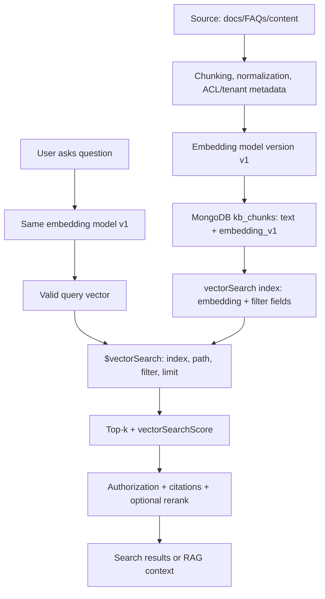

# Vector Search via Pipeline or Declarative APIs in Supported Versions

In **Spring Data MongoDB**, *vector search* finds documents that are **semantically close** by comparing **embedding vectors**, rather than only matching exact keywords. A question like “Làm sao xử lý kết nối MongoDB bị ngắt khi đang cập nhật?” (How to handle a MongoDB connection drop during an update?) can match a document titled “Retryable writes và idempotency” even when the two character strings share little overlap.

This lesson belongs to the **Advanced Search** chapter of the **SPRING_DATA_MONGODB** module. Throughout this module, we connect and map documents, operate via `MongoTemplate` or repositories, and practice querying, aggregation, indexes, transactions, reactive access, testing, and performance diagnostics. The direct scope here is **executing vector search via aggregation pipelines or declarative Spring Data APIs when supported by your dependency version**.

There are three main approaches:

1. **MongoDB aggregation `$vectorSearch`**: works at the database level via `mongosh` and the Java Driver on deployments with Vector Search enabled.
2. **Spring Data MongoDB `Aggregation.stage(...)` or `VectorSearchOperation`**: suited for code using `MongoTemplate` or `ReactiveMongoTemplate`. `VectorSearchOperation` was introduced in **Spring Data MongoDB 4.5**.
3. **Spring Data MongoDB repository `@VectorSearch`** with `Vector`, `Score`, and `SearchResults<T>`: declarative/derived queries introduced in **Spring Data MongoDB 5.0**.

**Important:** Spring Data version, MongoDB Server version, deployment type, index status, and embedding model **must all be compatible**. You cannot just add an annotation to a `MongoRepository` and expect an older standalone MongoDB server to gain vector search automatically.

## 1. What Problem Does Vector Search Solve?

With keyword search, systems typically compare tokens, phrases, and text operators. With vector search, each text or image is represented as a floating-point vector, for example:

```text
"Transaction bị rollback"         → [0.12, -0.31, 0.68, 0.05]
"Giao dịch hủy thay đổi dữ liệu"   → [0.10, -0.29, 0.70, 0.03]
"Cách nấu món ăn"                 → [-0.44, 0.19, 0.02, 0.51]
```

These vectors are **illustrative four-dimensional numbers**, not outputs from an actual embedding model. In real systems, vector lengths are **hundreds or thousands of dimensions**, depending on the model.

When a user enters a query, the application typically:

1. Converts the query into a **query embedding** using a compatible model.
2. Passes the vector into `$vectorSearch`.
3. MongoDB compares the query vector against indexed vectors.
4. Returns documents with high similarity scores.
5. Enforces permissions, builds snippets, and optionally reranks or feeds a RAG workflow.

Vector search excels at semantic retrieval, recommendations, and similarity lookup. It does **not completely replace** text search: order codes, API names, exact errors, and rare keywords are still often served better by lexical search.

## 2. Architecture from Source Document to Search Result



Four critical contracts:

- **Model**: document vectors and query vectors must be generated by **the same model or a vendor-confirmed compatible model family**.
- **Dimension**: vector length must match the `numDimensions` declared in the index.
- **Index**: a dedicated **`vectorSearch`** index, not a B-tree `createIndex` or `2dsphere` index.
- **Security**: `tenant_id`, visibility, and access-control conditions must be reliably enforced inside the query.

Never store a query embedding from a 768-dimension model and compare it against a 1536-dimension index; never swap models in production while skipping re-embedding and index migration.

## 3. Version Support Matrix: Do Not Apply One Example to Every Environment

According to current documentation, key milestones include:

| Component | Support Conditions | Implications |
| --- | --- | --- |
| MongoDB Atlas | Atlas versions listed by MongoDB for `$vectorSearch`, starting from MongoDB **6.0.11** for published ANN capabilities | Requires Vector Search capability and an active search index |
| Self-managed MongoDB Community | **8.2+** with appropriate MongoDB Vector Search configuration/features | It is no longer accurate to claim Vector Search only runs on Atlas |
| Self-managed MongoDB Enterprise | **8.2+** in configurations documented by MongoDB with the Kubernetes Operator | Verify the corresponding Search infrastructure |
| Spring Data MongoDB 4.0+ | `Aggregation.stage(...)` to insert raw stages into a pipeline | No dedicated type-safe VectorSearch API in all 4.x releases |
| Spring Data MongoDB **4.5+** | `VectorSearchOperation`, `VectorIndex`, and `searchIndexOps(...)` | Dedicated query/index DSL |
| Spring Data MongoDB **5.0+** | `@VectorSearch` repository annotation, Spring Data `Vector`, `SearchResults` | Declarative queries and derived vector methods |

**Check versions in order:** does the database support it → is the index created and READY → is the Java Driver used by Spring Data compatible → is the Spring Data API available? An application on Spring Data 4.2 can still issue raw `$vectorSearch` via pipelines or the driver if the database supports it, but **do not copy 5.0 `@VectorSearch` examples into 4.2**.

Spring Data MongoDB 4.5/5.x docs may still mention older Atlas-only or vector-size notes; current MongoDB Server releases have expanded the support matrix. When discrepancies appear, consult the documentation for your **actual deployed versions** rather than treating an older Javadoc line as universal truth.

## 4. `$vectorSearch` Restrictions to Remember

`$vectorSearch` is not an ordinary query operator like `$eq`:

- In a general pipeline, `$vectorSearch` must be the **first stage**.
- Do not place `$match` ahead of it to filter tenants; put filter conditions in the stage's own **`filter`** field.
- Do not use it inside `$facet` or `$lookup` sub-pipelines.
- MongoDB **8.0+** supports `$vectorSearch` inside a `$unionWith` branch per server documentation; do not assume that works on older releases.
- Requires a **MongoDB Vector Search index** with matching name, vector path, and filter fields.
- `limit` is required, and `numCandidates` is required for ANN mode unless `exact: true` is set.
- `$vectorSearch` produces `vectorSearchScore` metadata; score is not a probability that “the document is definitely right”.

This directly affects how you call `Aggregation.newAggregation(...)`: placing `match(...)` before the vector stage is not “early filtering for speed”—it produces an **invalid** pipeline.

## 5. Sample Data: Multi-Tenant Knowledge Base

We design a `kb_chunks` collection where each document is a short searchable passage:

```javascript
{
  _id: ObjectId("67400000000000000000a001"),
  tenant_id: "T1",
  doc_id: "mongo-retry-101",
  chunk_id: "mongo-retry-101#1",
  title: "Retryable writes trong Spring Data MongoDB",
  text: "Driver có thể retry một số lệnh ghi khi gặp lỗi mạng...",
  lang: "vi",
  visibility: "published",
  model_version: "embedding-v1",
  embedding_v1: [0.12, -0.31, 0.68, 0.05],
  updated_at: ISODate("2026-11-20T02:00:00Z")
}
```

For practice exercises, `embedding_v1` has only **4 dimensions** so the mechanics are easy to inspect; production must use real model dimensions and build a matching index.

Key fields:

| Field | Purpose | Include in `vectorSearch` index? |
| --- | --- | --- |
| `embedding_v1` | Vector used for semantic ranking | **`type:"vector"`**, matching `numDimensions` |
| `tenant_id` | Tenant boundary | **`type:"filter"`** if pre-filtered |
| `visibility` | Excludes drafts | **`type:"filter"`** if pre-filtered |
| `lang` | Restricts language | **`type:"filter"`** if pre-filtered |
| `doc_id` / `chunk_id` | Provenance and citations | Can be returned data only |
| `text`, `title` | Retrieved content | Not required inside `vectorSearch` index |
| `model_version` | Manages embedding migration strategy | Can be a filter field if needed |
| `updated_at` | When the document was updated | Depends on query criteria |

**Never use an embedding as a unique business key.** Two identical chunks can share identical vectors; deduplication and permissions are separate rules.

## 6. Where Do Embeddings Come From? MongoDB Does Not Guess Vectors

In **bring-your-own-embeddings (BYO)**, the application invokes an external embedding model to compute vectors:

```java
public interface EmbeddingService {
    // Returns vector matching expected dimensions and model version contract.
    java.util.List<Double> embed(String text);
}
```

Boundary validation example:

```java
import java.util.List;

public final class EmbeddingValidator {

    public static List<Double> requireValid(
            List<Double> vector, int dimensions) {

        if (vector == null || vector.size() != dimensions) {
            throw new IllegalArgumentException(
                "Vector has invalid dimension"
            );
        }

        for (Double element : vector) {
            if (element == null || !Double.isFinite(element)) {
                throw new IllegalArgumentException(
                    "Vector contains NaN/Infinity/null"
                );
            }
        }

        return List.copyOf(vector);
    }
}
```

MongoDB Vector Search also offers **automated embeddings** on supported index types and deployments, such as vector index fields using `autoEmbed` with matching text queries. **Do not conflate** them with BYO:

- **BYO**: index field `type:"vector"`, query supplies `queryVector` as a numeric array.
- **Automated embeddings**: index configures `autoEmbed`, query can pass `query:{text:...}` supported by the deployment's model.

The main exercises in this lesson use **BYO** so the examples work independently of deployment-specific automated embedding features.

## 7. Creating a Vector Search Index in `mongosh`

This is a **search index**, not `db.collection.createIndex({embedding_v1:1})`.

On a deployment supporting Vector Search, in `mongosh`:

```javascript
db.kb_chunks.createSearchIndex(
  "kb_vector_v1",
  "vectorSearch",
  {
    fields: [
      {
        type: "vector",
        path: "embedding_v1",
        numDimensions: 4, // Illustrative only!
        similarity: "cosine"
      },
      { type: "filter", path: "tenant_id" },
      { type: "filter", path: "visibility" },
      { type: "filter", path: "lang" },
      { type: "filter", path: "model_version" }
    ]
  }
);
```

Meaning:

- `"kb_vector_v1"` is the **index name**; queries must reference this exact string.
- `"vectorSearch"` is the **index type**, not a classic index.
- `embedding_v1` is the BSON path containing the vector.
- `numDimensions` must match the actual embedding dimensionality.
- `similarity:"cosine"` chooses cosine similarity scoring.
- Filter fields are declared `type:"filter"` so they can be **pre-filtered** inside `$vectorSearch`.

An index on `embedding_v1` does not apply to `embedding_v2`. When changing models or dimensions, you usually write new vectors, build a new index, and shift traffic carefully.

## 8. An Existing Index Is Not Necessarily Ready

After calling `createSearchIndex(...)`, MongoDB may take time to build the index. Never create an index and immediately assume every query will return complete results.

Inspect status:

```javascript
db.kb_chunks.getSearchIndexes("kb_vector_v1");
```

Depending on deployment/version, metadata reports statuses such as **`READY`** and queryability info. In Spring Data 4.5+, you can inspect `SearchIndexOperations#status(...)` per your version's API.

Deployment workflow:

1. Create the collection and insert valid embedding data.
2. Submit the search index creation request.
3. **Wait for the index to reach ready status** via a migration or deployment controller.
4. Run a smoke-test vector query against reference data.
5. Only then mark endpoints depending on vector search as ready.

Never create indexes on every request. Do not treat `index exists=true` alone as readiness; a search index may still be building, updating, or failed.

## 9. Basic ANN Query Using an Aggregation Pipeline

Assuming a query embedding compatible with `embedding_v1`:

```javascript
const queryVector = [0.10, -0.30, 0.70, 0.04];

db.kb_chunks.aggregate([
  {
    $vectorSearch: {
      index: "kb_vector_v1",
      path: "embedding_v1",
      queryVector: queryVector,
      numCandidates: 80,
      limit: 4,
      filter: {
        tenant_id: "T1",
        visibility: "published",
        lang: "vi",
        model_version: "embedding-v1"
      }
    }
  },
  {
    $project: {
      _id: 1,
      doc_id: 1,
      chunk_id: 1,
      title: 1,
      text: 1,
      tenant_id: 1,
      score: { $meta: "vectorSearchScore" }
    }
  }
]);
```

Here:

- `$vectorSearch` is the **first** stage.
- `queryVector` matches the index dimensions.
- `numCandidates=80` considers a candidate pool larger than `limit=4`.
- `filter` narrows the dataset **before searching**, rather than using `$match` at the end.
- `score` reads from `vectorSearchScore` metadata.
- `embedding_v1` is **not projected back**, reducing payload size and vector exposure.

**For tenant-sensitive data, production queries must take the tenant from backend authentication/authorization**, never from a parameter the client can freely override.

## 10. `vectorSearchScore` Results: How Can They Be Compared?

MongoDB Vector Search returns `vectorSearchScore` metadata, typically normalized to the **[0, 1] range**, where higher values indicate closer matches under the index's similarity metric.

Example:

```json
[
  {
    "doc_id": "mongo-retry-101",
    "chunk_id": "mongo-retry-101#1",
    "score": 0.94
  },
  {
    "doc_id": "mongodb-idempotency-202",
    "chunk_id": "mongodb-idempotency-202#2",
    "score": 0.86
  }
]
```

These scores are **illustrative examples**, not actual measured scores for the 4D vectors.

**Do not interpret `score=0.94` as “94% accurate answer”.** Score:

- Depends on how the embedding model represents text.
- Depends on the index similarity metric (`cosine`, `dotProduct`, `euclidean`).
- Can shift when the model, index, or dataset changes.
- Is not a calibrated empirical probability.
- Should not be compared directly across different models or indexes without evaluation.

If you need a cutoff threshold, calibrate it on a relevance-labeled dataset and establish an explicit policy. In a pipeline, you can add `$match:{score:{$gte:0.75}}` **after surfacing the score** via `$project` or `$addFields`, provided the threshold has been validated for your model and use case.

## 11. ANN and ENN: The Recall–Latency Trade-Off

Two search strategies:

| Attribute | ANN | ENN |
| --- | --- | --- |
| Name | Approximate Nearest Neighbors | Exact Nearest Neighbors |
| MongoDB flag | `exact:false` (usually default) | `exact:true` |
| Candidates | Tuned via `numCandidates` | Does not use ANN candidate pool |
| Strengths | Strong speed/cost on large datasets | Recall baseline, verifying top-k accuracy |
| Limitations | May miss some true nearest neighbors | Higher resource/latency cost |
| When to use | Production retrieval with latency SLOs | Benchmarking, relevance validation, small datasets, or strict exactness |

ANN:

```javascript
{
  $vectorSearch: {
    index: "kb_vector_v1",
    path: "embedding_v1",
    queryVector: [0.10, -0.30, 0.70, 0.04],
    exact: false,
    numCandidates: 80,
    limit: 4
  }
}
```

ENN, **when supported by deployment/version**:

```javascript
{
  $vectorSearch: {
    index: "kb_vector_v1",
    path: "embedding_v1",
    queryVector: [0.10, -0.30, 0.70, 0.04],
    exact: true,
    limit: 4
  }
}
```

Using ENN helps establish a baseline to estimate ANN quality. Never assume ANN always returns the **exact** ENN top-k, and never enable ENN unconditionally on very large corpora.

## 12. `numCandidates`, `limit`, and Tuning

In ANN, `limit` is the maximum results returned, while `numCandidates` is the number of candidate neighbors the algorithm considers during search.

Example:

```text
limit = 10
numCandidates = 200
```

MongoDB documentation recommends **starting around 20 times `limit`** to balance recall and latency, then **tuning on your real corpus**. Documented constraints on `numCandidates`:

- Must not be less than `limit`.
- Must not exceed **10,000** in current syntax.
- Must be set when running standard ANN `$vectorSearch`.
- Larger values generally improve recall but **can** increase latency and CPU usage.

An illustrative service policy:

```java
public record SearchBudget(
        int limit, int numCandidates) {

    public SearchBudget {
        if (limit < 1 || limit > 20) {
            throw new IllegalArgumentException(
                "limit must be in [1,20]"
            );
        }

        if (numCandidates < limit
                || numCandidates > 10_000) {
            throw new IllegalArgumentException(
                "Invalid numCandidates"
            );
        }
    }

    public static SearchBudget forLimit(int limit) {
        int candidates = Math.min(10_000, limit * 20);
        return new SearchBudget(limit, candidates);
    }
}
```

The `limit<=20` bound here is an **application policy**, not a MongoDB constant. Never let clients arbitrarily request `numCandidates=10000` to trigger expensive queries.

## 13. Pre-Filtering: Conditions Must Be Indexed as `type: "filter"`

To search documents for tenant T1, keeping only published chunks:

```javascript
filter: {
  $and: [
    { tenant_id: "T1" },
    { visibility: "published" },
    { lang: "vi" }
  ]
}
```

`$vectorSearch.filter` supports a subset of MongoDB Query Language operators documented for MongoDB Vector Search, such as:

- Equality: `$eq`/`$ne`.
- Range: `$gt`, `$gte`, `$lt`, `$lte`.
- Set membership: `$in`/`$nin`.
- Existence: `$exists`.
- Logical: `$and`, `$or`, `$not`, `$nor`.

**Not every MQL or aggregation operator is supported in pre-filters.** In particular, you cannot copy `$regex` or full-text operators into `filter`. Pre-filter fields must appear in the Vector Search index definition with `type:"filter"`, matching the exact BSON path and data type.

If queries routinely filter by `tenant_id` while the index only contains the vector field, you must **migrate the search index** to add the filter field rather than just adding `filter` in code.

## 14. Why Is `$match` After `$vectorSearch` Not Equivalent to a Pre-Filter?

Suboptimal pattern that risks skewed top-k results:

```javascript
db.kb_chunks.aggregate([
  {
    $vectorSearch: {
      index: "kb_vector_v1",
      path: "embedding_v1",
      queryVector: [0.10, -0.30, 0.70, 0.04],
      numCandidates: 80,
      limit: 4
    }
  },
  { $match: { tenant_id: "T1" } }
]);
```

The engine selects the top 4 across the **entire corpus**, then discards results not belonging to T1. If all four belong to T2, the query returns **0** results, even when T1 has many relevant documents.

Correct pattern for multi-tenant retrieval:

```javascript
{
  $vectorSearch: {
    index: "kb_vector_v1",
    path: "embedding_v1",
    queryVector: [0.10, -0.30, 0.70, 0.04],
    numCandidates: 80,
    limit: 4,
    filter: { tenant_id: "T1" }
  }
}
```

**Pre-filtering does not replace API-level authorization checks**, but it ensures ranking operates within the authorized dataset. Still enforce access controls, selectively project non-sensitive fields, and prevent clients from tampering with index or tenant filters.

## 15. Is Pre-Filtering Always Faster?

No. MongoDB explicitly notes that filtered queries can be **slower than unfiltered counterparts**, because the engine must combine vector search with metadata predicates. Overly restrictive filters can also yield fewer than `limit` results.

Sound design principles:

- **Mandatory** filters for tenant and visibility permissions, even if latency increases.
- **Recommended** filters for locale, status, or date ranges when they reduce noise.
- Avoid dozens of unindexed or unmeasured optional filters.
- Benchmark across both small and large tenants rather than testing with only a few documents.
- Measure **recall@k** against an ENN baseline along with p50/p95/p99 latency.

Never drop tenant protection pre-filters just to improve performance. If filtering is too slow, review data partitioning, index strategy, search workload, and capacity rather than weakening access control.

## 16. Spring Data MongoDB 4.0+: Raw `Aggregation.stage(...)`

When a project lacks `VectorSearchOperation`, you can pass raw BSON/JSON stages via `Aggregation.stage(...)` (available since **Spring Data MongoDB 4.0**):

```java
import java.util.List;

import org.bson.Document;
import org.springframework.data.mongodb.core.MongoTemplate;
import org.springframework.data.mongodb.core.aggregation.Aggregation;
import org.springframework.data.mongodb.core.aggregation.AggregationResults;

public List<Document> searchRaw(
        MongoTemplate template,
        List<Double> queryVector,
        String tenantId) {

    EmbeddingValidator.requireValid(queryVector, 4);

    Document stage = new Document("$vectorSearch",
        new Document("index", "kb_vector_v1")
            .append("path", "embedding_v1")
            .append("queryVector", queryVector)
            .append("numCandidates", 80)
            .append("limit", 4)
            .append("filter", new Document("tenant_id", tenantId)
                .append("visibility", "published"))
    );

    Document project = new Document("$project",
        new Document("doc_id", 1)
            .append("chunk_id", 1)
            .append("title", 1)
            .append("text", 1)
            .append("score",
                new Document("$meta", "vectorSearchScore"))
    );

    Aggregation pipeline = Aggregation.newAggregation(
        Aggregation.stage(stage),
        Aggregation.stage(project)
    );

    AggregationResults<Document> results =
        template.aggregate(pipeline, "kb_chunks", Document.class);

    return results.getMappedResults();
}
```

**Key takeaway:** `Aggregation.stage(Bson)` sends BSON **verbatim** and **does not automatically map Java property names** to MongoDB field names. Therefore, raw stages must use exact BSON keys like `tenant_id` and `embedding_v1`.

Never allow users to supply arbitrary field paths, index names, or raw pipeline JSON. Use backend-managed constants for index/path names and a validated `queryVector`.

## 17. Direct Java Driver Can Also Issue `$vectorSearch`

When an application does not use a Spring Data DSL, the MongoDB Java Sync Driver supports `MongoCollection.aggregate(...)`:

```java
import java.util.List;
import org.bson.Document;
import com.mongodb.client.MongoCollection;

public List<Document> runWithDriver(
        MongoCollection<Document> chunks,
        List<Double> vector,
        String tenantId) {

    Document stage = new Document("$vectorSearch",
        new Document("index", "kb_vector_v1")
            .append("path", "embedding_v1")
            .append("queryVector", vector)
            .append("numCandidates", 80)
            .append("limit", 4)
            .append("filter",
                new Document("tenant_id", tenantId))
    );

    Document project = new Document("$project",
        new Document("title", 1)
            .append("chunk_id", 1)
            .append("score",
                new Document("$meta", "vectorSearchScore"))
    );

    return chunks.aggregate(List.of(stage, project))
        .into(new java.util.ArrayList<>());
}
```

Here `chunks` must come from an **application-managed `MongoClient`**, rather than creating a new client per query. The driver forwards the BSON stage to the server; **the server and index determine** whether it executes successfully.

Note that this example method must only be called after validating vector dimensions and authorization at the service boundary. Do not treat this concise snippet as a complete production endpoint.

## 18. Spring Data 4.5+: Type-Safe `VectorSearchOperation`

Starting in Spring Data MongoDB **4.5**, `VectorSearchOperation` builds the stage without writing raw BSON:

```java
import java.util.List;

import org.springframework.data.mongodb.core.MongoTemplate;
import org.springframework.data.mongodb.core.aggregation.Aggregation;
import org.springframework.data.mongodb.core.aggregation.VectorSearchOperation;

public List<ChunkHit> searchTyped(
        MongoTemplate template,
        List<Double> vector,
        String tenantId) {

    EmbeddingValidator.requireValid(vector, 4);

    VectorSearchOperation vectorSearch =
        VectorSearchOperation.search("kb_vector_v1")
            .path("embedding")
            .vector(vector)
            .numCandidates(80)
            .limit(4)
            .filter(
                new org.bson.Document("tenant_id", tenantId)
                    .append("visibility", "published")
            )
            .withSearchScore("score");

    Aggregation aggregation =
        Aggregation.newAggregation(KbChunk.class, vectorSearch);

    return template.aggregate(
        aggregation, ChunkHit.class
    ).getMappedResults();
}
```

Breakdown:

- `search("kb_vector_v1")`: specifies the index.
- `path("embedding")`: Java property on the `KbChunk` entity.
- `vector(...)`: query embedding.
- `numCandidates(...)` and `limit(...)`: ANN parameters.
- `filter(...)`: metadata predicate.
- `withSearchScore("score")`: appends a stage to extract score metadata into the result.

**Version note:** overloads and builder contracts may vary across minor versions; inspect the Javadoc for your Spring Data 4.5/5.x release. This example uses a BSON `Document` for `filter` so the server field names are unmistakable. When using typed criteria, verify how each overload maps fields.

## 19. Domain Mapping for `VectorSearchOperation`

Define a model where Java names differ from BSON names:

```java
import java.util.List;

import org.bson.types.ObjectId;
import org.springframework.data.annotation.Id;
import org.springframework.data.mongodb.core.mapping.Document;
import org.springframework.data.mongodb.core.mapping.Field;

@Document("kb_chunks")
public class KbChunk {
    @Id
    private ObjectId id;

    @Field("tenant_id")
    private String tenantId;

    @Field("doc_id")
    private String docId;

    @Field("chunk_id")
    private String chunkId;

    private String title;
    private String text;
    private String visibility;

    @Field("embedding_v1")
    private List<Double> embedding;

    public KbChunk() {}

    public ObjectId getId() { return id; }
    public String getTenantId() { return tenantId; }
    public String getDocId() { return docId; }
    public String getChunkId() { return chunkId; }
    public String getTitle() { return title; }
    public String getText() { return text; }
    public String getVisibility() { return visibility; }
    public List<Double> getEmbedding() { return embedding; }
}
```

Projection DTO:

```java
import org.springframework.data.mongodb.core.mapping.Field;

public class ChunkHit {
    @Field("doc_id")
    public String docId;
    @Field("chunk_id")
    public String chunkId;
    public String title;
    public String text;
    public Double score;
}
```

In `VectorSearchOperation.path("embedding")`, Spring Data can map the **Java property `embedding`** to BSON `embedding_v1` because typed aggregation knows about `KbChunk.class`. Conversely, `Aggregation.stage(new Document(...))` in the earlier section **does not** apply entity field mapping to raw BSON stages.

This is why you must test the actual pipeline: a minor mismatch between `embedding` and `embedding_v1` can yield zero hits even when the vector index is READY.

## 20. Spring Data 4.5+: Managing Indexes with `VectorIndex`

Instead of `mongosh`, you can use `SearchIndexOperations`:

```java
import org.springframework.data.mongodb.core.MongoTemplate;
import org.springframework.data.mongodb.core.index.VectorIndex;
import static org.springframework.data.mongodb.core.index
    .VectorIndex.SimilarityFunction.COSINE;

public class KbVectorIndexMigration {
    private final MongoTemplate template;

    public KbVectorIndexMigration(MongoTemplate template) {
        this.template = template;
    }

    public void createVectorIndex() {
        VectorIndex index = new VectorIndex("kb_vector_v1")
            .addVector("embedding", vector ->
                vector.dimensions(4).similarity(COSINE)
            )
            .addFilter("tenantId")
            .addFilter("visibility");

        template.searchIndexOps(KbChunk.class)
            .createIndex(index);
    }
}
```

`searchIndexOps(KbChunk.class)` is entity-aware and can map `embedding` to `embedding_v1` and `tenantId` to `tenant_id`. In a real migration, include `lang`/`modelVersion` filters if endpoints filter on them; this example declares just two filter fields.

**Index provisioning is a deployment operation**, not code to run on every request. Execute it under an appropriate migration identity/role, wait for `READY`, smoke-test a vector query, and only then open traffic.

Both `VectorIndex` and `VectorSearchOperation` arrived in Spring Data MongoDB 4.5; do not attempt to use them in 4.4 or 4.3 without upgrading dependencies.

## 21. `SearchIndexOperations` Differs from Regular `IndexOperations`

Easy to confuse:

```java
// B-tree/general indexes:
template.indexOps(KbChunk.class);

// MongoDB Search / Vector Search indexes:
template.searchIndexOps(KbChunk.class);
```

| API | Purpose |
| --- | --- |
| `IndexOperations.createIndex(...)` | B-tree, TTL, 2dsphere, and classic MongoDB indexes |
| `SearchIndexOperations.createIndex(...)` | Dedicated MongoDB Search / Vector Search indexes |
| `VectorIndex` | Declares vector fields, dimensions, similarity, and filter paths |
| `VectorSearchOperation` | Issues `$vectorSearch` queries |
| `@VectorSearch` | Declares repository queries; does **not** replace index creation |

Do not expect `@Indexed` on `embedding` to create an HNSW/`vectorSearch` index. Also do not treat `createSearchIndex` as a synchronous completed build: always check for `READY`.

## 22. Spring Data MongoDB 5.0+: `Vector` Type and Repository API

Spring Data MongoDB **5.0+** supports declaring vector search methods using these abstractions:

- `org.springframework.data.domain.Vector`.
- `SearchResults<T>` / `SearchResult<T>` and `Score` from Spring Data Commons.
- `@VectorSearch` from `org.springframework.data.mongodb.repository`.
- `Near` and `Within` keywords in derived search methods.

Domain classes can store embeddings as `Vector` instead of `List<Double>`:

```java
import org.springframework.data.annotation.Id;
import org.springframework.data.domain.Vector;
import org.springframework.data.mongodb.core.mapping.Document;
import org.springframework.data.mongodb.core.mapping.Field;

@Document("kb_chunks")
public class KbSnippet {
    @Id
    private String id;

    @Field("tenant_id")
    private String tenantId;

    @Field("embedding_v1")
    private Vector embedding;

    private String title;
    private String visibility;

    public String getId() { return id; }
    public String getTenantId() { return tenantId; }
    public Vector getEmbedding() { return embedding; }
    public String getTitle() { return title; }
    public String getVisibility() { return visibility; }
}
```

`Vector` represents an n-dimensional embedding, for example:

```java
import org.springframework.data.domain.Vector;

Vector query = Vector.of(0.10f, -0.30f, 0.70f, 0.04f);
```

**Practice:** choose a consistent embedding representation across writes and queries (float32, double, or BSON binary vector). Never mix storage types and query formats/quantizations and expect reliable matches.

## 23. Declarative Repository Queries with `@VectorSearch`

Spring Data 5.0+ example:

```java
import org.springframework.data.domain.Score;
import org.springframework.data.domain.SearchResults;
import org.springframework.data.domain.Vector;
import org.springframework.data.mongodb.repository.VectorSearch;
import org.springframework.data.repository.Repository;

public interface KbSnippetRepository
        extends Repository<KbSnippet, String> {

    @VectorSearch(
        indexName = "kb_vector_v1",
        path = "embedding",
        filter = "{ 'tenant_id': ?0, 'visibility': 'published' }",
        limit = "4",
        numCandidates = "80"
    )
    SearchResults<KbSnippet>
    searchAnnotatedByTenantIdAndEmbeddingWithin(
        String tenantId, Vector embedding, Score threshold
    );
}
```

And illustrative invocation:

```java
Vector query = Vector.of(
    0.10f, -0.30f, 0.70f, 0.04f
);

SearchResults<KbSnippet> hits =
    repository.searchAnnotatedByTenantIdAndEmbeddingWithin(
        authorizedTenantId,
        query,
        Score.of(0.0)
    );
```

Notes:

- `@VectorSearch` declares `indexName`, `path`, `filter`, `limit`, and `numCandidates`.
- `?0` is bound by Spring Data from the first method parameter; **never concatenate raw JSON with user input**.
- `Score` is a threshold/range parameter per repository search conventions, not the output vector.
- `SearchResults<T>` returns entities paired with ranking scores via `SearchResult<T>`.
- Requires **Spring Data MongoDB 5.0+** and the matching search index in the database.
- Spring Data documentation restricts certain combinations of method names, `Score`, `Limit`, and annotations; prefer a clean signature and integration-test your application's actual queries.

`Score.of(0.0)` simply avoids filtering out valid hits within the normalized score range; it is **not a calibrated relevance threshold**.

## 24. Derived Queries: `Near`/`Within` by Method Name

Instead of writing a JSON filter, Spring Data 5.0+ supports certain derived search methods:

```java
public interface KbDerivedRepository
        extends Repository<KbSnippet, String> {

    @VectorSearch(
        indexName = "kb_vector_v1",
        numCandidates = "200"
    )
    SearchResults<KbSnippet>
    searchTop10ByTenantIdAndEmbeddingNear(
        String tenantId,
        Vector embedding,
        Score threshold
    );
}
```

Meaning:

- `searchTop10...` indicates top results per Spring Data repository conventions.
- `TenantId` is the property used as a pre-filter; the field must be declared `type:"filter"` in the vector index.
- `EmbeddingNear` is a vector-search predicate, not geospatial `$near`.
- `@VectorSearch(indexName=...)` is still required so `$vectorSearch` knows which index to target.

If a derived method cannot express a specialized filter, use `@VectorSearch(filter="...")` or a custom repository implementation with `VectorSearchOperation`.

**Never use a standard Mongo repository `@Query("{...}")` assuming it will turn into a vector search.** Vector search query derivation uses dedicated mechanisms and parameter types in Spring Data 5.x.

## 25. `limit` and `numCandidates` Are Two Different Parameters

In `@VectorSearch`:

```java
@VectorSearch(
    indexName = "kb_vector_v1",
    limit = "10",
    numCandidates = "200"
)
```

You can also pass a `Limit` parameter per Spring Data APIs:

```java
@VectorSearch(
    indexName = "kb_vector_v1",
    numCandidates = "200"
)
SearchResults<KbSnippet>
searchByEmbeddingNear(
    Vector embedding,
    Score threshold,
    org.springframework.data.domain.Limit limit
);
```

**Do not specify both `@VectorSearch(limit="10")` and a `Limit` parameter** on the same method, because they are competing limit configurations and the Javadoc forbids combining them.

Documentation also permits Value Expressions on some annotation attributes (such as `numCandidates`) to bind from method arguments. Still, enforce upper bounds in the **service layer** so clients cannot trigger unbounded query costs.

## 26. `Score` and `SearchResults` in Repositories vs. `$meta` Fields in Aggregation

Two consumption models:

| Query Approach | Where Is the Relevance Score? |
| --- | --- |
| Raw `$vectorSearch` + `$project` | `score` field from `{$meta:"vectorSearchScore"}` |
| `VectorSearchOperation.withSearchScore("score")` | Mapped output gains a `score` field |
| Repository `SearchResults<T>` | Score lives outside the entity on `SearchResult<T>`/`Score` |
| Repository returning `List<T>` | Normally lacks score metadata unless explicitly designed |

**Do not confuse** score with a fixed collection field. Scores are computed for a **specific query**; never persist `score` into `kb_chunks`, because every query uses a different query vector.

For API responses, a clean DTO looks like:

```java
public record SearchHitDto(
    String chunkId,
    String title,
    String snippet,
    double score
) {}
```

Never return the full embedding vector or entire document with private metadata if the endpoint only needs a snippet and citation ID.

## 27. A Portable Abstraction Across Spring Data Versions

If a team is on Spring Data 4.2 or 4.4, there is no need to rush a major upgrade solely to emit a BSON stage. Design an abstraction:

```java
public interface SemanticChunkSearch {
    java.util.List<SearchHitDto> search(
        String tenantId,
        java.util.List<Double> queryEmbedding,
        int limit
    );
}
```

Implementations:

- `RawAggregationSemanticChunkSearch`: uses `Aggregation.stage(Bson)`.
- `TypedSemanticChunkSearch`: uses `VectorSearchOperation` once upgraded to 4.5.
- `RepositorySemanticChunkSearch`: uses `@VectorSearch`/`SearchResults` once upgraded to 5.0.

Controllers and services do not need to care whether raw `Document` stages or annotations are used under the hood. Use a shared integration suite to verify:

1. Identical query embedding and tenant.
2. Expected index name and path.
3. Results do not exceed `limit`.
4. No chunks from other tenants are returned.
5. Appropriate scores and ordering (allowing ANN variance within test tolerances).
6. Clear error handling when the index is not ready.

Upgrading to declarative APIs then becomes **swapping implementations**, without breaking the external search contract.

## 28. Choosing Between Raw Pipeline, Typed Operation, and Annotations

| Criterion | Raw `$vectorSearch` / `Aggregation.stage` | `VectorSearchOperation` 4.5+ | `@VectorSearch` 5.0+ |
| --- | --- | --- | --- |
| Spring Data requirement | Driver / 4.0+ for raw stage | 4.5+ | 5.0+ |
| Pipeline control | Very flexible | Flexible, dedicated DSL | Concise via repository conventions |
| BSON field names | **Manually managed** | Type-mapped with typed aggregation | Mapping/repository metadata |
| Relevance score | `$meta` added manually | `withSearchScore` | `SearchResults` |
| Filters | Raw BSON | `filter(...)` | Annotation or derived predicates |
| Ease of testing raw query | High | High | Needs integration tests for query derivation |
| When to use | Older frameworks / custom stages | Complex services needing multiple stages | Stable, concise declarative queries |

There is no single “best choice for every problem”. Choose based on framework version, filter complexity, projection/reranking needs, and maintainability.

## 29. `$search` and `$vectorSearch` Restrictions Are Distinct Concepts

MongoDB Search and MongoDB Vector Search are related, but their syntax and index types are not arbitrarily interchangeable:

```javascript
// Vector Search stage:
{ $vectorSearch: {
    index: "kb_vector_v1",
    path: "embedding_v1",
    queryVector: [0.1, -0.3, 0.7, 0.04],
    numCandidates: 80,
    limit: 4
} }
```

In supported versions/features, there is also a **MongoDB Search `vectorSearch` operator nested inside `$search`** for combining semantic search with lexical operators. That is a **different API**, often with a different index/configuration; never copy JSON verbatim from one stage into the other.

Older systems may still reference `knnBeta` from earlier Atlas Search releases. When building new features, prefer current MongoDB Vector Search APIs and review version-specific migrations rather than assuming `knnBeta`, `$vectorSearch`, and `$search.vectorSearch` behave identically.

## 30. Choosing Similarity: `cosine`, `dotProduct`, or `euclidean`?

MongoDB Vector Search indexes support similarity functions depending on index type and version:

| Similarity | Concept | Best Suited When |
| --- | --- | --- |
| `cosine` | Compares angle between two vectors | Many semantic embeddings; removes sensitivity to vector magnitude |
| `dotProduct` | Inner product of vectors | Model trained/normalized for dot product |
| `euclidean` | Euclidean distance | Model/task relies on geometric distance |

Never guess similarity based on intuition. Embedding models typically specify recommended normalization and metrics.

If the model requires **L2 normalization**, both ingestion and query pipelines must normalize consistently. If not required, do not normalize vectors blindly just because an example showed cosine.

When changing similarity or vector dimensions, you must **build a new index and re-evaluate relevance**, rather than simply editing a constant in a Java class.

## 31. `float32`, `double`, BSON `BinData`, and Quantization

Vectors can be stored in several formats depending on MongoDB, driver, and index versions:

- Arrays of BSON numbers, e.g., `[0.12,-0.31,0.68,0.05]`.
- Spring Data's `Vector` abstraction.
- BSON binary vector subtypes using supported driver versions.
- Quantized vectors in certain configurations to reduce memory and boost throughput.

However:

- **The indexed field data type and query vector format must be compatible.**
- When enabling binary or scalar quantization, consult documentation for your exact version.
- Never encode an arbitrary byte array and assume it represents `float32`.
- Never mix embeddings from models with different dimensions or dtypes.
- Avoid overly aggressive rounding that degrades retrieval quality.

**Initial learning practice:** start with `List<Double>` arrays, which are easy to inspect. When optimizing for production, benchmark memory footprint, recall, and latency, and evaluate `Vector`/BSON binary vector support in your MongoDB Java Driver version.

## 32. Chunking: Retrieval Quality Starts Before `$vectorSearch`

If a 40-page document is stored as a single vector, semantic search may miss specific passages.

A common strategy:

1. Clean text and strip low-value boilerplate.
2. Split along **heading, paragraph, and semantic boundaries**.
3. Keep chunks within the embedding model's token limit.
4. Overlap slightly to preserve boundary context.
5. Record `doc_id`, `chunk_id`, section/page, tenant, and visibility.
6. Generate embeddings from the **chunk text**.
7. Store text + vector + metadata; index filter fields.
8. When a chunk matches, construct citations pointing back to the source document.

There is no universal chunk size for every model. **Chunks that are too small** lack context; **chunks that are too large** dilute retrieval precision and increase embedding cost.

A single source document can yield multiple chunks. Do not treat top 5 chunks as 5 distinct documents; group or deduplicate by `doc_id` after vector search if the UI shouldn't show duplicates.

## 33. Index Freshness: Updating a Document Does Not Mean Immediate Searchability

MongoDB Vector Search indexes have an asynchronous synchronization lifecycle separate from document writes. When updating text or embeddings:

```text
T0: save chunk with new embedding_v1
T1: MongoDB acknowledges write
T2: search index updates asynchronously
T3: vector search sees the new content
```

**Do not assume T1 and T3 are simultaneous.** Search indexes exhibit synchronization lag (*eventual consistency*) depending on the system.

Consequences:

- A successful `repository.save(...)` **does not guarantee** an immediate `$vectorSearch` query will find the new chunk.
- Committing a multi-document transaction does not mean the search index updates atomically with the transaction.
- Never build strict read-your-writes guarantees solely on Vector Search.
- If the UI needs confirmation of a newly created record, use `findById` or a business-key query on the primary data instead of relying purely on semantic retrieval.
- In tests, use **bounded polling** for index readiness/visibility rather than assuming `Thread.sleep(1000)` works across all environments.

Index readiness and **freshness** are two distinct metrics: `READY` means the index can serve queries; it does not promise every recent update has already arrived.

## 34. Ingestion and Model Migration: Never Overwrite Old Embeddings Blindly

When upgrading from embedding model v1 to v2:

```text
embedding_v1: dimension=4 (demo)
embedding_v2: dimension=8 (demo)
```

A zero-/low-downtime migration plan:

1. Record model and version metadata explicitly.
2. Run a re-embedding job populating `embedding_v2` alongside `embedding_v1`.
3. Build `kb_vector_v2` targeting the new field and new dimensions.
4. Wait for the index to reach **READY**, then test against an evaluation corpus.
5. Compare recall@k, precision, latency, cost, and tenant coverage.
6. Switch queries atomically to embedding model v2 **and** index v2 together.
7. Monitor errors and keep v1 around as a rollback option for a safe window.
8. Clean up old vectors and index v1 only after verifying the migration succeeded.

Never send a v2 query vector to index v1 if the models are incompatible, even if they happen to share the same dimensionality.

## 35. Vector Search in RAG: Retrieval Is Not Proof of Correctness

A basic RAG pipeline:

```text
User question
   ↓
Authentication + tenant/ACL context
   ↓
Embedding provider
   ↓
MongoDB $vectorSearch (top-k)
   ↓
Read chunk text, provenance, and score
   ↓
Optional rerank or fetch source document
   ↓
LLM generates answer with citations
   ↓
Verify facts and display sources
```

Controls to enforce:

- A vector index does not generate **ground truth**; it only ranks existing data.
- LLMs can hallucinate or infer incorrectly when retrieval context is incomplete.
- Surface `doc_id`, `chunk_id`, and section/page for citations.
- Prompt injections embedded inside document text are **untrusted data**, not instructions for your service or assistant.
- Only pass chunks the user is authorized to read into the model.
- When no sufficiently reliable hits exist, return “insufficient evidence” instead of fabricating an answer.

`vectorSearchScore` aids ranking, but it **is not proof that an answer is factually correct**.

## 36. Hybrid Retrieval: Semantic and Lexical Search Complement Each Other

Example question:

```text
"Mongorepository save lỗi E11000"
```

`E11000` is an exact error code; lexical search often locates it far better than semantic embeddings. You can combine:

- MongoDB Search lexical/text search for keywords and error codes.
- MongoDB Vector Search for semantic intent.
- Controlled candidate merging and reranking.

Depending on server version, MongoDB offers stages like `$rankFusion`, `$scoreFusion`, or combining `$search` and `$vectorSearch` under version-specific rules. Never assume every operator exists on older Atlas deployments or self-managed servers.

When building hybrid search, validate **both standalone queries** independently first, measure scores and recall, and only then introduce fusion. Never add raw BM25 scores and `vectorSearchScore` together without a normalization or rank-fusion strategy.

## 37. WebFlux Endpoints and `ReactiveMongoTemplate`

In a reactive application, never call synchronous `MongoTemplate` on the event loop. Use `ReactiveMongoTemplate.aggregate(...)` with an aggregation built from `VectorSearchOperation` or `Aggregation.stage(...)`, as supported by your version:

```java
import reactor.core.publisher.Flux;
import org.springframework.data.mongodb.core.ReactiveMongoTemplate;
import org.springframework.data.mongodb.core.aggregation.Aggregation;

public Flux<ChunkHit> searchReactive(
        ReactiveMongoTemplate template,
        Aggregation pipeline) {

    return template.aggregate(
        pipeline, "kb_chunks", ChunkHit.class
    );
}
```

Callers compose the Publisher:

```java
return embeddingClient.embedReactive(question)
    .flatMapMany(queryVector ->
        searchReactive(
            reactiveTemplate,
            buildVectorPipeline(queryVector, tenantId)
        )
    );
```

`embeddingClient` and `buildVectorPipeline` are application-implemented abstractions. `buildVectorPipeline` must place `$vectorSearch` first, bound candidate/result limits, and filter by tenant.

**Never do:** `searchReactive(...).collectList().block()` in a WebFlux controller, or `subscribe()` and return HTTP 200 before the query finishes. For vector query timeouts, configure Reactor timeouts or driver settings with an error policy rather than mixing synchronous `MongoClient` calls into a reactive pipeline.

## 38. HTTP API Contract: Never Accept Uncontrolled Raw Vectors or Index Names

A safer endpoint contract:

```java
public record SemanticSearchRequest(
    String question,
    int limit
) {}

public record SemanticSearchResponse(
    java.util.List<SearchHitDto> hits
) {}
```

Service flow:

```text
1. Authenticate user and resolve tenant and ACLs from the backend.
2. Validate question is non-empty and cap length.
3. Cap limit [1..20] and enforce rate limits/quotas.
4. Generate embedding using an internally managed model.
5. Validate dimensions, finite values, and model version.
6. Build $vectorSearch with server-controlled index/path constants.
7. Put tenant/visibility in the pre-filter.
8. Project snippet, citation, and score; omit full vectors.
9. Verify response permissions if extra ACL rules apply.
10. Apply timeouts/circuit breakers and return classified errors.
```

Avoid letting clients send:

```json
{
  "indexName": "arbitrary-index",
  "pipeline": [{ "$vectorSearch": "..." }],
  "numCandidates": 10000,
  "tenant_id": "other-tenant"
}
```

That is a recipe for query abuse or authorization bypass. If an API legitimately lets power users target multiple indexes, enforce a **server-side allowlist and authorization policy**.

## 39. MongoDB Vector Search vs. Transactions and Data Updates

Vector search is primarily **read/retrieval**. When writing chunks and metadata:

- Spring Data transactions can protect MongoDB writes on compatible deployments.
- Embedding computation normally happens **outside** transactions so transactions are not held open.
- Search indexes have an **async indexing lifecycle** that does not share MongoDB's transactional read visibility.
- If a write succeeds while indexing lags, expose an `INDEXING` or “pending searchable” status if needed.
- Never place `$vectorSearch` inside a transaction expecting snapshot parity with `find`; verify server/version constraints and respect documented search-index semantics.
- For re-embedding jobs, track `model_version`, `embedding_status`, and idempotency keys for safe retries.

Distinguish **strong consistency for business state** from **near-real-time retrieval**. A newly committed document is not guaranteed to appear in a vector query within the same request.

## 40. Diagnosing Empty or Incorrect Results

| Symptom | Possible Cause | Check |
| --- | --- | --- |
| `$vectorSearch` unrecognized | Server/deployment lacks support | MongoDB version, deployment & feature enablement |
| Query returns no hits | Index not READY or wrong name | `getSearchIndexes` / `searchIndexOps.status` |
| No hits despite text existing | Wrong `embedding_v1` path | Raw BSON mapping and index definition |
| Dimension mismatch | Model/index dimension difference | `numDimensions` vs `queryVector.size()` |
| Semantically poor results | Wrong model, poor chunking | Golden relevance set, embedding version |
| Top-k empty after tenant filter | Post-filter used after limit | Move filter into `$vectorSearch.filter` |
| Pre-filter error | Field not indexed as `type:"filter"` | Index schema, allowed filter operators |
| Low ANN recall | `numCandidates` too low | Compare ANN against ENN baseline |
| Huge response payload | Returning entire embeddings and full text | Project only needed fields |
| Newly written items missing | Search index update lag | Index freshness / bounded polling |
| `@VectorSearch` fails to compile | Spring Data < 5.0 | Check dependency/API version |
| `VectorSearchOperation` fails to compile | Spring Data < 4.5 | Use `Aggregation.stage(...)` |
| Wrong BSON field after typed-to-raw refactor | `@Field` does not apply in raw stages | Write exact BSON paths |
| Index build error | Invalid vectors, nulls, mixed formats | Batch validation and index status |
| Score threshold drops everything | Uncalibrated threshold | Relevance labels and score distribution |
| Tenant sees another tenant's data | Missing filter or client-controlled tenant | Security tests and code review |
| Works on Atlas, fails in local test | Local `mongod` lacks Vector Search | Use a Search-capable test deployment |

**A “no results” outcome does not necessarily mean the database lacks documents.** It can stem from index name, path, dimensions, model, filter configuration, or index freshness.

## 41. Observability and Performance

Metrics to track:

- End-to-end latency: authentication → embedding provider → database vector search → reranking.
- Breakdown of embedding provider latency vs. MongoDB latency.
- Query volume, error rates, and timeouts.
- `numCandidates`, `limit`, and actual returned hit counts (never log raw PII or vectors).
- Index `READY` status and freshness lag.
- Percentage of documents with embeddings out of total documents needing indexing.
- Rate of malformed vectors (wrong dimensions, null, NaN, missing).
- Recall@k, precision@k, MRR, and nDCG on a labeled golden set.
- Relevance distribution across tenants and languages.
- Embedding, index, and search node costs and resource utilization.
- Zero-result rate and duplicate `doc_id` rate in top-k.

MongoDB provides `explain`/diagnostic tools for Vector Search depending on deployment and version. Do not assume classic `COLLSCAN`/B-tree `explain` explains search-service ranking; inspect documented vector-specific diagnostics and metrics.

**Never log full embeddings or private document contents** for debugging. Use correlation IDs, model/index version hashes, and synthetic test data when reproducing bugs.

## 42. Unit Tests for Dimensions and Query Budgets

Two things that can be tested without MongoDB:

```java
import static org.assertj.core.api.Assertions.assertThat;
import static org.assertj.core.api.Assertions.assertThatThrownBy;
import java.util.List;
import org.junit.jupiter.api.Test;

class VectorInputContractTest {

    @Test
    void acceptsVectorMatchingIndexDimension() {
        List<Double> vector = EmbeddingValidator.requireValid(
            List.of(0.10, -0.30, 0.70, 0.04), 4
        );
        assertThat(vector).hasSize(4);
    }

    @Test
    void rejectsDimensionMismatch() {
        assertThatThrownBy(() ->
            EmbeddingValidator.requireValid(
                List.of(0.10, 0.20), 4
            )
        ).isInstanceOf(IllegalArgumentException.class);
    }

    @Test
    void rejectsNonFiniteValues() {
        assertThatThrownBy(() ->
            EmbeddingValidator.requireValid(
                List.of(0.1, Double.NaN, 0.3, 0.4), 4
            )
        ).isInstanceOf(IllegalArgumentException.class);
    }

    @Test
    void candidateBudgetIsBounded() {
        SearchBudget budget = SearchBudget.forLimit(4);
        assertThat(budget.numCandidates()).isEqualTo(80);
        assertThat(budget.limit()).isEqualTo(4);
    }
}
```

These tests enforce input contracts and resource policies; they **do not prove** that the MongoDB Vector Search index itself works properly.

## 43. Unit Testing Raw Aggregation: Verifying Stage and Filter

Extract a pure builder to inspect the generated BSON directly:

```java
import java.util.List;
import org.bson.Document;

public final class VectorStageFactory {

    public static Document create(
            List<Double> embedding, String tenantId,
            int limit) {

        EmbeddingValidator.requireValid(embedding, 4);
        SearchBudget budget =
            SearchBudget.forLimit(limit);

        if (tenantId == null || tenantId.isBlank()) {
            throw new IllegalArgumentException(
                "Missing tenantId from authentication"
            );
        }

        return new Document("$vectorSearch",
            new Document("index", "kb_vector_v1")
                .append("path", "embedding_v1")
                .append("queryVector", embedding)
                .append("numCandidates", budget.numCandidates())
                .append("limit", budget.limit())
                .append("filter",
                    new Document("tenant_id", tenantId)
                        .append("visibility", "published"))
        );
    }
}
```

JUnit 5:

```java
import static org.assertj.core.api.Assertions.assertThat;

import java.util.List;
import org.bson.Document;
import org.junit.jupiter.api.Test;

class VectorStageFactoryTest {
    @Test
    void tenantIsInsideVectorSearchPrefilter() {
        Document stage = VectorStageFactory.create(
            List.of(0.1, -0.3, 0.7, 0.04),
            "tenant-T1", 4
        );

        Document body = stage.get("$vectorSearch", Document.class);
        assertThat(body.getString("index"))
            .isEqualTo("kb_vector_v1");

        Document filter = body.get("filter", Document.class);
        assertThat(filter.getString("tenant_id"))
            .isEqualTo("tenant-T1");
        assertThat(filter.getString("visibility"))
            .isEqualTo("published");

        assertThat(body.getInteger("numCandidates"))
            .isGreaterThanOrEqualTo(body.getInteger("limit"));
    }
}
```

Unit tests catch filters placed in the **wrong position** outside `$vectorSearch` as well as wrong index or path names. Still, to verify relevance and scoring, run **integration tests against a deployment with Vector Search**.

## 44. Integration Testing: Requires Search-Capable MongoDB, Not Any `mongod`

A common mistake is running `@DataMongoTest` against a standalone MongoDB lacking Vector Search and expecting `$vectorSearch` to execute.

The test environment must match the **compatibility matrix**:

- An Atlas test cluster or supported local Atlas deployment.
- MongoDB Community 8.2+ or Enterprise 8.2+ in a MongoDB-supported Search configuration.
- Vector Search index `kb_vector_v1` created and in `READY` status.
- Test account with permissions to create/read indexes, or a dedicated migration account.
- Seeded chunks and compatible query embeddings.
- Coordinated network, search service readiness, and index freshness.

Never run tests that create or drop vector indexes on **production**. Avoid making search tests depend on live Internet model providers when you can inject **deterministic embedding vectors**.

An **integration test skeleton**:

```java
import static org.assertj.core.api.Assertions.assertThat;

import java.util.List;
import org.bson.Document;
import org.junit.jupiter.api.Test;
import org.springframework.beans.factory.annotation.Autowired;
import org.springframework.boot.test.context.SpringBootTest;
import org.springframework.data.mongodb.core.MongoTemplate;

@SpringBootTest
class VectorSearchIntegrationTest {
    @Autowired MongoTemplate template;

    @Test
    void returnsTenantScopedHitsWithScores() {
        // Fixture precondition:
        // - search index kb_vector_v1 READY
        // - seeded same-model 4-dim embeddings
        // - expected tenant-T1 document exists
        // - another tenant has potentially closer vectors

        List<Document> hits = new VectorQueryFixture(template)
            .searchForTenant(
                "tenant-T1",
                List.of(0.10, -0.30, 0.70, 0.04)
            );

        assertThat(hits).isNotEmpty();
        assertThat(hits)
            .allSatisfy(hit ->
                assertThat(hit.getString("tenant_id"))
                    .isEqualTo("tenant-T1")
            );
        assertThat(hits)
            .allSatisfy(hit ->
                assertThat(hit.get("score", Number.class)
                    .doubleValue()).isBetween(0.0, 1.0)
            );
    }
}
```

`VectorQueryFixture` here is an **illustrative test helper**, not a built-in Spring Data class; implement it using `Aggregation.stage` or `VectorSearchOperation` accordingly. The test enforces clear preconditions and verifies output/tenant isolation, rather than pretending a default standalone Testcontainers image supports full Search features.

## 45. Integration Test Comparing ANN Against ENN

A relevance verification strategy:

1. Seed a vector dataset labeled with expected nearest neighbors.
2. Query the exact same vectors and **same pre-filter** using ENN where supported.
3. Record the top-k IDs from ENN as a baseline.
4. Query ANN across `numCandidates` levels, such as `5k`, `10k`, `20k` (within server limits).
5. Compute **recall@k**:

\[
\operatorname{recall@k}
=\frac{|\operatorname{ANN}_{k}\cap\operatorname{ENN}_{k}|}
       {|\operatorname{ENN}_{k}|}
\]

6. Measure p50/p95 latency across enough runs to be stable.
7. Choose the configuration satisfying your SLO and target recall.

Tests should not demand **ANN IDs always equal ENN IDs** across all runs and cluster sizes. Instead, establish a measurable recall threshold calibrated to your corpus.

On tiny datasets or near-identical vectors, tie-breaking can affect ordering. When comparing outputs, define how ties are handled and compare **top-k sets** rather than brittle `equals(list1, list2)`.

## 46. Testing Index Freshness and Re-Embedding

Another integration test flow:

```text
1. Create index + wait for READY.
2. Seed a chunk with embedding v1.
3. Poll with a deadline until the query finds the chunk.
4. Update the chunk's embedding.
5. Poll with a deadline until search reflects the new semantics.
6. Verify queries targeting the wrong model version are filtered out.
7. Verify chunks from other tenants never leak.
8. Clean up test data/index via the test runner lifecycle.
```

**Never poll indefinitely.** Set a deadline appropriate to the test environment and emit diagnostics if the index fails to update within budget. Never rely on a fixed `Thread.sleep` as the sole correctness condition.

Specifically, reading back with `findById` right after saving may **see the new document** before the vector search index sees it. Tests must accommodate this eventual consistency gap rather than raising false failures.

## 47. When Should You Use Declarative Queries?

Choose repository `@VectorSearch` if:

- Spring Data MongoDB **5.0+** is actually in use.
- The entity has a properly mapped `Vector` property.
- Filters are relatively static, e.g., `tenantId`, `lang`, `visibility`.
- You only need top-k, scores, and straightforward predicates.
- The team is comfortable with repository query derivation conventions and tests the generated semantics.

Choose custom `MongoTemplate`/pipelines if:

- You need downstream aggregation stages after search: project, score filtering, grouping, deduplication, or metadata enrichment.
- Filters are built dynamically via domain policies (still allowlisted).
- You need hybrid retrieval or score fusion where supported by the server.
- You need detailed inspection of raw BSON output or compatibility across multiple framework versions.

Never let annotations obscure security filters. A `searchByEmbeddingNear(...)` method **does not automatically know which tenant is logged in** unless you design explicit policy and query filters.

## 48. Pre-Production Vector Search Checklist

- [ ] Confirm MongoDB Server/deployment and Spring Data versions support the chosen API.
- [ ] Ensure embedding model, model version, dimensions, normalization, and similarity metric match across index and query.
- [ ] Index of type `vectorSearch` specifies exact `path`, `numDimensions`, and `similarity`.
- [ ] Every required pre-filter field is declared with `type:"filter"`.
- [ ] Search index is `READY` and smoke-tested.
- [ ] `$vectorSearch` is the first stage in the pipeline, with no `$match` ahead of it.
- [ ] ANN configures `numCandidates >= limit` with a service-enforced upper bound.
- [ ] Benchmarked against an ENN baseline to measure recall@k before finalizing candidate counts.
- [ ] Clients cannot supply arbitrary index names, paths, tenants, or raw pipelines.
- [ ] Tenant and ACLs come from authentication; tests verify zero cross-tenant leaks.
- [ ] Query embeddings are non-empty, dimension-checked, and free of NaN/Infinity.
- [ ] Never log raw embeddings, secrets, or private documents.
- [ ] Timeouts, rate limits, and budgets protect both embedding providers and MongoDB.
- [ ] Projections omit `embedding_v1` when clients do not need it.
- [ ] Score thresholds, reranking, and citation strategies are evaluated.
- [ ] Index freshness lag is accepted and monitored; immediate search visibility is not assumed.
- [ ] Model/index migration plan (v1 → v2) includes a rollback path.
- [ ] CI runs unit tests on vector contracts and integration tests on a Search-capable deployment.
- [ ] Dashboards track latency, recall/no-result rate, index status/freshness, and cost.
- [ ] Source documents track provenance, version, and access permissions clearly.

## 49. Self-Assessment Questions

**1.** Which index type does `$vectorSearch` use?  
**Answer:** **MongoDB Vector Search index** (type `vectorSearch`), not B-tree `createIndex`.

**2.** Can `$match` be placed before `$vectorSearch` to filter tenants?  
**Answer:** No, not in a standard pipeline; `$vectorSearch` must be the first stage, and tenant filters belong inside the stage's `filter` option.

**3.** How does ANN differ from ENN?  
**Answer:** ANN approximates nearest neighbors to reduce cost and latency; ENN finds exact nearest neighbors and serves well as a baseline.

**4.** Is `numCandidates` the number of documents returned?  
**Answer:** No; `limit` caps the returned results, while `numCandidates` controls the ANN candidate pool size.

**5.** What should you do if a query embedding has 768 dimensions while the index has 1536?  
**Answer:** Do not send mismatched queries; use the matching embedding model/index, or re-embed and migrate the index.

**6.** Does `vectorSearchScore=0.9` mean a 90% chance the answer is correct?  
**Answer:** No. It is a similarity score computed by the index/model, not a calibrated probability.

**7.** Why can `$match` after `$vectorSearch(limit:5)` return 0 even when the tenant has thousands of chunks?  
**Answer:** Vector search picked the global top 5 across the corpus before post-filtering; all five may belong to other tenants.

**8.** Is `@VectorSearch` available in all Spring Data MongoDB 4.x releases?  
**Answer:** No; this repository annotation was introduced in **5.0**.

**9.** Which version introduced `VectorSearchOperation`?  
**Answer:** **4.5**.

**10.** When using raw `Aggregation.stage(Bson)`, does Spring Data automatically rename `embedding` to `embedding_v1`?  
**Answer:** No; raw stages require exact BSON field names.

**11.** Can vector search run on standalone MongoDB Community 7.x?  
**Answer:** No, per the current support matrix; self-managed Community Vector Search is documented starting in **8.2+** with appropriate configuration.

**12.** Does a Search index status of `READY` prove a document saved one millisecond ago is already searchable?  
**Answer:** No; index synchronization can lag.

**13.** Does an ANN query always return the exact same top-k output as ENN?  
**Answer:** No; ANN can miss some nearest neighbors, so benchmark recall.

**14.** Must filter fields be indexed in the `vectorSearch` index?  
**Answer:** Yes, if they are used inside `$vectorSearch.filter` pre-filtering.

**15.** If a query returns a high score but the snippet differs from what needs to be answered, should the LLM fill in the gaps on its own?  
**Answer:** No; verify retrieval, provenance, and answer only with grounded evidence.

**16.** Does `@VectorSearch` eliminate the need to create a search index?  
**Answer:** No; the index must be provisioned and ready before querying.

## 50. Hands-On Practice by Support Level

**Part A — MongoDB pipeline:** On an Atlas, local, or self-managed deployment **with Vector Search**, create `kb_chunks` with dummy 4D vectors and tenant/visibility fields. Create index `kb_vector_v1` using `createSearchIndex` and wait for `READY`. Run top-4 ANN `$vectorSearch`, pre-filter tenant T1, and project `vectorSearchScore`.

**Part B — Comparing ANN/ENN:** Run the same query with `exact:true` (if supported by your environment), test `numCandidates` at 10, 40, and 80, and measure latency and recall@4. Never use dummy 4D vectors to judge the semantic quality of real 768/1536D models.

**Part C — Spring Data template:** Use `Aggregation.stage(...)` to send raw BSON and verify `embedding_v1` in the pipeline. On Spring Data 4.5+, replace it with `VectorSearchOperation`, adding `withSearchScore` and typed entity mapping.

**Part D — Spring Data repository:** If your project is on 5.0+, declare `Vector embedding`, `@VectorSearch(indexName="kb_vector_v1")`, and `SearchResults<T>`. Write tests for tenant filtering, `limit`, and `Score` thresholds. Never paste 5.0 annotations into 4.x and mistake a compile error for a MongoDB Server bug.

**Part E — Security:** Create nearly identical embeddings for T1 and T2. Querying as user T1 must never return T2, even when T2's vector scores higher. Use pre-filters and verify the HTTP response leaks no private text.

**Part F — Index lifecycle:** Update a chunk and measure the delay before search reflects the new content; contrast `findById` with vector index freshness. Then build a separate v2 index for a different model dimensionality without deleting v1 until migration completes.

## 51. Official Documentation and Summary

Verify against your **actual versions** of MongoDB Server, Spring Data, and the Java Driver:

- [MongoDB Manual — `$vectorSearch` aggregation stage](https://www.mongodb.com/docs/manual/reference/operator/aggregation/vectorsearch/).
- [MongoDB Vector Search — ANN/ENN query syntax and filtering](https://www.mongodb.com/docs/vector-search/query/aggregation-stages/vector-search-stage/).
- [MongoDB Manual — `createSearchIndex`](https://www.mongodb.com/docs/manual/reference/method/db.collection.createsearchindex/).
- [MongoDB Vector Search — Index Vector Embeddings](https://www.mongodb.com/docs/vector-search/indexing/).
- [Spring Data MongoDB — MongoDB Search / Vector Indexes / VectorSearchOperation](https://docs.spring.io/spring-data/mongodb/reference/mongodb/mongo-search-indexes.html).
- [Spring Data MongoDB — Repository Vector Search](https://docs.spring.io/spring-data/mongodb/reference/mongodb/repositories/vector-search.html).
- [Spring Data MongoDB — `VectorSearchOperation` JavaDoc](https://docs.spring.io/spring-data/mongodb/reference/api/java/org/springframework/data/mongodb/core/aggregation/VectorSearchOperation.html).
- [Spring Data MongoDB — `VectorIndex` JavaDoc](https://docs.spring.io/spring-data/mongodb/reference/api/java/org/springframework/data/mongodb/core/index/VectorIndex.html).
- [Spring Data MongoDB — `@VectorSearch` JavaDoc](https://docs.spring.io/spring-data/mongodb/reference/api/java/org/springframework/data/mongodb/repository/VectorSearch.html).
- [Spring Data MongoDB — Aggregation Framework Support](https://docs.spring.io/spring-data/mongodb/reference/mongodb/aggregation-framework.html).
- [Spring Data Commons — Vector API](https://docs.spring.io/spring-data/commons/reference/api/java/org/springframework/data/domain/Vector.html).

**Conclusion:** MongoDB Vector Search runs via the **`$vectorSearch` aggregation stage** on Search-capable deployments with a properly configured **vectorSearch index**. In Spring Data MongoDB **4.0+**, raw stages can be sent via `Aggregation.stage(...)`; from **4.5+**, `VectorSearchOperation`/`VectorIndex` provide a dedicated DSL; from **5.0+**, `@VectorSearch` repositories and `Vector`/`SearchResults` enable declarative querying. For reliable retrieval, keep embedding models and dimensions aligned, wait for search indexes to reach `READY`, enforce **tenant and visibility in pre-filters**, tune ANN against an ENN baseline, avoid treating scores as probabilities, and account for post-write search index lag. When feeding results to RAG, always preserve **provenance/citations**, enforce access controls, and evaluate relevance on real data.
