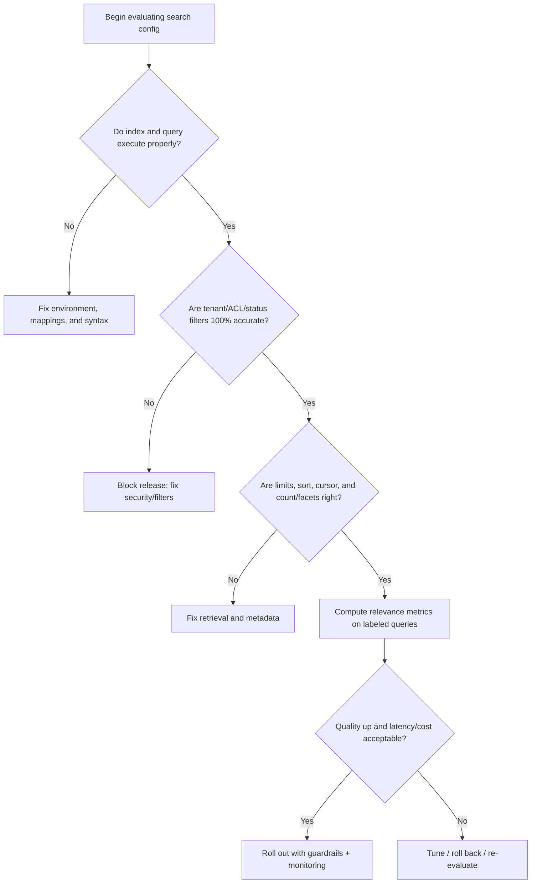

# Filters, Result Limits, and Search Quality Evaluation Criteria

A product search API can match the right keywords yet still **fail on quality**: returning another tenant's products, exposing unpublished items, ignoring a user's selected price range, returning hundreds of thousands of documents for a single request, or ranking less relevant items at the top. Conversely, a blazingly fast query that always returns an empty list because it used the wrong index type is not good search either.

To build reliable search with **Spring Data MongoDB**, you must design three layers simultaneously:

1. **Filters (eligibility):** determine which documents are *allowed* to appear, based on tenant, status, access permissions, price range, timestamps, and categories.
2. **Limits, sorting, and pagination (retrieval):** return a bounded, deterministic result set without loading the entire collection into memory.
3. **Quality evaluation (evaluation):** measure how well results satisfy user intent, coverage, data safety, latency, and stability over time.

Example:

```text
User T1 searches "bàn làm việc"
            │
            ▼
Keyword: "bàn làm việc"    → relevance matching/scoring
Tenant: T1                 → hard filter, cannot be bypassed
Status: PUBLISHED          → hard filter
Price: 1–5 million VND     → hard filter
Category: furniture        → hard filter per UI selection
            │
            ▼
Top 20 eligible results, ranked by relevance
            │
            ▼
Evaluation: P@10 / Recall@20 / NDCG@10 / p95 latency
```

This lesson belongs to the **Advanced Search** chapter of the **SPRING_DATA_MONGODB** module: using Spring Data MongoDB to connect, map documents, and operate on MongoDB via `MongoTemplate` or repositories; practicing query design, aggregation, indexes, transactions, reactive access, testing, and data performance diagnostics. The focus here is **filters, result limits, and search quality evaluation criteria**. Examples center on MongoDB Search (widely known via Atlas Search) alongside regular MongoDB queries; availability of `$search` and individual features depends on your deployment's version, topology, and Search service.

After this lesson, you will be able to:

- Distinguish `$match`/`Criteria` queries, traditional `$text`, and MongoDB Search `$search`.
- Design `compound.must`, `compound.filter`, `compound.should`, and `compound.mustNot` to separate mandatory constraints from relevance scoring.
- Choose index types for text fields, exact-match filter strings, numbers, and dates; verify the difference between a **Search index** and a **B-tree index**.
- Lock down tenant and access-control rules across queries, counts, facets, suggestions, and subsequent pages.
- Cap page sizes, enforce deterministic sorting, and use `searchAfter`/`searchSequenceToken` where appropriate.
- Retrieve counts/facets via `$searchMeta` without misrepresenting `lowerBound` as an exact total.
- Build pipelines in Java using `MongoTemplate` and `AggregationOperation` without concatenating JSON from arbitrary user input.
- Measure quality using `Precision@k`, `Recall@k`, `MRR`, `NDCG@k`, zero-result rates, latency, and safety gates.
- Design labeled query sets (relevance judgments), baselines, regression tests, and ranking experiments.

## 1. Decomposing a Search Request

### 1.1. A Request Combines Search Terms and Eligibility Rules

Suppose the API receives:

```json
{
  "query": "bàn làm việc",
  "category": "furniture",
  "priceMinCents": 100000000,
  "priceMaxCents": 500000000,
  "onlyAvailable": true,
  "pageSize": 20
}
```

The example uses `priceCents` (integers in the smallest currency unit) to avoid floating-point rounding in illustrations. If your currency domain specifies otherwise, choose an appropriate monetary model (e.g., `Decimal128`) and verify matching syntax and index types. **`tenantId` is absent from the request JSON**: the server derives it from authentication/authorization rather than letting clients pick another tenant's data.

A practical contract breaks down into:

| Component | Example | Nature |
| --- | --- | --- |
| Search text | `bàn làm việc` | Candidate generation and relevance scoring |
| Tenant | `T1` | **Mandatory**, security boundary |
| Visibility | `PUBLISHED` | **Mandatory** visibility gate |
| Category | `furniture` | Faceted UI filter |
| Price | 1 to 5 million | Range filter |
| In stock | `available=true` | Inventory filter per app model |
| Sort | descending relevance | Default ordering |
| Limit | max 20 | Resource and UX cap |
| Cursor | next-page token | Bound to the same search/filter/sort |

Never turn security filters into **scoring boosts**: another tenant's documents must not merely drop to “the bottom of the list”—they must be **completely excluded**.

### 1.2. Quality Has Multiple Dimensions

Good search must simultaneously be:

- **Authorized:** zero data leaks across tenants or ACLs.
- **Filter-accurate:** every returned item satisfies all mandatory filters.
- **Sufficiently comprehensive:** does not drop valid relevant products.
- **Usefully ranked:** highly relevant results appear early.
- **Navigable:** clean sorting, pagination, and facets without duplicate items from score ties.
- **Fast and stable:** acceptable p50/p95/p99 latency, throughput, and memory usage.
- **Observable:** backed by benchmarks, tests, telemetry, and alert thresholds.

**More results do not equal higher quality.** A query returning 10,000 items where the top 10 miss user intent is worse than one returning 20 accurate items.

## 2. Picking the Right Query Tool

### 2.1. `Criteria`/`$match` for Exact Conditions

When only filtering tenant, category, price, and status, ordinary MongoDB queries fit well:

```javascript
db.catalog_search_lab.find({
  tenantId: "T1",
  status: "PUBLISHED",
  category: "furniture",
  available: true,
  priceCents: { $gte: 100000000, $lte: 500000000 }
})
.sort({ updatedAt: -1, _id: -1 })
.limit(20);
```

With an appropriate index, `find`/`Criteria` handles structured filters efficiently. It does **not provide full-text relevance scores** or MongoDB Search's analyzer, synonym, and facet capabilities.

### 2.2. `$text` and `$regex` Are Not Equivalent to MongoDB Search

MongoDB provides `$text` on traditional **text indexes**, and `$regex` for string pattern matching:

```javascript
db.catalog_search_lab.find({
  $text: { $search: "desk" },
  tenantId: "T1"
}, {
  score: { $meta: "textScore" }
})
.sort({ score: { $meta: "textScore" } })
.limit(20);
```

`textScore` is metadata for traditional `$text`, **distinct** from MongoDB Search's `searchScore`. `$regex` fits specific pattern cases but lacks stemming, synonyms, and full-text ranking like MongoDB Search; arbitrary user regexes can also burn CPU or introduce injection risks if built carelessly.

### 2.3. MongoDB Search `$search`

MongoDB Search uses a **dedicated Search index** with `$search` as an aggregation stage:

```javascript
db.catalog_search_lab.aggregate([
  {
    $search: {
      index: "catalog_search_v1",
      text: {
        query: "desk",
        path: ["title", "description"]
      }
    }
  },
  { $limit: 20 },
  {
    $project: {
      title: 1,
      category: 1,
      score: { $meta: "searchScore" }
    }
  }
]);
```

Unlike regular queries, `$search` reads from a built **MongoDB Search index**. It will not run on an arbitrary standalone MongoDB server; verify the deployment supports MongoDB Search (such as MongoDB Atlas or a properly configured Search-enabled self-managed deployment). Search indexes maintain their own build and synchronization state, and sync lag can affect how soon new documents appear.

### 2.4. `$search` and `$searchMeta` Are First-Stage Pipeline Operators

`$search`/`$searchMeta` must appear at the **start of the pipeline** where they are used, subject to your deployment version's syntax rules. Never place a `$match` ahead of `$search` to “pre-filter tenants before searching”.

To filter inside the Search index before scoring, put predicates inside `$search.compound.filter`. A `$match` **after** `$search` can perform extra filtering, but it must never replace early filtering—especially once results are limited or when counts and facets must reflect the exact same permission scope.

## 3. Data and Search Index Design

### 3.1. Search Document Model

```javascript
{
  _id: ObjectId("..."),
  tenantId: "T1",
  externalId: "SKU-100",
  title: "Bàn làm việc điều chỉnh độ cao",
  description: "Bàn làm việc cho không gian nhỏ",
  category: "furniture",
  tags: ["desk", "office"],
  status: "PUBLISHED",
  available: true,
  priceCents: NumberLong("290000000"),
  updatedAt: ISODate("2026-11-20T09:00:00Z")
}
```

Choose field roles deliberately:

- `title`/`description`: fields needing language analysis and scoring.
- `tenantId`/`externalId`/`category`/`status`/`tags`: strings for **exact** filtering, sorting, and faceting.
- `available`: boolean filter.
- `priceCents`: numeric range.
- `updatedAt`: date range and chronological sorting.

In production, if documents store secrets or internal fields, allowlist returned fields and enforce authorization consistently across counts, facets, and suggestions as well.

### 3.2. Search Indexes Differ from MongoDB B-Tree Indexes

| Index | Used With | Serves |
| --- | --- | --- |
| Search index `catalog_search_v1` | `$search`, `$searchMeta` | Analyzed text, Search filters, relevance, facets |
| MongoDB index `{tenantId:1,externalId:1}` | `find`/`update`, unique constraint | Business keys and authoritative lookups |
| MongoDB index `{tenantId:1,status:1,updatedAt:-1,_id:-1}` | Sorted `find` | Structured filters, fallbacks, or non-Search flows |

A regular MongoDB `createIndex(...)` **never creates a Search index**. Conversely, a Search index never replaces a unique index or transactional constraint.

### 3.3. Controlled Search Index Definition

Example `catalog_search_v1` index:

```javascript
{
  mappings: {
    dynamic: false,
    fields: {
      title:       { type: "string" },
      description: { type: "string" },
      tenantId:    { type: "token" },
      externalId:  { type: "token" },
      category:    { type: "token" },
      tags:        { type: "token" },
      status:      { type: "token" },
      available:   { type: "boolean" },
      priceCents:  { type: "number" },
      updatedAt:   { type: "date" }
    }
  }
}
```

**`token`** supports exact matching, sorting, and faceting on string values (according to the field's analyzer/normalizer semantics). If using `equals` or `in` on strings, indexing only as analyzed full-text `string` may fail to match as intended. `string` is for text analysis; the same field may require multi-type mapping when used for both full-text search and exact sorting/filtering.

For Vietnamese text, word segmentation, diacritics, normalization, and synonyms strongly impact recall. Never assume the default English-oriented standard analyzer handles Vietnamese queries the way users expect; test with accented/unaccented queries, abbreviations, and compound words. Whenever changing indexes or analyzers, re-measure quality rather than merely checking that the pipeline runs.

### 3.4. Search Indexes Synchronize Separately

Inserting or updating a document does not mean the Search index updates **atomically** at write ACK time. When benchmarking after importing data, wait until the index reaches a ready state and documents are discoverable; otherwise recall evaluations may fail due to sync lag rather than relevance defects.

Likewise, never rely on a Search index as the sole enforcement point for an **immediate authorization check** after permission revocation or visibility changes. Define a clear consistency strategy (such as re-checking high-trust permissions before returning data) and test across index lag windows.

## 4. Building Filters with `compound`: Mandatory Matches vs. Scoring

MongoDB Search's `compound` operator supports four clauses: `must`, `filter`, `should`, and `mustNot`. Each clause takes an **array of sub-operators**, even when there is only one element.

| Clause | Must documents match? | Contributes to relevance score? | Appropriate Use Cases |
| --- | --- | --- | --- |
| `must` | Yes | Yes | Mandatory keyword matches, title/description |
| `filter` | Yes | **No** | Tenant, status, price range, timestamps, permissions |
| `should` | Optional by default, unless only `should` exists or `minimumShouldMatch` is set | Yes | Boosting title matches, preferred tags, phrase matches |
| `mustNot` | Matching documents are excluded | **No** | Excluding forbidden statuses, blocklists |

`filter` is the natural choice for conditions that purely determine **visibility eligibility**. Putting `tenantId` in `must` with a scoring operator wastes scoring effort and lets non-search factors skew relevance scores. See the MongoDB Search `compound` documentation in References at the end.

### 4.1. Tenant, Status, Availability, and Price Range Filters

```javascript
db.catalog_search_lab.aggregate([
  {
    $search: {
      index: "catalog_search_v1",
      compound: {
        must: [
          {
            text: {
              query: "desk",
              path: ["title", "description"]
            }
          }
        ],
        filter: [
          { equals: { path: "tenantId", value: "T1" } },
          { equals: { path: "status", value: "PUBLISHED" } },
          { equals: { path: "available", value: true } },
          { equals: { path: "category", value: "furniture" } },
          {
            range: {
              path: "priceCents",
              gte: NumberLong("100000000"),
              lte: NumberLong("500000000")
            }
          }
        ]
      }
    }
  },
  { $limit: 20 },
  {
    $project: {
      _id: 1,
      externalId: 1,
      title: 1,
      priceCents: 1,
      score: { $meta: "searchScore" }
    }
  }
]);
```

This snippet hard-codes `"T1"` for illustration only; **production APIs must inject the tenant from an authenticated security context**. String filter fields must be mapped as `token`, `available` as `boolean`, and `priceCents` as `number`. Mismatched mappings yield wrong or empty results.

### 4.2. What If the User Did Not Select a Category?

Never emit:

```javascript
{ equals: { path: "category", value: null } }
```

to mean “no category filter”. **No filter** means **omitting the category clause completely**. Query builders should append optional filters only for **valid, explicitly selected** options, while tenant, status, and ACLs are always appended from server policy.

If an API genuinely needs “items with an unassigned category”, that is a distinct business case requiring an explicit missing/null query and clear Search index semantics.

### 4.3. Multiple Categories: `in` Instead of Wrongly Splitting into `AND`

User selects `furniture` **or** `accessories`:

```javascript
{
  in: {
    path: "category",
    value: ["furniture", "accessories"]
  }
}
```

Putting two separate `equals` category clauses inside the same `filter` array expresses **AND**: a document would have to match both values simultaneously, which is impossible for a single-valued string field. `in` accurately expresses OR across values.

An alternative is nesting `compound.should` inside `filter`. When expressing OR across different fields, nested `compound` filters are more flexible.

### 4.4. OR Inside a Filter

Example requiring documents to belong to one of two categories:

```javascript
{
  compound: {
    should: [
      { equals: { path: "category", value: "furniture" } },
      { equals: { path: "category", value: "accessories" } }
    ],
    minimumShouldMatch: 1
  }
}
```

Place this object inside the outer `compound.filter` array. Because it sits inside the parent compound's `filter`, the OR condition governs eligibility only without adding relevance score to the parent query.

### 4.5. `mustNot` for Exclusions

If the catalog has a `status` field with `PUBLISHED`, `HIDDEN`, and `DELETED`, then:

```javascript
mustNot: [
  { equals: { path: "status", value: "DELETED" } }
]
```

only excludes `DELETED`; **it does not guarantee remaining documents are `PUBLISHED`**. When policy mandates showing only `PUBLISHED`, use a **positive filter**:

```javascript
filter: [
  { equals: { path: "status", value: "PUBLISHED" } }
]
```

Positive allowlists are safer than blocklists whenever new statuses such as `DRAFT` or `EMBARGOED` are introduced later.

### 4.6. `must` and `should`: Mandatory Matching vs. Boosting

```javascript
compound: {
  must: [{
    text: {
      query: "desk",
      path: ["title", "description"]
    }
  }],
  should: [{
    phrase: {
      query: "office desk",
      path: "title",
      score: { boost: { value: 3 } }
    }
  }],
  filter: [
    { equals: { path: "tenantId", value: "T1" } },
    { equals: { path: "status", value: "PUBLISHED" } }
  ]
}
```

In this example, every result **must** satisfy the `text` query and filters, while documents matching the phrase in `title` get an extra boost. Note that `should` is not always optional: if a `compound` has **only `should`** and no `must` or `filter`, MongoDB Search requires at least one `should` clause to match; `minimumShouldMatch` can raise that minimum threshold further.

### 4.7. Constraints That Must Be Validated

A syntactically valid filter can still be invalid for business logic:

- `priceMinCents > priceMaxCents`: return HTTP 400 rather than running a pointless query.
- `pageSize <= 0` or above ceiling: reject or clamp explicitly.
- Disallowed categories or overly long strings: validate against an allowlist and length cap.
- Unbounded date ranges with overly broad queries: cap resource usage or treat as a separate mode.
- Overly long tag lists: cap element counts and item lengths.
- Blank query text: explicitly decide between “browse catalog” mode and HTTP 400 rather than accidentally returning the entire collection.
- Client-supplied regex or query DSL: never inject straight into `$search` without parsing and allowlisting.

**Filters must be enforced on the server**; UI filters are a convenience, never a data security boundary.

## 5. Access Control and Filter Consistency Are Quality Gate #1

### 5.1. Tenant Filters Must Apply to Every Search Path

Suppose a client sends:

```json
{
  "tenantId": "T2",
  "query": "desk"
}
```

while authentication confirms the user only belongs to `T1`. The server **must never use `tenantId=T2`** in the Search filter. It must enforce `T1` per the security/authorization policy, or reject the request for invalid scope.

```text
Trusted tenant resolver
       │
       ▼
tenantId = "T1"
       │
       ▼
$search.compound.filter contains
  equals(path="tenantId", value="T1")
       │
       ▼
Result docs, count, facets, pagination
  must all enforce the same permissions
```

### 5.2. Multi-Group ACLs

Suppose a document is viewable only within tenant `T1`, status `PUBLISHED`, and when `allowedGroups` intersects the user's groups:

```javascript
filter: [
  { equals: { path: "tenantId", value: "T1" } },
  { equals: { path: "status", value: "PUBLISHED" } },
  {
    in: {
      path: "allowedGroups",
      value: ["team:design", "team:buyer"]
    }
  }
]
```

For this ACL filter to work, `allowedGroups` must also be mapped in the Search index with an appropriate type (e.g., `token`). The group list **must come from a trusted authorization provider**, never from a JSON parameter supplied by the user.

Cases where documents are public **or** shared with allowed groups should use a nested OR inside `filter`, keeping `tenantId` and `status` outside the OR so no branch can accidentally drop tenant isolation.

### 5.3. Risk of Stale Permissions in the Search Index

Search indexes synchronize asynchronously with the collection. Right after a document's permissions are revoked, a Search query might briefly see stale permissions depending on lag. When security rules **forbid revocation lag**, re-verify permissions against the authoritative source of truth before returning documents; Search pre-filtering is necessary, yet not always sufficient on its own.

Distinguish three safeguards:

- **Search pre-filter:** prunes candidates and prevents ordinary leaks.
- **Final authorization gate:** blocks returning records whose access was revoked while the Search index lagged.
- **Facet/count policy:** metadata can also leak document existence or counts. Never compute tenant-wide totals/facets and post-filter only the displayed list.

If strict point-in-time authorization is mandatory, align your query and authorization architecture with deployment consistency, including hiding or restricting metadata that cannot be safely verified.

### 5.4. Permission Tests Are Part of Search Quality

Mandatory tests:

1. A `T2` document matching `T1`'s keywords **never** appears in `T1`'s API responses.
2. `HIDDEN` and `DELETED` documents never appear when policy permits only `PUBLISHED`.
3. `T1`'s counts and facets never include `T2` documents.
4. Cursors never allow switching filters to tenant `T2`.
5. Grant/revoke permissions and query within the Search index lag window to test the final authorization gate.
6. Query errors or timeouts never fall back to a query lacking permission filters.

**Unauthorized document leakage must equal 0 across security tests.** A search engine with high NDCG that leaks cross-tenant data still fails.

## 6. Scoring and Relevance: Boosts Do Not Replace Hard Filters

### 6.1. MongoDB Search Returns `searchScore`

MongoDB Search ranks documents by relevance score (per operator and scoring configuration). Project the score to inspect it:

```javascript
{
  $project: {
    _id: 1,
    title: 1,
    category: 1,
    score: { $meta: "searchScore" }
  }
}
```

This score **is not a probability** that a document is right, is not a 0–100 percentage, and cannot be compared directly across different query or index versions without a baseline. Scores depend on analyzers, operators, corpus statistics, index scoring configs, and boosts.

### 6.2. Field Weights

Suppose `title` matters more than `description`:

```javascript
compound: {
  should: [
    {
      text: {
        query: "desk",
        path: "title",
        score: { boost: { value: 4 } }
      }
    },
    {
      text: {
        query: "desk",
        path: "description",
        score: { boost: { value: 1 } }
      }
    }
  ],
  minimumShouldMatch: 1,
  filter: [
    { equals: { path: "tenantId", value: "T1" } },
    { equals: { path: "status", value: "PUBLISHED" } }
  ]
}
```

When a query has only `should` and no `must`, `minimumShouldMatch: 1` requires at least one matching clause. Weights `4` and `1` are **experimental starting points**, not guaranteed optimal constants.

### 6.3. Boosts Must Never Express Permissions

Insecure:

```javascript
should: [
  { equals: {
      path: "tenantId",
      value: "T1",
      score: { boost: { value: 1000 } }
  }}
]
```

Documents from `T2` **can still be returned** whenever other clauses match, merely with a lower score. Access permissions belong inside `filter` or an equivalent mandatory constraint.

### 6.4. `minimumShouldMatch` Is a Recall–Precision Lever

Suppose a query splits into three signals:

- Matches `title`.
- Matches `description`.
- Matches `tags`.

Requiring **at least two signals** with `minimumShouldMatch: 2` can raise precision while dropping good documents that only matched `title`. Setting it to `1` increases recall while letting noisier documents through.

**Never tune this parameter by intuition alone.** Measure `Precision@10`, `Recall@20`, `NDCG@10`, and zero-result rate on a labeled query set, paying close attention to rare queries.

### 6.5. Score Thresholds Must Be Calibrated

A common idea is “drop everything with `score < 2.0`”. Absolute numeric thresholds break easily when changing analyzers, boosts, corpus size, or index versions.

To avoid weak matches safely:

- Study score distributions per query class.
- Test thresholds on a labeled dataset and measure the precision/recall trade-off.
- Monitor zero-result rates after applying the threshold.
- Never treat MongoDB Search scores as pre-calibrated probabilities.
- Prefer explicit business hard filters over using scores as a proxy for eligibility.

## 7. Result Limits, Sorting, and Pagination

### 7.1. Always Enforce a Page Size Ceiling

APIs must never let clients request `size=1000000` and return a million documents:

```java
if (pageSize < 1 || pageSize > 50) {
    throw new IllegalArgumentException("pageSize must be between 1 and 50");
}
```

`50` is an **example policy cap**, not a fixed MongoDB limit. Pick your ceiling based on resources, document size, SLAs, client devices, serialization cost, and concurrency. Alongside `$limit`, use `$project` to return only allowed and necessary fields.

### 7.2. Why Place `$limit` Immediately After `$search`?

```javascript
db.catalog_search_lab.aggregate([
  { $search: { /* search + filter conditions */ } },
  { $limit: 20 },
  { $project: { title: 1, externalId: 1 } }
]);
```

This prevents passing thousands of documents into unnecessary downstream stages. Note, however, that `$search` may still examine many index candidates to determine top hits; **`$limit: 20` does not mean search execution only inspects 20 documents**.

Stage order changes query semantics:

```text
$search → $limit:20 → $match:{category:"furniture"}
```

is not equivalent to:

```text
$search compound.filter(category) → $limit:20
```

The former may drop most of the top 20 and return only 3 items even when plenty of matching furniture exists further down. For any condition representable in the Search index, **filter inside `compound.filter` before taking top-K**.

### 7.3. Relevance Order Plus a Deterministic Tie-Breaker

When multiple documents share identical scores, ordering becomes non-deterministic without a tie-breaker. When `externalId` is indexed as `token` and `(tenantId, externalId)` is unique, you can sort by:

```javascript
db.catalog_search_lab.aggregate([
  {
    $search: {
      index: "catalog_search_v1",
      compound: {
        must: [{
          text: {
            path: ["title", "description"],
            query: "desk"
          }
        }],
        filter: [
          { equals: { path: "tenantId", value: "T1" } },
          { equals: { path: "status", value: "PUBLISHED" } }
        ]
      },
      sort: {
        score: { $meta: "searchScore" },
        externalId: 1
      }
    }
  },
  { $limit: 20 },
  {
    $project: {
      title: 1,
      externalId: 1,
      score: { $meta: "searchScore" }
    }
  }
]);
```

MongoDB Search supports sorting on fields indexed with compatible types. If `externalId` is not actually unique across the eligible result set, it is **not a strong enough tie-breaker**: choose a unique, immutable key.

### 7.4. Sorting by Newest Differs from Sorting by Relevance

Users may pick among sort modes:

| Sort Mode | Criterion | Trade-Off |
| --- | --- | --- |
| `relevance` | `searchScore DESC, externalId ASC` | Brings most relevant items to the top |
| `newest` | `updatedAt DESC, externalId ASC` | Newest items first; may be less textually relevant |
| `price_asc` | `priceCents ASC, externalId ASC` | Cheapest items first; relevance is no longer primary |
| `price_desc` | `priceCents DESC, externalId ASC` | Most expensive first; confirm UX intent |

Allow **only server-allowlisted sort modes**. Never accept an arbitrary sort object from the client straight into the pipeline. If UX needs a blend of relevance and freshness, design a verified scoring/reranking strategy rather than assuming a post-`$limit` MongoDB `$sort` reorders the full dataset.

### 7.5. Offset Pagination with `$skip`

```javascript
db.catalog_search_lab.aggregate([
  { $search: { /* query + filters + stable sort */ } },
  { $skip: 40 },
  { $limit: 20 }
]);
```

With zero-based page numbering and `pageSize = 20`, this fetches page 3 using:

\[
\text{offset}=\text{pageNumber}\times\text{pageSize}.
\]

Deep `$skip` consumes significant resources and risks duplicates or skipped hits when data or the index mutates between requests. MongoDB recommends `searchAfter`/`searchBefore` when sequentially paginating across many pages on supported deployments.

### 7.6. `searchAfter` and `searchSequenceToken`

On supported deployments/versions (MongoDB Search docs describe pagination tokens on MongoDB **7.0.5+** clusters subject to current deployment constraints), you can project a sequence token per hit:

```javascript
const pageOne = db.catalog_search_lab.aggregate([
  {
    $search: {
      index: "catalog_search_v1",
      compound: {
        must: [{
          text: { query: "desk", path: ["title", "description"] }
        }],
        filter: [
          { equals: { path: "tenantId", value: "T1" } },
          { equals: { path: "status", value: "PUBLISHED" } }
        ]
      },
      sort: {
        score: { $meta: "searchScore" },
        externalId: 1
      }
    }
  },
  { $limit: 10 },
  {
    $project: {
      title: 1,
      externalId: 1,
      score: { $meta: "searchScore" },
      paginationToken: { $meta: "searchSequenceToken" }
    }
  }
]).toArray();

const nextCursor = pageOne.length === 0
  ? null
  : pageOne[pageOne.length - 1].paginationToken;

printjson({ nextCursor });
```

Page two uses the **exact same operator, filters, and sort**, adding `searchAfter`:

```javascript
const pageTwo = nextCursor === null
  ? []
  : db.catalog_search_lab.aggregate([
      {
        $search: {
          index: "catalog_search_v1",
          compound: {
            must: [{
              text: {
                query: "desk",
                path: ["title", "description"]
              }
            }],
            filter: [
              { equals: { path: "tenantId", value: "T1" } },
              { equals: { path: "status", value: "PUBLISHED" } }
            ]
          },
          sort: {
            score: { $meta: "searchScore" },
            externalId: 1
          },
          searchAfter: nextCursor
        }
      },
      { $limit: 10 },
      {
        $project: {
          title: 1,
          externalId: 1,
          paginationToken: { $meta: "searchSequenceToken" }
        }
      }
    ]).toArray();

printjson(pageTwo);
```

**Tokens do not guarantee an immutable snapshot.** If documents are added, updated, or deleted between requests—or scoring shifts across Search nodes—results can still shift. For sensitive pagination flows, establish explicit consistency expectations and tests.

### 7.7. Cursors Must Be Bound to Query, Filter, Sort, and Tenant

In an API, treat cursors as **opaque tokens**. Alongside the Search token, bind a version and fingerprint covering:

```text
tenantId from authentication
normalized query text
category/price/date/status/ACL filters
sort mode
index/query version
pageSize
expiry
```

For example, store these in server-side state or wrap them in a tamper-proof signed cursor envelope. On subsequent page requests, **re-authenticate the actor and current permissions**; never let a client take a token from `T1` to `T2` or mutate filters to access out-of-scope records. `searchSequenceToken` must only be replayed with the **exact same search semantics and sort**; never decode or edit it manually.

### 7.8. `size+1` to Detect Whether Another Page Exists

To return 20 items and `hasNext` without running an exact count, request up to **21** items:

```text
requested pageSize = 20
database limit = 21
if items.size() > 20: hasNext = true
return only first 20 items
nextCursor = token of the 20th item
```

**Never use the 21st item's token**, or the next page will skip that 21st item. `size+1` improves UX without replacing exact counts; under concurrent writes or index lag, `hasNext` is simply an observation at query time.

## 8. Counts and Facets: Metadata Must Share the Exact Same Filter Scope

### 8.1. `$searchMeta` for Counts and Facets

When only the count of matching results is needed:

```javascript
db.catalog_search_lab.aggregate([
  {
    $searchMeta: {
      index: "catalog_search_v1",
      compound: {
        must: [{
          text: { query: "desk", path: ["title", "description"] }
        }],
        filter: [
          { equals: { path: "tenantId", value: "T1" } },
          { equals: { path: "status", value: "PUBLISHED" } }
        ]
      },
      count: { type: "total" }
    }
  }
]);
```

`$searchMeta` returns **metadata**, not a list of products. `count.type:"total"` computes an exact total count; `type:"lowerBound"` returns a lower-bound count, which is typically cheaper on huge result sets, with a configurable `threshold`. Never relabel `lowerBound` as “exactly N products” when N is only a lower bound.

### 8.2. Lower-Bound Counts and UX Messaging

```javascript
count: {
  type: "lowerBound",
  threshold: 1000
}
```

If metadata returns:

```javascript
{ count: { lowerBound: NumberLong("1000") } }
```

the UX can display **“at least 1,000 results”**, never claiming the exact total equals 1,000. Exact totals can add latency and load, so enable them only when UI or business requirements genuinely demand them.

### 8.3. Faceting by Category

Facets return bucket counts for the UI:

```text
Furniture       12
Accessories      7
Lighting         3
```

Query example:

```javascript
db.catalog_search_lab.aggregate([
  {
    $searchMeta: {
      index: "catalog_search_v1",
      facet: {
        operator: {
          compound: {
            must: [{
              text: {
                query: "desk",
                path: ["title", "description"]
              }
            }],
            filter: [
              { equals: { path: "tenantId", value: "T1" } },
              { equals: { path: "status", value: "PUBLISHED" } }
            ]
          }
        },
        facets: {
          categoryFacet: {
            type: "string",
            path: "category",
            numBuckets: 10
          }
        }
      }
    }
  }
]);
```

In the Search index, `category` must be mapped as `token` to support **string facets**. Each bucket count applies to the scoped query/operator, not the whole collection.

### 8.4. Self-Filtering Facets and Multi-Select UX

Suppose the user selects `category = furniture`. If you **apply the category filter before computing the category facet**, the facet may show only `furniture` and hide how many results exist in `accessories`.

There are two common designs:

- **Facets over post-filter results:** accurately reflects the current filtered slice, at the cost of hiding sibling options.
- **Facets excluding the dimension being displayed:** preserves sibling category counts so the UI allows switching or multi-selecting, while still enforcing tenant, status, ACL, and all other mandatory filters.

If using newer multi-select facet features like `doesNotAffect`, verify support in your exact version. A straightforward, easy-to-verify approach is running a **separate facet query** that omits only the `category` filter when computing `categoryFacet`, while **never omitting tenant or ACL filters**.

### 8.5. `$searchMeta` Differs from Pipeline `$facet`

MongoDB aggregation also has a `$facet` stage for branching pipelines. However:

- `$searchMeta` is a dedicated Search metadata stage.
- `$search` can populate metadata in `$$SEARCH_META` for supported downstream stages.
- Aggregation `$facet` has its own stage-placement and memory restrictions.
- You cannot put `$search` inside a regular `$facet` branch expecting it to work as a Search first stage.

For APIs needing only counts or facets, `$searchMeta` is the direct choice. When needing both hit documents and metadata in one response, evaluate issuing two queries vs. using `$$SEARCH_META` based on version semantics and consistency requirements.

### 8.6. Counts and Content May Not Share the Same Snapshot

An API may run `$search` for 20 documents and `$searchMeta` for the total count. If the catalog mutates or the Search index updates between the two queries, the count may not match an exact snapshot of the fetched content.

Your UI should distinguish:

- **Reference** totals for navigation.
- **Snapshot-exact** totals (which require dedicated architecture/consistency if business-critical).
- Lower bounds.

Never promise “100% synchronized” simply because both pipelines used identical filter expressions.

## 9. Spring Data MongoDB Integration with `MongoTemplate`

### 9.1. Choosing the Right Integration API

Spring Data MongoDB's `Query`/`Criteria` works well for standard `find` and `$match`. For MongoDB Search stages lacking a dedicated fluent builder in your Spring Data version, you can:

1. Use `AggregationOperation` to build BSON `Document` objects for `$search`/`$searchMeta`.
2. On supported versions, use `Aggregation.stage(...)` with JSON or BSON representations.
3. Access the MongoDB Java Driver via `MongoTemplate.getCollection(...)` for specialized cases.

**Never concatenate JSON from user input**:

```java
// WRONG: input alters JSON structure and introduces injection risks.
String stage = "{ $search: { text: { query: '" +
    userInput + "' } } }";
```

To prevent escaping bugs and query injection, construct `org.bson.Document` objects using **server-defined fields and operators**, binding only validated input values.

### 9.2. Request DTO and Response DTOs

```java
package com.example.search;

import java.util.List;

public record CatalogSearchRequest(
    String text,
    String category,
    Long minPriceCents,
    Long maxPriceCents,
    boolean onlyAvailable,
    int pageSize
) {}

public record CatalogSearchHit(
    String id,
    String externalId,
    String title,
    double score
) {}

public record CatalogSearchPage(
    List<CatalogSearchHit> items,
    boolean hasNext,
    String nextCursor
) {}
```

In Java, these three `public record` types belong in **three separate `.java` files** when declared top-level; they are grouped here to show the contract together. `nextCursor` is an opaque token; omit raw scores or internal cursor details from public responses if your security policy restricts metadata exposure.

### 9.3. Service Enforcing Authenticated Tenant Scope

The following example demonstrates **the first page** sorted by relevance using `MongoTemplate` and typed `Document` construction:

```java
package com.example.search;

import java.util.ArrayList;
import java.util.List;
import java.util.Set;
import org.bson.Document;
import org.springframework.beans.factory.annotation.Value;
import org.springframework.data.mongodb.core.MongoTemplate;
import org.springframework.data.mongodb.core.aggregation.Aggregation;
import org.springframework.data.mongodb.core.aggregation.AggregationOperation;
import org.springframework.stereotype.Service;

@Service
public class CatalogSearchService {

    private static final Set<String> CATEGORIES = Set.of(
        "furniture", "accessories", "lighting"
    );

    private final MongoTemplate mongoTemplate;
    private final String collectionName;

    public CatalogSearchService(
            MongoTemplate mongoTemplate,
            @Value("${app.search.collection:catalog_search_lab}")
            String collectionName) {
        this.mongoTemplate = mongoTemplate;
        this.collectionName = collectionName;
    }

    public CatalogSearchPage firstPage(
            String trustedTenantId,
            CatalogSearchRequest request) {

        validate(trustedTenantId, request);
        int size = request.pageSize();

        Document searchStage = buildSearch(
            trustedTenantId, request
        );
        Document projection = new Document("_id", 1)
            .append("externalId", 1)
            .append("title", 1)
            .append("score", new Document("$meta", "searchScore"))
            .append("paginationToken",
                new Document("$meta", "searchSequenceToken"));

        AggregationOperation first = context -> searchStage;
        AggregationOperation project =
            context -> new Document("$project", projection);

        Aggregation aggregation = Aggregation.newAggregation(
            first,
            Aggregation.limit(size + 1L),
            project
        );

        List<Document> raw = mongoTemplate.aggregate(
            aggregation,
            collectionName,
            Document.class
        ).getMappedResults();

        boolean hasNext = raw.size() > size;
        int visibleCount = Math.min(size, raw.size());
        List<CatalogSearchHit> hits =
            new ArrayList<>(visibleCount);

        for (int i = 0; i < visibleCount; i++) {
            Document row = raw.get(i);
            Number score = (Number) row.get("score");
            hits.add(new CatalogSearchHit(
                row.getObjectId("_id").toHexString(),
                row.getString("externalId"),
                row.getString("title"),
                score == null ? 0.0 : score.doubleValue()
            ));
        }

        String cursor = visibleCount == 0
            ? null
            : raw.get(visibleCount - 1)
                .getString("paginationToken");

        return new CatalogSearchPage(hits, hasNext, cursor);
    }

    private Document buildSearch(
            String tenantId, CatalogSearchRequest request) {

        List<Document> filters = new ArrayList<>();
        filters.add(new Document("equals",
            new Document("path", "tenantId")
                .append("value", tenantId)));
        filters.add(new Document("equals",
            new Document("path", "status")
                .append("value", "PUBLISHED")));

        if (request.category() != null) {
            filters.add(new Document("equals",
                new Document("path", "category")
                    .append("value", request.category())));
        }

        if (request.onlyAvailable()) {
            filters.add(new Document("equals",
                new Document("path", "available")
                    .append("value", true)));
        }

        if (request.minPriceCents() != null
                || request.maxPriceCents() != null) {
            Document range = new Document("path", "priceCents");
            if (request.minPriceCents() != null) {
                range.append("gte", request.minPriceCents());
            }
            if (request.maxPriceCents() != null) {
                range.append("lte", request.maxPriceCents());
            }
            filters.add(new Document("range", range));
        }

        Document text = new Document("text",
            new Document("query", request.text().trim())
                .append("path",
                    List.of("title", "description")));

        Document compound = new Document("must", List.of(text))
            .append("filter", filters);

        Document sort = new Document("score",
            new Document("$meta", "searchScore"))
            .append("externalId", 1);

        return new Document("$search",
            new Document("index", "catalog_search_v1")
                .append("compound", compound)
                .append("sort", sort));
    }

    private void validate(
            String tenantId, CatalogSearchRequest request) {

        if (tenantId == null || tenantId.isBlank()
                || request == null
                || request.text() == null
                || request.text().trim().isEmpty()
                || request.text().length() > 128
                || request.pageSize() < 1
                || request.pageSize() > 50) {
            throw new IllegalArgumentException(
                "Invalid search request");
        }

        if (request.category() != null
                && !CATEGORIES.contains(request.category())) {
            throw new IllegalArgumentException(
                "Unsupported category");
        }

        Long min = request.minPriceCents();
        Long max = request.maxPriceCents();

        if ((min != null && min < 0)
                || (max != null && max < 0)
                || (min != null && max != null && min > max)) {
            throw new IllegalArgumentException(
                "Invalid price range");
        }
    }
}
```

Example limitations:

- `app.search.collection` configures the collection name, defaulting to `catalog_search_lab`. The `mongosh` lab in section 13 uses a randomized collection name; when running the Java integration test, pass that collection name and ensure the matching Search index exists. Never take the collection name from user input.
- `trustedTenantId` must come from a **trusted security/tenant resolver**, never an unverified client-supplied string.
- The DTO prevents clients from specifying index names, field paths, operators, ACLs, or tenants.
- Raw `AggregationOperation` builds `Document` objects directly; because these fields bypass Java entity field-name mapping, stage field names must match **physical BSON names**.
- Search index `catalog_search_v1` must exist and be ready; an unavailable MongoDB Search service must surface an appropriate error, **never** an empty result list.
- The service illustrates `firstPage` only; a cursor-enabled API must validate cursor signatures/query fingerprints and reuse the exact same sort when adding `searchAfter`.
- `score` is read as `Number` because `searchScore` returns a numeric type; if the public API hides scores, omit the field from the public DTO while optionally logging safe metrics.

### 9.4. Adding `searchAfter` Without Breaking Filters

To fetch the next page, **do not** rebuild a different query:

```java
Document searchStage = buildSearch(trustedTenantId, request);
Document searchBody = searchStage.get(
    "$search", Document.class
);

if (verifiedCursor != null) {
    searchBody.append("searchAfter", verifiedCursor);
}
```

`verifiedCursor` is accepted only after the server confirms it binds to the current request's tenant, query, filters, sort, and index version. The snippet omits specific decoding/signature code to avoid assuming an internal MongoDB token format; Search tokens are opaque. When fetching `size+1` items, `nextCursor` must use the **last returned item's token**, not the overfetched item's token.

### 9.5. An Alternative for Purely Structured Queries

When full-text relevance is unnecessary, `MongoTemplate` and `Criteria` are simpler:

```java
import org.springframework.data.domain.Sort;
import org.springframework.data.mongodb.core.query.Criteria;
import org.springframework.data.mongodb.core.query.Query;

Query q = Query.query(
    Criteria.where("tenantId").is(trustedTenantId)
        .and("status").is("PUBLISHED")
        .and("category").is("furniture")
        .and("priceCents").gte(100000000L).lte(500000000L)
);
q.with(Sort.by(
    Sort.Order.desc("updatedAt"),
    Sort.Order.desc("_id")
));
q.limit(20);

List<ProductDocument> products =
    mongoTemplate.find(q, ProductDocument.class);
```

`ProductDocument` is an entity declared by the application; this snippet illustrates the query builder without redefining the entity. Back it with MongoDB B-tree indexes matching the filters and sort. Do not involve `$search` when business logic only needs exact filtering and date sorting.

### 9.6. `ReactiveMongoTemplate` Keeps Semantics, Changing Only the Publisher

```java
import org.springframework.data.mongodb.core.ReactiveMongoTemplate;
import org.springframework.data.mongodb.core.aggregation.Aggregation;
import reactor.core.publisher.Mono;

public Mono<List<Document>> searchReactive(
        ReactiveMongoTemplate template,
        Aggregation aggregation) {
    return template.aggregate(
        aggregation,
        "catalog_search_lab",
        Document.class
    ).collectList();
}
```

This executes the validated aggregation built above. `collectList()` is safe **when the query already applies `$limit` 21**, not after an unbounded Search returning millions of hits. Never call `block()` or `subscribe()` inside a WebFlux service.

### 9.7. Search Errors Are Errors, Not Empty Results

If the Search index is missing/unready or an operator/field type is invalid, the pipeline throws an exception. Never write:

```java
// DANGEROUS: disguises an outage as "no results".
return searchReactive(template, aggregation)
    .onErrorReturn(List.of());
```

Classify 4xx request validation errors, 5xx/503 Search infrastructure outages, ambiguous timeouts, and valid zero-match queries (empty list) separately. Good search lets users and operators distinguish **nothing matched** from **the search service is down**.

## 10. Offline Quality Evaluation: Build Labeled Judgments Before Tuning Scores

### 10.1. What Is a Relevance Judgment?

To compute quality metrics, you first need answers to “which documents count as relevant for this query?”. A judgment table might look like:

| Query | Filter/Tenant | Document | Relevance Grade |
| --- | --- | --- | --- |
| `desk` | T1, PUBLISHED | SKU-100 — bàn làm việc | 3 — highly relevant |
| `desk` | T1, PUBLISHED | SKU-101 — đèn bàn | 0 — irrelevant to primary intent |
| `desk` | T1, PUBLISHED | SKU-102 — phụ kiện bàn | 2 — fairly relevant |
| `desk` | T1, PUBLISHED | SKU-103 — bàn học | 1 — partially relevant |
| `desk` | T2, PUBLISHED | SKU-900 — bàn làm việc | **Ineligible due to tenant**, excluded from T1's relevant set |

Search quality evaluation must define the **relevant set within eligible hard filters**. SKU-900 may look identical by keywords, yet for user T1 it is a **security violation**, never a true positive.

### 10.2. Binary Relevance vs. Graded Relevance

With **binary relevance**, each document receives `relevant = 1` or `0`. `Precision@k`, `Recall@k`, and `MRR` commonly use binary relevance.

With **graded relevance**, labels can span 0–3:

```text
0 = irrelevant
1 = weakly relevant
2 = good match
3 = exact intent match
```

A policy might treat grades `>= 2` as relevant when computing Precision/Recall while feeding all four grades into NDCG. Document this threshold clearly in benchmarks and keep it consistent across versions.

### 10.3. A Representative Query Set, Not Just “Pretty” Queries

A good benchmark includes:

- Head queries, long-tail queries, single-word and multi-word queries.
- Accented and unaccented phrases, typos, abbreviations, and synonyms.
- Category queries, exact SKUs, brands, prices, and locations if applicable.
- Rare queries, zero-result queries, and ambiguous intents.
- Tenants with sparse vs. dense catalogs, and varying permissions/visibility.
- Queries combining multiple filters, narrow price bands, or sparse data.
- Mobile queries and properly anonymized real user queries.

Never tune boosts solely on 5 developer-invented queries; that leads to overfitting. Split queries into a **tuning/development** set and a **holdout evaluation** set to measure generalization beyond the queries used during tuning.

### 10.4. Labeling Workflow

1. Normalize and group queries by user intent.
2. Build candidate pools from both the baseline and experimental configurations rather than labeling only one system's outputs.
3. Exclude cross-tenant/ACL violations up front or track them as separate security failures.
4. Label against a written rubric, blinded to system scores.
5. For ambiguous queries, document multiple intents and conditional relevance.
6. Perform cross-review and adjudicate disagreements on critical cases.
7. Version-control queries, filters, indexes, corpus snapshots, and the rubric.

If labels do not cover most relevant items in the collection, Recall computed from them is an **incomplete estimate**. Document that limitation whenever using pooled judgments.

## 11. Relevance Evaluation Metrics and How to Compute Them

### 11.1. `Precision@k`: How Many of the Top-k Results Are Relevant?

For a single query:

\[
\operatorname{Precision@k}
=\frac{\#\{\text{relevant documents in top }k\}}{k}.
\]

Example top 5:

```text
Rank:      1  2  3  4  5
Relevant:  1  0  1  1  0
```

For `k = 3`, the top 3 contain two relevant documents:

\[
P@3=\frac{2}{3}\approx 0.667.
\]

**Define edge cases clearly:** when a system returns fewer than `k` items, some reports divide by `k` while others divide by actual returned count; stay consistent across versions. Here we use a **fixed denominator `k`** so systems are not rewarded for returning too few hits.

### 11.2. `Recall@k`: How Much of the Relevant Set Was Retrieved?

\[
\operatorname{Recall@k}
=\frac{\#\{\text{relevant documents in top }k\}}
{\#\{\text{eligible relevant documents in the evaluation set}\}}.
\]

Suppose three eligible documents are relevant to a query and top 3 returns two:

\[
R@3=\frac{2}{3}\approx 0.667.
\]

If 100 relevant documents exist in the evaluation set and top 3 contains 2, `Recall@3` is 2/100, not 2/3. **The recall denominator depends on known/labeled relevant items**, so incomplete labeling skews the metric.

For queries with **zero eligible relevant documents**, standard Recall has a zero denominator; track “no-answer queries” and how the system handles them separately rather than dividing by zero.

### 11.3. `MRR`: Where Does the First Correct Result Appear?

Mean Reciprocal Rank (`MRR`) across `Q` queries:

\[
\operatorname{MRR}=
\frac{1}{|Q|}
\sum_{q\in Q}\frac{1}{\operatorname{rank}_q},
\]

where a query scores **0** if no relevant document appears within the evaluated cutoff.

Example:

| Query | Rank of First Relevant Hit | Reciprocal Rank |
| --- | ---: | ---: |
| Q1 | 1 | 1.0 |
| Q2 | 2 | 0.5 |
| Q3 | Not in top k | 0 |

MRR = `(1 + 0.5 + 0) / 3 = 0.5`.

MRR shines when **users seek a single first right answer**, such as SKU lookups or targeted doc searches. It reveals less about the quality of the **entire list** when many relevant items exist; there, `NDCG` and `Precision@k` fit better.

### 11.4. `NDCG@k`: Rewarding Highly Relevant Items Near the Top

For graded relevance `rel_i`, a standard definition is:

\[
\operatorname{DCG@k}=
\sum_{i=1}^{k}\frac{2^{rel_i}-1}{\log_2(i+1)}.
\]

`IDCG@k` is the maximum DCG achieved by the **ideal ordering** of those same judgments. When `IDCG@k > 0`:

\[
\operatorname{NDCG@k}
=\frac{\operatorname{DCG@k}}{\operatorname{IDCG@k}}.
\]

Example top 5 with graded relevance:

```text
Rank:       1   2   3   4   5
Relevance:  3   0   2   1   0
```

For `k = 3`:

\[
\operatorname{DCG@3}
=\frac{2^3-1}{\log_2 2}
+\frac{2^0-1}{\log_2 3}
+\frac{2^2-1}{\log_2 4}
=7+0+1.5=8.5.
\]

Ideal top-3 ordering is `[3,2,1]`:

\[
\operatorname{IDCG@3}
=7+\frac{3}{\log_2 3}
+\frac{1}{\log_2 4}
\approx 9.393.
\]

Therefore:

\[
\operatorname{NDCG@3}\approx \frac{8.5}{9.393}
\approx 0.905.
\]

NDCG evaluates the entire ranking, not merely “how many hits were relevant”. When a query has no relevant documents (`IDCG = 0`), define an explicit policy—such as excluding it from mean NDCG and tracking zero-result quality separately—never dividing by zero.

### 11.5. Additional Metrics to Monitor

| Metric | What It Measures | Useful When |
| --- | --- | --- |
| `Hit@k` | Whether at least one relevant item is in top k | Lookup and navigation |
| `MAP@k` | Average Precision across multiple relevant hits | Multi-answer query sets |
| `NDCG@10` | Graded ranking quality in top 10 | Catalog/blog search |
| `Precision@10` | Cleanliness of top 10 | First-page UX |
| `Recall@20` | Coverage of relevant items in top 20 | Avoiding missed candidates |
| `MRR@10` | How early the first relevant hit appears | Code or answer lookup |
| `Zero-result rate` | Share of queries returning empty | Analyzers, coverage, filters |
| `Invalid-filter rate` | Share of requests rejected for bad filters | API/UX friction |
| `Forbidden-hit count` | Unauthorized documents returned | Security gate; must equal 0 in tests |
| `Duplicate-across-pages rate` | Items repeated while paginating | Cursor and sort stability |
| `Facet consistency` | Buckets match permissions and filters | Guided search |

Do not measure everything just to populate dashboards. Pick metrics tied to **user intent** and actionable quality gates.

### 11.6. Metrics Must Be Computed Over the Same Data Scope

If the baseline enforces `tenant=T1, status=PUBLISHED, category=furniture` while a candidate accidentally drops `category`, their NDCG numbers are not comparable. Benchmarks must hold constant:

```text
query text
tenant / permission policy
filter set
sort mode
corpus snapshot / index version
page size
judgment rubric
metric definition
```

An NDCG increase caused by accidentally **bypassing a hard filter** is never an improvement: that run fails immediately at the security/filter quality gate.

## 12. Online Evaluation, Performance, and Continuous Improvement

### 12.1. Strong Offline Relevance Does Not Guarantee Great UX

A configuration with higher `NDCG@10` might still:

- Be significantly slower at p95/p99.
- Raise query timeout rates.
- Make facets slow or inconsistent.
- Produce duplicate items across pages.
- Demand huge Search indexes and high operating cost.
- Degrade rare queries or accented Vietnamese queries.

Combine **offline metrics + system metrics + online experiments**.

### 12.2. Latency: p50, p95, p99

A search request spans multiple stages:

```text
Auth + request validation
   → MongoDB Search index execution
   → MongoDB document fetch
   → Count/facet query (if used)
   → DTO mapping / serialization
   → Network/client
```

Monitor:

- `latency_p50`: median request duration.
- `latency_p95`: 95% of requests complete at or below this threshold.
- `latency_p99`: rare tail latency that can still hurt UX severely.
- Timeout rate, Search error rate, and retry/circuit breaker trips.
- QPS, Search node CPU/utilization, memory, and connection pool usage.
- Response payload size, hit count, and facet bucket counts.

**Never mistake p95 for “95% of requests are as fast as the average”.** Percentiles measure the **request latency distribution** over an observation window, and should be segmented by query, filter, and page.

### 12.3. Search Execution Stats and `explain`

MongoDB Search provides execution and profiling diagnostics depending on deployment and version. Inspect:

- Whether the query targets the right Search index name and field types.
- Time spent in the search stage vs. document fetch and mapping.
- Operator types (`text`/`phrase`/`range`/`equals`), clause counts, and query complexity.
- Whether sorting uses indexed fields or triggers expensive downstream steps.
- Deep `$skip` or missing `$limit`.
- Whether exact counts or Search metadata add excessive overhead.

For regular MongoDB `find` queries, `explain("executionStats")` exposes `IXSCAN`/`COLLSCAN` and examined document counts. **Do not equate `$search` explain output with B-tree `IXSCAN` query plans**, since Search runs on a different index engine.

### 12.4. Watch Out for Bias in Online Clicks and Conversions

Online metrics to track:

```text
search impression
click-through rate (CTR)
long-click / product detail engagement
add-to-cart / conversion (where applicable)
query reformulation rate
search abandonment
zero-result session rate
time-to-first-useful-result
```

However, CTR suffers from **position bias**: items at rank 1 get clicked more partly because they sit first, not necessarily because they are more relevant. Conversion is also skewed by price, stock, UI layout, and promotions. Never use CTR alone to declare relevance improved.

### 12.5. A/B Tests with Quality Gates

A sound experiment:

1. Preserves identical security/tenant filters and eligible data.
2. Splits traffic cleanly using an appropriate randomization unit (user/session).
3. Compares baseline against a candidate changing analyzers, boosts, or thresholds.
4. Tracks offline `NDCG@k` alongside online engagement.
5. Tracks p95/p99 latency, error rates, zero results, and resource cost.
6. Aborts immediately if any forbidden hit or policy bypass occurs, regardless of CTR gains.
7. Never mixes another tenant's user data into benchmarks.

Set acceptance thresholds **before** inspecting experiment results, with proper sample sizes and confidence intervals. Never treat tiny shifts across a few dozen queries as statistical proof.

### 12.6. Recording Index/Query Versions and Evaluation Runs

A useful evaluation record looks like:

```text
Evaluation run: search-eval-2026-11
Corpus snapshot: catalog-T1-snapshot-2026-11
Index: catalog_search_v1
Analyzer: standard (version/config recorded)
Query configuration: boost-title-4-desc-1
Judgments: dataset-v3
Metrics: P@10, R@20, MRR@10, NDCG@10
System: p50/p95/p99, zero-results, errors
Security: forbidden-hit-count, facet scope
Decision: keep / reject / rerun
```

Never claim “NDCG rose 10%” without specifying the baseline, query set, labeling method, and query count. Small-sample metrics are noisy and unrepresentative of production.

### 12.7. Impact of Index Synchronization on Quality

A newly committed document not yet synced by the Search index will not be retrieved by `$search`. When evaluating recall on fresh data:

- Score results only after the index reaches ready/synced status per test setup.
- Record the timestamp when index readiness was observed.
- If “searchable immediately after creation” is required, track **freshness lag** as an independent metric.
- Distinguish an unavailable Search index, index sync lag, and true zero relevant matches.

**Relevance ranking and data freshness both impact search quality**, yet they are distinct failure modes requiring different fixes.

## 13. `mongosh` Lab: Filters, Limits, and Search Indexes

This lab requires a **MongoDB deployment with MongoDB Search available**. On MongoDB Atlas, use a cluster with privileges to create Search indexes; on self-managed deployments, confirm supporting version and infrastructure. A plain standalone MongoDB **without the Search service** cannot run `$search` even though `find` works normally.

**Run only in a test database.** The script creates a **randomly named** isolated collection for your session without modifying or dropping production collections. Search index readiness takes sync time; never assume the index is `READY` instantaneously after creation.

### 13.1. Seeding Targeted Data to Test Filters

```javascript
use spring_data_training

const runId = new ObjectId().toHexString();
const collectionName = "catalog_search_lab_" + runId;
const tenant1 = "T1-" + runId;
const tenant2 = "T2-" + runId;

db.createCollection(collectionName);
const lab = db.getCollection(collectionName);

function product(
    externalId, tenantId, title, description,
    category, status, available, priceCents, updatedAt) {
  return {
    _id: new ObjectId(),
    externalId,
    tenantId,
    title,
    description,
    category,
    status,
    available,
    priceCents: NumberLong(String(priceCents)),
    updatedAt: ISODate(updatedAt)
  };
}

const date = "2026-11-20T09:00:00Z";

lab.insertMany([
  product("SKU-100", tenant1, "Standing desk",
    "Adjustable office desk", "furniture", "PUBLISHED",
    true, 290000000, date),
  product("SKU-101", tenant1, "Home office desk",
    "Compact wooden desk", "furniture", "PUBLISHED",
    true, 190000000, date),
  product("SKU-102", tenant1, "Desk lamp",
    "LED lamp for desk", "lighting", "PUBLISHED",
    true, 59000000, date),
  product("SKU-103", tenant1, "Desk accessories",
    "Cable organizer for desk", "accessories", "PUBLISHED",
    true, 49000000, date),
  product("SKU-104", tenant1, "Sit stand desk",
    "Electric height adjustable desk", "furniture", "PUBLISHED",
    true, 480000000, date),
  product("SKU-105", tenant1, "Office chair",
    "Ergonomic chair for offices", "furniture", "PUBLISHED",
    true, 210000000, date),
  product("SKU-106", tenant1, "Desk mat",
    "Protective mat for desk", "accessories", "PUBLISHED",
    true, 39000000, date),
  product("SKU-107", tenant1, "Study desk",
    "Small study desk", "furniture", "PUBLISHED",
    true, 160000000, date),
  product("SKU-108", tenant1, "Designer desk",
    "Premium desk for architects", "furniture", "PUBLISHED",
    true, 600000000, date),
  product("SKU-109", tenant1, "Hidden office desk",
    "Private desk draft", "furniture", "HIDDEN",
    true, 150000000, date),
  product("SKU-110", tenant1, "Old desk",
    "Archived desk", "furniture", "ARCHIVED",
    true, 120000000, date),
  product("SKU-111", tenant1, "Folding desk",
    "Portable desk", "furniture", "PUBLISHED",
    false, 100000000, date),
  product("SKU-900", tenant2, "Premium desk",
    "Desk only for another tenant", "furniture",
    "PUBLISHED", true, 250000000, date)
]);

lab.createIndex(
  { tenantId: 1, externalId: 1 },
  { unique: true, name: "uniq_tenant_external" }
);

printjson({
  collectionName,
  tenant1,
  tenant2,
  records: lab.countDocuments({})
});
// Expected: 13 records.
```

Keep `lab`, `collectionName`, `tenant1`, and `tenant2` inside **the same `mongosh` session**. All data and tenant names belong solely to this lab run.

### 13.2. Creating the Search Index on the Lab Collection

```javascript
const indexDefinition = {
  mappings: {
    dynamic: false,
    fields: {
      title:       { type: "string" },
      description: { type: "string" },
      tenantId:    { type: "token" },
      externalId:  { type: "token" },
      status:      { type: "token" },
      category:    { type: "token" },
      available:   { type: "boolean" },
      priceCents:  { type: "number" },
      updatedAt:   { type: "date" }
    }
  }
};

lab.createSearchIndex(
  "catalog_search_v1",
  indexDefinition
);

printjson(lab.getSearchIndexes());
```

`createSearchIndex` works only on supporting deployments/`mongosh`; it differs from B-tree `createIndex` above. **Check the index status** via `getSearchIndexes()` or the Atlas console until the index is queryable/ready, and run a quick smoke test query. Never spin in an infinite loop or rely on a hard-coded wait assuming sync finished.

### 13.3. Baseline Text Search Scoped Only by Tenant and Status

```javascript
const baseFilter = [
  { equals: { path: "tenantId", value: tenant1 } },
  { equals: { path: "status", value: "PUBLISHED" } }
];

const baseSearch = {
  index: "catalog_search_v1",
  compound: {
    must: [{
      text: {
        query: "desk",
        path: ["title", "description"]
      }
    }],
    filter: baseFilter
  },
  sort: {
    score: { $meta: "searchScore" },
    externalId: 1
  }
};

const baseResults = lab.aggregate([
  { $search: baseSearch },
  { $limit: 30 },
  {
    $project: {
      externalId: 1,
      title: 1,
      category: 1,
      status: 1,
      tenantId: 1,
      score: { $meta: "searchScore" }
    }
  }
]).toArray();

printjson(baseResults.map(x => ({
  id: x.externalId,
  score: x.score
})));
```

On this dataset, documents matching `"desk"` in `title`/`description` with `tenant1` and `status=PUBLISHED` can match. **Never hard-code score ordering** as expected output because rankings depend on analyzers, scoring, and indexes. Invariants to verify:

```javascript
print(
  baseResults.every(
    x => x.tenantId === tenant1 &&
         x.status === "PUBLISHED"
  )
);
// Expected: true.

print(
  baseResults.some(x => x.externalId === "SKU-900")
);
// Expected: false (other tenant).
```

### 13.4. Adding Category, Price, and Availability Filters

```javascript
const restrictedSearch = {
  index: "catalog_search_v1",
  compound: {
    must: [{
      text: {
        query: "desk",
        path: ["title", "description"]
      }
    }],
    filter: [
      { equals: { path: "tenantId", value: tenant1 } },
      { equals: { path: "status", value: "PUBLISHED" } },
      { equals: { path: "available", value: true } },
      { equals: { path: "category", value: "furniture" } },
      {
        range: {
          path: "priceCents",
          gte: NumberLong("100000000"),
          lte: NumberLong("500000000")
        }
      }
    ]
  },
  sort: {
    score: { $meta: "searchScore" },
    externalId: 1
  }
};

const restricted = lab.aggregate([
  { $search: restrictedSearch },
  { $limit: 50 },
  {
    $project: {
      externalId: 1, category: 1,
      status: 1, available: 1, priceCents: 1,
      tenantId: 1, score: { $meta: "searchScore" }
    }
  }
]).toArray();

printjson(restricted.map(x => x.externalId));
```

With this dataset and the Search analyzer, the expected SKU set (order unspecified) is:

```text
SKU-100
SKU-101
SKU-104
SKU-107
```

Verify the absence of `SKU-900` (`tenant2`), `SKU-109`/`110` (not `PUBLISHED`), `SKU-108` (over max price), `SKU-111` (`available=false`), and `SKU-102`/`103`/`106` (different category).

`SKU-105` is available furniture in the right price range, but neither its title nor its description contains `"desk"`, so it does not match the text clause. Custom analyzers or synonyms could alter results; whenever changing indexes, update tests to reflect actual semantics rather than assuming simple substring counts.

### 13.5. Verifying `$limit`

```javascript
const topTwo = lab.aggregate([
  { $search: restrictedSearch },
  { $limit: 2 },
  {
    $project: {
      externalId: 1,
      score: { $meta: "searchScore" }
    }
  }
]).toArray();

printjson({
  size: topTwo.length,
  ids: topTwo.map(x => x.externalId)
});
// Expected size <= 2, not necessarily a fixed pair of SKUs.
```

This returns the **top k** among filter-eligible hits, not “grab two arbitrary items and sort by score”. Never move `$limit` ahead of `$search`.

### 13.6. Count from `$searchMeta`

```javascript
const countMeta = lab.aggregate([
  {
    $searchMeta: {
      index: "catalog_search_v1",
      compound: restrictedSearch.compound,
      count: { type: "total" }
    }
  }
]).toArray();

printjson(countMeta);
```

Once the index is synced on this sample data, the restricted query count matches the hit set. Inspect `count.total`. If switching to `lowerBound`, read the matching metadata field and respect its semantics; never display a lower bound as an exact number.

### 13.7. Facets Before and After the Category Filter

Compute category facets over `baseSearch`, **keeping tenant and status** while omitting the category filter:

```javascript
const facets = lab.aggregate([
  {
    $searchMeta: {
      index: "catalog_search_v1",
      facet: {
        operator: baseSearch.compound,
        facets: {
          categoryFacet: {
            type: "string",
            path: "category",
            numBuckets: 10
          }
        }
      }
    }
  }
]).toArray();

printjson(facets);
```

Switching `operator` to `restrictedSearch.compound` shrinks the buckets because `category=furniture`, `available`, and `price` have already filtered the scope. Choose facet scoping to fit the UI contract, but **never drop tenant or ACL filters** merely to show fuller buckets.

### 13.8. Generating a Next-Page Token

```javascript
const limit = 2;

const results = lab.aggregate([
  { $search: baseSearch },
  { $limit: limit + 1 },
  {
    $project: {
      externalId: 1,
      score: { $meta: "searchScore" },
      paginationToken: { $meta: "searchSequenceToken" }
    }
  }
]).toArray();

const visible = results.slice(0, limit);
const hasNext = results.length > limit;
const nextCursor = visible.length === 0
  ? null
  : visible[visible.length - 1].paginationToken;

printjson({
  ids: visible.map(x => x.externalId),
  hasNext,
  nextCursor
});
```

For the next page, add `searchAfter: nextCursor` to the **exact same** `baseSearch` while preserving sort and filters, as in section 7.6. Tokens are opaque and do not create a snapshot; never keep expired tokens or reuse them across modified queries/indexes.

### 13.9. Comparing Against a Regular Query

```javascript
const normalQuery = lab.find({
  tenantId: tenant1,
  status: "PUBLISHED",
  category: "furniture",
  available: true,
  priceCents: {
    $gte: NumberLong("100000000"),
    $lte: NumberLong("500000000")
  }
})
.sort({ updatedAt: -1, _id: -1 })
.limit(20)
.toArray();

printjson(normalQuery.map(x => x.externalId));
```

This query lacks the `"desk"` text condition, so it returns `SKU-105` (chair) despite being unrelated to the keyword. This demonstrates that **structured filters do not replace text relevance matching**.

### 13.10. Cleaning Up This Session's Collection

```javascript
printjson({
  collectionName,
  count: lab.countDocuments({})
});

// ONLY after confirming collectionName is the
// randomized name created by this practice session.
lab.drop();
```

`drop()` deletes the collection and its indexes. Never run `lab.drop()` if `lab` points to a production or shared collection; never create Search indexes on someone else's collection without permission.

## 14. Testing Metrics and Search Integration

### 14.1. Two Independent Test Layers

**Layer 1 — Unit testing metric calculations:** needs no MongoDB; uses labeled rankings to verify `Precision`/`Recall`/`MRR`/`NDCG` formulas.

**Layer 2 — Search query integration tests:** requires a ready MongoDB Search index and seeded test data; verifies filters, tenant isolation, limits, sorting, metadata, and data provenance.

Never combine both into a fake test: a unit test checking a `Document` has `"tenantId"` does not prove the Search service applied that filter, and an integration test checking “query returns at least one record” does not prove good relevance.

### 14.2. Metric Functions in Java

```java
package com.example.search.quality;

import java.util.ArrayList;
import java.util.Comparator;
import java.util.List;

public final class SearchMetrics {

    private SearchMetrics() {}

    public static double precisionAtK(
            List<Integer> labels,
            int k,
            int relevanceThreshold) {

        checkK(k);
        long hits = labels.stream()
            .limit(k)
            .filter(label -> label >= relevanceThreshold)
            .count();
        return hits / (double) k;
    }

    public static double recallAtK(
            List<Integer> labels,
            int k,
            int relevanceThreshold,
            int knownRelevantCount) {

        checkK(k);
        if (knownRelevantCount <= 0) {
            throw new IllegalArgumentException(
                "Recall is undefined when no relevant items exist");
        }

        long hits = labels.stream()
            .limit(k)
            .filter(label -> label >= relevanceThreshold)
            .count();
        return hits / (double) knownRelevantCount;
    }

    public static double reciprocalRankAtK(
            List<Integer> labels,
            int k,
            int relevanceThreshold) {

        checkK(k);
        for (int i = 0; i < Math.min(k, labels.size()); i++) {
            if (labels.get(i) >= relevanceThreshold) {
                return 1.0 / (i + 1);
            }
        }
        return 0.0;
    }

    public static double dcgAtK(
            List<Integer> gradedLabels, int k) {

        checkK(k);
        double result = 0.0;
        for (int i = 0;
                i < Math.min(k, gradedLabels.size()); i++) {
            int rel = gradedLabels.get(i);
            if (rel < 0) {
                throw new IllegalArgumentException(
                    "Graded relevance must be non-negative");
            }
            double gain = Math.pow(2, rel) - 1;
            double discount = Math.log(i + 2)
                / Math.log(2);
            result += gain / discount;
        }
        return result;
    }

    public static double ndcgAtK(
            List<Integer> gradedLabels, int k) {

        checkK(k);
        double actual = dcgAtK(gradedLabels, k);
        List<Integer> ideal = new ArrayList<>(gradedLabels);
        ideal.sort(Comparator.reverseOrder());
        double maximum = dcgAtK(ideal, k);

        // Policy of this utility: no gain -> NDCG=0.
        // Formal reports should flag queries with no relevant items
        // and may exclude them from mean NDCG per the rubric.
        return maximum == 0 ? 0.0 : actual / maximum;
    }

    private static void checkK(int k) {
        if (k <= 0) {
            throw new IllegalArgumentException(
                "k must be positive");
        }
    }
}
```

**Input semantics:** `labels` are ordered by **the rank returned by the search system**; for Recall, `knownRelevantCount` is the total relevant count across the **entire eligible labeled set** for that query, not just the first page.

### 14.3. JUnit 5 Tests for Metrics

```java
package com.example.search.quality;

import static org.junit.jupiter.api.Assertions.*;
import java.util.List;
import org.junit.jupiter.api.Test;

class SearchMetricsTest {

    @Test
    void precisionRecallAndRankHaveDistinctMeanings() {
        // 1 = relevant, 0 = non-relevant.
        List<Integer> binary = List.of(1, 0, 1, 1, 0);

        assertEquals(
            2.0 / 3.0,
            SearchMetrics.precisionAtK(binary, 3, 1),
            1e-9
        );

        assertEquals(
            2.0 / 3.0,
            SearchMetrics.recallAtK(binary, 3, 1, 3),
            1e-9
        );

        assertEquals(
            1.0,
            SearchMetrics.reciprocalRankAtK(binary, 3, 1),
            1e-9
        );
    }

    @Test
    void ndcgRewardsRelevantItemsNearTheTop() {
        List<Integer> graded = List.of(3, 0, 2, 1, 0);
        double ndcg = SearchMetrics.ndcgAtK(graded, 3);

        assertTrue(ndcg > 0.90);
        assertTrue(ndcg < 0.91);
    }

    @Test
    void noRelevantResultHasZeroReciprocalRank() {
        assertEquals(0.0,
            SearchMetrics.reciprocalRankAtK(
                List.of(0, 0, 0), 3, 1));
    }

    @Test
    void badKAndUnknownRecallAreRejected() {
        assertThrows(
            IllegalArgumentException.class,
            () -> SearchMetrics.precisionAtK(
                List.of(1), 0, 1)
        );

        assertThrows(
            IllegalArgumentException.class,
            () -> SearchMetrics.recallAtK(
                List.of(1), 3, 1, 0)
        );
    }
}
```

These assertions verify the **metric formulas**. They do not query MongoDB or validate any MongoDB Search ranking algorithm.

### 14.4. Prerequisites for Integration Testing

To test real `$search`, you must have:

1. MongoDB Search supported on the test deployment.
2. A test collection holding a fixture equivalent to the `mongosh` lab in section 13.
3. Search index `catalog_search_v1` created on the **exact collection** and `queryable`.
4. The Search service accepting the collection name from test configuration, never from clients.
5. Two tenants plus multiple statuses and prices seeded to verify isolation.
6. No shared production collections or dropping another user's data.

A `@DataMongoTest` running against a standalone test MongoDB **does not provide MongoDB Search indexes**. Without a Search-capable environment, never fake a PASS by swapping `$search` for `find`; report the test as **skipped/unrun due to missing Search infrastructure**.

### 14.5. JUnit Integration Contract

Example reading collection and tenant fixture parameters from an isolated CI environment:

```java
package com.example.search;

import static org.junit.jupiter.api.Assertions.*;
import java.util.HashSet;
import java.util.List;
import java.util.Set;
import org.bson.Document;
import org.bson.types.ObjectId;
import org.junit.jupiter.api.BeforeEach;
import org.junit.jupiter.api.Test;
import org.springframework.beans.factory.annotation.Autowired;
import org.springframework.boot.test.autoconfigure.data.mongo.DataMongoTest;
import org.springframework.data.mongodb.core.MongoTemplate;

@DataMongoTest
class CatalogSearchIntegrationTest {

    @Autowired
    MongoTemplate mongoTemplate;

    private CatalogSearchService service;
    private String collection;
    private String tenant1;

    @BeforeEach
    void setup() {
        collection = System.getProperty(
            "search.test.collection"
        );
        tenant1 = System.getProperty(
            "search.test.tenant1"
        );

        assertNotNull(collection,
            "Search test collection must be prepared");
        assertNotNull(tenant1,
            "Fixture tenant must be prepared");

        service = new CatalogSearchService(
            mongoTemplate, collection
        );
    }

    private CatalogSearchRequest request(int size) {
        return new CatalogSearchRequest(
            "desk",
            "furniture",
            100000000L,
            500000000L,
            true,
            size
        );
    }

    @Test
    void firstPageHonorsLimitAndStableTieBreak() {
        CatalogSearchPage page =
            service.firstPage(tenant1, request(2));

        assertTrue(page.items().size() <= 2);
        assertEquals(2, page.items().size());
        assertTrue(page.hasNext());
        assertNotNull(page.nextCursor());

        Set<String> ids = new HashSet<>();
        for (CatalogSearchHit hit : page.items()) {
            assertTrue(ids.add(hit.externalId()));
        }
    }

    @Test
    void returnedDocumentsSatisfyMandatoryFilters() {
        CatalogSearchPage page =
            service.firstPage(tenant1, request(20));

        Set<String> expected = Set.of(
            "SKU-100", "SKU-101", "SKU-104", "SKU-107"
        );

        Set<String> actual = new HashSet<>();
        for (CatalogSearchHit hit : page.items()) {
            actual.add(hit.externalId());

            Document raw = mongoTemplate
                .getCollection(collection)
                .find(new Document(
                    "_id", new ObjectId(hit.id())
                ))
                .first();

            assertNotNull(raw);
            assertEquals(tenant1, raw.getString("tenantId"));
            assertEquals(
                "PUBLISHED", raw.getString("status"));
            assertEquals(
                "furniture", raw.getString("category"));
            assertEquals(true, raw.getBoolean("available"));

            long price = raw.getLong("priceCents");
            assertTrue(price >= 100000000L);
            assertTrue(price <= 500000000L);
        }
        assertEquals(expected, actual);
    }

    @Test
    void invalidPageAndCategoryAreRejected() {
        assertThrows(
            IllegalArgumentException.class,
            () -> service.firstPage(tenant1, request(1000))
        );

        CatalogSearchRequest bad =
            new CatalogSearchRequest(
                "desk", "unknown-category",
                null, null, false, 20
            );
        assertThrows(
            IllegalArgumentException.class,
            () -> service.firstPage(tenant1, bad)
        );
    }
}
```

**This test requires the section 13 fixture** on a Search test environment; pass `-Dsearch.test.collection=<labName>` and `-Dsearch.test.tenant1=<tenant1>` for the session once the index is `READY`. The test queries `getCollection(...).find(...)` to inspect raw BSON directly—such N+1 lookups are for **integration verification**, not for production search services.

The exact SKU list asserted here reflects **this lesson's dataset and analyzer**; if CI uses custom synonyms or analyzers, update the fixture/test or pin index settings before comparing. In production suites, always assert mandatory security invariants even if rankings evolve.

### 14.6. Additional Tests Needed for Counts, Facets, and Cursors

Do not stop at the three tests above. Extended matrix:

| Test Group | Expectation |
| --- | --- |
| Tenant security | `SKU-900` never appears in `tenant1`'s results, counts, or facets |
| Visibility | `SKU-109` (`HIDDEN`) and `SKU-110` (`ARCHIVED`) are excluded |
| Availability | `SKU-111` excluded when `onlyAvailable=true` |
| Price range | `SKU-108` excluded when `max=500000000` |
| Empty query | Rejected or handled via browse contract, never runs dangerous query |
| Empty result | Returns valid empty page; **never** swallows Search service errors |
| Missing Search index | Raises explicit error rather than faking `count=0` |
| Facet scope | Bucket totals count only eligible documents |
| Cursor page 2 | No overlap with page 1 on an unchanged fixture |
| Cursor tampering | Token bound to a different tenant/filter is rejected |
| Concurrent updates | Documents best-effort pagination without promising snapshots |
| Relevance regression | `NDCG`/`Precision` on labeled queries does not regress past threshold |
| Latency | p95/p99 and timeouts stay within budget |
| Freshness | Search index lag reflects writes within SLA |

### 14.7. Never Use `Thread.sleep` to Wait for a Search Index

Code like:

```java
Thread.sleep(1000);
assertEquals(4, search().size());
```

is inherently flaky because Search index builds and replication can take more or less than one second. Test infrastructure should:

- Create the index and poll its `queryable`/ready status.
- Enforce a finite deadline with retry/backoff **only while awaiting index readiness** in the test environment.
- Seed data and verify visibility using mechanisms supported by the deployment.
- Fail setup clearly when the deadline expires instead of recording `recall=0`.
- Clean up only test-owned resources and log the MongoDB/Search versions.

**Never** trigger failovers, modify production indexes, or drop shared collections just to test a lesson.

## 15. Troubleshooting: Separating Filters, Ranking, and Infrastructure

### 15.1. Common Error Matrix

| Symptom | Possible Cause | How to Check |
| --- | --- | --- |
| `$search` reports unsupported | Deployment lacks Search or wrong version/topology | Check cluster Search capability and index status |
| Query returns empty even though `find` sees docs | Search index not `READY` or not yet synced | Check `getSearchIndexes`, smoke query, index lag |
| String `equals` fails to match | Field not mapped as `token` or value mismatch | Inspect Search mapping and stored BSON |
| Unaccented Vietnamese misses accented text | Analyzer/normalization mismatch | Test accented/unaccented queries and index analyzer |
| SKU query splits into partial words | Full-text analyzer used instead of exact `token` | Use dedicated lookup key with `equals`/`in` |
| Other tenant's items appear | Missing tenant filter or OR clause drops tenant | Inspect `compound.filter`, security regressions |
| `HIDDEN` items slip through | Blocklist `mustNot(DELETED)` used instead of allowlist `PUBLISHED` | Use `equals(status, PUBLISHED)` |
| Wrong low/high prices | Wrong currency unit, BSON type, or inclusive/exclusive bounds | Inspect `priceCents`, `$type`, `gte`/`lte` |
| Multi-category selection returns empty | Two `equals` category filters combined via AND | Use `in` or nested `compound.should` |
| Ordering changes on every request | Tied scores, shifting scores/index | Sort with unique tie-breaker; monitor index/corpus |
| Items duplicate across pages | `$skip` under mutations or unstable sort | Use `searchAfter`, immutable tie-breaker, cursor tests |
| Next page skips an item | Used token of the overfetched `(size+1)`-th item | Use token of the last **returned** item |
| Next page jumps to another filter | Cursor not bound to query/filter/tenant | Signed fingerprint envelope, revalidate auth |
| `$limit:20` before category filter returns too few | Filtering after top-K | Move category into `compound.filter` |
| Count exceeds displayed results | Count used different scope or hits were capped at top-K | Align filters and clarify count vs. page size |
| Count shows “1000” when actual total is higher | `lowerBound` interpreted as exact `total` | Read `count.lowerBound` explicitly |
| Facet includes another tenant's categories | Facet query missing tenant/ACL filter | Apply all mandatory filters to facet operator |
| Sibling categories vanish after selecting one | Self-filtering facet | Run facet query tailored to UX without dropping security filters |
| `searchScore` rises while NDCG drops | Boosts misaligned with real user intent | Use labeled judgments and inspect top-K |
| CTR rises while revenue/quality drops | Position bias or UI changes | A/B experiments and guardrails |
| Very high p95 latency | Broad filters, exact counts, deep sort/skip | Narrow queries, profile, inspect resource metrics |
| `collectList` causes memory spikes | Unbounded query collected into a `List` | Cap results in database before collecting |
| Java Search failure returns 0 results | Overly broad `onErrorResume` | Preserve infrastructure errors via proper error mapping |
| Java error due to malformed JSON query | String concatenation with user input | Use typed `Document` / parameter binding |
| Java field names differ from MongoDB names | Raw stage bypasses entity field mapping | Align BSON paths with converter mappings |
| Search index “created” yet matches nothing | Not `queryable` or field unmapped | Inspect index status, mappings, ingestion |
| Query matches right docs but leaks secrets | Missing projection/DTO allowlist | Whitelist returned fields and enforce final authorization |
| Zero results spike after deploy | Analyzer/index/query change or filter bug | Compare baseline, query logs, and regression set |
| High offline NDCG, unhappy production users | Unrepresentative labeled queries or poor UX/latency | Expand dataset and monitor online metrics |

### 15.2. When a Query Returns Empty

Follow this order:

1. **Does the document exist in the collection?** Test `find` by ID in a test environment.
2. **Do tenant and status match?** Never delete permission checks to “fix” a production query.
3. **Is the Search index `queryable` and synced?** Check `getSearchIndexes` and mappings.
4. **Are field types right?** `token` for exact strings, `string` for analyzed text, `number` for prices, `date` for dates.
5. **Does the analyzer handle the input as expected?** Test accented/unaccented text, phrases, and terms.
6. **Are filters using AND vs. OR properly?** Multi-select categories need OR/`in`.
7. **Are price and date ranges using the right units and bounds?**
8. **Are `skip`, cursors, or score thresholds eliminating everything?**
9. **Did MongoDB throw an error that the service swallowed into an empty list?**

If no eligible document matches after checking, return “no results” per UX; if the Search service failed, return an explicit error status. **Never blur those two cases together.**

### 15.3. When Results Are Irrelevant

Analyze layer by layer:

```text
Candidate generation:
  text fields, analyzer, synonyms, phrase, must/minShouldMatch
       │
       ▼
Eligibility:
  tenant, status, category, price, availability, ACL
       │
       ▼
Ranking:
  boost title/description, scoring behavior, sort mode
       │
       ▼
Presentation:
  top-k, snippets, facets, cursor, dedup
```

Filter changes can drop relevant candidates; scoring changes keep the candidates while pushing them onto later pages. Measure both **recall** and **ranking metrics** to pinpoint which layer needs tuning.

### 15.4. When Pagination Is Unstable

Check:

- Does the Search sort include a **unique, immutable secondary key**?
- Was the token created and replayed with the **exact same query semantics**?
- Can a cursor be replayed after changing filters or tenants?
- Are concurrent writes/updates mutating scores or sort fields between pages?
- Is the Search index syncing and shifting corpus statistics?
- Is `searchAfter` using the last returned item's token rather than the overfetched item's token?

If business rules require an immutable list for a legal transaction, relevance pagination on a dynamic Search index may **not satisfy snapshot semantics**. Build an explicit ID-list snapshot and audit trail if required.

### 15.5. When Queries Are Slow

Measure each component separately:

- Search stage execution time.
- Count/facet time (especially exact `total`).
- Full document fetch time.
- Projection/serialization time.
- Network and downstream client latency.
- Clause count, filter cardinality, query length, and page size.
- Search node count, threads, and deployment resources.

Apply optimizations one controlled change at a time: filter early, trim indexed fields, cap `k`, pick matching Search index types, avoid exact counts unless necessary, and replace deep `skip` with cursors. **Never change indexes and boosts together and measure only one aggregate number**, or you will not know what caused the change.

## 16. Designing Verifiable Acceptance Criteria

### 16.1. Quality Is More Than a Single Number

An acceptance suite for a search feature might include:

| Layer | Example Acceptance Criterion | Type |
| --- | --- | --- |
| Security | Zero forbidden results in tests and production checks | Mandatory gate |
| Filter correctness | Every returned item satisfies all filters | Mandatory gate |
| Schema/index | Search index exists, is `queryable`, and has valid mappings | Deployment gate |
| Limit | Each request returns at most validated `pageSize` items | Resource gate |
| Pagination | Zero duplicate IDs on a stable fixture; token bound to query | Regression |
| Relevance | `NDCG@10` does not drop below chosen baseline | Offline metric |
| Coverage | `Recall@20` meets target on labeled set | Offline metric |
| UX | Zero-results and abandonment stay within guardrails | Online |
| Latency | p95/p99 stays within API budget | Performance |
| Freshness | Index lag stays within defined SLA | Consistency |
| Cost | Search node CPU/storage stays within budget | Operations |

Exact numeric thresholds (e.g., millisecond p95 targets or minimum NDCG) must come from your product's **SLOs and real data**; never copy arbitrary numbers across unrelated apps.

### 16.2. Prioritize Hard Constraints Before Relevance Optimization



Relevance must never be traded for access control. A query that ranks every product brilliantly while exposing hidden records is a critical defect that must block release.

### 16.3. Pre-Deployment Checklist

1. **Configuration:** does the deployment support MongoDB Search?
2. **Index:** is the Search index `READY`/`queryable` with accurate `token`/`string`/`number`/`date` mappings?
3. **Tenant:** does tenant ID come from authentication rather than client request bodies?
4. **ACL:** are allowed groups sourced from a trusted authorization policy?
5. **Status:** is a positive allowlist enforced rather than solely `mustNot` on one status?
6. **Filters:** are optional filters added only when valid, with proper AND/OR grouping?
7. **Price/time:** are BSON types, currency units, and inclusive/exclusive bounds verified?
8. **Query:** are length limits, field/operator allowlists, and non-concatenated BSON building enforced?
9. **Relevance:** have boosts and thresholds been measured on labeled judgments?
10. **Sort:** is there a unique, immutable tie-breaker?
11. **Limit:** is `pageSize` capped server-side and projection limited to needed fields?
12. **Cursor:** is the token bound to query, filters, sort, index, tenant, and expiry?
13. **Count:** are `total` and `lowerBound` interpreted accurately without misleading the UI?
14. **Facets:** do facets share the exact security scope, with self-filtering behavior settled?
15. **Metadata:** can counts or suggestions leak sensitive data?
16. **Consistency:** are immediate permission revocations protected despite Search index lag?
17. **Validation:** are empty queries, unknown categories, and inverted price ranges tested?
18. **Errors:** do missing indexes and outages surface as errors rather than zero hits?
19. **Tests:** do unit metric tests and integration tests cover filters, tenant, visibility, cursors, and facets?
20. **Performance:** are p50/p95/p99, query distributions, and resource costs measured?
21. **Offline dataset:** does it have a rubric, versions, a holdout set, and difficult intents?
22. **Online:** are A/B experiments protected by privacy, security, and latency guardrails?
23. **Rollout:** can index/query configs roll back cleanly while monitoring regressions?
24. **Observability:** are sanitized query IDs/fingerprints logged without tokens or PII?
25. **Ownership:** is it clear who owns index updates, benchmarks, and metric thresholds?

## 17. Self-Practice Exercises

**Exercise 1 — Separating eligibility and relevance.** User `T1` searches “bàn làm việc” in category `furniture`, priced 1–5 million, `PUBLISHED` only. Split conditions into `must`, `filter`, and `should`. Why must tenant never go in `should`?

**Exercise 2 — AND vs. OR.** Two clauses `equals(category="furniture")` and `equals(category="lighting")` sit inside `filter`. For a single-valued `category` field, what happens? Rewrite using `in` or a nested compound OR.

**Exercise 3 — Positive status filter.** Why is `mustNot(status="DELETED")` insufficient when the collection also contains `DRAFT` and `HIDDEN`? Write a policy returning only `PUBLISHED`.

**Exercise 4 — BSON Search index.** Design mappings for `title`, `description`, `tenantId`, `category`, `priceCents`, `available`, and `updatedAt`. Which fields need `string`, `token`, `number`, `boolean`, and `date`?

**Exercise 5 — Two index types.** Contrast `db.collection.createIndex({tenantId:1,externalId:1},{unique:true})` with `createSearchIndex`. Can a Search index enforce uniqueness constraints?

**Exercise 6 — Empty queries.** An API receives `""`, `priceMin > priceMax`, and `pageSize = 100000`. Design validation and error codes. Which cases return 400, and which might trigger an explicit browse contract?

**Exercise 7 — `$match` after limit.** Compare `$search → $limit:20 → $match(category)` with placing `category` inside `compound.filter`. Construct a 50-document example explaining why the first pipeline returns fewer items than expected.

**Exercise 8 — Scoring.** Query `"desk"` boosts `title` by 4x and `description` by 1x. State the risks of over-boosting on multi-intent queries. Design a labeled set to measure effectiveness.

**Exercise 9 — `minimumShouldMatch`.** With three `should` clauses (`title`, `description`, `tags`), compare `minimumShouldMatch = 1` vs. `2`. Which increases or decreases recall? Explain why measurements on real data are required.

**Exercise 10 — Stable sorting.** Two documents share the same `searchScore`. If sorting only by score, what can go wrong across pages? Pick an appropriate unique secondary field within the tenant.

**Exercise 11 — Offsets.** Compute the offset of page 4 when `pageSize = 25` using zero-based indexing. Compare against `searchAfter` when results reach hundreds of thousands of items.

**Exercise 12 — Overfetching.** `pageSize = 10`, and the query returns 11 items. Compute `hasNext`, displayed item count, and which token becomes `nextCursor`. Why must you not use the 11th item's token?

**Exercise 13 — Cursor integrity.** A client takes a token from `T1`/“desk” and replays it with `T2`/“lamp”. How should the service verify and respond? Design a cursor envelope with version, fingerprint, and expiry.

**Exercise 14 — Lower-bound counts.** `$searchMeta` returns `{count:{lowerBound:1000}}`. What message should the UI show? If business needs an exact total, how do you change the count option and what is the trade-off?

**Exercise 15 — Self-filtering facets.** A user picks `furniture`, leaving only `furniture` in the category facet. Propose a facet query that still shows `accessories`/`lighting` without leaking other tenants.

**Exercise 16 — Precision/Recall.** Top 5 binary labels are `[1,0,1,1,0]`, with 3 total relevant items in the eligible corpus. Compute `P@3` and `R@3` and compare with `P@5` and `R@5`.

**Exercise 17 — MRR.** Across three queries, the first relevant item appears at rank 1, rank 2, and outside top 10. Compute `MRR@10` and describe when MRR is most appropriate.

**Exercise 18 — NDCG.** Given graded labels `[3,0,2,1,0]`, compute `DCG@3`, `IDCG@3`, and `NDCG@3`. Does reordering to `[3,2,1,...]` improve the metric?

**Exercise 19 — Thresholds.** Someone proposes keeping only hits with `score > 2.0`. Why does that threshold not mean “80% relevant”? What validation and calibration are needed?

**Exercise 20 — Unit testing metrics.** Write a Java utility and JUnit tests for `Precision@k`, `Recall@k`, `MRR@k`, and `NDCG@k`. Handle `k <= 0`, zero-relevant queries, and incomplete labels.

**Exercise 21 — Typed query builder.** Write a `MongoTemplate` aggregation building `$search` with `Document` instead of JSON string concatenation. Resolve tenant from a trusted resolver, allowlist categories, and cap limit at 50.

**Exercise 22 — Reactive.** Port a `MongoTemplate` pipeline capped at 20 items to `ReactiveMongoTemplate.aggregate(...).collectList()`. Why is `collectList` safer once the query is limited?

**Exercise 23 — Finding newly published items.** A user wants `updatedAt DESC` sorting instead of relevance. Choose the Search sort and index type. Describe the impact on NDCG and pagination while `updatedAt` mutates.

**Exercise 24 — Security leak via facets.** Results are filtered to `T1`, yet category facets count across the whole collection. What bug is this? Write a test proving buckets exclude `T2`.

**Exercise 25 — Search index lag.** A newly inserted product succeeds in MongoDB yet `$search` omits it. Explain why you should not immediately record `recall=0`. Propose a freshness test and index-readiness policy.

**Exercise 26 — Latency.** After adding exact total counts and facets, p95 climbs sharply. Design an experiment isolating the cost of search hits, exact/lower-bound counts, and facets. What changes could help?

**Exercise 27 — Online bias.** CTR rises 20% while NDCG drops. Give at least three explanations, including position bias, UI layout, and campaigns. Why can you not conclude the ranking improved?

**Exercise 28 — Relevance benchmark.** Build a query set covering exact SKUs, synonyms, accented/unaccented Vietnamese, rare queries, and filters. Design a 0–3 rubric, candidate pooling, and a holdout split.

**Exercise 29 — Regression tests.** A deployment changes `title` from `string` to `token` without updating queries. Which errors occur? Which smoke, count, relevance, and security tests catch it?

**Exercise 30 — End-to-end design.** For a multi-tenant catalog, combine authentication, Search index, compound filters, score boosts, `size+1` cursors, facets, judgments, `NDCG@10`, p95, and online A/B tests. List the **hard quality gates** required before rollout and triggers for immediate rollback.

### Quick Verification Hints

- **Exercise 1:** tenant, status, category, and price go in mandatory filters; keywords in `must`; title priority in `should`.
- **Exercise 2:** AND across two single-valued categories never matches; use `in` or nested OR.
- **Exercise 7:** filtering after limit leaves the page short even when eligible candidates exist beyond top-K.
- **Exercise 12:** return 10 items; `hasNext=true`; use the **10th** item's token, not the 11th.
- **Exercise 14:** lower bound is not an exact total; use `count.type="total"` only if truly needed and cost is acceptable.
- **Exercise 16:** `P@3 = 2/3`, `R@3 = 2/3`; `P@5 = 3/5`, `R@5 = 1`.
- **Exercise 17:** `MRR = (1 + 1/2 + 0)/3 = 0.5`.
- **Exercise 18:** `DCG@3 = 8.5`, `IDCG@3 ≈ 9.393`, `NDCG@3 ≈ 0.905`.
- **Exercise 24:** counts and facets are data-leakage surfaces too; tenant/ACL scope must apply inside metadata queries.
- **Exercise 25:** index lag and relevance defects are separate root causes that must be measured independently.

## 18. Summary

Effective advanced search requires designing and verifying **three distinct yet connected layers**:

1. **Mandatory eligibility filters:** place tenant, ACLs, status, price, and category properly inside `compound.filter` (or equivalent query filters). `must`/`should` drive matching and scoring; never use boosts to enforce access control.
2. **Result limits and navigation:** enforce `$limit` at the database, project only allowed fields, sort with a unique tie-breaker, and use `searchAfter` for multi-page browsing. `count.total` differs from `count.lowerBound`; facets must enforce the exact same security scope. Cursors do not turn results into immutable snapshots.
3. **Quality evaluation:** maintain labeled judgments and baselines, track `Precision@k`, `Recall@k`, `MRR`, `NDCG@k`, zero-result rates, p95/p99 latency, and Search index freshness. Online experiments require guardrails for security, latency, and filter correctness.

With **Spring Data MongoDB**, use `Criteria`/`MongoTemplate` for structured filters and `AggregationOperation` to construct BSON `$search`/`$searchMeta` stages when full-text relevance is needed. Always validate inputs, keep index names and field paths server-controlled, avoid JSON string concatenation, and never disguise Search infrastructure errors as “no results”.

**Golden rule:** *First guarantee that only **authorized and eligible** documents can appear; only then optimize how they rank in the top k and measure whether users find what they need.* A high search score can never compensate for broken filters or leaked data.

### API References

- [MongoDB Search — `compound` operator](https://www.mongodb.com/docs/search/query/operators-collectors/compound/): `must`, `filter`, `should`, `mustNot`, scoring, and `minimumShouldMatch`.
- [MongoDB Search — paginate results](https://www.mongodb.com/docs/search/query/paginate-results/): `searchAfter`, `searchBefore`, `searchSequenceToken`, and sort/tie caveats.
- [MongoDB Search — count results](https://www.mongodb.com/docs/search/query/counting/): `total`, `lowerBound`, `threshold`, and `$$SEARCH_META`.
- [MongoDB Search — facets](https://www.mongodb.com/docs/search/query/operators-collectors/facet/): facet operator, bucket types, and index requirements.
- [MongoDB Search — token field type](https://www.mongodb.com/docs/search/indexes/field-types/token-type/): exact filtering, sorting, and facets.
- [MongoDB mongosh — createSearchIndex](https://www.mongodb.com/docs/manual/reference/method/db.collection.createsearchindex/): syntax, availability, and index definitions.
- [Spring Data MongoDB — Aggregation Framework](https://docs.spring.io/spring-data/mongodb/reference/mongodb/aggregation-framework.html): `AggregationOperation` and `Aggregation.stage`.

APIs and Search capabilities evolve across MongoDB, Atlas, and Spring Data releases. Before deploying examples to production, verify against **your deployed versions** and test on a real Search-capable deployment with matching Search index settings.
