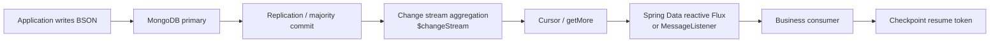
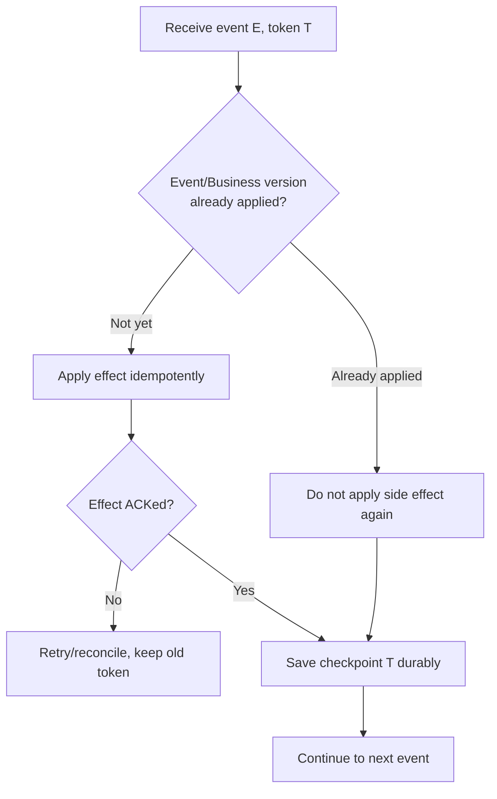
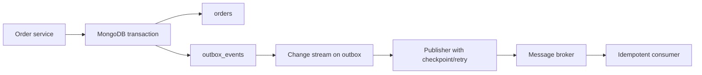

# Change Streams and the Data Change Tracking Problem

## 1. The Problem: Data Changed—How Do Other Components Find Out?

In an application using **Spring Data MongoDB**, an API may save an order using `MongoTemplate` or `MongoRepository`. Immediately afterward, several other components need to react:

- An admin UI needs to know that an order status just transitioned to `PAID`.
- A cache needs to refresh when product information is updated.
- A search index needs to sync when a document is inserted, replaced, or deleted.
- A monitoring system needs to record state transitions or workflow progress.
- A worker needs to know when a reservation was canceled to update a read model.

If every worker calls `find` every 5 seconds, they create repeated load on MongoDB, introduce latency, and easily miss rapid changes occurring between scans. **Change streams** allow an application to open a notification stream of changes recorded by MongoDB, instead of tailing the `oplog` via low-level APIs or continuously polling the entire collection.

Example:

```text
HTTP API
  |
  +-- MongoTemplate.save(order) / repository.save(order)
              |
        MongoDB replica set / sharded cluster
              |
     Majority-committed change recorded
              |
        Change stream cursor
              |
   +----------+------------+
   |          |            |
   v          v            v
Cache sync   UI events   Search index worker
```

**A change stream is a database data-change tracking mechanism.** It is not an infinitely durable message broker, does not replace business invariants inside transactions, and does not by default guarantee each side effect is applied exactly once.

### Learning Objectives

After this lesson, you will be able to:

1. Explain what a change stream is, how it relies on the `oplog`, and how it differs from polling, triggers, and domain events.
2. Identify deployment requirements: **replica set/sharded cluster**, access privileges, oplog, and cursor lifecycle.
3. Read `operationType`, `documentKey`, `fullDocument`, `updateDescription`, `ns`, `clusterTime`, and the **resume token at `_id`**.
4. Watch changes using `mongosh`, `ReactiveMongoTemplate.changeStream(...)`, or `MessageListenerContainer` in imperative Spring Data.
5. Distinguish `resumeAfter`, `startAfter`, `startAtOperationTime`, `fullDocument: "updateLookup"`, and pre/post-images.
6. Design consumers with **checkpoints, idempotency, error recovery**, performance monitoring, and testing against real MongoDB.

## 2. How Do Change Streams Work?

MongoDB Change Streams (available since the **3.6** series) use the operation history in the replication oplog to expose a continuous cursor containing change notifications for a **collection, database, or deployment**. Consumers do not need to decode individual oplog entries manually.



### 2.1. Key Properties

| Property | Meaning | What it does **not** imply |
| --- | --- | --- |
| Change notifications | Receive insert/update/replace/delete and other event types | Not a callback running inside the same Java write method |
| Majority-committed | Notifies data changes durable across a majority of the deployment | Does not guarantee consumer side effects succeeded |
| Ordered event stream | MongoDB provides change notification ordering per stream/deployment semantics | Does not mean parallel workers preserve side-effect order |
| Resume token | Indicates where reading can continue | Not a business ID, nor does it retain the oplog forever |
| Long-lived cursor | Can wait and receive events over time | Cannot be treated like a short query that immediately frees a connection |
| Aggregation pipeline | Can filter or project events server-side | Must not remove or alter the `_id` resume token |

MongoDB emits notifications only for changes whose semantics apply to change streams and that have been majority-committed. A **rolled-back/aborted** transaction does not become a stream of committed events for consumers. Changes occurring **before the stream is opened** do not automatically appear in a new stream unless you explicitly start from a supported historical point.

### 2.2. The oplog is underlying data, not an infinite queue

Change streams depend on replication history. As the oplog wraps around, old entries may no longer be available to resume a cursor from an overly stale token. Therefore:

- If a worker stops for hours or days, check the actual **oplog window**.
- If an old token can no longer be located, `resumeAfter` may fail.
- Do not resolve this by **deleting the checkpoint and starting from now** if that drops unprocessed events.
- For workloads that cannot miss updates, design **resnapshot/reconciliation** or another durable event source.

### 2.3. How change streams differ from polling

| Criterion | Polling by `updatedAt` | MongoDB change stream |
| --- | --- | --- |
| Signal source | Application periodically queries | MongoDB emits notifications via cursor |
| Latency | Bounded by polling interval | Near real-time, depending on replication/cluster |
| Idle cost | Still runs queries | Cursor awaits events; still holds resources |
| Detecting deletes | Hard once document is gone; needs tombstones/soft-delete | Provides `delete` event and `documentKey` |
| Detecting all operations | Depends on callers updating timestamps | Tracks changes supported by change streams |
| Recovery | Application-built watermark/timestamp | Resume token, bounded by oplog |
| Exactly-once business effect | Not built-in | **Not built-in** |

Polling is not always wrong: for small datasets, low load, or environments lacking a topology supporting change streams, polling + watermarks can be simple and appropriate. However, when fast notifications for updates and deletes are needed, change streams are usually the more natural tool.

## 3. Deployment Requirements Before Writing Java

### 3.1. Topology

Change streams **do not work on a normal standalone `mongod`**. You need:

- A MongoDB **replica set** with a supported storage engine/topology; or
- A **sharded cluster** connected through `mongos`.

Example URI for a **pre-configured** local replica set:

```properties
spring.data.mongodb.uri=mongodb://localhost:27017/change_stream_demo?replicaSet=rs0
```

`replicaSet=rs0` is only an example name; adding the URI parameter **does not convert a standalone server into a replica set**. In MongoDB Atlas, connect to a cluster tier capable of change streams; account configuration and privileges must still be correct.

**Do not open a change stream to test, see silence, and conclude "there are no changes"** without verifying topology and subscription/cursor creation. Failing to subscribe to a reactive stream likewise means reading never starts.

### 3.2. Access Privileges

A user needs appropriate privilege actions, typically **`find` and `changeStream`** on the watched collection. For database-level or deployment-level watches, privilege scope must be correspondingly broader. Grant privileges following **least privilege**:

```javascript
// Illustrative privilege scope; do not run directly
// as a user-creation command in production.
{
  resource: { db: "change_stream_demo", collection: "orders" },
  actions: ["find", "changeStream"]
}
```

This is an **authorization configuration**, not a query. When creating real roles, administrators use proper MongoDB commands and organizational security policies. Never assign an admin account just so a worker can listen to a single collection.

### 3.3. Special Databases and Collections

You cannot arbitrarily watch **system collections** or the `admin`, `local`, and `config` system databases per MongoDB rules. Certain specialized collection types have restrictions; for example, time-series collections have change stream restrictions in current server documentation. Always check the actual **MongoDB release and collection type**.

### 3.4. Long-lived cursors consume resources

Each change stream consumes a long-lived cursor and may hold a connection while `getMore` awaits data. With many open streams:

- An undersized connection pool can increase notification latency.
- Each application instance opening its own stream can cause the same event to be processed **multiple times by multiple consumers**.
- Sharded clusters incur cross-shard event merging and network overhead.
- Do not open a new stream **per HTTP request**.

Distinguish a **long-running worker/subscriber** from a WebFlux endpoint that only performs a one-off query.

## 4. Watch Scope: Collection, Database, or Deployment?

MongoDB supports three main scopes:

| Scope | `mongosh` | Example use case | Notes |
| --- | --- | --- | --- |
| Collection | `db.orders.watch(...)` | Syncing an orders table | Less noise, narrower privileges |
| Database | `db.watch(...)` | Monitoring collections within one DB | Events of different entity types need safe conversion |
| Deployment | `db.getMongo().watch(...)` | Multi-database CDC/monitoring | High privileges/load; filter namespaces carefully |

Example:

```javascript
// Watch the orders collection in the current database:
const stream1 = db.orders.watch();

// Watch all permitted collections in the database:
const stream2 = db.watch();

// Watch the entire deployment via the mongosh connection:
const stream3 = db.getMongo().watch();

// After testing, release cursors:
stream1.close();
stream2.close();
stream3.close();
```

When watching a database or deployment, the `ns` (namespace) field holds `db`/`coll`; a consumer mapping every event to an `OrderDocument` entity will break when other collections have different schemas. For multi-collection streams, use `org.bson.Document`/raw events and dispatch by `ns`, then validate event type and namespace authorization.

### Which scope to choose?

For "when an order changes, update the read model", start with a **collection-level watch on `orders`**. Only widen the scope when genuinely syncing multiple collections and a clear schema/permission routing architecture is in place.

## 5. Anatomy: What Does a Change Event Contain?

When inserting an order, a change event might look like:

```javascript
{
  _id: { _data: "8263...resume-token..." },
  operationType: "insert",
  clusterTime: Timestamp({ t: 1795123200, i: 1 }),
  ns: {
    db: "change_stream_demo",
    coll: "orders"
  },
  documentKey: { _id: "ORD-001" },
  fullDocument: {
    _id: "ORD-001",
    tenant_id: "SHOP-A",
    status: "CREATED",
    amount_minor: NumberLong("250000")
  }
}
```

This is an **illustrative data schema**, not a real token/`clusterTime` usable with `resumeAfter`. The `_id` token must be taken as the **exact BSON value from a real event**—never fabricate it with a placeholder string.

### 5.1. Key Fields

| Field | Meaning | Usage |
| --- | --- | --- |
| `_id` | **Resume token** for the change event | Store intact to resume; do not confuse with `documentKey._id` |
| `operationType` | `insert`, `update`, `replace`, `delete`, `invalidate`, ... | Consumer branching |
| `clusterTime` | MongoDB logical timestamp | Observe server ordering/timing; does not replace exact resume tokens |
| `ns.db`/`ns.coll` | Source database and collection | Routing and multi-collection validation |
| `documentKey` | Identifier of changed document; sharded collections may include shard key | Identify changed resource |
| `fullDocument` | Full document for insert/replace; optional on update | Sync read models when needed data is present |
| `updateDescription` | Fields changed by an update | Selective patch/read-model updates |
| `fullDocumentBeforeChange` | Pre-image if enabled/available | Audit or comparing prior values, subject to privileges and retention |
| `lsid`/`txnNumber` | Transaction metadata if event belongs to a transaction | Observation; does not replace a business request ID |

### 5.2. Distinguishing the resume token from the document ID

`_id` **at the change event level** is typically a token object like `{_data:"..."}`. Meanwhile, `documentKey._id` is the order's ID, e.g., `"ORD-001"`. If you save `"ORD-001"` as your checkpoint and pass it to `resumeAfter`, MongoDB cannot use it as a resume token.

Also, when using aggregation filters/`$project` on change events, **do not remove or modify the change event's `_id`**. Since MongoDB 4.2, pipelines modifying this field may be rejected by the server; even if not rejected, doing so breaks resumability.

## 6. Common Operation Types

| `operationType` | When seen | Accompanying details to note |
| --- | --- | --- |
| `insert` | New document created | `fullDocument` usually contains the new document |
| `update` | Update modifies fields of a document | `updateDescription`; `fullDocument` may be absent by default |
| `replace` | Whole document replaced | New `fullDocument` |
| `delete` | Document deleted | `documentKey`; no current `fullDocument` remains |
| `invalidate` | Stream invalidated (e.g. collection drop/rename) | Stream closes; handle with `startAfter` when appropriate |
| `drop`, `rename`, `dropDatabase` | Supported namespace metadata changes | Depends on scope/version |
| DDL/index expanded events | Collection/index changes | Only when supported by option/version |

### 6.1. `update` vs. `replace`

Suppose:

```javascript
db.orders.updateOne(
  { _id: "ORD-001" },
  { $set: { status: "PAID" } }
)
```

An update event may contain:

```javascript
{
  operationType: "update",
  documentKey: { _id: "ORD-001" },
  updateDescription: {
    updatedFields: { status: "PAID" },
    removedFields: []
  }
}
```

Meanwhile, `replaceOne` usually produces a `replace` event containing the full replacement document. Still, **do not assume every client method produces an operation type matching its API name**: MongoDB has internal rewrites, array truncations, pipeline updates, and version-specific behaviors; always check real events.

### 6.2. Does delete only carry the document key?

For a normal delete, the document is gone so there is no new `fullDocument` to read. If a consumer needs the content **before deletion**, MongoDB 6.0+ provides **pre-images** on configured collections, or the application can use soft-deletes/an outbox depending on the use case. Never assume `delete` automatically carries the old body.

### 6.3. How `invalidate` affects stream lifecycle

Dropping or renaming a collection can emit `invalidate` and close the cursor. `resumeAfter` cannot continue past an invalidate token; when you need to reopen a stream after `invalidate`, you must use `startAfter` and verify whether the new namespace/collection exists. **Do not treat `invalidate` as a transient error to retry infinitely on the same cursor.**

## 7. `mongosh` Practice: Open a Stream, Write Data, and Inspect Events

Use a **MongoDB replica set dedicated to learning**. These steps require two `mongosh` sessions (terminals A and B) connected to the same `change_stream_demo` database. Never run against production or delete someone else's data.

### 7.1. Prepare the collection

In **terminal B**, create the collection if it does not exist yet, before opening the stream:

```javascript
use change_stream_demo
db.createCollection("orders")

// These two commands are for inspecting state only:
db.getCollectionNames()
db.orders.getIndexes()
```

If the collection already exists, `createCollection` may report `NamespaceExists`; skip the create step if so. In a fresh test environment, this operation needs no transaction. In real environments, collections and indexes should be managed via migrations.

### 7.2. Open the stream in terminal A

```javascript
use change_stream_demo

const stream = db.orders.watch([
  {
    $match: {
      operationType: {
        $in: ["insert", "update", "replace", "delete"]
      }
    }
  }
], {
  fullDocument: "updateLookup",
  maxAwaitTimeMS: 1000
});

while (stream.hasNext()) {
  const event = stream.next();
  printjson(event);
}
```

`hasNext()` is a blocking wait loop in terminal A. **It may wait indefinitely while no events arrive**; that is normal behavior for an active stream. When stopping the experiment, interrupt the loop and call `stream.close()` in that session to free the cursor.

In production, never place this blocking loop on an HTTP request-handling thread or a WebFlux event-loop thread.

### 7.3. Write in terminal B

```javascript
db.orders.insertOne({
  _id: "ORD-001",
  tenant_id: "SHOP-A",
  status: "CREATED",
  amount_minor: NumberLong("250000"),
  updated_at: new Date()
})

db.orders.updateOne(
  { _id: "ORD-001" },
  { $set: { status: "PAID", updated_at: new Date() } }
)

db.orders.replaceOne(
  { _id: "ORD-001" },
  {
    _id: "ORD-001",
    tenant_id: "SHOP-A",
    status: "FULFILLED",
    amount_minor: NumberLong("250000"),
    updated_at: new Date()
  }
)

db.orders.deleteOne({ _id: "ORD-001" })
```

Terminal A will receive events once they satisfy majority-commit conditions. You may see `insert`, `update`, `replace`, and `delete` (depending on actual operations and server version). Do not base SLAs on exact timings between writes and events without measuring.

### 7.4. Reading a single event for testing

When you only need one event, manage opening and closing the cursor cleanly:

```javascript
const stream = db.orders.watch();
try {
  const first = stream.next(); // Wait for a new change.
  printjson({
    operationType: first.operationType,
    token: first._id,
    documentKey: first.documentKey
  });
} finally {
  stream.close();
}
```

For this snippet to finish, create a write **after opening the stream** from terminal B. Do not run a test that inserts **before** opening the stream and expects the old event to appear automatically.

## 8. Filtering Change Events: By Operation, Namespace, Tenant

MongoDB lets you add certain aggregation stages to the `watch(...)` pipeline to **filter events**. Because a change stream has an event structure, filtering differs from filtering underlying documents in `find(...)`.

### 8.1. Receiving only insert/update events

```javascript
db.orders.watch([
  {
    $match: {
      operationType: {
        $in: ["insert", "update"]
      }
    }
  }
])
```

This is a common way to reduce payload volume and keep listeners from handling unsupported event types. However, evaluate **if you omit delete**, how your cache or search index would become stale.

### 8.2. Namespace in a database watch

```javascript
db.watch([
  {
    $match: {
      "ns.coll": {
        $in: ["orders", "reservations"]
      },
      operationType: {
        $in: ["insert", "update", "replace", "delete"]
      }
    }
  }
])
```

`ns.coll` is the **collection name from event metadata**, not a field of the `OrderDocument` domain model. When watching multiple collections, inspect `ns.db`/`ns.coll` before mapping to a specific Java class.

### 8.3. Tenant filters and delete events

For inserts, you can filter tenants via:

```javascript
{
  $match: {
    operationType: "insert",
    "fullDocument.tenant_id": "SHOP-A"
  }
}
```

However, for `delete`, `fullDocument` is **usually absent**, so filtering on `fullDocument.tenant_id` will **drop delete events**. For updates, if `updateLookup`/post-image is not enabled, `fullDocument` may also be missing.

A more reliable design:

- Ensure the consumer is authorized to receive and process events from that collection.
- Encode `tenant_id` in a **business key** or in reliably accessed associated data when needed.
- You may use `documentKey` (on sharded collections this often includes the shard key if present) for routing, though **never assume** an unsharded collection always puts tenant info in `documentKey`.
- If filtering by tenant in the stream is required, thoroughly analyze behavior for insert/update/replace/delete and pre-delete data.
- Use access privileges/tenant isolation architecture to prevent sensitive events from being misrouted; an application filter **does not replace MongoDB authorization**.

**Note per MongoDB docs:** Combining `fullDocument: "updateLookup"` with `$match` on `fullDocument` fields can encounter **"Resume Token Not Found"** cases in certain situations, particularly if the document is deleted between the update and lookup, making `fullDocument` null and filtered out. If you need snapshots with stable historical semantics, consider pre/post-images where supported and design filters that preserve resumability; test on your exact server version and workload.

### 8.4. Do not modify or remove event `_id`

Wrong:

```javascript
// WRONG: removes/alters the change event resume token.
db.orders.watch([
  { $project: { operationType: 1, fullDocument: 1, _id: 0 } }
])
```

Better—project only the **needed fields while keeping `_id` intact**:

```javascript
db.orders.watch([
  {
    $project: {
      _id: 1,
      operationType: 1,
      documentKey: 1,
      ns: 1,
      clusterTime: 1,
      fullDocument: 1,
      updateDescription: 1
    }
  }
])
```

MongoDB allows only a specific set of stages **after `$changeStream`**. Do not insert stages like `$out`/`$merge` into a stream and treat it like an ordinary ETL pipeline. Verify allowed stages for your MongoDB server version.

### 8.5. Changing the pipeline on resume can be dangerous

A resume token is not a bookmark you can freely carry into an arbitrary new pipeline. MongoDB recommends keeping the **same pipeline and options** that produced the token when resuming. Changing filters, collation, full-document options, or watch scope without a checkpoint migration plan can miss events, duplicate them, or cause resume failures.

If you need to change consumer architecture, version `consumer_id`, checkpoints, and pipeline configuration; consider creating a new consumer with an initial snapshot/rebuild rather than silently reusing an old token on a new stream.

## 9. `fullDocument`: An Update Delta Is Not a Post-Update Snapshot

### 9.1. By default, update events typically contain `updateDescription`

Command:

```javascript
db.orders.updateOne(
  { _id: "ORD-001" },
  {
    $set: { status: "PAID" },
    $unset: { note: "" }
  }
)
```

The update event may look like:

```javascript
{
  operationType: "update",
  documentKey: { _id: "ORD-001" },
  updateDescription: {
    updatedFields: { status: "PAID" },
    removedFields: ["note"]
  }
}
```

This represents **which fields changed**, not a full copy of the order. When patching a read model, handle `updatedFields`, `removedFields`, and versioned array/field-path structures; do not apply `updatedFields` while ignoring `removedFields`.

### 9.2. What does `fullDocument: "updateLookup"` do?

When opened with:

```javascript
db.orders.watch([], {
  fullDocument: "updateLookup"
})
```

MongoDB looks up the matching document at its majority-committed state **at the time the lookup runs**. It is **not guaranteed** to be the exact snapshot immediately after the update that produced the event.

Example:

```text
T1: status CREATED -> PAID       (update event E1)
T2: status PAID -> FULFILLED     (update event E2)
T3: Consumer reads E1 and performs updateLookup

E1.updateDescription.updatedFields.status = "PAID"
E1.fullDocument.status may already be "FULFILLED"
```

Therefore:

- `updateDescription` describes the delta of **that update event**.
- `updateLookup` may observe a **newer version** of the document.
- `fullDocument` may be **null/absent** if the document was deleted or renamed between the event and the lookup.
- When syncing a read model state by state, decide whether to use deltas, full documents, or pre/post-images **with consistent semantics**.

### 9.3. Pre-images and post-images since MongoDB 6.0+

MongoDB 6.0+ supports configuring **change stream pre/post-images** per collection:

```javascript
// For test environments or controlled migrations:
db.runCommand({
  collMod: "orders",
  changeStreamPreAndPostImages: {
    enabled: true
  }
})
```

Then, with `watch`:

```javascript
db.orders.watch([], {
  fullDocument: "whenAvailable",
  fullDocumentBeforeChange: "whenAvailable"
})
```

If the application should **error when a required image is unavailable**, choose `"required"` instead of `"whenAvailable"`, accepting that the stream will stop/error if an image is missing or past retention.

| Event type | Pre-image | Post-image |
| --- | --- | --- |
| Insert | No prior document | Document after |
| Update | Prior state if enabled and within retention | Post state if enabled and within retention |
| Replace | Prior state if enabled and within retention | Post state if enabled and within retention |
| Delete | Prior state if enabled and within retention | No document after |

Pre/post-images require storage and increase write cost; historical data written **before enabling the option** is not retroactively backfilled. Images can expire based on retention settings and when corresponding oplog entries roll off; never assume enabling pre-images keeps old versions **forever**.

### 9.4. Which option to choose?

| Requirement | Option to consider |
| --- | --- |
| UI displays a newly created order notification | Insert event + `fullDocument` |
| Cache needs to know which ID to invalidate | `documentKey`; `fullDocument` not necessarily needed |
| Search index wants to sync latest content | `updateLookup` or re-read current state by ID with a version policy |
| Audit old → new with exact semantics | Pre/post-images (when available) or purpose-built audit/outbox |
| Delete synced to search index | `delete` + `documentKey` |
| Durable notification across long outages | Separate outbox/event log and checkpoints |

**No single option fits every consumer.** Using `updateLookup` merely for cache invalidation adds unnecessary overhead, while using only `documentKey` for detailed auditing usually lacks data.

## 10. Spring Data MongoDB: Modeling Orders and Change Events

To use `ReactiveMongoTemplate` or `MongoTemplate` in examples, define the entity:

```java
package com.example.changestream;

import org.springframework.data.annotation.Id;
import org.springframework.data.mongodb.core.mapping.Document;
import org.springframework.data.mongodb.core.mapping.Field;

@Document(collection = "orders")
public record OrderDocument(
    @Id String id,
    @Field("tenant_id") String tenantId,
    String status,
    @Field("amount_minor") long amountMinor
) {}
```

For mapped entity code, `@Field("tenant_id")` maps Java's `tenantId` to BSON `tenant_id`. When watching an entire database, do not force events from other collections into `OrderDocument`; use `Document` and route by namespace.

### 10.1. Spring Data `ChangeStreamEvent<T>`

Spring Data provides the wrapper `org.springframework.data.mongodb.core.ChangeStreamEvent<T>`:

| API | Return type / meaning |
| --- | --- |
| `getOperationType()` | `OperationType` enum from the MongoDB Java Driver |
| `getBody()` | `T` converted from `fullDocument`, **may be null** |
| `getBodyBeforeChange()` | `T` converted from pre-image, **may be null** |
| `getRaw()` | `ChangeStreamDocument<org.bson.Document>`, may be null |
| `getResumeToken()` | `org.bson.BsonValue`, may be null |
| `getTimestamp()` | `Instant` derived from server cluster time; precision differs from token |
| `getBsonTimestamp()` | `BsonTimestamp`, suitable when server operation time is needed |
| `getDatabaseName()`/`getCollectionName()` | Source namespace |

**Never call `event.getBody().getId()` unconditionally**: on delete, update without `fullDocument`, invalidate, or expired images, `getBody()` can be null. To retrieve the deleted document's ID, inspect `event.getRaw().getDocumentKey()` and check the appropriate BSON value type.

## 11. Reactive Change Streams with `ReactiveMongoTemplate`

Spring Data MongoDB offers the fluent `changeStream(...)` API returning `Flux<ChangeStreamEvent<T>>`. For long-lived streams, reactive is often a better fit than blocking loops because it integrates with the MongoDB Java Reactive Streams Driver, though it **does not solve checkpointing or idempotency automatically**.

### 11.1. Defining a `Flux` watching `orders`

```java
package com.example.changestream;

import org.springframework.data.mongodb.core.ChangeStreamEvent;
import org.springframework.data.mongodb.core.ReactiveMongoTemplate;
import org.springframework.data.mongodb.core.query.Criteria;
import org.springframework.stereotype.Service;
import reactor.core.publisher.Flux;

@Service
public class OrderChangeFeed {

    private final ReactiveMongoTemplate template;

    public OrderChangeFeed(ReactiveMongoTemplate template) {
        this.template = template;
    }

    public Flux<ChangeStreamEvent<OrderDocument>> events() {
        return template.changeStream(OrderDocument.class)
            .watchCollection("orders")
            .filter(Criteria.where("operationType")
                .in("insert", "update", "replace", "delete"))
            .listen();
    }
}
```

Calling `events()` **only constructs a publisher**; once subscribed, the MongoDB cursor is actually opened. Calling `events()` and subscribing on every HTTP request can open **multiple cursors**, each receiving the same events.

Here `filter(...)` filters the **event metadata `operationType`**, not an entity field like `status`. For receiving only `status=PAID` orders, filtering by `fullDocument.status` can drop delete/update events; design separate semantics and options.

### 11.2. Receiving the full document on update

```java
import org.springframework.data.mongodb.core.ChangeStreamEvent;
import org.springframework.data.mongodb.core.ChangeStreamOptions;
import reactor.core.publisher.Flux;

ChangeStreamOptions options = ChangeStreamOptions.builder()
    .returnFullDocumentOnUpdate()
    .build();

Flux<ChangeStreamEvent<OrderDocument>> feed =
    reactiveMongoTemplate.changeStream(
        "orders", options, OrderDocument.class);
```

`reactiveMongoTemplate` is an injected `ReactiveMongoTemplate` bean. `returnFullDocumentOnUpdate()` corresponds to `fullDocument: "updateLookup"`; review Section 9 regarding **current-state lookup vs. an update event's exact snapshot**. For deletes, `getBody()` may still be null.

### 11.3. Reading operation type, body, and document key

```java
import com.mongodb.client.model.changestream.OperationType;
import org.bson.BsonDocument;
import org.springframework.data.mongodb.core.ChangeStreamEvent;
import reactor.core.publisher.Mono;

Mono<Void> observe(
        ChangeStreamEvent<OrderDocument> event) {

    OperationType type = event.getOperationType();
    BsonDocument key = event.getRaw() == null
        ? null
        : event.getRaw().getDocumentKey();

    if (type == OperationType.DELETE) {
        // Body is normally null; rely on documentKey.
        System.out.println("Deleted key = " + key);
    } else {
        OrderDocument body = event.getBody();
        System.out.println(
            "Type=" + type +
            ", key=" + key +
            ", bodyPresent=" + (body != null));
    }

    // Illustrative observation only; no side effects or checkpointing yet.
    return Mono.empty();
}
```

In real applications, do not print the entire `body` containing personal data. Use controlled logging, correlation IDs, operation type, and namespace. **`Mono.empty()` here signals that the observation handler finished**, not a mechanism guaranteeing the event was saved or processed exactly once.

### 11.4. Preserving order when applying side effects

A consumer wanting to process one event at a time:

```java
Flux<ChangeStreamEvent<OrderDocument>> events =
    orderChangeFeed.events();

Mono<Void> runUntilStopped = events
    .concatMap(event -> downstreamHandler.handle(event))
    .then();
```

`downstreamHandler.handle(event)` is defined to return `Mono<Void>`, completing only after the corresponding effect is confirmed. `concatMap` serializes handlers; `Flux.flatMap(handler)` can run concurrently and apply side effects **out of order**. `.then()` here does not complete on its own for a long-lived stream—it waits until the source finishes or is canceled.

**Note:** even with sequential processing, a consumer can still receive an event again when restarting from an older checkpoint. `concatMap` preserves order **within one subscription**, not idempotency across restarts or instances.

### 11.5. Subscription lifecycle

Never place a hidden `subscribe()` inside an HTTP-handling service. Long-running subscribers belong in the **application lifecycle** (such as a dedicated `SmartLifecycle` bean, supervised scheduler/worker, or orchestrator). Close the subscription via `Disposable.dispose()` on application shutdown to release MongoDB cursors and connections.

A brief example for an **independent worker**:

```java
import org.springframework.data.mongodb.core.ChangeStreamEvent;
import reactor.core.Disposable;
import reactor.core.publisher.Flux;

// Place only inside the worker's lifecycle-managing component:
Disposable subscription = orderChangeFeed.events()
    .concatMap(downstreamHandler::handle)
    .subscribe(
        ignored -> {},
        error -> logger.error("Change stream stopped", error)
    );

// On shutdown / explicit stop:
subscription.dispose();
```

This is a **minimal lifecycle pattern**, not a complete production consumer. You need a supervisor to detect `onError`, load checkpoints, back off, and reopen the stream. Otherwise, a listener dies silently after a single error while the Spring Boot process keeps running.

## 12. Imperative Spring Data: `MessageListenerContainer`

When an application uses only `MongoTemplate` and the MongoDB Sync Driver, `watch` is a long-running blocking wait loop. Spring Data provides `DefaultMessageListenerContainer` to run `ChangeStreamRequest` tasks in the background without blocking HTTP handling threads.

### 12.1. A request listening to a collection

```java
package com.example.changestream;

import org.bson.Document;
import com.mongodb.client.model.changestream.ChangeStreamDocument;
import org.springframework.data.mongodb.core.MongoTemplate;
import org.springframework.data.mongodb.core.ChangeStreamOptions;
import org.springframework.data.mongodb.core.messaging.ChangeStreamRequest;
import org.springframework.data.mongodb.core.messaging.DefaultMessageListenerContainer;
import org.springframework.data.mongodb.core.messaging.MessageListener;
import org.springframework.data.mongodb.core.messaging.MessageListenerContainer;
import org.springframework.data.mongodb.core.messaging.Subscription;

public class ImperativeChangeStreamExample {

    public void startListening(MongoTemplate template) {
        MessageListenerContainer container =
            new DefaultMessageListenerContainer(template);

        container.start();

        MessageListener<ChangeStreamDocument<Document>, Document>
            listener = message -> {
                System.out.println(message.getRaw());
            };

        ChangeStreamRequest.ChangeStreamRequestOptions options =
            new ChangeStreamRequest.ChangeStreamRequestOptions(
                "change_stream_demo",
                "orders",
                ChangeStreamOptions.empty()
            );

        Subscription subscription = container.register(
            new ChangeStreamRequest<>(listener, options),
            Document.class
        );

        // Illustration only: in real apps keep container/subscription
        // as lifecycle-managed beans and stop them on shutdown.
        // subscription.cancel();
        // container.stop();
    }
}
```

**Example purpose:** shows `MessageListener`, `ChangeStreamRequest`, and `MessageListenerContainer`. `container.start()` starts tasks; `register(...)` registers a subscription. Retain references and **stop/cancel** them when the application shuts down. When `DefaultMessageListenerContainer` is registered as a Spring bean, it implements `SmartLifecycle` and can start automatically with the lifecycle.

### 12.2. Errors in synchronous listeners

Errors may be passed to the container's `ErrorHandler`; the default setup may simply log them and **does not necessarily retry business logic**. Register an error handler/supervisor matching your Spring Data API version, monitor `Subscription` status, and persist checkpoints only after processing succeeds. Never catch and ignore all errors when losing events is unacceptable.

### 12.3. Reactive vs. imperative?

| Scenario | Consider |
| --- | --- |
| Project uses WebFlux, continuous event processing | `ReactiveMongoTemplate.changeStream(...)` and `Flux` |
| Project uses Spring MVC/Sync driver | `MessageListenerContainer` or dedicated worker |
| Long-lived streams, high throughput, many subscribers | Reactive can save threads |
| Processing needs lots of blocking operations | Suitable container tasks/workers, kept off event-loops |
| Requirement not to lose effects across restarts | **Both** need checkpoints + idempotency + recovery |

Do not migrate to WebFlux solely because MongoDB offers change streams if your entire business stack and clients are blocking; what you need is a **worker with solid lifecycle and recovery**, not a framework buzzword.

## 13. Resume Tokens: Continuing After Errors, Restarts, and Failover

### 13.1. Extracting the token from an event

Every change event has an `_id` field serving as its **resume token**. In Spring Data:

```java
import org.bson.BsonValue;
import org.springframework.data.mongodb.core.ChangeStreamEvent;

public static BsonValue requireResumeToken(
        ChangeStreamEvent<?> event) {

    BsonValue token = event.getResumeToken();
    if (token == null) {
        throw new IllegalStateException(
            "Change event has no resume token");
    }
    return token;
}
```

This is a **server-provided BSON value**, not a document string ID. When writing to a checkpoint store, preserve its **BSON structure/type**—do not re-encode, slice `_data`, or mutate the token. If storing as JSON, use an **Extended JSON codec capable of round-tripping BSON types**, and decode back to the exact type before passing to the driver.

### 13.2. `resumeAfter`: starting **after** a processed token

Java reactive example from a verified token:

```java
import org.bson.BsonValue;
import org.bson.Document;
import org.springframework.data.mongodb.core.ChangeStreamEvent;
import org.springframework.data.mongodb.core.ChangeStreamOptions;
import org.springframework.data.mongodb.core.ReactiveMongoTemplate;
import reactor.core.publisher.Flux;

public Flux<ChangeStreamEvent<Document>> resumeOrders(
        ReactiveMongoTemplate template, BsonValue processedToken) {

    ChangeStreamOptions options = ChangeStreamOptions.builder()
        .resumeAfter(processedToken)
        .returnFullDocumentOnUpdate()
        .build();

    return template.changeStream(
        "orders", options, Document.class);
}
```

`resumeAfter` requires the token to **still exist in accessible history**. It starts **after the marked event**, which fits when the checkpoint was saved after that event's effect succeeded.

If the token lags behind actual progress, the consumer may re-receive old events. If the token advances before effects finish, the consumer may **drop events**. Hence **when you persist checkpoints matters as much as how you open the cursor**.

### 13.3. How does `startAfter` differ?

`resumeAfter` **cannot** resume past an `invalidate` event (e.g., collection drop/rename). If business logic genuinely wants to open a new stream after invalidation on an eligible namespace, MongoDB provides `startAfter`:

```javascript
// Special operation: invalidateToken must come from a real event.
const reopened = db.orders.watch([], {
  startAfter: invalidateToken
});
```

You must clarify whether the old collection was dropped/renamed and whether new data, indexes, or namespaces need bootstrapping. `startAfter` does not restore dropped documents and **does not make schema changes automatically safe**.

### 13.4. `startAtOperationTime` and `resumeAt`

When you have no token but do have a **MongoDB server operation time** still inside the oplog, use `startAtOperationTime` (MongoDB) or `resumeAt(...)` in Spring Data:

```java
import java.time.Instant;
import org.springframework.data.mongodb.core.ChangeStreamEvent;
import reactor.core.publisher.Flux;

Instant start = Instant.parse("2026-11-20T08:00:00Z");

Flux<ChangeStreamEvent<OrderDocument>> events =
    reactiveMongoTemplate.changeStream(OrderDocument.class)
        .watchCollection("orders")
        .resumeAt(start)
        .listen();
```

The `start` example is illustrative only, not a guarantee that events from that date still exist. You can only read from a point **still within the oplog**. `Instant` has different precision than `BsonTimestamp` (logical time with an increment), so for production checkpoints **resume tokens are more exact** than raw timestamps.

**Only one starting point may be chosen per stream open** among `resumeAfter`, `startAfter`, and `startAtOperationTime`. Never mix these options in one request.

### 13.5. Does driver auto-resume replace checkpoints?

The MongoDB Java Driver automatically resumes certain connection/resumable stream errors. That reduces brief interruptions, but **does not handle process crashes, deployment restarts, or consumer side effects that ran before checkpointing**. Applications still need durable checkpoints and a supervisor.

Once MongoDB's oplog has evicted the event for a token, retrying a hundred more times with the **same old token** will not recover deleted history. Trigger a **rebuild/reconciliation** policy and record the potentially missed window.

### 13.6. High-watermark / postBatch tokens

Beyond event-attached tokens, MongoDB has **high-watermark/post-batch resume tokens** reflecting stream progress when no new events occurred. This is helpful for tracking read/catch-up positions in advanced CDC systems.

However, do not treat a high-watermark token ("read up to time T") as proof that **all side effects before T completed** if your pipeline/consumer runs concurrent handlers or has errors. Checkpoints should record **durably processed** progress, not merely how far the cursor read from the server.

## 14. Checkpoints and At-Least-Once: Choosing the Right Order to Avoid Dropping Events

Suppose a consumer updates a search index when an order changes. It processes event `E1` and saves resume token `T1` in a `consumer_checkpoints` collection.

### 14.1. **Unsafe** order

```text
1. Receive E1
2. Save checkpoint T1
3. Crash
4. Search index not yet updated
5. Restart with resumeAfter(T1)
6. E1 is NOT read again => lost effect
```

Never save a checkpoint before business effects are confirmed complete, unless another **durable queue** has taken explicit, designed responsibility for processing that event.

### 14.2. Minimum acceptable order

```text
1. Receive E1 with token T1
2. Update read model/search index idempotently
3. Receive ACK from read-model store
4. Durably save checkpoint T1
5. Read E2
```

If a crash happens between steps 2 and 4, E1 may be delivered **again** on restart. Therefore:

**Change streams + checkpointing in this order typically provide at-least-once semantics for consumer effects**, provided history has not rolled off and recovery is implemented properly. Never promise exactly-once merely because MongoDB issues unique tokens.

### 14.3. State diagram



### 14.4. Correct-order reactive pseudocode

```java
import org.bson.BsonValue;
import org.springframework.data.mongodb.core.ChangeStreamEvent;
import reactor.core.publisher.Mono;

// Sketch of contracts for business components.
public interface ChangeEffectHandler {
    // Must be idempotent/replay-safe for the same event.
    Mono<Void> apply(ChangeStreamEvent<OrderDocument> event);
}

public interface DurableCheckpointStore {
    // Save RAW BSON value after the effect succeeds.
    Mono<Void> save(String consumerId, BsonValue resumeToken);
}

public final class OrderChangeProcessor {

    private final ChangeEffectHandler handler;
    private final DurableCheckpointStore checkpoints;

    public OrderChangeProcessor(
            ChangeEffectHandler handler,
            DurableCheckpointStore checkpoints) {
        this.handler = handler;
        this.checkpoints = checkpoints;
    }

    public Mono<Void> process(ChangeStreamEvent<OrderDocument> event) {
        BsonValue token = event.getResumeToken();
        if (token == null) {
            return Mono.error(
                new IllegalStateException("Missing resume token"));
        }

        return handler.apply(event)
            .then(checkpoints.save("orders-search-v1", token));
    }
}
```

These are **example contracts**, not a standalone runnable package without implementations. `ChangeEffectHandler.apply` must be designed idempotently; `DurableCheckpointStore.save` must persist durably and keep the raw BSON token. When the handler returns `Mono.error`, `then(...)` does not save the checkpoint, allowing replay once resolved.

Combined with:

```java
Flux<ChangeStreamEvent<OrderDocument>> feed =
    orderChangeFeed.events();

Mono<Void> consumer = feed
    .concatMap(processor::process)
    .then();
```

`concatMap` maintains **process-then-checkpoint** order within a single subscription. Running concurrent `flatMap` lets E2's token be saved **before E1's effect finishes**, creating a window that skips E1 on restart.

### 14.5. Can effect and checkpoint be atomic in the same MongoDB transaction?

If the read model and checkpoint reside in the same MongoDB deployment and satisfy transaction conditions, you can execute **both writes** (apply effect + save token) inside **one short transaction**. However:

- **Do not open the `$changeStream` cursor inside that transaction.** The cursor watches external operations; only **handler writes/checkpointing** can run in a separate transaction.
- When effects go to Kafka, Redis, Elasticsearch, email, or HTTP, MongoDB transactions **do not cover** those systems.
- You still must handle multi-worker fencing, consumer ownership, retries, and unknown commit outcomes.
- A transaction does not replace duplicate detection when tokens/offsets can be replayed.

For systems spanning multiple external targets, **transactional outbox, idempotent upserts/version checks, and reconciliation** are normally required.

### 14.6. Each consumer needs its own checkpoint

Example document:

```javascript
{
  _id: "orders-search-index-v1",
  // token must be the REAL BSON document of the change event:
  resume_token: { _data: "8263...real-token..." },
  updated_at: ISODate("2026-11-20T08:00:00Z"),
  owner_id: "search-worker-1",
  generation: NumberLong("7")
}
```

This is an **illustrative schema** only—never send a placeholder string as a real token. Consumers for caching, search, and analytics advance at **different paces**, so they must not share one checkpoint record. If multiple instances run **for the same logical consumer group**, use leader election/leases and **fencing** so an old worker cannot advance the token ahead of a new worker. Change streams do not provide Kafka-style consumer group coordination out of the box.

## 15. Doing It the First Time: Initial Snapshots and the Snapshot–Watch Race

A new change stream by default receives changes **from when it opens**. It does not emit all existing documents like an initial `findAll`. To build a search index from existing data, you must **bootstrap**.

### 15.1. An approach that easily loses changes

```text
T1: findAll orders to build search index
T2: Order A changes CREATED -> PAID
T3: Open change stream

Change at T2 is neither in the old snapshot nor
received by the new stream => stale search index.
```

### 15.2. Safer approaches

**Approach A — anchor a server timestamp and replay:**

1. Determine a valid change stream start point or server operation time.
2. Read the snapshot/backfill data.
3. Replay change events from that anchor using **idempotent, version-aware application**.
4. Switch to streaming mode once caught up.

**Approach B — open the stream first, buffer changes:**

1. Open the stream and start receiving/buffering events into a safe store.
2. Scan existing data to build the projection.
3. Apply buffered events in order with version/idempotency control.
4. Once caught up with no gaps, transition to real-time consumption.

**Approach C — rebuild from current state and reconcile:**

1. Build a new projection via an idempotent snapshot.
2. Watch concurrent changes from a managed checkpoint/cursor.
3. Reconcile discrepancies until the projection meets invariants.
4. Cut over traffic to the new projection via a controlled blue/green process.

Each approach must define **snapshot consistency** and update/delete ordering, especially across sharded clusters. Simply "reading first then opening a stream" is insufficient. If the entire oplog history covering the backfill rolls over, you **must resnapshot/reconcile** rather than claiming a resume token alone suffices.

### 15.3. Do not let an old snapshot overwrite a newer event

Suppose the snapshot reads `status=CREATED`, while E1 changing to `PAID` was already applied by the consumer. If backfill overwrites `CREATED` after E1, the projection regresses. Use a **version/cluster-time/watermark policy** or explicit ordering strategy rather than running `findAll` blindly alongside an event consumer.

For critical entities, a business version (such as a `revision` incremented via conditional updates) is usually easier to reason about in projections than comparing wall-clock timestamps.

## 16. Event Ordering, Transactions, and Sharded Clusters

### 16.1. Transactions are observed **after commit**

Suppose a transaction writes to `orders` and `inventory` and then aborts:

```text
Transaction T:
  - update orders ORD-001      [uncommitted]
  - update inventory BOOK-101  [uncommitted]
  - throw exception -> abort

Change stream only reports majority-committed data changes.
Do not treat those two steps as successful business events.
```

When a transaction **commits**, changes appear as change events per MongoDB semantics. Transaction events may carry `lsid`/`txnNumber` and other metadata. However, **never treat a single change stream event as a "transactional atomic unit"**:

- One transaction can produce **multiple events** across multiple documents.
- A consumer may process a subset of events and then crash.
- Side effects outside MongoDB do not participate in the original transaction.
- If you need to apply **one complete business unit**, use correlation/business events and explicit grouping/commit logic rather than emitting individual document deltas and assuming every service stays atomic.

### 16.2. Event ordering on sharded clusters

With a sharded cluster, `mongos` opens streams on shards and **merges/orders** results to present one unified stream per MongoDB semantics. This can incur higher latency than a simple replica set.

Points to remember:

1. Sharded cluster watches must go through **`mongos`**, not independently on each shard trying to infer global order.
2. Do not merge streams from different collections/databases into a cluster-wide ordered queue by comparing worker `Instant.now()`.
3. If consumers process concurrently, side-effect commit order can **differ** from event arrival order.
4. `documentKey` on sharded collections may include shard keys; handle BSON types properly.
5. Failovers, shard migrations, or shard removals have distinct resume limits; check versions and specific events/errors.

### 16.3. Time fields do not replace tokens

`clusterTime` is a logical server timestamp, typically a `BsonTimestamp` with seconds and increment components. `wallTime`, when present, represents clock time and is better suited for latency observation than resume positioning.

**Do not store `LocalDateTime.now()` instead of a resume token** or compare wall clocks across two nodes to adjudicate consistent ordering. For exact resuming, prefer tokens; for business ordering, use document versions and atomic writes.

### 16.4. Exactly-once vs. at-least-once

MongoDB change streams notify you of committed database changes; they **do not guarantee exactly-once consumer side effects**:

```text
MongoDB emits E1 -> Consumer receives E1
Consumer updates search index successfully
Crash before saving checkpoint T1
Restart resumes from T0
MongoDB emits E1 again to consumer
```

This is why **idempotent updates** are mandatory in production projections. For instance:

- Search indexes can **upsert by order ID**, applying newer revisions.
- Cache invalidations can usually be repeated safely.
- Sending emails, charging money, or incrementing counters with `$inc` requires an **event dedupe/ledger**; never re-invoke unconditionally.
- If two effects must be atomic together, consider transactions/outbox at the appropriate boundary.

## 17. Change Streams, Spring Lifecycle Events, Domain Events, and Transactional Outbox

The following mechanisms are easily lumped together as "events", yet serve distinct purposes:

| Mechanism | Origin | Best suited for | Weakness if misused |
| --- | --- | --- | --- |
| Spring Data `EntityCallback` | Entity passing through mapping save/read | Normalization, auditing, validation | Does not run on all native/bulk updates |
| `ApplicationEvent`/MongoMappingEvent | Java application lifecycle | Best-effort observation | Not crash-durable; `AfterSave` does not mean after-commit |
| **MongoDB Change Stream** | Changes recorded by the database | CDC, cache invalidation, search/read-model sync | Bounded by oplog; requires consumer checkpoints/idempotency |
| **Domain Event** | Application publishing business meaning | `OrderPaid`, `InventoryReserved` | Not automatically durable just by being a Java event |
| Transactional outbox | Event document written in the same business transaction | Durable publishing of business events to queues/brokers | Needs publisher worker + consumer dedupe |
| Message broker (Kafka/RabbitMQ…) | Dedicated managed event log/queue | Fan-out, retention, consumer groups | Not automatically atomic with MongoDB writes |

### 17.1. Change streams detect updates, not all business intent

An update:

```javascript
db.orders.updateOne(
  { _id: "ORD-001" },
  { $set: { status: "PAID" } }
)
```

shows that the `status` field changed to `PAID`. That **does not by itself prove**:

- The payment provider actually confirmed real funds.
- The order passed fraud checks.
- Which `OrderPaid` version or payload should be sent to the customer.
- How many downstream tasks should run, who owns retries, or what deadlines apply.

Use change streams to **observe data state**; use **domain events/outbox** when you need a strong business contract with a stable event ID, schema version, and crash recovery delivery.

### 17.2. Using a change stream to dispatch an outbox

An architecture can combine both tools:



Here the business event is **durably stored in an outbox collection** as a document within the same transaction as the order, while the change stream acts as a **fast trigger to wake the publisher**. If the cursor loses history or the oplog expires, the system can still **scan unpublished outbox records** to recover.

Do not delete an outbox record as soon as the change stream "sees the event"; only transition state upon **durable publish ACK** and retention/cleanup policy.

### 17.3. When should you NOT use change streams?

Do not use change streams as your sole tool when:

- The task only needs a **one-time current-state query**, not continuous tracking.
- The environment runs only standalone MongoDB with no plan to upgrade topology.
- Business event history must be kept for months or years beyond what the oplog window supports.
- Every event must be replayed from the beginning indefinitely without snapshots/archives.
- You want to guarantee charging money or sending email exactly once without idempotency.
- Every user opens a dedicated stream yielding tens of thousands of cursors; at scale you need a fan-out/worker tier.

## 18. Operations: Backpressure, Resources, and Monitoring

### 18.1. Backpressure does not replace capacity planning

`Flux` supports Reactive Streams backpressure, yet the database keeps accepting writes and the oplog keeps rotating. A slow consumer can:

- Accumulate events waiting after a checkpoint.
- Widen the gap between event time and processing time.
- Hold cursors/connections and memory buffers.
- If stalled too long, **lose the token from the oplog** for resuming.

Do not abuse `onBackpressureDrop`/`sample` for business events that **cannot be skipped**. For best-effort UI map updates, coalescing might be acceptable; for complete payment/order projections, dropping means data loss.

### 18.2. Connection pools and stream counts

MongoDB notes that when the number of active change streams on a database exceeds the connection pool size, notification latency can rise because each stream holds a connection while `getMore` awaits data.

Monitor:

| Metric | Meaning |
| --- | --- |
| `change_stream_active_subscriptions` | Open streams/cursors |
| `change_stream_event_lag_seconds` | Time from event cluster time to processing (observational metric) |
| `change_stream_checkpoint_age_seconds` | How long since checkpoint advanced; distinguish idle vs. failing |
| `change_stream_processed_total` | Successfully processed events |
| `change_stream_replayed_total` | Re-received/deduplicated events |
| `change_stream_resume_failures_total` | Failed token/operation-time resumes |
| `change_stream_handler_errors_total` | Business effect failures |
| `change_stream_open_cursors` | Cursor/subscription leaks |
| `oplog_window_hours` | Estimated recoverable history window |
| `change_stream_full_document_lookups_total` | Current-document lookup cost if instrumented |

Never put raw `resume token`, order ID, tenant ID, or email into **high-cardinality metric labels**. In logs, use correlation IDs/consumer IDs and avoid printing entire `fullDocument` objects containing personal data.

### 18.3. Does a quiet stream mean it is dead?

Not necessarily. The collection might have no writes, or the filter might exclude all recent events. Distinguish:

- **Live cursor with no events:** normal on low-write workloads.
- **No subscription:** `Flux` was never subscribed, so no cursor opened.
- **Listener terminated with error:** nothing runs anymore even though the app process is alive.
- **Bad privileges/URI:** change stream failed to open.
- **Connection pool exhausted:** events arrive slowly or time out.

In production, health checks should verify subscriber/driver status and cursor/checkpoint progress in light of workload—do not alert on "no events for 10 seconds" for an infrequently updated collection.

### 18.4. Watching across multiple instances

If three application replicas all subscribe to `db.orders.watch()`, **all three can receive the same event**. There is no built-in "one consumer in a group gets each event" like Kafka.

Strategies:

1. Each instance independently updates a local cache: receiving the same event may be **intentional**.
2. Only one worker updates a shared search index: use leader election/leases with **fencing**, or a standalone consumer service.
3. Scaling processing: shard safely by namespace/tenant/key; each partition needs its own checkpoint and corresponding business ordering.
4. Never share the **same checkpoint** across concurrently processing instances without ownership/fencing; a slow worker can regress or skip offsets.

### 18.5. Security and privacy

Change streams can carry document copies, pre/post-images, and sensitive fields. Ensure you:

- Grant minimal `find`/`changeStream` privileges on the watched collection.
- Request `fullDocument`/pre-images only when the consumer genuinely needs them.
- Control logging, tracing, retention, and encryption when persisting checkpoints/outboxes.
- Never treat application-side `tenant_id` filtering as a substitute for database/collection-level security.
- Restrict privileges on workers publishing events containing payment/user details; avoid sending raw BSON onto public message brokers.

## 19. Testing Change Streams: Real MongoDB Needed, Not Just Mocks

A unit test returning `Flux.just(fakeEvent)` only tests handler code; it **does not prove**:

- MongoDB opened a change stream cursor on the right collection.
- Actual topology supports watching.
- Driver returns the expected `operationType`, `documentKey`, and `resume token`.
- `fullDocument` on update/replace/delete maps properly.
- Resuming from an old token after restart actually works.
- Transaction events appear only after commit.

To verify those behaviors, use a **dedicated test MongoDB replica set** (e.g., Testcontainers MongoDB with replica set initialized), not standalone or mocked repositories.

### 19.1. Testcontainers replica set with Spring Boot

Example configuring a Spring Boot test using a dedicated MongoDB container:

```java
package com.example.changestream;

import org.junit.jupiter.api.Test;
import org.springframework.beans.factory.annotation.Autowired;
import org.springframework.boot.test.context.SpringBootTest;
import org.springframework.test.context.DynamicPropertyRegistry;
import org.springframework.test.context.DynamicPropertySource;
import org.testcontainers.containers.MongoDBContainer;
import org.testcontainers.junit.jupiter.Container;
import org.testcontainers.junit.jupiter.Testcontainers;
import org.springframework.data.mongodb.core.ReactiveMongoTemplate;

import static org.assertj.core.api.Assertions.assertThat;

@SpringBootTest
@Testcontainers
class MongoChangeStreamEnvironmentTest {

    @Container
    static final MongoDBContainer mongo =
        new MongoDBContainer("mongo:7.0");

    @DynamicPropertySource
    static void configure(DynamicPropertyRegistry registry) {
        registry.add(
            "spring.data.mongodb.uri",
            mongo::getReplicaSetUrl
        );
    }

    @Autowired
    ReactiveMongoTemplate template;

    @Test
    void connectsToMongoReplicaSet() {
        assertThat(mongo.isRunning()).isTrue();
        assertThat(template).isNotNull();
    }
}
```

This example **only checks the environment, not events yet**. It assumes the project declares Testcontainers dependencies, a Docker environment, and the Spring Boot reactive MongoDB starter. On some Testcontainers branches, container class names/APIs change; check Javadocs for your version.

### 19.2. Two-terminal integration test scenario

A basic yet effective test:

1. Create a test MongoDB replica set and an `orders` collection.
2. Open a real change stream subscription; **wait for the server to confirm the cursor opened** (via synchronization barrier/command monitoring or an exact marker).
3. Insert `ORD-TEST-1` with a test tenant; inspect `insert`/`fullDocument`/`documentKey`.
4. Update status `CREATED -> PAID`; inspect `updateDescription`/`fullDocument` per options.
5. Delete the document; observe `delete` carrying `documentKey` without expecting a new `fullDocument`.
6. Save the **real resume token**, close the stream, reopen with `resumeAfter`, emit a second event, and verify only events after the token arrive.
7. Clean up subscriptions/cursors and the isolated test database.

**Do not rely solely on `Thread.sleep(500)` assuming the cursor must be open by then.** With a lazy stream, writing too early in a test can execute the insert before the watch subscribes. To avoid flaky tests, use a **barrier proving the cursor is open**, or a properly captured server operation time/resume token before generating writes.

### 19.3. Unit testing handlers with finite streams

Pure business logic can be tested without MongoDB. For instance, verifying side-effect order with a mock stream:

```java
import java.util.List;
import java.util.concurrent.CopyOnWriteArrayList;
import org.junit.jupiter.api.Test;
import reactor.core.publisher.Flux;
import reactor.core.publisher.Mono;
import reactor.test.StepVerifier;

import static org.assertj.core.api.Assertions.assertThat;

class SequentialHandlerTest {

    @Test
    void concatMapPreservesHandlerCompletionOrder() {
        List<String> applied = new CopyOnWriteArrayList<>();

        Mono<Void> run = Flux.just("E1", "E2", "E3")
            .concatMap(eventId ->
                Mono.fromRunnable(() -> applied.add(eventId)))
            .then();

        StepVerifier.create(run).verifyComplete();
        assertThat(applied)
            .containsExactly("E1", "E2", "E3");
    }
}
```

This test **only** proves handlers chain sequentially; it does not prove exactly-once from MongoDB or resume token semantics. Real applications must add crash/replay and checkpoint tests:

| Scenario | What to prove |
| --- | --- |
| Effect succeeds, checkpoint unsaved, then crash | Event replays; effect is **not applied twice** |
| Checkpoint saved successfully, restart | Resumes strictly after that token |
| Filtered-out events | Operational progress/offsets do not drop required effects |
| Rapid update after insert | `updateLookup` may differ from delta |
| Delete | Body may be null; `documentKey` still extracted |
| Idle period with no events | Subscriber/cursor stays healthy, no false alerts |
| Cursor closed/network reset | Consumer has supervisor/reconnect/replay |
| Token too old, evicted from oplog | System alerts that resnapshot is needed, does not silently skip |
| Collection drop/rename | Receives `invalidate` and decides `startAfter`/rebuild |
| Two workers with same consumer ID | Checkpoint is not overwritten by stale worker after losing lease |

### 19.4. Transaction integration test

If your problem uses MongoDB multi-document transactions:

```text
1. Open stream outside transaction.
2. Transaction T1 inserts document then aborts.
3. No committed insert event received from T1.
4. Transaction T2 inserts/updates then commits.
5. Receive corresponding events after majority commit.
6. Consumer applies effects and checkpoints as a separate workflow.
```

The test requires a transaction-capable topology. Never open `$changeStream` cursors inside T1/T2. For sharded clusters, also test and monitor merge ordering, failover, and cross-shard lag.

## 20. Troubleshooting: Symptoms and Resolutions

| Symptom | Common cause | Resolution |
| --- | --- | --- |
| `The $changeStream stage is only supported on replica sets` | Connected to standalone | Use proper replica set/sharded cluster topology |
| `not authorized` when watching | Missing `find` or `changeStream` | Grant scoped role, do not blindly grant admin |
| `Flux` emits no events | Not subscribed | Move subscriber into worker lifecycle, confirm subscription |
| Missed insert that happened before subscribe | New stream starts from present | Bootstrap or use valid `resumeAt`/`resumeAfter` anchor |
| Stream "silent" too long | No writes, overly tight filter, or subscription errored | Distinguish idle from `onError`/closed cursor |
| Update event lacks `fullDocument` | Default only sends delta | Use `updateLookup` or post-image when appropriate |
| `updateLookup` shows newer status than `updateDescription` | Lookup saw a subsequent write | Do not treat `updateLookup` as a historical snapshot |
| Delete event has null body | Document already deleted | Use `documentKey` or pre-image when configured |
| `resumeAfter` says token does not exist | Token expired from oplog, mismatched pipeline/options/scope | Reconcile/resnapshot; keep pipeline/options compatible |
| `resumeAfter` fails after `invalidate` | Invalidate closed stream | Consider `startAfter`, verify namespace/rebuild |
| Consumer processes an event twice | Crash after effect before checkpoint | Idempotent handler + correct checkpoint ordering |
| Effect lost after crash | Checkpointed before effect succeeded | Reverse order, add durability and tests |
| Events lost via `onBackpressureDrop` | Downstream intentionally dropped items | Never drop when full event delivery is required |
| Event processed on three instances | All three instances watch the same collection | Leader/fencing or intentional fan-out design |
| Stream stopped while process still alive | `onError` terminated subscription | Supervisor/restart from durable checkpoint plus alert |
| Logs expose entire sensitive documents | Printing `fullDocument`/raw events | Minimize logs, enforce privileges/retention |
| DDL/drop broke stream | Collection dropped/renamed | Handle `invalidate`, schema lifecycle, and checkpoints |
| Full document image reported missing | Pre/post not enabled or past retention | Enable on supported version, handle `whenAvailable`/`required` |
| Database watch maps wrong entity | Multiple collections with distinct schemas | Use raw `Document` and dispatch by `ns` |
| Latency rises with many streams | Small connection pool, `mongos` merging many shards | Reduce cursor count, size pool properly, measure lag |
| App crashes after Kafka publish before checkpoint | External side effect not atomic with MongoDB token | Outbox + stable event ID + dedupe/reconciliation |

### Layered diagnosis approach

1. **MongoDB topology:** server version, replica set/shards, `mongos`, privileges.
2. **Subscription:** is the cursor open, are events filtered out, has the listener emitted `onError`?
3. **Event payload:** operation type, document key, null body, BSON field mapping.
4. **Resuming:** which token, when saved, are pipeline/options/scope compatible, is oplog history intact?
5. **Consumer effect:** ACKed yet, does an idempotency ledger prevent duplicates?
6. **Resources:** connection pool, cursor count, reactive buffers, handler latency, sharded merge.
7. **Security:** log minimal data, never print sensitive payloads/tokens into unauthorized sinks.

## 21. Practice Exercises with Answers

### Exercise 1. Polling or change stream?

**Question:** A worker must know immediately when an order is deleted, including deletes via admin tools. Is polling `find({updatedAt: {$gt: lastTimestamp}})` enough?

**Answer:** Not enough if the document is already deleted without a tombstone. A change stream emits a `delete` event with `documentKey`; you still need checkpoints, oplog awareness, and watch privileges. If very long history is required, pair with a dedicated outbox/audit log.

### Exercise 2. Standalone MongoDB

**Question:** Local MongoDB runs a single standalone `mongod`; `db.orders.watch()` errors. Can adding `?replicaSet=rs0` to the URI fix it?

**Answer:** No. You must **initialize/configure a real replica set** (or use a sharded cluster/Atlas tier). Changing the URI alone does not create a replication oplog or topology on a standalone server.

### Exercise 3. When does a stream start?

**Question:** A Java service returns `Flux<ChangeStreamEvent<OrderDocument>>` and nobody subscribes. Has MongoDB started sending events to the service?

**Answer:** No. A reactive publisher only describes how data will flow. Only when a subscription/worker lifecycle subscribes is the change stream cursor opened. Lifecycle, errors, and shutdown must be explicitly managed.

### Exercise 4. Which token is used to resume?

**Question:** An event has `_id={_data:"..."}` and `documentKey._id="ORD-001"`. Which value is passed to `resumeAfter`?

**Answer:** The **change event's `_id`** (raw BSON resume token), not the document ID. Never build a fake token string from `"ORD-001"`.

### Exercise 5. Null body on update events

**Question:** A consumer calls `event.getBody().status()` on every event and hits an NPE on updates/deletes. Why?

**Answer:** Updates may only contain the `updateDescription` delta when full-document lookup is disabled; deletes have no new document. Check `operationType` and null bodies; use `getRaw().getDocumentKey()`/`updateDescription` or enable `updateLookup` as needed.

### Exercise 6. `updateLookup` and deltas

**Question:** E1 reports `status="PAID"`, yet `fullDocument.status="FULFILLED"`. Is MongoDB necessarily returning wrong data?

**Answer:** No. `updateLookup` can look up the **latest state at lookup time**, after another update E2. `updateDescription` belongs to E1's delta, whereas `fullDocument` is not always the exact post-image at E1's instant.

### Exercise 7. Tenant delete events

**Question:** A pipeline matches only `"fullDocument.tenant_id"="SHOP-A"`. Will it reliably receive SHOP-A's delete events?

**Answer:** No. Deletes usually have no `fullDocument`. You need safe tenant identification/routing and authorization based on keys/pre-images/business schema, or handle deletes on a dedicated path.

### Exercise 8. Dropping `_id` with projection

**Question:** Should we use `{$project: {_id:0, operationType:1}}` to shrink change stream payloads?

**Answer:** No. `_id` is the resume token; since MongoDB 4.2, pipelines modifying this field may be rejected. Keep the token intact and strip only permissible fields.

### Exercise 9. Checkpoint before effect

**Question:** A worker saves token T1 before publishing event E1. The process crashes after saving T1 and before publishing. What happens on restart with `resumeAfter(T1)`?

**Answer:** E1 can be **permanently skipped** for that consumer. Process/publish the effect with durable ACK before checkpointing, or hand off to a durable queue/outbox within the same transaction.

### Exercise 10. Effect before checkpoint

**Question:** A worker publishes E1 successfully, then crashes before saving T1. Restarting from T0 causes E1 to reappear. Is that a design bug?

**Answer:** That is natural behavior under **at-least-once**. Effects must be idempotent or use stable event IDs/inbox deduplication; replay must never double-charge, double-email, or double-increment counters.

### Exercise 11. Stale resume token

**Question:** A worker was offline for days; its old token rolled off the oplog. Should we delete the token and `watch()` from now to get moving fast?

**Answer:** Not if business logic cannot drop events. The system must raise an alert and run **resnapshot/reconciliation**, or read from an event log/outbox with sufficient history. Never silently skip an unprocessed gap.

### Exercise 12. Invalidate

**Question:** A stream receives `invalidate` after a collection drop/rename. Is `resumeAfter(invalidateToken)` valid?

**Answer:** No. Use `startAfter` when appropriate and re-evaluate collection/namespace/schema, or rebuild the projection. Do not blindly retry with `resumeAfter`.

### Exercise 13. Snapshot race

**Question:** A consumer reads all orders first, then opens a change stream. An order changes status between the two steps. Can changes be lost?

**Answer:** Yes. You need a **server anchor/replay, stream buffering before snapshot, or reconciliation** with business versions/watermarks. A plain scan followed by watch does not guarantee complete synchronization.

### Exercise 14. Three replicas watching

**Question:** Three Spring Boot instances all subscribe to `orders`. Does only one instance receive each event via a consumer group?

**Answer:** No. Each stream is an independent subscriber and can receive **the same events**. If only one shared consumer may apply effects, use leader/lease/fencing or a different worker/queue architecture.

### Exercise 15. Parallel processing

**Question:** A consumer uses `Flux.flatMap(handle, 10)` and saves each event's token whenever its handler finishes. What is the risk?

**Answer:** E2 may finish before E1 and advance the checkpoint to T2 while E1 has not yet applied its effect; on crash, E1 is skipped. Use `concatMap`/ordered checkpoint tracking, or strict partitioned ordering.

### Exercise 16. Spring lifecycle events vs. CDC

**Question:** When MongoDB is updated by another Node.js app, does `BeforeSaveEvent` run in our current Spring app? What about a change stream?

**Answer:** Spring mapping events only run on the persistence path of that `ApplicationContext`; Node.js writes do not trigger that Java listener. Change streams track changes in the **database**, so they can receive the event if namespace, privileges, and options align.

### Exercise 17. Sending to Kafka exactly once

**Question:** Are change streams + `resumeAfter` alone enough to publish `OrderPaid` to Kafka **exactly-once**?

**Answer:** No. A crash can happen between Kafka ACK and MongoDB checkpointing. You need stable event IDs, idempotency/transactional outbox/reconciliation, and an understanding of broker/consumer guarantees by design.

### Exercise 18. Pre-images on MongoDB 6.0+

**Question:** A consumer needs the document **before deletion**. Is enabling `fullDocument:"updateLookup"` enough?

**Answer:** No. Deletes have no current document. Enable **pre-images on the collection** and use `fullDocumentBeforeChange:"whenAvailable"`/`"required"` as needed, or maintain a separate audit/outbox; pay attention to retention.

### Exercise 19. Reactive consumer

**Question:** An `events()` method returning `Flux` is called inside a controller; the controller calls `subscribe()` and returns HTTP 200. What is wrong with this?

**Answer:** Every HTTP request opens a new cursor, lifecycle is unmanaged, errors never reach the response, resources leak, and events duplicate. Place long-running consumers in **worker/lifecycle components**; HTTP endpoints should read current state or receive fan-out from a managed service.

### Exercise 20. When to choose an outbox?

**Question:** An API must guarantee every `PAID` order emits one business event and must recover even if the worker is down past the oplog window. Is watching `orders` alone enough?

**Answer:** No. A change stream helps detect changes quickly, but you should **write business events to an outbox in the same MongoDB transaction**, keep records until ACKed, and be able to scan the outbox for recovery; consumers must still handle duplicates.

## 22. Spring Data MongoDB Change Streams Implementation Checklist

1. **Clarify requirements:** observing current state, invalidating cache, CDC projection, or durable domain events?
2. **Verify topology:** replica set/sharded, MongoDB version, oplog, privileges, and collection type.
3. **Choose the narrowest scope:** collection first, database/deployment only when truly needed.
4. **Verify `find` and `changeStream` privileges**; never use admin accounts for business workers.
5. **Distinguish event `_id` from `documentKey._id`**; store raw BSON resume tokens intact.
6. **Define supported operation types** and policies for insert/update/replace/delete/invalidate.
7. **Choose how to retrieve bodies:** delta, `updateLookup`, pre/post-image, or `documentKey`; understand nullability and timing.
8. **Never alter/remove event `_id` in filter pipelines.**
9. **Keep pipelines/options compatible across resumes**, versioning changes.
10. **Start subscribers in lifecycle workers**, never per HTTP request.
11. **Close cursors/subscriptions on shutdown**, and monitor streams that `onError` or die.
12. **Process effects before checkpointing**, or use a proven durable handoff.
13. **Apply side effects idempotently**, supporting crash replay.
14. **Use `concatMap` or an ordered checkpoint protocol** when event ordering matters.
15. **Give each logical consumer its own checkpoint**, using leases/fencing across multiple instances.
16. **Have an initial snapshot/replay strategy** so there is no gap before watch starts.
17. **Monitor the oplog window** and plan for tokens that are too old/unresumable.
18. **Never treat `updateLookup` as exact history**; use pre/post-images or auditing if required.
19. **Do not replace an infinite-retention message broker with change streams** when heavy retention/replay is needed.
20. **Separate transaction commits from consumer effect ACKs**, especially with Kafka/Redis/email.
21. **Measure stream lag, handler failures, checkpoint age, cursor count, and connection pool.**
22. **Do not drop required events using backpressure operators.**
23. **Minimize sensitive payloads/logs**; enforce per-tenant authorization when routing events.
24. **Test on real MongoDB replica sets:** cursors, CRUD events, tokens, resume, invalidate, delete, transactions.
25. **Check MongoDB/Spring Data versions** when changing APIs, expanded events, or pre/post-images.

## 23. Official References

The following sources serve as authoritative references for your project's exact MongoDB server and Spring Data MongoDB release:

1. **MongoDB Manual — Change Streams:** https://www.mongodb.com/docs/manual/changestreams/
2. **MongoDB Manual — `db.collection.watch()`:** https://www.mongodb.com/docs/manual/reference/method/db.collection.watch/
3. **MongoDB Manual — `db.watch()`:** https://www.mongodb.com/docs/manual/reference/method/db.watch/
4. **MongoDB Manual — `$changeStream` aggregation stage:** https://www.mongodb.com/docs/manual/reference/operator/aggregation/changestream/
5. **MongoDB Manual — Change Stream Events:** https://www.mongodb.com/docs/manual/reference/change-events/
6. **MongoDB Manual — Change Stream Pre- and Post-Images:** https://www.mongodb.com/docs/manual/changestreams/#change-streams-with-document-pre--and-post-images
7. **MongoDB Manual — Change Streams Production Considerations:** https://www.mongodb.com/docs/manual/changestreams/#change-stream-performance-considerations
8. **Spring Data MongoDB — Change Streams:** https://docs.spring.io/spring-data/mongodb/reference/mongodb/change-streams.html
9. **Spring Data MongoDB — `ReactiveMongoOperations` API:** https://docs.spring.io/spring-data/mongodb/docs/current/api/org/springframework/data/mongodb/core/ReactiveMongoOperations.html
10. **Spring Data MongoDB — `ChangeStreamEvent` API:** https://docs.spring.io/spring-data/mongodb/docs/current/api/org/springframework/data/mongodb/core/ChangeStreamEvent.html
11. **Spring Data MongoDB — `ChangeStreamOptions` Builder API:** https://docs.spring.io/spring-data/mongodb/docs/current/api/org/springframework/data/mongodb/core/ChangeStreamOptions.ChangeStreamOptionsBuilder.html
12. **Spring Data MongoDB — `ChangeStreamRequest` / Messaging:** https://docs.spring.io/spring-data/mongodb/docs/current/api/org/springframework/data/mongodb/core/messaging/ChangeStreamRequest.html
13. **MongoDB Java Driver — Change Streams:** https://www.mongodb.com/docs/drivers/java/sync/current/logging-monitoring/change-streams/

Links using `current` may describe APIs newer than the dependency branch your project actually runs; always verify class/method signatures in your deployed release, especially `ChangeStreamOptions`/`ReactiveMongoOperations` and pre/post-image options. Code here illustrates design and testing patterns and **is not proof of a compiled build or executed integration test against the current repository**.

## 24. Conclusion

**MongoDB Change Streams allow Spring Data MongoDB to track majority-committed changes without polling or manually tailing the oplog.** A cursor at the collection, database, or deployment level emits events like `insert`, `update`, `replace`, and `delete`; `ChangeStreamEvent<T>`/`MessageListener` lets Java applications receive them. The core rules are that **`operationType` dictates how to read payloads**, and **`_id` on the change event is the resume token**, not the document ID.

For real-world systems, simply receiving events is not enough. You need a **lifecycle-managed subscriber**, proper privileges, a **durable checkpoint saved after effects**, idempotent replay handling, a policy when tokens fall out of the oplog, and a gap-free initial snapshot/reconciliation workflow. `fullDocument:"updateLookup"` is not an exact historical snapshot, `AfterSaveEvent` is not after-commit, and change streams do not automatically yield exactly-once business effects. When business events must be durably delivered across systems, combine a **transactional outbox and consumer deduplication** rather than treating change streams as an infinite queue.

Finally, testing against a **real MongoDB replica set**, measuring lag/cursors/connection pools, protecting sensitive data, and proactively monitoring recovery will let change streams reliably serve **cache synchronization, search indexing, read-model projections, and near-real-time data observation**.
