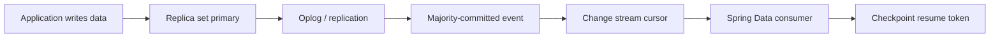
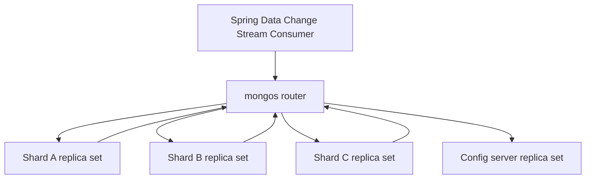
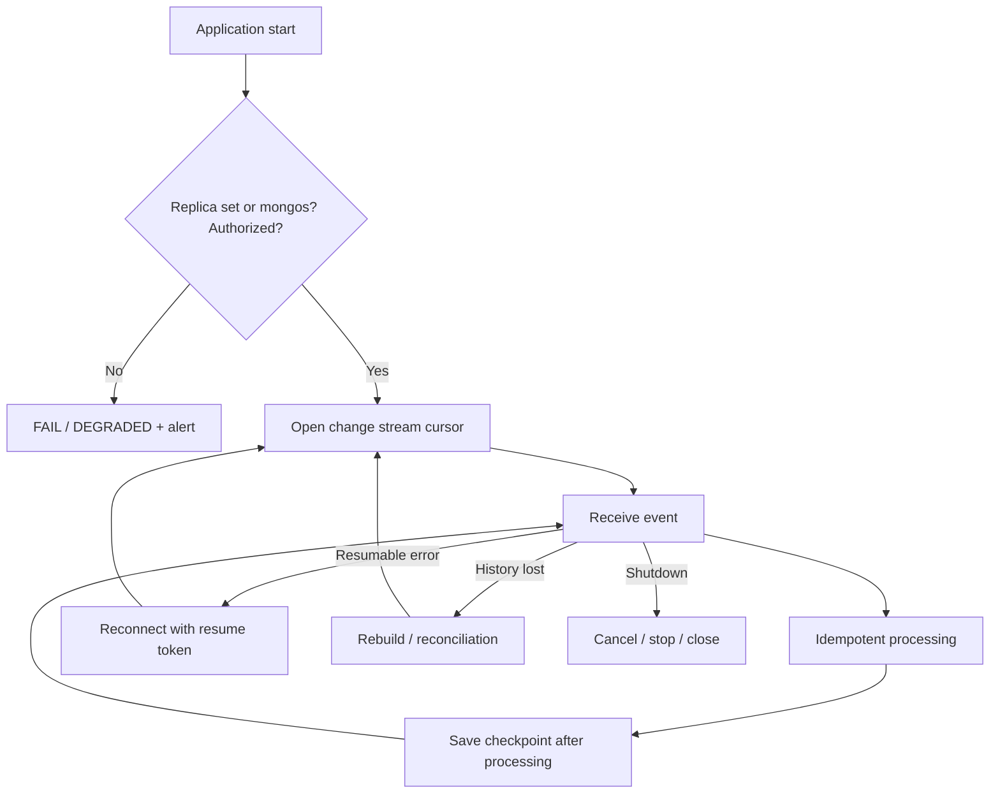

# Replica Set or Sharded Cluster Requirements

MongoDB **change streams** allow an application to receive events when documents are inserted, updated, replaced, deleted, or when collection-related changes occur. Instead of repeatedly running `find` to poll for changes, a service can open a **change stream cursor** and process events emitted by MongoDB. In **Spring Data MongoDB**, this stream can be consumed via `ReactiveMongoTemplate` (returning `Flux<ChangeStreamEvent<T>>`) or via `MongoTemplate` through `MessageListenerContainer`.

The first requirement is not in Java code, but in the **MongoDB topology**: change streams are **only supported on replica sets or sharded clusters**. A `mongod` started in **standalone** mode, even with existing data and indexes, does not satisfy this requirement. On a replica set, open the stream from a suitable **data-bearing member** matching the read preference; on a sharded cluster, connect the application through **`mongos`** to get a unified stream across shards.

This lesson belongs to the **Change stream** chapter of the `SPRING_DATA_MONGODB` module. The module teaches how to connect, map documents, and operate on MongoDB through `MongoTemplate` or repositories; practice queries, aggregations, indexes, transactions, reactive access, testing, and performance diagnostics. This lesson focuses on the **replica set or sharded cluster** prerequisite, how to identify topology, local/test/production configuration, and its consequences for security, oplog, resuming, Spring Data, and testing.

> **Remember:** `mongodb://localhost:27017` is only a connection address; it **does not prove the server is a replica set**. You must check `hello`/`rs.status()` and actually open a stream. A **single-node replica set** is sufficient for practicing change streams in test environments, but it **does not provide redundancy or fault tolerance like a multi-node replica set**.

## 1. Learning Objectives

After this lesson, you will be able to:

1. Distinguish `standalone mongod`, `replica set`, and `sharded cluster`.
2. Explain why change streams require replication infrastructure and do not work on standalone servers.
3. Identify MongoDB Server versions supporting change streams and compatible Spring Data MongoDB Driver versions.
4. Inspect topology using `db.hello()`, `rs.status()`, `rs.conf()`, and `listShards` according to privileges.
5. Initialize a **single-node replica set** for development and recognize its limitations.
6. Know when you must connect through `mongos` rather than directly to a shard replica set.
7. Write connection strings with `replicaSet=...` and appropriate host lists/seedlists.
8. Understand majority-committed change events, the oplog, and change stream cursors.
9. Verify `find` + `changeStream` authorization at collection/database/deployment scope.
10. Open `db.collection.watch()` and distinguish it from `find()`/tailable cursors.
11. Understand collection, database, and deployment-wide scopes along with access control risks.
12. Read `operationType`, `ns`, `documentKey`, `clusterTime`, and the `_id` resume token.
13. Understand the limits of `resumeAfter`, `startAfter`, and oplog retention duration.
14. Distinguish `fullDocument: "updateLookup"` from an atomic snapshot at the exact moment of update.
15. Understand the difference between event streaming and a message queue with independent retention and acks.
16. Open a change stream using `ReactiveMongoTemplate.changeStream(...).listen()`.
17. Use `MessageListenerContainer` for the imperative path and manage task lifecycle.
18. Test topology against a real MongoDB test replica set instead of mocking standalone.
19. Distinguish single-node replica set tests from multi-node primary election/failover tests.
20. Identify issues related to shard ordering, cold shards, resume tokens, and timeouts.
21. Design duplicate-safe event handling and maintain checkpoints securely.
22. Diagnose errors indicating `$changeStream` is only supported on replica sets, missing privileges, or too-short oplogs.
23. Recognize the impact of watch cursor counts, long-running connections, and backpressure.
24. Build a production deployment checklist covering authentication, TLS, monitoring, HA, and recovery plans.

## 2. Three Deployment Models and Change Stream Support

| Topology | Description | Supports change streams? | Application connection |
| --- | --- | --- | --- |
| **Standalone `mongod`** | Single server, not running replication protocol | **No** | URI to standalone node, but cannot watch |
| **1-member replica set** | Single `mongod` started with `--replSet` and `rs.initiate` run | **Yes** for dev/test | URI with replica set name, reachable host |
| **Multi-member replica set** | Primary and secondary data-bearing nodes | **Yes** | Seedlist URI + `replicaSet` |
| **Sharded cluster** | `mongos`, config server replica set, shards | **Yes** | URI to **`mongos`** |
| MongoDB Atlas cluster | Managed deployment, topology depends on tier/offer | Yes when deployment supports change streams | Atlas SRV/URI with proper privileges |
| `mongod --replSet` not yet initiated | ReplSet mode enabled, no stable primary yet | **Not yet operational** | Initiate, wait for PRIMARY, then verify |

**The deciding factor is server topology**, not Maven dependency names or `@EnableMongoRepositories`. An application can perform CRUD successfully on standalone yet fail immediately when opening `watch()`.

### 2.1. Why is a single-node replica set still valid?

Change streams rely on the replication oplog and logical time mechanisms. A single-node replica set has a replication configuration and oplog, so it can serve streams. However, the majority of a single voting member is just that node itself; if the host goes down, **there is no secondary to take over**.

Therefore:
- A single-node replica set is suitable for **learning, CI, and certain local environments**.
- For production requiring availability, backups, elections, and durability per SLO, use a **properly designed and operated multi-member topology**.
- Passing tests on a single-node replica set does not prove the consumer recovers properly during elections or network partitions.

### 2.2. A sharded cluster is not equivalent to one big replica set

In a sharded cluster, shards and config servers run replica sets and routing mechanisms; `mongos` is the routing layer that dispatches commands to shards and coordinates results. A client connecting directly to one shard will **not see all changes across the entire sharded collection**. To open a sharded cluster stream, connect through `mongos`.

## 3. MongoDB Internals: Oplog, Majority, and `$changeStream`

MongoDB change streams are a server API implemented via the **`$changeStream`** aggregation stage, sourcing change data from the replication oplog and supplying **resume tokens** for continuation.



Conceptual flow:

1. Client sends `insertOne`, `updateOne`, or commits a transaction.
2. MongoDB writes and replicates via the replica set mechanism.
3. **Change notifications are emitted once the change is majority-committed** per change stream guarantees.
4. Consumer receives an event document with `_id` resume token, `operationType`, and metadata fields.
5. Consumer runs business logic, persists an appropriate checkpoint, and continues reading.
6. Upon disconnect, the consumer can recover the stream if the **resume token is still within the required oplog history**.

**Do not** assume an event arrives immediately after a `w:1` write response. Change stream notifications rely on **majority commit**, which can involve replication latency.

### 3.1. What is the oplog?

The oplog (operation log) is an internal capped collection used for replication; it has a **finite history window**. As new writes arrive continuously, overly old history can roll off. Change streams do not guarantee infinite replay.

In MongoDB, inspect oplog status with appropriate administrative privileges:

```javascript
// On a replica set mongod, with granted privileges:
rs.printReplicationInfo()
rs.printSecondaryReplicationInfo()
```

These commands are observational; exact syntax/output fields may vary by version and topology. The most important figure for consumers is whether the **oplog window remains long enough relative to downtime and backlog**.

### 3.2. Change streams vs. tailable cursors

A tailable cursor reads a capped collection directly, whereas `watch()` is the Change Streams API with metadata events, resume tokens, and official guarantees. Do not open a tailable cursor on `local.oplog.rs` in business applications just to mimic change streams: that requires high privileges, risks coupling to internal formats, and complicates failover handling.

## 4. Prerequisites Before Enabling the Application

Check each category independently:

| Category | Prerequisite |
| --- | --- |
| **Topology** | Initiated replica set with an available data-bearing member, or sharded cluster with `mongos` |
| **Version** | MongoDB Server supporting change streams (3.6+ for replica sets, 4.0+ for sharded clusters); choose supported and compatible server/driver versions |
| **Replication** | Oplog present, replication healthy; retains enough history for resume SLA |
| **Connection** | Driver can discover hosts advertised in `rs.conf()`, with a topology-correct URI |
| **Authorization** | Role grants `changeStream` and `find` on the watched scope |
| **Network/TLS** | Hosts, ports, certificates, DNS, firewalls, and `mongos` reachable |
| **Collection** | Correct namespace, permissions, and pipeline filters |
| **Consumer** | Handles infinite stream, cancellation, errors, checkpoint/resume, and shutdown |
| **Resources** | Connection/cursor budget, memory, throughput, monitoring |
| **Testing** | Test environment is truly a replica set/sharded cluster, not just mocked repositories |

Advanced options such as **pre/post images** require additional collection/version configuration and are not enabled merely because the topology supports change streams.

## 5. Signs You Are Connected to a Standalone Server

A `mongod` started like this:

```bash
mongod --dbpath /path/to/local-data --port 27017
```

without `--replSet` or `replication.replSetName` typically runs **standalone**. CRUD still works:

```javascript
db.orders.insertOne({ _id: "O-1", status: "NEW" })
db.orders.findOne({ _id: "O-1" })
```

However:

```javascript
const cursor = db.orders.watch()
cursor.hasNext()
```

can fail with a server error equivalent to **`$changeStream stage is only supported on replica sets`**. Do not hardcode exact error message strings or error codes: error representation varies by server version, driver, and context.

**The fix is not** adding `@EnableReactiveMongoAuditing`, indexes, changing `Flux` to `Mono`, or retrying queries. You must **switch the deployment to a replica set or use a sharded cluster**.

### 5.1. Checking with `db.hello()`

In `mongosh`:

```javascript
const topology = db.hello();
printjson({
  setName: topology.setName,
  isWritablePrimary: topology.isWritablePrimary,
  secondary: topology.secondary,
  msg: topology.msg
});
```

Interpretation:

- `setName` has a value like `rs0`: connected to a replica set member.
- `isWritablePrimary:true`: the member is currently primary.
- `secondary:true`: the member is currently secondary.
- `msg:"isdbgrid"`: endpoint is a sharded cluster `mongos`.
- Neither `setName` nor `msg:"isdbgrid"`: typically a standalone `mongod`.

`hello` is only a quick check; it does not replace verifying the URI, privileges, and actually opening a stream.

## 6. Configuring a Single-Node Replica Set for Dev

Example running a **local MongoDB Server on an internal network**; do not use these commands to alter a production database holding live data.

### 6.1. Starting `mongod` in replica set mode

In a terminal with `mongod` available, create a **dedicated dev** data directory and run:

```bash
# Example on Linux/macOS, for dev environments only.
mkdir -p /tmp/mongo-change-rs

mongod \
  --replSet rs0 \
  --bind_ip 127.0.0.1 \
  --port 27017 \
  --dbpath /tmp/mongo-change-rs
```

**Do not** run simultaneously with another MongoDB process occupying port `27017`. On Windows, use a local data path and appropriate shell syntax. The example binds loopback only so an unauthenticated database is not exposed to the network.

### 6.2. Initiate exactly once

In a second `mongosh` terminal:

```bash
mongosh "mongodb://localhost:27017/?directConnection=true"
```

Then:

```javascript
rs.initiate({
  _id: "rs0",
  members: [{ _id: 0, host: "localhost:27017" }]
});
```

Wait for the member to become `PRIMARY`:

```javascript
rs.status()
db.hello()
```

Initiate **once only**. Once the replica set is configured, do not call `rs.initiate` on every application startup. Never run `rs.reconfig`/`rs.add` against production for a test.

### 6.3. Dev application connection URI

```text
mongodb://localhost:27017/change_training?replicaSet=rs0
```

For single-node dev, `directConnection=true` can help when Docker/network port mapping restricts discovery of advertised hosts, but never use it to **mask replica set hostname errors** in multi-node production. A URI with the right `replicaSet` whose members advertise unresolvable hostnames can still cause `server selection timeout`.

### 6.4. Why a single-node replica set is not production HA

It has an oplog and serves change streams, but has no standby secondary. When the host goes down, both the database and the stream stop. In tests, this topology only verifies **API/change stream semantics**, not elections, replication lag, or failover across nodes.

## 7. Multi-Node Replica Sets in Production

A replica set can include a primary and secondary data-bearing members. Connections typically use a **seedlist** alongside the replica set name:

```text
mongodb://db1.example.net:27017,db2.example.net:27017,db3.example.net:27017/change_training?replicaSet=rs0
```

The driver discovers members and roles via topology monitoring. Hosts listed in `rs.conf()` must be resolvable and reachable **from the application's actual runtime environment**, not just from a DBA's workstation.

### 7.1. Which member should `watch` open on?

MongoDB allows opening a change stream on any **data-bearing member** of a replica set under a valid read preference. It does not strictly have to be the primary in all cases. Choose primary vs. secondary based on consistency, latency, resilience, and read preference policy; the driver can resume streams after elections on certain resumable errors.

**Do not** target a hidden or arbiter-only member as a readable source for change streams if it is not a readable data-bearing node.

### 7.2. Does having a primary mean events always flow uninterrupted?

No. During elections or network failovers, cursors can temporarily close or error and clients must **resume**. Resume tokens and the oplog window govern how far back you can resume; having a multi-node replica set does not automatically guarantee "zero lost events across infinitely long outages".

### 7.3. Majority commit belongs in SLA design

Events are emitted only after changes are majority-committed. If replication lags, consumers will experience latency. Monitor replication lag alongside change stream lag rather than immediately concluding `watch()` is "hung" after a recent write.

## 8. Sharded Clusters: Connecting Through `mongos`

A sharded cluster consists of:



For sharded deployments, **open change streams through `mongos`**, not directly against a shard's primary. `mongos` coordinates events across shards and provides a logically ordered stream across the watched scope.

### 8.1. Example URI for `mongos`

```text
mongodb://router1.example.net:27017,router2.example.net:27017/change_training
```

This is an **illustrative** URI without credentials. For a sharded cluster, do not append one shard's `replicaSet=rs0` parameter onto a `mongos` URI: cluster routing and replica set member discovery are different models.

### 8.2. Why not watch one shard directly?

A sharded collection has documents distributed across multiple shards. Watching a single shard observes only a subset of activity and lacks cross-shard event ordering coordination. A cluster-wide change stream must be opened via `mongos`.

### 8.3. Cold shards and latency

`mongos` must coordinate state across shards to guarantee **total order** of events. Shards with little or no write traffic (cold shards) can increase event wait times because the router must confirm they have advanced far enough in logical time. Do not treat change stream latency as independent of shard layout and write distribution.

## 9. Identifying the Application's Endpoint Before Watching

Verification example in `mongosh`:

```javascript
const hello = db.hello();

if (hello.msg === "isdbgrid") {
  print("Endpoint: mongos / sharded cluster");
} else if (hello.setName) {
  print("Endpoint: replica set " + hello.setName);
} else {
  print("Endpoint: standalone or topology not ready");
}
```

For replica sets, also run `rs.status()` on an authorized member to verify primary/secondaries. For sharded clusters, a DBA can run `db.adminCommand({ listShards: 1 })` if their role permits. Running `rs.status()` directly on `mongos` is not the way to inspect shard topology.

### 9.1. Same host:port but wrong MongoDB process

Sometimes a developer runs a standalone MongoDB container on `localhost:27017` while a replica set is running on a different port. Pointing the Spring Boot URI at the wrong process leads to "CRUD works, watch fails". Print `db.hello()` against the **exact application URI**, not just a random MongoDB console.

### 9.2. MongoDB Atlas

When using MongoDB Atlas, obtain the URI/SRV from the target deployment and check its tier, capabilities, and permissions. Never run `rs.initiate()` or `rs.reconfig()` against a managed deployment. Change stream availability also depends on the specific service tier/features and organizational policy, not merely on seeing a `mongodb+srv://` hostname.

## 10. Authorizing `changeStream` and `find`

When authorization is enabled in MongoDB, a consumer needs the following actions:

- `changeStream`
- `find`

Privilege scope depends on the stream type:

| Watch scope | `find` + `changeStream` privilege scope |
| --- | --- |
| Single collection | The corresponding collection |
| Single database | Non-`system` collections in that database |
| Entire deployment | Non-`system` collections across databases per role rules |

Example custom role for a single collection in the `change_training` database, executed by an authorized DBA:

```javascript
use change_training

db.createRole({
  role: "ordersChangeReader",
  privileges: [
    {
      resource: { db: "change_training", collection: "orders" },
      actions: ["find", "changeStream"]
    }
  ],
  roles: []
});
```

Assign the role to the service user via your organization's approved IAM/provisioning process; do not create admin users or use root credentials just to open a stream.

### 10.1. Broader watch scope requires broader privileges

A role granting `find`/`changeStream` only on the `orders` collection does not automatically allow calling `db.watch()` across the whole database. Choose the narrowest scope that meets business needs to limit blast radius and prevent data leakage.

### 10.2. Privileges are checked when opening the stream

Even if MongoDB connects successfully and `findOne` works, calling `watch()` can still fail with `Unauthorized` if `changeStream` is missing. This is an **authorization error**, not a missing-replica-set error. Distinguish them via `hello`, driver/server logs, and assigned privileges.

## 11. Collection, Database, and Deployment-Wide Streams

MongoDB supports different watch scopes:

```javascript
// Single collection:
const collectionStream =
    db.getSiblingDB("change_training").orders.watch();

// All eligible collections in one database:
const databaseStream =
    db.getSiblingDB("change_training").watch();

// Entire deployment (requires appropriate privileges):
const deploymentStream =
    db.getMongo().watch();
```

Watching at the database or deployment level produces events across multiple namespaces. Because `fullDocument` can take different entity shapes, Spring Data documentation recommends using **`Document`** when receiving heterogeneous events rather than forcing everything into a single domain class.

### 11.1. Choosing scope by business need

| Requirement | Recommended scope | Impact |
| --- | --- | --- |
| Emit order change events | `orders` collection | Fewer privileges and fewer events |
| Cache invalidation across multiple collections in one DB | Database | Route events by `ns.coll` |
| Cluster-wide CDC/ETL | Deployment-wide | Broad privileges, requires sensitive data controls |
| A sharded collection | Watch collection via `mongos` | Stream merged across shards |

Do not choose deployment-wide just to "avoid missing events" and funnel everything into one consumer without quotas. Broader scopes demand broader privileges and generate more traffic.

### 11.2. Constraints of the `$changeStream` stage

In raw aggregation, `$changeStream` must be the **first stage** in the pipeline. `db.collection.watch(pipeline, options)` builds that stage for you; the pipeline stages you pass filter and transform **change events**, not the raw underlying documents as in `find()`.

For example, filtering on `operationType` requires placing `$match` after `$changeStream`, not before it.

## 12. Testing `watch()` with `mongosh` on a Replica Set

Assuming `rs.initiate` succeeded and `PRIMARY` status is confirmed, use **two terminals** pointing to the same dev database.

**Terminal 1: open the stream first.**

```javascript
use change_training

const cursor = db.orders.watch([
  {
    $match: {
      operationType: { $in: ["insert", "update", "replace", "delete"] }
    }
  }
], {
  fullDocument: "updateLookup"
});

while (cursor.hasNext()) {
  const event = cursor.next();
  printjson({
    token: event._id,
    operationType: event.operationType,
    namespace: event.ns,
    key: event.documentKey,
    fullDocument: event.fullDocument
  });
}
```

`hasNext()` waits for events and **does not terminate like a regular query**. Use Ctrl+C or close the cursor via shell controls to end the experiment; never place this waiting loop inside a regular HTTP request handler.

**Terminal 2: make changes after the stream is ready.**

```javascript
use change_training

db.orders.insertOne({
  _id: "ORDER-CS-1",
  tenantId: "tenant-demo",
  status: "NEW"
});

db.orders.updateOne(
  { _id: "ORDER-CS-1" },
  { $set: { status: "PAID" } }
);

db.orders.deleteOne({ _id: "ORDER-CS-1" });
```

The consumer in Terminal 1 sequentially receives the change events visible to the stream under majority-commit semantics. Events do not always contain a full document for every operation type (especially **delete**), and `updateLookup` may return the document at lookup time rather than the exact snapshot at update time.

### 12.1. Why open the stream before inserting?

By default, a stream starts at the server's current position when opened. If an insert occurs **before the cursor is ready**, you may miss that event unless you configure `startAtOperationTime` or a resume token. This is a common pitfall in integration tests that sleep/subscribe and insert immediately without synchronizing readiness.

### 12.2. Do not use production collections as fixtures

The `insertOne/updateOne/deleteOne` commands in these examples must only run against an explicit test database. Never test by modifying real orders just to "see if the change stream works".

## 13. Structure of a Change Event

A typical insert event (simplified):

```json
{
  "_id": { "_data": "<opaque-resume-token>" },
  "operationType": "insert",
  "clusterTime": { "$timestamp": { "t": 1732100000, "i": 1 } },
  "ns": {
    "db": "change_training",
    "coll": "orders"
  },
  "documentKey": { "_id": "ORDER-CS-1" },
  "fullDocument": {
    "_id": "ORDER-CS-1",
    "tenantId": "tenant-demo",
    "status": "NEW"
  }
}
```

Key fields:

| Field | Meaning | What to do |
| --- | --- | --- |
| `_id` | Event resume token | **Store intact**, do not alter/overwrite |
| `operationType` | Change type (`insert`, `update`, `replace`, `delete`, etc.) | Branch processing logic |
| `ns` | Source database/collection | Authorization and dispatch |
| `documentKey` | Document identifier | Use to upsert/delete in read models |
| `clusterTime` | Logical cluster time | Useful for ordering and metrics |
| `fullDocument` | Document content if present and requested | May be `null`/absent depending on operation |
| `updateDescription` | Fields modified in an update event | Not a full snapshot |
| `lsid`/`txnNumber` | Session/transaction metadata when present | Aids correlation, not a business ID |

`_id` is an **opaque resume token**; do not parse and interpret it as a numeric timestamp/offset. MongoDB can change token encoding across server versions. Preserve its BSON value/structure for recovery.

### 13.1. Do not project out or alter event `_id`

Since MongoDB 4.2, change stream pipelines that modify event `_id` may be rejected by the server. Do not use `$project:{_id:0}` or `$replaceRoot` to strip the token and expect the driver to resume reliably. Keep the token up to the checkpoint boundary, even if DTOs sent to clients omit the token.

### 13.2. Delete events lack a normal `fullDocument`

When a document is deleted, the event carries `documentKey` so the consumer knows which record was removed. If business logic requires the **state before deletion**, see pre-images support and configuration in Section 17; do not expect `fullDocument:"updateLookup"` to query back a record that has already vanished.

## 14. Change Streams and Transaction Commits

If the application uses multi-document transactions on a replica set/sharded cluster:

1. Writes inside an uncommitted transaction are **not** emitted by the change stream as durably existing changes.
2. Once the transaction commits and is majority-committed, consumers can receive the corresponding events.
3. If the transaction aborts, no success events are emitted for the rolled-back writes.
4. Events may include `lsid`/`txnNumber` or other metadata for correlation.
5. Multiple events from one transaction **do not give downstream consumers an automatic transaction boundary**.

If a consumer must update a second system consistently, it must implement idempotency/checkpointing or a transactional outbox rather than treating closely arriving transaction events as a distributed transaction.

### 14.1. Do not confuse majority notifications with the caller's write concern

Change streams reflect majority-committed changes. A `w:1` write command may return before the consumer sees an event, and can also roll back during failovers before majority commit. Never claim that once a client sees an ACK, the change stream event already exists.

### 14.2. Ordering on sharded clusters

MongoDB provides total ordering for change events across shards using logical clocks and `mongos` coordination. This is a server stream-level guarantee; it does **not** mean a downstream consumer running multiple concurrent workers will automatically process them in order. If a handler uses `flatMap(..., concurrency)`, side-effect completion order can differ from input event order.

## 15. Resume Tokens: Prerequisites for Recovery

A change stream cursor is a long-lived resource. Network disconnects, elections, rolling deployment restarts, or consumer restarts can all require it to **resume**.

MongoDB supports:

- `resumeAfter`: continue **after** a known event/token when interrupted under permitted conditions.
- `startAfter`: start a new stream **after** a token, particularly useful after an `invalidate` event.
- `startAtOperationTime`: open from a timestamp still **within the remaining oplog window**.

```javascript
// Example retaining a token saved from a previous event.
const lastToken = lastSeenEvent._id;

// Reopen stream after the token:
const resumed = db.orders.watch([], {
  resumeAfter: lastToken
});
```

`lastSeenEvent` is an event the application previously persisted safely. In production, checkpoints should be stored in a BSON/serialized format preserving the token, not converted into a contrived integer.

### 15.1. Resume tokens depend on the oplog window

If a consumer stays offline longer than the required history window and the token rolls off the oplog, **resuming cannot recover accurately from the old token**. You must have a **rebuild/reconciliation** strategy—such as taking a current snapshot and continuing from an appropriate stream position—instead of claiming "resume forever".

### 15.2. Resuming after `invalidate`

When a collection is dropped or renamed, the stream may receive `invalidate` and close. `resumeAfter` **cannot** continue past an invalidate per MongoDB semantics; `startAfter` is provided to start a new stream after `invalidate` where supported. This does not magically recover the old collection's data.

### 15.3. Pipelines and options when resuming

MongoDB recommends using the **same pipeline and options** when resuming with a previously generated token. Changing filters, `fullDocument` options, or scope can cause resume to fail or behave unpredictably. When deploying a new consumer version, plan checkpoint schema/version management and rollout strategy.

### 15.4. Do not checkpoint before business side effects

Wrong:

```text
receive event
  -> save resume token
  -> write to search index
  -> process crashes before search index update
```

On restart from the new token, the event can be **lost for the search index**. Safer: apply downstream idempotently, confirm the side effect, then persist the checkpoint according to your guarantees. If the checkpoint and side effect live in two different systems, there is no default atomic transaction across them; use deduplication/reconciliation.

## 16. Oplog Capacity, Downtime, and Retention

The **oplog window** depends on oplog size, write rate, and MongoDB retention settings. A replica set with an oplog under heavy write load may retain history for only a short period.

Example scenarios:

| Scenario | Assumed oplog window | Consumer downtime | Resumability |
| --- | --- | --- | --- |
| Small test, low writes | 12 hours | 5 minutes | Usually still has token if no invalidation |
| High-write production | 30 minutes | 2 hours | **Not guaranteed** because history may roll off |
| Sharded cluster with a busy shard | Varies across shards | 45 minutes | Must consider available window across the entire stream |
| Stream opened at present time | No past replay needed | 0 | Can follow subsequent changes |

The numbers in the table are **illustrative assumptions**, not MongoDB defaults.

### 16.1. Do not replace long-term message retention with change streams

MongoDB change streams are not a message queue with independent retention, per-consumer-group acknowledgments, and infinite replay. If you need days or months of replay or multiple independent consumers with strict SLAs, consider a CDC pipeline to Kafka/an event bus or a suitable event store/outbox.

### 16.2. Monitor lag meaningfully

Track time from `clusterTime`/event time to processing completion, checkpoint age, oplog window, and failed resume counts. A slow consumer can "look connected" yet lose resumability if its lag exceeds remaining history.

### 16.3. High-watermark tokens

MongoDB can generate **post-batch resume tokens** even without a new change event, indicating that logical time has advanced. When using low-level drivers/cursors, distinguish event tokens from post-batch tokens; never assume every checkpoint comes only from a document event.

## 17. `fullDocument`, Pre-Images, and Post-Images

`fullDocument:"updateLookup"` asks MongoDB to query the **latest majority-committed version** of the corresponding document when handling an update event. It is **not guaranteed to be the exact snapshot at the instant of the update** if intervening changes occurred before lookup.

```javascript
const cursor = db.orders.watch([], {
  fullDocument: "updateLookup"
});
```

An update event may look like:

```javascript
{
  operationType: "update",
  documentKey: { _id: "ORDER-CS-1" },
  updateDescription: {
    updatedFields: { status: "PAID" },
    removedFields: []
  },
  fullDocument: {
    _id: "ORDER-CS-1",
    status: "PAID"
  }
}
```

`fullDocument` may be absent/null if the document was deleted or is no longer available at lookup time. For deletes, you still need `documentKey` or a pre-image if the prior state is required.

### 17.1. Pre/post images are a separate feature

MongoDB 6.0+ supports change stream **pre- and post-images** under specific collection and retention settings. Example enabling on a collection:

```javascript
db.runCommand({
  collMod: "orders",
  changeStreamPreAndPostImages: { enabled: true }
});
```

This requires appropriate roles/server version and only applies to events **after enabling**; it does not reconstruct historical images for earlier changes. Storage and retention overhead must be managed.

### 17.2. Do not confuse images with topology prerequisites

Even without pre/post images enabled, basic change streams **still require a replica set or sharded cluster**. Conversely, enabling image configuration does not turn a standalone `mongod` into a topology that supports `$changeStream`.

## 18. Sharded Cluster Considerations

`mongos` merges events from shards and maintains logical ordering under MongoDB change stream semantics, though sharded deployments introduce distinct operational considerations.

### 18.1. Cold shards can increase latency

To guarantee total order, `mongos` must determine how far each shard has progressed in logical time. A low-activity shard can raise stream latency even while the primary busy shard receives steady writes. Monitor per-shard activity and change stream lag rather than measuring latency only at application nodes.

### 18.2. Shard removal is not always a simple reconnect

MongoDB documentation notes that when a shard is removed, an open change stream cursor may close and is **not always resumable**. Plan reconciliation when changing topology rather than assuming every `resumeAfter` succeeds after shard removal.

### 18.3. `$lookup`/`fullDocument` lookups can be resource-intensive

Change streams in a sharded cluster may need to coordinate lookups across shards. `fullDocument:"updateLookup"` and `$lookup` inside pipelines add overhead. Reduce event volume, filter early on `operationType/ns`, and avoid unnecessary inline enrichment.

### 18.4. Do not treat one shard as the whole cluster

If staging is sharded but a service points its URI at a single shard primary, tests may "see events" for a subset while missing events on other shards. Connecting via `mongos` is a **correctness requirement**, not just connection optimization.

## 19. Spring Data `ReactiveMongoTemplate`: Subscribing to a Change Stream

Spring Data MongoDB documentation gives this fluent API example:

```java
import org.bson.Document;
import org.springframework.data.mongodb.core.ReactiveMongoTemplate;
import org.springframework.data.mongodb.core.ChangeStreamEvent;
import reactor.core.publisher.Flux;

Flux<ChangeStreamEvent<Document>> changes =
    reactiveMongoTemplate.changeStream(Document.class)
        .watchCollection("orders")
        .listen();
```

`reactiveMongoTemplate` is an injected Spring bean. `Document.class` is chosen when inspecting raw event bodies; for an entity tied to a single collection, you can choose the corresponding domain class.

**Prerequisite:** the reactive driver must connect to a proper **replica set or `mongos`**, with privileges and an oplog. Creating a `Flux` on standalone does not make `$changeStream` valid.

### 19.1. Cold Publisher and subscription

`Flux<ChangeStreamEvent<T>>` is a Publisher. Creating it does not open the stream; a **subscriber** is required. Upon subscription, Spring Data/the driver opens the cursor/aggregation. Two subscribers can open **two separate change stream cursors** and increase database load.

Do not write a service method like:

```java
// Anti-pattern: hidden subscription and loss of lifecycle control.
public Flux<ChangeStreamEvent<Document>> wrong() {
    reactiveMongoTemplate.changeStream(Document.class)
        .watchCollection("orders")
        .listen()
        .subscribe(event -> System.out.println(event));
    return Flux.empty();
}
```

Instead, **return the Publisher** from the service and let the application manage subscription lifecycle explicitly:

```java
public Flux<ChangeStreamEvent<Document>> watchOrders() {
    return reactiveMongoTemplate.changeStream(Document.class)
        .watchCollection("orders")
        .listen();
}
```

### 19.2. Do not map every event to an entity regardless of operation type

For delete/invalidate, `ChangeStreamEvent#getBody()` may be `null` or carry no domain data. Consumers must check operation type, `getResumeToken()`/metadata, and `documentKey` as needed. Never write `event.getBody().getId()` before verifying a body exists.

### 19.3. Reactor Context does not replace MongoDB topology

Spring WebFlux and `ReactiveMongoTemplate` avoid tying up threads while waiting on cursors. However, they do not eliminate requirements for replication, authorization, resume tokens, and oplog retention. If the topology is wrong, errors still arrive via `onError` on subscribe.

## 20. Imperative `MongoTemplate`: `MessageListenerContainer`

With the sync driver, reading a change stream is a **long-running blocking** task. Spring Data provides `DefaultMessageListenerContainer` to coordinate tasks instead of holding an HTTP request thread indefinitely.

Example per Spring Data documentation:

```java
import org.bson.Document;

import com.mongodb.client.model.changestream.ChangeStreamDocument;
import org.springframework.data.mongodb.core.MongoTemplate;
import org.springframework.data.mongodb.core.messaging.ChangeStreamRequest;
import org.springframework.data.mongodb.core.messaging.ChangeStreamRequest.ChangeStreamRequestOptions;
import org.springframework.data.mongodb.core.messaging.DefaultMessageListenerContainer;
import org.springframework.data.mongodb.core.messaging.MessageListener;
import org.springframework.data.mongodb.core.messaging.MessageListenerContainer;
import org.springframework.data.mongodb.core.messaging.Subscription;
import org.springframework.data.mongodb.core.ChangeStreamOptions;

MessageListenerContainer container =
    new DefaultMessageListenerContainer(mongoTemplate);

container.start();

MessageListener<ChangeStreamDocument<Document>, Document> listener =
    message -> System.out.println(message);

ChangeStreamRequestOptions options =
    new ChangeStreamRequestOptions(
        "change_training", "orders", ChangeStreamOptions.empty());

Subscription subscription = container.register(
    new ChangeStreamRequest<>(listener, options),
    Document.class);

// When the application shuts down or no longer needs to watch:
container.stop();
```

`mongoTemplate` is an injected bean. `container.stop()` must happen during **shutdown lifecycle**, not immediately after `register(...)` in a real production setup, otherwise the stream stops before processing events. When registered as a Spring bean, `DefaultMessageListenerContainer` implements `SmartLifecycle`.

### 20.1. `ErrorHandler` and task management

Spring Data lets you attach an `ErrorHandler` via `register(request, bodyType, errorHandler)` in corresponding versions. Log errors, monitor state, apply a backoff/restart policy, and avoid tight retry loops on unrecoverable topology/permission errors.

### 20.2. Do not let each HTTP request create an unbounded listener

If an endpoint is called 100 times and creates a new `DefaultMessageListenerContainer` each time, the application can open hundreds of cursors/threads and exhaust the connection pool. Change stream consumers are typically **application-scoped background components** or dedicated managed services, not unbounded work per GET request.

### 20.3. Reactive and imperative share the same cluster requirements

Both `MessageListenerContainer` and `ReactiveMongoTemplate.changeStream` send change stream commands to MongoDB; both require a replica set or sharded cluster, authorization, an oplog, and resumability. Switching Java APIs will not fix an improper server configuration.

## 21. Readiness Check in a Spring Boot Application

A Spring Boot application can start up and execute CRUD on standalone MongoDB, only failing when code actually opens a change stream. Therefore, if this capability is mandatory, check the topology at startup.

Example with imperative `MongoTemplate`:

```java
package dev.learning.changestreams;

import org.bson.Document;
import org.springframework.boot.ApplicationArguments;
import org.springframework.boot.ApplicationRunner;
import org.springframework.data.mongodb.core.MongoTemplate;
import org.springframework.stereotype.Component;

@Component
public class ChangeStreamTopologyCheck
        implements ApplicationRunner {

    private final MongoTemplate template;

    public ChangeStreamTopologyCheck(MongoTemplate template) {
        this.template = template;
    }

    @Override
    public void run(ApplicationArguments args) {
        Document hello = template.executeCommand(
            new Document("hello", 1));

        boolean replicaSet =
            hello.getString("setName") != null;
        boolean mongos =
            "isdbgrid".equals(hello.getString("msg"));

        if (!replicaSet && !mongos) {
            throw new IllegalStateException(
                "MongoDB change streams require replica set or "
                    + "sharded cluster, not standalone mongod");
        }
    }
}
```

This check only confirms `hello` reports a replica set member or `mongos`. It **does not yet verify** that the user holds `changeStream` privileges, that the cursor opened, that the oplog is long enough, or that all advertised hosts are reachable.

### 21.1. Choosing fail-fast vs. degraded mode

- If change streams are essential to preserve business invariants, failing fast with a clear message can make sense.
- If change streams only feed eventually consistent caches/search indexes, you can report **DEGRADED** status, skip starting the consumer, and provide a recovery workflow.
- If the application uses only the reactive stack, use the reactive client/template for the equivalent check rather than creating a synchronous `MongoTemplate` just for startup checks.

### 21.2. Ping does not prove change stream support

`db.adminCommand({ping:1})` succeeds on standalone. Proper health checks distinguish network, topology, authorization, actual stream health, lag, and resumability.

## 22. Consumer Lifecycle: From Subscribe to Shutdown



A consumer must know who owns the subscription, how to restart, how to log errors, and how to close resources. Never fire a hidden `subscribe()` in a service and leave the event stream running without a lifecycle owner.

### 22.1. Retrying does not fix topology errors

Adding `retryWhen` every 100 ms on a standalone server will not conjure a replica set. It only adds log/CPU noise and obscures the root cause. Classify missing topology, missing privileges, transient network failures, and oplog history loss separately; retry only recoverable errors.

### 22.2. Cancellation is not acknowledgment

Canceling a subscription releases the cursor or requests stopping the stream. It does **not** persist a resume token and does not mean downstream finished processing the event. Checkpointing is a separate application responsibility.

### 22.3. Ordered shutdown

During graceful shutdown, stop taking new work first, allow in-flight handlers to finish within a bounded timeout, persist checkpoints after successful side effects, and then cancel/close cursors. A crash can occur before any step, so handlers must tolerate replay.

## 23. Multiple Pods Watching: Not a Kafka Consumer Group

If 5 Spring Boot pods all call `orders.watch()`, typically **every pod receives a copy of the change events** in its watched scope. MongoDB does not partition load across a consumer group and does not automatically ensure each event is processed by only one pod.

| Pattern | Characteristics | When to choose |
| --- | --- | --- |
| Dedicated single consumer | One instance owns the stream and checkpoint | Small and medium systems |
| Leader lease/election | One active leader, follower takeover | Consumer HA required |
| CDC → event bus | Few stream readers fanning out via Kafka/queue | Many downstream subscriptions |
| One stream per pod | Every pod can see the same events | Intentional broadcast only, with deduplication |

### 23.1. Leader election requires fencing

If leader A loses connectivity to the lease store while still processing, leader B may acquire the lease and also process events. Protect writes using fencing tokens, lease expiration, and idempotent updates. Adding a simple Redis lock alone does not turn delivery into exactly-once.

### 23.2. Do not open one stream per SSE connection

If 1,000 web clients open SSE and the server opens a MongoDB change stream cursor per client, connection and cursor counts can explode. Instead, share a backend consumer at the service layer and fan out **filtered and authorized** events with backpressure and client disconnect cleanup.

### 23.3. Do not equate stream scope with tenant authorization

A database-level stream can contain events across many tenants. Even if each HTTP client may only view one tenant, a broad backend stream must filter by namespace/tenant before dispatching data to clients.

## 24. Docker/Kubernetes: Advertised Replica Set Hostnames

An especially common error:

- Docker host publishes `localhost:27018` mapped to container port `27017`.
- The replica set member in `rs.conf()` advertises `mongo-rs:27017`.
- A Java app running outside Docker cannot resolve `mongo-rs`.
- The driver reaches the initial seedlist, then discovery fails with `server selection timeout`.

**Proper fix:** hostnames in `rs.conf()` must be resolvable and reachable from the applications/drivers that connect; in Kubernetes, use stable DNS and valid TLS certificates/SANs.

### 24.1. `directConnection` is only a limited workaround

`directConnection=true` can be helpful for **single-node dev/test with port mapping** in specific scenarios, but avoid using it in multi-node production replica sets because it disables required topology discovery and failover.

### 24.2. Do not point sharded cluster URIs at one shard

In a sharded cluster, clients must connect to `mongos`, never use one shard primary's connection string assuming cluster-wide events will arrive. Verify `db.hello().msg==="isdbgrid"` using the app's exact URI.

### 24.3. Managed services

When using Atlas or another managed MongoDB service, verify deployment capabilities, URI, auth/TLS, and privileges. Never invoke `rs.initiate` or `rs.reconfig` on provider-managed clusters.

## 25. Integration Testing with a Real MongoDB Replica Set

In CI, never use a standalone MongoDB container and assume tests verify change streams. The **Testcontainers MongoDB module** can provision a replica set for testing without fragile custom `rs.initiate` scripts.

Example using **Testcontainers Java 1.x** and Spring Boot 3.x:

```java
package dev.learning.changestreams;

import static org.assertj.core.api.Assertions.assertThat;

import org.bson.Document;
import org.junit.jupiter.api.Test;
import org.springframework.beans.factory.annotation.Autowired;
import org.springframework.boot.test.context.SpringBootTest;
import org.springframework.data.mongodb.core.MongoTemplate;
import org.springframework.test.context.DynamicPropertyRegistry;
import org.springframework.test.context.DynamicPropertySource;
import org.testcontainers.containers.MongoDBContainer;
import org.testcontainers.junit.jupiter.Container;
import org.testcontainers.junit.jupiter.Testcontainers;
import org.testcontainers.utility.DockerImageName;

@Testcontainers
@SpringBootTest
class ChangeStreamTopologyIntegrationTest {

    @Container
    static final MongoDBContainer mongo = new MongoDBContainer(
        DockerImageName.parse("mongo:7.0")
    );

    @DynamicPropertySource
    static void mongoProperties(DynamicPropertyRegistry registry) {
        // Spring Boot 3.x; verify property namespace in Boot 4+.
        registry.add("spring.data.mongodb.uri",
            mongo::getReplicaSetUrl);
    }

    @Autowired
    MongoTemplate template;

    @Test
    void reportsReplicaSetTopology() {
        Document hello = template.executeCommand(
            new Document("hello", 1));

        assertThat(hello.getString("setName")).isNotBlank();
        assertThat(hello.getString("msg"))
            .isNotEqualTo("isdbgrid");
    }
}
```

The example above tests **topology**, not event delivery yet. Testcontainers 2.x changed some module/package names; follow the BOM and documentation of your pinned version and do not mix 1.x and 2.x imports.

### 25.1. Dependencies for Testcontainers 1.x

```groovy
dependencies {
    testImplementation "org.springframework.boot:spring-boot-starter-test"
    testImplementation "org.testcontainers:junit-jupiter"
    testImplementation "org.testcontainers:mongodb"
}
```

Depending on Spring Boot version, `spring-boot-starter-data-mongodb` or the reactive starter must also be included. Do not invoke Docker from test code if CI lacks Docker support; use a provisioned MongoDB replica set test service instead.

### 25.2. Test receiving an insert event

A proper integration test should:

1. Start the MongoDB replica set and wait for primary readiness.
2. Open `watch()` on the test collection with a cursor/subscription.
3. **Confirm the cursor is actually established** or configure an appropriate `startAtOperationTime` before writing.
4. Insert a document with a unique `_id` and test tenant UUID.
5. Wait for the insert event using `StepVerifier` or `BlockingQueue` with a finite timeout.
6. Assert `operationType="insert"`, `documentKey`, and resume token.
7. Cancel/close the stream in `finally` or lifecycle cleanup.

Subscribing to a `Flux` and inserting `Thread.sleep(100)` before writing can behave nondeterministically and flake in CI. Never rely on a fixed sleep to prove a cursor is open.

### 25.3. Testing standalone as a negative case

A separate standalone container can demonstrate that `findOne` succeeds while `watch()` fails due to topology. Do not assert a rigid error message or error code if your project runs across multiple server versions. Ensure the test targets the **exact `mongod` instance** under test, not another URI that happens to point to a replica set.

### 25.4. Testing stream shutdown

With imperative `MessageListenerContainer`, stop the container after the test so CI does not hang. With reactive `Flux`, `thenCancel` or `Disposable.dispose()` at the test boundary releases the stream. Do not leave a cursor open indefinitely in a test expecting `verifyComplete()` since change streams do not auto-complete like regular `find()`.

## 26. Testing Sharded Clusters and Failover

A single-node replica set verifies basic API usage but **does not adequately simulate production sharding**.

| Scenario to test | Is 1-node RS enough? | Suitable environment |
| --- | --- | --- |
| Open collection watch | Yes | Testcontainers MongoDB RS |
| Read insert/update events | Yes | Test replica set |
| Resume within oplog window | Possible | Test replica set with checkpoints |
| Primary election/reconnect | **No** | Multi-member replica set |
| Merge events across shards | **No** | Staging sharded cluster |
| `mongos` routing | **No** | Sharded cluster |
| Cold-shard event latency | **No** | Sharded cluster with representative workload |
| Shard removal | **No** | Controlled topology test environment |
| Cluster-wide privileges | Partial simulation only | Roles + staging cluster |

### 26.1. Failover tests need data and checkpoints

Write event A, save resume token A, switch primary in the HA test, write event B, reopen the stream from the token, and verify no business outcome is lost. Distinguish the driver's automatic resume from **replaying from an application-persisted checkpoint**. Each path has different preconditions and error handling.

### 26.2. Do not remove shards in production to test app features

Topology changes require administrative privileges and dedicated operational plans. Use a staging/sharded test environment. If your system has no sharded deployment, do not introduce that complexity just to test a replica-set-focused application consumer.

## 27. Observing Change Stream Performance

A change stream cursor is a long-running query, unlike a `find()` that returns a page and finishes. Subscription count, downstream processing speed, and oplog retention all affect operations.

| Metric group | Meaning |
| --- | --- |
| Number of open streams | Consumer resource consumption |
| Consumer lag | Time from event to business processing completion |
| Checkpoint age | Last confirmed position |
| Oplog history window | Duration over which resuming remains possible |
| Replica set health | Elections, majority availability, replication lag |
| Resume attempts/errors | Network failures, lost history, pipeline mismatches |
| `mongos`/shard event delay | Cross-shard merge latency |
| Driver connection pool | Pool saturation, timeouts |
| Handler retry/duplicate count | Effectiveness of idempotency |
| Full document lookup latency | Extra read overhead |
| Listener task restarts | Lifecycle/health of imperative watchers |
| Event payload size | Memory/network pressure |

### 27.1. Backpressure does not keep events in the oplog forever

`Flux` supports backpressure, yet MongoDB keeps writing new changes to the oplog. If downstream stops consuming for too long, old tokens can still roll off the oplog window. Backpressure manages process memory/demand, **not replay retention policy**.

### 27.2. Do not call `collectList` on an infinite stream

`reactiveTemplate.changeStream(...).listen().collectList()` waits for source completion; since a change stream can stay open indefinitely, this causes unbounded memory accumulation. Use handlers with bounded concurrency, idempotent effects, and checkpoints; avoid high-concurrency `flatMap` when processing order matters.

### 27.3. Limit full-document enrichment

With frequent update events, `fullDocument:"updateLookup"` adds extra lookups and latency, especially on sharded clusters. If you only need invalidation based on `documentKey` or `updateDescription`, skip querying the full document when unnecessary.

### 27.4. Monitor cold shards

In sharded clusters, low-activity shards can still affect total-order merge latency through `mongos`. Do not look solely at CPU on the busy primary shard while ignoring routing and logical time progression on other shards.

## 28. Production Security and Reliability

Minimum controls:

- **Least privilege:** assign `find` and `changeStream` only to the needed scope.
- **Authentication/TLS:** authenticate server/driver and protect credentials.
- **Tenant isolation:** do not fan out events containing raw `fullDocument` data of another tenant.
- **Resume token protection:** store tokens intact and restrict checkpoint modification permissions.
- **Pipeline versioning:** when changing filters/options, define a checkpoint migration policy.
- **Idempotency:** handlers can re-run the same event after crashes or reconnects.
- **Retention:** monitor the oplog window and prepare rebuilds when tokens expire.
- **HA:** multi-member replica set and consumer failover matching SLOs.
- **Logging:** do not print raw BSON events containing PII, secrets, or sensitive locations.
- **Backups:** primary data and downstream projections both require recovery plans.
- **Quotas:** bound open cursors, subscriptions, and concurrency.
- **Audit:** grant administrative commands like `rs.reconfig` only to authorized personnel.

### 28.1. Change streams do not make processing outside MongoDB exactly-once

If a consumer updates a search index and crashes **before saving the token**, the event may replay. If it saves the token before updating the search index and crashes, downstream may lose the event. Use idempotent upserts, a transactional outbox, or an appropriate architecture to balance duplicates vs. data loss.

### 28.2. Collection watch does not replace application-side authorization

Having collection-read privileges does not mean every HTTP user may see every event. The service layer must enforce actor/tenant authorization and expose only safe payloads. For SSE/WebSockets, use a controlled shared application consumer instead of opening a separate watch per client.

## 29. Common Errors and Troubleshooting

| Symptom | Possible cause | Resolution |
| --- | --- | --- |
| `$changeStream only supported on replica sets` | Standalone `mongod` | Switch to replica set/sharded cluster |
| `--replSet` set but watch still errors | `rs.initiate` not run or no ready member | Check `rs.status()`, wait for PRIMARY |
| CRUD works, watch returns Unauthorized | Missing `changeStream` | Grant privilege on the exact scope |
| Server selection timeout after initiate | Advertised hostname DNS/network unreachable | Fix member hostnames/URI |
| Sharded watch misses events | App connected directly to one shard | Connect through `mongos` |
| Events arrive slower than write ACKs | Majority replication lag | Measure replication/change stream lag |
| No events received in tests | Insert ran before cursor was ready | Synchronize startup/start position |
| Events lost after long downtime | Oplog no longer holds token | Reconciliation/rebuild |
| `resumeAfter` stops working after drop | Invalidate event | Use `startAfter` per contract |
| Update `fullDocument` differs from expected | `updateLookup` read latest committed state | Use pre/post images if exact image is needed |
| Delete lacks `fullDocument` | Document already deleted | Use `documentKey`/pre-image |
| Multiple pods process the same event | Each pod opens its own watch | Leader lease/dedup/event bus |
| Cursors/threads grow unboundedly | Creating watches per request | Application-scoped consumer |
| Memory grows forever | `collectList()` on an infinite stream | Process stream event by event |
| Watch interrupted during election | Cursor role/network changed | Resumable handling/checkpoint |
| Ping-only health shows false green | Topology/consumer not checked | Stream-based readiness |
| Pipeline rejected | Stripped/altered event `_id` | Preserve resume token |
| Resuming from token with changed filter | Pipeline/options mismatch | Versioned checkpoint migration |
| High sharded latency despite heavy writes | Cold shards/`mongos` ordering | Monitor shards and routing |
| Downstream snapshot wrong | Non-idempotent handler | Idempotent upsert/checkpoint |
| Testcontainers still standalone | Wrong module/config | Use `MongoDBContainer` replica set |
| Dev `directConnection=true` works but HA fails | Topology discovery bypassed | Fix URI for production |

### 29.1. Practical debugging sequence

1. Run `db.hello()` on the application's exact URI: is `setName` or `msg:"isdbgrid"` present?
2. For RS, does `rs.status()` show a PRIMARY member?
3. For sharded clusters, is the app routing through `mongos`?
4. Are advertised DNS names in `rs.conf()` reachable from containers/pods?
5. Does the user have both `find` + `changeStream`?
6. Did the stream actually subscribe and open a cursor before writes occurred?
7. Was the operation majority-committed?
8. Does the pipeline preserve event `_id` and filter the right namespace?
9. Is the resume token still in oplog history?
10. Were there any invalidations, shard removals, or option/pipeline changes?
11. How many pods are consuming events simultaneously?
12. Did downstream process and save checkpoints in the proper order?
13. What are the oplog lag, replica lag, and `mongos` merge lag?
14. Are tests running against a topology representative of production?

## 30. Exercises, Checklist, and Official Documentation

### 30.1. Practice Exercises

**Exercise 1.** Compare standalone, single-node replica set, three-node replica set, and sharded cluster on: ability to open `watch()`, failover support, and application URI.

**Exercise 2.** Write a `mongosh` script using `db.hello()` to detect an RS member, `mongos`, and standalone.

**Exercise 3.** Create a single-node replica set in dev; run `rs.initiate` once and confirm `rs.status()` shows PRIMARY.

**Exercise 4.** Open `db.orders.watch()` in one terminal, insert/update/delete a test ID in another terminal, and explain each `operationType`.

**Exercise 5.** Why does a `w:1` write ACK not guarantee a change event has already been emitted?

**Exercise 6.** Write a custom role granting only `find` and `changeStream` on a single collection.

**Exercise 7.** Distinguish `db.orders.watch()`, `db.watch()`, and `db.getMongo().watch()` by scope and privileges.

**Exercise 8.** Save a resume token, close the stream, then resume with `resumeAfter`; explain the limitation when the token rolls off the oplog.

**Exercise 9.** Dropping a collection produces `invalidate`: why is `startAfter` different from `resumeAfter`?

**Exercise 10.** Compare `updateDescription` and `fullDocument:"updateLookup"` in an update event.

**Exercise 11.** Build `ReactiveMongoTemplate.changeStream(Document.class).watchCollection("orders").listen()` returning a `Flux`.

**Exercise 12.** Configure `DefaultMessageListenerContainer` and release subscriptions on shutdown.

**Exercise 13.** Explain the Docker advertised host `mongo-rs:27017` error when the app runs outside the container.

**Exercise 14.** Use Testcontainers MongoDB replica set and assert `hello.setName` is non-null.

**Exercise 15.** Design a single-leader + checkpoint architecture when running three application replicas.

**Exercise 16.** Why must sharded clusters connect through `mongos`, and why can cold shards slow down the stream?

**Exercise 17.** Consumer was offline for two hours while the oplog window is only 30 minutes: create a rebuild/reconciliation plan.

**Exercise 18.** Build a dashboard monitoring change stream lag, resumability, oplog, elections, and open cursors.

### 30.2. Pre-production checklist

- [ ] MongoDB is a **replica set or sharded cluster**, not standalone.
- [ ] Replica set is initiated and data-bearing members are ready.
- [ ] Single-node replica set is used only for dev/test, never treated as HA.
- [ ] Sharded cluster is accessed through `mongos`.
- [ ] URI/seedlist/`replicaSet` name/DNS work from where the application runs.
- [ ] Authentication/TLS and `find` + `changeStream` roles are configured on the proper scope.
- [ ] Team understands change streams only notify majority-committed changes.
- [ ] Real subscription opening is verified, not just MongoDB ping.
- [ ] Event `_id` resume token is preserved untouched.
- [ ] Resuming uses compatible pipeline/options.
- [ ] `resumeAfter`/`startAfter`/oplog retention strategy is in place.
- [ ] Rebuild/reconciliation plan exists if the token is gone.
- [ ] `fullDocument:updateLookup` is not assumed to always reflect an event-time snapshot.
- [ ] If pre/post images are required, version/config/retention are verified.
- [ ] Imperative listeners have explicit lifecycle and error handling.
- [ ] Reactive streams have clear subscriber and cancellation logic.
- [ ] Streams are not opened uncontrollably per HTTP request/SSE client.
- [ ] Multiple app instances use deduplication, leader ownership, or an event bus.
- [ ] Handlers are idempotent, checkpointing after successful side effects.
- [ ] Consumer lag, oplog history, replica/`mongos` health, and driver pool are monitored.
- [ ] Tests run against a real MongoDB replica set; sharded features tested in appropriate staging.
- [ ] Secrets/raw `fullDocument` are not logged and cross-tenant data is not leaked.
- [ ] Failover, recovery, and checkpoint upgrade plans exist.
- [ ] `WRITTEN` only confirms drafting, not Content QA/publication.

### 30.3. Official References

1. [MongoDB Manual — Change Streams](https://www.mongodb.com/docs/manual/changestreams/): topology, watch, majority, resume, and privileges.
2. [MongoDB Manual — Production Recommendations for Change Streams](https://www.mongodb.com/docs/manual/administration/change-streams-production-recommendations/): sharded cluster ordering/cold shards.
3. [MongoDB Manual — Convert Standalone to Replica Set](https://www.mongodb.com/docs/manual/tutorial/convert-standalone-to-replica-set/): replication config, initiate, and verify.
4. [MongoDB Manual — Deploy Replica Set](https://www.mongodb.com/docs/manual/tutorial/deploy-replica-set/): topology/hostnames/authentication.
5. [MongoDB Manual — rs.initiate](https://www.mongodb.com/docs/manual/reference/method/rs.initiate/): how to initialize a replica set.
6. [MongoDB Manual — db.hello](https://www.mongodb.com/docs/manual/reference/method/db.hello/): identifying replica set members and `mongos`.
7. [MongoDB Manual — db.collection.watch](https://www.mongodb.com/docs/manual/reference/method/db.collection.watch/): collection-level change streams.
8. [MongoDB Manual — db.watch](https://www.mongodb.com/docs/manual/reference/method/db.watch/): database scope.
9. [MongoDB Manual — Mongo.watch](https://www.mongodb.com/docs/manual/reference/method/mongo.watch/): deployment scope.
10. [MongoDB Manual — Privilege Actions](https://www.mongodb.com/docs/manual/reference/privilege-actions/): `find`/`changeStream` actions.
11. [Spring Data MongoDB — Change Streams](https://docs.spring.io/spring-data/mongodb/reference/mongodb/change-streams.html): reactive and imperative consumption.
12. [Spring Data MongoDB — ChangeStreamEvent API](https://docs.spring.io/spring-data/mongodb/docs/current/api/org/springframework/data/mongodb/core/ChangeStreamEvent.html): token, body, operation type.
13. [Spring Data MongoDB — ChangeStreamRequest API](https://docs.spring.io/spring-data/mongodb/docs/current/api/org/springframework/data/mongodb/core/messaging/ChangeStreamRequest.html): listener request/options.
14. [Spring Data MongoDB — MessageListenerContainer API](https://docs.spring.io/spring-data/mongodb/docs/current/api/org/springframework/data/mongodb/core/messaging/MessageListenerContainer.html): lifecycle and subscriptions.
15. [Testcontainers — MongoDB Module](https://java.testcontainers.org/modules/databases/mongodb/): Testcontainers replica set.
16. [MongoDB Manual — Change Events](https://www.mongodb.com/docs/manual/reference/change-events/): event structure.
17. [MongoDB Manual — Pre/Post Images](https://www.mongodb.com/docs/manual/changestreams/#change-streams-with-document-pre--and-post-images): before/after update image features.
18. [MongoDB Manual — Oplog](https://www.mongodb.com/docs/manual/core/replica-set-oplog/): finite replication history.
19. [MongoDB Manual — Sharded Cluster Components](https://www.mongodb.com/docs/manual/core/sharded-cluster-components/): shard/`mongos`/config servers.
20. [Project Reactor — Hot Versus Cold](https://projectreactor.io/docs/core/release/reference/advancedFeatures/reactor-hotCold.html): publisher subscriptions.

**Conclusion:** MongoDB change streams only work on a **replica set or sharded cluster**; standalone `mongod` can still serve CRUD but does not support `$changeStream`. An initiated single-node replica set is enough for dev/CI, though it does not replace production HA. For sharded clusters, applications must connect **through `mongos`**. To run streams reliably long-term, beyond topology you need **`find` + `changeStream` privileges, a proper connection URI, an adequate oplog window, resume tokens/checkpoints, and lifecycle management**. `ReactiveMongoTemplate` and `MessageListenerContainer` are event consumption tools and do not waive replication requirements. Validate against a real test MongoDB instance, monitor majority commit/lag, and build idempotency plus reconciliation for replays or history loss.
