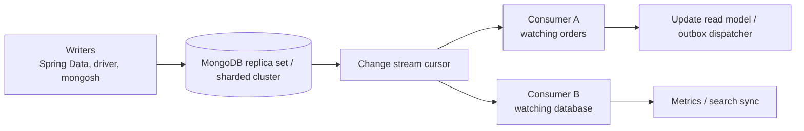
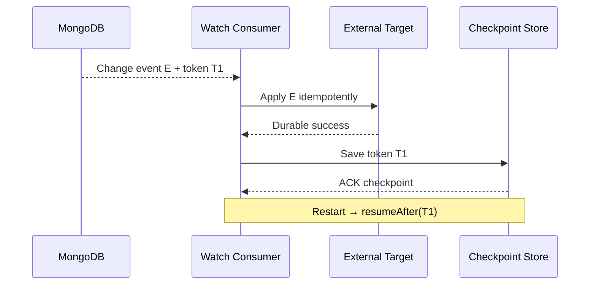

# Watching a Collection or Database with MongoDB Change Streams

An order application needs to update a dashboard when new orders arrive, sync a search index when products change, or push events to analytics when payment status is recorded. If it repeatedly calls `find()` every few seconds, the application scans data over and over, easily misses changes occurring between reads, and struggles to control load. **MongoDB Change Streams** provide a server-emitted stream of change events, allowing an application to watch **a single collection**, **all collections in a database**, or at the deployment level with appropriate privileges.

This lesson in the **Change stream** chapter of the `SPRING_DATA_MONGODB` module focuses directly on **“Watching a collection or database”**. The module uses Spring Data MongoDB to connect, map documents, and operate via `MongoTemplate` or repositories; while also practicing queries, aggregations, indexes, transactions, reactive access, testing, and performance diagnostics. Here, we distinguish the scopes of `MongoCollection.watch()` and `MongoDatabase.watch()`, practice sync/reactive Java Driver and Spring Data reactive, filter events by namespace, restart using resume tokens, and operate consumers safely.

**Change streams do not guarantee exactly-once delivery on their own.** A consumer can receive an event again after restart/retry, fall outside the oplog window, or see an `update` without a full document. Therefore the design must include **checkpoints, idempotent processing, authorization, and error observability**—not just calling `watch()` and printing logs.

After this lesson, you will be able to:

1. Explain MongoDB prerequisites supporting Change Streams and how they differ from polling, Spring mapping events, and system-wide change data capture.
2. Choose properly between `MongoCollection.watch()` and `MongoDatabase.watch()` based on collection count, privileges, and `ns.coll` filtering needs.
3. Inspect a change event containing `_id` (resume token), `operationType`, `ns`, `documentKey`, `fullDocument`, and `updateDescription`.
4. Write sync/reactive Java Driver listeners and use `ReactiveMongoTemplate.changeStream(...)` for a collection.
5. Filter events server-side safely with aggregation pipelines, recognize `invalidate`, `drop`, and `rename` events, and understand the limits of `resumeAfter`/`startAfter`.
6. Design post-processing checkpoints, handle duplicates/retries, store tokens in proper BSON types, and deal with tokens evicted from the oplog.
7. Test against a real MongoDB replica set, observing namespace, scope, event content, recovery, and privileges.

## 1. What Is a Change Stream and How Does It Differ from Polling?

A change stream is a **streaming cursor** backed by MongoDB Server that returns events representing data changes for supported operations. The application opens a cursor with `watch()` and continuously consumes events as they arrive.

Change streams observe **majority-committed changes** per MongoDB's mechanism; a write acknowledged only at a lower primary level and rolled back before majority commit should not be treated as a stream-published business event. That does not turn the consumer into an exactly-once system or remove the need for idempotency.



Instead of repeatedly asking "what is the current data?", the consumer asks "**what changes happened after the stream position already processed?**".

| Aspect | Periodic polling | Change stream |
| --- | --- | --- |
| Data source | Querying current state | Server-emitted cursor of change events |
| Trail of intermediate operations | Can miss intermediate states | Can observe changes within the resumable history window |
| Latency | Depends on polling interval | Near-real-time, still subject to server/network/consumer |
| Cost | Repeated queries, potential data scans | Long-lived cursor and tracking resources |
| Restart | Needs separate timestamp/reconciliation logic | Has **resume tokens** while history remains available |
| Exactly-once | Not automatic | **Not automatic** |
| Server prerequisites | Standard MongoDB queries | Replica set/sharded cluster + oplog and proper privileges |

### 1.1. Deployment requirements

Change streams require MongoDB deployed as a **supported replica set or sharded cluster**; they **do not work on a standalone `mongod`** without replica set configuration. Locally or in tests, you can use a **single-node replica set** with a valid URI and replica-set host.

Support for `watch()` across scopes evolved across server/driver releases: collection-level arrived in MongoDB 3.6; database- and deployment-level were introduced later. **Do not copy modern snippets onto older clusters without verifying the running server version.**

### 1.2. Change streams are not Spring mapping events

`AbstractMongoEventListener` is fired by Spring Data when a **Spring application** executes entity mapping steps. Change streams are served by **MongoDB Server**, so they observe changes made by other clients such as `mongosh`, the Java Driver, or non-Spring-Data services.

However, a change stream **does not mean every change in the ecosystem is retained forever**. Resumability depends on history remaining in the oplog/change stream retention; you must handle expired history or extended downtime.

### 1.3. Suitable and unsuitable use cases

Suitable: syncing search indexes, updating dashboards, detecting order changes, updating caches or summary tables in another system, triggering consumers on persisted business events.

Do not use change streams to replace a **transaction** when two MongoDB documents must commit atomically; nor should you treat an `update` on an order collection as a canonical "business event" if technical/maintenance scripts modify the same field. For cross-system integration requiring business guarantees, consider a **transactional outbox**: the writer saves a business event to an outbox inside the transaction, and a consumer watches the outbox collection and dispatches idempotently.

## 2. Choosing the Right Scope: Collection, Database, or Deployment

Three ways to open a stream in the Java Driver serve different goals:

```java
MongoCollection<Document> orders =
        client.getDatabase("commerce").getCollection("orders");
orders.watch();                       // Only the orders collection.

MongoDatabase commerce =
        client.getDatabase("commerce");
commerce.watch();                     // Collections in commerce.

client.watch();                       // Deployment level (when supported).
```

These calls **construct a `ChangeStreamIterable`**, not the processing loop itself. The cursor is actually opened when subscribing or iterating, depending on sync vs. reactive APIs.

| Scope | Driver call | Where do events come from? | When to choose? |
| --- | --- | --- | --- |
| Single collection | `MongoCollection.watch()` | Changes in the specified collection | Orders, outbox, status history of one entity type |
| Single database | `MongoDatabase.watch()` | Collections belonging to that database | Syncing multiple entity types within one database |
| Cluster/deployment | `MongoClient.watch()` | Multiple databases per support rules | Broad-privilege CDC/observability infrastructure |

### 2.1. Collection-level watch

```javascript
// MongoDB shell:
const cursor = db.orders.watch();
```

The stream watches only the `orders` collection in the current database; inserts into `products` will **not** be returned on this cursor. A narrow scope simplifies business handlers, avoids unrelated noise, and allows tighter privileges.

If your goal is strictly "newly created orders", pick collection-level and filter `operationType: "insert"` rather than watching the whole database and manually discarding everything else.

### 2.2. Database-level watch

```javascript
// Open a stream on the commerce database:
const commerceDb = db.getSiblingDB("commerce");
const cursor = commerceDb.watch();
```

A database stream can receive changes from `commerce.orders`, `commerce.products`, `commerce.customers`, and other collections in the same database, subject to server event support and privileges.

It does **not** mean "watch all databases". If orders live in `commerce.orders` while payment events live in `billing.payments`, `commerceDb.watch()` **will not capture** payment events from the other database.

### 2.3. Does the stream know which collection an event came from?

Yes. Change events normally carry an `ns` (namespace) field:

```json
{
  "operationType": "insert",
  "ns": {
    "db": "commerce",
    "coll": "orders"
  },
  "documentKey": { "_id": "ORDER-101" }
}
```

With a database-level watch, `ns.db`/`ns.coll` are essential to dispatch to the right handler. **Never infer the namespace from `fullDocument._class` or solely from a Java entity name**: data may be written by another driver, use a different schema/version, or omit Spring Data `_class`.

Some event types such as invalidation/DDL differ in shape from insert/update; guard against `NullPointerException` when `ns` or `fullDocument` is absent.

### 2.4. Choose scope based on privileges, not just coding convenience

A consumer handling only an order outbox should not hold privileges to watch every collection in a database unnecessarily. Database watches broaden observable metadata and events, increasing data-leakage risk if logging or filtering slips.

Practical rule: **least privilege**—use the narrowest scope fitting the task, and verify `changeStream`/`find` privileges on the watched resource in your target MongoDB Server.

### 2.5. Watching multiple collections with one stream vs. multiple streams

| Design | Benefits | Trade-offs |
| --- | --- | --- |
| One stream per collection | Clear handling, narrow privileges, separate checkpoints | More cursors and connections |
| One database stream filtering `ns.coll` | Single stream coordinates multiple collections, shared checkpoint | Complex routing, broader privileges, single shared bottleneck |
| Watching a shared outbox collection | Business events share a uniform schema | Writers must create outbox records inside transactions and run a dispatcher |

A database stream does not automatically guarantee strict cross-service business ordering; you still must evaluate concurrency, per-key ordering, transaction events, and idempotency.

## 3. Anatomy of a Change Event

Example `update` event (illustrative shape; real tokens are server-issued BSON and must not be fabricated):

```javascript
{
  _id: { _data: "SERVER_ISSUED_RESUME_TOKEN" },
  operationType: "update",
  clusterTime: Timestamp(1732000000, 1),
  ns: { db: "commerce", coll: "orders" },
  documentKey: { _id: "ORDER-101" },
  updateDescription: {
    updatedFields: { status: "PAID" },
    removedFields: []
  }
}
```

Common fields:

| Field | Meaning | Notes |
| --- | --- | --- |
| `_id` | Unique **resume token** of the event | Do not treat as the entity's document ID |
| `operationType` | `insert`, `update`, `replace`, `delete`... | Handlers should switch on type |
| `ns` | Source database + collection | Used to route database-level streams |
| `documentKey` | Identifier of affected document | May include shard key when applicable |
| `fullDocument` | Full document if supplied by event/options | Not always present, especially for delete |
| `updateDescription` | Fields updated/removed in an update event | Not a full snapshot |
| `clusterTime` | Server logical time | Do not use instead of resume token |
| `wallTime` | Wall-clock time if supported by server/event | Should not be relied on for strict ordering |

### 3.1. `insert`

Insert events typically carry `fullDocument` containing the inserted document. Example:

```javascript
{
  operationType: "insert",
  ns: { db: "commerce", coll: "orders" },
  documentKey: { _id: "ORDER-101" },
  fullDocument: {
    _id: "ORDER-101",
    tenantId: "T-A",
    status: "CREATED",
    amount: NumberDecimal("120.00")
  }
}
```

### 3.2. `update`

For updates such as `$set`, events usually include `updateDescription.updatedFields` and `removedFields`. By default, `fullDocument` **may not contain the full document** for update events. If a full snapshot is needed, see `FullDocument.UPDATE_LOOKUP` in a later section and understand its "latest-value lookup" limitation.

### 3.3. `replace` and `delete`

`replace` replaces the entire document and typically includes `fullDocument` per operation semantics. `delete` normally **lacks a post-delete `fullDocument`**. To know pre-deletion data, design an audit/outbox or use **pre-images** when supported by deployment/version/config; never assume every `delete` event automatically carries deleted content.

### 3.4. Do not depend on JSON field ordering

Change events are BSON documents; field display order in logs is not a business contract. Processing logic should rely on `operationType`, `ns`, `documentKey`, and nullable fields—never on a field's position in a JSON string.

## 4. `mongosh` Practice: Collection Watch vs. Database Watch

Before writing Java, observe scope differences on a **test replica set**. Use the `change_stream_lab` database to avoid impacting real data.

### 4.1. Prepare data

```javascript
const lab = db.getSiblingDB("change_stream_lab");

lab.orders.insertOne({
  _id: "ORDER-BASE",
  tenantId: "T-A",
  status: "CREATED"
});

lab.products.insertOne({
  _id: "PRODUCT-BASE",
  tenantId: "T-A",
  name: "Pen"
});
```

Run once or change IDs against a clearly isolated test database. Do not use `dropDatabase()` as a default reset while streams are actively running unless testing `invalidate` events.

### 4.2. Terminal A: watch a single collection

```javascript
const lab = db.getSiblingDB("change_stream_lab");
const orderCursor = lab.orders.watch([
  { $match: { operationType: { $in: ["insert", "update", "replace"] } } }
]);

while (orderCursor.hasNext()) {
  const event = orderCursor.next();
  printjson({
    operationType: event.operationType,
    namespace: event.ns,
    documentKey: event.documentKey,
    resumeToken: event._id
  });
}
```

Run in a separate shell session and keep the cursor open. `hasNext()` may wait for events; that is expected behavior for a long-lived stream.

### 4.3. Terminal B: generate changes

```javascript
const lab = db.getSiblingDB("change_stream_lab");

lab.orders.insertOne({
  _id: "ORDER-102",
  tenantId: "T-A",
  status: "CREATED"
});

lab.orders.updateOne(
  { _id: "ORDER-102" },
  { $set: { status: "PAID" } }
);

lab.products.updateOne(
  { _id: "PRODUCT-BASE" },
  { $set: { name: "Blue pen" } }
);
```

The collection stream in terminal A receives the filtered `orders` changes and **does not receive** `products`.

### 4.4. Terminal C: database watch

```javascript
const lab = db.getSiblingDB("change_stream_lab");
const dbCursor = lab.watch([
  {
    $match: {
      "ns.coll": { $in: ["orders", "products"] },
      operationType: { $in: ["insert", "update", "replace", "delete"] }
    }
  }
]);

while (dbCursor.hasNext()) {
  const event = dbCursor.next();
  printjson({
    collection: event.ns && event.ns.coll,
    type: event.operationType,
    key: event.documentKey,
    token: event._id
  });
}
```

**Note on stream start time:** terminal C does not automatically replay the three changes that occurred **before it started watching**. After the cursor is ready, perform another `orders.updateOne(...)` and another `products.updateOne(...)` to observe both namespaces arriving on the same database stream.

### 4.5. Direct comparison

| Actual change | `lab.orders.watch()` | `lab.watch()` |
| --- | --- | --- |
| Insert into `lab.orders` | Received if filter permits | Received if filter permits |
| Update `lab.orders` | Received if filter permits | Received if filter permits |
| Update `lab.products` | **No** | Yes, if `ns.coll` filter includes `products` |
| Change in `billing.payments` | **No** | **No** |
| `orders` renamed/dropped | Stream may invalidate per rules | Database stream may observe DDL events depending on type/filter/version |

Every stream starts at the **point in time determined by its resume/start options**. Never compare a stream opened earlier against one opened later and attribute missing past events to scope differences.

## 5. Synchronous Java Driver: `MongoCollection.watch()`

For applications using the sync Java Driver, `watch()` builds a `ChangeStreamIterable`; its cursor is consumed sequentially. Here is a foundational **collection-level** example:

```java
import com.mongodb.client.MongoChangeStreamCursor;
import com.mongodb.client.MongoClient;
import com.mongodb.client.MongoCollection;
import com.mongodb.client.model.changestream.ChangeStreamDocument;
import com.mongodb.client.model.changestream.FullDocument;
import org.bson.Document;
import org.bson.BsonDocument;
import java.util.concurrent.TimeUnit;

public final class OrdersCollectionWatcher {

    private final MongoClient client;

    public OrdersCollectionWatcher(MongoClient client) {
        this.client = client;
    }

    public void watchOrdersUntilInterrupted() {
        MongoCollection<Document> orders = client
                .getDatabase("commerce")
                .getCollection("orders");

        try (MongoChangeStreamCursor<ChangeStreamDocument<Document>> cursor =
                orders.watch()
                        .fullDocument(FullDocument.UPDATE_LOOKUP)
                        .maxAwaitTime(1, TimeUnit.SECONDS)
                        .cursor()) {

            while (!Thread.currentThread().isInterrupted()) {
                ChangeStreamDocument<Document> event = cursor.tryNext();
                if (event == null) {
                    // No event arrived during this await window.
                    continue;
                }

                String type = event.getOperationType().getValue();
                BsonDocument token = event.getResumeToken();
                Document key = event.getDocumentKey() == null
                        ? null : Document.parse(
                                event.getDocumentKey().toJson());

                processOrderEvent(type, key, event.getFullDocument());
                // Checkpoint token only after processOrderEvent
                // completes durably; see Section 9.
                saveCheckpointAfterSuccess(token);
            }
        }
    }

    private void processOrderEvent(
            String type, Document key, Document fullDocument
    ) {
        // Real app: route by operationType,
        // process idempotently, and avoid logging sensitive data.
    }

    private void saveCheckpointAfterSuccess(BsonDocument token) {
        // Real app: persist BSON token durably.
    }
}
```

This is an **illustrative skeleton**, without a full checkpoint store or exception classifier. The two empty methods are extension points to implement before production. `processOrderEvent(...)` must also handle `delete`/`invalidate` per contract; even with `FullDocument.UPDATE_LOOKUP`, a consumer **cannot** assume `fullDocument` is always non-null.

### 5.1. `tryNext()`, `hasNext()`, and stop signals

`MongoChangeStreamCursor.tryNext()` returns an event or `null` if no event is available within the await duration. It suits loops that check interruption/shutdown flags. Conversely, `hasNext()` can block waiting for the server to emit an event.

Never deploy a `while(true)` loop lacking stop/cursor-close mechanics and call it a production worker. On application shutdown, stop the thread, close the cursor, and record completed checkpoints.

### 5.2. Avoid holding a cursor on a request thread

An HTTP handler must not execute `while(cursor.hasNext())` to serve a regular REST request. Change streams are **long-lived resources**, suited to lifecycle-managed background services or standalone reactive subscriptions—not blocking controller methods holding connections indefinitely.

### 5.3. Server-side operation filtering

```java
import com.mongodb.client.model.Aggregates;
import com.mongodb.client.model.Filters;
import java.util.List;

var pipeline = List.of(
        Aggregates.match(
                Filters.in(
                        "operationType",
                        "insert", "update", "replace", "delete"))
);

var stream = orders.watch(pipeline)
        .fullDocument(FullDocument.UPDATE_LOOKUP);
```

This snippet sits inside a method where `orders` is declared. The filter is a **change-stream aggregation pipeline**, not a query over existing `orders` documents. `operationType` and `ns.coll` belong to the **event envelope**, not `fullDocument`.

## 6. Synchronous Java Driver: `MongoDatabase.watch()`

In Java, use `MongoDatabase.watch()` to watch **multiple collections in one database** and dispatch by namespace:

```java
import com.mongodb.client.MongoChangeStreamCursor;
import com.mongodb.client.MongoClient;
import com.mongodb.client.MongoDatabase;
import com.mongodb.client.model.Aggregates;
import com.mongodb.client.model.Filters;
import com.mongodb.client.model.changestream.ChangeStreamDocument;
import org.bson.Document;
import java.util.List;
import java.util.concurrent.TimeUnit;

public final class CommerceDatabaseWatcher {
    private final MongoClient client;

    public CommerceDatabaseWatcher(MongoClient client) {
        this.client = client;
    }

    public void consume() {
        MongoDatabase commerce = client.getDatabase("commerce");

        var pipeline = List.of(
                Aggregates.match(
                        Filters.and(
                                Filters.in("ns.coll", "orders", "products"),
                                Filters.in("operationType",
                                        "insert", "update",
                                        "replace", "delete")))
        );

        try (MongoChangeStreamCursor<ChangeStreamDocument<Document>> cursor =
                commerce.watch(pipeline)
                        .maxAwaitTime(1, TimeUnit.SECONDS)
                        .cursor()) {
            while (!Thread.currentThread().isInterrupted()) {
                ChangeStreamDocument<Document> event = cursor.tryNext();
                if (event == null) {
                    continue;
                }

                String coll = event.getNamespace() == null
                        ? null
                        : event.getNamespace().getCollectionName();
                if ("orders".equals(coll)) {
                    handleOrders(event);
                } else if ("products".equals(coll)) {
                    handleProducts(event);
                } else {
                    // Do not treat unknown namespaces as products.
                    handleUnknownNamespace(event);
                }
                checkpointOnlyAfterSuccess(event.getResumeToken());
            }
        }
    }

    private void handleOrders(ChangeStreamDocument<Document> event) {}
    private void handleProducts(ChangeStreamDocument<Document> event) {}
    private void handleUnknownNamespace(ChangeStreamDocument<Document> event) {}
    private void checkpointOnlyAfterSuccess(org.bson.BsonDocument token) {}
}
```

This is a **skeleton** intentionally separating handlers per collection, without implementing side effects or checkpointing yet. `OperationType` is not needed for routing in this snippet; production code should inspect `event.getOperationType()` to distinguish `insert/update/delete` instead of routing every `orders` event through the same logic.

### 6.1. When collections are added later

A database stream can observe newly created collections in the database, subject to privileges and event/filter rules. However, if the `$match` pipeline restricts `"ns.coll": { "$in": ["orders","products"] }`, a new `coupons` collection **is still filtered out** until configuration updates.

If the requirement is "watch all non-internal collections", define an explicit namespace policy, test collection creation/renaming behavior, and grant appropriate privileges.

### 6.2. Is filtering by `fullDocument.tenantId` sufficient?

Not for every event type. `delete` normally lacks `fullDocument`, and `update` lacks it when lookup is disabled or fails. If the pipeline only matches `"fullDocument.tenantId": "T-A"`, events lacking a full document are dropped.

For multi-tenant systems, use an outbox record carrying tenant/operation info or a carefully designed `documentKey` → tenant mapping; **never infer tenant access from an optional field that may be absent**. Namespace filtering and tenant filtering solve two distinct problems.

### 6.3. One database-level cursor does not imply unbounded parallelism

If a consumer reads events and invokes a slow handler, cursor read throughput is capped. Dumping every event onto an executor without backpressure or queue limits risks OOM and out-of-order checkpoints. Design **processing order and checkpointing** before adding concurrency; Section 10 explains partitioning by key and avoiding lost events.

## 7. Spring Data MongoDB Reactive: Watching a Single Collection

Spring Data MongoDB provides `ReactiveMongoTemplate.changeStream(...)` to create a `Flux<ChangeStreamEvent<T>>` from a collection. This integrates smoothly into WebFlux/Reactor apps, yet **does not turn a change stream into a short-lived Publisher**: it remains a long-lived stream needing lifecycle management, retries, checkpoints, and resource limits.

### 7.1. Creating a collection stream

```java
import org.springframework.data.mongodb.core.ChangeStreamOptions;
import org.springframework.data.mongodb.core.ReactiveMongoTemplate;
import org.springframework.data.mongodb.core.ChangeStreamEvent;
import org.bson.Document;
import reactor.core.publisher.Flux;

public final class ReactiveOrdersWatcher {
    private final ReactiveMongoTemplate template;

    public ReactiveOrdersWatcher(ReactiveMongoTemplate template) {
        this.template = template;
    }

    public Flux<ChangeStreamEvent<Document>> events() {
        ChangeStreamOptions options =
                ChangeStreamOptions.builder().build();

        return template.changeStream(
                "orders", options, Document.class);
    }
}
```

Package names and signatures for `ChangeStreamOptions` and `ChangeStreamEvent` may vary or offer different overloads depending on your **Spring Data MongoDB version**, so check your project's actual dependency. The core point: `template.changeStream("orders", ...)` specifies the **collection name** and returns a Flux of events, not a list of current `Order`s.

### 7.2. A `Flux` does not start processing until subscribed

```java
Flux<ChangeStreamEvent<Document>> stream =
        watcher.events();

// Only a stream variable exists: consumption has not opened yet.
```

In WebFlux applications, a Publisher returned from a controller can be subscribed to by the framework; however, using a change stream as a background consumer usually calls for a dedicated component managing **start/stop**. Never call `subscribe()` haphazardly on every HTTP request: you could open thousands of duplicate unmanaged cursors.

### 7.3. Processing only needed events

You can filter the envelope in Reactor:

```java
Flux<ChangeStreamEvent<Document>> orderChanges = watcher.events()
        .filter(event ->
                event.getOperationType() != null);
```

Client-side filtering helps with routing, but the server still sends the events over the wire. Under heavy workloads, prefer **pushing supported filter conditions into the change-stream aggregation pipeline** to cut traffic and serialization; still verify token/checkpoint behavior when events are filtered.

### 7.4. When a typed entity is needed

```java
import org.springframework.data.mongodb.core.mapping.Document;
import org.springframework.data.mongodb.core.mapping.MongoId;

@Document(collection = "orders")
public record OrderView(
        @MongoId String id,
        String tenantId,
        String status
) {}
```

Inside another method with `ReactiveMongoTemplate template`:

```java
Flux<ChangeStreamEvent<OrderView>> changes =
        template.changeStream(
                "orders",
                ChangeStreamOptions.builder().build(),
                OrderView.class);
```

This snippet illustrates syntax inside a method with `template` and `@Document`/`@MongoId` imports. It works well when event `fullDocument` payloads match the entity shape, yet **does not mean `ChangeStreamEvent.getBody()` is always non-null**:

- `insert` and `replace` typically include the full document.
- `update` may contain only `updateDescription` without lookup.
- `delete` usually lacks a body.
- DDL/invalidate events are not `OrderView`s.

Consequently, a consumer handling all events should inspect envelope metadata (operation type, namespace, document key, resume token) and **never blindly call `event.getBody().status()`**.

### 7.5. Reactor backpressure cannot replace checkpoints

`Flux` supports demand coordination; still, slow downstream consumption puts pressure on cursors, connections, buffers, and the oplog window. If the app stops mid-way, backpressure **does not save the last processed event marker**. Resume tokens and checkpoints are a separate reliability layer.

### 7.6. Reactor and concurrent execution

A pipeline like:

```java
stream.flatMap(event -> handleEventAsync(event), 64)
```

can process many events concurrently and **complete out of arrival order**. If you checkpoint event 20's token before event 19 finishes, restarting from 20 can **skip 19**.

For a stream requiring sequential checkpointing, a safe starting choice is:

```java
stream.concatMap(event ->
        handleEventAsync(event)
                .then(saveTokenAsync(event)));
```

This is pseudocode illustrating composition; `handleEventAsync` and `saveTokenAsync` must be implemented. `concatMap` preserves order within one subscription, though it does not automatically solve idempotency, ambiguous commit failures, or multiple processes reading the stream.

## 8. Database Streams in Reactive Applications

At the **MongoDB Reactive Streams Java Driver** level, you can obtain a publisher from `com.mongodb.reactivestreams.client.MongoDatabase.watch()` and wrap it in a Reactor `Flux`:

```java
import com.mongodb.client.model.Aggregates;
import com.mongodb.client.model.Filters;
import com.mongodb.client.model.changestream.ChangeStreamDocument;
import com.mongodb.reactivestreams.client.MongoClient;
import com.mongodb.reactivestreams.client.MongoDatabase;
import org.bson.Document;
import reactor.core.publisher.Flux;
import java.util.List;

public final class ReactiveCommerceDatabaseWatcher {
    private final MongoClient mongoClient;

    public ReactiveCommerceDatabaseWatcher(MongoClient mongoClient) {
        this.mongoClient = mongoClient;
    }

    public Flux<ChangeStreamDocument<Document>> changes() {
        MongoDatabase database =
                mongoClient.getDatabase("commerce");

        var pipeline = List.of(
                Aggregates.match(
                        Filters.in(
                                "ns.coll", "orders", "products"))
        );

        return Flux.from(database.watch(pipeline));
    }
}
```

**This uses the Reactive Streams Driver, not the sync Driver from Section 5.** Note that the two `MongoClient` types belong to **two different packages**:

| Stack | Java type | Result from `watch()` |
| --- | --- | --- |
| Sync | `com.mongodb.client.MongoClient` | `ChangeStreamIterable`, yielding `MongoChangeStreamCursor` |
| Reactive Streams | `com.mongodb.reactivestreams.client.MongoClient` | Publisher, converted via `Flux.from(...)` |

Do not inject a sync `com.mongodb.client.MongoClient` bean into a constructor expecting a reactive client and expect Reactor to turn blocking I/O non-blocking.

### 8.1. Should you use Spring Data `ReactiveMongoTemplate` for every database stream?

Spring Data offers collection stream APIs and various overloads depending on version. However, when you need to **watch an entire database**, the Java Driver's `MongoDatabase.watch()` clearly expresses that scope; do not invent `template.changeStream(null, ...)` calls without verifying version-specific semantics.

When using the driver directly, you manage BSON mapping, resume options, subscription lifecycle, and security context. For single-collection streams needing typed entities, Spring Data's template is usually more convenient.

### 8.2. Dispatching events by namespace, not by Java class

```java
Flux<ChangeStreamDocument<Document>> events =
        databaseWatcher.changes();

Flux<Void> dispatched = events.concatMap(event -> {
    var namespace = event.getNamespace();
    if (namespace == null) {
        return handleControlEvent(event);
    }
    return switch (namespace.getCollectionName()) {
        case "orders" -> handleOrderEvent(event);
        case "products" -> handleProductEvent(event);
        default -> handleUnexpectedCollection(event);
    };
});
```

This snippet uses Java 17 switch expressions and assumes `Mono<Void>`/`Publisher<Void>` handler methods exist. `concatMap` keeps subscription order if handlers return properly completing publishers; never rely on `OrderView.class` to identify the collection, as `fullDocument` may be null.

### 8.3. Single consumer vs. multiple consumer groups

Change streams are **not Kafka consumer groups**. If two applications both call `database.watch()`, by default **both can receive the same events** rather than splitting load between them. To ensure a piece of logic executes once system-wide, use:

- Leader/lease ownership so one active consumer owns each logical shard/partition; or
- Idempotent processing with durable checkpoint/claim logic; or
- A pipeline forwarding the change stream into a message broker with consumer-group semantics.

Do not rely on `watch()` to automatically partition namespaces or documents across instances in ways MongoDB does not promise.

## 9. Resume Tokens: Persisting Progress by **Successfully Processed** Stream Position

A change event's `_id` is its **resume token**, not `documentKey._id`. It represents a position in the change stream, letting the client ask the server to resume after a known point while sufficient history remains.

Example envelope:

```javascript
{
  _id: { _data: "SERVER_GENERATED_OPAQUE_TOKEN" },
  operationType: "insert",
  ns: { db: "commerce", coll: "orders" },
  documentKey: { _id: "ORDER-102" }
}
```

**Tokens are opaque.** Do not parse `_data`, fabricate tokens from `clusterTime`, or use `documentKey._id` as a checkpoint. Token formats can change across server versions, FCVs, and feature options.

### 9.1. Store tokens as BSON, do not flatten to arbitrary strings

In the Java Driver:

```java
import org.bson.BsonDocument;
import com.mongodb.client.model.changestream.ChangeStreamDocument;
import org.bson.Document;

ChangeStreamDocument<Document> event = /* event received from cursor */;
BsonDocument token = event.getResumeToken();

// Example: persist BsonDocument in a checkpoint document
// using the application's appropriate BSON codec.
```

Do not save only `event.getResumeToken().get("_data").asString()` and drop other BSON fields or types; the server may use different token structures. When serializing to JSON, ensure **Extended JSON round-tripping** preserves BSON types without alteration during serialize/deserialize.

### 9.2. When to checkpoint?



**Do not checkpoint right upon receiving an event.** If you persist the token before downstream finishes and the process crashes, restarting from the new token skips an unprocessed event. The baseline safe order is **process successfully → checkpoint**.

Conversely, if downstream succeeds and the process dies **before checkpointing**, the event may be redelivered. Downstream **must therefore be idempotent** or use durable deduplication.

### 9.3. `resumeAfter`, `startAfter`, and `startAtOperationTime`

| Option | When to use | Warning |
| --- | --- | --- |
| `resumeAfter(token)` | Resume after a valid token of a processed event | Cannot resume **after an invalidate event** |
| `startAfter(token)` | Start after a token, including continuing after invalidate per server rules | Does not make a dropped collection reappear |
| `startAtOperationTime(timestamp)` | Start from an eligible logical server time | Requires valid server timestamp and remaining oplog events; not client wall-clock time |

These options are **mutually exclusive** on a given watch call. Never combine `resumeAfter` and `startAfter`, or derive an anchor from `System.currentTimeMillis()`.

### 9.4. Java Driver resuming from a checkpoint

```java
import org.bson.BsonDocument;
import com.mongodb.client.MongoCollection;
import com.mongodb.client.model.changestream.ChangeStreamDocument;
import org.bson.Document;

BsonDocument checkpointToken = loadTokenFromStore();

var iterable = orders.watch();
if (checkpointToken != null) {
    iterable = iterable.resumeAfter(checkpointToken);
}

try (var cursor = iterable.cursor()) {
    // Consume, process idempotently, checkpoint after success.
}
```

This snippet sits in a method with `orders` and an application-defined `loadTokenFromStore()`. The token must belong to a **compatible stream, scope, and pipeline**. Never grab a token from collection A and reuse it arbitrarily on a different stream with different privileges, filters, or scopes.

### 9.5. Expired tokens due to oplog rollover

If a consumer stays stopped too long, needed history may roll off the oplog and `resumeAfter` will fail. **Do not fix this by deleting the token and silently watching from "now"** if missing changes is unacceptable.

Safer runbook:

1. Detect an unrecoverable resume failure; distinguish from transient network errors.
2. Pause and flag the consumer as needing a rebuild.
3. Rebuild the read model/index from a data snapshot or controlled backfill process.
4. Establish a fresh stream start point that does not miss the gap between backfill and catch-up.
5. Reconcile by business keys before marking the consumer healthy.

Safe start points depend on topology, snapshot/session/read concern, and backfill duration. Running `findAll()` followed by `watch()` afterward **can miss** writes occurring between the two steps.

### 9.6. Event tokens and post-batch resume tokens

Some APIs/server versions provide a **post-batch resume token** even when a batch contains no change events, advancing the continuation position. That does not mean "business events succeeded". If an application checkpoints such tokens, verify that **all prior events were durably processed** and maintain ordering semantics.

Never fabricate a "latest event" marker using `clusterTime` or an auto-incrementing sequence in the application database.

## 10. Designing Durable Consumers: Idempotency, Checkpointing, and Ordering

A watch cursor merely delivers **events**; business handlers still must decide "has this event already been handled?", "in what order do we write to targets?", and "if the process dies mid-way, how do we continue?".

### 10.1. Minimal checkpoint model

A checkpoint record might look like:

```javascript
{
  _id: "commerce-orders-search-indexer-v1",
  streamScope: "collection",
  database: "commerce",
  collection: "orders",
  pipelineVersion: 1,
  resumeToken: { _data: "OPAQUE_SERVER_TOKEN" },
  updatedAt: ISODate("2026-11-20T00:00:00Z")
}
```

Notes:

- `_id` identifies the **consumer workflow**, not an Order ID.
- `streamScope` and filter/pipeline version prevent mistakenly resuming from an incompatible stream configuration.
- `resumeToken` should be stored as **intact BSON**.
- `updatedAt` is for monitoring, **not a substitute for the token**.
- The example token only illustrates shape, not a token usable with real `resumeAfter`.

### 10.2. Three crash windows to test

| When the process dies | Target business effect | Token checkpointed? | On restart |
| --- | --- | --- | --- |
| Before processing event | No | No | Event redelivered |
| After processing, before checkpoint | **Yes** | No | Redelivered → needs dedupe/idempotency |
| After checkpoint | Yes | Yes | Resumes after event |

**You cannot completely eliminate the "apply succeeded but checkpoint failed" window if the sink and checkpoint live in two independent systems without coordinating transactions or reconciliation.** Build an at-least-once consumer + idempotent sink; never advertise exactly-once solely because resume tokens exist.

### 10.3. Business-operation idempotency keys

If a consumer updates search documents for `orders`, an idempotent upsert keyed by source `_id`/version is safer than blindly incrementing a "received events" counter on every delivery.

```javascript
// Idempotent read-model overwrite pattern by identifier key.
db.orderSearchView.updateOne(
  { _id: "ORDER-102" },
  { $set: { status: "PAID", tenantId: "T-A" } },
  { upsert: true }
);
```

This example **does not yet solve out-of-order events**: if an older event arrives after a newer one, overwriting can regress the view. With concurrent workers, store a **source version/sequence** or enforce per-document-key ordering, writing only when the incoming version is no older than the stored one.

### 10.4. When sink and checkpoint share one MongoDB transaction

If the business side effect writes **a read model within the same MongoDB deployment** and the checkpoint also resides in MongoDB, you can design:

```text
Transaction:
  apply event E to readModel (idempotent)
  update checkpoint with resumeToken(E)
  commit
```

The goal is **synchronizing sink state and checkpoint** when operations can participate in a suitable MongoDB transaction. However, the stream cursor/`watch` operation itself **must not** be held inside a long transaction; read the event, then run a short transaction for apply + checkpoint. Test on a replica set and verify transaction manager/session preconditions.

### 10.5. When the sink is Elasticsearch, Kafka, or an HTTP API

MongoDB transactions **do not cover** external systems. If a consumer pushes an event to Elasticsearch and then checkpoints, a crash can send the event twice. The target must support upserts, idempotency keys, or conditional versions; or the consumer can maintain an operation ledger sufficient to detect duplicates.

Never call external systems inside a MongoDB transaction expecting both to commit/roll back together.

### 10.6. Processing order and checkpointing with `flatMap`

Example:

```text
Read E10 → E11 → E12
Concurrent handlers:
  E12 finishes first
  E10 finishes next
  E11 still failing
```

If you checkpoint E12's token while E11 has not completed, a restart can skip E11. When linear stream processing is required, start with **sequential consumption**. To parallelize, partition by business key, use contiguous-ack tracking, and checkpoint only at **the token before the first incomplete event**—never simply the largest completed token.

### 10.7. If multiple processes watch the same collection

Every process can receive the same events; `watch()` does not issue leases or split partitions. If only one active consumer should apply side effects, use leader leases/elections with fencing tokens, or make all handlers idempotent with clear checkpoint ownership. Two processes writing the same checkpoint key without locking can cause tokens to **move backward or skip incomplete ranges**.

### 10.8. Event filtering and checkpoint notes

If a pipeline keeps only certain `operationType`s, tokens of filtered-out events are **not delivered to the application**. That is normal, yet when changing filters/pipelines later, an old checkpoint does not retroactively mean newly added event types were processed.

**Changing a pipeline changes the consumer contract.** Version filters and decide whether previously skipped events must be backfilled.

## 11. `fullDocument`, `updateDescription`, and Subsequent Modifications

A change event is not always a full snapshot at the exact emission instant.

### 11.1. `UPDATE_LOOKUP` is a lookup, not immutable history

Java Driver:

```java
import com.mongodb.client.model.changestream.FullDocument;

var stream = orders.watch()
        .fullDocument(FullDocument.UPDATE_LOOKUP);
```

For an `update` event, `UPDATE_LOOKUP` fetches the **latest majority-committed document** after the update. If the document is updated again before the lookup runs, `fullDocument` may reflect a **newer state** than the event being processed, or be absent if the document no longer matches/exists.

Timeline:

```text
E1: status CREATED → PAID
E2: status PAID → SHIPPED
Consumer processes E1 using UPDATE_LOOKUP
fullDocument may show status SHIPPED.
```

Do not assume `event.updateDescription.updatedFields.status = "PAID"` implies `fullDocument.status = "PAID"` always holds.

### 11.2. When to use `updateDescription`?

If the requirement is simply "what did order status change to in this update?", read `updateDescription` per schema. Example:

```javascript
{
  operationType: "update",
  updateDescription: {
    updatedFields: { status: "PAID" },
    removedFields: []
  }
}
```

However, not every write emits `update` with `updatedFields`: replacing the whole document may emit `replace` with `fullDocument`. Consumers must handle **`replace` as well** to keep full read models accurate.

### 11.3. `delete` has no default full document

```javascript
{
  operationType: "delete",
  documentKey: { _id: "ORDER-102" },
  ns: { db: "commerce", coll: "orders" }
}
```

If you need to remove an Order from a search index, `documentKey` may be enough to delete by ID. If you need `tenantId` to route the deletion into a tenant-specific index, design a trustworthy metadata source or keep a mapping/ledger. Never assume the old full document appears in a `delete` event.

### 11.4. Pre-images and post-images

Modern MongoDB versions support **change stream pre- and post-images** when appropriate features and collection settings are configured. They help audit before/after values, but require:

- Enabling the feature and configuring collections properly.
- Understanding the difference between `whenAvailable` and `required` when using those APIs.
- Accounting for retention/storage of pre/post images.
- Controlling access rights and sensitive data.

Never assume pre-images are always available across every deployment, nor retain them indefinitely in violation of data policies.

### 11.5. Multi-document transaction events

MongoDB publishes change stream events for transactional operations only once the changes commit per server semantics. This prevents consumers from seeing rolled-back writes as committed events.

Still, consumers **do not automatically receive a single "business transaction message"** covering all changes. A transaction updating three documents can produce multiple change events; business-level grouping/idempotency is needed. A database-level stream does not make it safe to slice and checkpoint between three events if the read model requires all updates atomically.

## 12. Drop, Rename, Invalidate, and Resume Rules

Schema and collection changes directly affect stream scopes.

### 12.1. Collection watch and `invalidate`

A collection-level stream can receive `drop` or `rename` followed by `invalidate`, closing the cursor for that collection. **Do not retry infinitely with the same collection and token** once a stream invalidates.

If business logic wants to resume watching after the collection is recreated, consider `startAfter` and verify namespace/scope/privileges while evaluating whether data continuity remains valid.

### 12.2. Database watch behaves differently

A database-level stream can receive collection drop/rename events without necessarily invalidating **merely because one child collection was dropped**. Dropping **the entire database** can invalidate the database watch. Exact behavior depends on the DDL event type and server version.

Thus claiming "watching the whole database guarantees you never need to reopen" is false; equally false is assuming dropping one collection always terminates a database watch.

### 12.3. `resumeAfter` vs. `startAfter`

`resumeAfter` **cannot** resume a stream **after an invalidate event** per MongoDB semantics. `startAfter` can be used to open a new stream after an invalidate token where supported by the server.

Java Driver example:

```java
var iterable = orders.watch();

// If the saved token is from an invalidate event and complies
// with current server rules:
iterable = iterable.startAfter(invalidateToken);
```

This snippet assumes `orders` and a properly typed `BsonDocument` `invalidateToken`. **Do not treat `startAfter` as a cure-all for expired resume tokens**; once the oplog loses history, backfill/reconciliation is still required.

### 12.4. Do not filter out all control events and forget cursor governance

A pipeline matching only `operationType: "insert"` makes sense for insert-only consumers, yet operations still need to know if the cursor closed, errored, or invalidated. **Suppressing DDL events in business filters does not prevent a collection from being dropped.**

Create metrics/alerts on cursor lifecycle and exceptions separately from business handlers; never rely solely on insert counts to judge stream health.

### 12.5. Renames and collection names in namespaces

If a collection is renamed from `orders` to `orders_archive`:

- Collection-level watches must handle rename/invalidate semantics.
- Database-level streams can keep seeing events under the new name, **but a pipeline filtering `ns.coll = "orders"` will not receive updates written to `orders_archive`**.
- Checkpoint filter versions and routing handlers must be updated in a controlled manner.

Never treat a collection rename as simply editing `@Document(collection = "...")` on a Java entity; schema, indexes, privileges, and consumers all require coordinated migration.

## 13. Change-Stream Aggregation Pipelines and Filtering Safety

The server permits a subset of aggregation stages to filter/transform events, subject to specific **restrictions**.

### 13.1. Filtering by namespace and operation type

```javascript
const commerce = db.getSiblingDB("commerce");

const stream = commerce.watch([
  {
    $match: {
      "ns.coll": { $in: ["orders", "products"] },
      operationType: {
        $in: ["insert", "update", "replace", "delete"]
      }
    }
  }
]);
```

This is a server-side condition. If you chose a database stream intending to pick up **future collections automatically**, hard-coding `$in` means new collections won't be tracked until the filter changes.

### 13.2. Do not modify or remove event `_id`

The server uses the change event's `_id` as the resume token. Pipelines that drop or mutate `_id` can break resumability and be rejected by compatible MongoDB versions.

```javascript
// WRONG: strips the resume token:
db.orders.watch([
  { $project: { _id: 0, operationType: 1 } }
]);
```

Keep `_id` intact; if you only want to forward a subset of fields downstream, perform projection **after extracting/checkpointing the token**, without altering the token in the server pipeline.

### 13.3. Filtering by business fields can drop deletes

```javascript
// Dangerous if the goal includes tenant deletes:
db.orders.watch([
  { $match: { "fullDocument.tenantId": "T-A" } }
]);
```

A `delete` lacks `fullDocument` by default. Delete events for tenant T-A can be filtered out. Use an outbox carrying the tenant field in the event or an appropriate lookup/ledger design; never rely on filtering an optional nullable field for authorization.

### 13.4. Changing filters changes processed history

If a consumer initially received only `orders` inserts/updates and later expands to include `products`, the old `orders` stream token does not mean past `products` were processed. Plan a backfill for the newly added collection, establish a snapshot/watch anchor, and version the checkpoint config.

### 13.5. Keep pipelines minimal

Every added stage can add server/serialization cost, and several stages are restricted inside change-stream pipelines. Start with `$match` on `operationType`/`ns.coll` where suitable; add more logic only when it genuinely reduces load or satisfies business needs. Never copy a pipeline from `db.collection.aggregate(...)` assuming every stage works in `watch()`.

## 14. Integration Testing: Collection vs. Database Watch on a Replica Set

Mocking a `ChangeStreamDocument` and invoking a handler only exercises Java branches; it **does not prove** MongoDB Server emits events with the right namespace, operation type, and resume token, or that a database stream captures two collections. With Change Streams, replica-set integration tests are essential for critical assumptions.

### 14.1. Preparing the test environment

Requirements:

- MongoDB Server running a **replica set**; a single `rs0` node is enough for basic tests.
- URI targeting a **dedicated test database**, never production.
- Test credentials allowed to create/insert/update data and open change streams at the relevant scope.
- Cursor **opened before emitting test events**, or using an appropriate start point/server token to avoid races.
- Do not let multiple tests concurrently mutate/delete the same collection without isolation.

Example URI once a replica set is configured and reachable:

```properties
spring.data.mongodb.uri=mongodb://localhost:27017/change_stream_test?replicaSet=rs0
```

Adding `?replicaSet=rs0` alone does not convert a standalone `mongod` into a replica set. With Testcontainers/Docker, ensure replica set host/port advertisement resolves properly for the driver.

### 14.2. Bounded test helper waiting for events

Instead of calling `Thread.sleep(100)` and guessing events arrived, use `cursor.tryNext()` with a deadline:

```java
import com.mongodb.client.MongoChangeStreamCursor;
import com.mongodb.client.model.changestream.ChangeStreamDocument;
import org.bson.Document;
import java.time.Duration;

static ChangeStreamDocument<Document> awaitChange(
        MongoChangeStreamCursor<ChangeStreamDocument<Document>> cursor,
        Duration timeout
) {
    long deadline = System.nanoTime() + timeout.toNanos();
    while (System.nanoTime() < deadline) {
        ChangeStreamDocument<Document> event = cursor.tryNext();
        if (event != null) {
            return event;
        }
    }
    throw new AssertionError("No change event received before timeout");
}
```

This helper assumes the cursor has a reasonable `maxAwaitTime` (e.g. 100 ms) so each poll does not block too long. Real tests should set total timeouts in JUnit/CI, close cursors via try-with-resources, and distinguish timeouts from connection failures.

### 14.3. Testing that collection watch ignores other collections

```java
import static org.assertj.core.api.Assertions.assertThat;

import com.mongodb.client.MongoChangeStreamCursor;
import com.mongodb.client.MongoClient;
import com.mongodb.client.MongoCollection;
import com.mongodb.client.model.changestream.ChangeStreamDocument;
import java.time.Duration;
import java.util.concurrent.TimeUnit;
import org.bson.Document;
import org.junit.jupiter.api.Test;

class ChangeStreamScopeIntegrationTest {
    private final MongoClient client;

    ChangeStreamScopeIntegrationTest(MongoClient client) {
        this.client = client;
    }

    @Test
    void collectionWatchReceivesOrdersOnly() {
        var db = client.getDatabase("change_stream_test");
        MongoCollection<Document> orders =
                db.getCollection("orders");
        MongoCollection<Document> products =
                db.getCollection("products");

        try (MongoChangeStreamCursor<ChangeStreamDocument<Document>> cursor =
                orders.watch()
                        .maxAwaitTime(100, TimeUnit.MILLISECONDS)
                        .cursor()) {

            products.insertOne(new Document(
                    "_id", "PRODUCT-WATCH-1")
                    .append("name", "Pen"));
            orders.insertOne(new Document(
                    "_id", "ORDER-WATCH-1")
                    .append("status", "CREATED"));

            ChangeStreamDocument<Document> event =
                    awaitChange(cursor, Duration.ofSeconds(5));

            assertThat(event.getNamespace()
                    .getCollectionName()).isEqualTo("orders");
            assertThat(event.getDocumentKey()
                    .getString("_id").getValue())
                    .isEqualTo("ORDER-WATCH-1");
            assertThat(event.getResumeToken()).isNotNull();
        }
    }
}
```

**Test fixture note:** this snippet shows the core logic, not the full test harness; constructor injection in JUnit 5 requires the appropriate Spring test extension/configuration. With `@SpringBootTest`, inject `MongoClient` via `@Autowired`; with plain JUnit, create and close the client in the fixture. Names `ORDER-WATCH-1`/`PRODUCT-WATCH-1` must not collide with other tests; the collections must already exist and have no unrelated background events.

This test confirms **collection watch returns the order event** after inserting both a product and an order. To demonstrate the product did not arrive on the stream, you can poll briefly with a bounded deadline and assert no `products` event appears—avoid turning a negative assertion into an infinite wait.

### 14.4. Testing database watch across two namespaces

```java
@Test
void databaseWatchReceivesOrdersAndProducts() {
    var db = client.getDatabase("change_stream_test");

    try (var cursor = db.watch()
            .maxAwaitTime(100, TimeUnit.MILLISECONDS)
            .cursor()) {

        db.getCollection("orders").insertOne(
                new Document("_id", "ORDER-DB-1"));
        db.getCollection("products").insertOne(
                new Document("_id", "PRODUCT-DB-1"));

        ChangeStreamDocument<Document> first =
                awaitChange(cursor, Duration.ofSeconds(5));
        ChangeStreamDocument<Document> second =
                awaitChange(cursor, Duration.ofSeconds(5));

        assertThat(first.getNamespace().getDatabaseName())
                .isEqualTo("change_stream_test");
        assertThat(second.getNamespace().getDatabaseName())
                .isEqualTo("change_stream_test");

        assertThat(
                java.util.Set.of(
                        first.getNamespace().getCollectionName(),
                        second.getNamespace().getCollectionName()))
                .containsExactlyInAnyOrder("orders", "products");
    }
}
```

This test is an **additional method inside the class declared** in Section 14.3. It assumes no other writers modify the database during execution; if parallel jobs/tests run, filter events by test ID/namespace or use an isolated database per test.

### 14.5. Testing resume tokens from a processed insert

```java
@Test
void resumeAfterReceivesEventWrittenWhileDisconnected() {
    var orders = client.getDatabase("change_stream_test")
            .getCollection("resume_orders");

    org.bson.BsonDocument token;
    try (var firstCursor = orders.watch()
            .maxAwaitTime(100, TimeUnit.MILLISECONDS)
            .cursor()) {

        orders.insertOne(new Document("_id", "RESUME-E1"));
        ChangeStreamDocument<Document> first =
                awaitChange(firstCursor, Duration.ofSeconds(5));
        token = first.getResumeToken();
        assertThat(token).isNotNull();
    }

    // Change occurs while the consumer has no open cursor.
    orders.insertOne(new Document("_id", "RESUME-E2"));

    try (var resumed = orders.watch()
            .resumeAfter(token)
            .maxAwaitTime(100, TimeUnit.MILLISECONDS)
            .cursor()) {

        ChangeStreamDocument<Document> next =
                awaitChange(resumed, Duration.ofSeconds(5));

        assertThat(next.getDocumentKey()
                .getString("_id").getValue())
                .isEqualTo("RESUME-E2");
    }
}
```

The test relies on the **oplog still retaining the event** and no other writer touching `resume_orders` between the two events. It proves `resumeAfter` works from a valid token, **not** that the consumer is idempotent or handles expired tokens.

### 14.6. Testing `updateDescription` and `fullDocument`

In a separate test:

1. Open a cursor watching `orders`, optionally with `FullDocument.UPDATE_LOOKUP`.
2. Insert a fixture order, using a token or ID filter to reach the target event.
3. Run `updateOne({ _id: ... }, { $set: { status: "PAID" } })`.
4. Assert `operationType = "update"` and `updateDescription.updatedFields.status = "PAID"`.
5. If using `UPDATE_LOOKUP`, assert full document only under **no concurrent writer**; never write tests assuming lookup always equals the snapshot at event time.

For `delete`, assert `documentKey`, and do not require `fullDocument` unless pre-images are configured and specifically tested.

### 14.7. Testing collection invalidate and database watch

DDL tests can disrupt or break shared data. Create a dedicated test namespace:

1. Watch a fresh `invalidate_test` collection.
2. Drop/rename the collection in a controlled scenario.
3. Observe `drop`/`rename` and `invalidate` per server/version rules.
4. Try `resumeAfter(invalidateToken)` and `startAfter(invalidateToken)` to see the difference.
5. Watch a dedicated database and compare dropping **a child collection** vs. dropping **the entire database**.

Never run `dropDatabase()` or trigger failovers on shared/production environments just for a demo. Restrict destructive tests to an isolated test deployment.

### 14.8. Unit tests for handlers vs. integration tests for streams have different roles

Unit tests should feed mocked change events to verify `orders/products` routing, missing `fullDocument` handling, deduplication, exception mapping, and token persistence logic.

Integration tests prove the server emits events, namespaces match, event tokens are resumable, cursor shutdown works, and pipeline filters behave correctly. Both test levels complement each other and neither replaces the other.

## 15. Security: `changeStream` Privileges, Namespaces, and Sensitive Data

Change streams reveal **which collection changed, document keys, and even full documents**. A database-level stream can expose multiple collections containing more sensitive data than a consumer needs. Scope and privileges must therefore be designed alongside business logic.

### 15.1. Least privilege

MongoDB checks privileges when opening a change stream. Users typically need **`changeStream`** and **`find`** privileges on the watched resource (collection/database/deployment), depending on server version and stream type.

Guidance table:

| Consumer | Desired scope | Privileges to consider |
| --- | --- | --- |
| Order search indexer | `commerce.orders` | Only the `orders` collection |
| Commerce read-model updater | Multiple collections in `commerce` | Scoped database-level |
| Central CDC platform | Multiple databases | Deployment-level if approved |

Never grant `root` to a consumer just because `watch()` failed with `Unauthorized`. Review MongoDB role/privilege mapping and create a dedicated service account. Built-in role scopes can vary across versions; never copy unverified role configs to production.

### 15.2. `ns.coll` does not replace authorization

A database watch can filter:

```javascript
{
  $match: {
    "ns.coll": "orders"
  }
}
```

However, `$match` is an **event selection predicate**, not a security boundary replacing server permissions. Grant privileges on the appropriate resource scope; if the requirement is strictly narrow access to `orders`, a **collection watch** is usually better.

### 15.3. Personal data inside `fullDocument`

If `FullDocument.UPDATE_LOOKUP` is enabled, events can pull fields the handler never uses—such as addresses, phone numbers, emails, or other sensitive data—into memory and logs.

Do not do:

```java
// Anti-pattern:
logger.info("Change event = {}", event);
```

Logs should record **operation type, sanitized namespace, trace ID, handler outcome, latency**, and log document keys only when permitted by policy. Never put raw `fullDocument`, resume tokens, full tenant IDs, or personal data into high-cardinality metric labels.

### 15.4. Should resume tokens be kept confidential?

Tokens are not passwords, yet they represent **consumer state and stream history metadata**. If tampered with, checkpoints can jump to another position or break the consumer. Only authorized services may read/write checkpoints; protect their integrity and never let HTTP clients supply arbitrary tokens.

### 15.5. Combining with tenant isolation

A `delete` event carrying only `documentKey` may omit `tenantId`; you cannot safely filter tenants using only `fullDocument.tenantId` across all operations.

If you must share a database watch across tenants, consider **schemas including the tenant in the key/envelope**, an outbox carrying tenant info in event payloads, or a mapping to resolve deletes before running side effects. Never let a consumer route T-A's data into T-B's sink because a handler defaulted a null tenant field.

### 15.6. Seeing events also means seeing metadata

`ns.coll` exposes internal collection names; `documentKey` can reveal business IDs. Pushing raw change events over WebSockets to end users requires separate **authorization and DTO projection**; usually, the server consumer should translate events into authorization-filtered business notifications.

## 16. Managing Lifecycle and Performance of Long-Running Watchers

A stream is designed to run long-term, yet networks, rollouts, failovers, server restarts, or privilege changes can close cursors. Production consumers must have clear **start, healthy, degraded, retrying, stopped** lifecycle states.

### 16.1. Start after the application is ready

Do not open a stream inside a Spring bean constructor; constructors are not the place to block on `hasNext()` or create unmanaged subscriptions. Launch watchers after the context is ready, retaining handles to tasks/subscriptions and implementing shutdown cleanup.

Reactive skeleton example:

```java
import org.springframework.context.SmartLifecycle;
import reactor.core.Disposable;
import reactor.core.publisher.Flux;

public final class ChangeStreamLifecycle implements SmartLifecycle {
    private final ReactiveCommerceDatabaseWatcher watcher;
    private Disposable subscription;
    private volatile boolean running;

    public ChangeStreamLifecycle(
            ReactiveCommerceDatabaseWatcher watcher
    ) {
        this.watcher = watcher;
    }

    @Override
    public synchronized void start() {
        if (running) {
            return;
        }

        running = true;
        subscription = watcher.changes()
                .concatMap(this::processAndCheckpoint)
                .doOnError(this::reportFatalError)
                .subscribe();
    }

    @Override
    public synchronized void stop() {
        running = false;
        if (subscription != null) {
            subscription.dispose();
            subscription = null;
        }
    }

    @Override
    public boolean isRunning() {
        return running;
    }

    private reactor.core.publisher.Mono<Void> processAndCheckpoint(
            com.mongodb.client.model.changestream
                    .ChangeStreamDocument<org.bson.Document> event
    ) {
        // Example skeleton: implement handler and checkpoint.
        return reactor.core.publisher.Mono.empty();
    }

    private void reportFatalError(Throwable error) {
        running = false;
        // Record metrics/alert and coordinate restart per policy.
    }
}
```

**This is a lifecycle skeleton, not a production worker**: `processAndCheckpoint` is empty, `running` must synchronize with terminal signals and restart logic, and `stop` needs graceful drain coordination rather than canceling mid-critical side effect. `subscribe()` is used here **deliberately for a background consumer managing its `Disposable`**, unlike calling `subscribe()` casually inside an HTTP service.

### 16.2. Shutdown: close cursors without abandoning commits

When the application receives SIGTERM or Spring context shuts down:

1. Stop accepting new work or pause the subscription at a clean point.
2. Allow in-flight event processing to finish within a shutdown budget; if unfinished, **do not checkpoint**.
3. Close cursors / cancel subscriptions, freeing driver and server resources.
4. Ensure restarts pick up uncheckpointed events and handle them idempotently.

In Spring reactive, `Disposable.dispose()` may cancel immediately. If business handlers need graceful shutdown, track active work, lifecycle, and timeouts separately; do not assume `dispose()` means every handler already committed.

### 16.3. Error-classified backoff retries

Transient network errors may be appropriate for watch retries; `Unauthorized`, stale tokens, or invalid pipelines **must not be retried forever**.

```java
import java.time.Duration;
import reactor.util.retry.Retry;

Retry transientRetry = Retry.backoff(
        5, Duration.ofMillis(200))
        .maxBackoff(Duration.ofSeconds(10))
        .filter(this::isTransientWatchFailure);
```

This snippet belongs in a service implementing `isTransientWatchFailure` using appropriate **MongoDB driver exception labels/codes**. A proper retry policy must also **reopen from the latest checkpoint**, rather than endlessly reusing a Publisher bound to a stale startup token once the checkpoint has advanced.

### 16.4. Driver auto-resume does not replace application checkpointing

The MongoDB Driver auto-resumes certain resumable errors per version/spec. However, the driver cannot track the state of **Elasticsearch, caches, HTTP webhooks, or process restarts**. Application-managed checkpoints are still needed at the processed boundary.

Avoid wrapping the driver in blind outer retry loops that re-fire non-idempotent side effects. Align driver retry settings, timeouts, server selection, and consumer behavior in one coherent policy.

### 16.5. Cursors and connections are finite resources

Opening a change stream per HTTP client or user session can spawn huge cursor counts. If you need live updates pushed to thousands of browsers, run **a small set of controlled backend watchers** and fan out authorized notifications via WebSocket/SSE/message broker.

Never turn `database.watch()` into a fresh stream per dashboard load. Measure open cursors/connections, events/sec, and consumer lag.

### 16.6. Backpressure and buffers

A stream producing 5,000 events/s while the consumer processes 300 events/s will build backlog or fall behind, risking token eviction from the oplog. Reactor `onBackpressureBuffer` does not make memory infinite; unbounded buffers cause OOMs.

Mitigations:

- Filter unneeded events early via server-side `$match`.
- Reduce per-event work; batch idempotently when applicable.
- Choose concurrency with clear ordering/checkpoint guarantees instead of unbounded `flatMap`.
- Monitor lag and scale workers across safe partitions.
- Re-evaluate storing all intermediate events if downstream cannot keep up.

### 16.7. Measuring lag and health carefully

Events normally carry `clusterTime`; you can estimate lag against processing time, keeping in mind it is a MongoDB **logical timestamp**, not a strictly synchronized ISO client clock. Comparing directly with `System.currentTimeMillis()` requires accounting for clock skew, units, topology, and measurement semantics.

Suggested metrics (defined **by your application**, not built automatically by Spring Data):

```text
mongo.change_stream.events_total{scope="orders",type="insert"}
mongo.change_stream.handler_errors_total{scope="orders",category="transient"}
mongo.change_stream.resumes_total{scope="orders",cause="network"}
mongo.change_stream.invalidations_total{scope="orders"}
mongo.change_stream.checkpoint_age_seconds{scope="orders"}
mongo.change_stream.estimated_lag_seconds{scope="orders"}
mongo.change_stream.open_cursors{scope="orders"}
```

Never put full resume tokens, document IDs, or raw tenant IDs into **metric labels**. Monitor **checkpoint age, error rate, processing latency, events/s, and cursor status**; a quiet stream with zero events may simply reflect an idle collection, so health checks must distinguish "idle but healthy connection" from "dead cursor".

### 16.8. Sharded clusters and operational cost

Change streams on sharded clusters carry different semantics and resource footprints than simple replica sets; streams coordinate events across shards. Broad database/deployment watches can raise overhead. Benchmark on real topology, especially with many shards and high update rates.

Do not assume that because `orders.watch()` is fast on a single-node test, cluster-wide `client.watch()` will have the same latency and cost.

## 17. Troubleshooting Common Issues When Watching Collections or Databases

| Symptom | Possible cause | Resolution |
| --- | --- | --- |
| `watch()` fails on localhost | Standalone MongoDB lacks replica set | Start a test replica set, check topology and URI |
| `Unauthorized` on `database.watch()` | Role scoped to single collection or missing privilege | Grant proper `changeStream`/`find` scope; do not carelessly use root |
| Collection stream misses `products` updates | Watching `orders` | Use `database.watch()` or a second stream |
| Database stream misses `billing.payments` | Watching `commerce` database | Choose broader scope if authorized or open separate stream |
| Database stream misses new collections | Pipeline hard-codes `ns.coll` or missing privileges | Check filters and namespace routing |
| Inserted data but consumer received nothing | Watch started after insert, unsubscribed, or cursor not ready | Open cursor first, use token/start point and bounded tests |
| Flux emits nothing | Publisher not subscribed | Manage subscription in background lifecycle |
| Duplicate events across instances | Every watcher gets the same events; no consumer group | Leader lease/fencing or idempotent handlers |
| `fullDocument` null on `update` | Lookup not enabled, document missing, or bodyless event | Use `updateDescription`/controlled lookup |
| `fullDocument.status` differs from `updatedFields.status` | `UPDATE_LOOKUP` saw a later change | Do not treat lookup as update-time snapshot |
| `delete` lacks `tenantId` | Deletes omit full document by default | Outbox/ledger or configured pre-image |
| Cannot extract token from event | Pipeline dropped/altered `_id`, or wrong API mapping | Keep raw BSON resume token, inspect pipeline |
| `resumeAfter` fails after long downtime | Oplog no longer retains needed history | Backfill/reconcile; never silently drop tokens |
| `resumeAfter` fails after invalidate | Cannot use `resumeAfter` past invalidate | Use `startAfter` per server version/use case |
| Collection watcher stops after rename | Rename/drop invalidates stream | Handle DDL/lifecycle and reopen stream deliberately |
| Database watcher receives unwanted collections | Missing or wrong `ns.coll` filter | Dispatch by `ns` and adjust pipeline |
| Event handler commits while checkpoint stays stale | Crash between side effect and token save | Idempotent replay, save token after processing |
| Checkpoint newer than unprocessed event | `flatMap` saved token of faster later event | Use `concatMap` or contiguous ack/watermark |
| Consumer falling behind | Slow handler, large queue, overly broad stream | Filter server-side, optimize handler, measure lag |
| Memory grows continuously | Unbounded buffer, opening watchers per request | Bound queues, manage subscriptions/cursors |
| Raw event logs leak sensitive info | Printing full `fullDocument`, `documentKey`, tokens | Redact and enforce access control/log retention |
| Tenant `$match` misses deletes | `fullDocument.tenantId` absent on deletes | Design envelope/ledger; avoid filtering nullable fields |
| Transaction updating multiple docs emits multiple events | Consumer expected a single business event | Outbox or grouping by business operation |
| Duplicate index/search updates on retry | Non-idempotent sink | Upsert/conditional version or ledger |
| Change events do not reach WebSockets automatically | Change stream is a backend cursor, not automatic UI push | Dedicated fan-out/authorization service |

### 17.1. Debugging "collection watch sees no events"

1. Verify MongoDB is a **replica set or sharded cluster** and server/driver support the watched scope.
2. Verify connection targets the **exact database and collection** (including case sensitivity).
3. Verify listener/cursor **was actually opened/subscribed before the event**.
4. Temporarily remove `$match` filters in **tests** to see if any events arrive.
5. Insert a test document via `mongosh` into the same namespace; never in production.
6. Inspect `operationType`, `ns`, and `documentKey` on received events.
7. Check `changeStream`/`find` privileges and error responses.
8. Check whether the watcher was closed/canceled, the process shut down, or an error halted it without restarting.
9. Check whether tokens/start options skip expected events.
10. Close test cursors and write bounded regression tests to avoid infinite waits.

### 17.2. Debugging "database stream only sees one collection"

If `commerce.watch()` returns only `orders` events even though `products` was written, verify:

- Does the pipeline filter `"ns.coll": "orders"`?
- Is code actually calling `commerce.getCollection("orders").watch()` instead of `commerce.watch()`?
- Are product writes going to the **same `commerce` database**?
- Does the service account have database-wide change stream privileges?
- Are product events dropped by `operationType`, `fullDocument` filters, or tenant predicates?
- Did the stream start after the `products` write?
- Does the handler default-route everything to `orders` and ignore `products`?

Never "fix" a broken filter by widening to deployment-level watch and granting excessive privileges.

### 17.3. Debugging "events arrive but `fullDocument` is empty"

Depends on operation:

```text
insert    → usually has fullDocument
replace   → usually has fullDocument
update    → may only have updateDescription
delete    → usually lacks fullDocument
drop/...  → control event, not entity payload
```

If a handler expects `fullDocument` for every operation, the design is flawed from the start. Branch by `operationType` and check for nulls. For `update` needing a full body, evaluate `UPDATE_LOOKUP` or pre/post images where supported, recognizing lookup data may be newer than the event.

### 17.4. Debugging "old `resumeAfter` token stopped working"

Classify the failure:

- **Token lost BSON types** due to string serialization and broken parsing.
- **Token incompatible with scope/pipeline/version** after deploying new config.
- **Oplog history rolled over** due to long consumer downtime or high write volume.
- **Token came from an `invalidate` event** yet the app called `resumeAfter` instead of `startAfter`.
- **Cursor lost privileges or namespace** after collection or role changes.

The right fix may be fixing serialization, restoring the right checkpoint, reopening with `startAfter`, or running a backfill. **Never silently discard the token** just to make the service "green" when skipping events corrupts data.

### 17.5. Debugging "side effects occasionally run twice"

This is expected behavior in an at-least-once design:

```text
Consumer receives E (token T)
  → search index update succeeds
  → process crashes before checkpoint(T)
  → restarts from token before T
  → receives E again
```

Do not fix this by checkpointing before processing: that turns duplicates into **lost events** when processing fails. Fix with idempotent writes keyed by business key/version, or atomic sink+checkpoint where supported.

### 17.6. Debugging a stopped stream with no alerts

An unhandled `onError` on a Flux terminates the stream. `doOnError` only observes; it does not retry. Unowned `subscribe()` calls hide failures from health checks.

Track **watcher state** and alert on fatal errors, invalidations, and retry exhaustion; one successful `subscribe()` at startup does not mean the stream is healthy a day later.

## 18. Case Study Exercise: Updating Search Indexes for Orders and Products

Suppose a commerce database has two collections:

```javascript
db.orders.insertOne({
  _id: "ORDER-201",
  tenantId: "T-A",
  status: "CREATED",
  total: NumberDecimal("99.00")
});

db.products.insertOne({
  _id: "PRODUCT-201",
  tenantId: "T-A",
  title: "Water bottle",
  active: true
});
```

Requirements:

- Indexer A syncs only `orders`.
- Indexer B syncs both `orders` and `products` into two separate read models.
- When `order.status` becomes `PAID`, update the order search view.
- When a product is deleted, remove the product from the search view.
- Services can restart, so changes must not be lost due to premature checkpoints.

### 18.1. Choosing scope

| Consumer | Right scope | Why |
| --- | --- | --- |
| A | `db.orders.watch()` | Needs only `orders`; least privilege |
| B | `db.watch()` and route `ns.coll` | One database holds both `orders` and `products` |
| Watching `payments` in `billing` DB | Not covered by `commerce.watch()` alone | Needs another stream or authorized scope |

### 18.2. Filter pipeline for B

```javascript
const commerce = db.getSiblingDB("commerce");

const stream = commerce.watch([
  {
    $match: {
      "ns.coll": { $in: ["orders", "products"] },
      operationType: {
        $in: ["insert", "update", "replace", "delete"]
      }
    }
  }
]);
```

Upon receiving an event, B dispatches:

```text
event.ns.coll == "orders"
   → orderSearchHandler(event)

event.ns.coll == "products"
   → productSearchHandler(event)

other events
   → check policy/metric, do not blindly route into orders
```

**Do not filter based on `fullDocument._class`:** raw driver inserts may lack Spring metadata, and delete events lack `fullDocument`.

### 18.3. Scenario A: order changes status then changes again

```javascript
db.orders.updateOne(
  { _id: "ORDER-201" },
  { $set: { status: "PAID" } }
);

db.orders.updateOne(
  { _id: "ORDER-201" },
  { $set: { status: "SHIPPED" } }
);
```

The consumer reads the `PAID` event, yet `UPDATE_LOOKUP` may return `fullDocument` with status `SHIPPED`. **Question:** did MongoDB emit a wrong event?

**Answer:** No. The first event's `updateDescription` reports the field changed by that operation; the full-document lookup may read the latest state after subsequent writes. Pick clear business semantics:

- To capture **every status transition**: process each event/`updateDescription`, deduplicate, and preserve order.
- To keep the **read model at latest state**: fetch current state or use conditional versioned updates so old states never overwrite newer ones.

### 18.4. Scenario B: product deleted

```javascript
db.products.deleteOne({ _id: "PRODUCT-201" });
```

The consumer receives `operationType="delete"` with `documentKey._id`, normally without `fullDocument`. If the search index stores products by ID, it can delete by key. If the search index is partitioned by tenant, retrieve the tenant from a ledger/envelope/pre-image or key design—never grab `fullDocument.tenantId` when the body is null.

### 18.5. Scenario C: worker dies between apply and checkpoint

```text
E17: ORDER-201 status PAID
→ Search service updates PAID successfully
→ Worker dies before save resumeToken(E17)
→ Worker restarts and receives E17 again
```

The fix is **not checkpointing before applying**. Make the search update idempotent, verify source version if needed, and checkpoint only after the write is durably confirmed.

### 18.6. Scenario D: converting a collection stream to a database stream

Initially Indexer B watched only `orders`. Later the team switched to `commerce.watch()` to include `products`. **Do not blindly reuse the old collection-watch token** assuming historical `products` events were processed; backfill `products`, establish a proper catch-up anchor, and persist the checkpoint with a new `streamScope`/`pipelineVersion`.

### 18.7. Scenario E: consumer stopped for two days

If after two days the oplog still holds a valid token, the consumer can resume. If history rolled off, `resumeAfter` fails. Run a monitored backfill/reconciliation rather than dropping the token and starting from "now" when the search index requires full synchronization.

### 18.8. Self-check questions

1. **Does `collection.watch()` see events from other collections?** No.
2. **Does `database.watch()` see other databases?** No.
3. **Which field identifies the event's collection?** `ns.coll`.
4. **Is `documentKey._id` the resume token?** No; the token is event `_id`.
5. **Does an `update` always include the full document?** No.
6. **Does `UPDATE_LOOKUP` always return a snapshot from exact event time?** No.
7. **Does `delete` include the old document by default?** No.
8. **Should `_id` be removed in a change-stream pipeline?** No.
9. **May we checkpoint before side effects to reduce duplicates?** No, if losing events is unacceptable.
10. **After a crash between apply and checkpoint, can an event reappear?** Yes.
11. **Do two instances calling `watch()` share load automatically like a Kafka consumer group?** No.
12. **Can concurrent `flatMap` advance a checkpoint past an unfinished event?** Yes.
13. **Can `resumeAfter` resume past an `invalidate` event?** No; check `startAfter`.
14. **Can expired tokens be fixed by casually discarding the checkpoint?** Not when correctness is required.
15. **Does collection watch require a replica set or sharded cluster?** Yes.
16. **Should we open a new watcher per WebSocket client?** Usually no; backend fan-out is better.
17. **Must tenant filtering and authorization exist in both the app and MongoDB roles?** Yes.
18. **Do change streams guarantee exactly-once business processing?** No.
19. **Can change streams replace a transaction for atomically writing two collections?** No.
20. **Why is an outbox often better than watching an arbitrary business collection?** Events carry clear business schemas/intent and commit in the same transaction as source changes.

## 19. Production Checklist for Watching Collections or Databases

### 19.1. Scope and infrastructure

1. **Are Change Streams truly needed?** Distinguish near-real-time change events from reading current state with regular queries.
2. **Is MongoDB running a watch-capable replica set or sharded cluster?** Never use standalone without replica set configuration.
3. **Did you pick the narrowest scope?** Single collection if only watching `orders`; database only when multiple collections are genuinely needed.
4. **Are all needed collections in the same database?** `commerce.watch()` will not see `billing.payments`.
5. **Are `changeStream`/`find` privileges scoped with least privilege?** Do not grant root to bypass a permission error.
6. **Have you distinguished deployment watch from database watch?** Do not confuse `MongoClient.watch()` with `MongoDatabase.watch()`.

### 19.2. Event schema and business processing

7. **Does the consumer inspect `ns.db`/`ns.coll` on database watches?** Dispatch by namespace, never guess from Java classes.
8. **Do you switch on `operationType`?** Handle insert/update/replace/delete and control events per contract.
9. **Are null checks in place for `fullDocument`?** Deletes/updates may omit full bodies.
10. **Do you use `updateDescription` when needing exact update deltas?** Do not confuse it with the latest document.
11. **Do you recognize `UPDATE_LOOKUP` can read data newer than the event?** Never treat it as a strict historical snapshot.
12. **Is the `_id` resume token preserved in pipelines?** Never project/replace the token.
13. **Could `$match` pipelines drop deletes or new namespaces?** Never filter tenants solely via `fullDocument`.
14. **Have you standardized business event schemas for complex domain logic?** Consider a transactional outbox.

### 19.3. Checkpointing, retries, and ordering

15. **Are resume tokens stored as intact BSON?** Never store just document IDs, `clusterTime`, or custom `_data` strings.
16. **Are tokens tagged with scope and pipeline version?** Never reuse tokens casually when switching from collection to database watch.
17. **Are checkpoints written only after durable side effects?** Avoid lost events.
18. **Are handlers idempotent?** Events can replay after crashes between apply and checkpoint.
19. **When processing concurrently, do checkpoints wait for all prior events?** Never pick the largest token from fast finishers.
20. **Are transient, invalidation, permission, and token-too-old errors classified separately?** Never retry every error infinitely.
21. **Is there a backfill/reconciliation plan when oplog history expires?** Never reset tokens silently.
22. **Have you distinguished `resumeAfter` and `startAfter`?** Especially for `invalidate`.
23. **Do you understand driver auto-resume does not replace app checkpoints?** Process restarts and side effects require separate handling.
24. **Is multi-instance coordination handled?** `watch()` does not load-balance as a consumer group.

### 19.4. Lifecycle, security, and operations

25. **Does the watcher have a start/stop owner and cursor cleanup?** Never open unmanaged streams in controllers or constructors.
26. **Is graceful shutdown implemented, distinguishing cancel from commit?** Never checkpoint unfinished work.
27. **Are buffers, concurrency, and resources bounded?** Never open one cursor per user.
28. **Are resume counts, error rates, checkpoint age, lag, and throughput monitored?** An idle stream is not a dead stream.
29. **Are full events and sensitive data excluded from logs?** Control document IDs, tenants, tokens, and payloads.
30. **Are there procedures for privilege changes, collection renames/drops, and schema migrations?** Namespace changes affect routing and tokens.
31. **Are tests executed against a real replica set?** Mocks do not verify server event semantics.
32. **Are collection and database streams tested using events across two collections?** Verify both correct scope and zero scope leakage.
33. **Is resuming tested across a consumer disconnect gap?** Emit E1, save token, disconnect, emit E2, resume from E1.
34. **Are `delete`/`update` without `fullDocument` and DDL/invalidate tested?** Do not test only the insert happy path.
35. **Is expired-token recovery rehearsed in an isolated environment?** Never test destructive recovery in production.

**Rule of thumb:** `collection.watch()` watches **one collection**; `database.watch()` watches **multiple collections in the same database** and must route by `ns.coll`. Every event can carry a **resume token** in `_id`, which does not automatically mean processing succeeded. Always **apply idempotently → checkpoint token → resume within matching scope**; handle `update`/`delete`, `invalidate` events, access privileges, oplog retention, and multi-instance consumers explicitly. A stream "receiving events" does not yet guarantee downstream data is **correct and recoverable**.

### Official References

- [MongoDB Manual — Change Streams](https://www.mongodb.com/docs/manual/changeStreams/): fundamentals, topology prerequisites, and watch scopes.
- [MongoDB Manual — Change Events](https://www.mongodb.com/docs/manual/reference/change-events/): `operationType`, `ns`, `documentKey`, `fullDocument`, `updateDescription`, and resume tokens.
- [MongoDB Manual — `db.collection.watch()`](https://www.mongodb.com/docs/manual/reference/method/db.collection.watch/): watching a single collection.
- [MongoDB Manual — `db.watch()`](https://www.mongodb.com/docs/manual/reference/method/db.watch/): database watches and pipeline options.
- [MongoDB Manual — Change Stream Pre- and Post-Images](https://www.mongodb.com/docs/manual/changeStreams/#change-streams-with-document-pre--and-post-images): before/after change data and limitations.
- [MongoDB Manual — Oplog](https://www.mongodb.com/docs/manual/core/replica-set-oplog/): replication history and resume limits when events roll off.
- [MongoDB Manual — Change Stream Access Control](https://www.mongodb.com/docs/manual/changeStreams/#access-control): scoped `changeStream`/`find` privileges.
- [MongoDB Java Sync Driver — Watch Operations](https://www.mongodb.com/docs/drivers/java/sync/current/usage-examples/watch/): `MongoCollection.watch()`, `MongoDatabase.watch()`, cursors, and options.
- [MongoDB Reactive Streams Driver — Change Streams](https://www.mongodb.com/docs/drivers/java/reactive-streams/current/usage-examples/watch/): publisher-based watches.
- [Spring Data MongoDB — Change Streams](https://docs.spring.io/spring-data/mongodb/reference/mongodb/change-streams.html): `ReactiveMongoTemplate`, `ChangeStreamOptions`, and event mapping.
- [Spring Data MongoDB — `ReactiveMongoTemplate` API](https://docs.spring.io/spring-data/mongodb/docs/current/api/org/springframework/data/mongodb/core/ReactiveMongoTemplate.html): `changeStream(...)` signatures.
- [Spring Data MongoDB — `ChangeStreamOptions` API](https://docs.spring.io/spring-data/mongodb/docs/current/api/org/springframework/data/mongodb/core/ChangeStreamOptions.html): pipeline, full document, and resume options.
- [Project Reactor — Reference Guide](https://projectreactor.io/docs/core/release/reference/): `Flux`, `concatMap`, `flatMap`, backpressure, retry, and cancellation.
