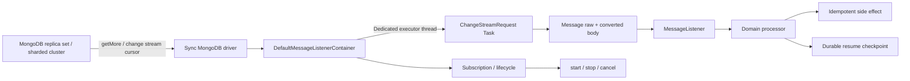
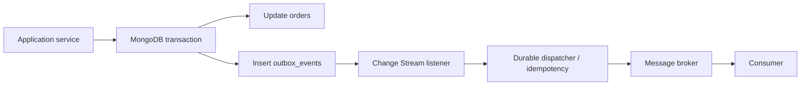

# DefaultMessageListenerContainer for Synchronous Applications

## 1. The Problem: Listening to MongoDB Changes Without Blocking Business Threads

A Spring Boot application using `MongoTemplate` and `MongoRepository` needs to refresh its cache whenever orders change. Instead of polling the entire `orders` collection with `find()` every few seconds, the application wants notifications when MongoDB performs an `insert`, `update`, `replace`, or `delete`.

MongoDB **Change Streams** allow tracking committed data changes. However, with the **MongoDB synchronous Java driver**, calling `watch()` opens a long-lived cursor: a thread calling `iterator.hasNext()` can block waiting for the server to return events. If that loop runs inside an HTTP request, shared scheduler, or business-processing thread, the application risks exhausting threads and hanging endpoints.

Spring Data MongoDB provides `DefaultMessageListenerContainer`, a `MessageListenerContainer` implementation that runs Change Stream listening tasks on a **dedicated executor**, delivers events to a `MessageListener`, and manages subscription lifecycle.

This lesson belongs to the **Change stream** chapter of the **SPRING_DATA_MONGODB** module. The module covers connections, document mapping, operating on MongoDB via `MongoTemplate`/repositories, queries, aggregations, indexes, transactions, reactive access, testing, and data performance diagnostics. Here we focus on the **synchronous/imperative path**, without rewriting the entire application to WebFlux.

### 1.1. Lesson Objectives

You will be able to:

1. Explain why Change Streams require a **replica set or sharded cluster**, and why a synchronous listener occupies a thread long-term.
2. Create a `DefaultMessageListenerContainer` from `MongoTemplate`, register a `ChangeStreamRequest`, and receive `Message`s.
3. Understand `Message.getRaw()`, `getBody()`, `Subscription`, `ErrorHandler`, `start()`, `stop()`, and `SmartLifecycle`.
4. Configure `fullDocumentLookup`, pipeline filters, collection scope, and database scope.
5. Design **resume tokens**, post-processing checkpoints, deduplication, and crash/restart recovery.
6. Manage executors, connection pools, shutdown, health checks, manual backpressure, and multiple application replicas.
7. Write bounded integration tests on a MongoDB replica set verifying insert/update/delete without hanging tests.

> **Limitation:** A Change Stream is a source of change notifications, not a durable queue with automatic business acknowledgments. A listener **receiving** an event does not mean side effects succeeded, tokens were saved, or other consumers processed it once.

## 2. Choosing the Right Reading Mechanism

| Need | Mechanism | Notes |
| --- | --- | --- |
| Read existing documents | `MongoTemplate.find(...)`/repository | On-demand queries |
| Poll for new documents | Scheduled query by offset | Easy to implement but adds latency and query cost |
| Receive committed changes | MongoDB Change Streams | Provides resume tokens; requires supported topology |
| Listen from an imperative app | `DefaultMessageListenerContainer` | Blocking cursor on a dedicated executor |
| Listen from a reactive app | `ReactiveMongoTemplate.changeStream(...)` | `Flux`, generally more thread-efficient |
| Reliably deliver business events externally | Transactional outbox + dispatcher | Supports idempotency/retry/commit policies |
| Push data change updates to UI | Change Stream → notification gateway | Needs fan-out and access control |

Spring Data MongoDB officially recommends considering reactive Change Streams because they typically consume fewer resources. Still, if an entire application runs on Spring MVC and synchronous `MongoTemplate`, the **synchronous container** is a sound choice provided you size the **executor and shutdown** properly.

### 2.1. Which changes generate change events?

Within a watched collection, insert/update/replace/delete commands from **any authorized client** can emit events, including `mongosh`, raw MongoDB drivers, or other applications. Change Streams **do not depend on Spring `EntityCallback`**.

Normal `find`/aggregation reads do not mutate data, so they emit no write events. With transactions, data-related change events are published under MongoDB commit semantics, not each time an uncommitted write sits inside an open transaction.

### 2.2. Prerequisites

To run the examples, you need:

- A MongoDB **replica set** (a single-node replica set works for integration tests) or a **sharded cluster** supporting Change Streams.
- Compatible MongoDB server and driver versions, plus an account with appropriate Change Stream privileges.
- Spring Boot with imperative `spring-boot-starter-data-mongodb`; WebFlux is not required.
- An `orders` collection and a clearly defined watch scope.
- An executor with enough threads for your long-lived subscriptions.

**Standalone MongoDB is insufficient.** If local `mongod` lacks a replica set and throws change stream errors, do not just tweak Java code—check your deployment topology.

## 3. Runtime Architecture



### 3.1. Core Components

| Component | Role |
| --- | --- |
| `MongoTemplate` | Supplies connections/driver and mapping infrastructure |
| `DefaultMessageListenerContainer` | Runs event-listening tasks on an `Executor` |
| `MessageListenerContainer` | Interface to register subscriptions and control lifecycle |
| `ChangeStreamRequest<T>` | Describes collection/database, filter, `fullDocument`, and resume options |
| `MessageListener<ChangeStreamDocument<Document>,T>` | Receives one `Message` per event |
| `Message.getRaw()` | Accesses driver-level change event |
| `Message.getBody()` | Converted document/body when present |
| `Subscription` | Handle to inspect active state, await startup, or cancel |
| `ErrorHandler` | Receives errors forwarded by the container |
| `SmartLifecycle` | Integrates automatic start/stop when registered as a Spring bean |

### 3.2. An event is not always a full entity

Change events have an envelope:

```javascript
{
  _id: { /* opaque resume token */ },
  operationType: "update",
  clusterTime: Timestamp({ t: 1795150000, i: 1 }),
  ns: { db: "appdb", coll: "orders" },
  documentKey: { _id: "ord-101" },
  updateDescription: {
    updatedFields: { status: "PAID" },
    removedFields: []
  },
  // fullDocument may be absent depending on options/operation.
}
```

The token is an **opaque BSON value**; never decode it or slice substrings to build a cursor—persist and pass back the exact typed value.

### 3.3. Where does blocking happen?

Running a MongoDB Change Stream via the sync driver waits on the cursor for new events, so each task occupies an executor thread. `MessageListener` normally executes on that task's path; if the callback spends 30 seconds calling an HTTP API, cursor reads stall accordingly.

That is why you must avoid:

- `while(true)` with `watch()` on request threads.
- `Thread.sleep()` polling for events inside controllers.
- Unbounded-timeout network calls inside listeners.
- Sharing an executor with latency-sensitive web tasks.

## 4. Maven and Gradle Dependencies

### 4.1. Spring Boot Maven

```xml
<dependencies>
    <dependency>
        <groupId>org.springframework.boot</groupId>
        <artifactId>spring-boot-starter-data-mongodb</artifactId>
    </dependency>

    <!-- Optional if the app exposes synchronous HTTP endpoints -->
    <dependency>
        <groupId>org.springframework.boot</groupId>
        <artifactId>spring-boot-starter-web</artifactId>
    </dependency>
</dependencies>
```

### 4.2. Gradle Groovy DSL

```groovy
dependencies {
    implementation 'org.springframework.boot:spring-boot-starter-data-mongodb'
    implementation 'org.springframework.boot:spring-boot-starter-web'
}
```

If the application is a background worker with no HTTP endpoints, omit `starter-web`. Let the Spring Boot BOM/parent/plugin manage Spring Data MongoDB and MongoDB driver compatibility. Never force a manual driver version without compatibility testing.

### 4.3. URI Configuration

With Spring Boot 3.x, for example:

```yaml
spring:
  data:
    mongodb:
      uri: "mongodb://localhost:27017/appdb?replicaSet=rs0"
```

With Spring Boot 4.x, the primary URI property moves to `spring.mongodb.uri`:

```yaml
spring:
  mongodb:
    uri: "mongodb://localhost:27017/appdb?replicaSet=rs0"
```

These are illustrative **development environment** URIs, not production configs. In real deployments, provide URIs via secret managers/environment variables, configure TLS/auth/read preferences per policy, and never log URIs containing passwords.

## 5. Minimal Example: Creating a Container and Listening to a Collection

### 5.1. Basic Java Code

```java
import com.mongodb.client.model.changestream.ChangeStreamDocument;
import org.bson.Document;
import org.springframework.data.mongodb.core.MongoTemplate;
import org.springframework.data.mongodb.core.messaging.ChangeStreamRequest;
import org.springframework.data.mongodb.core.messaging.DefaultMessageListenerContainer;
import org.springframework.data.mongodb.core.messaging.MessageListener;
import org.springframework.data.mongodb.core.messaging.Subscription;

// Assuming MongoTemplate 'template' is Spring-injected.
DefaultMessageListenerContainer container =
    new DefaultMessageListenerContainer(template);

MessageListener<ChangeStreamDocument<Document>, Document> listener =
    message -> {
        ChangeStreamDocument<Document> raw = message.getRaw();
        if (raw == null) {
            return;
        }
        System.out.println("Operation: " + raw.getOperationType());
        System.out.println("Body: " + message.getBody());
    };

ChangeStreamRequest<Document> request =
    ChangeStreamRequest.builder(listener)
        .collection("orders")
        .build();

Subscription subscription =
    container.register(request, Document.class);
container.start();

// When no longer listening:
// subscription.cancel();
// container.stop();
```

**Meaning:** the container runs on an executor; the request selects the `orders` collection; the listener inspects raw operation type and body. Update events may have `body == null` without full-document lookup enabled. Never use `System.out.println` in production; logs require redaction and structured fields.

### 5.2. Why register before `start`?

If you register first, the container can launch tasks immediately when `start()` is called. If the container is already running, `register(...)` can also start the task right away. Do not assume **calling `start` means the cursor is already active**; task startup is asynchronous.

### 5.3. Checking that the task became active

```java
import java.time.Duration;

boolean active =
    subscription.await(Duration.ofSeconds(10));
if (!active) {
    throw new IllegalStateException(
        "Change stream did not become active"
    );
}
```

`await(Duration)` is a **blocking method**: suitable for verifying startup in command runners or bounded integration tests, **never** inside HTTP request paths. It can throw `InterruptedException`; enclosing methods must declare `throws InterruptedException` or follow your interrupt policy.

`subscription.isActive()` is a **point-in-time snapshot**; it does not guarantee the task stays active immediately afterward. Detecting dead tasks requires continuous health monitoring.

## 6. `SmartLifecycle`: Letting Spring Manage the Lifecycle

When `DefaultMessageListenerContainer` is declared as a Spring bean, it implements `SmartLifecycle` and by default **auto-starts when the context initializes** (per Spring Data version). When the Spring context closes, the lifecycle infrastructure invokes stop.

### 6.1. Container bean

```java
package com.example.orders.config;

import org.springframework.context.annotation.Bean;
import org.springframework.context.annotation.Configuration;
import org.springframework.data.mongodb.core.MongoTemplate;
import org.springframework.data.mongodb.core.messaging.DefaultMessageListenerContainer;

@Configuration
public class MongoChangeStreamConfig {

    @Bean
    public DefaultMessageListenerContainer changeStreamContainer(
        MongoTemplate mongoTemplate
    ) {
        return new DefaultMessageListenerContainer(mongoTemplate);
    }
}
```

Never create a new container **per request**. Each container/subscription holds long-lived resources, so its lifecycle belongs at the application/worker level.

### 6.2. Registering subscriptions after the context creates the bean

A clear pattern with Spring Boot:

```java
package com.example.orders.config;

import com.mongodb.client.model.changestream.ChangeStreamDocument;
import org.bson.Document;
import org.springframework.boot.ApplicationRunner;
import org.springframework.context.annotation.Bean;
import org.springframework.context.annotation.Configuration;
import org.springframework.data.mongodb.core.messaging.ChangeStreamRequest;
import org.springframework.data.mongodb.core.messaging.DefaultMessageListenerContainer;
import org.springframework.data.mongodb.core.messaging.MessageListener;

@Configuration
public class ChangeStreamRegistration {

    @Bean
    ApplicationRunner registerOrderWatcher(
        DefaultMessageListenerContainer changeStreamContainer
    ) {
        return args -> {
            MessageListener<ChangeStreamDocument<Document>, Document>
                listener = message -> {
                    if (message.getRaw() != null) {
                        System.out.println(
                            message.getRaw().getOperationType()
                        );
                    }
                };

            ChangeStreamRequest<Document> request =
                ChangeStreamRequest.builder(listener)
                    .collection("orders")
                    .build();

            changeStreamContainer.register(request, Document.class);
        };
    }
}
```

By the time `ApplicationRunner` runs, the container may already have auto-started; new requests run immediately. **A brief gap may exist before the watch becomes active**, and writes during that window can be missed without a resume/start-at policy. For zero-gap startup requirements, see the checkpointing and startup coordination sections.

### 6.3. Controlling startup manually

```java
DefaultMessageListenerContainer container =
    new DefaultMessageListenerContainer(mongoTemplate);
container.setAutoStartup(false);
```

Register this container as a bean, register requests first, then call `container.start()` inside a proper orchestration hook. Avoid enabling multiple start hooks that register duplicates. `setAutoStartup(boolean)` exists in newer Spring Data releases; check your version's API.

### 6.4. Shutdown

```java
container.stop();
```

`stop()` halts the container's tasks/subscriptions and frees its resources through lifecycle management. Do not merely cancel a `Future` and abandon cursors; never let listening tasks continue after the application context and Mongo client close.

## 7. `Message`: Body, Raw Event, and Metadata Differences

A `Message<ChangeStreamDocument<Document>, T>` provides:

| API | Result | When to use |
| --- | --- | --- |
| `message.getRaw()` | `ChangeStreamDocument<Document>` or null | Extract operation type, resume token, document key, update description |
| `message.getBody()` | Converted `T` or null | Use full document for domain handling when present |
| `message.getProperties()` | Metadata wrapper | Inspect source properties of the message |
| `message.getBodyBeforeChange()` | Converted pre-image or null if supported | Only when server and options provide pre-images |

### 7.1. Listener must not assume `body` always exists

```java
MessageListener<ChangeStreamDocument<Document>, Document> listener =
    message -> {
        ChangeStreamDocument<Document> raw = message.getRaw();
        if (raw == null) {
            return;
        }

        // Event envelope:
        var operation = raw.getOperationType();
        var token = raw.getResumeToken();
        var documentKey = raw.getDocumentKey();

        // Body is not always present.
        Document body = message.getBody();
        if (body != null) {
            handleFullDocument(body);
        } else {
            handleByKey(operation, documentKey);
        }
    };
```

`handleFullDocument` and `handleByKey` are illustrative application methods to define in your project. Delete events normally lack post-images; on updates, `fullDocument` may be absent unless lookup is enabled.

### 7.2. Distinguishing `operationType`

```java
import com.mongodb.client.model.changestream.OperationType;

OperationType operation = raw.getOperationType();

if (operation == OperationType.INSERT) {
    // New document may appear in body.
} else if (operation == OperationType.UPDATE) {
    // Has updateDescription; post-image depends on options.
} else if (operation == OperationType.DELETE) {
    // Rely on documentKey; post-image is normally null.
}
```

Never build a system assuming every event is an insert. Operation types can expand across MongoDB server versions, especially when expanded events are enabled.

### 7.3. `UpdateDescription` holds a delta, not the full record

```javascript
{
  operationType: "update",
  documentKey: { _id: "ord-101" },
  updateDescription: {
    updatedFields: { status: "PAID" },
    removedFields: []
  }
}
```

To invalidate a cache, knowing `documentKey._id` is usually enough. To update a search index needing the full body, you can enable `fullDocumentLookup`, keeping in mind consistency caveats covered next.

## 8. `fullDocumentLookup`: When Needed and When Not

### 8.1. Requesting post-images via `UPDATE_LOOKUP`

```java
import com.mongodb.client.model.changestream.FullDocument;

ChangeStreamRequest<Document> request =
    ChangeStreamRequest.builder(listener)
        .collection("orders")
        .fullDocumentLookup(FullDocument.UPDATE_LOOKUP)
        .build();
```

With `FullDocument.UPDATE_LOOKUP`, MongoDB attempts to read the **latest majority-committed version at lookup time** for update events; it **does not guarantee an exact snapshot at the instant each delta happened**. If a document is updated twice in rapid succession, the earlier event's body may already contain the later state.

### 8.2. Which event types normally have bodies?

| Event | Typical `fullDocument` |
| --- | --- |
| `insert` | Newly inserted document |
| `replace` | Replacement document |
| `update` | Delta by default; body may be null unless lookup/post-image chosen |
| `delete` | No post-image; use `documentKey` |
| `invalidate` | Not a full business document |

Even with lookup enabled, a body is not guaranteed: the document may be deleted before lookup runs, privileges may block it, or feature/policy settings may omit pre/post-images.

### 8.3. When should you use `UPDATE_LOOKUP`?

Appropriate when listeners need current data to sync a read model and downstream accepts that the body reflects **current state** rather than an event-time snapshot. If you only need the changed ID to invalidate caches, prefer `documentKey` and save extra lookup load.

### 8.4. Pre-images differ from `UPDATE_LOOKUP`

On MongoDB server versions supporting document pre/post-images, you can request pre-images, provided the collection feature is enabled and retention/overhead are weighed. `message.getBodyBeforeChange()` is not populated merely by setting `FullDocument.UPDATE_LOOKUP`.

### 8.5. Avoid logging entire bodies

An event can hold shipping addresses, customer info, or sensitive data. Logs should capture operation type, namespace, hashed/redacted IDs, token hashes, latency, and error categories per policy—never raw JSON documents or credentials.

## 9. Filtering Change Events Server-Side

### 9.1. Filtering only inserts and updates

```java
import java.util.List;
import org.bson.Document;

Document match = new Document(
    "$match",
    new Document("operationType",
        new Document("$in", List.of("insert", "update")))
);

ChangeStreamRequest<Document> request =
    ChangeStreamRequest.builder(listener)
        .collection("orders")
        .filter(match)
        .build();
```

This is a raw aggregation pipeline filter on the **event envelope**, not an ordinary collection `Query`. It reduces the number of events listeners must process.

### 9.2. Filtering by namespace when watching a database

In a database-level change stream, events include `ns.db` and `ns.coll`. Filters can match:

```javascript
{
  $match: {
    "ns.coll": "orders",
    operationType: { $in: ["insert", "update", "replace"] }
  }
}
```

However, if you only need one collection, `.collection("orders")` is simpler and clearer in scope than a database-level watch + filter.

### 9.3. Database-level watcher

```java
ChangeStreamRequest<Document> databaseRequest =
    ChangeStreamRequest.builder(listener)
        .database("appdb")
        .build();
```

Database-level watches receive events from **multiple collections** with different document schemas. Use `Document.class` rather than forcing every `fullDocument` into a single domain entity. Restrict privileges and filters appropriately, especially in multi-tenant databases or databases holding unrelated domains.

### 9.4. Filtering by tenant: beware null bodies

```javascript
{
  $match: {
    "fullDocument.tenantId": "tenant-a"
  }
}
```

This filter can drop `delete` (no `fullDocument`) and `update` (no post-image or failed lookup). For multi-tenant isolation across every event, consider `documentKey` including tenant via schema/shard key, collection-per-tenant, or resolving tenant via a reliable source. **Never apply a `fullDocument`-only filter and assume deletes are covered.**

### 9.5. Filtering with Spring Data `Aggregation`

The builder also supports:

```java
import static org.springframework.data.mongodb.core.aggregation.Aggregation.*;
import static org.springframework.data.mongodb.core.query.Criteria.*;

ChangeStreamRequest<Document> request =
    ChangeStreamRequest.builder(listener)
        .collection("orders")
        .filter(newAggregation(
            match(where("operationType").in(
                "insert", "update", "replace"
            ))
        ))
        .build();
```

With typed aggregations, Spring Data may map domain field names; envelope paths such as `operationType`/`ns`/`documentKey` follow special rules. To avoid mapping surprises, test the resulting BSON pipeline, especially when filtering `fullDocument.someAlias` with `@Field`.

### 9.6. Never modify the event's `_id` field

The resume token sits in the change event's `_id` field. MongoDB restricts pipelines that mutate event `_id`; **never use `$project`/`$replaceRoot` to overwrite the token expecting resuming to still work**. When trimming payloads, preserve the token per server contract.

## 10. `Subscription`: Active, Cancel, Remove, and Restart

### 10.1. `Subscription` is not a Reactive Streams subscription

Here `Subscription` is the handle linking a `SubscriptionRequest` and the running task in `DefaultMessageListenerContainer`. It differs from `org.reactivestreams.Subscription` in Project Reactor.

```java
Subscription subscription =
    container.register(request, Document.class);

boolean runningNow = subscription.isActive();
boolean startedWithinDeadline =
    subscription.await(Duration.ofSeconds(5));
```

`isActive()` reflects instantaneous state; `await(...)` waits for activation and can throw `InterruptedException`. Do not call `await` repeatedly as an HTTP health check on request threads.

### 10.2. Canceling a subscription

```java
subscription.cancel();
```

Canceling stops the corresponding task/cursor. **Do not** assume canceling rolls back side effects the listener already applied; each processed event has its own lifecycle.

### 10.3. Removing a subscription from the container

```java
container.remove(subscription);
```

`remove(...)` **unregisters** the subscription from the container. By contract, still-registered requests may restart if the container restarts; to permanently drop a watcher, remove it rather than merely stopping the container temporarily.

### 10.4. Container stop then start

```java
container.stop();
container.start();
```

Registered requests can restart when the container starts again. **There is no automatic guarantee of catching missed events during the stop gap** without a resume token or proper start position. Never treat stop/start as durable recovery.

### 10.5. Avoid duplicate registrations

Containers have rules for re-registering the **same request instance**, yet creating two new `ChangeStreamRequest` objects with identical config creates two separate subscriptions. Ensure lifecycle registration is idempotent and never invoke registration inside health checks.

## 11. Executor: A Common Resource Exhaustion Point

`DefaultMessageListenerContainer` is **Executor-based**. One listener thread may wait on `getMore` indefinitely, even when zero events arrive.

### 11.1. Never use a single-thread executor for multiple watchers

If you register three independent subscriptions on a single-threaded executor, the first task occupies that thread long-term, starving the other two watchers so they never become active.

```text
Executor thread-1: watch orders    (long-running)
Executor thread-2: watch invoices  (long-running)
Executor thread-3: watch payments  (long-running)
```

Each subscription needs a long-lived execution thread. Size the pool by **active subscriptions**, not just HTTP request concurrency.

### 11.2. Dedicated `ThreadPoolTaskExecutor`

```java
package com.example.orders.config;

import org.springframework.beans.factory.annotation.Qualifier;
import org.springframework.context.annotation.Bean;
import org.springframework.context.annotation.Configuration;
import org.springframework.core.task.TaskExecutor;
import org.springframework.data.mongodb.core.MongoTemplate;
import org.springframework.data.mongodb.core.messaging.DefaultMessageListenerContainer;
import org.springframework.scheduling.concurrent.ThreadPoolTaskExecutor;

@Configuration
public class ChangeStreamExecutorConfig {

    @Bean(name = "changeStreamExecutor")
    public ThreadPoolTaskExecutor changeStreamExecutor() {
        ThreadPoolTaskExecutor executor =
            new ThreadPoolTaskExecutor();
        executor.setThreadNamePrefix("mongo-change-");
        executor.setCorePoolSize(3);
        executor.setMaxPoolSize(3);
        executor.setQueueCapacity(0);
        executor.setWaitForTasksToCompleteOnShutdown(false);
        executor.initialize();
        return executor;
    }

    @Bean
    public DefaultMessageListenerContainer changeStreamContainer(
        MongoTemplate template,
        @Qualifier("changeStreamExecutor") TaskExecutor executor
    ) {
        return new DefaultMessageListenerContainer(template, executor);
    }
}
```

**Do not define both this config and the container bean from Section 6** in the same project if they create two unwanted containers. This is an alternative configuration. A pool of three threads illustrates three watchers; size appropriately for throughput, subscription count, monitoring, and deployment resources. When declaring a Spring-managed bean, consider letting Spring manage `initialize()` rather than calling it manually; verify behavior for your Spring version.

### 11.3. `queueCapacity=0` exposes thread starvation immediately

`queueCapacity=0` forces the executor to spawn threads up to `maxPoolSize` instead of silently queueing forever; exceeding active capacity rejects tasks. For long-running watchers, **unbounded queues hide misconfiguration**, so monitor rejected tasks and active subscriptions.

### 11.4. Connection pool vs. thread pool

A change stream cursor also requires a MongoDB client connection/resources. Having enough executor threads while exhausting the connection pool still stalls subscriptions. Monitor them separately:

| Resource | Symptom |
| --- | --- |
| Executor threads | Subscription fails to become active because task isn't scheduled |
| MongoDB connection pool | Slow checkout, timeouts, failed operations |
| Server change stream cursors | Many open cursors, `getMore` activity, server pressure |
| Listener CPU | Heavy callbacks slowing cursor reads |
| Downstream queues | Backlog growth or drops under overload |

## 12. `ErrorHandler`: Seeing an Error Does Not Mean the Stream Self-Recovers

Spring Data documentation notes that processing errors are passed to `org.springframework.util.ErrorHandler`, whose default implementation mainly logs. **Retrieval** errors can cause the task to cancel. Do not assume the container automatically recreates every subscription after any error.

### 12.1. Per-subscription `ErrorHandler`

```java
import org.springframework.util.ErrorHandler;

ErrorHandler handler = error -> {
    // Never log raw events containing customer data.
    System.err.println(
        "Change stream failure: " +
        error.getClass().getSimpleName()
    );
    metrics.recordChangeStreamFailure(error);
};

Subscription subscription =
    container.register(request, Document.class, handler);
```

`metrics` is an illustrative application dependency. The handler should emit structured logs/metrics and notify a **supervisor** coordinating recovery, rather than infinitely re-registering directly inside the error callback.

### 12.2. Two distinct error categories

| Error | Example | Response |
| --- | --- | --- |
| Retrieval/cursor | MongoDB disconnect, primary stepdown, expired token | Check task state, resume/recreate per policy |
| Business processing | Listener API call times out, unknown schema, downstream failure | Do not checkpoint token; retry/idempotency/DLQ |

Never inspect only `ErrorHandler` and conclude every event was handled. If a callback catches an exception, swallows it, and still saves the token, the application can **skip unrecovered failed events**.

### 12.3. Do not use `ErrorHandler` to hide failures

```java
// Anti-pattern:
// ErrorHandler handler = error -> {};
```

Swallowing errors fools monitoring into thinking the watcher is healthy. A task may already have stopped; base health on subscription state, connectivity, checkpoint progression, and restart counts.

### 12.4. Preventing retry storms

Supervisors should apply bounded retries with backoff/jitter and error classification:

- Network/transient topology: attempt recovery from the saved token.
- Unauthorized/invalid option: fix configuration/privileges; tight retries achieve nothing.
- Token evicted from oplog: run **rebootstrap/reconciliation** per business policy.
- Invalidate due to drop/rename: evaluate `startAfter` or opening a new scoped stream.
- Poison event (persistent business failure): isolate to DLQ and decide replay strategy.

Never reset the checkpoint to "now" just to make dashboards green if doing so drops data.

## 13. Resume Tokens: Position in the Event Stream

Each change event has a resume token (in event BSON `_id`), letting the app open a stream continuing after a specified position. Spring Data exposes the token through the raw `ChangeStreamDocument`.

### 13.1. Reading the token in a listener

```java
import org.bson.BsonDocument;

MessageListener<ChangeStreamDocument<Document>, Document> listener =
    message -> {
        ChangeStreamDocument<Document> raw = message.getRaw();
        if (raw == null) {
            return;
        }

        BsonDocument token = raw.getResumeToken();
        if (token == null) {
            throw new IllegalStateException(
                "Expected resume token"
            );
        }

        // Process business logic durably first.
        processEvent(raw, message.getBody());

        // Checkpoint only after success.
        checkpointStore.save("orders-stream-v1", token);
    };
```

`processEvent` and `checkpointStore` are illustrative abstractions defined later. This snippet illustrates the **proper conceptual order**, though it **does not automatically make side effects and checkpointing atomic**.

### 13.2. Resuming from a saved token

```java
ChangeStreamRequest.ChangeStreamRequestBuilder<Document> builder =
    ChangeStreamRequest.builder(listener)
        .collection("orders")
        .fullDocumentLookup(FullDocument.UPDATE_LOOKUP);

checkpointStore.load("orders-stream-v1")
    .ifPresent(builder::resumeAfter);

ChangeStreamRequest<Document> request = builder.build();

Subscription subscription =
    container.register(request, Document.class);
```

If a valid prior token exists, the stream starts **after the event carrying that token** (per `resumeAfter` semantics). If none exists, the stream starts at the default position upon registration/initialization; it **does not automatically replay full history**.

### 13.3. Preserving BSON types

A resume token is neither an auto-incrementing number nor an ISO timestamp. Persist tokens as BSON subdocuments or type-preserving Extended JSON and parse them back; **never save only `token.toString()` or a manually extracted `_data` string** without verified round-tripping.

### 13.4. Why not save `Instant.now()` instead of a token?

Application wall clocks can drift from the server, and multiple events within the same second or millisecond have distinct ordering and precision. Servers provide `clusterTime`/resume tokens for MongoDB-consistent resumption. Prefer tokens for exact resumption; use `resumeAt(Instant)`/native timestamps only when you accept their trade-offs.

## 14. Resume Options: `resumeAfter`, `startAfter`, and `resumeAt`

| Option | When to use | Notes |
| --- | --- | --- |
| `resumeAfter(token)` | Resume after a normal event | Cannot resume *after invalidate* with this option |
| `startAfter(token)` | Start a new stream after a token, including invalidate events | Subject to history/topology limits |
| `resumeAt(Instant)` | Start from the corresponding server time | `Instant` may lack increment precision |
| `resumeAt(BsonTimestamp)` | Native BSON timestamp precision required | Depends on API/version used |
| None passed | Watch changes from stream open time by default | Does not backfill prior history |

### 14.1. Invalidate from drop/rename

When a collection is dropped or renamed, the stream may emit `invalidate` and close. MongoDB forbids using `resumeAfter` **after invalidate**; evaluate `startAfter` per policy and confirm the new collection matches expected schema. Never automatically reopen onto a renamed collection without considering migration.

### 14.2. Oplog retention is a hard boundary

Tokens only work while the server still holds enough oplog/history to locate the position. If a consumer is down for days and the token is too old, resuming fails. No infinite retry setting can regenerate evicted history. You must:

1. Detect expired/invalid token errors.
2. Run reconciliation/rebootstrap from current data and domain sources of truth.
3. Establish a new checkpoint using a race-safe strategy.
4. Report the gap/missing history to monitoring and operations.

### 14.3. Do not arbitrarily change the pipeline on resume

MongoDB recommends reusing the **exact same pipeline and options** that produced the token. Switching from collection to database watch, changing `fullDocument`/filters, or changing schemas can break resuming. Version stream definitions alongside checkpoints (e.g., `orders-stream-v1`) and plan migrations whenever filters change.

### 14.4. Resume tokens are not transaction commit acknowledgments

A token identifies a position in the change stream. It does not confirm an HTTP response succeeded, a consumer sent to Kafka, or a side effect committed in a separate transaction. Never conflate stream checkpoints with request/response business state.

## 15. Persisting Checkpoints as Type-Preserving BSON

A simple implementation can use a dedicated `change_stream_checkpoints` collection storing full `BsonDocument`s. The example below uses the raw synchronous MongoDB driver from `MongoTemplate.getDb()` so mapping never strips BSON types.

### 15.1. Interface

```java
package com.example.orders.change;

import java.util.Optional;
import org.bson.BsonDocument;

public interface ResumeCheckpointStore {
    Optional<BsonDocument> load(String streamId);
    void save(String streamId, BsonDocument token);
}
```

### 15.2. MongoDB implementation

```java
package com.example.orders.change;

import java.util.Optional;
import com.mongodb.WriteConcern;
import com.mongodb.client.MongoCollection;
import com.mongodb.client.model.UpdateOptions;
import org.bson.BsonDocument;
import org.bson.BsonString;
import org.springframework.data.mongodb.core.MongoTemplate;
import org.springframework.stereotype.Repository;

@Repository
public class MongoResumeCheckpointStore
        implements ResumeCheckpointStore {

    private final MongoCollection<BsonDocument> checkpoints;

    public MongoResumeCheckpointStore(MongoTemplate mongoTemplate) {
        this.checkpoints = mongoTemplate.getDb()
            .getCollection(
                "change_stream_checkpoints",
                BsonDocument.class
            )
            .withWriteConcern(WriteConcern.MAJORITY);
    }

    @Override
    public Optional<BsonDocument> load(String streamId) {
        BsonDocument filter = new BsonDocument(
            "_id", new BsonString(streamId)
        );
        BsonDocument found = checkpoints
            .find(filter)
            .first();
        if (found == null || !found.containsKey("token")) {
            return Optional.empty();
        }
        return Optional.of(found.getDocument("token"));
    }

    @Override
    public void save(String streamId, BsonDocument token) {
        BsonDocument filter = new BsonDocument(
            "_id", new BsonString(streamId)
        );
        BsonDocument update = new BsonDocument(
            "$set", new BsonDocument("token", token)
        );
        checkpoints.updateOne(
            filter,
            update,
            new UpdateOptions().upsert(true)
        );
    }
}
```

**Example limitations:** this is a minimal checkpoint store for **one logical consumer** and lacks fencing, compare-and-set, or distributed leases. If two processes share `streamId`, a slower process can overwrite a newer token with an older one. Multi-instance production needs single-writer leadership/lease + fencing or conditional checkpointing tested for races.

### 15.3. Never save before processing

```java
// WRONG:
// checkpointStore.save(streamId, token);
// processor.process(event);
```

If the process crashes after `save` and before processing, restarting calls `resumeAfter(token)` and **skips the unprocessed event**. Safer execution order:

```java
processor.process(event);        // Must be idempotent.
checkpointStore.save(streamId, token);
```

Also recognize the reverse window: if the process dies **after processing and before checkpointing**, the event replays. That is why **idempotency** is mandatory.

### 15.4. Majority acknowledgment is not magic

`WriteConcern.MAJORITY` strengthens checkpoint durability under MongoDB semantics, yet does not make an external side effect and the checkpoint atomic together. If the app sends an email and then checkpoints, a crash window still exists where the email was sent but the offset was not saved.

### 15.5. Include clear namespace/schema metadata in checkpoints

In practice, store alongside the token:

- `streamId` and stream definition version.
- Database/collection scope.
- Actual checkpoint timestamp.
- Event metadata (operation type, redacted document key ID if permissible).
- Consumer/lease owner and fencing epoch when running multiple instances.
- Last processing status and recent error info (in a separate collection/telemetry store as needed).

Do not dump long raw BSON tokens into logs; log fingerprints instead.

## 16. At-Least-Once, Replay, and Idempotency

### 16.1. Crash matrix to know by heart

| Crash timing | Durable side effect? | Token saved? | On restart |
| --- | --- | --- | --- |
| Before processing | No | No | Replay event |
| Mid-processing | Possibly partial | No | Replay; must guard against partials |
| After processing, before checkpoint | Yes | No | Replay **duplicate** |
| After checkpoint in proper order | Yes | Yes | Resume after token |
| After checkpoint while side effect failed | Incomplete | Yes | **Risk of losing event** |
| External side effect commit uncertain | Unknown | Saved or unsaved | Reconcile by business key |

### 16.2. Idempotent processor

Instead of "send an email on every received event", track event identity or operation IDs:

```text
Input: streamId + event resume token + documentKey
  |
  v
Validate schema / expected operation
  |
  v
Try recording processing ID with unique constraint
  |
  +-- already processed → skip side effect safely
  |
  +-- new → apply business effect, commit result
  |
  v
Save checkpoint only after successful processing
```

**Inserting a unique marker before a side effect is not enough** if the marker commits and the side effect never runs. For data inside the same MongoDB replica set, put marker + projection update + checkpoint inside **one transaction**. For external APIs/email/brokers, use a durable outbox and idempotent consumers.

### 16.3. Tokens are not always stable business event IDs across pipelines

A resume token marks position in a specific change stream and is opaque; it may not work as a business-level ID if the same mutation is re-emitted under a redesigned stream definition. Domain data should carry its own stable business `operationId`/`eventId`. You can include stream tokens in dedupe keys to block replays within the same watcher definition.

### 16.4. Change streams do not load-balance across replicas

If you deploy three Spring Boot instances, each creating a container watching the same collection, **all three can receive the same events**. This is fan-out, not a Kafka consumer group. You need:

- One active leader/singleton worker with lease/fencing, **or**
- Each instance processing idempotently for intentional fan-out, **or**
- Forwarding events into a broker/queue with consumer groups.

Never assume Kubernetes replicas automatically split change events evenly across three pods.

## 17. Integrating Change Streams into a Transactional Outbox Architecture

### 17.1. When business events need reliable delivery

Suppose `orders` is updated and the app must publish `ORDER_PAID` to a message broker. Watching `orders` directly can help, yet raw table envelopes do not always carry complete business intent. A more reliable layout:



The outbox stores domain event records with `eventId` and application-defined payloads. A Change Stream on the outbox serves as a **fast wake-up signal for the dispatcher**, not the sole replacement for scanning unsent outbox rows and reconciliation.

### 17.2. Why is outbox scanning still needed?

If a watcher stops longer than the oplog window, its resume token expires. Unpublished outbox documents remain in the collection per retention policy, letting the dispatcher scan `PENDING` rows to recover. Watching `orders` directly without an event history or read model cannot reconstruct intermediate state changes from current state.

### 17.3. Never publish to a broker directly from a listener without a policy

```java
// Dangerous without idempotency and a checkpoint strategy:
// listener = message -> broker.send(message.getBody());
```

Broker network acknowledgments and MongoDB checkpoints belong to two separate systems. Define idempotency keys, retry budgets, dead-letter policies, and persistent sent-state tracking.

## 18. Synchronous Processing vs. Handing Off to a Worker Pool

With the sync driver, callbacks can process immediately or enqueue work elsewhere. Both carry trade-offs.

### 18.1. Processing directly in the listener

```java
MessageListener<ChangeStreamDocument<Document>, Document> listener =
    message -> {
        var raw = message.getRaw();
        if (raw == null) {
            return;
        }
        processor.handle(raw, message.getBody());
        checkpoints.save(
            "orders-stream-v1", raw.getResumeToken()
        );
    };
```

This assumes `processor.handle` is **synchronous, durable, and idempotent**, the token is non-null, and failures are caught by a supervisor. Advantage: processing order and checkpoints are easy to reason about. Trade-off: a slow listener slows down reading subsequent change events on that subscription.

### 18.2. Bounded queue

```java
import java.util.concurrent.ArrayBlockingQueue;
import java.util.concurrent.BlockingQueue;

BlockingQueue<WorkItem> queue =
    new ArrayBlockingQueue<>(1000);

MessageListener<ChangeStreamDocument<Document>, Document> listener =
    message -> {
        WorkItem item = WorkItem.from(message);
        if (!queue.offer(item)) {
            throw new IllegalStateException(
                "Change stream queue full"
            );
        }
    };
```

`WorkItem` is a placeholder DTO to define. **Crucial:** this is an *in-memory queue* only. Successful enqueuing **is not durable processing**, so **never save the resume token after `offer`**. If the process dies with messages left in the queue, those events must replay from the previous checkpoint.

### 18.3. When is checkpointing after enqueue safe?

Only when enqueuing into a **durable queue/inbox** with durable acknowledgments and idempotency, then checkpointing after the durable write succeeds. The queue's consumer then handles its own retries; still ensure the checkpoint never precedes the durable enqueue.

### 18.4. Preserving order

If multiple consumer threads run, events for the same `orderId` may finish out of order even though the Change Stream emitted them sequentially. For versioned projections, enforce CAS/version checks or partition by aggregate ID to preserve per-key order. Never depend on network callback speed for ordering guarantees.

### 18.5. Queue-full policies

| Policy | Risk |
| --- | --- |
| Drop item | Loses events if checkpoint/offset advanced |
| Block with `put` | Watcher stops reading, increasing lag and pool pressure |
| Throw exception | May fail the task; requires supervisor and replay |
| Pause intake, resume later | Needs durable checkpoints and monitoring |
| Durable broker | Adds infrastructure, decouples intake and processing |

There is no one-size-fits-all answer; choose based on zero-loss requirements, latency, and recoverability.

## 19. Managing Multiple Instances: Leader Election and Fencing

If a Change Stream serves a singleton task (only one process may update a shared projection), multi-replica deployments require coordination.

### 19.1. Leader lease

A design can store a lease document:

```javascript
{
  _id: "orders-stream-v1",
  ownerId: "worker-abc",
  leaseUntil: ISODate("2026-11-20T11:05:00Z"),
  fencingToken: NumberLong("42")
}
```

One worker renews the lease under a clock/time-source policy; another worker can claim ownership only once the lease expires. To prevent *split brain* if a paused process wakes up and resumes writing, every projection and checkpoint write must verify **`fencingToken`**. Leases without fencing still allow two workers to write concurrently.

### 19.2. Watchers do not cluster-lock automatically

`DefaultMessageListenerContainer` is not a distributed lock manager. `Subscription.isActive()` only says the local task is running—not whether another pod is reading the same collection.

### 19.3. Single active watcher vs. fan-out

| Strategy | Best when | Warning |
| --- | --- | --- |
| Single leader watcher | Updating shared read models, exclusive job dispatch | Needs failover/lease/fencing |
| Every pod watches | Per-pod local cache invalidation | Multiplies Change Stream cursors |
| One watcher → broker | Many consumers needing load sharing | Needs broker/outbox and idempotency |
| Every pod handles all | Intentional fan-out | Side effects must be idempotent |

### 19.4. Bind checkpoints to ownership

A production checkpoint store generally cannot allow any arbitrary process to call `save(streamId, token)`. Combine fencing/lease epochs or conditional transactions verifying the current owner so a stale worker never writes an offset backward.

### 19.5. Clock skew

Leases built on unsynchronized client wall clocks can produce dual owners. For critical workloads, use an authoritative server time source and atomic server-side compare-and-set; test failovers, network partitions, GC pauses, rolling deploys, and ownership handoffs.

## 20. Resuming After Restarts or Rolling Deploys

### 20.1. Recommended startup sequence

```text
1. Verify replica set, auth, and collections/indexes are ready.
2. Verify stream definition + options version.
3. Load durable checkpoint token.
4. Acquire lease/fencing if a singleton consumer is needed.
5. Build ChangeStreamRequest with valid resumeAfter/startAfter.
6. Register with DefaultMessageListenerContainer.
7. Start container or rely on SmartLifecycle.
8. Wait on Subscription.await(deadline) during startup path.
9. Mark readiness up per SLA.
10. Monitor lag, active state, processing success, and checkpoint progress.
```

### 20.2. Shutdown sequence

```text
1. Stop accepting new external work.
2. Finish/drain in-flight side effects within a deadline.
3. Save checkpoints for durably processed events.
4. Cancel/stop the change stream container.
5. Close executors and MongoClient via Spring lifecycle.
6. Release lease/fencing if used.
```

**Never checkpoint in-flight events** just to shut down faster. If the shutdown timeout expires, rely on safe idempotent replay rather than falsely marking unfinished events complete.

### 20.3. Readiness vs. liveness

- **Liveness:** process is alive without obvious deadlocks.
- **Readiness:** worker is ready to receive/process Change Streams per contract.
- **Business health:** checkpoint is not lagging behind, side effects/queues are within SLA.

Do not use `container.isRunning() == true` as sole proof of business health. A container can be running even though a specific subscription was canceled by a retrieval error.

### 20.4. Stop/start does not imply automatic replay

When a task stops, the cursor can miss new changes unless restarts load a token. The listener container's ability to restart registered subscriptions **does not replace durable checkpointing and explicit resuming**.

## 21. Error Configuration and Production Monitoring

### 21.1. Recommended metrics

| Metric | Meaning | Alert trigger |
| --- | --- | --- |
| Active subscriptions | Did a task die or fail to start? | Count lower than expected |
| Listener events/sec | Traffic by operation type | Prolonged zero may be normal if no writes occur |
| Processing p50/p95/p99 | Callback/side-effect latency | Spikes when downstream stalls |
| Checkpoint age | Time since last token save | High while new events exist |
| Last event `clusterTime` | Stream position | Growing gap under active traffic |
| `ErrorHandler` count | Cursor/conversion/process errors | Abnormal surge |
| Retry/restart count | Instability indicator | Retry storm |
| Queue depth/oldest age | Manual backpressure | Hitting capacity or growing steadily |
| MongoDB pool wait | Connection exhaustion | Checkout timeouts |
| Open cursors | Resource usage | Fails to drop after stop |
| Duplicate processing | Idempotency activity | Spike after failover/replay |
| Oplog window | Enough time left to resume? | Consumer lag approaching retention |

**Note:** A collection with zero writes can emit zero events for a long time, so do not treat "no events" alone as proof the watch died. Combine subscription status, driver/server telemetry, and where appropriate a synthetic canary event carrying no real data.

### 21.2. Structured logging

```text
streamId
ownerId / fencingEpoch (if applicable)
namespace
operationType
documentKey (PII-sanitized)
eventClusterTime
processingDurationMs
checkpointLatencyMs
checkpointResult = WRITTEN | SKIPPED | FAILED
errorCategory
subscriptionState
```

Never log access tokens, MongoDB credentials, full PII-bearing bodies, or raw resume tokens indiscriminately. When correlation is required, use fingerprints/token hashes compliant with logging policy.

### 21.3. Command monitoring and tracing

The MongoDB Java driver provides command monitoring/metrics, integrating with Spring Boot Actuator/Micrometer depending on setup. You can measure `aggregate` calls opening change streams, `getMore`/cursors, and connection checkouts. Never tie business success to every `getMore`: a cursor returning zero events during an idle period is normal.

### 21.4. Batch/await timeout limits

`ChangeStreamRequest.builder(...).maxAwaitTime(Duration.ofSeconds(2))` configures the server-side maximum await time for cursor `getMore` where supported; it is **not a callback processing deadline or overall subscription timeout**.

```java
ChangeStreamRequest<Document> request =
    ChangeStreamRequest.builder(listener)
        .collection("orders")
        .maxAwaitTime(Duration.ofSeconds(2))
        .build();
```

Do not assume the container restarts or emits a heartbeat every 2 seconds. Keep `getMore` polling await, socket/read timeouts, processing timeouts, and health SLAs distinct.

## 22. Access Control and Security

### 22.1. MongoDB permissions

The account opening a Change Stream needs privileges matching its scope, typically **`find`** and **`changeStream`** on target resources. If using `fullDocument: updateLookup`, permissions/collection visibility must also allow the lookup query. Database-level watch privileges are broader than single-collection watches.

Never grant cluster-wide admin roles to a worker just to silence an `Unauthorized` error. Assign least-privilege roles scoped to watched databases/collections and verify permissions with an integration smoke test.

### 22.2. Collection-level vs. database-level scope

| Scope | Access privileges | Risk |
| --- | --- | --- |
| `orders` collection | Narrow, fits a single bounded context | Fewer differing schemas |
| Entire database | Multiple collections | Higher risk of schema confusion or PII exposure |
| Entire deployment (`client.watch`) | Broadest | Demands explicit policies and privilege review |

### 22.3. Tenant isolation

A collection-scoped Change Stream on a multi-tenant collection sees events across all tenants. Listeners do not automatically know which authenticated HTTP user may see which event. If forwarding to WebSocket/SSE, enforce subscriber auth/tenant checks before fan-out and never expose raw `Document`s to clients.

### 22.4. Change events can contain sensitive fields

`fullDocumentLookup` pulls full documents into memory, logs, and queues. When you only need cache invalidation, avoid full-document lookups. Data minimization lowers security exposure and overhead.

### 22.5. TLS and secrets

MongoDB connection strings can contain users, passwords, and TLS parameters. Keep secrets out of source control, enable TLS per deployment policy, and redact logs/traces. Because Change Streams use long-lived connections, test reconnect/restart behavior under credential and certificate rotation.

## 23. Edge Cases in Event Streams

### 23.1. Drop, rename, and `invalidate`

Collection-level streams can emit `invalidate` when a collection is dropped or renamed. The cursor closes; `resumeAfter` is invalid for continuing past invalidate. If a migration renames a collection, re-evaluate scope/schema, use `startAfter` when appropriate, and run reconciliation.

### 23.2. Rapid consecutive updates

With `UPDATE_LOOKUP`, `fullDocument` may show a **newer state** than the event's delta. If update 1 moves status `NEW→PAID` and update 2 moves `PAID→SHIPPED` immediately after, update 1's body may already read `SHIPPED`. When every transition's history matters, persist domain events/outbox records from the application instead of relying on current post-images.

### 23.3. Multi-document transactions

Change Streams reflect committed changes per MongoDB semantics. However, never use `clusterTime` alone to conclude that events sharing a timestamp belong to the same transaction. On supported server versions, inspect `lsid` and `txnNumber` for correlation when present in events.

### 23.4. Deletes usually have no body

A cache invalidator can process deletes using `documentKey`:

```java
if (raw.getOperationType() == OperationType.DELETE) {
    var key = raw.getDocumentKey();
    if (key == null || !key.containsKey("_id")) {
        throw new IllegalStateException("Missing delete key");
    }
    invalidateCacheForId(key.get("_id"));
}
```

`invalidateCacheForId` is an application method. On sharded collections, `documentKey` may include shard key fields depending on schema; never assume `_id` is the only key field in every deployment.

### 23.5. Expanded events

Newer MongoDB versions support additional DDL/index events when options such as `showExpandedEvents(true)` are enabled. Do not turn it on just to "see everything" if handlers cannot process new event types; update schema handling, metrics, privileges, and tests first.

### 23.6. Pre/post-images and retention

To retrieve documents prior to changes, MongoDB requires specific collection settings and retention (on supported servers). If pre-images expire or are not enabled, never build audit history assuming they are always available. Pre-image retention differs from resume token/oplog retention.

## 24. When to Choose Reactive Instead of the Sync Container?

| Criterion | `DefaultMessageListenerContainer` | Reactive `changeStream` |
| --- | --- | --- |
| Data layer | `MongoTemplate`/sync driver | `ReactiveMongoTemplate` |
| Callback style | Synchronous `MessageListener` | `Flux<ChangeStreamEvent<T>>` |
| Thread model | Long-running blocking tasks on Executor | Reactive Streams/non-blocking driver |
| Existing Spring MVC apps | Easy to integrate | Requires designing reactive boundaries |
| Resource cost with many watchers | Each blocking task needs a thread | Usually more thread-efficient |
| Error handling | `ErrorHandler` + supervisor | Reactor operators/retry policies |
| Resume token | `ChangeStreamRequest` options | `ChangeStreamOptions`/reactive API |
| At-least-once/idempotency | Must design yourself | Still must design yourself |
| Stop/cleanup | Container/`Subscription` lifecycle | Dispose/cancel reactive subscription |

**Never mix both APIs just for syntactic preference.** A pure sync Spring MVC worker can run `DefaultMessageListenerContainer` reliably with a small subscription count and controlled worker threads. With hundreds of watchers or complex fan-out streams, reactive architecture is worth evaluating; still, reactive does not automatically deliver exactly-once processing.

### 24.1. Never call `block()` on an event loop

If your app runs WebFlux, invoking sync `MongoTemplate.watch(...)` on the event loop blocks threads. The container is designed to isolate blocking tasks; if workloads are end-to-end reactive, prefer reactive APIs to avoid bridging.

### 24.2. Polling still has its place

If business logic only needs daily syncs or processing durable backlog items, scheduled polling of a status-indexed outbox collection can be simpler and easier to recover than Change Streams. Change Streams optimize reaction latency—they are not automatically right for every background task.

## 25. Testing Against a Real MongoDB Replica Set

Never mock `MessageListenerContainer` alone and conclude MongoDB change streams work. Integration tests should verify:

1. The driver opens a change stream cursor on a replica set.
2. The container registers and starts the task successfully.
3. Real insert or update events reach the listener.
4. Raw operation type, resume token, and body match configured options.
5. Canceling and stopping the container leaves no leaked threads or cursors.

### 25.1. Test dependencies

Example with Spring Boot 3.x and compatible Testcontainers modules:

```xml
<dependency>
    <groupId>org.springframework.boot</groupId>
    <artifactId>spring-boot-starter-test</artifactId>
    <scope>test</scope>
</dependency>
<dependency>
    <groupId>org.testcontainers</groupId>
    <artifactId>mongodb</artifactId>
    <scope>test</scope>
</dependency>
<dependency>
    <groupId>org.testcontainers</groupId>
    <artifactId>junit-jupiter</artifactId>
    <scope>test</scope>
</dependency>
```

Testcontainers 2.x and Spring Boot 4.x change certain artifacts, test starters, and APIs; use dependencies managed by your BOM/test platform and consult documentation for your running version.

### 25.2. Integration test skeleton

```java
package com.example.orders.change;

import static org.junit.jupiter.api.Assertions.*;

import com.mongodb.client.model.changestream.ChangeStreamDocument;
import com.mongodb.client.model.changestream.OperationType;
import java.time.Duration;
import java.util.UUID;
import java.util.concurrent.BlockingQueue;
import java.util.concurrent.LinkedBlockingQueue;
import java.util.concurrent.TimeUnit;
import org.bson.Document;
import org.junit.jupiter.api.Test;
import org.springframework.beans.factory.annotation.Autowired;
import org.springframework.boot.test.context.SpringBootTest;
import org.springframework.data.mongodb.core.MongoTemplate;
import org.springframework.data.mongodb.core.messaging.ChangeStreamRequest;
import org.springframework.data.mongodb.core.messaging.DefaultMessageListenerContainer;
import org.springframework.data.mongodb.core.messaging.Message;
import org.springframework.data.mongodb.core.messaging.MessageListener;
import org.springframework.data.mongodb.core.messaging.Subscription;
import org.springframework.test.context.DynamicPropertyRegistry;
import org.springframework.test.context.DynamicPropertySource;
import org.testcontainers.containers.MongoDBContainer;
import org.testcontainers.junit.jupiter.Container;
import org.testcontainers.junit.jupiter.Testcontainers;

@SpringBootTest
@Testcontainers
class ChangeStreamListenerIntegrationTest {
    @Container
    static MongoDBContainer mongodb =
        new MongoDBContainer("mongo:7.0");

    @DynamicPropertySource
    static void mongoSettings(DynamicPropertyRegistry registry) {
        // Spring Boot 3.x:
        registry.add(
            "spring.data.mongodb.uri",
            mongodb::getReplicaSetUrl
        );
        // For Boot 4.x: use "spring.mongodb.uri".
    }

    @Autowired MongoTemplate template;

    @Test
    void containerReceivesInsertEvent() throws Exception {
        String collection = "it_orders_" +
            UUID.randomUUID().toString().replace("-", "");
        template.createCollection(collection);

        BlockingQueue<Message<
            ChangeStreamDocument<Document>, Document>> events =
                new LinkedBlockingQueue<>();

        MessageListener<ChangeStreamDocument<Document>, Document>
            listener = message -> events.offer(message);

        DefaultMessageListenerContainer watcher =
            new DefaultMessageListenerContainer(template);

        ChangeStreamRequest<Document> request =
            ChangeStreamRequest.builder(listener)
                .collection(collection)
                .build();

        try {
            Subscription subscription =
                watcher.register(request, Document.class);
            watcher.start();
            assertTrue(
                subscription.await(Duration.ofSeconds(10)),
                "Listener task did not activate"
            );

            template.getCollection(collection).insertOne(
                new Document("_id", "order-it-1")
                    .append("status", "NEW")
            );

            Message<ChangeStreamDocument<Document>, Document> event =
                events.poll(15, TimeUnit.SECONDS);

            assertNotNull(event, "Change event not received");
            assertNotNull(event.getRaw());
            assertEquals(
                OperationType.INSERT,
                event.getRaw().getOperationType()
            );
            assertNotNull(event.getRaw().getResumeToken());
            assertNotNull(event.getBody());
            assertEquals(
                "order-it-1",
                event.getBody().getString("_id")
            );
        } finally {
            watcher.stop();
            template.dropCollection(collection); // TEST DATABASE ONLY
        }
    }
}
```

**Example scope:** requires a Spring Boot test application context and compatible Testcontainers MongoDB module. `MongoDBContainer` on matching releases configures a replica set for Change Streams; confirm with real execution. `template.dropCollection` is solely for isolated temporary collections in a test database, **never production**.

### 25.3. Avoiding startup races when opening cursors

`Subscription.await(...)` proves the task became active, yet under some timing, writes issued right around watch opening can occur before the cursor's observation anchor. Rigorous tests should use explicit startup coordination (or a known resume/start position), have fixtures write **only after the watch is ready**, and use bounded deadlines instead of arbitrary `Thread.sleep(5000)` calls. When tests fail, distinguish startup races from processing bugs.

### 25.4. Testing update bodies

A test with `FullDocument.UPDATE_LOOKUP` should:

1. Create the document before starting the watch.
2. Open the stream and verify readiness.
3. Update the document, e.g., `$set: {status:"PAID"}`.
4. Assert `raw.getOperationType() == OperationType.UPDATE`.
5. Assert `raw.getUpdateDescription()` carries the delta per driver API.
6. Assert `message.getBody()` can be looked up (and handle absence if deleted/raced).

With stable fixtures and no competing writers, the body normally reflects `status=PAID`; never extrapolate this into an exact-snapshot guarantee under concurrent production writes.

### 25.5. Testing deletes

When deleting a document, assert `OperationType.DELETE`, verify `documentKey._id`, and **never assert a non-null body**. Deleting the source document should not make callbacks expect the vanished entity.

## 26. Testing Resuming After Restarts and Idempotency

### 26.1. Scenario to test

```text
1. Open watcher A.
2. Insert event E1; listener processes E1.
3. Durably save E1 resume token.
4. Stop watcher A.
5. Insert event E2 while watcher is down.
6. Open watcher B with resumeAfter(E1 token).
7. Assert E2 is received.
8. Assert no duplicate side effect occurred for E1.
```

Simply calling `stop()/start()` without a resume token does not satisfy step 6.

### 26.2. Building from a token

```java
import org.bson.BsonDocument;

BsonDocument savedToken =
    checkpointStore.load("orders-stream-v1")
        .orElseThrow();

ChangeStreamRequest<Document> resumed =
    ChangeStreamRequest.builder(listener)
        .collection("orders")
        .resumeAfter(savedToken)
        .build();
```

In integration tests, use the exact same watcher definition and options that generated the token. `resumeAfter` does not work after `invalidate`; see `startAfter`.

### 26.3. Testing duplicates after crashes

Simulate a crash **after side effect E1 commits and before checkpointing token E1**. Restart from token E0; E1 may be redelivered. Tests should verify the domain processor:

- Recognizes E1 was already handled via a durable deduplication record/`operationId`.
- Produces no unintended extra side effects.
- Safely updates the checkpoint to E1 after confirming state.

Mock-only tests fit business logic checks; **integration tests are needed** to verify transactions, unique indexes, and atomic writes.

### 26.4. Testing expired tokens

Never alter production oplogs to test this. In a controlled test environment, configure a small oplog window and generate enough writes so the token is rejected by the server, or simulate the exception at the supervisor boundary. Expect: **infinite retries stop**, an alert fires saying "gap requires reconciliation", and the app does not silently jump to the present and drop history.

### 26.5. Testing `invalidate`

In a dedicated test database, dropping or renaming a watched collection emits an `invalidate` event and closes the cursor. Verify the workflow does not pass `invalidateToken` to `resumeAfter`; if using `startAfter`, verify behavior against your MongoDB version/topology. Never run drop/rename tests on production data.

### 26.6. Testing shutdown

After `watcher.stop()`, verify `container.isRunning()` is false and tasks stop receiving new events per policy; check that executor threads/cursors are eventually released. Do not rely solely on log output stopping—check metrics and cursor counts when needed.

## 27. Unit Testing Listeners and Checkpoint Ordering

Pure logic units should be tested separately without MongoDB:

```java
package com.example.orders.change;

import java.util.function.Consumer;
import org.bson.BsonDocument;

public final class CheckpointingProcessor {
    private final Consumer<BsonDocument> businessEffect;
    private final ResumeCheckpointStore checkpoints;

    public CheckpointingProcessor(
        Consumer<BsonDocument> businessEffect,
        ResumeCheckpointStore checkpoints
    ) {
        this.businessEffect = businessEffect;
        this.checkpoints = checkpoints;
    }

    public void handle(String streamId, BsonDocument token) {
        businessEffect.accept(token);
        checkpoints.save(streamId, token);
    }
}
```

### 27.1. When `businessEffect` throws an exception

Test with a `Consumer` throwing `IllegalStateException`; verify `checkpoints.save(...)` **is never invoked**. This is the fundamental invariant preventing checkpoints from advancing ahead of side effects.

### 27.2. When saving the checkpoint fails

If the effect succeeds and checkpointing throws, the system will replay on restart. Tests must verify the effect is **idempotent** rather than assuming an already-sent email or HTTP call can roll back.

### 27.3. When a listener receives a null body

Test a mock delete event carrying `documentKey` with no body; verify the listener processes by ID instead of throwing `NullPointerException`.

### 27.4. Duplicate events

Pass the same event identity twice to the domain processor and assert durable state reflects only one outcome via unique keys/CAS. Do not equate "process method invoked twice" with "business side effect committed twice".

## 28. Troubleshooting Comparison Table

| Symptom | Possible cause | Fix |
| --- | --- | --- |
| `ChangeStreamRequest` created but no events | Container not started, wrong collection, no writes | Check start/await, DB/collection, insert test |
| `The $changeStream stage is only supported on replica sets` | Standalone MongoDB | Run replica set/sharded cluster |
| `Unauthorized` | Missing `changeStream`/`find` privilege | Grant least privilege on target resource |
| Listener blocks HTTP requests | Watching on request thread/shared executor | Dedicated container executor |
| One watcher runs, second never becomes active | Executor has only one thread | Size worker threads for active subscriptions |
| Update event has `body == null` | Lookup disabled or document deleted | Check raw `updateDescription`/`documentKey` |
| Delete throws `NullPointerException` | Attempting to use `getBody()` | Use `documentKey` |
| Listener lags / backlog grows | Heavy DB/HTTP callbacks | Bound work, durable queue, processing budget |
| App stops but threads linger | Container not stopped | `SmartLifecycle`/stop/cancel |
| Events lost after restart | Tokens not persisted/resumed | Checkpoint after processing + `resumeAfter` |
| Duplicate events after restart | Crash between side effect and checkpoint | Idempotent consumer |
| Token no longer valid | Oplog rolled over or pipeline changed | Reconciliation/rebootstrap |
| `resumeAfter` errors after drop/rename | Invalidate event | Evaluate `startAfter`/new stream scope |
| Multiple pods send duplicate emails | Every pod receives every event | Leader lease/fencing or dedupe |
| Token regresses | Multiple workers share one `streamId` | CAS checkpoints/lease owner |
| Full queue drops data | Dropping items or checkpointing on in-memory enqueue | Durable queue or replay policy |
| Metrics show healthy container despite dead task | Checking only `container.isRunning()` | Monitor `Subscription.isActive()` and errors |
| No error logs yet projection misses events | `ErrorHandler` swallowed errors, token kept advancing | Fail/alert and enforce checkpoint discipline |
| Tenant filter drops deletes | Matching only `fullDocument.tenantId` | `documentKey`/scoping strategy |
| Update body mismatches delta | `UPDATE_LOOKUP` returned newer current state | Rely on `updateDescription` or outbox history |
| Database-wide watch conversion errors | Multiple schemas mapped to one target type | Use `Document.class` |
| `getMore` takes long | `maxAwaitTime`/socket config/idle | Measure await vs. processing separately; idle is not failure |
| Failures after driver upgrade | Change Stream options/serialization changed | Integration tests, dependency compatibility |
| Flaky tests | Watch not active yet during insert | Startup coordination + bounded polling |
| Memory grows from event queue | Unbounded queue and slow callbacks | Clear backpressure, queue caps, and alarms |
| ChangeStream relied on for full history | Token/oplog retention too short | Durable outbox/event store |

### 28.1. Quick diagnosis sequence

```text
1. Is MongoDB a replica set or sharded cluster?
                ↓
2. Are connection URI, auth, and find/changeStream privileges correct?
                ↓
3. Did the container bean start and register the request?
                ↓
4. Did Subscription.await(...) return true? Does Executor have enough threads?
                ↓
5. Are collection/database scope and pipeline filters right?
                ↓
6. Did writes happen after the watcher became active?
                ↓
7. Does Message.getRaw() have operationType/resume token?
                ↓
8. Is Message.getBody() null due to event type or options?
                ↓
9. Did the processor succeed and checkpoint afterward?
                ↓
10. Are ErrorHandler, subscription health, and queue/pool metrics healthy?
                ↓
11. Is the replay token still in the oplog with unchanged options?
                ↓
12. Are multiple instances causing duplicate processing?
```

### 28.2. Do not self-heal by restarting infinitely

A startup loop failing due to auth, expired tokens, or pipeline mismatches can leave data unprocessed for hours. Add error classification, retry budgets, alerts, operator runbooks, and reconciliation paths.

## 29. Worked Practice Exercises

### Exercise 1 — Why does sync Change Stream need its own thread?

**Problem:** A Spring MVC controller calls `mongoTemplate.getCollection("orders").watch().iterator()` and loops infinitely on `hasNext()`. Why is this dangerous?

**Solution:** Sync-driver Change Streams use long-lived cursors where `hasNext()` blocks waiting for events. Looping on a request thread ties up a web worker and can exhaust the thread pool. Use `DefaultMessageListenerContainer` with a dedicated executor, or adopt the reactive driver if appropriate for your architecture.

### Exercise 2 — Creating `DefaultMessageListenerContainer`

**Problem:** Given `MongoTemplate template` and wanting to watch `orders`, write the minimal setup.

**Solution:**

```java
DefaultMessageListenerContainer container =
    new DefaultMessageListenerContainer(template);

MessageListener<ChangeStreamDocument<Document>, Document> listener =
    message -> {
        if (message.getRaw() != null) {
            System.out.println(message.getRaw().getOperationType());
        }
    };

ChangeStreamRequest<Document> request =
    ChangeStreamRequest.builder(listener)
        .collection("orders")
        .build();

Subscription subscription =
    container.register(request, Document.class);
container.start();
```

Include imports from Section 5 and call `container.stop()` on shutdown. Use a replica set and compatible Java driver; never create containers per HTTP request.

### Exercise 3 — Checking whether a subscription started

**Problem:** `container.start()` just returned. Can you guarantee the listener is ready?

**Solution:** Not entirely. Task startup is asynchronous. During startup or bounded tests, use:

```java
boolean active = subscription.await(Duration.ofSeconds(10));
if (!active) {
    throw new IllegalStateException(
        "Listener not active before deadline"
    );
}
```

This method can throw `InterruptedException`; never call it on HTTP hot paths. Pair with startup coordination to avoid missing events at stream start.

### Exercise 4 — Update event with `getBody()` null

**Problem:** A listener reads `message.getBody().getString("status")` and hits NPE when `operationType=UPDATE`. Why?

**Solution:** Update change events usually carry only `updateDescription`; `fullDocument` is not included by default. Fix by reading `raw.getUpdateDescription()` if only deltas are needed, or:

```java
ChangeStreamRequest<Document> request =
    ChangeStreamRequest.builder(listener)
        .collection("orders")
        .fullDocumentLookup(FullDocument.UPDATE_LOOKUP)
        .build();
```

Still check for null since lookup may yield no body. `UPDATE_LOOKUP` is not an exact event-time snapshot under concurrent writes.

### Exercise 5 — Delete event

**Problem:** When a document is deleted, the consumer needs to invalidate cache by ID. Where should it get the ID?

**Solution:** Use `message.getRaw().getDocumentKey()` rather than `message.getBody()`. Check the BSON type of `_id` and shard keys if the collection is sharded; validate before triggering cache invalidation.

### Exercise 6 — Server-side `operationType` filter

**Problem:** Receive only insert and update events.

**Solution:**

```java
Document filter = new Document(
    "$match",
    new Document("operationType",
        new Document("$in", List.of("insert", "update")))
);

ChangeStreamRequest<Document> request =
    ChangeStreamRequest.builder(listener)
        .collection("orders")
        .filter(filter)
        .build();
```

Remember not to alter the change event's `_id` token in the pipeline; if filtering on `fullDocument`, consider null bodies on deletes/updates.

### Exercise 7 — When should checkpoints be saved?

**Problem:** A processor syncs a read model. Should it save the token before or after updating the read model?

**Solution:** **After the effect completes durably**. Checkpointing before can lose events on crashes. Effect first and checkpoint after can replay events on mid-crash; hence processing must be idempotent or share the same MongoDB transaction.

### Exercise 8 — Two replicas receiving the same event

**Problem:** Deploy a Spring Boot app as three pods, each registering an `orders` watcher. Do events split 1/3 each?

**Solution:** No. Each independent watcher can receive **all events** in its watched scope. Singleton side effects need leader/lease/fencing or a broker consumer group/idempotency. If invalidating per-pod local caches, fan-out may be intentional.

### Exercise 9 — Invalidation error

**Problem:** A collection is dropped and the watcher stops with an invalidate token. Can we pass `resumeAfter(invalidateToken)` to keep listening?

**Solution:** No. MongoDB forbids `resumeAfter` **after invalidate**; `startAfter` works in supported scenarios, though migrations/new collections still need schema checks and reconciliation. Never blindly resume while ignoring missed events.

### Exercise 10 — Executor starvation

**Problem:** An executor has one thread while the app registers three long-running change streams. Two subscriptions remain inactive even though the container is running. Fix?

**Solution:** Each long-running blocking task can hold one thread; provision a dedicated executor with enough threads for all active subscriptions, without unbounded queues hiding capacity limits. Inspect `Subscription.isActive()`, active threads, rejected tasks, and the MongoDB connection pool.

### Exercise 11 — `ErrorHandler` does not self-recover

**Problem:** An error handler merely logs exceptions. After a retrieval error, the watcher stops receiving events. Why is logging insufficient?

**Solution:** Retrieval errors can cancel the task; error handlers do not guarantee restarting in every scenario. Build a supervisor watching subscription state, classifying errors, backing off/recreating from saved tokens, emitting metrics/alerts, and recovering expired tokens.

### Exercise 12 — Production system design

**Problem:** A sync app must send `ORDER_PAID` events from MongoDB to a broker, run across three pods, and lose zero events across rolling deploys. Propose an architecture and test plan.

**Solution:** Write domain events with `eventId` into an **outbox within the business transaction**; use `DefaultMessageListenerContainer` to wake the dispatcher quickly, while also scanning `PENDING` outbox rows to recover if oplog tokens expire. Use a single active leader with lease/fencing or idempotent consumers; persist durable checkpoints after processing rather than after in-memory enqueue; add retries/backoff/DLQ. Test insert events, token restarts, crashes between publish and checkpoint (dedupe), expired tokens/reconciliation, failovers, multi-pod duplication, event processing latency, resource shutdown, and authorization.

## 30. Deployment Checklist

| Check | Pass criteria |
| --- | --- |
| MongoDB topology | Replica set/sharded cluster supporting Change Streams |
| Server/driver | Compatible versions, required features enabled |
| URI | Correct database/replica set/TLS/auth |
| Privileges | `find`/`changeStream` following least privilege |
| Spring dependency | Imperative `spring-boot-starter-data-mongodb` |
| Container | Single bean/watcher owner with clear lifecycle |
| Task executor | Sufficient long-lived threads, bounded queue or explicit policy |
| Mongo connection pool | Adequate capacity and metrics |
| Scope | Collection/database properly scoped, not overly broad |
| Message target | `Document.class` for mixed schemas, typed mapping for clear single domains |
| Operation handling | Insert/update/replace/delete/invalidate handled unambiguously |
| Null body | No NPE on update/delete |
| `fullDocumentLookup` | Enabled only when genuinely needed; latest-lookup semantics understood |
| Filter | Does not drop needed events; preserves resume tokens |
| Subscription readiness | Bounded `await(Duration)` or startup gating |
| `SmartLifecycle` | Clean auto start/stop; never created per request |
| `ErrorHandler` | Logs category/metrics, never swallows errors |
| Supervisor | Monitors tasks and recovers with backoff |
| Resume token | Persisted as raw BSON with consistent stream options |
| Checkpoint order | Strictly after durable processing |
| Idempotency | Replay/crash causes no duplicate side effects |
| Oplog window | Backed by SLA and token-expiry recovery plan |
| Invalidate | Distinguishes `resumeAfter` vs. `startAfter` |
| Multi-instance | Leader/fencing or intentional fan-out |
| Queue | Bounded with overflow policy; no checkpoint on in-memory enqueue |
| Shutdown | Stops tasks and frees resources |
| Security/PII | Redaction, tenant scoping, never expose full bodies recklessly |
| Integration test | Testcontainers replica set + insert/update/delete |
| Recovery test | Restart, duplicate replay, expired token, invalidate |
| Monitoring | Active tasks, lag, processing, errors, retries, pool, oplog |
| Business delivery | Outbox/idempotency when publishing to brokers |
| Material QA | Separate subject-matter review per curriculum workflow |

## 31. Official References

1. Spring Data MongoDB — [Change Streams](https://docs.spring.io/spring-data/mongodb/reference/mongodb/change-streams.html): comparing synchronous `MessageListenerContainer` and reactive Change Streams; lifecycle, subscriptions, errors, and resuming.
2. Spring Data MongoDB — [DefaultMessageListenerContainer API](https://docs.spring.io/spring-data/mongodb/docs/current/api/org/springframework/data/mongodb/core/messaging/DefaultMessageListenerContainer.html): constructors, `SmartLifecycle`, `register`, `remove`, `start`, `stop`.
3. Spring Data MongoDB — [MessageListenerContainer API](https://docs.spring.io/spring-data/mongodb/docs/current/api/org/springframework/data/mongodb/core/messaging/MessageListenerContainer.html): registration, target types, `ErrorHandler`, and lifecycle.
4. Spring Data MongoDB — [ChangeStreamRequest API](https://docs.spring.io/spring-data/mongodb/docs/current/api/org/springframework/data/mongodb/core/messaging/ChangeStreamRequest.html): request options, builder, raw/body semantics.
5. Spring Data MongoDB — [ChangeStreamRequestBuilder API](https://docs.spring.io/spring-data/mongodb/docs/current/api/org/springframework/data/mongodb/core/messaging/ChangeStreamRequest.ChangeStreamRequestBuilder.html): `collection`, `database`, `filter`, `fullDocumentLookup`, `resumeAfter`, `startAfter`, `maxAwaitTime`.
6. Spring Data MongoDB — [Message API](https://docs.spring.io/spring-data/mongodb/docs/current/api/org/springframework/data/mongodb/core/messaging/Message.html): `getRaw()`, `getBody()`, `getProperties()`.
7. Spring Data MongoDB — [Subscription API](https://docs.spring.io/spring-data/mongodb/docs/current/api/org/springframework/data/mongodb/core/messaging/Subscription.html): `isActive()`, `await(Duration)`, `cancel()`.
8. MongoDB — [Change Streams](https://www.mongodb.com/docs/manual/changestreams/): topology, event format, resume tokens, oplog/history, and limits.
9. MongoDB — [db.collection.watch()](https://www.mongodb.com/docs/manual/reference/method/db.collection.watch/): `fullDocument`, `resumeAfter`/`startAfter`, driver-level options.
10. MongoDB — [Invalidate Event](https://www.mongodb.com/docs/manual/reference/change-events/invalidate/): drop/rename/invalidate semantics.
11. MongoDB — [Change Stream Aggregation Stage](https://www.mongodb.com/docs/manual/reference/operator/aggregation/changestream/): filters, pre/post-images, expanded events, and options by server version.
12. Testcontainers — [MongoDB module](https://java.testcontainers.org/modules/databases/mongodb/): integration testing with MongoDB containers.

**Version note:** In Spring Data MongoDB 5.x, `DefaultMessageListenerContainer` remains the sync-driver implementation, and `setAutoStartup(boolean)` belongs to newer APIs (5.0+). For Spring Data 4.x, check the exact branch Javadocs before copying lifecycle configs or test artifacts. MongoDB server 6.0+ provides expanded events/pre-post-image options depending on enabled features; never assume all deployments share identical support.

## 32. Summary

1. **`DefaultMessageListenerContainer` is the Change Streams solution for synchronous apps**: it moves blocking cursors off HTTP threads onto an executor running long-lived tasks.
2. **`MongoTemplate`, `ChangeStreamRequest`, `MessageListener`, and `Subscription`** are the core building blocks for registering, receiving, inspecting, and stopping watchers.
3. **The container implements `SmartLifecycle`** when declared as a Spring bean; it starts/stops cleanly with context lifecycle yet does not automatically handle replay or event processing.
4. **`Message.getRaw()` holds event metadata and the resume token**, whereas `getBody()` can be null on updates/deletes or when lookup yields no post-image.
5. **`UPDATE_LOOKUP` returns the latest majority-committed state at lookup time**, not always a snapshot from exact event time.
6. **Filters operate on the change event envelope**, unlike normal collection queries; filters assuming `fullDocument` always exists can accidentally drop delete events.
7. **Checkpointing after durable processing** plus idempotency form the foundation of recovery. Crashes after effects yet before checkpoints can replay events.
8. **Resume tokens carry oplog window and stream-definition constraints**; `resumeAfter` cannot cross `invalidate`, while `startAfter` follows specific semantics.
9. **Multiple replicas do not form a consumer group**; every watcher can receive every event. Use leader/fencing or intentional idempotent fan-out.
10. **`ErrorHandler` does not automatically make a system self-healing**. Monitor subscription health, build supervised retries with backoff, alerts, reconciliation, and graceful shutdown.
11. **Change Streams do not replace a transactional outbox or durable queue** when delivering business events externally with recovery guarantees.
12. **Integration tests against a real replica set** are mandatory to verify critical contracts: startup readiness, insert/update/delete, tokens, restarts, replays, and cleanup.

**Conclusion:** `DefaultMessageListenerContainer` enables synchronous Spring Data MongoDB applications to consume change events without hand-coding `watch()` loops that hog HTTP threads. Reliable production usage requires designing full container lifecycle, executors, error handling, checkpoints/idempotency, watch scope, and recovery plans. Confirming technical accuracy in this draft does not replace separate subject-matter QA per curriculum standards.
