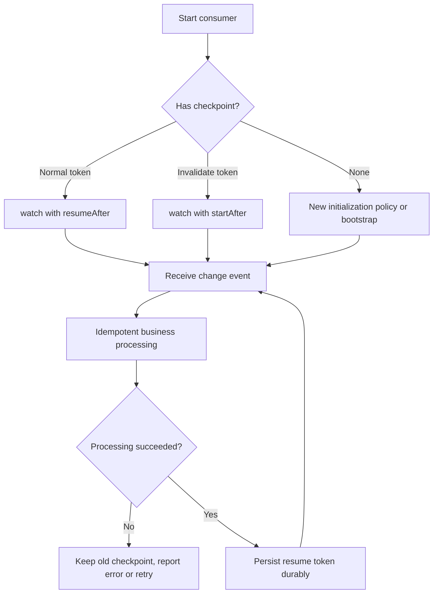

# Resume Tokens, resumeAfter, startAfter, and Start Time

> **Scope:** `SPRING_DATA_MONGODB` — Using Spring Data MongoDB to connect, map documents, and operate on MongoDB via MongoTemplate or repositories. Practicing query design, aggregation, indexing, transactions, reactive access, testing, and data performance diagnostics. This lesson focuses on choosing the starting point and recovering a **Change Stream** when a Spring Data MongoDB application stops and restarts.

## 1. Problem: When a Consumer Stops, Where Does It Resume Reading?

Suppose the `order-projection` service listens to changes on the `orders` collection to update an order summary table. After processing two events, the service hits a network error or is redeployed. If it opens `watch()` normally, the new stream starts from the time the cursor opens; changes that occurred while the service was down may not be redelivered.

MongoDB provides a **resume token** to mark a position in the stream and three ways to specify a starting point:

- `resumeAfter`: continue reading **after** a known token.
- `startAfter`: open a new stream **after** a token; specifically supports cases where an `invalidate` event terminated the old stream.
- `startAtOperationTime`: start at a **logical point in time** in oplog history, used when no suitable token is available.

In Spring Data MongoDB, the corresponding declarations are `resumeAfter(token)`, `startAfter(token)`, and `resumeAt(BsonTimestamp)` or `resumeAt(Instant)`.

```text
Time       ───────────────────────────────────────────────────────────>
            E1            E2            E3            E4
            tA            tB            tC            tD
                          ▲                 ▲
                  persisted token      service restarts

resumeAfter(token E2):               receives E3, E4, ...
watch() without checkpoint:                         receives only new changes
startAtOperationTime(tB):           may also receive E2 if at timestamp tB
```

**Prerequisites:** Change Streams require a MongoDB **replica set** or **sharded cluster**; standalone MongoDB is not supported. The required historical data must still be present in the **oplog**. Change Streams deliver notifications of majority-committed changes, not an infinitely retained event storage system.

## 2. What Really Is a Resume Token?

Each Change Stream notification has an `_id` field containing the **event's resume token**. This is a BSON structure generated by MongoDB whose encoding may change across versions. Do not confuse this token with the business document's `_id` inside `fullDocument` or `documentKey`.

Abbreviated example from `mongosh` (the `_data` value is illustrative only):

```javascript
{
  _id: { _data: "8267...TOKEN..." },    // resume token of the change event
  operationType: "update",
  clusterTime: Timestamp({ t: 1735689600, i: 2 }),
  ns: { db: "shop", coll: "orders" },
  documentKey: { _id: ObjectId("64b000000000000000000001") },
  updateDescription: {
    updatedFields: { status: "PAID" },
    removedFields: []
  }
}
```

A token represents a **continuation point**, not an identifier that the application may assemble, increment, or take a `substring` of to infer ordering. Store the **entire BSON token** in a format that can be restored accurately, such as BSON or Extended JSON preserving data types; avoid storing only a timestamp string or `documentKey._id`.

In addition to **event tokens**, MongoDB also has **high-watermark tokens** (commonly exposed via `cursor.postBatchResumeToken` on `aggregate`/`getMore` commands), representing an advanced position even when a batch contains no events. Drivers can use this token to maintain cursor position while the stream is idle. For **business processing** checkpoints, only advance the checkpoint to a position where all prior relevant events have been durably processed; do not adopt a token past unprocessed events.

Spring Data provides:

- `ChangeStreamEvent<T>.getResumeToken()`: returns the event's `BsonValue`, which may be `null` and should be checked.
- `ChangeStreamEvent<T>.getBsonTimestamp()`: retrieves the `BsonTimestamp` from `clusterTime`.
- `ChangeStreamEvent<T>.getTimestamp()`: retrieves the time as an `Instant`.

## 3. Comparing the Three Ways to Choose a Starting Point

| MongoDB option | Input | Changes received | When to use |
|---|---|---|---|
| No option passed | None | Changes from the time the new stream opens | Brand-new stream, no need to read history |
| `resumeAfter` | Resume token `T` | Changes **after** event/marker `T` | Normal consumer restart after checkpoint |
| `startAfter` | Resume token `T` | Changes **after** `T`, creating a new Change Stream | Restarting after `invalidate` or deliberately starting a new stream after a token |
| `startAtOperationTime` | BSON `Timestamp` | Changes **at or after** that logical time | Recovering from a point in time when no token is available |

The three options `resumeAfter`, `startAfter`, and `startAtOperationTime` are **mutually exclusive**. Configure only one starting point per Change Stream open call.

### 3.1. `resumeAfter`: continuing from a checkpoint

Given the event sequence `A → B → C → D`, if `B`'s token was saved after `B` succeeded, `resumeAfter(tokenB)` starts at `C`. It does not replay `B` itself per the option's semantics.

This is the sensible default choice for a checkpointed consumer. The conditions are that the token is valid, the oplog still holds enough history, and the scope, aggregation pipeline, and options on reopen remain compatible with when the token was created.

**Important limitation:** if the stream was terminated by an `invalidate` event (e.g., `drop` or `rename` on the watched collection), you **cannot** use `resumeAfter` with the `invalidate` token.

### 3.2. `startAfter`: restarting after `invalidate`

`invalidate` signals that the watched scope is no longer valid; the current cursor is closed. This differs from a temporary network disconnect.

`startAfter(invalidateToken)` lets you initialize a new Change Stream after that terminating event. For example, while watching `shop.orders`, if the collection is dropped and recreated, the application can use the `invalidate` token with `startAfter` to continue listening for changes in the appropriate scope. Handle the business meaning of the dropped/recreated collection separately; `startAfter` does not restore deleted collection data.

`startAfter` also accepts normal tokens, but the **main reason to distinguish it** is handling `invalidate` cases where `resumeAfter` cannot be used. A collection `drop` does not necessarily `invalidate` every database- or cluster-level Change Stream; consider the `watch` scope.

### 3.3. `startAtOperationTime`: starting from a logical timestamp

`startAtOperationTime` uses a `BsonTimestamp` consisting of two parts: seconds `t` and ordinal increment `i` within that second. When this point is specified, MongoDB selects events with a logical time **greater than or equal to** the given point. Therefore, compared to `resumeAfter`, the application may re-encounter events right at the selected timestamp and must deduplicate.

This is not `wallTime` or the application host's clock. In Spring Data, `resumeAt(Instant)` is a convenience when only a UTC timestamp is available; when you need precision within the same second, prefer `resumeAt(BsonTimestamp)` obtained from `getBsonTimestamp()`.

Do not take the application's `Instant.now()` as a checkpoint after an outage and assume no data was missed: client clocks, time resolution, and the moment events become majority-committed can differ. If you already have a token, **prefer the token**.

## 4. Practicing in `mongosh`

The examples run on a replica set or sharded cluster that already has the `shop` database and `orders` collection.

### 4.1. Capturing a token and resuming after the last processed event

Open a `mongosh` session to listen:

```javascript
use shop

const stream = db.orders.watch();
const event = stream.next();  // wait until a change occurs
printjson({
  operationType: event.operationType,
  token: event._id,
  clusterTime: event.clusterTime
});

// After the event's business logic succeeds:
db.streamCheckpoints.updateOne(
  { _id: "order-projection-v1" },
  { $set: { token: event._id, savedAt: new Date() } },
  { upsert: true }
);

stream.close();
```

Generate a change in another `mongosh` session:

```javascript
use shop
db.orders.insertOne({ orderNo: "O-1001", status: "NEW" });
```

When the service restarts, read the checkpoint and pass the **entire** token:

```javascript
use shop

const checkpoint = db.streamCheckpoints.findOne({
  _id: "order-projection-v1"
});

const resumed = db.orders.watch([], {
  resumeAfter: checkpoint.token
});

// Read changes occurring after the saved token.
printjson(resumed.next());
```

In practice, verify that the checkpoint exists before passing `resumeAfter`; if none exists, follow your initial bootstrap procedure. Do not place the checkpoint collection inside the scope of a database-wide `watch` without filtering and controlling the event loop caused by checkpoint writes themselves.

### 4.2. Recovering after `invalidate` with `startAfter`

Suppose the consumer received and saved the token of an `invalidate` event:

```javascript
const invalidateToken = { _data: "ACTUAL_BSON_TOKEN" }; // illustrative, do not use a fake string
const streamAfterDrop = db.orders.watch([], {
  startAfter: invalidateToken
});
```

In real code, `invalidateToken` must be the exact **BSON value** from the `invalidate` event's `event._id`, not a fabricated object. Recreate the collection or handle namespace lifecycle according to the scenario. If the token is already too old for the oplog, `startAfter` will still fail.

### 4.3. Recovering from a timestamp

```javascript
const operationTime = Timestamp({ t: 1735689600, i: 2 });

const streamFromTime = db.orders.watch([], {
  startAtOperationTime: operationTime
});
```

The hardcoded timestamp example is for illustration only; in real environments, obtain `clusterTime` from an event or a reliable server logical timestamp. Do not pass `resumeAfter`/`startAfter` together with `startAtOperationTime`.

## 5. Spring Data MongoDB: Using `ReactiveMongoTemplate`

Spring Data supports Change Streams in two styles: **reactive** with `ReactiveMongoTemplate` and **imperative** with `MongoTemplate` and `MessageListenerContainer`. Reactive is well suited for long-lived change-receiving streams because it avoids dedicating a blocking thread per subscription.

### 5.1. Opening a new stream, resuming from a token, or resuming from a time

```java
import org.bson.BsonTimestamp;
import org.bson.BsonValue;
import org.bson.Document;
import org.springframework.data.mongodb.core.ChangeStreamEvent;
import org.springframework.data.mongodb.core.ReactiveMongoTemplate;
import reactor.core.publisher.Flux;

// reactiveTemplate is a pre-configured ReactiveMongoTemplate bean.

// First time: only receive changes from when the stream starts.
Flux<ChangeStreamEvent<Document>> fresh = reactiveTemplate
    .changeStream(Document.class)
    .watchCollection("orders")
    .listen();

// After restart: BSON token read from the checkpoint store.
BsonValue savedToken = /* load saved checkpoint */ null;
Flux<ChangeStreamEvent<Document>> resumed = reactiveTemplate
    .changeStream(Document.class)
    .watchCollection("orders")
    .resumeAfter(savedToken)
    .listen();

// After invalidate: use the token of the invalidate event itself.
BsonValue invalidateToken = /* real BSON token */ null;
Flux<ChangeStreamEvent<Document>> afterInvalidate = reactiveTemplate
    .changeStream(Document.class)
    .watchCollection("orders")
    .startAfter(invalidateToken)
    .listen();

// When you have a reliable clusterTime anchor but no resume token:
BsonTimestamp serverTime = /* recorded clusterTime */ null;
Flux<ChangeStreamEvent<Document>> fromTime = reactiveTemplate
    .changeStream(Document.class)
    .watchCollection("orders")
    .resumeAt(serverTime)
    .listen();
```

The snippet above illustrates **independent branching options**; the `null` variables are placeholders to replace with real data before running. Do not call `resumeAfter(null)` or `startAfter(null)`. With reactive streams, obtaining a `Flux` does not yet open an active subscription; the application must manage subscribing, unsubscribing, and retry policies aligned with the service lifecycle.

### 5.2. Consumer pattern with checkpointing

Suppose the application implements two functions:

- `projectIdempotently(event)`: returns `Mono<Void>`, updating the projection so that re-running an event does not corrupt data.
- `checkpointStore.save(consumerId, token)`: returns `Mono<Void>`, durably saving the token with full BSON types.

You can build a **sequential** processing pipeline:

```java
Flux<ChangeStreamEvent<Document>> changes = reactiveTemplate
    .changeStream(Document.class)
    .watchCollection("orders")
    .resumeAfter(savedToken)
    .listen();

return changes.concatMap(event -> {
    BsonValue token = event.getResumeToken();
    if (token == null) {
        return reactor.core.publisher.Mono.error(
            new IllegalStateException("Change event missing resume token")
        );
    }

    return projectIdempotently(event)
        .then(checkpointStore.save("order-projection-v1", token));
}).then();
```

`concatMap` preserves completion order for each processing step within this subscription. By itself, the example does **not** guarantee exactly-once delivery: if the projection update succeeds but the service crashes before saving the token, the next run will receive that event again. Hence business operations must be **idempotent** (such as upserting by a stable key), or use a suitable transaction when both the projection and checkpoint reside within the same MongoDB transaction boundary. If there are multiple consumer instances, you need lease/ownership or checkpoint coordination; do not assume two instances split events between themselves.

When no checkpoint exists, branch to an initial startup path:

```java
Flux<ChangeStreamEvent<Document>> changes =
    savedToken == null
        ? reactiveTemplate.changeStream(Document.class)
            .watchCollection("orders").listen()
        : reactiveTemplate.changeStream(Document.class)
            .watchCollection("orders").resumeAfter(savedToken).listen();
```

**Note on delete:** `event.getBody()` can be `null` because delete operations have no post-change full document. Rely on `event.getOperationType()` and `event.getRaw()`/`documentKey` per business requirements rather than assuming the body is always present.

### 5.3. Configuring with `ChangeStreamOptions`

When using options-based APIs, including the `MongoTemplate` + `MessageListenerContainer` path, Spring Data provides a corresponding builder:

```java
import org.springframework.data.mongodb.core.ChangeStreamOptions;

ChangeStreamOptions afterCheckpoint = ChangeStreamOptions.builder()
    .resumeAfter(savedToken)
    .build();

ChangeStreamOptions afterInvalidation = ChangeStreamOptions.builder()
    .startAfter(invalidateToken)
    .build();

ChangeStreamOptions fromClusterTime = ChangeStreamOptions.builder()
    .resumeAt(serverTime)
    .build();
```

Choose **one** of these configurations per request. With an imperative listener, register the `ChangeStreamRequest` via the container and stop the container when no longer needed; do not run a blocking Change Stream task directly on an HTTP request-handling thread.

## 6. Choosing Checkpoints Properly to Avoid Lost or Duplicate Data

The core principle is that a **checkpoint reflects durably processed events**, not merely events read from the socket.



| Failure timing | Checkpoint state | Outcome when reopening with `resumeAfter` |
|---|---|---|
| Before processing `E5` | Token `E4` | Receives `E5` again, no event lost |
| After processing `E5`, before saving token | Token `E4` | Receives `E5` again; requires idempotency |
| After saving token `E5` | Token `E5` | Starts from events after `E5` |
| Saved token `E5` before processing `E5` | Token `E5` | Risk of **losing `E5`**; this is the wrong order |

If business logic needs a snapshot of existing data followed by continuous change tracking, design a separate **bootstrap/snapshot + handoff** step with Change Streams: record a consistency point and ensure no gap between the snapshot and the watch start time. Simply calling `watch()` after a snapshot without a handoff anchor risks missing changes.

### Driver self-recovery and recovery after restart

The MongoDB Java Driver can automatically attempt to reconnect on **certain resumable Change Stream errors**, using the token it holds in the cursor session. However, this does not replace checkpoints in the application's persistent store: when the process is killed or redeployed, in-memory state disappears. Likewise, do not retry every exception indefinitely; history-lost token errors require a dedicated recovery procedure.

## 7. Common Limitations and Errors

| Symptom | Common cause | Resolution |
|---|---|---|
| `The $changeStream stage is only supported on replica sets` | Connected to standalone MongoDB | Use a replica set or sharded cluster, including in test environments |
| `Resume Token Not Found` / `ChangeStreamHistoryLost` | Oplog no longer contains the needed starting point, or resume conditions are incompatible | Mark checkpoint as unresumable; run a controlled bootstrap/backfill, then establish a new checkpoint |
| `resumeAfter` fails after `drop`/`rename` | Cursor received `invalidate` | If a valid invalidate token exists, open a new stream with `startAfter`; re-evaluate data lifecycle |
| Missing updates from downtime after restart | Opened `watch()` without a token/history anchor | Persist durable checkpoints and reopen with `resumeAfter` |
| Duplicate events received after app error | Processed the event but had not written checkpoint yet | Design idempotent handlers or coordinated transaction/checkpoint |
| No events or fewer events than expected | Wrong collection/database, overly strict pipeline filter, missing privileges, or source not producing majority-committed changes | Check `watch` scope, `changeStream`/`find` privileges, pipeline, and replica set status |
| Time-based resume repeats/misses point | Confusing `Instant`/`wallTime` with BSON `clusterTime`, or timestamp too old | Prefer tokens; when time-based start is mandatory, preserve `BsonTimestamp` and verify oplog range |

Preventive principles:

1. **Preserve the token and pipeline.** Do not `$project`, `$unset`, or modify the change event's `_id`; reuse compatible pipelines and options when resuming. Starting in MongoDB 4.2, modifying `_id` in the pipeline can trigger an error.
2. **Monitor lag against the oplog window.** If a consumer stops longer than the oplog retains history, no option can recover all old events using only a token or timestamp.
3. **Separate transient errors from permanent errors.** Network errors can be retried; tokens no longer in history require a backfill/rebuild workflow and operational alerts.
4. **Store checkpoints with clear identities.** Bind `consumerId` to namespace scope, pipeline version, and checkpoint status; do not share one token across consumers with different filters.
5. **Keep resources bounded.** Each Change Stream cursor maintains `getMore` requests; too many cursors relative to the connection pool can increase latency. Clean up subscriptions/containers on application shutdown.

## 8. Verification Exercises

Try with a development replica set and two `mongosh` sessions or a Spring Data consumer:

1. Open a Change Stream watching `orders`; execute three `insert`/`update` operations and print `operationType`, `clusterTime`, and `_id` for each event.
2. Process and save the token of the second event; close the consumer. While the consumer is closed, add a third event. Reopen with `resumeAfter(token2)` and verify that the third event is received.
3. Deliberately let the handler finish business processing but stop before writing the checkpoint. Reopen and confirm the event is redelivered; verify the handler is idempotent.
4. On a separate test collection, observe `invalidate` during a `drop` or `rename`, save that event's token; test `resumeAfter` (which will be invalid) and `startAfter` on the same token, and inspect behavior when the namespace is recreated.
5. Try `resumeAt(event.getBsonTimestamp())`; compare with `resumeAfter(event.getResumeToken())` to see the difference between *at a timestamp* and *after an event*.
6. Check `rs.printReplicationInfo()` on the test replica set to understand oplog limits; do not arbitrarily shrink the oplog on an environment serving real data.

**Self-check questions**

- Why can saving the token before updating the projection lose an event?
- Should the token of an `invalidate` event be used with `resumeAfter` or `startAfter`?
- Why is `BsonTimestamp` more accurate than `Instant` when selecting a point within the same second?
- When the oplog has evicted the history containing a token, what is the data-correct recovery operation?

## 9. Key Takeaways

- **`resumeAfter`:** continuation point after a normal checkpoint.
- **`startAfter`:** start a new Change Stream after a token, including `invalidate` tokens.
- **`startAtOperationTime` / `resumeAt`:** start at or after a logical timestamp; may repeat events at that exact timestamp.
- **Reliability:** persist the raw BSON token **after** processing succeeds, ensure idempotency, monitor the oplog window, and have a backfill plan if history is lost.

### References

- [MongoDB Manual — Change Streams](https://www.mongodb.com/docs/manual/changestreams/)
- [MongoDB Manual — `$changeStream` aggregation stage](https://www.mongodb.com/docs/manual/reference/operator/aggregation/changestream/)
- [MongoDB Change Streams specification](https://github.com/mongodb/specifications/blob/master/source/change-streams/change-streams.md)
- [Spring Data MongoDB — Change Streams](https://docs.spring.io/spring-data/mongodb/reference/mongodb/change-streams.html)
- [Spring Data API — `ChangeStreamOptions.ChangeStreamOptionsBuilder`](https://docs.spring.io/spring-data/mongodb/docs/current/api/org/springframework/data/mongodb/core/ChangeStreamOptions.ChangeStreamOptionsBuilder.html)
