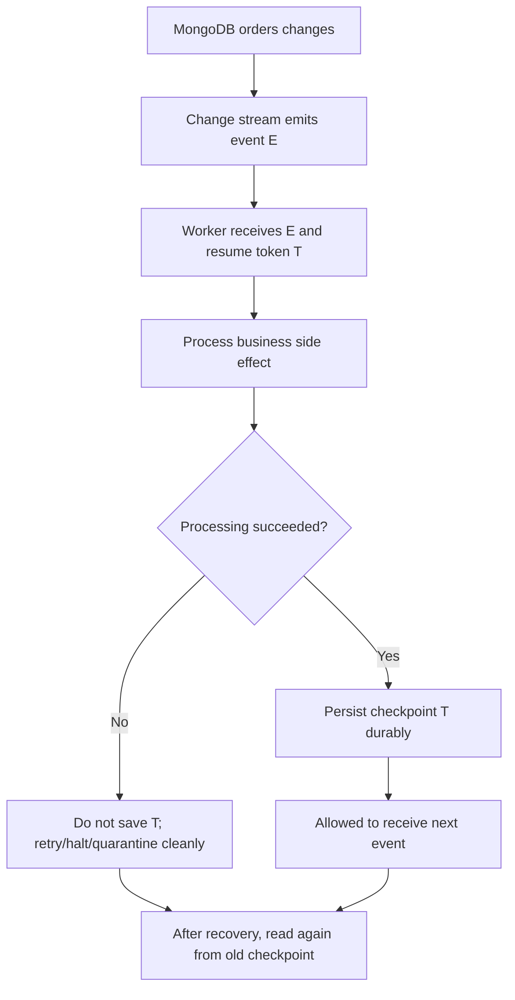

# Saving Checkpoints After Successful Processing and Recovering After Interruptions

## 1. The Mini Commerce Problem: Never Missing Changes When a Worker Restarts

A **Mini Commerce** system writes `Order`, `Product`, and `Customer` documents to MongoDB via Spring Data MongoDB. To update an **order read table** (`order_search`) or send notifications after an Order changes, the application runs a worker watching the **MongoDB change stream** on the `orders` collection.

For example, when a user completes payment:

```text
orders:
  {_id: "ord-001", status: "PAID", tenant_id: "shop-a"}

Change stream event:
  operationType = "update"
  documentKey._id = "ord-001"
  resumeToken = {"_data": "..."}  // opaque BSON token

Consumer:
  1. Update order_search["ord-001"].
  2. Persist checkpoint that the event was processed.
```

What happens if the worker is killed between these two steps? If it writes the checkpoint **before** updating `order_search`, the next startup can skip the event and leave the read table permanently stale. If it updates `order_search` **first**, and dies before writing the checkpoint, the event will be read again: processing must be **idempotent** so it does not trigger side effects twice.

This lesson is **"Saving Checkpoints After Successful Processing and Recovering After Interruptions"**, part of the **"Change stream"** chapter in `SPRING_DATA_MONGODB`. We combine skills across connecting/mapping documents, `MongoTemplate`/`ReactiveMongoTemplate` or repositories, indexing, transactions, reactive access, testing, and MongoDB data performance diagnostics.

### Learning Objectives

After this lesson, you will be able to:

1. Distinguish **resume token**, **checkpoint**, **business ACK**, **bootstrap checkpoint**, and **replay**.
2. Explain why you must **succeed in processing before saving a checkpoint**.
3. Read `ChangeStreamEvent.getResumeToken()` and persist the raw BSON token in a format supporting round-trip fidelity.
4. Reopen streams using `ChangeStreamOptions.builder().resumeAfter(token)`, and distinguish `startAfter` and `resumeAt(BsonTimestamp)`.
5. Establish a **durable starting anchor** before handling the first event, avoiding lost data if the worker dies before any checkpoint exists.
6. Design sequential consumers with `Flux.defer` and `concatMap` so checkpoints never overtake unfinished event processing.
7. Explain **at-least-once**, deduplication, idempotency, and the boundaries of **exactly-once** accurately.
8. Update projections + checkpoints inside **one MongoDB transaction** when both reside in a compatible database/deployment.
9. Handle network errors, poison events, tokens expired from the oplog, invalidations, and pipeline changes.
10. Coordinate multiple workers using a logical consumer/lease/fencing mechanism or clear checkpoint partitioning.
11. Write integration tests with a MongoDB replica set and `StepVerifier` proving crash replays do not double-apply results.
12. Set up metrics, lag alerts, backup/recovery, and operational runbooks.

**Prerequisites:** Java 17+, Spring Boot, `spring-boot-starter-data-mongodb-reactive` for reactive examples, MongoDB replica set or sharded cluster, Reactor, understanding of `@Document`, `@Id`, and idempotency principles. Imperative examples using `MongoTemplate`/`MessageListenerContainer` appear in a dedicated section.

## 2. Change Streams Are Not Queues with Automatic ACKs

A MongoDB change stream is a stream of notifications for committed changes, backed by replication/oplog history. Events carry resume tokens so clients know where to continue reading.



Points to remember:

- The server knows its cursor **emitted** the event; it **does not know** whether the app updated the read table or called an API successfully.
- `ChangeStreamEvent.getResumeToken()` supplies the token **for the event**, not a confirmation that it was processed.
- `resumeAfter(T)` asks the server to continue **after** the event with token `T`. Recording `T(E)` before processing `E` **loses the ability to replay event E** when reopening the stream.
- The driver can auto-resume after certain errors, yet **does not replace durable application checkpoints** or provide business ACKs.

### 2.1. Core Concepts

| Concept | Meaning | Example |
| --- | --- | --- |
| Change event | Description of a change observed by the stream | Order moves `PLACED → PAID` |
| Resume token | Opaque BSON marker denoting stream position | Event `_id: {"_data":"..."}` |
| Checkpoint | Last token that the **app finished processing** and persisted durably | `change_stream_checkpoints/orders-to-search-v1` |
| Resume | Open the stream after a saved checkpoint | `resumeAfter(savedToken)` |
| Replay | Re-receive an event after a crash/timeout before checkpointing | Update `order_search` a second time |
| Business ACK | Criteria confirming the task succeeded | Projection acknowledged by MongoDB |
| Bootstrap anchor | Durable starting point when **no event token exists yet** | `startAtOperationTime` saved before startup |
| Idempotency | Reprocessing creates no corrupted side effects | Upsert Order view by stable ID |
| Poison event | Event that fails consistently with the same payload/schema | Payload missing a mandatory key |

### 2.2. Why not keep a variable in RAM?

```java
// WRONG for recovery across process restarts:
AtomicReference<BsonValue> lastSeen = new AtomicReference<>();

stream.doOnNext(event ->
    lastSeen.set(event.getResumeToken()));
```

RAM disappears on crash/deploy. Worse, `doOnNext` runs **when the event arrives**, before asynchronous processing can complete.

Instead, store checkpoints in a durable collection such as `change_stream_checkpoints` **after downstream processing confirms success**.

## 3. Explaining At-Least-Once Guarantees Across Failure Windows

Suppose the current durable checkpoint is `T0`, and the worker receives event `E1` with token `T1`.

### 3.1. Wrong way: checkpoint before processing

```text
T0: current checkpoint = T0
T1: receive E1
T2: SAVE CHECKPOINT = T1
T3: process is killed
T4: E1 processing NEVER RAN
Restart: resumeAfter(T1) -> server emits E2 onward
=> E1 IS MISSED
```

Even if `T2` is acknowledged by MongoDB, that only proves the checkpoint saved—**not that business processing succeeded**.

### 3.2. Right way: process then checkpoint

```text
T0: current checkpoint = T0
T1: receive E1
T2: process E1 successfully
T3: SAVE CHECKPOINT = T1
T4: process E2 ...
```

Crash scenarios:

| Crash timing | Side effect E1 | Checkpoint | After restart | Safety requirement |
| --- | --- | --- | --- | --- |
| Before processing | Not yet | `T0` | E1 replayed | Oplog history still present |
| During processing | Uncertain / partial | `T0` | E1 replayed | Side effect must be atomic/idempotent |
| After processing, before checkpoint | Complete | `T0` | E1 replayed | **Idempotency/dedupe** |
| While saving checkpoint | Possibly complete | `T0` or `T1` | May replay or skip | Acknowledged checkpoint write, read back if outcome unknown |
| After checkpoint `T1` commits | Complete | `T1` | Starts after E1 | Same logical stream |

This gives the worker **at-least-once processing**: an event may be processed more than once, but is never skipped because a checkpoint ran ahead of business logic. It does not mean exactly-once for email, HTTP, Kafka, or Redis.

### 3.3. Invariant to preserve

```text
Persisted checkpoint = token of the LAST EVENT
for which all preceding business outcomes were confirmed.
```

In other words, if `E1`, `E2`, and `E3` arrive sequentially:

- Checkpoint `T1` only after E1 succeeds.
- Checkpoint `T2` only after E2 succeeds.
- Checkpoint `T3` only after E3 succeeds.
- Never checkpoint `T3` while E2 is failing.

**Never use concurrent `flatMap` and write whichever event finishes first** if all events share a single checkpoint. Because E3 can finish before E2, checkpointing `T3` skips E2 on restart.

## 4. Infrastructure Prerequisites: Replica Set, Oplog, and Privileges

MongoDB change streams are supported on **replica sets and sharded clusters**, not ordinary standalone MongoDB. Testcontainers/local MongoDB used for integration tests must be configured as a replica set.

### 4.1. Mandatory prerequisites

- The MongoDB cluster holds enough oplog history to reopen from older tokens.
- The user has watch/change stream and read privileges on relevant collections, plus write privileges on checkpoints.
- `orders`, `order_search`, and `change_stream_checkpoints` collections exist; if using transactions, the deployment supports multi-document transactions.
- Pipeline/filter/options on resume remain compatible with when the token was created.
- Clocks, write concerns, lag, and recovery windows are monitored.
- Each logical consumer owns a separate checkpoint; never share tokens casually across dev/prod environments.

### 4.2. Events do not hold "infinite history"

Change streams rely on the oplog, so resume tokens expire once old positions roll off the oplog. Persisting a token in a database **does not force MongoDB to keep the oplog forever**.

Example:

```text
Oplog history = 24 hours (illustrative, not a default config).
Consumer offline = 72 hours.
Checkpoint T0 still exists in the checkpoint collection.
MongoDB no longer holds the event at T0.
resumeAfter(T0) -> fails.
```

Never resolve this error by deleting the checkpoint and opening the stream at "now": that can skip thousands of modified orders. **Reconcile/rebuild** from durable source data or trigger a recovery procedure with an approved cutover point.

### 4.3. Watch scope

| Scope | What is received | Checkpoint note |
| --- | --- | --- |
| `orders` collection | Changes in this collection | Fits worker updating `order_search` |
| Database watch | Changes across collections in database | Requires filters/schemas; avoid watching **checkpoint writes** causing feedback loops |
| Deployment watch | Multiple databases/namespaces | Privileges, event types, checkpoints, and filters are more complex |

In this lesson, the worker watches only `orders`. It writes projections to `order_search` and checkpoints to `change_stream_checkpoints`, **never re-emitting those writes into the same watched stream**.

### 4.4. `FullDocument` and `documentKey`

In `ChangeStreamEvent<T>`:

- `getOperationType()` distinguishes insert/update/replace/delete/invalidate and others depending on MongoDB version/options.
- `getBody()` is the entity mapped from `fullDocument`, **which may be null** (especially on delete).
- `getRaw()` exposes the raw payload (including `documentKey` and `updateDescription`).
- `getResumeToken()` returns `BsonValue` and is annotated **nullable** in the Spring Data API; serious code checks for null before checkpointing.
- `getBsonTimestamp()` gives cluster time when present; **it cannot replace exact resume tokens**.

With `fullDocument: "updateLookup"`, the retrieved document on an update can be the latest version at lookup time, **not necessarily an atomic snapshot at the instant of the update event**; the document might even no longer exist. Never use lookup results as an exact audit ledger if business rules need exact before/after snapshots of each operation.

## 5. Resume Tokens: Opaque, Must Be Kept as Intact BSON

An illustrative MongoDB change event:

```javascript
{
  _id: { _data: "8263...TOKEN..." },
  operationType: "update",
  clusterTime: Timestamp({ t: 1795123200, i: 1 }),
  ns: { db: "mini_commerce", coll: "orders" },
  documentKey: { _id: "ord-001" },
  updateDescription: {
    updatedFields: { status: "PAID" },
    removedFields: []
  }
}
```

`_id` on the **change event** is the **resume token**, distinct from `documentKey._id` which is the ID of the modified Order.

### 5.1. Never alter resume tokens

- Never strip `_data` or store only part of the token.
- Never try to compute the next token by incrementing numbers.
- Never compare token ordering lexicographically as strings in business logic.
- Never truncate tokens into timestamps assuming sufficient precision.
- Never add `$project`/`$replaceRoot` dropping or mutating event `_id` in a change-stream pipeline.
- Never assume every MongoDB/driver version generates identical JSON/BSON token structures.

MongoDB requires **passing the whole token** when reopening a stream and warns to keep the same pipeline and options that produced it.

### 5.2. Event tokens vs. high-water-mark tokens

MongoDB provides event tokens attached to specific events, and high-water-mark tokens representing stream progress when no events occur. `ChangeStreamEvent.getResumeToken()` exposes tokens on emitted events; raw drivers/cursors can also expose batch-level `postBatchResumeToken`, even on empty batches.

**Checkpoint a high-water-mark token only once you are certain all earlier events have finished processing.** Never "optimize" by saving the newest token seen by the driver while downstream is still processing E1/E2.

Spring Data `Flux<ChangeStreamEvent<T>>` typically does not surface `postBatchResumeToken` from empty batches as a domain event; if you need idle progress checkpoints, use a raw driver cursor following the same ACK rule.

## 6. Choosing a Durable Checkpoint Format

A checkpoint document typically includes:

```javascript
{
  _id: "orders-to-search-v1",
  resumeTokenJson: "{ \"_data\": \"8263...\" }",
  initialTimestampSeconds: 1795123200,
  initialTimestampIncrement: 1,
  pipelineVersion: "orders-v1",
  acknowledgedAt: ISODate("2026-11-20T10:30:00Z"),
  ownerEpoch: NumberLong(7)
}
```

Timestamp, token, and epoch values are illustrative. Once `resumeTokenJson` exists, resume from the token; before any event token exists, use the **previously persisted bootstrap anchor**. `ownerEpoch` supports leader/fencing protocols and does not enforce exclusivity merely by existing as a field.

### 6.1. One checkpoint key per logical consumer

Example:

```text
orders-to-search-v1
orders-to-analytics-v1
orders-to-notifications-v1
```

These three workflows have separate business side effects, replay profiles, and operations, so **they must not share a token**. When a consumer changes pipelines, filters, namespaces, or processing strategies, allocate a new checkpoint generation and cutover plan.

An `orders-to-search-v1` checkpoint **must never be copied blindly from another tenant, database, or environment**; tokens are not arbitrarily portable pointers.

### 6.2. Why use Canonical Extended JSON?

`BsonValue` can contain specialized BSON types. Simply calling `toString()` or using a generic unconfigured JSON serializer (like Jackson) can lose types or alter structure on save/read. Canonical Extended JSON preserves all BSON types as strings so they parse cleanly back to `BsonDocument`.

```java
package com.example.minicommerce.streams;

import org.bson.BsonDocument;
import org.bson.BsonValue;
import org.bson.json.JsonMode;
import org.bson.json.JsonWriterSettings;

public final class ResumeTokenCodec {

    private static final JsonWriterSettings CANONICAL =
        JsonWriterSettings.builder()
            .outputMode(JsonMode.EXTENDED)
            .build();

    private ResumeTokenCodec() {}

    public static String encode(BsonValue token) {
        if (token == null || !token.isDocument()) {
            throw new IllegalArgumentException(
                "Expected non-null BSON document resume token");
        }
        return token.asDocument().toJson(CANONICAL);
    }

    public static BsonDocument decode(String json) {
        if (json == null || json.isBlank()) {
            throw new IllegalArgumentException("Missing token JSON");
        }
        return BsonDocument.parse(json);
    }
}
```

**Note:** the MongoDB Java Driver enum name is **`JsonMode.EXTENDED`** (representing **Canonical Extended JSON**), not `JsonMode.CANONICAL`. `JsonMode.RELAXED` is the relaxed variant; prefer `EXTENDED` to preserve exact BSON types when storing tokens. Always round-trip test against your project's driver: the goal is **reconstructing an equivalent `BsonDocument`**, not just saving a token-like string.

Do not log raw resume tokens or stream credentials unnecessarily. Though tokens are not passwords, they reveal stream positioning metadata; protect checkpoint collections with proper ACLs, backups, and retention.

## 7. Creating the Checkpoint Collection with Reactive Entities and Repositories

In reactive examples, Spring Data maps the checkpoint entity to the `change_stream_checkpoints` MongoDB collection:

```java
package com.example.minicommerce.streams;

import java.time.Instant;
import org.springframework.data.annotation.Id;
import org.springframework.data.mongodb.core.mapping.Document;

@Document(collection = "change_stream_checkpoints")
public record ChangeCheckpoint(
    @Id String id,
    String resumeTokenJson,
    Integer initialTimestampSeconds,
    Integer initialTimestampIncrement,
    String pipelineVersion,
    Instant acknowledgedAt
) {}
```

```java
package com.example.minicommerce.streams;

import org.springframework.data.mongodb.repository.ReactiveMongoRepository;

public interface ChangeCheckpointRepository
        extends ReactiveMongoRepository<ChangeCheckpoint, String> {
}
```

These two snippets represent two Java files, `ChangeCheckpoint.java` and `ChangeCheckpointRepository.java`. Only **one writer** should update a checkpoint `id` in the basic design; in HA/multi-consumer setups, add leases/fencing and CAS updates (Section 20).

### 7.1. Preserve the bootstrap timestamp when updating the token

Suppose an existing checkpoint holds:

```java
ChangeCheckpoint previous = ...;

ChangeCheckpoint updated = new ChangeCheckpoint(
    previous.id(),
    ResumeTokenCodec.encode(event.getResumeToken()),
    previous.initialTimestampSeconds(),
    previous.initialTimestampIncrement(),
    previous.pipelineVersion(),
    Instant.now());
```

This is a **service snippet** where `previous` has been loaded and `event` has finished processing. Keep pipeline version, bootstrap anchor, and ID intact. Never use `Instant.now()` here as a resume point; it is purely the **ACK persistence timestamp** for observability.

### 7.2. Choosing write concern for checkpoints

Because checkpoints directly govern recovery correctness, use **acknowledged writes**, commonly considering `WriteConcern.MAJORITY` per deployment durability needs. Weak write concerns can lose ACKs on failover, forcing workers to replay more events—which still demands idempotency.

Conversely, never mark a checkpoint write succeeded just because a method returned a publisher that **was never subscribed to/awaited**. In Reactor, completion of the save `Mono` is the application-level ACK signal per driver contract.

## 8. Bootstrap: Handling the First Run Before Any Checkpoint Exists

This is a critical operational bug that is easy to overlook:

```text
First deploy:
  No checkpoint exists.
  Worker opens stream "from now".
  Receives E1, processes successfully, NOT YET saved checkpoint.
  Worker crashes.

Restart:
  STILL no checkpoint exists.
  Opens stream "from now" again.
  E1 is skipped forever.
```

Saving tokens **only after the first event** is insufficient for reliable recovery. You need a **durable starting anchor saved before the consumer processes any event**.

### 8.1. Two bootstrap strategies

| Strategy | Approach | Scope |
| --- | --- | --- |
| Start from a verified server timestamp | Capture `BsonTimestamp` from a valid cluster source, save bootstrap checkpoint; open stream via `resumeAt(BsonTimestamp)` | Tracking from a defined cutover point |
| Start after a high-water-mark token | Open stream/cursor, obtain valid token, save token **before processing** future events; then resume from token | Requires controlling buffering/ordering while cursor is active |

For a projection **with existing historical data**, bootstrapping must also cover the snapshot:

1. Determine cutover/anchor before or alongside snapshot generation.
2. Read the `orders` snapshot with designed consistency guarantees.
3. Apply all changes **since the anchor** in stream order once the snapshot finishes.
4. Transition to live streaming, checkpointing only after projections/side effects commit.

Never casually "scan old collection then watch from now": writes between scan and watch can vanish. Likewise, never open a stream and buffer unboundedly in RAM while a huge snapshot runs; use bounded/durable spooling and a cutover plan.

### 8.2. Bootstrap document fields

Suppose the operations team inserts an initialized checkpoint:

```javascript
db.change_stream_checkpoints.insertOne({
  _id: "orders-to-search-v1",
  resumeTokenJson: null,
  initialTimestampSeconds: 1795123200,
  initialTimestampIncrement: 1,
  pipelineVersion: "orders-v1",
  acknowledgedAt: null
});
```

**Do not use these literal numbers as real timestamps:** they only illustrate the schema. In production, bootstrap anchors must come from the cluster at a deliberate cutover and remain within the oplog; never use an arbitrary machine's `Instant.now()` to guess timestamps, especially when missed events are unacceptable.

### 8.3. Fail closed when the checkpoint is not bootstrapped

```java
return checkpoints.findById(STREAM_KEY)
    .switchIfEmpty(Mono.error(
        new IllegalStateException(
            "Missing bootstrap checkpoint; refusing to tail from now")));
```

This is an intentional choice: the system errors and requires proper bootstrapping rather than silently tailing from now and losing data across restarts.

### 8.4. Resume tokens take precedence over timestamps

Once the first event is processed and ACKed, `resumeTokenJson` is populated. Subsequent runs **use `resumeAfter(token)`**, keeping `initialTimestampSeconds/Increment` purely as investigative metadata.

`resumeAt(Instant)`/`startAtOperationTime` cannot pinpoint a single event when multiple events occur in the same second; prefer full tokens whenever available. Spring Data MongoDB supports `resumeAt(BsonTimestamp)` when exact cluster-time precision is needed.

## 9. Reading Checkpoints and Building `ChangeStreamOptions`

### 9.1. Helper for building options

```java
package com.example.minicommerce.streams;

import org.bson.BsonTimestamp;
import org.springframework.data.mongodb.core.ChangeStreamOptions;

public final class ChangeStreamRecovery {

    public static final String STREAM_ID =
        "orders-to-search-v1";

    public static final String PIPELINE_VERSION =
        "orders-v1";

    private ChangeStreamRecovery() {}

    public static ChangeStreamOptions options(
            ChangeCheckpoint checkpoint) {

        if (!STREAM_ID.equals(checkpoint.id()) ||
                !PIPELINE_VERSION.equals(
                    checkpoint.pipelineVersion())) {
            throw new IllegalStateException(
                "Checkpoint scope/pipeline mismatch");
        }

        String tokenJson = checkpoint.resumeTokenJson();
        if (tokenJson != null && !tokenJson.isBlank()) {
            return ChangeStreamOptions.builder()
                .resumeAfter(ResumeTokenCodec.decode(tokenJson))
                .build();
        }

        Integer seconds = checkpoint.initialTimestampSeconds();
        Integer increment = checkpoint.initialTimestampIncrement();
        if (seconds == null || increment == null) {
            throw new IllegalStateException(
                "Checkpoint has neither token nor bootstrap anchor");
        }

        return ChangeStreamOptions.builder()
            .resumeAt(new BsonTimestamp(seconds, increment))
            .build();
    }
}
```

Key rules to maintain:

- `resumeAfter` accepts a **`BsonValue`**, not an Order ID or timestamp.
- `resumeAt` uses the saved `BsonTimestamp` **only** when no acknowledged event token exists yet.
- Never configure `resumeAfter`, `startAfter`, and `resumeAt/startAtOperationTime` together.
- Never change `pipelineVersion` merely to bypass the mismatch check. Execute a planned migration/reconciliation.

### 9.2. Opening the stream with `ReactiveMongoTemplate`

```java
package com.example.minicommerce.streams;

import org.bson.Document;
import org.springframework.data.mongodb.core.ChangeStreamEvent;
import org.springframework.data.mongodb.core.ReactiveMongoTemplate;
import org.springframework.stereotype.Component;

import reactor.core.publisher.Flux;
import reactor.core.publisher.Mono;

@Component
public class OrdersChangeStreamSource {

    private final ReactiveMongoTemplate template;
    private final ChangeCheckpointRepository checkpoints;

    public OrdersChangeStreamSource(
            ReactiveMongoTemplate template,
            ChangeCheckpointRepository checkpoints) {
        this.template = template;
        this.checkpoints = checkpoints;
    }

    public Flux<ChangeStreamEvent<Document>> open() {
        return checkpoints.findById(
                ChangeStreamRecovery.STREAM_ID)
            .switchIfEmpty(Mono.error(
                new IllegalStateException(
                    "Bootstrap checkpoint is required")))
            .flatMapMany(cp -> template.changeStream(
                "orders",
                ChangeStreamRecovery.options(cp),
                Document.class));
    }
}
```

`ReactiveMongoTemplate.changeStream(String collection, ChangeStreamOptions options, Class<T> targetType)` returns `Flux<ChangeStreamEvent<T>>`. Here `Document.class` avoids data loss if events from varying Order shapes or legacy schemas fail strict entity conversion.

`open()` builds a **publisher**; the MongoDB cursor opens only when **subscription** starts. For retries, invoke `open()` **again** to reload the latest checkpoint rather than reusing options/tokens captured once at startup.

### 9.3. Why not keep a "latest received token"?

```java
// Wrong: lastReceived is not lastAcknowledged.
Flux<ChangeStreamEvent<Document>> raw = source.open()
    .doOnNext(event -> lastReceived.set(
        event.getResumeToken()));
```

`lastReceived` runs ahead of processing, whereas `lastAcknowledged` is the token **committed after processing**. These are two different states; saving the wrong one risks skipping events on recovery.

## 10. Processing Mini Commerce Events in a Replay-Safe Way

The worker updates `order_search`: a materialized read model for querying Orders. We avoid incrementing revenue in this example to prevent non-idempotent side effects; instead we use **idempotent upsert/replace by Order ID**.

### 10.1. Source entity `Order`

```java
package com.example.minicommerce.domain;

import org.springframework.data.annotation.Id;
import org.springframework.data.mongodb.core.mapping.Document;
import org.springframework.data.mongodb.core.mapping.Field;

@Document(collection = "orders")
public class Order {

    @Id
    private String id;

    @Field("tenant_id")
    private String tenantId;

    private String status;

    public Order() {}

    public Order(String id, String tenantId, String status) {
        this.id = id;
        this.tenantId = tenantId;
        this.status = status;
    }

    public String getId() { return id; }
    public String getTenantId() { return tenantId; }
    public String getStatus() { return status; }
}
```

### 10.2. Read model entity `OrderSearchView`

```java
package com.example.minicommerce.streams;

import org.springframework.data.annotation.Id;
import org.springframework.data.mongodb.core.mapping.Document;
import org.springframework.data.mongodb.core.mapping.Field;

@Document(collection = "order_search")
public record OrderSearchView(
    @Id String id,
    @Field("tenant_id") String tenantId,
    String status
) {}
```

Omits email, address, and payment fields not needed by the order search API. Using the Order ID as the view's `_id` ensures `save(view)` **converges to one document per ID** on replay rather than creating duplicates.

### 10.3. Event handler reading `documentKey` from raw payload

```java
package com.example.minicommerce.streams;

import java.util.Objects;

import org.bson.BsonDocument;
import org.bson.BsonValue;
import org.bson.Document;

import com.mongodb.client.model.changestream.ChangeStreamDocument;
import com.mongodb.client.model.changestream.OperationType;

import org.springframework.data.mongodb.core.ChangeStreamEvent;
import org.springframework.data.mongodb.core.ReactiveMongoTemplate;
import org.springframework.stereotype.Component;

import reactor.core.publisher.Mono;

import com.example.minicommerce.domain.Order;

@Component
public class OrderProjectionHandler {

    private final ReactiveMongoTemplate template;

    public OrderProjectionHandler(ReactiveMongoTemplate template) {
        this.template = template;
    }

    public Mono<Void> apply(ChangeStreamEvent<Document> event) {
        return Mono.defer(() -> {
            OperationType operation = Objects.requireNonNull(
                event.getOperationType(), "operationType");

            if (operation == OperationType.INVALIDATE) {
                return Mono.error(new IllegalStateException(
                    "Collection stream invalidated"));
            }

            if (operation != OperationType.INSERT &&
                operation != OperationType.UPDATE &&
                operation != OperationType.REPLACE &&
                operation != OperationType.DELETE) {
                return Mono.error(new IllegalStateException(
                    "Unsupported operation: " + operation));
            }

            ChangeStreamDocument<Document> raw =
                Objects.requireNonNull(event.getRaw(), "raw");
            BsonDocument key = Objects.requireNonNull(
                raw.getDocumentKey(), "documentKey");
            BsonValue idValue = key.get("_id");
            if (idValue == null || !idValue.isString()) {
                return Mono.error(new IllegalArgumentException(
                    "Expected String Order _id"));
            }
            String orderId = idValue.asString().getValue();

            if (operation == OperationType.DELETE) {
                return template.remove(
                    org.springframework.data.mongodb.core.query.Query
                        .query(org.springframework.data.mongodb.core.query
                            .Criteria.where("id").is(orderId)),
                    OrderSearchView.class).then();
            }

            // Build read model from current state.
            // If source was deleted immediately after update event,
            // remove projection instead of storing stale data.
            return template.findById(orderId, Order.class)
                .flatMap(order ->
                    template.save(new OrderSearchView(
                        order.getId(),
                        order.getTenantId(),
                        order.getStatus()))
                    .thenReturn(true))
                .switchIfEmpty(Mono.defer(() ->
                    template.remove(
                        org.springframework.data.mongodb.core.query.Query
                            .query(org.springframework.data.mongodb.core.query
                                .Criteria.where("id").is(orderId)),
                        OrderSearchView.class)
                        .thenReturn(false)))
                .then();
        });
    }
}
```

Key points:

- `documentKey._id` is the Order ID, **not the resume token**.
- On delete, `fullDocument` is typically null; the handler still removes the projection using `documentKey`.
- On insert/update/replace, the handler **reads the current Order state** and saves the view by ID, allowing replay without double-counting.
- `switchIfEmpty` must sit **before `then()`** as shown, because `Mono<Void>` always completes empty without emitting a value; putting `switchIfEmpty` after `Mono<Void>` would mistakenly run the delete branch even when `save` succeeded.
- Unsupported operations and `invalidate` fail loudly rather than ACKing.

**Limitation of the "read current state" strategy:** it builds a **projection converging to final state**, not a historical audit log of every intermediate change. If business logic must record event E1 faithfully after the Order moved to E2, use `updateDescription`, pre/post images where eligible, and an idempotent event log instead of re-reading current state.

### 10.4. Why is the projection idempotent?

If the worker crashes after processing E1 and before checkpointing, replaying E1 executes:

```text
save order_search["ord-001"] = {status:"PAID"}
save order_search["ord-001"] = {status:"PAID"}
=> still 1 document per ID, never two.
```

Never do:

```java
// Anti-pattern: replaying E1 adds revenue twice.
new Update().inc("revenue", orderAmount);
```

When `$inc` is required, add an inbox/dedupe key and update target + inbox + checkpoint inside one transaction where supported; see Section 14.

## 11. ACKing Checkpoints Only After the Handler Completes

### 11.1. ACK persistence service

```java
package com.example.minicommerce.streams;

import java.time.Instant;
import java.util.Objects;

import org.springframework.beans.factory.annotation.Qualifier;
import org.bson.BsonValue;
import org.bson.Document;

import org.springframework.data.mongodb.core.ChangeStreamEvent;
import org.springframework.stereotype.Component;
import reactor.core.publisher.Mono;

@Component
public class ChangeCheckpointAcknowledger {

    private final ChangeCheckpointRepository checkpoints;
    private final OrderProjectionHandler handler;

    public ChangeCheckpointAcknowledger(
            ChangeCheckpointRepository checkpoints,
            OrderProjectionHandler handler) {
        this.checkpoints = checkpoints;
        this.handler = handler;
    }

    public Mono<BsonValue> processThenAck(
            ChangeStreamEvent<Document> event) {

        return Mono.defer(() -> {
            BsonValue token = Objects.requireNonNull(
                event.getResumeToken(),
                "Change event without resume token");

            String tokenJson = ResumeTokenCodec.encode(token);

            return handler.apply(event)
                .then(checkpoints.findById(
                    ChangeStreamRecovery.STREAM_ID))
                .switchIfEmpty(Mono.error(
                    new IllegalStateException(
                        "Checkpoint unexpectedly disappeared")))
                .flatMap(previous -> {
                    if (!ChangeStreamRecovery.PIPELINE_VERSION.equals(
                            previous.pipelineVersion())) {
                        return Mono.error(
                            new IllegalStateException(
                                "Checkpoint version changed"));
                    }

                    ChangeCheckpoint advanced = new ChangeCheckpoint(
                        previous.id(),
                        tokenJson,
                        previous.initialTimestampSeconds(),
                        previous.initialTimestampIncrement(),
                        previous.pipelineVersion(),
                        Instant.now());

                    return checkpoints.save(advanced)
                        .thenReturn(token);
                });
        });
    }
}
```

Because of `handler.apply(event).then(...)`, the MongoDB checkpoint **is not invoked** until the processing `Mono<Void>` completes successfully. If processing throws or emits `onError`, `then(...)` does not run. If the checkpoint write fails, the pipeline errors and on restart/retry reads from the old checkpoint.

**Note:** this example calls `checkpoints.save` on a stable `@Id` record; it requires **a single writer** for `STREAM_ID`. Two concurrent writers saving checkpoints can overwrite each other's progress. For HA safety, use optimistic CAS/fencing (Section 20).

### 11.2. Why not use `doOnNext` for checkpoints?

```java
// WRONG: reactive side effect is neither composed nor awaited.
flux.doOnNext(event -> checkpointRepository
    .save(...));
```

`save(...)` returns a `Mono`. Without a subscription, **no write happens at all**. Calling `save(...).subscribe()` inside `doOnNext` runs fire-and-forget, decoupled from business work and potentially writing checkpoints before processing completes.

**Right way:** use `concatMap(event -> handler.apply(event).then(saveCheckpoint(event)))` or ordered transactional composition.

### 11.3. Defining business ACK clearly

In the `order_search` example:

```text
ACK = template.save(view) completed successfully
      or template.remove(view) completed successfully.
```

If the consumer calls external systems:

```text
ACK = external service confirmed via an explicit
      idempotent/transactional/outbox protocol.
```

Never equate `HTTP request sent` with `successfully processed`. Timeouts can occur after the target service already executed the request; use idempotency keys and reconciliation.

## 12. Preserving Order with `concatMap` and Retrying from Checkpoints

### 12.1. Sequential processing flow

```java
package com.example.minicommerce.streams;

import java.time.Duration;

import org.bson.BsonValue;
import org.springframework.stereotype.Component;

import reactor.core.publisher.Flux;
import reactor.util.retry.Retry;

@Component
public class OrdersCheckpointWorker {

    private final OrdersChangeStreamSource source;
    private final ChangeCheckpointAcknowledger acknowledger;

    public OrdersCheckpointWorker(
            OrdersChangeStreamSource source,
            ChangeCheckpointAcknowledger acknowledger) {
        this.source = source;
        this.acknowledger = acknowledger;
    }

    public Flux<BsonValue> run() {
        return Flux.defer(source::open)
            .concatMap(acknowledger::processThenAck, 1)
            .retryWhen(
                Retry.backoff(5, Duration.ofSeconds(1))
                    .maxBackoff(Duration.ofSeconds(30))
                    .filter(StreamErrors::isTransient));
    }
}
```

With `concatMap(..., 1)`:

- E1 must complete business processing and checkpointing before E2 starts.
- The acked token is emitted **only after the checkpoint saves successfully**.
- On error, the stream stops. `retryWhen` reopens the **publisher from source**.
- `Flux.defer(source::open)` ensures every retry reads the **latest checkpoint** from the repository.
- `retryWhen` is bounded: after the illustrative retry limit, the pipeline terminates with an error and must alert.

**Key point:** if code builds options once in a constructor, `retryWhen` can reopen the stream from an **older token** even though checkpoints advanced in the meantime. Replays must still be idempotent, yet loading the fresh checkpoint on every resubscription avoids wasted rework.

### 12.2. Classifying transient errors

```java
package com.example.minicommerce.streams;

import com.mongodb.MongoException;
import com.mongodb.MongoSocketException;
import com.mongodb.MongoTimeoutException;

public final class StreamErrors {

    private StreamErrors() {}

    public static boolean isTransient(Throwable error) {
        if (error instanceof MongoSocketException ||
                error instanceof MongoTimeoutException) {
            return true;
        }
        if (error instanceof MongoException mongo) {
            return mongo.hasErrorLabel(
                "ResumableChangeStreamError");
        }
        return false;
    }
}
```

This is a **minimal illustrative classifier**, not a complete policy. In production, unwrap Reactor/Spring Data exception translations, separate transient checkpoint DB errors from permanent errors (oplog-expired tokens, unauthorized, unsupported pipelines, poison events), apply jitter, alert, and cap total retry duration.

**Never** mark token-decoding errors as transient and retry indefinitely. If checkpoint JSON is corrupted, halt and repair/recover in a controlled manner.

### 12.3. Never use concurrent `flatMap` over a single checkpoint

```java
// WRONG: E3 may write its token before E2 completes.
source.open()
    .flatMap(acknowledger::processThenAck, 16);
```

Scenario:

```text
E1 takes 10 ms -> checkpoint T1
E2 takes 500 ms -> unfinished
E3 takes 20 ms -> checkpoint T3
Crash!
resumeAfter(T3) -> E2 is skipped
```

Parallel processing requires a **contiguous prefix** ACK protocol: advancing the checkpoint only to the token of the **last event in an unbroken completed prefix**, backed by reorder buffers and backpressure. That is complex, especially across sharded streams or multiple tokens; for this pattern, `concatMap` is simpler and safer.

### 12.4. Never swallow errors and still checkpoint

```java
// WRONG: turns an error into a successful completion.
handler.apply(event)
    .onErrorResume(error -> Mono.empty())
    .then(checkpointStore.save(...));
```

`onErrorResume(... -> Mono.empty())` makes the pipeline look successful, advancing the checkpoint past an unhandled event. When skipping a malformed event is permitted, use an explicit policy—such as **persisting the event to a durable dead-letter/quarantine store** and ACKing only after quarantine succeeds and business policy approves.

## 13. Starting, Stopping, and Releasing Change Stream Cursors

Creating a `Flux` does not subscribe the worker. A clean Spring Boot lifecycle integration:

```java
package com.example.minicommerce.streams;

import org.bson.BsonValue;
import org.springframework.boot.context.event.ApplicationReadyEvent;
import org.springframework.context.event.EventListener;
import org.springframework.context.annotation.Profile;
import org.springframework.stereotype.Component;

import jakarta.annotation.PreDestroy;
import reactor.core.Disposable;

@Profile("stream-worker")
@Component
public class OrdersWorkerLifecycle {

    private final OrdersCheckpointWorker worker;
    private Disposable subscription;

    public OrdersWorkerLifecycle(OrdersCheckpointWorker worker) {
        this.worker = worker;
    }

    @EventListener(ApplicationReadyEvent.class)
    public synchronized void start() {
        if (subscription != null && !subscription.isDisposed()) {
            return;
        }

        subscription = worker.run().subscribe(
            token -> {
                // ACK saved: record metric, never log full token.
            },
            error -> {
                // Production: log error + increment metric/alert.
                // Terminal errors must never be silently ignored.
            });
    }

    @PreDestroy
    public synchronized void stop() {
        if (subscription != null) {
            subscription.dispose();
        }
    }
}
```

This example bean runs only when the `stream-worker` Spring profile is active on a **worker deployment** owning the checkpoint. If a web application runs three replicas and every replica auto-starts the worker, **three consumers will write the same checkpoint** unless leader election/fencing is present.

### 13.1. Graceful shutdown

Desired sequence:

1. Stop taking/reading new events; wait up to a deadline for in-flight event processing to complete.
2. Wait for the final checkpoint to be durably ACKed.
3. Cancel the subscription / close the cursor.
4. If the deadline expires, force shutdown: unACKed events must **replay** on restart.

`subscription.dispose()` only issues a cancel signal; **it does not automatically await in-flight writes**. The lifecycle snippet above is a **minimal skeleton**; production needs drain coordination with readiness and leader release so a new owner cannot start while the old owner might still commit.

### 13.2. Terminal errors must be visible

If a worker hits a non-retryable error (like an expired token or pipeline mismatch), the subscription terminates. Logging `error` while leaving the process reporting "healthy" is not enough. Health checks, readiness probes, and metrics must expose that the consumer stopped or breached lag thresholds; operators need a runbook.

### 13.3. Do not rely on the imperative listener's default `ErrorHandler`

With synchronous `MessageListenerContainer`, Spring Data invokes `ErrorHandler`, which by default may merely log failures. When business rules require **no ACK on processing failures**, register an explicit error handler and stop/retry policy—never assume logging an exception rewinds the cursor to that event.

## 14. Atomicity: Projection and Checkpoint in One MongoDB Transaction

In Section 11, the two writes ran **sequentially**, not atomically together:

```text
1. Save order_search -> commit.
2. Save checkpoint   -> commit.
```

If a crash hits between the two steps, the change event replays. With an **idempotent projection** like our sample, that is safe. However, if handling spans multiple documents or you want to eliminate the crash window within the same MongoDB cluster, use a **multi-document transaction** to commit both projection and checkpoint **together**.

### 14.1. Prerequisites for transactions

- Deployment supports MongoDB transactions (replica set or compatible sharded cluster).
- `ReactiveMongoTemplate` and `ReactiveMongoTransactionManager` share the **same `ReactiveMongoDatabaseFactory`**.
- Both checkpoint and projection live within transaction-supported collections/namespaces.
- Operations inside one transaction run **sequentially**, never concurrently on one `ClientSession`.
- The change stream cursor is read **outside the transaction**; only business writes + checkpointing are wrapped in the transaction.
- Transactions do not cover external HTTP/Kafka/email calls.

### 14.2. Configuring `ReactiveMongoTransactionManager`

```java
package com.example.minicommerce.config;

import org.springframework.beans.factory.annotation.Qualifier;
import org.springframework.context.annotation.Bean;
import org.springframework.context.annotation.Configuration;
import org.springframework.data.mongodb.ReactiveMongoDatabaseFactory;
import org.springframework.data.mongodb.ReactiveMongoTransactionManager;
import org.springframework.transaction.reactive.TransactionalOperator;

@Configuration
public class StreamTransactionConfig {

    @Bean("streamTransactionManager")
    ReactiveMongoTransactionManager transactionManager(
            ReactiveMongoDatabaseFactory factory) {
        return new ReactiveMongoTransactionManager(factory);
    }

    @Bean("streamTransactionalOperator")
    TransactionalOperator operator(
            @Qualifier("streamTransactionManager")
            ReactiveMongoTransactionManager manager) {
        return TransactionalOperator.create(manager);
    }
}
```

If the project already defines a reactive Mongo transaction manager for the same factory, do not create an unnecessary duplicate bean. In multi-manager apps, use explicit `@Qualifier`/bean names so you never inject a JDBC or imperative `MongoTransactionManager` by mistake.

### 14.3. Transactional handler + checkpoint

```java
package com.example.minicommerce.streams;

import java.time.Instant;
import java.util.Objects;

import org.bson.BsonValue;
import org.bson.Document;
import org.springframework.data.mongodb.core.ChangeStreamEvent;
import org.springframework.stereotype.Component;
import org.springframework.transaction.reactive.TransactionalOperator;

import reactor.core.publisher.Mono;

@Component
public class AtomicChangeEventProcessor {

    private final OrderProjectionHandler handler;
    private final ChangeCheckpointRepository checkpoints;
    private final TransactionalOperator operator;

    public AtomicChangeEventProcessor(
            OrderProjectionHandler handler,
            ChangeCheckpointRepository checkpoints,
            @Qualifier("streamTransactionalOperator")
            TransactionalOperator streamTransactionalOperator) {
        this.handler = handler;
        this.checkpoints = checkpoints;
        this.operator = streamTransactionalOperator;
    }

    public Mono<BsonValue> processAtomically(
            ChangeStreamEvent<Document> event) {

        return Mono.defer(() -> {
            BsonValue token = Objects.requireNonNull(
                event.getResumeToken(), "Missing resume token");
            String json = ResumeTokenCodec.encode(token);

            Mono<BsonValue> transactionWork = handler.apply(event)
                .then(checkpoints.findById(
                    ChangeStreamRecovery.STREAM_ID))
                .switchIfEmpty(Mono.error(
                    new IllegalStateException(
                        "Checkpoint missing")))
                .flatMap(previous -> {
                    if (!ChangeStreamRecovery.PIPELINE_VERSION.equals(
                            previous.pipelineVersion())) {
                        return Mono.error(new IllegalStateException(
                            "Pipeline version changed"));
                    }

                    ChangeCheckpoint next = new ChangeCheckpoint(
                        previous.id(),
                        json,
                        previous.initialTimestampSeconds(),
                        previous.initialTimestampIncrement(),
                        previous.pipelineVersion(),
                        Instant.now());

                    return checkpoints.save(next)
                        .thenReturn(token);
                });

            return operator.transactional(transactionWork);
        });
    }
}
```

In the worker, select **one** of the two callbacks:

```java
// Option A: idempotent projection + ordered checkpoint
.concatMap(acknowledger::processThenAck, 1)

// Option B: projection + checkpoint committed in the same transaction
.concatMap(atomicProcessor::processAtomically, 1)
```

These lines are **illustrative pipeline snippets**, not standalone Java statements. When choosing B, inject `AtomicChangeEventProcessor` and confirm transaction configuration.

### 14.4. What is guaranteed vs. not guaranteed?

| Outcome | Without transaction, idempotent view | Within same MongoDB transaction |
| --- | --- | --- |
| Projection succeeds, checkpoint fails | Event replays, view upserts again | Transaction rolls back both |
| Checkpoint succeeds while projection rolled back | Prevented by ordered ACK completion | No partial commit within same transaction |
| External email sent, checkpoint not written | Email may send again | **Can still send again** because email is outside the transaction |
| Multiple workers writing checkpoint | Race risk | Still needs lease/fencing/ownership |
| Resume token falls out of oplog | Does not auto-recover | **Transactions cannot rescue an oplog-expired token** |
| Source event payload incomplete | Must read source/current state or images | Transactions do not turn current-state reads into event snapshots |

Transactions raise atomicity **inside MongoDB**, without turning the entire distributed system into end-to-end exactly-once.

### 14.5. Can checkpoints live in the watched collection itself?

Do not store a "checkpoint" document inside `orders` itself if watching the whole collection unfiltered: writing the checkpoint emits a new change event, re-triggering the consumer in an **infinite event loop**.

In our sample, checkpoints live in a separate `change_stream_checkpoints` collection while the worker watches only `orders`, preventing feedback loops.

## 15. Non-Idempotent Side Effects: Inbox, Deduplication, and Outbox

Instead of upserting a read model, suppose upon receiving Order PAID the consumer runs:

```java
new Update().inc("paidOrders", 1);
```

Replaying the same event **counts it twice**. To stay safe, track already-processed events. A resume token uniquely identifies an event in a specific stream and can derive keys for an **inbox/processed-event ledger**.

### 15.1. Generating a stable event ID

One option is hashing the token's Canonical Extended JSON:

```java
package com.example.minicommerce.streams;

import java.nio.charset.StandardCharsets;
import java.security.MessageDigest;
import java.security.NoSuchAlgorithmException;
import java.util.HexFormat;

public final class EventIdentity {

    private EventIdentity() {}

    public static String tokenSha256(String tokenJson) {
        try {
            byte[] bytes = MessageDigest
                .getInstance("SHA-256")
                .digest(tokenJson.getBytes(StandardCharsets.UTF_8));
            return HexFormat.of().formatHex(bytes);
        } catch (NoSuchAlgorithmException ex) {
            throw new IllegalStateException(ex);
        }
    }
}
```

Keys should include the **logical consumer/stream identity** (e.g. `orders-to-analytics-v1:hash`) because the same event token may be processed independently by multiple workflows:

```text
orders-to-analytics-v1:41b6...
orders-to-notifications-v1:41b6...
```

Never use the Order's `documentKey._id` alone as an "event ID" for all mutations: an Order can update multiple times, and you do not want every update treated as the same event.

### 15.2. Processed-event ledger

```java
package com.example.minicommerce.streams;

import java.time.Instant;
import org.springframework.data.annotation.Id;
import org.springframework.data.mongodb.core.mapping.Document;

@Document(collection = "processed_change_events")
public record ProcessedChangeEvent(
    @Id String eventId,
    String consumerId,
    Instant processedAt
) {}
```

The unique index on `_id` ensures one `eventId` cannot be inserted twice concurrently. However, **a ledger alone is insufficient** if you apply the side effect in a separate transaction. If you insert the ledger first and crash before incrementing the counter, replay sees the ledger and skips the event → lost side effect.

### 15.3. Transactional inbox pattern

When all effects reside **within the same MongoDB database transaction**:

```text
BEGIN TRANSACTION
  insert processed_change_events[eventId]   (unique)
  update analytics counters                 (if newly inserted)
  save checkpoint                          (token E)
COMMIT
```

If the transaction rolls back, **none** of ledger, counter, or checkpoint commit for event E. If it commits yet the consumer misses the response, a retry sees the existing event ID before incrementing counters; "already processed" is only trustworthy when the ledger and effect share the committed transaction.

**Pitfall:** a duplicate-key exception on the inbox does not automatically prove the checkpoint can jump to a new token; before ACKing a duplicate, verify event ID, workflow version, and committed transaction status. If a prior transaction processed the event while the checkpoint was lost due to failover/config, handle duplicates via recovery and CAS policies.

### 15.4. Never promise exactly-once when calling HTTP

```text
Worker -> POST /send-email
Email service sends the email.
Network response times out.
Worker thinks it failed; skips checkpoint.
Event replays -> POST sent again.
Two emails delivered.
```

Options:

- External API accepts a stable **idempotency key** and stores outcomes by key.
- Worker writes an **outbox event** inside the same transaction as projection/checkpoint, and a separate publisher sends with retries while consumers deduplicate.
- Business accepts at-least-once and relies on downstream reconciliation/deduplication.

Never place email or HTTP calls inside a MongoDB transaction assuming an abort rolls back the email.

### 15.5. Outbox after change stream processing

```text
Change Event E
  -> MongoDB transaction:
       update order_search
       insert outbox[eventId]
       save checkpoint T(E)
     COMMIT

Publisher:
  -> send outbox[eventId] to broker
  -> retry on timeout

Consumer:
  -> deduplicate by eventId/business operationId
```

Advantage: MongoDB transactions commit projection, outbox, and checkpoint together. Limitation: the publisher can still send duplicates after timeouts, so receivers must be idempotent. Keep `outbox` outside the `orders` watch scope to avoid feedback loops, or filter deliberately on database watches.

## 16. Handling Poison Events Without Losing Data

A poison event is one that fails the handler **repeatedly even when the environment is healthy**, for example:

- An Order has a `documentKey` ID format unsupported by the current schema.
- Code does not recognize a new `operationType`.
- A Product/Order lacks a mandatory field after an incomplete migration.
- The projection rejects validation due to malformed source data.

### 16.1. Never checkpoint across business errors

```text
Checkpoint T10.
E11 is a poison event.
E12, E13 afterward are valid.

If you write checkpoint T13 to "skip E11":
=> E11 has no remaining chance to be reprocessed from the stream.
```

Default approach: **stop the consumer at E11**, keep `T10`, alert, and fix the schema/handler. After fixing, call `resumeAfter(T10)` and process E11.

### 16.2. When quarantine/DLQ is allowed

Some systems define "successful handling = writing the failed event to a durable quarantine store for operator investigation":

```text
BEGIN TRANSACTION
  insert dead_letter_events[eventId] {
    stream, token, documentKey, sanitizedPayload,
    reasonCode, firstSeenAt, status: "PENDING_REPLAY"
  }
  update checkpoint -> T(E11)
COMMIT
```

Here you **intentionally** advance the checkpoint past E11 while preserving E11's data in a DLQ/ledger, backed by a manual/automated replay workflow once fixed. Never use silent `onErrorResume(Mono.empty())`.

**Note:** checkpointing after DLQ is only valid if business policy accepts moving the event onto a separate durable error queue. If E11 is an urgent payment or ledger posting that cannot be deferred, do not advance the checkpoint.

### 16.3. Separating transient and permanent errors

| Error | Auto-retry? | Action |
| --- | --- | --- |
| Brief MongoDB disconnect | Yes, with backoff/limit | Reload checkpoint; reopen stream |
| Primary election/network timeout | Yes, per driver/app policy | Retain ACKed token |
| Checkpoint write timeout | Possibly | Do not assume ACK succeeded; readback/replay |
| Permanent payload schema error | Not infinitely | Halt/quarantine with owner triage |
| Corrupted token JSON | No | Halt, restore from backup / inspect checkpoint |
| Resume token too old | Do not retry forever | Rebuild/reconcile |
| Invalidated stream | Do not resume via `resumeAfter` | Follow `startAfter`/recreate or rebootstrap plan |
| Unauthorized/missing collection | Not as normal transient error | Fix privileges/topology/deployment |

## 17. `resumeAfter`, `startAfter`, `resumeAt`: When to Use Each

### 17.1. `resumeAfter(token)` — standard path after checkpoint ACK

```java
ChangeStreamOptions resume = ChangeStreamOptions.builder()
    .resumeAfter(ResumeTokenCodec.decode(savedJson))
    .build();
```

Given event E's token:

```text
ResumeAfter(T(E)) => does not replay E,
                     starts after E.
```

Use only once E is ACKed under business rules. The token must remain in oplog history, and pipeline/options should match those used when creating the token.

### 17.2. `startAfter(token)` — after invalidation

`invalidate` events occur when a watched collection is dropped or renamed; `resumeAfter` **cannot continue past `invalidate`**.

```java
ChangeStreamOptions startNew = ChangeStreamOptions.builder()
    .startAfter(invalidateToken)
    .build();
```

`startAfter` opens a new stream after an invalidate token, **yet does not guarantee the app still observes the same namespace/schema** after a drop/rename. Verify:

- Was the collection recreated?
- Do namespace, event filters, schema, and projection still apply?
- Does `order_search` need a rebuild?
- Did drop/recreate alter token semantics or collection UUID?

Never auto-convert every failed `resumeAfter` into `startAfter`. `startAfter` is a conditional recovery path, not a "second-try fallback" to bypass arbitrary failures.

### 17.3. `resumeAt(Instant/BsonTimestamp)` — point in time

```java
ChangeStreamOptions fromTime = ChangeStreamOptions.builder()
    .resumeAt(new org.bson.BsonTimestamp(
        bootstrapSeconds, bootstrapIncrement))
    .build();
```

This corresponds to `startAtOperationTime` using a cluster timestamp. It suits clean bootstraps or recovery without a token when a valid cutover timestamp is known. Because many operations can share one second, `Instant` can lose precision; prefer `BsonTimestamp` for exact positioning.

### 17.4. Selection table

| State | Option | Notes |
| --- | --- | --- |
| Valid ACKed token exists | `resumeAfter(token)` | Default |
| First run with durable bootstrap timestamp | `resumeAt(BsonTimestamp)` | Oplog must still retain history |
| ACKed `invalidate` and need a new stream | `startAfter(invalidateToken)` | Check recreation/namespace/snapshot |
| Token evicted from oplog | No safe automatic option | Rebuild/reconcile from durable sources |
| Neither token nor bootstrap | **Fail closed** | Never default to "now" |
| Pipeline/filters changed | Usually needs versioning/migration | Never blindly reuse old tokens |

### 17.5. Never use the app machine's timestamp to "push" checkpoints forward

`Instant.now()` on an application server can skew from cluster time and lacks sub-second ordering. Resuming from current wall time after an error can **skip existing unACKed events**. Timestamps serve only explicit cutover contracts; tokens remain primary for post-processing checkpoints.

## 18. When Resuming Fails Due to Stale Tokens or Incompatible Pipelines

Not every interruption can recover via retries:

```text
Day 1: checkpoint T100 saved.
Day 5: worker restarts.
Oplog no longer contains position T100.
resumeAfter(T100) fails with history-too-old error.
```

At this point, **the exact continuation point has disappeared from the oplog**. No amount of inspecting the token or nudging timestamps can reconstruct evicted intermediate changes.

### 18.1. Runbook for invalid/expired token errors

1. **Stop ACKing** and mark the consumer unhealthy; never advance the checkpoint to "now".
2. Snapshot the old checkpoint, `pipelineVersion`, owner, lag, error code, and sanitized logs/traces.
3. Inspect replica set/sharded cluster status, oplog window, last ACK time, and any filter/option changes.
4. Distinguish **malformed token**, **cross-scope token**, **expired history**, **stream invalidated**, and **version incompatibility**.
5. If the token becomes valid again after fixing permissions/connectivity, retry per policy.
6. If unresumable, execute a **rebuild/reconcile plan** for the projection from authoritative `orders` (and event logs if history is needed).
7. Establish a new bootstrap/cutover **without dropping writes between snapshot and stream**, supported by durable backlogs.
8. Verify data parity before switching checkpoint generations, restarting the worker, and watching lag.

### 18.2. Rebuilding is not always equivalent to replaying events

For `order_search` holding **current state** of Orders, scanning all existing Orders can rebuild the projection. For `paid_orders_counter` counting every state transition, a current-state scan cannot distinguish historical transitions.

| Consumer | Rebuildable from current state? | What else is needed |
| --- | --- | --- |
| Current-status Order search table | Usually yes | Consistent snapshot/cutover and replay from anchor |
| Count of currently PAID Orders | Recomputable | Clear state definitions and filters |
| Total payment retry attempts | **No** from current status alone | Payment event ledger |
| Emails sent per event | Uncertain | Notification ledger/outbox |
| Address change history | No | Event log/pre-images/CDC archive |

Claiming "change streams are an infinite event log" is wrong. If business rules require long-term history, store domain events/outbox/ledgers with dedicated retention.

### 18.3. Does changing filters or collections require changing checkpoints?

MongoDB recommends **keeping pipelines and options unchanged** when using resume tokens. Example:

```text
v1: watch orders where status == PAID
v2: watch orders where status in [PAID, SHIPPED]
```

If you reuse v1's token on v2, `SHIPPED` events **before token v1** were skipped by the old filter and will not magically appear when resuming v2. Plan a migration/rebuild with versioned checkpoints:

```text
orders-to-search-v1 -> pipelineVersion=orders-v1
orders-to-search-v2 -> pipelineVersion=orders-v2
```

Never bump the version by editing a string in the old checkpoint just to bypass the check in `ChangeStreamRecovery.options()`.

## 19. Multiple Replicas and Ownership Strategies

In Kubernetes, a Spring Boot application may run three replicas. If all three run:

```text
orders-to-search-v1
```

all three consumers can receive `orders` events and concurrently write `order_search`/checkpoints. For idempotent materialized views, duplicates may not corrupt state, yet still waste resources and break non-idempotent effects; checkpoint writes can even regress progress.

### 19.1. Three distinct models

| Model | When to use | Checkpoint |
| --- | --- | --- |
| Single active consumer per logical stream | Default in this lesson | One checkpoint, one owner |
| Leader election + failover | HA required | One checkpoint with owner/epoch fencing |
| Multiple independent consumers for distinct use cases | E.g., search, analytics, notifications | Each logical consumer has **its own checkpoint** |

**Never** shard events by `tenantId` across multiple consumers while having all of them write the same checkpoint token. If choosing partitioned processing, each partition/reader needs an offset protocol and strong ownership; events on a global cursor still carry a logical order requiring contiguous ACKs.

### 19.2. Leases and fencing

An owner can hold a lease document:

```javascript
{
  _id: "orders-to-search-v1",
  ownerId: "worker-pod-7",
  ownerEpoch: NumberLong(42),
  leaseExpiresAt: ISODate("2026-11-20T11:00:00Z"),
  resumeTokenJson: "{...}"
}
```

If the lease expires and a new owner receives epoch 43, old owner epoch 42 **must no longer commit checkpoints**. Enforce **fencing** by checking the epoch in updates:

```javascript
db.change_stream_checkpoints.updateOne(
  {
    _id: "orders-to-search-v1",
    ownerEpoch: NumberLong(42)
  },
  {
    $set: {
      resumeTokenJson: "<ACKED_TOKEN_JSON>",
      acknowledgedAt: new Date()
    }
  }
);
```

This is an **illustrative epoch-based CAS**, not a complete lease protocol. Production also requires:

- Atomically generating/incrementing epochs on ownership transfer.
- Lease TTLs and heartbeats anchored on cluster/server clock policies.
- Co-locating projection + checkpoint writes under fencing/transactions where critical.
- Stopping the stale owner **immediately** when `matchedCount=0` rather than retrying overwrites.
- Not relying solely on TTL indexes to enforce ownership; TTL deletion runs asynchronously.
- Monitoring and alerting on split-brain events.

### 19.3. Avoiding checkpoint regression

Resume tokens are opaque. Never write:

```java
// Anti-pattern: never compare tokens as numbers or strings.
if (newTokenJson.compareTo(oldTokenJson) > 0) {
    save(newTokenJson);
}
```

Progress monotonicity is guaranteed by **sequential event processing**, valid ownership, and CAS/processing state—never by lexicographical token sorting.

### 19.4. Fencing external side effects

Even when checkpoint writes are fenced, a stale owner might **call an external API or write a projection** before noticing it lost its lease. When exclusive ownership is required for side effects, pass fencing/operation IDs into the **side-effect protocol itself** (e.g., transactional conditions, inbox tables, idempotency keys), not just as a field on the checkpoint document.

## 20. Backpressure, Batching, and Checkpoint Performance

### 20.1. `concatMap` is a safe starting choice

`concatMap` limits concurrency and preserves ACK ordering, fitting moderate throughput. However, if each event takes 200 ms:

```text
Theoretical single-threaded throughput ~5 events/s
(excluding network, retries, and DB latency).
```

If `orders` emits 2,000 events/s, lag climbs and resume tokens risk falling off the oplog before the consumer catches up.

### 20.2. Increasing throughput without corrupting checkpoints

- Optimize projection DB queries/indexes; eliminate N+1 remote calls.
- Batch multiple processed changes **inside one commit unit** when supported; checkpoint the **token of the last event in the committed batch**.
- Partition by key with **independent checkpoints per stream/partition** when event distribution supports it.
- Offload to an outbox/queue for parallel downstream work; advance checkpoints only after events durably reach the queue/outbox.
- If processing in parallel, maintain a **contiguous ACK tracker** and durable reorder buffer.
- Track produce/consume rates, peak lag, and oplog retention before raising batching/concurrency.

### 20.3. Wrong batch ACK

```text
Batch [E1, E2, E3, E4].
E1, E2, E4 finished.
E3 still running.

Wrong: checkpoint T(E4).
Right: checkpoint at most T(E2).
```

Once E3 finishes afterward and E4 is durably done, you can checkpoint T(E4). However, "E4 finished" state must survive crashes or rely on idempotent replay—never depend solely on RAM.

### 20.4. Chunking and checkpoint cadence

Checkpointing every event makes correctness easiest to prove, at higher checkpoint write load. Checkpointing every 100 events lowers write load while widening the post-crash replay window:

```text
checkpoint T1000
processing E1001..E1099 succeeds
crash before checkpoint T1100
replay E1001..E1099
```

Reduce checkpoint frequency only with measured idempotency, oplog windows, and bounded replay tolerances. **Never** checkpoint an unfinished event's token merely because an interval timer fired.

### 20.5. Backpressure does not stretch the oplog indefinitely

Reactive Streams backpressure protects downstream from flooding, yet does not make MongoDB keep change history forever. When consumer lag persists:

- Increase processing capacity or trim unnecessary workload.
- Tune oplog retention/size according to deployment capacity and risk.
- Split read-model and notification workloads into dedicated consumers.
- Introduce a durable event bus if multi-day/week backlogs are expected.
- Actively monitor catch-up rate and alert before the oplog window runs dry.

## 21. Monitoring: Lag and Checkpoint Health

Essential metrics:

| Metric | Meaning | Suggested alert |
| --- | --- | --- |
| `change_stream_last_ack_age_seconds` | Time since last event ACK | Alert if writes exist yet progress stalls |
| `change_stream_recovery_count` | Stream reopens | Sudden spike |
| `change_stream_process_latency_ms` | Side-effect processing time | p95/p99 degradation |
| `change_stream_checkpoint_latency_ms` | Checkpoint save duration | Slow DB writes |
| `change_stream_ack_failure_total` | Failed token saves after processing | Any unexpected increase |
| `change_stream_poison_event_total` | Events requiring halt/quarantine | Any occurrence |
| `change_stream_oplog_window_seconds` | Remaining oplog history | Smaller than lag + recovery margin |
| `change_stream_lag_seconds` | Difference between cluster event time and processing/ACK time | Exceeds SLO |
| `change_stream_invalidate_total` | Invalidate events | Requires scope handling |
| `change_stream_owner_epoch` | Current lease/fencing epoch | Split-brain/stale owner |
| `change_stream_dlq_pending` | Events awaiting replay from quarantine | Must not accumulate indefinitely |

### 21.1. When a stream is idle

Rising `last_ack_age_seconds` **does not prove the worker failed** if the collection has no writes. Distinguish:

- No new events.
- Events arriving yet unprocessed.
- Worker lost its subscription.
- Checkpointing failing and stuck.

Combine subscription/cursor health, operational heartbeats, production write rates, and server cluster time. With high-water-mark tokens, you can track progress during idle periods, provided you never jump past unACKed processing.

### 21.2. Computing lag from cluster time

`ChangeStreamEvent.getBsonTimestamp()` gives cluster time when present; processing lag can be estimated via:

```text
observedAt - eventClusterTime
```

This is a **relative metric** subject to clock skew (server/client) and resolution; do not treat temporary negative values or jumps as corruption. In sharded deployments with multiple sources, understand how cluster time is propagated and ordered.

### 21.3. Do not log raw events continuously

Change events can contain PII, payment states, addresses, emails, and update contents. Log minimally:

```text
streamKey, pipelineVersion, operationType,
sanitized documentKey,
processingMs, ackMs, retryAttempt, errorCategory
```

Never log full `fullDocument` or `resumeTokenJson` by default. For special diagnostics, enforce redaction, encryption, retention, RBAC, and audit access.

## 22. Security and Data Governance

### 22.1. Consumer privileges

A worker watching `orders` and writing `order_search`/`change_stream_checkpoints` needs least privilege:

- ChangeStream/watch/read privileges required by the MongoDB deployment.
- Read privilege on `orders` (if projections look up current state).
- Write privileges on granted projection/checkpoint/outbox collections.
- Never default to `dropDatabase`, production index modifications, or cross-tenant reads outside contract.

If a worker sees multiple tenants, **projections must persist tenant ID from a trusted source** and read-model query APIs must continue enforcing authorization.

### 22.2. Checkpoints hold sensitive operational state

Checkpoints are not login secrets, yet tampering with them can cause:

- Lost events if a token is pushed forward.
- Massive replays if a token is rolled back.
- Worker halts if JSON is corrupted.
- Starting under the wrong scope/pipeline if metadata is swapped.

Enforce ACLs, backups, encryption at rest, modification audits, and operator approval workflows for manual checkpoint edits.

### 22.3. Data retention policies

`processed_change_events`, `dead_letter_events`, and `outbox` are separate durable collections. Never set an inbox TTL shorter than the consumer's **maximum replay window**; if the inbox expires an event ID before a checkpoint rollback or rebuild completes, non-idempotent side effects can fire again.

Do not retain PII indefinitely either: hash keys, sanitize payloads, and apply deletion policies matching organizational/legal rules.

## 23. Unit Testing: Token Round-Trip and ACK Ordering

These tests **require no MongoDB server**. They prove core invariants before running integration tests.

### 23.1. Testing `BsonDocument` token encode/decode

```java
package com.example.minicommerce.streams;

import static org.junit.jupiter.api.Assertions.*;

import org.bson.BsonDocument;
import org.junit.jupiter.api.Test;

class ResumeTokenCodecTest {

    @Test
    void canonicalExtendedJsonRoundTripsBsonDocument() {
        BsonDocument example = BsonDocument.parse(
            """
            {
              "_data": "synthetic-not-a-real-resume-token",
              "extra": {
                "$numberLong": "9223372036854775807"
              }
            }
            """);

        String encoded = ResumeTokenCodec.encode(example);
        BsonDocument restored = ResumeTokenCodec.decode(encoded);

        assertEquals(example, restored);
        assertEquals(
            example.getInt64("extra"),
            restored.getInt64("extra"));
    }

    @Test
    void rejectsMissingToken() {
        assertThrows(
            IllegalArgumentException.class,
            () -> ResumeTokenCodec.encode(null));

        assertThrows(
            IllegalArgumentException.class,
            () -> ResumeTokenCodec.decode(""));
    }
}
```

`"_data"` here is a **synthetic fixture**, not a token usable with real `resumeAfter`. It strictly proves BSON String/Int64 types survive Canonical Extended JSON round-tripping.

### 23.2. Testing no ACK advances past a failed event

```java
package com.example.minicommerce.streams;

import static org.junit.jupiter.api.Assertions.*;

import java.util.ArrayList;
import java.util.List;

import org.junit.jupiter.api.Test;
import reactor.core.publisher.Flux;
import reactor.core.publisher.Mono;
import reactor.test.StepVerifier;

class OrderedAcknowledgementTest {

    @Test
    void doesNotAckEventsAfterFailedProcessing() {
        List<String> acknowledged = new ArrayList<>();

        Flux<String> flow = Flux.just("E1", "E2", "E3")
            .concatMap(eventId ->
                process(eventId)
                    .then(Mono.fromRunnable(() ->
                        acknowledged.add(eventId)))
                    .thenReturn(eventId),
                1);

        StepVerifier.create(flow)
            .expectNext("E1")
            .expectErrorMessage("Poison E2")
            .verify();

        assertEquals(List.of("E1"), acknowledged);
    }

    private Mono<Void> process(String id) {
        if ("E2".equals(id)) {
            return Mono.error(
                new IllegalStateException("Poison E2"));
        }
        return Mono.empty();
    }
}
```

This test simulates the **process → ACK** contract without opening a MongoDB cursor. It verifies `E3` is never ACKed when `E2` fails. An implementation using `flatMap(...,16)` would not enforce this invariant.

### 23.3. Testing crash after side effect, before checkpoint

```java
package com.example.minicommerce.streams;

import static org.junit.jupiter.api.Assertions.*;

import java.util.concurrent.atomic.AtomicBoolean;
import java.util.concurrent.atomic.AtomicReference;

import org.junit.jupiter.api.Test;
import reactor.core.publisher.Mono;
import reactor.test.StepVerifier;

class CrashWindowTest {

    @Test
    void replayKeepsIdempotentProjectionCorrect() {
        AtomicReference<String> view =
            new AtomicReference<>("PLACED");
        AtomicReference<String> durableCheckpoint =
            new AtomicReference<>("T0");
        AtomicBoolean failAckOnce = new AtomicBoolean(true);

        Mono<Void> attempt = Mono.defer(() ->
            Mono.fromRunnable(() -> view.set("PAID"))
                .then(Mono.defer(() -> {
                    if (failAckOnce.getAndSet(false)) {
                        return Mono.error(
                            new IllegalStateException(
                                "Injected checkpoint failure"));
                    }
                    return Mono.fromRunnable(() ->
                        durableCheckpoint.set("T1"));
                })));

        StepVerifier.create(attempt)
            .expectErrorMessage(
                "Injected checkpoint failure")
            .verify();

        assertEquals("PAID", view.get());
        assertEquals("T0", durableCheckpoint.get());

        // Simulate replaying E1 after restart.
        StepVerifier.create(attempt)
            .verifyComplete();

        assertEquals("PAID", view.get());
        assertEquals("T1", durableCheckpoint.get());
    }
}
```

Here `view.set("PAID")` is **idempotent**: re-running does not inflate counters. Replacing it with `revenue.addAndGet(amount)` would expose double-counting, requiring the transactional inbox/outbox from Section 15.

### 23.4. Testing resume policy on an empty checkpoint

```java
@Test
void failsClosedWithoutTokenOrAnchor() {
    ChangeCheckpoint invalid = new ChangeCheckpoint(
        "orders-to-search-v1",
        null, null, null,
        "orders-v1", null);

    assertThrows(
        IllegalStateException.class,
        () -> ChangeStreamRecovery.options(invalid));
}
```

This is a **unit test method body** to place in `ResumeTokenCodecTest` or a `ChangeStreamRecoveryTest` with matching imports. It guards against regressing into "if checkpoint missing, watch from now".

### 23.5. Testing `pipelineVersion` mismatch

```java
@Test
void refusesCheckpointFromDifferentPipeline() {
    ChangeCheckpoint incompatible = new ChangeCheckpoint(
        "orders-to-search-v1",
        null, 1795123200, 1,
        "orders-v0", null);

    assertThrows(
        IllegalStateException.class,
        () -> ChangeStreamRecovery.options(incompatible));
}
```

When pipeline filters or options change, code must stop and require migration rather than silently resuming a v0 token on v1 without compatibility verification.

## 24. Integration Testing on a Replica Set: Restart, ACK, and Replay

Unit tests in Section 23 do not prove:

- MongoDB actually emits change events.
- Server-issued resume tokens serialize/deserialize cleanly for `resumeAfter`.
- Cursors do not drop events across crashes.
- Projections/transactions are acknowledged/committed by MongoDB.
- Oplog and pipeline match deployment expectations.

Therefore, run **integration tests against a real MongoDB replica set** (or Testcontainers MongoDB replica set) with `StepVerifier`.

### 24.1. Dependencies and test scope

```groovy
dependencies {
    implementation 'org.springframework.boot:spring-boot-starter-data-mongodb-reactive'
    implementation 'org.springframework.boot:spring-boot-starter-webflux'

    testImplementation 'org.springframework.boot:spring-boot-starter-test'
    testImplementation 'io.projectreactor:reactor-test'

    // If using Testcontainers: add MongoDB and JUnit Jupiter modules
    // matching your project's Spring Boot/Testcontainers BOM.
}
```

Tests should use dedicated test databases/namespaces, unique stream keys, and isolated document IDs. Never run `dropDatabase`/`dropCollection` on databases shared with other workers. Creating/dropping collections emits invalidate events; create collections before starting recovery tests.

### 24.2. Step-by-step end-to-end test

Standard sequence avoiding races on the **first event**:

1. Start a test replica set and pre-create `orders`, `order_search`, and `change_stream_checkpoints`.
2. Capture a bootstrap anchor from a **verified cluster time** or valid high-water-mark token and save it into the test checkpoint **before** inserting an Order.
3. Subscribe to `worker.run().take(1)`, then insert Order `ord-test-1`.
4. `StepVerifier` receives one ACKed token (since `run` emits tokens **only after** processing/checkpointing).
5. Read `order_search`, verifying the Order view; read the checkpoint, parse the token, and assert non-empty.
6. Dispose the subscription to simulate worker shutdown.
7. Insert/update Order `ord-test-2` **while the worker is stopped**.
8. Reopen a new worker using the saved checkpoint; `resumeAfter` must emit E2, update the view, and persist the new checkpoint.
9. Verify both views, confirm checkpoints never regressed, and confirm zero duplicate documents in `order_search`.
10. Clean up only test-created documents/checkpoints; never drop shared collections.

**Do not** enable the `stream-worker` profile during this test if it spawns a second competing subscriber; subscribe directly to `OrdersCheckpointWorker.run()` in the test to control lifecycle.

### 24.3. `StepVerifier` skeleton waiting for a real ACK

```java
// Snippet inside an integration test injecting worker and
// reactiveMongoTemplate, having already bootstrapped the test
// checkpoint with a valid server timestamp/token.

Mono<org.bson.BsonValue> oneAck = worker.run()
    .take(1)
    .single();

StepVerifier.create(oneAck)
    .then(() -> {
        StepVerifier.create(
            reactiveMongoTemplate.insert(
                new Order(
                    "ord-recovery-test-001",
                    "shop-test",
                    "PAID")))
            .expectNextCount(1)
            .verifyComplete();
    })
    .assertNext(token -> {
        assertNotNull(token);
        assertTrue(token.isDocument());
    })
    .verifyComplete();
```

This is a **test skeleton** needing imports and fixtures. `STREAM_ID` in demo code is hardcoded; tests must isolate checkpoints via a dedicated test database (or inject configurable stream keys when extending the sample). Bootstrapping before `StepVerifier` must follow Section 8; merely using `ChangeStreamOptions.empty()` does not prove crash recovery from the very first event.

### 24.4. Testing checkpointing after successful processing

Inject a test handler intentionally failing on Order `ord-recovery-test-002`. Expected behavior:

```text
Checkpoint before E2 = T1.
Handler E2 -> onError.
Checkpoint remains T1.
Worker stops / does not ACK E2.
Swap test handler to succeed on E2.
Reopen from T1 -> E2 replays.
E2 processed -> checkpoint T2.
```

Never add a mutable counter in production handlers to "fail once for tests"; inject faults solely through isolated test configurations/fakes.

### 24.5. Testing crash after projection, before ACK

With the **non-transactional** implementation:

1. Let `handler.apply(E2)` save the view successfully.
2. Mock/inject a failure on the checkpoint store save for T2.
3. Read MongoDB: view updated, checkpoint still T1.
4. Restart worker from T1.
5. E2 replays; view upsert by Order ID succeeds without duplicates.
6. Checkpoint advances to T2.

With the **transactional** implementation:

1. Inject an error before `checkpoints.save(T2)` inside the transaction.
2. Verify **both view and checkpoint roll back**.
3. Retry E2; transaction commits both.

Test each variant separately. If a service mixes transactions and idempotent projections, never assume one test covers all failure modes.

### 24.6. Testing lost responses after commit

Deterministic network drops are hard in unit tests; in integration environments use fault proxies or primary stepdown injection:

```text
MongoDB commits projection + checkpoint T2.
Network response drops.
Client sees timeout.
Worker reopens from durable checkpoint.
If checkpoint is T2: E2 does not replay.
If checkpoint stayed T1: E2 replays and must be idempotent.
```

Verify outcomes via **MongoDB readback**, not solely client exceptions. If fault-injection tooling is unavailable, note that this case is unautomated rather than fabricating results.

### 24.7. Testing oplog expiry and `invalidate`

Never alter oplog settings or drop production collections to reproduce failures. On an isolated test replica set, you can:

- Create a dedicated collection, open a watch, trigger `invalidate` per test protocol, and verify `resumeAfter` cannot cross it.
- Verify `startAfter(invalidateToken)` when the namespace/collection is recreated, per MongoDB version.
- Use a small oplog/controlled test workload to expire a token while avoiding flaky CI; or simulate expired-token exceptions at the unit boundary to verify **fail closed** behavior.

Never turn an expired-token failure into `resumeAt(Instant.now())` inside tests and call that "successful recovery": it hides data loss.

## 25. Comprehensive Test Verification Matrix

| Scenario | Mandatory outcome |
| --- | --- |
| Bootstrap anchor present, no ACKed token yet | Resumes from anchor, never defaults to "now" |
| Neither token nor bootstrap | Fails closed |
| Token Canonical JSON round-trip | `BsonDocument` preserves exact types and values |
| E1 processing succeeds | Saves E1 token after handler completion |
| E1 handler fails | Does not ACK E1 |
| E2 fails after E1 succeeds | Checkpoint advances at most to T1 |
| E3 finishes before E2 due to parallelism | Never ACKs T3 while E2 is unfinished |
| Projection succeeds, checkpoint fails | Replays E1 safely/idempotently |
| Checkpoint and projection share transaction | Both commit or both roll back |
| Replay a PAID Order | Never creates duplicate `order_search` docs |
| Replay an `$inc` operation | Protected by inbox/idempotency |
| Delete Order | Handler uses `documentKey`, needs no `fullDocument` |
| Unsupported operation | Never ACKs blindly |
| Missing resume token | Does not advance checkpoint |
| Retry transient MongoDB error | Reopens from durable checkpoint |
| Token expired | Halts and requires reconcile/rebuild |
| Invalidate event | Does not use `resumeAfter` across invalidate |
| `PipelineVersion` mismatch | Refuses unverified token reuse |
| Two workers sharing a checkpoint | Requires lease/fencing, no blind overwrites |
| Unacknowledged checkpoint write | Insufficient durability guarantee |
| Shutdown mid-processing | UnACKed events replay on restart |
| Idle stream | Does not error solely due to zero events |
| Database-level watch | Does not consume its own checkpoint writes in a loop |
| Worker offline longer than oplog | Runs recovery plan, never silently skips gap |

## 26. Common Errors and Troubleshooting

| Symptom | Common cause | Resolution |
| --- | --- | --- |
| Restart misses the first event | Missing durable bootstrap anchor when checkpoint is null | Save anchor before processing; fail closed if unbootstrapped |
| Checkpoint exists yet Order missing from projection | Token saved before business processing | Switch to process → checkpoint, rebuild lost data |
| Event E1 processed twice | Crash after effect, before ACK | Ensure idempotency; expected replay behavior |
| Revenue double-counted | Using `$inc` without an inbox ledger | Unique event ID + transaction/ledger |
| Resume fails after long outage | Token rolled off oplog | Reconcile/rebuild, enlarge retention / cut lag |
| `resumeAfter` fails after collection drop | Stream invalidated | Evaluate `startAfter`/namespace, rebuild if needed |
| Reopened stream replays many already-ACKed events | Retry logic used stale startup options | Use `Flux.defer` and reload checkpoint |
| Worker watches from present after restart | Fallback when checkpoint absent | Remove "now" fallback; require bootstrap |
| Saved token fails to parse | Serializer stripped BSON types or token was edited | Canonical Extended JSON + round-trip + ACLs |
| `getResumeToken()` null causes NPE | Event token not validated | Fail explicitly before processing/ACK |
| Deletes handled incorrectly | Relying only on `getBody()` | Extract `documentKey` from raw event |
| `OrderSearch` records inaccurate E1 history | Using current-state lookup as an audit log | Use deltas, pre/post images, or event ledgers |
| Checkpoint regresses when scaling replicas | Two writers share one stream key | Single owner or lease/fencing/CAS |
| Checkpoint "skips" failed event | `flatMap` ran concurrently, ACKing on completion | `concatMap` or contiguous ACK tracker |
| Handler errors yet token still saves | `onErrorResume(Mono.empty())` followed by `then(save)` | Halt, retry per policy, or durable DLQ before ACK |
| Checkpointing in `doOnNext` does nothing | Save publisher never subscribed | Compose `Mono` and await completion |
| Checkpointing via separate `subscribe()` | Fire-and-forget loses ordering | `concatMap(process.then(checkpoint))` |
| Driver auto-resumes yet app loses data | Confusing driver cursor delivery with app ACK | Durable checkpoints and idempotency |
| Different processing across restarts | Pipeline/options version changed | Versioned checkpoints + migration |
| Change stream fails on standalone | MongoDB not running as replica set | Replica set/sharded deployment |
| Worker reports healthy while subscription dead | Only logged terminal errors | Metrics/readiness/alerts on stopped state |
| High last-ACK age with no writes | Stream idle | Combine heartbeats and cluster activity |
| Lag climbs rapidly | Processing too slow relative to write rate | Indexes, batching, outbox, safe partitioning |
| Database watch enters infinite loop | Consumes its own checkpoint writes | Narrow collections / filter namespaces |
| Checkpoint lost after failover | Weak write concern | Acknowledged/majority policy, idempotent replay |
| External email sent twice | Missing idempotency key/outbox | Outbox + downstream dedupe |
| Lease released yet old worker still writes | Missing fencing on effect/checkpoint | `ownerEpoch` CAS and transactional guards |
| Collection renamed yet old token reused | Scope/pipeline mismatch | Rebootstrap/reconcile |
| Tests pass despite losing events | Test only checked checkpoint updated | Verify projection/side effects and real replay |

### 26.1. Checklist when investigating a missing event

1. Identify `streamKey`, `pipelineVersion`, namespace, and tenant scope—never guess from application name.
2. Read the current checkpoint and **any previous backup** if available. Do not modify before capturing evidence.
3. Verify via target/outbox/inbox readback whether event E's side effect committed.
4. Check logs to see if E's checkpoint was saved **before** the side effect or outside a transaction.
5. Check whether the source stream/driver opened from a valid bootstrap or defaulted to "now".
6. Verify the token came from the same namespace/pipeline/options and remains in the oplog.
7. Check whether two replicas shared a checkpoint ID or hit a split-brain lease.
8. Check whether `onErrorContinue`/`onErrorResume` turned failures into completions and ACKed.
9. If the event rolled off the oplog, evaluate rebuilding from source state and event ledgers.
10. Write a regression test covering the exact failure window that lost the event.

### 26.2. Checklist when an event is processed twice

1. Did a crash/timeout occur after business side effects and before checkpointing?
2. Was the checkpoint saved with a sufficiently strong write concern?
3. Did multiple workers or overlapping deployments run for one logical stream?
4. Did retries reload the checkpoint or reuse an old startup token?
5. Does the handler perform `$inc`, array appends, emails, or external API calls?
6. Is the dedupe ID derived from event token + consumer identity, or a stable business key?
7. Did the inbox ledger share a transaction with the side effect?
8. Does the receiving outbox/consumer implement idempotency?
9. Is the inbox TTL shorter than the replay window?
10. Do double-counted totals require reconciliation?

## 27. Production Deployment Runbook

### 27.1. Before starting the worker

- Confirm topology is a change-stream-capable replica set or sharded cluster.
- Verify `orders`/`order_search`/`change_stream_checkpoints` collections exist with proper MongoDB privileges.
- Confirm indexes on `order_search` match query workloads and unique `_id` exists.
- Define a fixed **`streamKey`/`pipelineVersion`** for the logical consumer.
- Bootstrap: cluster anchor + durable checkpoint, or a valid resume token; if neither exists, **refuse to start**.
- Pick ACK contract: idempotent view or transactional inbox/outbox.
- Configure write concern/transaction manager, retries, and failure categories.
- Ensure only one active instance or working leader lease/fencing.
- Configure metrics, alerts, DLQ/quarantine, and expired-token runbooks.
- Prepare snapshot/reconcile plans for historical projections.

### 27.2. When deploying a new version

1. Check **whether pipeline/filter/options changed** compared to the active token.
2. If unchanged: drain old worker, await checkpoint ACK, shut down, release lease, then start new worker from the durable token.
3. If changed: execute a migration plan/`pipelineVersion` bump rather than reusing incompatible tokens; define a clear cutover point.
4. Watch first event after restart, ack age, lag, token parse errors, and schema shifts.
5. Verify view correctness on a sample set of Orders.

### 27.3. When a worker fails

1. Classify transient vs. poison vs. expired/invalidate/pipeline mismatch.
2. For transient: retry with backoff from the **committed checkpoint**.
3. For poison: halt/quarantine per policy, never blindly ACK.
4. For expired: halt, capture checkpoint snapshot, rebuild/reconcile, create fresh bootstrap, review oplog retention.
5. For split-brain: block old owner via fencing, then reconcile side effects.
6. Post-recovery: confirm lag drops within SLO, compare target/projection against source, and close the incident with evidence.

### 27.4. Pausing for maintenance

Pausing **must never mean deleting checkpoints**:

```text
1. Stop accepting new events.
2. Wait for in-flight events to finish and ACK.
3. Cancel/close the cursor.
4. Keep the checkpoint intact.
5. Resume from that token after maintenance.
```

If planned maintenance exceeds oplog retention, arrange a durable backlog/reconciliation plan before pausing. "Having a checkpoint" does not mean a worker can resume indefinitely.

## 28. Practice Exercises

**Exercise 1 — Crash matrix.** Draw timelines for E1 and checkpoints T0/T1. Place crashes (a) before processing, (b) after processing but before ACK, (c) after ACK. Explain when events replay and why none are skipped.

**Exercise 2 — `ResumeTokenCodec`.** Implement `encode/decode(BsonDocument)` using Canonical Extended JSON. Write unit tests covering BSON String, Int64, and binary to verify round-tripping.

**Exercise 3 — Bootstrap.** Implement a checkpoint containing `initialTimestampSeconds` and `initialTimestampIncrement` retrieved from the cluster. If neither token nor anchor exists, fail closed.

**Exercise 4 — Source.** Use `ReactiveMongoTemplate.changeStream("orders", options, Document.class)` to open a stream and apply `resumeAfter` when a checkpoint token exists.

**Exercise 5 — Sequential ACK.** Use `concatMap(event -> handle(event).then(ack(event)))`. Intentionally fail E2; verify the checkpoint does not advance past E1.

**Exercise 6 — Idempotent replay.** Update `order_search` via upsert by Order ID. Simulate a crash after save and before checkpoint; reopen and verify only one document exists for the Order.

**Exercise 7 — Non-idempotent.** Swap upsert for `$inc revenue` and observe double-counting on replay. Design a processed-event ledger with unique event IDs and transactions.

**Exercise 8 — Transactional ACK.** Wrap projection + checkpoint inside `TransactionalOperator`. Inject a failure before checkpointing and verify both roll back on a replica set.

**Exercise 9 — External side effects.** Worker must emit Order PAID notifications to a message broker. Design an outbox committed with the checkpoint and an idempotent receiver consumer.

**Exercise 10 — Delete.** Create an Order, delete it, and read the delete event. Verify `getBody()` can be null while `documentKey._id` still deletes the view.

**Exercise 11 — Real resume.** Seed E1, ACK T1, shut down worker, write E2 while stopped, restart, and prove E2 is received via `resumeAfter(T1)`.

**Exercise 12 — Bootstrap crash.** Simulate a crash before checkpointing the **very first event**. Prove that a durable start anchor allows replay, whereas reopening "now" fails.

**Exercise 13 — Poison event.** Inject a payload missing a valid `_id`; test both policies: stop without ACK vs. DLQ+checkpoint in a transaction. Explain DLQ replay ownership.

**Exercise 14 — Pipeline migration.** Change the filter from PAID to PAID+SHIPPED; explain why reusing the old token unverified is wrong and design v2 cutover.

**Exercise 15 — Invalidate.** On an isolated test replica set, drop and recreate a collection to observe `invalidate` and test differences between `resumeAfter` and `startAfter`.

**Exercise 16 — Oplog expired.** Simulate an expired-token failure via controlled fault injection; ensure the worker does not delete the checkpoint and tail "now".

**Exercise 17 — Leadership.** Implement lease/`ownerEpoch` and CAS on ACK. Let a stale owner attempt a token write after an epoch bump; require `matchedCount=0` and halt the stale worker.

**Exercise 18 — Parallel processing.** Try `flatMap` where E2 runs slower than E3; observe the checkpoint-skipping hazard. Build a contiguous ACK tracker or return to `concatMap`.

**Exercise 19 — Lag monitoring.** Measure processing latency, checkpoint write latency, last ACK age, and oplog window. Define alerts before lag approaches remaining history.

**Exercise 20 — Reconciliation.** Introduce intentional drift between `orders` and `order_search` in a test database. Build a drift-detection/repair command and describe safe cutover back to change stream consumption.

### Self-Check Questions

1. Why do MongoDB change streams lack automatic business ACKs?
2. Which field holds an event's resume token, and how does it differ from `documentKey._id`?
3. Does `resumeAfter(T1)` replay event E1?
4. What happens if T1 is saved before processing E1?
5. What happens if E1 finishes processing but crashes before saving T1?
6. Why is **idempotent** processing essential for at-least-once delivery?
7. If no checkpoint ever existed, why can starting "now" after a restart lose events?
8. When is a `BsonTimestamp` bootstrap anchor used?
9. Why must resume tokens be preserved as opaque BSON values?
10. What problem does Canonical Extended JSON solve?
11. Can `ChangeStreamEvent.getResumeToken()` be null?
12. Why can `ChangeStreamEvent.getBody()` be null on deletes?
13. How does `concatMap` keep checkpoints in order?
14. Why can `flatMap(...,16)` skip E2 when E3 finishes first?
15. What role does `Flux.defer` play during retries?
16. Why avoid `doOnNext(saveCheckpointMono)`?
17. What does placing checkpoint and projection in the same MongoDB transaction guarantee?
18. Can a transaction roll back an already-sent email?
19. Why must a unique `processedEventId` share a transaction with the side effect?
20. When is it permissible to write a DLQ entry and advance the checkpoint?
21. How does `resumeAfter` differ from `startAfter` when a stream invalidates?
22. Can an oplog-expired token be fixed with `Instant.now()`?
23. Why must you keep the same pipeline and options when resuming?
24. Why can a database-level watch enter a loop when writing checkpoints?
25. What risk arises when multiple replicas share a `streamKey`?
26. What problem does `ownerEpoch` fencing solve?
27. Why never compare resume tokens using string ordering?
28. Does a high last-ACK age necessarily mean the worker failed?
29. When can rebuilding a read model from current state not replace replaying events?
30. Which test proves the very first event is not lost after a crash?

**Expected outcome:** learners can design **Spring Data MongoDB change stream consumers with durable post-processing checkpoints**, handle crash windows, bootstraps, and resume tokens cleanly, use `concatMap`/`Flux.defer` to preserve order across restarts, protect side effects with idempotency/transactions/outboxes, fail closed on unresumable tokens, and test recovery against a real replica set.

## References

- [Spring Data MongoDB — Change Streams](https://docs.spring.io/spring-data/mongodb/reference/mongodb/change-streams.html): `ReactiveMongoTemplate`, `MessageListenerContainer`, and token/timestamp resuming.
- [Spring Data MongoDB — ChangeStreamEvent API](https://docs.spring.io/spring-data/mongodb/docs/current/api/org/springframework/data/mongodb/core/ChangeStreamEvent.html): `getResumeToken()`, `getRaw()`, `getBody()`, `getBsonTimestamp()`.
- [Spring Data MongoDB — ChangeStreamOptions API](https://docs.spring.io/spring-data/mongodb/docs/current/api/org/springframework/data/mongodb/core/ChangeStreamOptions.html): options and resume configuration.
- [Spring Data MongoDB — ChangeStreamOptionsBuilder API](https://docs.spring.io/spring-data/mongodb/docs/current/api/org/springframework/data/mongodb/core/ChangeStreamOptions.ChangeStreamOptionsBuilder.html): `resumeAfter`, `startAfter`, `resumeAt`.
- [Spring Data MongoDB — ReactiveMongoOperations API](https://docs.spring.io/spring-data/mongodb/docs/current/api/org/springframework/data/mongodb/core/ReactiveMongoOperations.html): `changeStream(String,ChangeStreamOptions,Class)`.
- [Spring Data MongoDB — Client Sessions and Transactions](https://docs.spring.io/spring-data/mongodb/reference/mongodb/client-session-transactions.html): reactive transaction manager and `TransactionalOperator`.
- [Project Reactor — Flux, Mono and Error Handling](https://projectreactor.io/docs/core/release/reference/coreFeatures/error-handling.html): `concatMap`, `defer`, error propagation/retries.
- [Project Reactor — Testing with StepVerifier](https://projectreactor.io/docs/core/release/reference/testing.html): testing ACK order, errors, and recovery.
- [MongoDB Manual — Change Streams](https://www.mongodb.com/docs/manual/changestreams/): resume tokens, oplog retention, `resumeAfter` and `startAfter` after invalidate.
- [MongoDB Manual — Change Stream Events](https://www.mongodb.com/docs/manual/reference/change-events/): event `_id`, `operationType`, `documentKey`, and payloads.
- [MongoDB Manual — $changeStream Stage](https://www.mongodb.com/docs/manual/reference/operator/aggregation/changeStream/): stage scope and resume options.
- [MongoDB Manual — db.collection.watch()](https://www.mongodb.com/docs/manual/reference/method/db.collection.watch/): watch options, resume tokens, `fullDocument` lookup.
- [MongoDB Manual — Transactions](https://www.mongodb.com/docs/manual/core/transactions/): multi-document atomicity, topology, and limitations.
- [MongoDB Manual — Replica Set Oplog](https://www.mongodb.com/docs/manual/core/replica-set-oplog/): oplog window/retention and recovery planning.
- [MongoDB Java Reactive Streams Driver — Change Streams](https://www.mongodb.com/docs/languages/java/reactive-streams-driver/current/logging-monitoring/change-streams/): raw driver resume tokens and cursor behavior.
- [MongoDB Java Driver — JsonMode API](https://mongodb.github.io/mongo-java-driver/5.7/apidocs/bson/org/bson/json/JsonMode.html): `JsonMode.EXTENDED` for Canonical Extended JSON when serializing tokens.
