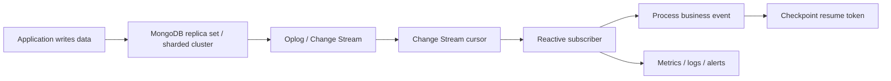
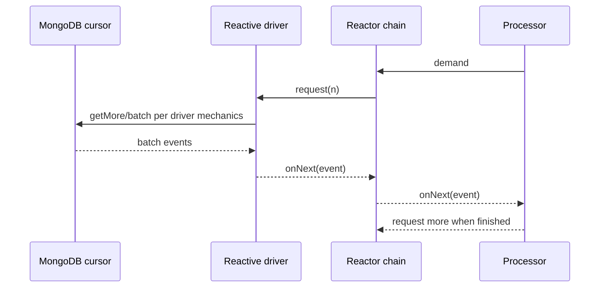
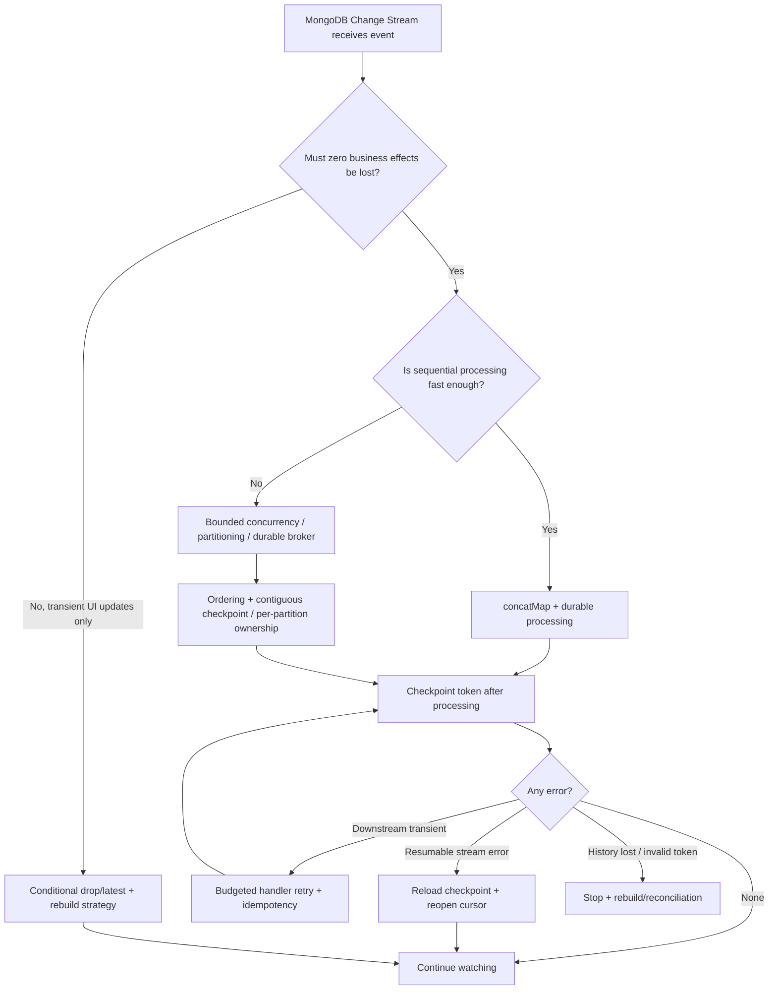

# Backpressure, Listener Errors, and Subscription Lifecycle Management in Change Streams

## 1. Why Can a Correctly Working Change Stream Still Overload a System?

In the **SPRING_DATA_MONGODB** module, Change Streams enable Spring Data MongoDB applications to watch committed changes on a MongoDB replica set or sharded cluster. Applications can use `ReactiveMongoTemplate`, the reactive driver, or `MessageListenerContainer` to receive insert/update/delete events, then update caches, materialized views, search indexes, or send notifications.

Real-world trouble begins when **the incoming event rate exceeds the processing rate**:

- MongoDB writes tens of thousands of changes during a bulk import while the consumer processes only a fraction.
- A listener calls a slow HTTP API or PostgreSQL temporarily loses connectivity.
- An unhandled exception terminates a reactive `Flux`.
- A worker restarts using the wrong resume token, causing **lost events** or **duplicate processing**.
- A rolling deployment runs two subscriptions concurrently, sending the same email twice.
- An unmanaged `subscribe()` keeps a cursor open after the service has stopped.

Three groups of concerns must be solved together:

1. **Backpressure:** limit in-flight work, control buffers, measure lag, and prevent an infinite stream from consuming unbounded resources.
2. **Listener errors:** distinguish per-event business errors, transient MongoDB/target errors, and unresumable failures; define when to retry, quarantine, or rebuild.
3. **Subscription lifecycle:** open streams when the app is ready, own/cancel subscriptions, close cursors, restart from durable checkpoints, and coordinate multiple replicas.

This lesson focuses directly on **"Backpressure, listener errors, and subscription lifecycle management"** within the scope of using Spring Data MongoDB to connect, query, aggregate, manipulate data, handle reactive access, test, and diagnose performance. No additional notes.

### 1.1. Expected Learning Outcomes

After this lesson, learners will be able to:

- Explain the differences among **Reactive Streams demand**, driver batching/prefetch, in-app buffers, and MongoDB **oplog retention**.
- Design concurrency-bounded pipelines with `concatMap`, `flatMap(..., concurrency)`, or partitioned processing when genuinely safe.
- Recognize the danger of `onBackpressureDrop`/`onBackpressureLatest` in flows requiring all events to be processed.
- Save **resume tokens after durable processing**, handle duplicates via idempotency, and reconnect at the exact position.
- Separate stream-terminating errors from single-message processing errors.
- Manage `Disposable`/subscriptions across Spring Boot startup, shutdown, rolling deploys, and scaling.
- Distinguish reactive subscriptions from imperative `MessageListenerContainer` and their respective error-handling policies.
- Test demand, cancellation, retries, crash windows, and history loss in an appropriate MongoDB environment.

## 2. Nature of Change Streams: Long-Lived Cursors and Infinite Event Sources

### 2.1. Prerequisites for use

MongoDB Change Streams rely on watching changes via the oplog and require an eligible **replica set or sharded cluster**; a basic standalone MongoDB is insufficient. Events are emitted for observable changes subject to change-stream contracts and required privileges. They are **not** standalone work queues permanently retained by MongoDB per consumer.

Event-watching components can target:

- A specific collection, such as `orders`.
- A database across multiple collections.
- A deployment per supported capability/API.

Each level carries implications for authorization, traffic volume, tokens, and filtering. This lesson uses **collection watch** to keep scope clear.

### 2.2. Data flow diagram



`MongoTemplate`/`ReactiveMongoTemplate` helps build queries and map documents, yet does not turn a Change Stream into a **durable queue** with per-message acks like some brokers. Continuing cleanly across restarts relies on **resume tokens + remaining oplog history + application checkpointing**.

### 2.3. What does an event contain?

An event may contain:

| Property | Meaning |
|---|---|
| `_id`/resume token | Position identifier for resuming per the Change Stream contract |
| `operationType` | `insert`, `update`, `replace`, `delete`, and eligible DDL events |
| `ns` | Database/collection namespace |
| `documentKey` | Key of the affected document |
| `fullDocument` | Document content depending on operation/`fullDocument` option |
| `updateDescription` | Fields updated/removed per the change event |
| `clusterTime` | MongoDB logical timestamp, not an end-to-end wall-clock SLA |
| `wallTime` | Present on supported server versions; not strictly relied upon |

Never confuse **resume tokens** with business IDs. A single document `orderId=O-101` can emit many change events with distinct tokens; per-event idempotency requires its own strategy.

### 2.4. `fullDocument` may not be a snapshot at the exact update time

When using `FullDocument.UPDATE_LOOKUP` on update events, MongoDB queries the current document to populate `fullDocument`. If intervening mutations happen, the looked-up body **may reflect a newer state** than the update that triggered the event.

Therefore:

- Use `updateDescription` when you need which fields changed in the operation.
- Use **pre/post images** when exact before/after snapshots are required and the deployment/collection is configured with sufficient retention.
- Use authoritative documents + version guards when updating current state.
- Never recompute money or inventory from `UPDATE_LOOKUP` as if it were always an immutable event payload.

This is a correctness boundary distinct from backpressure: even a pipeline losing zero messages can misinterpret event payloads.

## 3. Each Subscribe Opens an Independent Processing Stream

### 3.1. `ReactiveMongoTemplate` returns a `Flux`

```java
import org.springframework.data.mongodb.core.ReactiveMongoTemplate;
import org.springframework.data.mongodb.core.ChangeStreamOptions;
import org.springframework.data.mongodb.core.ChangeStreamEvent;
import reactor.core.publisher.Flux;

public Flux<ChangeStreamEvent<OrderDocument>> events(
        ReactiveMongoTemplate template) {
    return template.changeStream(
        "orders",
        ChangeStreamOptions.empty(),
        OrderDocument.class);
}
```

`OrderDocument` is an example application entity; your Spring Data version must support the `changeStream(collectionName, options, targetType)` overload. The `Flux` can remain active indefinitely, rarely completing while the collection is watched and connectivity holds.

In reactive programming, **creating a `Flux` does not open the stream**. MongoDB I/O begins only when subscribed.

### 3.2. Do not call `subscribe` accidentally in multiple places

```java
Flux<ChangeStreamEvent<OrderDocument>> events = events(template);

events.subscribe(this::updateCache);
events.subscribe(this::sendNotification);
```

This creates **two independent subscriptions**. Each has its own cursor, retries, processing progress, and checkpoints. If both callbacks affect a business operation, they can trigger duplicate effects or run in different orders.

When two distinct business consumers are needed, design them as two **independent consumer pipelines with separate checkpoints/ownership**, or publish an intermediate durable event. Never assume `Flux` is shared by default simply because a Java variable is reused.

### 3.3. One stream and multiple business steps

When running multiple steps **for the same event** and checkpointing only once all finish:

```java
Flux<ChangeStreamEvent<OrderDocument>> source = events(template);

return source.concatMap(event ->
    updateCache(event)
        .then(updateProjection(event))
        .then(saveCheckpoint(event))
);
```

Here `updateCache`, `updateProjection`, and `saveCheckpoint` are application helpers returning `Mono<Void>`. Never use `doOnNext(event -> someMono.subscribe())`, because it neither awaits completion/errors nor establishes a safe checkpoint boundary.

If cache updates are best-effort while projections must be durable, give those steps **distinct failure policies** rather than blindly swallowing cache errors and claiming "every event succeeded".

### 3.4. Subscription ownership is an architectural decision

A worker should know:

- Which collection/pipeline does it watch?
- Which **consumer identity** owns the checkpoint ID and tokens?
- How many process instances may receive the same events?
- What triggers stopping: app shutdown, lease revocation, tenant filter changes, index rebuilds?
- When errors occur, who restarts it and emits alerts?

Answering these clearly before writing `subscribe()` matters more than Java method naming.

## 4. Backpressure: `request(n)` Does Not Mean Data Cannot Be Lost

### 4.1. Reactive Streams signals

A subscriber can call `request(n)` to demand at most `n` elements before asking for more. In Reactor, operators manage demand on behalf of application code. `ReactiveMongoTemplate` and the reactive MongoDB driver cooperate via Reactive Streams to propagate demand signals.



Demand prevents **flooding the subscriber unboundedly**, yet does not stop MongoDB from accepting new writes when the app slows down. The database keeps writing; the oplog keeps advancing/wrapping.

### 4.2. Four places where data can accumulate

| Location | Bounded by what? | When consumer slows down |
|---|---|---|
| MongoDB oplog/history | Retention, oplog size, workload, cluster config | Old events can roll off history so tokens cannot resume |
| Driver/cursor batches | `batchSize`, `maxAwaitTime`, prefetch/implementation | Fetched events may sit waiting for app processing |
| Reactor operators | `publishOn` prefetch, `buffer`, `flatMap` concurrency/queues | Memory pressure, latency, out-of-order processing |
| Application queues/external brokers | Queue capacity, consumer concurrency, disk durability | Backlog/drops/retries depending on design |

Merely setting `batchSize(100)` **does not mean** the whole application caps memory at 100 events. A downstream `buffer(1000000)` or high-concurrency `flatMap` can still consume substantial memory.

### 4.3. Never confuse throughput with lag

Track separately:

- **Arrival rate:** changes MongoDB generates per second.
- **Processing rate:** events whose side effects are confirmed complete per second.
- **Backlog:** events awaiting processing/retention, sometimes not directly measurable from Change Streams alone.
- **End-to-end lag:** from committed change to successful processing/checkpoint.
- **In-flight count:** events currently executing business handlers.

When arrival rate exceeds processing rate over long periods, **backlog grows** even if the pipeline is strictly "Reactive Streams compliant". Scale capacity, narrow watch scope, split consumers, offload to a durable broker, or adjust retention.

### 4.4. Backpressure does not create exactly-once

Bounding demand does not prevent:

- Process crashes before checkpointing.
- Duplicates after reconnect/retry.
- Accidentally checkpointing a received-but-unprocessed event.
- History loss from prolonged downtime.
- Two instances seeing the same event.

Backpressure manages **resource flow**; idempotency, checkpoints, leases, and reconciliation enforce **delivery correctness**.

## 5. Operator Choice: `concatMap`, `flatMap`, Buffers, and Drops

### 5.1. `concatMap` for order and one in-flight event

```java
Flux<ChangeStreamEvent<OrderDocument>> changes =
    template.changeStream(
        "orders", ChangeStreamOptions.empty(),
        OrderDocument.class);

return changes.concatMap(event ->
    processBusinessEvent(event)
        .then(checkpoint(event))
);
```

When both `processBusinessEvent` and `checkpoint` return `Mono<Void>`, `concatMap` awaits each inner publisher before starting the next event. This simplifies reasoning about **ordered processing + checkpointing** and caps handler concurrency at one.

**Still, zero buffering is not guaranteed**: Reactor operators/drivers can prefetch and hold items. Measure needs and use `concatMap(..., 1)` on versions supporting prefetch configuration or `limitRate(...)` per contract to tighten demand—never claim `concatMap` alone guarantees the cursor fetches zero extra events ahead.

### 5.2. `flatMap` raises throughput but complicates checkpointing

```java
return changes.flatMap(
    event -> processBusinessEvent(event),
    8
);
```

This runs **up to eight handlers concurrently**, allowing events to **complete out of source order**.

Suppose:

```text
Receive A(token=10), B(token=11), C(token=12)
A is slow; B and C finish fast
Checkpoint token=12
Crash
Resume after 12 ⇒ unprocessed A is skipped
```

**Never** checkpoint "whichever event token just finished" under unordered concurrency. Use a coordinator tracking a **contiguous committed prefix** or partitioned processing with independent checkpoints. Without that mechanism, stick to sequential `concatMap` whenever events cannot be lost.

### 5.3. `flatMapSequential` does not solve exactly-once either

`flatMapSequential` emits outputs in source order while executing inner publishers concurrently. However, inner side effects still execute whenever scheduled; if event C writes to an external database before A, **side-effect ordering already changed** even though downstream emissions are re-ordered.

When business commands require ordering per aggregate, use `concatMap` or partition by aggregate key with dedicated ordered workers and checkpoint policies.

### 5.4. Bounded `onBackpressureBuffer` and overflow policies

```java
import reactor.core.publisher.BufferOverflowStrategy;

Flux<ChangeStreamEvent<OrderDocument>> bounded =
    changes.onBackpressureBuffer(
        512,
        dropped -> recordOverflow(dropped),
        BufferOverflowStrategy.ERROR);
```

This illustrates the Reactor API; `recordOverflow` is a non-blocking logging/metric callback. With `ERROR`, a full buffer **errors the pipeline** instead of silently discarding events. This triggers **cursor cancellation + retry/resume** when infrastructure has proper checkpoints, retention, and idempotency.

A limit of 512 caps **one operator's buffer**, not total pipeline memory. Overflows require monitoring and runbooks, never suppression via `onErrorResume(e -> Flux.empty())`.

### 5.5. `onBackpressureDrop` and `onBackpressureLatest` are dangerous

```java
// Use ONLY when the product intentionally accepts losing samples.
changes.onBackpressureDrop();

changes.onBackpressureLatest();
```

In a Change Stream:

- `onBackpressureDrop` drops unprocessed events whenever downstream has zero demand.
- `onBackpressureLatest` keeps only the newest event during overload windows.
- If checkpoints still advance, dropped events **will not replay** on restart.

Only acceptable for **telemetry/sampled UI updates** where the business contract explicitly allows losing intermediate updates and can rebuild current state. **Never** use for payments, inventory, mandatory audits, or outbox relays.

### 5.6. `limitRate` and `publishOn` prefetch

```java
Flux<ChangeStreamEvent<OrderDocument>> controlled =
    changes.limitRate(32);
```

`limitRate` shapes how downstream demand propagates upstream; it **does not** throttle writes into MongoDB and is **not** a durable queue. `publishOn(scheduler)` introduces its own prefetch and queue; when inserting it between source and handler, check concurrency, prefetch, thread utilization, and cancellation.

If you must throttle to match a target API's rate limit, use a rate limiter/backpressure-aware publisher or bounded queue, while ensuring catch-up from resume tokens stays inside the retention window.

## 6. Batch Size, `maxAwaitTime`, and Resource Limits

### 6.1. Using the reactive MongoDB driver to tune the cursor

For driver-level Change Stream options, access the collection from `ReactiveMongoTemplate`:

```java
import java.util.concurrent.TimeUnit;
import com.mongodb.client.model.FullDocument;
import com.mongodb.client.model.changestream.ChangeStreamDocument;
import com.mongodb.reactivestreams.client.ChangeStreamPublisher;
import org.bson.Document;
import org.springframework.data.mongodb.core.ReactiveMongoTemplate;
import reactor.core.publisher.Flux;

public Flux<ChangeStreamDocument<Document>> watchOrders(
        ReactiveMongoTemplate template) {
    return template.getCollection("orders")
        .flatMapMany(collection -> {
            ChangeStreamPublisher<Document> watch = collection.watch()
                .fullDocument(FullDocument.UPDATE_LOOKUP)
                .batchSize(128)
                .maxAwaitTime(1, TimeUnit.SECONDS);

            return Flux.from(watch);
        });
}
```

Because this uses **raw driver events**, document bodies arrive as `org.bson.Document` rather than Spring Data's mapped `OrderDocument`. `FullDocument.UPDATE_LOOKUP` illustrates requesting full documents on updates; omit it if handlers only need operation, `documentKey`, or `updateDescription`.

### 6.2. `batchSize` does not equal a business processing batch

`batchSize(128)` hints MongoDB cursor batch size, not how many events commit per transaction or inbox batch. `maxAwaitTime(1, TimeUnit.SECONDS)` sets how long the server waits for events during an eligible `getMore`; it is **not** a business processing timeout.

Never crank `maxAwaitTime` extremely low trying to "process faster" without measuring `getMore` polling overhead, CPU, and network impact.

### 6.3. Bounding concurrency and memory per layer

A pipeline with:

```text
MongoDB batchSize=128
   ↓
Reactor publishOn prefetch
   ↓
onBackpressureBuffer capacity=512
   ↓
flatMap concurrency=16
   ↓
HTTP connections / DB pool
```

does not have a global limit of "only 16 events in the entire pipeline". Up to 128 events may be fetched and hundreds queued downstream. Define:

- `max in-flight handlers`.
- `max local buffered events`.
- `external connection pool limit`.
- `per-event timeout/deadline`.
- `retry/backoff policy`.
- `oplog retention safety margin` and downstream backlog capacity.

If handlers have high latency and the system requires zero loss, a **durable queue/broker** or scaled-up processing capacity is usually the right architecture rather than growing JVM memory buffers.

### 6.4. Buffer overflow needs a recovery plan

When the buffer fills under `ERROR` policy:

1. The pipeline emits an error and the upstream subscription cancels.
2. The driver stream cursor cleans up upon cancellation.
3. The supervisor classifies the failure as backpressure overload rather than a data bug.
4. Recovery reads the **last committed checkpoint**, opens a fresh stream, and replays unfinished events within the oplog retention window.
5. Idempotent processors absorb duplicates.

If oplog history rolled over, **there is no guarantee** retries alone can recover every event. Execute a rebuild/reconciliation plan (Section 11).

## 7. Resume Tokens: Checkpointing After Durable Side Effects

### 7.1. Both orderings have failure windows

Suppose a handler updates PostgreSQL upon receiving event `E-7`.

**Wrong — checkpoint before processing:**

```text
Receive E-7
Save resume token T7
Process crashes
PostgreSQL has NOT processed E-7
Resume after T7 ⇒ E-7 can be permanently skipped
```

**Preferred — process first, checkpoint afterward:**

```text
Receive E-7
PostgreSQL COMMIT succeeds
Process crashes before token T7 checkpoint
Resume from T6 ⇒ E-7 redelivered
Consumer inbox/dedup absorbs duplicate effect
```

This is **at-least-once processing**: accepting replay to avoid losing business effects. When side effects live in PostgreSQL and checkpoints live in MongoDB, those two commits are **not atomic together**; rely on idempotency or a durable downstream inbox.

### 7.2. Resume tokens are opaque BSON documents

In the raw driver:

```java
org.bson.BsonDocument token = change.getResumeToken();
```

Never extract a substring of `_data` to "increment by 1" like a numeric offset; never sort tokens alphabetically. Resume tokens are **opaque** and formats may vary across versions and topologies.

Persist the token **intact**, tagged with:

- Consumer identity + scope (collection/database/pipeline).
- Search/aggregation `$match` pipeline version.
- Processor implementation version.
- Processing/checkpoint timestamps and worker ownership.
- Optional lag/metrics indicators.

When switching a consumer from collection A to a database-wide watch or altering pipeline semantics, never assume the old token stays valid or properly scoped.

### 7.3. Oplog retention is not infinite

MongoDB retains oplog history within a bounded window. A consumer paused too long can find its token missing from retained history, triggering history-lost or unresumable errors.

Retention **depends on write volume and config**, so never assume a fixed number of hours from cluster size alone. A bulk import can dramatically shrink the oplog window.

Therefore:

1. Measure `oldest available oplog history` alongside consumer lag.
2. Alert before lag approaches the retention safety margin.
3. Never treat local memory queues as durable buffers.
4. Maintain a projection rebuild/reconcile plan when tokens expire.
5. Consider a dedicated-retention broker/outbox if extended downtime is normal.

### 7.4. Checkpointing policy when handlers return results

```java
public Mono<Void> handleAndCheckpoint(
        ChangeStreamDocument<Document> change) {
    return businessHandler.handle(change)
        .then(checkpointStore.save(
            change.getResumeToken()));
}
```

`businessHandler` and `checkpointStore` are **application-defined abstractions**. `businessHandler.handle` must complete only once the business effect is durable per contract—not merely when dispatching an unacknowledged async HTTP request.

`checkpointStore.save` must also return a `Mono<Void>` representing a durable checkpoint write (or matching response type) rather than triggering token writes via a detached `subscribe()`.

### 7.5. Checkpoint per event vs. per batch?

| Strategy | Pros | Trade-offs |
|---|---|---|
| After every processed event | Smallest duplicate window, easy to reason about | Higher write overhead |
| After every N consecutive processed events | Lower checkpoint I/O | Crashes replay more events |
| Periodically on an interval | Lower write load | Recovery replays wider windows; must know contiguous token |
| Batched in one transaction with state | Atomic if state and token share MongoDB tx | Does not extend atomicity to PostgreSQL/HTTP |

Batch checkpointing is safe only when **every event up to that token has finished**. With concurrent handlers, never pick the "latest token by completion time" as a contiguous sequence.

### 7.6. One checkpoint shared by multiple workers

If multiple workers share one checkpoint ID without ownership/fencing:

```text
Worker A receives E-10, processing slowly
Worker B receives E-11, saves token T11
Worker A crashes before finishing E-10
Resume after T11 ⇒ E-10 is skipped
```

Solutions:

- Single active owner per checkpoint partition.
- Leases with **fencing tokens** or compare-and-set when saving checkpoints.
- Key-based partitioning with independent checkpoints when ordering/ownership can be isolated.
- A durable queue with consumer-group semantics when strong fan-out/scaling is needed.

Never pick `flatMap(concurrency=16)` and let every handler write the same token into one document.

## 8. `resumeAfter`, `startAfter`, and `startAtOperationTime`

### 8.1. Where to start when no checkpoint exists?

Initial startup:

- Listen **from now**: simple to deploy, misses changes occurring before watch readiness.
- Use `startAtOperationTime` per server-supported behavior when a valid timestamp exists and remains in the oplog.
- Execute a bootstrap snapshot + stream/reconciliation with a gap-prevention procedure.

Choose the policy before deploying production projections. If a service needs full existing state, opening a Change Stream "from now" **does not backfill historical documents**.

### 8.2. `resumeAfter(token)`

Once successfully processed up to token `T6`, reopen the stream with:

```java
ChangeStreamPublisher<Document> resumed =
    collection.watch()
        .resumeAfter(token);
```

`token` is a `BsonDocument` captured from an earlier MongoDB change event. It must belong to a compatible stream scope/pipeline and remain in resumable history.

**Never** use the token of an event merely received and **not yet finished**. Because `resumeAfter` skips past the specified token, an unfinished event loses its business effect.

### 8.3. `startAfter(token)` and `invalidate`

MongoDB can emit an `invalidate` event after certain DDL changes such as drops or renames within scope. `resumeAfter` **cannot resume past an `invalidate` event** per server rules. `startAfter` supports restarting after `invalidate` in eligible server versions and topologies.

Do not treat `startAfter` as a magic "ignore all errors" switch or expect it to restore collections/indexes properly. When a collection is dropped/renamed, consumers must:

1. Detect the DDL/invalidation event.
2. Determine the new namespace scope.
3. Verify whether downstream data remains valid or needs rebuilding.
4. Start a fresh watcher following official lifecycle and token semantics.

Silently re-watching a newly created collection with the same name ignores the fact that old data vanished.

### 8.4. `startAtOperationTime` is not magic

`startAtOperationTime(timestamp)` starts a stream at a MongoDB logical timestamp still in history. However:

- Cannot request a timestamp evicted by oplog truncation.
- Does not guarantee snapshot consistency with a collection query executed before/after on another resource.
- Must use a valid server timestamp—never cast `Instant.now()` straight into a `BsonTimestamp` with a guessed increment.
- Distributed clusters require careful boundary and token math for exact bootstrapping.

If you lack a provably gap-free bootstrap procedure, design **idempotent projection rebuilds** or use a supported outbox/durable event stream.

### 8.5. Resume tokens in Spring Data's abstraction

Spring Data `ChangeStreamEvent<T>` exposes fields/methods to access raw events and resume tokens per version. Conceptual example:

```java
Flux<ChangeStreamEvent<OrderDocument>> changes =
    template.changeStream(
        "orders", options, OrderDocument.class);

return changes.concatMap(event ->
    process(event.getBody())
        .then(saveToken(event.getResumeToken())));
```

`options` must be constructed from a durable checkpoint (e.g. `ChangeStreamOptions.builder().resumeToken(...)` in supporting versions), and `saveToken` must match the token type exposed by your Spring Data version. Never assume `getBody()` is always non-null: delete/invalidate events lack full documents.

## 9. Listener Errors and Change Stream Errors Are Two Separate Layers

### 9.1. Errors from the MongoDB source

The source `Flux` can emit `onError` on:

- Connection drops, node stepdowns, network glitches, or server selection timeouts.
- Cursor closed/killed or operation interrupted.
- Token unresumable because oplog/history rolled off.
- Invalid token/watch options, or namespace dropped/renamed.
- Insufficient privileges to watch the collection/change stream.
- Unsupported or incompatible aggregation pipeline stages.

Never catch every MongoDB error and return `Flux.empty()`: that turns a mandatory 24/7 consumer into a service that **silently stops watching** while HTTP health checks stay green.

### 9.2. Errors while processing an event

Listeners/processors can fail even when the MongoDB Change Stream is healthy:

- Failing to deserialize an event with an unsupported `schemaVersion`.
- Business handlers encountering inconsistent data or missing mandatory fields.
- PostgreSQL or external HTTP APIs temporarily unavailable.
- Unique constraints flagging a duplicate.
- Checkpoint store failing after business effects committed.
- Thread/callbacks performing blocking I/O, exhausting memory pools, or canceling.

These are **processing-pipeline failures**, not necessarily reasons to restart the entire MongoDB cursor every time. Separate **operation** retries from **stream** retries.

### 9.3. Error classification matrix

| Error | Examples | Primary policy |
|---|---|---|
| Transient source error | Flaky network, primary failover | Backoff reconnect, reload checkpoint token |
| History-lost / invalid resume | Token outside oplog window | **Do not** retry old token infinitely; rebuild/resync |
| Authentication/authorization | Missing `changeStream`/namespace read privileges | Fail fast + alert/fix config |
| Invalid pipeline/index/schema | Stage unsupported on server version | Fail fast, fix deployment |
| Downstream transient | SQL/broker unavailable | Bounded event processing retry; never pre-checkpoint |
| Poison event | Undecodable payload, incompatible schema version | Durable quarantine/DLQ; explicit replay policy |
| Duplicate | EventId/business op already handled | Confirm idempotently, safe to checkpoint |
| Checkpoint failure | Side effect succeeded yet token save failed | Do not advance token; retry save or replay idempotently |
| Backpressure overflow | Bounded buffer full | Alert, shed/scale capacity, reconnect cleanly |
| Cancellation | Deploy shutdown or owner lease revoked | Stop intake, drain in-flight, clean up cursor |

An error can be transport-transient yet an **ambiguous outcome** at the business layer. For example, an HTTP timeout after a payment charge: never re-call with a new idempotency key. Reconcile outcome with the provider via a dedicated workflow instead of blindly raising `retryWhen` counts.

### 9.4. `onError` is a terminal signal

In Reactor, once a `Flux` emits `onError`, **that subscription terminates**. `doOnError` only logs/records metrics—it **does not** restart the stream:

```java
source
    .doOnError(error -> logStreamFailure(error))
    .subscribe();
```

After the error, the subscriber is dead. Controlled reconnecting requires wrapping **the actual source** in `retryWhen`, reloading checkpoints on retry, or an explicit supervisor restart policy.

### 9.5. `onErrorContinue` is usually the wrong choice

```java
// ANTI-PATTERN: can silently skip an event when the handler errors.
changes
    .map(this::decodeBusinessEvent)
    .onErrorContinue((error, value) ->
        log.warn("skip event", error));
```

`onErrorContinue` has operator-dependent semantics, can propagate unexpectedly upstream, and is not a safe per-event error handler. If an event is skipped while later tokens advance, downstream data develops **permanent gaps**.

Instead, handle errors **inside the inner publisher** with an explicit policy:

```java
return changes.concatMap(event ->
    decodeAndProcess(event)
        .onErrorResume(PoisonEventException.class,
            error -> durableQuarantine(event, error))
        .then(checkpoint(event))
);
```

This pattern is **safe only if** `durableQuarantine` persists the full event, token, error, and reason into a **durable DLQ/quarantine**, and business rules permit checkpointing afterward. When strict "zero skipped events" is required, halt the stream and alert instead of auto-skipping. Also never catch errors from `checkpoint(event)` pretending the checkpoint succeeded.

### 9.6. Handler retries vs. source retries

```java
return changes.concatMap(event ->
    downstreamProcessor.apply(event)
        .retryWhen(downstreamRetryPolicy)
        .then(checkpointStore.save(event.getResumeToken())));
```

`downstreamRetryPolicy` targets transient **downstream operation** failures with bounded attempts/deadlines, preserving the same idempotency key across retries. Once attempts exhaust, the error bubbles out of `concatMap` so the supervisor can stop/restart the Change Stream per policy.

Never put `Retry.max(1000000)` at the handler level, letting **one poison event stall the entire stream for weeks** while oplog lag climbs silently without alerts.

## 10. Reconnecting: `retryWhen` Must Reload the Checkpoint on Every Attempt

### 10.1. Mistake: creating the source once and reusing a stale token

```java
// ANTI-PATTERN: token loaded only once before retrying.
return checkpointStore.load(CONSUMER_ID)
    .flatMapMany(token -> openChangeStream(token))
    .retryWhen(reconnectPolicy);
```

In Reactor, resubscription re-runs cold sources, yet if `token` or the cursor publisher was built/cached **outside** the retry boundary, restarts can use a stale token or dead publisher. To express intent cleanly and prevent accidental shared references, wrap **checkpoint lookup + cursor creation** inside `Flux.defer`.

### 10.2. Reopening from durable tokens pattern

The example below uses the raw reactive driver via `ReactiveMongoTemplate`. `TokenStore.load` returns `Mono<Optional<BsonDocument>>`; `TokenStore.save` returns `Mono<Void>`; `ChangeProcessor.process` completes only once business effects are durable.

```java
import java.time.Duration;
import java.util.Optional;
import java.util.concurrent.TimeUnit;
import org.bson.BsonDocument;
import org.bson.Document;
import com.mongodb.client.model.changestream.ChangeStreamDocument;
import com.mongodb.reactivestreams.client.ChangeStreamPublisher;
import org.springframework.data.mongodb.core.ReactiveMongoTemplate;
import org.springframework.stereotype.Component;
import reactor.core.publisher.Flux;
import reactor.core.publisher.Mono;
import reactor.util.retry.Retry;

public interface TokenStore {
    Mono<Optional<BsonDocument>> load(String consumerId);
    Mono<Void> save(String consumerId, BsonDocument token);
}

public interface ChangeProcessor {
    Mono<Void> process(ChangeStreamDocument<Document> event);
}

@Component
public final class ResumableOrderStream {
    public static final String CONSUMER_ID = "order-projection-v1";

    private final ReactiveMongoTemplate template;
    private final TokenStore tokens;
    private final ChangeProcessor processor;

    public ResumableOrderStream(
            ReactiveMongoTemplate template,
            TokenStore tokens,
            ChangeProcessor processor) {
        this.template = template;
        this.tokens = tokens;
        this.processor = processor;
    }

    public Flux<Void> run() {
        return Flux.defer(() ->
                tokens.load(CONSUMER_ID)
                    .flatMapMany(this::open))
            .concatMap(event ->
                processor.process(event)
                    .then(tokens.save(
                        CONSUMER_ID,
                        event.getResumeToken())),
                1)
            .retryWhen(reconnectPolicy());
    }

    private Flux<ChangeStreamDocument<Document>> open(
            Optional<BsonDocument> lastCommittedToken) {
        return template.getCollection("orders")
            .flatMapMany(collection -> {
                ChangeStreamPublisher<Document> cursor =
                    collection.watch()
                        .batchSize(64)
                        .maxAwaitTime(1, TimeUnit.SECONDS);

                if (lastCommittedToken.isPresent()) {
                    cursor = cursor.resumeAfter(
                        lastCommittedToken.get());
                }
                return Flux.from(cursor);
            });
    }

    private Retry reconnectPolicy() {
        return Retry.backoff(
                8, Duration.ofMillis(250))
            .maxBackoff(Duration.ofSeconds(20))
            .jitter(0.35)
            .filter(StreamFailureClassifier::isRetryable)
            .onRetryExhaustedThrow(
                (spec, signal) -> signal.failure());
    }
}
```

**Reading the boundaries properly:**

- Every resubscription in `Flux.defer` re-invokes `tokens.load(...)` and opens a new cursor.
- `concatMap(..., 1)` executes handlers sequentially; token N+1 never checkpoints before event N completes.
- Tokens save **after** processor success, not merely after `onNext`.
- When errors escape processor/checkpointing, `retryWhen` decides whether to **restart the stream**.
- When retries exhaust or a non-retryable exception hits, the `Flux` terminates with error; the outer lifecycle owner must alert and mark the service unhealthy/degraded.

Key assumptions: **a single active owner** for `CONSUMER_ID`, an idempotent processor, durable token store, and unchanged watch scope. The sample omits distributed fencing, lease coordinators, DLQs, and authentication; add them before running multi-replica production workloads.

When placing this into a Java project, put the two public interfaces `TokenStore` and `ChangeProcessor` into their own Java files, provide a bean implementing `ChangeProcessor`, and keep `ResumableOrderStream` in its own class (e.g., `@Component` above). An example `MongoTokenStore` bean for `TokenStore` appears in Section 12.

### 10.3. Do not retry every `MongoException`

`StreamFailureClassifier.isRetryable` is an **application policy**, not a built-in Spring Data API. It must weigh:

- Connection/primary failover errors that can recover.
- Error labels like `ResumableChangeStreamError` emitted by the driver/server.
- Timeout/cancellation errors carrying ambiguous downstream outcomes.
- Invalid resume tokens, history-lost, and permission/schema errors that **cannot** recover by retrying identically.
- Exceptions wrapped/translated by Spring Data, requiring inspection of the cause chain and error codes/labels.

Never write a classifier like:

```java
// DANGEROUS: retries history-lost/authorization indefinitely.
return failure instanceof RuntimeException;
```

Classification must be tested against your deployed MongoDB Java Driver and Spring Data versions. The driver auto-resumes certain errors per its own contract; app-level retries still need checkpoint management and liveness tracking.

### 10.4. Example classifier with clear guardrails

```java
import com.mongodb.MongoException;
import reactor.core.Exceptions;

public final class StreamFailureClassifier {
    private StreamFailureClassifier() {}

    public static boolean isRetryable(Throwable failure) {
        Throwable current = Exceptions.unwrap(failure);

        for (int depth = 0;
                current != null && depth < 16;
                depth++, current = current.getCause()) {
            if (current instanceof MongoException mongo) {
                if (mongo.hasErrorLabel(
                        "ResumableChangeStreamError")) {
                    return true;
                }
            }
            // Specific transient downstream errors may be selected
            // by a dedicated policy, never every RuntimeException.
        }
        return false;
    }
}
```

This classifier is **intentionally very narrow** to illustrate error labels. Network errors might be translated by Spring Data so `MongoException` does not surface directly in the cause chain, or an error without that label might still be retryable on a specific release. Expand policies using **driver documentation + integration tests**, never guessing from exception names. Even on resumable labels, confirm the current token remains valid.

### 10.5. Source `retryWhen` does not replace a supervisor

After eight retries, `retryWhen` in the example propagates the final failure outward. You need a supervisory mechanism:

- Track stream states `RUNNING / RETRYING / FAILED / STOPPED`.
- Fire alerts upon retry exhaustion rather than just logging stack traces.
- Optionally coordinate controlled restarts via an orchestrator/Spring lifecycle policy once recovery conditions are verified.
- On history loss, enter **rebuild/reconciliation** instead of endlessly retrying the stale token.
- Avoid writing `while(true) subscribe()` loops that leak cursors and threads.

Never add `onErrorResume(e -> Flux.empty())` at the subscription edge without setting failed state/alerting: the service would keep answering HTTP requests while having **stopped watching change events**.

## 11. History Lost: Never Use Retries to Mask Lost Data

### 11.1. The missed time window

```text
T0: Processor checkpoints token T100
T1: Service offline for hours/days
T2: Oplog evicts history containing T100
T3: Service calls resumeAfter(T100) and gets history-lost
```

MongoDB cannot recover change events beyond the history window using `resumeAfter` alone. Dropping the token and watching from now **loses all changes during the outage** if downstream depends on complete event history.

### 11.2. Rebuild the projection instead of pretending history remains

For a materialized view or search projection, you can:

1. Mark consumer state `REBUILD_REQUIRED` and stop reporting caught-up status.
2. Identify the authoritative source (MongoDB collection or business store).
3. Rebuild the snapshot/projection using **versioned/idempotent writes**.
4. Follow a bootstrap stream + snapshot procedure with a **watermark/no-gap policy**, processing events emitted while the snapshot ran.
5. Reconcile counts/correlation IDs and convergence state.
6. Only then publish the **new checkpoint** and transition to `RUNNING`.

**Warning:** simply "reading the whole collection, then starting to watch" leaves a gap between snapshot and stream opening. "Watching first, then snapshotting" also requires handling overlap, versions, ordering, and stream buffering. Never claim either is automatically gap-free without designing and testing it.

### 11.3. When history cannot be rebuilt

For emails, payments, or mandatory audit logs, current snapshots **cannot recreate** lost historical events. If business rules require zero loss across prolonged outages, Change Streams should not serve as the sole event store.

A stronger design:

- Transactional outbox durably storing events/commands in the same MongoDB transaction as state.
- A relay reading the outbox with its own retries, checkpoints, and retention.
- A broker with durable retention and consumer groups/inboxes/idempotency.
- Archiving append-only audit events to storage with policy-compliant retention.

Change Streams can serve to **notify that new outbox events arrived**, while the outbox records remain the durable source for long-term replay.

### 11.4. Never switch silently to "start now"

When recovering from history loss, always log/emit metrics/alert on the data gap and migration decision. If the product intentionally tolerates losing intermediate UI updates (e.g., needing only latest dashboard state), rebuild current state and start a fresh stream. Make that a **business-approved behavior**, not the silent default for every consumer.

## 12. Storing Structured Checkpoints Without Breaking Token Formats

### 12.1. Checkpoint storage model

A checkpoint record in `cdc_checkpoints` can hold:

```javascript
{
  _id: "order-projection-v1",
  sourceNamespace: "shop.orders",
  pipelineVersion: 1,
  tokenJson: "{ ... canonical Extended JSON of BSON resume token ... }",
  updatedAt: ISODate("2026-11-20T03:00:00Z"),
  ownerEpoch: NumberLong(12)
}
```

`tokenJson` here is a **JSON string**, not a token object that users may arbitrarily edit. Tokens must be preserved intact via Extended JSON/BSON encoding or raw BSON bytes; never extract `_data` and slice characters. `ownerEpoch` is needed only when distributed ownership/fencing is used (Section 16); never assume a plain timestamp replaces fencing.

### 12.2. Example `TokenStore` using the reactive driver

A baseline implementation **intended solely for a single active owner**:

```java
import java.util.Optional;
import org.bson.BsonDocument;
import org.bson.Document;
import org.bson.json.JsonMode;
import org.bson.json.JsonWriterSettings;
import org.springframework.data.mongodb.core.ReactiveMongoTemplate;
import org.springframework.stereotype.Component;
import com.mongodb.client.model.Filters;
import com.mongodb.client.model.UpdateOptions;
import com.mongodb.client.model.Updates;
import reactor.core.publisher.Mono;

@Component
public class MongoTokenStore implements TokenStore {
    private final ReactiveMongoTemplate template;
    private final JsonWriterSettings settings =
        JsonWriterSettings.builder()
            .outputMode(JsonMode.CANONICAL)
            .build();

    public MongoTokenStore(ReactiveMongoTemplate template) {
        this.template = template;
    }

    @Override
    public Mono<Optional<BsonDocument>> load(String consumerId) {
        return template.getCollection("cdc_checkpoints")
            .flatMap(collection ->
                Mono.from(collection.find(
                    Filters.eq("_id", consumerId)).first()))
            .map(record -> Optional.of(
                BsonDocument.parse(
                    record.getString("tokenJson"))))
            .defaultIfEmpty(Optional.empty());
    }

    @Override
    public Mono<Void> save(
            String consumerId, BsonDocument token) {
        String canonical = token.toJson(settings);

        return template.getCollection("cdc_checkpoints")
            .flatMap(collection ->
                Mono.from(collection.updateOne(
                    Filters.eq("_id", consumerId),
                    Updates.combine(
                        Updates.set("tokenJson", canonical),
                        Updates.currentDate("updatedAt")),
                    new UpdateOptions().upsert(true))))
            .then();
    }
}
```

In this example:

- Save timestamp comes from the server via `currentDate`.
- `token.toJson(CANONICAL)` → `BsonDocument.parse(...)` must be round-trip tested against your exact MongoDB Driver version and real tokens; **never** substitute an arbitrary custom JSON format.
- The `_id` index suffices for looking up one consumer checkpoint; no full collection scan needed.
- Never store tokens inside the watched `orders` collection, avoiding self-induced change stream feedback loops.
- Never delete/TTL checkpoints while business retention policies remain undecided.

**Limitation:** this snippet does not prevent two instances from overwriting the same checkpoint. With multiple replicas, add owner/fencing CAS in the write predicate; otherwise an old worker can write tokens backward.

### 12.3. Why might no token exist on a never-run consumer?

`Optional.empty()` on first launch can be intentional: start watching from subscription time. However, if a checkpoint was accidentally deleted or failed deserialization, **never** turn a parse error into empty and start from now. Token stores should distinguish:

- **FIRST_START:** no checkpoint provisioned yet, follow bootstrap policy.
- **RESUMING:** checkpoint exists and is valid.
- **CHECKPOINT_CORRUPT/MISSING_UNEXPECTEDLY:** requires operator intervention or rebuild.

To enforce this, store consumer registration, generation, or a bootstrapped flag in the store; the basic example above omits those fields.

### 12.4. Ownership metadata inside checkpoints

A production record can store:

```text
consumerId
sourceNamespace
pipelineHash / version
resumeToken (opaque)
ownerId
leaseUntil
ownerEpoch (monotonic fencing token)
lastProcessedAt
checkpointUpdatedAt
streamState
```

Never use checkpoint metadata to claim "all downstream consumers succeeded" if an event triggers multiple asynchronous side effects outside the checkpointed boundary.

## 13. Idempotency: Tolerating Duplicates Is Mandatory When Checkpointing After Processing

### 13.1. Why can the same change event arrive again?

Execution trace:

```text
Receive E-101 / token T101
   ↓
Update PostgreSQL commits OK
   ↓
JVM crashes before saving T101
   ↓
Restart with resumeAfter(T100)
   ↓
Receive E-101 again
```

This is not a Change Stream bug. Whenever a design prioritizes **zero lost events**, duplicates are a natural consequence of the failure window between two commits.

### 13.2. Inbox unique keys for PostgreSQL

```sql
CREATE TABLE processed_change_events (
    consumer_name text NOT NULL,
    event_key text NOT NULL,
    processed_at timestamptz NOT NULL DEFAULT now(),
    PRIMARY KEY (consumer_name, event_key)
);

CREATE TABLE order_projection (
    order_id text PRIMARY KEY,
    status text NOT NULL,
    source_version bigint NOT NULL
);
```

The consumer executes **within one SQL transaction**:

1. Insert an event key into `processed_change_events`; the unique constraint rejects duplicates.
2. If already processed, return success idempotently without re-applying the projection effect.
3. If new, apply the version-guarded business update.
4. Commit inbox marker + projection.
5. Only afterward update the Change Stream token in the MongoDB checkpoint store.

This still does not make MongoDB and PostgreSQL one global ACID transaction; it makes replays **safe**, provided event keys are stable and local SQL transactions work properly.

### 13.3. Choosing event identity

There are two levels:

- **Change Stream identity:** the token or hash of the **exact token** in a deterministic round-tripped format, scoped per consumer/stream.
- **Business event identity:** an `eventId` persisted inside an outbox document, e.g. `"E-ORDER-101-v3"`.

A change token identifies an operation in MongoDB, whereas a business event ID identifies domain intent. When strong downstream idempotency is needed across reprocessing, migrations, or pipeline changes, **business event IDs** from a transactional outbox are usually clearer.

Never use `documentKey._id` as the sole event identity: the same order can emit multiple updates, and deduping all of them by order ID would drop valid mutations.

### 13.4. Version guards against out-of-order updates

Suppose `order_projection` already holds `source_version = 7`, then re-receives event version 6:

```sql
UPDATE order_projection
SET status = :status,
    source_version = :version
WHERE order_id = :orderId
  AND source_version < :version;
```

Stale states never overwrite newer versions. Handle **version gaps** (jumping from 4 to 7) per business rules: defer/replay/rebuild, or allow latest-state overwrite when projections need only eventual convergence. Never assume every out-of-order event can simply be ignored safely.

### 13.5. External HTTP effects need their own idempotency

Never call:

```java
return paymentClient.charge(orderId)
    .then(checkpointStore.save(consumer, token));
```

without a stable payment operation ID, provider status lookup, and unknown-outcome handling. When a timeout happens after a successful charge, Change Stream replay can charge again.

Irreversible operations (payments, emails, shipping orders) should be coordinated via an **outbox/command + idempotent worker**, rather than wired straight into a Change Stream listener lacking durable operation identity.

### 13.6. One event with multiple destinations

When one event updates both a search index and a SQL projection:

- Either checkpoint only after both complete, accepting that both may replay (both idempotent).
- Or split into two independent consumers with **separate checkpoints** per destination.
- Or publish to a durable broker for fan-out so each consumer group tracks its own offset.

Never checkpoint a shared token once SQL finishes while letting the search index run in a fire-and-forget `Mono`; a crash causes the search index to miss the event.

## 14. `Disposable` Lifecycle and Spring Boot Lifecycle

### 14.1. `subscribe` returns a `Disposable`

```java
import reactor.core.Disposable;

Disposable subscription = resumableOrderStream.run()
    .subscribe(
        ignored -> {},
        error -> reportTerminalFailure(error),
        () -> reportUnexpectedCompletion());

// When the service must stop:
subscription.dispose();
```

`dispose()` requests subscription cancellation; it **does not guarantee** all in-flight external side effects rolled back or completed. If a handler is mid-HTTP request or SQL transaction, cancellation can leave an ambiguous state. Design graceful draining and idempotency.

`subscribe()` belongs at the **application lifecycle edge** responsible for stream ownership. Calling it covertly inside business repository methods or reactive callbacks without an owner responsible for cancellation is an anti-pattern.

### 14.2. `SmartLifecycle` to manage worker subscriptions

```java
import java.util.concurrent.atomic.AtomicReference;
import org.springframework.context.SmartLifecycle;
import org.springframework.stereotype.Component;
import reactor.core.Disposable;

@Component
public final class OrderChangeStreamLifecycle
        implements SmartLifecycle {

    private final ResumableOrderStream stream;
    private final AtomicReference<Disposable> current =
        new AtomicReference<>();

    private volatile boolean running;

    public OrderChangeStreamLifecycle(
            ResumableOrderStream stream) {
        this.stream = stream;
    }

    @Override
    public synchronized void start() {
        if (running) {
            return;
        }

        running = true;
        Disposable disposable = stream.run()
            .doFinally(signal -> running = false)
            .subscribe(
                ignored -> {},
                error -> reportTerminalFailure(error),
                () -> reportUnexpectedCompletion());

        current.set(disposable);
    }

    @Override
    public synchronized void stop() {
        Disposable disposable = current.getAndSet(null);
        if (disposable != null) {
            disposable.dispose();
        }
        running = false;
    }

    @Override
    public void stop(Runnable callback) {
        stop();
        callback.run();
    }

    @Override
    public boolean isRunning() {
        return running;
    }

    @Override
    public boolean isAutoStartup() {
        return true;
    }

    private void reportTerminalFailure(Throwable error) {
        // Logs, metrics, and alerts; fail readiness per policy.
    }

    private void reportUnexpectedCompletion() {
        // An infinite stream completing on its own requires investigation.
    }
}
```

This is a **skeleton for managing one subscription**. The report methods are application placeholders; production must emit real metrics/alerts and update health state. `SmartLifecycle` integrates start/stop with Spring, yet keep in mind:

- An async `subscribe()` can fail immediately after `start()`; readiness must observe stream state, not just `running`.
- `stop()` here **cancels immediately**, without waiting for in-flight completion. To drain gracefully, stop upstream demand/intake, wait for active work and checkpoints within a deadline, then dispose.
- `current` should pair with a generation/owner epoch if restarting after terminal errors so stale subscription callbacks never corrupt new state.
- Never open extra streams during Spring context refreshes or from job schedulers also invoking `start()`.

### 14.3. Startup readiness differs from "bean created"

`@PostConstruct` only signals the bean was constructed—not that MongoDB is reachable, checkpoint stores are readable, search indexes exist, or downstream targets are up. Production Change Stream consumers should verify:

1. Configuration validated.
2. Checkpoint store and MongoDB connected.
3. Indexes/namespaces/pipelines match production versions.
4. Ownership acquired if multiple replicas exist.
5. Stream opened cleanly and liveness confirmed.
6. Only then mark the consumer `RUNNING/READY`.

If starting on `ApplicationReadyEvent`, do not simultaneously keep `SmartLifecycle.isAutoStartup() = true` and accidentally launch an unmanaged duplicate stream.

### 14.4. Graceful shutdown

```text
SIGTERM / rolling deploy
    |
    +-- Mark DRAINING, stop taking new events
    +-- Await in-flight events within shutdown budget
    +-- Commit downstream effects and checkpoints in order
    +-- Cancel/close Change Stream cursor
    +-- Release ownership lease / set state STOPPED
    \-- Process exits
```

If the budget expires, **do not checkpoint undurable events**; let the replacement instance replay idempotently. Shutdown hooks cannot run on `kill -9`, node crashes, or power loss—recovery must always survive abrupt crashes.

### 14.5. Should you use a shared `Flux`?

`publish().refCount(...)` or `share()` lets multiple local subscribers share one upstream subscription, yet each subscriber operates at its own speed and error policy. If one subscriber slows down, understand buffering/dropping behavior. When subscribers own distinct business side effects and checkpoints, a shared hot stream fails to provide durable replay for late subscribers.

**Never use `share()` to replace a durable broker** when fan-out needs at-least-once guarantees and independent consumer progress. Use in-process multicasting only for consumers with explicit shared contracts and managed lifecycles.

## 15. `MessageListenerContainer`: Imperative Listeners Lack Reactor Backpressure

### 15.1. Two approaches in Spring Data MongoDB

| Characteristic | Reactive `Flux` / `ReactiveMongoTemplate` | Imperative `MessageListenerContainer` |
|---|---|---|
| Consumption model | Reactive Streams demand, subscriptions | Container manages polling/receive threads |
| Processing API | `Flux<ChangeStreamEvent<T>>` or raw reactive driver | `MessageListener`, `ChangeStreamRequest` |
| Lifecycle | `Disposable`, `SmartLifecycle`/owner | `container.start/stop`, `Subscription.cancel` |
| Handler errors | Terminal `onError` unless handled | Error handler/task/container policy per API/version |
| Backpressure | Reactive demand and operator queues | Must govern thread pools, queue capacities, and callback times |
| Best suited for | Non-blocking I/O and Reactor pipelines | Imperative apps or integrations with synchronous callbacks |

`MessageListenerContainer` is **not** a reactive subscriber receiving `request(n)` from business handlers. If a listener calls a slow service, container worker threads block and lag builds; if a listener offloads to an unbounded executor, queues swell.

### 15.2. Registering a `ChangeStreamRequest`

Skeleton example in imperative Spring Data MongoDB:

```java
import org.springframework.data.mongodb.core.MongoTemplate;
import org.springframework.data.mongodb.core.messaging.ChangeStreamRequest;
import org.springframework.data.mongodb.core.messaging.DefaultMessageListenerContainer;
import org.springframework.data.mongodb.core.messaging.MessageListenerContainer;
import org.springframework.data.mongodb.core.messaging.Subscription;

public final class ImperativeOrderWatcher {
    private final MessageListenerContainer container;
    private Subscription subscription;

    public ImperativeOrderWatcher(MongoTemplate template) {
        this.container =
            new DefaultMessageListenerContainer(template);
    }

    public void start() {
        ChangeStreamRequest<OrderDocument> request =
            ChangeStreamRequest.builder()
                .collection("orders")
                .publishTo(message -> {
                    // Handler requires error policy and idempotency.
                    processSynchronously(message);
                })
                .build();

        subscription =
            container.register(request, OrderDocument.class);
        container.start();
    }

    public void stop() {
        if (subscription != null) {
            subscription.cancel();
        }
        container.stop();
    }

    private void processSynchronously(Object message) {
        // Execute business operation synchronously or
        // enqueue onto a bounded, durable work queue.
    }
}
```

This is an **illustrative lifecycle and callback skeleton**: verify types/generics on `ChangeStreamRequest`, `MessageListenerContainer`, and `register(...)` against your Spring Data version before compiling. It omits error handlers, resume tokens/checkpoints, and graceful draining; do not deploy verbatim claiming an at-least-once consumer.

### 15.3. Listener exceptions can halt tasks

With an imperative callback:

```java
message -> {
    writeSql(message);  // May throw SQLException/runtime wrapper.
}
```

if an exception escapes the listener, the container/error handler decides the outcome per implementation and config; **never assume** the request automatically retries forever or resumes at the exact right token.

Ensure you:

1. Configure an error handler matching your container's API.
2. Record terminal failures and subscription liveness state.
3. Checkpoint strictly after durable processing.
4. Implement a durable restart/resume policy.
5. Never swallow errors and silently continue as if the event succeeded.

### 15.4. Offloading to an executor still needs bounded queues

A listener submitting messages to:

```java
executor.submit(() -> process(message));
```

and returning immediately lets the container keep fetching events unaware of whether tasks finished. If you then checkpoint newly arrived tokens, process crashes will lose events.

When offloading to an executor:

- Keep queues **bounded** with explicit rejection/overflow policies.
- Track **completion** of each task before checkpointing.
- Never advance tokens past unfinished events.
- Plan shutdown, draining, and retention.
- With multiple concurrent worker threads, enforce contiguous checkpoint logic or isolated key partitioning.

Moving from callbacks to `CompletableFuture` does not create backpressure or durable replay by itself.

### 15.5. Managing container lifecycle via Spring

Declaring the container as a Spring-managed bean is cleaner than instantiating objects across controllers. Still, avoid duplicate registrations caused by:

- Calling `register/start` in both `@PostConstruct` and `ApplicationReadyEvent`.
- Context refreshes creating a new container without stopping the old one.
- Parallel test suites opening multiple subscriptions on the same namespace.
- Rolling updates running two instances sharing one checkpoint ID.

Assign a clear **owner** for containers, requests, and subscriptions. On stop: cancel registrations, stop the container, finish draining in-flight work (when supported), then free resources.

## 16. Multiple Replicas: Change Streams Have No Built-In Consumer Group

### 16.1. Two processes watching simultaneously both receive changes

```text
MongoDB orders change event E-101
             |
             +--> Instance A watches orders --> processes E-101
             |
             +--> Instance B watches orders --> processes E-101
```

MongoDB Change Streams **do not assign each event to a single instance** like partitions in a Kafka consumer group. Every watch subscription receives all events matching its scope per stream semantics.

If A and B both issue invoices or emails for the same event, side effects fire twice. Three options:

1. **Active-passive watcher:** one owner holding a lease/fencing token; standby takes over only on failure.
2. **Partitioned workers:** each worker reads an isolated key/pipeline subset with its own checkpoint and strict per-partition ordering.
3. **Change Stream → durable broker:** an owned connector publishes to a broker offering consumer groups and retention.

### 16.2. Leases do not replace idempotency

A lease record in MongoDB may contain:

```javascript
{
  _id: "order-projection-v1",
  ownerId: "pod-a",
  leaseUntil: ISODate("2026-11-20T03:00:30Z"),
  ownerEpoch: NumberLong(42),
  tokenJson: "...",
  status: "RUNNING"
}
```

Worker A holds the lease yet pauses on a network stall. The lease expires, B claims it, and B starts processing. A may **wake up** afterward unaware it lost ownership during the stall. Therefore:

- Acquire and renew leases via atomic conditional updates.
- Bump a **monotonically increasing fencing epoch** on every ownership change.
- Predicate checkpoint writes on `ownerId + ownerEpoch`, not just `_id`.
- When downstream supports fencing, pass the epoch or check a durable ownership token.
- When downstream cannot fence (email/payment HTTP), **idempotency** remains mandatory.

Leases reduce duplicate execution in normal operation, **not an exactly-once guarantee**.

### 16.3. Fenced checkpoint updates

Pseudocode (explaining atomic compare-and-set, not a literal API):

```text
UPDATE cdc_checkpoints
WHERE _id = consumerId
  AND ownerId = currentOwner
  AND ownerEpoch = acquiredEpoch
SET token = lastFullyProcessedToken,
    updatedAt = serverTime

IF matchedCount == 0:
    stop current stream; ownership revoked
```

Never let an old worker overwrite tokens after B has taken over; writing tokens backward causes extra replays, while jumping forward skips events the new owner has not finished.

### 16.4. Single-leader does not fix insufficient throughput

If a single sequential stream/handler cannot keep up with arrival rate, active-passive gives HA without **improving throughput**. Options:

- Optimize handlers, database queries, and indexes.
- Reduce watched event volume via tight watch pipelines.
- Partition event processing by aggregate key, provided gap-free ordering/checkpointing is proven.
- Forward events to a broker with partitions and consumer groups.
- Rebuild materialized views periodically if intermediate events are unnecessary.

Never spin up extra pods all watching the same collection hoping MongoDB splits the load; you will simply **multiply the entire workload**.

### 16.5. Ordering per aggregate, not necessarily across every namespace

An order emits versioned events:

```text
Order O-101: v1 CREATED → v2 PAID → v3 SHIPPED
Order O-102: v1 CREATED → v2 CANCELLED
```

If business logic must ensure O-101 never applies v3 before v2, enforce per-aggregate ordering/sequence guards or partition keys. Do not serialize the whole cluster onto one worker when two orders are independent, yet never allow unguarded concurrency on **the same order**.

A global resume token ordered by source sequence does not create per-key checkpoints under distributed execution; you need a coordination layer or durable broker to know **every event prior to a checkpoint** is durable.

## 17. Schemas, Operation Types, and Listener Safety

### 17.1. Delete and invalidate may lack `fullDocument`

```java
ChangeStreamDocument<Document> event = ...;

switch (event.getOperationType()) {
    case INSERT, REPLACE ->
        processDocument(event.getFullDocument());
    case UPDATE ->
        processUpdate(event.getUpdateDescription());
    case DELETE ->
        processDelete(event.getDocumentKey());
    default ->
        handleMetadataOrLifecycleEvent(event);
}
```

This is a **sketch using the `OperationType` enum**; `process...` methods are application-implemented. When writing Java `switch` expressions/statements on a specific Java Driver release, verify all operation types and behavior.

Never write:

```java
event.getFullDocument().getString("status");
```

for every event: delete/invalidate may lack bodies, and updates without fullDocument lookup may lack the complete document.

### 17.2. Invalid messages need a structured DLQ

Quarantine records should contain:

```text
consumerId
eventId / exact resume token
namespace
operationType
raw event hash/reference (per security policy)
schemaVersion
errorCode / errorCategory
firstSeenAt / lastTriedAt / attemptCount
replayState
```

If events carry PII, never dump raw documents into logs/DLQs without encryption, access control, and retention. Quarantine is not an "unbounded junk bin": assign owners, triage SLAs, replay tools, and auditing.

### 17.3. Filters can drop crucial lifecycle events

When filtering via `$match` for only inserts/updates:

```javascript
[
  {
    $match: {
      operationType: { $in: ["insert", "update", "replace"] }
    }
  }
]
```

understand the impact on delete, drop, rename, invalidate, and resuming. Never drop delete events if projections must delete removed source objects. Never assume lifecycle events are handled properly merely because a query filters `operationType`.

### 17.4. Bad projections can strip the resume token

In change stream pipelines, the **`_id` resume token is a special field**. Never write `$project: {_id: 0}` or mutate `_id` arbitrarily expecting the driver to keep resuming. MongoDB can reject pipelines that alter/drop the token, with enforcement varying across server versions.

To slim payloads, filter other fields per Change Stream rules while leaving resume tokens and checkpoint metadata untouched.

### 17.5. Operation types differ from business events

A MongoDB update:

```javascript
{ $set: { status: "PAID" } }
```

does not automatically equal a **PaymentConfirmed** business event. It could stem from a migration, repair script, or backoffice edit. If your product needs stable business-meaningful events, write an **outbox event with `eventType`/`schemaVersion`/`idempotencyKey`** inside the same transaction as business state, using Change Streams as the relay.

### 17.6. Never run external side effects inside `doOnNext`

```java
// ANTI-PATTERN: side-effect publisher is not awaited.
changes.doOnNext(event ->
    reactiveHttpClient.send(event).subscribe());
```

`doOnNext` is purely a signal hook; an inner `subscribe()` is detached from the outer stream's lifecycle, retries, and checkpoints. Use `concatMap(event -> httpClient.send(event).then(checkpoint(...)))` when direct HTTP calls are allowed and idempotent; for mandatory/non-rollbackable side effects, prefer a durable outbox/inbox.

## 18. Observability: Measuring Lag, Liveness, and Checkpoint Safety

### 18.1. Minimum metric set

| Suggested metric | Question answered | Alert |
|---|---|---|
| `change_stream_subscriptions_active` | How many cursors/subscriptions are open? | 0 when service must watch, or unexpected extra owners |
| `change_stream_cursor_restarts_total` | How many reopens occurred? | Retry storm |
| `change_stream_terminal_errors_total` | Did the stream die past retry policy? | Any critical outage |
| `change_stream_history_lost_total` | Did the oplog lose history? | Requires rebuild/reconciliation |
| `change_stream_received_total` | Event arrival rate | Sudden spike |
| `change_stream_processed_total` | Durable processing rate | Sustained below arrival rate |
| `change_stream_processing_latency_p95` | How slow are handlers? | Exceeds SLO |
| `change_stream_inflight` | How many events are currently processing? | Near concurrency limit |
| `change_stream_local_buffer_utilization` | Remaining in-process queue room | Near capacity |
| `change_stream_buffer_overflows_total` | Any overflows? | Investigate immediately |
| `change_stream_checkpoint_age` | How long since checkpoint progressed? | Exceeds SLA **while events exist** |
| `change_stream_checkpoint_errors_total` | Are token saves failing? | Rising or retry loop |
| `change_stream_end_to_end_lag` | Time from source change to durable downstream effect | Approaching retention/SLA |
| `change_stream_poison_events_total` | Undecodable/unprocessable events | Needs DLQ triage |
| `change_stream_duplicates_total` | How many events replayed? | Spike after failover/restart |
| `change_stream_lease_conflicts_total` | Any ownership/fencing contention? | Two active owners |
| `change_stream_oplog_safety_margin` | Time left before history loss | Margin smaller than recovery budget |

Metric names are illustrative. You do not need all of them on day one, yet you must measure at least **liveness**, **progress**, **lag**, **terminal failures**, **overflow**, **duplicates**, and **checkpoint durability**.

### 18.2. Zero events is not automatically an error

A low-write collection can go hours with zero events. Using `lastProcessedAt` alone for health checks falsely flags consumers as "dead" even when the cursor is connected and awaiting `getMore` normally.

Distinguish:

- **Cursor liveness:** watcher is subscribed, driver connected and executing `getMore` cleanly.
- **Business activity:** whether new events exist.
- **Processing progress:** how far events have been received and checkpointed.
- **Downstream availability:** whether events can be processed when they arrive.

You can emit a synthetic heartbeat/change record into a separate collection under security/retention rules if end-to-end liveness measurement is required. Note that synthetic writes add throughput/cost and do not mirror real workload shapes; use deliberately.

### 18.3. Lag using `clusterTime` requires understanding precision

`clusterTime` is a logical MongoDB timestamp with seconds and increment fields; you cannot convert the increment into microseconds to compute wall-clock intervals.

Measure latency using:

- `wallTime` when provided by your MongoDB version with matching semantics.
- Business event timestamps recorded by producers, accounting for clock-skew policy.
- Local receive, process, and checkpoint timestamps.
- A consistent definition when comparing across environments.

Never treat a negative difference of a few milliseconds from clock skew as evidence of out-of-order events. When latency carries financial or legal significance, synchronize clocks/traces and measure against one authoritative source.

### 18.4. Diagnostic logging for retries

```text
traceId
consumerId
sourceNamespace
pipelineVersion
ownerId / ownerEpoch
operationType
aggregateId (verified safe to log)
eventKey/hash
attemptNumber
errorCategory
checkpointStatus
lagMillis
```

Never dump raw resume tokens or PII into production debug logs unboundedly; tokens can be operational secrets/metadata requiring restricted access. When logging tokens for triage, enforce redaction/hashing and strict access controls.

### 18.5. Correlating metrics together

A consumer with rising `received_total` and flat `processed_total` shows downstream is stuck while the Change Stream source remains healthy. A consumer with rising `processed_total` alongside rising `checkpoint_errors_total` risks **heavy replay** upon restart.

If `cursor_restarts_total` surges and `history_lost_total > 0`, do not merely raise `Retry.backoff`: inspect oplog retention, indexes, and downstream bottlenecks, and consider pausing stale projection reads.

## 19. Testing Backpressure and Stream Lifecycles

### 19.1. Three test layers

| Layer | Tools | Goal |
|---|---|---|
| Reactor unit | `StepVerifier`, `TestPublisher`, fake store | Demand, ordering, retry classification, cancellation |
| MongoDB integration | Test replica set, `ReactiveMongoTemplate` | Watch/cursor/resume tokens/saves/driver errors |
| End-to-end fault injection | MongoDB + downstream DB/broker in isolated env | Durable processing, crash windows, idempotency, failover |

Never use a unit test mocking `getCollection().watch()` as evidence that resume tokens survive stepdowns/sharding or that the MongoDB driver reconnects cleanly on history loss.

### 19.2. `StepVerifier` testing demand

```java
import org.junit.jupiter.api.Test;
import reactor.core.publisher.Flux;
import reactor.test.StepVerifier;

class ReactiveDemandTest {
    @Test
    void requestsOnlyWhatTheSubscriberNeeds() {
        Flux<Integer> events = Flux.range(1, 4);

        StepVerifier.create(events, 0)
            .thenRequest(1)
            .expectNext(1)
            .thenRequest(2)
            .expectNext(2, 3)
            .thenRequest(1)
            .expectNext(4)
            .verifyComplete();
    }
}
```

This tests basic **Reactive Streams demand**; it does not prove MongoDB's server oplog was "paused" or that drivers did not prefetch batches.

### 19.3. `concatMap` never runs two handlers concurrently

```java
import java.time.Duration;
import java.util.concurrent.atomic.AtomicInteger;
import org.junit.jupiter.api.Test;
import reactor.core.publisher.Flux;
import reactor.core.publisher.Mono;
import reactor.test.StepVerifier;

import static org.assertj.core.api.Assertions.assertThat;

class SequentialProcessingTest {
    @Test
    void handlesInOrderWithOneInflight() {
        AtomicInteger active = new AtomicInteger();
        AtomicInteger maxActive = new AtomicInteger();

        Flux<Integer> processed =
            Flux.range(1, 4)
                .concatMap(number ->
                    Mono.defer(() -> {
                        int n = active.incrementAndGet();
                        maxActive.accumulateAndGet(
                            n, Math::max);
                        return Mono.delay(
                                Duration.ofMillis(5))
                            .map(tick -> number)
                            .doFinally(signal ->
                                active.decrementAndGet());
                    }), 1);

        StepVerifier.create(processed)
            .expectNext(1, 2, 3, 4)
            .verifyComplete();

        assertThat(maxActive.get()).isEqualTo(1);
    }
}
```

A test using `flatMap(..., 4)` can observe `maxActive > 1` and out-of-order results, though scheduling-dependent timing requires deterministic time control in tests. The goal is proving **checkpoints never advance** ahead of contiguous processing, not just counting concurrency.

### 19.4. Unit testing that failed events are never checkpointed

Simulate failure:

```text
Source: E1, E2, E3
E1 handler succeeds -> save token T1
E2 handler fails permanently -> no token T2
E3 must not be considered processed/checkpointed
```

Test with a fake `TokenStore` recording tokens into a list only after `process` completes:

```java
import java.util.List;
import java.util.concurrent.CopyOnWriteArrayList;
import reactor.core.publisher.Flux;
import reactor.core.publisher.Mono;
import reactor.test.StepVerifier;

List<Integer> checkpoints = new CopyOnWriteArrayList<>();

Flux<Integer> pipeline =
    Flux.just(1, 2, 3)
        .concatMap(eventId ->
            (eventId == 2
                ? Mono.<Void>error(
                    new IllegalStateException("Injected fault"))
                : Mono.<Void>empty())
                .then(Mono.fromRunnable(() ->
                    checkpoints.add(eventId)))
                .thenReturn(eventId), 1);

StepVerifier.create(pipeline)
    .expectNext(1)
    .expectError(IllegalStateException.class)
    .verify();

// Only E1's token was checkpointed.
assertThat(checkpoints).containsExactly(1);
```

This is a **test snippet** needing the right `assertThat` import. It simulates checkpoints in a list without proving durability. Production checkpoint writes must be acknowledged and durably persisted.

### 19.5. Testing that retries reload checkpoints

Build a fake store asserting:

```text
load #1 -> T0
process E1 -> durable effect OK
save T1 -> OK
process E2 -> transient failure
retry/resubscribe
load #2 -> T1
resumeAfter(T1) -> E2
```

Assert:

- `TokenStore.load` is invoked again on every retry.
- No T2 checkpoint while E2 is not yet durable.
- Replaying E2 creates no duplicate effect if the first run committed the side effect and lost the ACK.
- On invalid/history-lost tokens, the classifier **refuses** to retry infinitely.

Do not merely assert `retryWhen` fired N times on a fake `Mono.just(...)`; what matters is **reloading state/tokens at the exact retry boundary**.

### 19.6. Real MongoDB integration test using a replica set

A proper integration test should:

1. Provision a test MongoDB replica set instance (e.g., Testcontainers or an isolated CI cluster).
2. Create `orders` and `cdc_checkpoints` before watching.
3. Open `changeStream`/driver watch on the collection with the right pipeline.
4. **Confirm the cursor is genuinely established/ready** before writing test mutations; seeing `Flux` `onSubscribe` does not always mean the server created the cursor yet.
5. Insert a test document with a unique ID.
6. Receive the event, verify `operationType=INSERT` and non-null token.
7. Process, persist the token durably, and dispose/cancel the watcher.
8. Reopen a new watcher with `resumeAfter(savedToken)`, insert/update the next event, and verify zero lost events.
9. Test delete/update `fullDocument` semantics and idempotent deduplication.
10. Clean up using test-specific namespaces; never run `dropCollection` on shared databases.

**Avoid races** such as:

```java
Flux<ChangeStreamEvent<OrderDocument>> flux = watch();
StepVerifier.create(flux)
    .then(() -> insertOrder().subscribe())
    .expectNextCount(1)
    .thenCancel()
    .verify();
```

`insertOrder().subscribe()` detaches completion and does not verify cursor readiness. Use bounded readiness coordination, run writes from an awaited test pipeline, and assert results after commit. Never rely on `Thread.sleep(1000)` as your sole fix for readiness races.

### 19.7. Backpressure overflow testing

Build a fake source emitting faster than the handler consumes; add bounded `onBackpressureBuffer` and a `TestPublisher`/custom source with explicit demand behavior. Assert:

- Overflow triggers an error/metric per policy (never silent drops).
- Subscription cancels on fatal overflow.
- Last durable token never advances past processed events.
- Resuming from checkpoint replays unfinished events.
- Consumer stays within memory and connection bounds under load.

Notice that a source **strictly obeying demand** throttles itself and **will not overflow the buffer** in unit tests; structure overflow tests with a non-cooperating upstream or a separate queue stage. Never test overflow assuming `Flux.range` ignores `request(n)`.

### 19.8. Crash/failover matrix

| Fault injection point | Expected outcome |
|---|---|
| Before processing E1 | T0 intact, E1 replays |
| After SQL commit, before T1 checkpoint | E1 replays, SQL inbox blocks duplicate |
| After T1 checkpoint | Resumes after E1, no forced E1 replay |
| During checkpoint write | May replay; never skips E1 |
| MongoDB primary stepdown | Driver or app reconnects per policy, token still valid |
| Oplog token expired | Stop retrying old token; rebuild/reconcile |
| Handler schema error | Durable quarantine or failed state, no silent skip |
| Buffer overflow | Alert, cancel/reopen from checkpoint, prevent data loss |
| SIGTERM while handler runs | Bounded drain; if budget expires, replay idempotently |
| Two replicas active together | Ownership/fencing blocks checkpoint races; idempotency blocks duplicates |
| Namespace drop/invalidate | Manage `startAfter`/rebuild per contract, never blindly start-now |
| Source quiet for hours | Health liveness stays accurate, no false alarms from old `lastProcessedAt` |

### 19.9. Never inject destructive faults in production

Never step down MongoDB primaries, truncate oplogs, drop collections, or induce backpressure overloads on production or shared clusters just to test. Use isolated replica sets, test-specific IDs, time/throughput bounds, and clean up environments after every case.

## 20. Runbook: Resolving Incidents Without Dropping Events

### 20.1. Consumer lag climbing steadily

Symptoms:

```text
received_rate > processed_rate
inflight at limit
buffer nearly full
checkpoint_age rising
```

Actions:

1. Verify whether the MongoDB source is healthy or restarting cursors repeatedly.
2. Check downstream bottlenecks: HTTP latency, SQL pools, lock contention, external API rate limits.
3. Profile performance by operation type and tenant; check for poison or hot keys.
4. Calculate remaining time before oplog history can no longer resume.
5. Reduce fan-out/volume if contracts allow; consider a durable queue/broker.
6. Scale handlers across partitions/ownership proven checkpoint-safe—never blindly add duplicate-reading replicas.
7. Monitor backlog post-fix until lag returns to normal before closing the incident.

**Never** enable `onBackpressureDrop` merely to make backlog charts look clean if every event must be processed.

### 20.2. Consumer suddenly stops receiving events

Check:

- Is the subscription still active (`Disposable.isDisposed()`, `SmartLifecycle.isRunning()`)?
- Did the source emit `onError`/`onComplete`, and did the lifecycle owner log it?
- Did `mongod`/`mongos`/primary connectivity change?
- Were there driver timeouts, server selection errors, or killed cursors?
- Did the application shut down or restart?
- Did security privileges change?
- Was the watched namespace dropped, renamed, or invalidated?
- Did missing health monitors leave the process marked `READY` despite a `FAILED` stream?

Before isolating the root cause, never call `subscribe()` inside an unbounded loop: doing so opens extra cursors and duplicates business effects.

### 20.3. Checkpoint stops advancing while handlers still run

Possible causes:

- Processor finishes yet `TokenStore.save` errors.
- Handler runs slowly or hangs due to missing deadlines.
- One failing event blocks `concatMap` ahead of subsequent events.
- Quarantine/DLQ fails to commit.
- Ownership was revoked and fenced checkpoint writes match zero rows.
- Source has no new events (normal when idle; never treat zero arrivals as stuck).

Compare `received`, `processed`, `checkpoint save success/failure`, and liveness. Never manually set a token from an event "seen in logs" unless you have verified all preceding effects are durable.

### 20.4. Retry storms after primary failover

During a MongoDB election, driver watchers reconnect. If the app also configures aggressive fast retries on every error:

- Hundreds of instances reopen streams simultaneously.
- Oplog/cursor/query load spikes sharply.
- Downstream receives heavy duplicate replays.
- The resume token store takes bursts of concurrent writes.

Prevent retry storms with bounded backoff + jitter, capped active owners, liveness reporting, and checkpoint discipline. **Never** open a separate watcher per event.

### 20.5. History lost or invalid resume token

Runbook:

1. Confirm error classification is genuinely invalid token/history, not a transient timeout.
2. Stop auto-retrying the old token.
3. Transition consumer state to `REBUILD_REQUIRED`/`DATA_GAP`.
4. Identify which data can rebuild from MongoDB current state vs. needing audit/outbox archives.
5. Execute an approved recovery plan with gap-free bootstrapping and idempotent replay.
6. Verify projection, billing, inventory, and audit consistency.
7. Save the fresh checkpoint via an explicit **cutover procedure**.
8. Re-enable the consumer and readiness only after meeting business acceptance criteria.

If mandatory historical data is gone with no archive, **document the gap** and escalate the incident; never declare recovery complete merely because the Change Stream reconnected from now.

### 20.6. Poison event halts the pipeline

Distinguish:

- **Unknown schema version:** deploy consumer support and replay.
- **Invalid payload:** producer bug or out-of-contract data mutation.
- **Authorization/security anomaly:** never relax permissions blindly to force processing.
- **Transient external failure:** retry with backoff.

When an event cannot process automatically:

1. Save a durable quarantine record compliant with data protection rules.
2. Record event ID/token, schema version, and reason code.
3. Follow policy: **halt** under strict no-loss rules, or **quarantine+checkpoint** if approved by the business.
4. Alert owners and enter triage.
5. Once fixed, replay idempotently with the same event/business ID.

`onErrorContinue` is neither a DLQ nor a triage workflow.

### 20.7. Rolling deployments

Before rollout:

- Verify both old and new consumer versions understand event schemas within the retention window.
- Verify checkpoint token codec compatibility.
- Prepare migration/cutover policies for any watch pipeline or namespace changes.
- Enforce lease/owner fencing when multiple pods overlap during rollout.
- Report startup readiness as true only once the stream is active and downstream baselines succeed.
- Configure shutdown drain budgets, idempotency, and rollback images/versions.

After rollout:

- Monitor duplicate counts, cursor restarts, checkpoint age, lag, and error categories.
- Never delete checkpoints to "quick-fix" a broken release without checking for data gaps.
- Ensure rollbacks stay compatible with schemas, indexes, and tokens of the running version.

## 21. Practice Project: Lossless Change Stream Projection

### 21.1. Problem Statement

Build a Spring Boot reactive service:

```text
MongoDB source collection: orders
MongoDB checkpoint collection: cdc_checkpoints
PostgreSQL target: order_projection + processed_change_events
Consumer identity: order-projection-v1
```

Goal: when orders change, the consumer updates the SQL projection while surviving transient MongoDB failovers, SQL downtime, duplicates, JVM crashes, and rolling restarts within the retention window.

Do not attempt a global MongoDB + SQL transaction; use a **local SQL transaction + idempotent inbox**, followed by checkpointing the MongoDB token. If rebuilding after oplog history loss is needed, define an authoritative snapshot/reconciliation procedure.

### 21.2. Part A — Infrastructure

1. Run an isolated MongoDB **test replica set** and PostgreSQL test instance.
2. Create `orders` with sample documents and `cdc_checkpoints`.
3. Create SQL `order_projection` and `processed_change_events` with unique keys.
4. Define `OrderDocument` and raw Change Stream event handling.
5. Watch only `orders`; never watch `cdc_checkpoints`.
6. Define supported operation types: insert, update, replace, delete.
7. Note explicitly that `fullDocument=UPDATE_LOOKUP` can reflect a state newer than the update event.

### 21.3. Part B — Backpressure

1. Open `ReactiveMongoTemplate.changeStream(...)` and record received metrics.
2. Implement `concatMap(event -> process.then(checkpoint))`.
3. Configure `batchSize` and `maxAwaitTime` on the driver watch if needed.
4. Measure P95 processor latency and in-flight counts.
5. Use `StepVerifier` to test order `E1→E2→E3` when E2 is slow.
6. Temporarily try `flatMap(concurrency=4)` and observe the risk of checkpointing T3 before T2.
7. Add a bounded buffer and synthetic overflow to verify errors and metrics.
8. Never use `onBackpressureDrop` in a flow syncing all SQL events.

### 21.4. Part C — Idempotent SQL projection

1. Derive a stable `eventKey` from the opaque token (or `outboxEventId` if present) for each change event.
2. Inside the **same PostgreSQL transaction**, insert the inbox marker and update the projection.
3. Add a source version/conditional update to block stale events.
4. On duplicates, return success **without re-applying effects**.
5. Call `TokenStore.save(...)` only after the SQL transaction commits.
6. Inject a crash after SQL commit and before token save; verify replaying E1 produces zero duplicate projection writes.
7. Test an invalid schema, record to quarantine, and follow your chosen policy.

### 21.5. Part D — Reconnect and token checkpoints

1. Implement `TokenStore.load/save`, round-tripping BSON tokens without modifying internal fields.
2. Build the stream inside `Flux.defer(() -> loadCheckpoint().flatMapMany(openCursor))`.
3. Place `retryWhen` **outside** the full processing pipeline so every restart reloads the latest token.
4. Retry only transient source errors per your tested classifier.
5. With checkpoint T7, restarts must resume after T7, never from now.
6. On checkpoint save failures, never advance the token and ensure idempotent replay.
7. On history loss, stop auto-retries and trigger the recovery plan.
8. Measure lag against oplog retention and fire warnings before exhausting the safety window.

### 21.6. Part E — Subscription lifecycle

1. Create a lifecycle owner (e.g., `SmartLifecycle`) holding the `Disposable`.
2. Start only once app/config/identity/indexes/connections pass checks.
3. Prevent dual subscriptions from both `@PostConstruct` and `ApplicationReadyEvent` starting.
4. Test `stop()` and assert the driver stream stops consuming.
5. Test graceful drain when an event is mid-processing.
6. On shutdown timeout, confirm uncheckpointed events replay.
7. Run two replicas sharing a consumer ID; prove lease/fencing or consumer-group design prevents checkpoint races.
8. Monitor terminal errors and flip readiness/degraded status appropriately.

### 21.7. Part F — Failure injection and recovery

| Test | Minimum expectation |
|---|---|
| SQL down for 30 seconds | Never checkpoints unfinished events; bounded handler/reconnect retries |
| Mongo primary election | Watcher resumes or supervisor reconnects; zero lost events inside oplog window |
| Poison schema event | Halts/quarantines with audit trail; zero silent skips |
| Token store write fails | Idempotent replay; checkpoint never advances |
| Source rate spike | Buffers/concurrency stay bounded; overload measured and handled |
| Kill JVM after SQL commit | Resumes from prior token; SQL inbox keeps one effect |
| Two active watchers | Never checkpoints ahead of unfinished events |
| Oplog token history lost | Rebuild/reconciliation; no fake start-now |
| Collection drop emits invalidate | Namespace lifecycle handled per policy |
| Rolling deploy, app shutdown | Cursor canceled; in-flight events follow drain budget |

Never perform fault injection on production or shared environments.

### 21.8. Completion criteria

Passed when you can:

- Explain how `request(n)`, driver batches, queues, and oplog retention are **four distinct layers**.
- Build a reactive pipeline with bounded concurrency and explicit error policies.
- Never checkpoint events before durable side effects.
- Demonstrate how unordered `flatMap` causes checkpoint skips.
- Persist/load opaque BSON resume tokens and reload them on every retry.
- Define a MongoDB history-lost recovery plan without infinite retries.
- Run an idempotent consumer surviving post-crash duplicates.
- Manage subscription ownership, lifecycle, cancellation, and restart states.
- Expose liveness/lag/overflow/checkpoint metrics and alerts.
- Test using `StepVerifier`, a MongoDB replica set, and a test downstream DB.
- Never treat Change Streams as an infinitely retained durable message queue.

## 22. Production Deployment Checklist

### 22.1. Backpressure and throughput

- [ ] Concurrent handlers, local buffers, and external connections are bounded.
- [ ] `concatMap` or a checkpoint coordinator maintains contiguous event progress.
- [ ] Drop/latest strategies are never used on mandatory events.
- [ ] Driver `batchSize`/`maxAwaitTime` are benchmarked, not confused with business batches.
- [ ] `timeout`/backoff/rate limits align with downstream contracts.
- [ ] Processed rate and backlog/lag are measured with overload handling.
- [ ] Oplog retention margin covers planned outages and recovery budgets.

### 22.2. Errors and checkpoints

- [ ] Opaque tokens are stored intact, access-protected, and tagged with scope/version metadata.
- [ ] Checkpoints save only after durable processing or authorized quarantine.
- [ ] Handlers are idempotent by event/business ID and version.
- [ ] Source retries reload the checkpoint on every attempt.
- [ ] Source, downstream, poison, auth, and history-lost errors are classified separately.
- [ ] Terminal errors are never swallowed or silenced into `Flux.empty`.
- [ ] DLQ/quarantine and replay policies exist.
- [ ] History-lost rebuild and gap-free bootstrap procedures are reviewed.

### 22.3. Lifecycle and ownership

- [ ] Exactly one owner/supervisor governs the stream subscription.
- [ ] `Disposable`/`Subscription` closes cleanly on shutdown.
- [ ] Graceful drain finishes in-flight work within a bounded deadline.
- [ ] Health/readiness reflects stream state, not merely HTTP liveness.
- [ ] Owner leases/fencing protect shared checkpoints across multiple instances.
- [ ] Bean lifecycle/startup hooks cannot spawn duplicate cursors.
- [ ] Hot `Flux.share()` is not misused in place of a durable broker for multiple consumers.
- [ ] Change stream pipelines/versions and schema migrations have rollout plans.

### 22.4. Security and operations

- [ ] Watch scope aligns with collection/tenant/authorization boundaries.
- [ ] Database users hold least-privilege permissions only.
- [ ] Raw PII, secrets, and opaque tokens are excluded from unguarded logs.
- [ ] Stale `fullDocument` snapshots from source events are never trusted as authorization truth.
- [ ] Metrics and alerts cover terminal failures, buffer overflows, and oplog history loss.
- [ ] Integration/failover tests run on test replica sets without touching production.
- [ ] Runbooks exist for stalled listeners, slow downstreams, history loss, and rollouts.

## 23. Reference Cheat Sheet and Architectural Decisions

### 23.1. Scenario — suitable choice

| Scenario | Approach |
|---|---|
| Keep simple order and checkpointing | Sequential `concatMap`, checkpoint after durable processing |
| Handler too slow | Trim work, optimize downstream, bound concurrency, measure lag |
| Need higher concurrency with one checkpoint | Build contiguous checkpoint coordinator or partitioned progress |
| Intermediate UI samples can be skipped | Drop/latest if permitted plus current-state rebuild |
| Cannot lose payment/audit events | Never drop; outbox/durable broker/inbox |
| Temporary MongoDB disconnect | Resumable backoff retry, reload checkpoint |
| Token expired / unresumable | Rebuild/reconciliation; never retry forever |
| SQL committed yet checkpoint unsaved | Expect replay; SQL inbox idempotency |
| JVM dies mid-event | Restart from prior token; idempotent handler |
| Spring Boot stops/redeploys | `DRAINING`, bounded wait, dispose cursor, hand off ownership |
| Two replicas watch together | Active owner/lease/fencing or broker consumer group |
| Listener hits unfamiliar schema repeatedly | Triaged quarantine/DLQ, never blind `onErrorContinue` |
| Change Stream goes quiet | Separate liveness check; never rely solely on `lastProcessedAt` |
| Fan-out to multiple consumers | Independent checkpoints or durable broker, never hot `Flux.share()` as a queue |
| Need exact state after update | Read authoritative doc/version; `UPDATE_LOOKUP` can be newer |
| Need months of history | Event archive/outbox/broker; Change Stream oplogs are not permanent archives |

### 23.2. Decision flow



This diagram does not replace transaction design: when downstream spans multiple steps across separate databases, each resource still needs local transactions, idempotency, and compensation/reconciliation where required.

### 23.3. Five core principles

1. **Demand is not a durable queue.** Reactive backpressure protects subscriber resources; it does not extend oplog retention or pause MongoDB writes.
2. **A checkpoint is a processing commitment.** Persist tokens only once all business effects in the checkpoint scope are durable, or once events enter an approved quarantine.
3. **Retries must reopen the right stream from the right token.** Use cold `Flux.defer` to reload checkpoints on every reconnect; never swallow terminal errors or retry history-lost forever.
4. **Subscriptions need owners and lifecycles.** Manage `Disposable`/`Subscription`, graceful shutdowns, readiness, and cross-replica ownership.
5. **At-least-once and idempotency go hand in hand.** Crashes between side effects and checkpoints naturally produce duplicates; inbox/outbox/version guards ensure duplicates do not become duplicate business effects.

**Conclusion:** A Change Stream consumer can read events very quickly yet remain **unsafe** if backpressure blows memory, listeners fail silently, checkpoints jump past unfinished events, or shutdowns leave dangling cursors and unverified side effects. In Spring Data MongoDB, design **reactive demand + bounded processing**, **error classification + durable resume tokens**, and **subscription lifecycle + ownership/fencing** as parts of one unified system. Prove your assumptions with `StepVerifier`, MongoDB replica set integration tests, and fault injection before going to production.

### 23.4. Official References

- [Spring Data MongoDB — Change Streams](https://docs.spring.io/spring-data/mongodb/reference/mongodb/change-streams.html): reactive and imperative Change Stream APIs.
- [Spring Data MongoDB — Reactive MongoDB](https://docs.spring.io/spring-data/mongodb/reference/mongodb/reactive-mongodb.html): reactive template/driver and context.
- [Spring Data MongoDB — Lifecycle Events](https://docs.spring.io/spring-data/mongodb/reference/mongodb/lifecycle-events.html): comparing entity callbacks with change events.
- [Spring Data MongoDB — Client Sessions and Transactions](https://docs.spring.io/spring-data/mongodb/reference/mongodb/client-session-transactions.html): local transactions and session context.
- [MongoDB — Change Streams](https://www.mongodb.com/docs/manual/changestreams/): deployment prerequisites, event types, resumability, and limitations.
- [MongoDB — Resume a Change Stream](https://www.mongodb.com/docs/manual/changeStreams/#resume-a-change-stream): resume tokens, `resumeAfter`/`startAfter`, and oplog history.
- [MongoDB Java Reactive Streams Driver — Watch Changes](https://www.mongodb.com/docs/drivers/reactive-streams/current/usage-examples/watch/): `watch()`, raw `ChangeStreamDocument`, cursor options.
- [MongoDB — Change Stream Update Events](https://www.mongodb.com/docs/manual/changeStreams/#change-events): `fullDocument`, `updateDescription`, delete/invalidate semantics.
- [MongoDB — Change Stream Pre- and Post-Images](https://www.mongodb.com/docs/manual/changeStreams/#change-streams-with-document-pre--and-post-images): exact images and retention requirements.
- [Project Reactor — Backpressure](https://projectreactor.io/docs/core/release/reference/coreFeatures/advanced-broadcast-multiple-subscribers-connectableflux.html): Reactive Streams/`Flux` behavior, multicasting considerations.
- [Project Reactor — Error Handling](https://projectreactor.io/docs/core/release/reference/coreFeatures/error-handling.html): `retryWhen`, `onErrorResume`, and terminal errors.
- [Project Reactor — Retry API](https://projectreactor.io/docs/core/release/api/reactor/util/retry/Retry.html): backoff, jitter, filtering, and retry hooks.
- [Project Reactor — Testing](https://projectreactor.io/docs/core/release/reference/testing.html): `StepVerifier`, `TestPublisher`, and virtual time.
- [Spring Framework — SmartLifecycle Javadoc](https://docs.spring.io/spring-framework/docs/current/javadoc-api/org/springframework/context/SmartLifecycle.html): startup/shutdown phases and callbacks.

**Version note:** Spring Data MongoDB, MongoDB Reactive Streams Driver, Reactor, and MongoDB Server may change signatures, error labels, resume options, operation types, and Change Stream lifecycle behavior across versions. Java snippets illustrate implementation patterns requiring configuration and testing; they are **not** proof of compilation or passing tests in a specific project. Verify history loss, invalidation, lease/fencing, and gap-free bootstrap behavior on your exact running version and topology, especially before handling money or mandatory audits.
