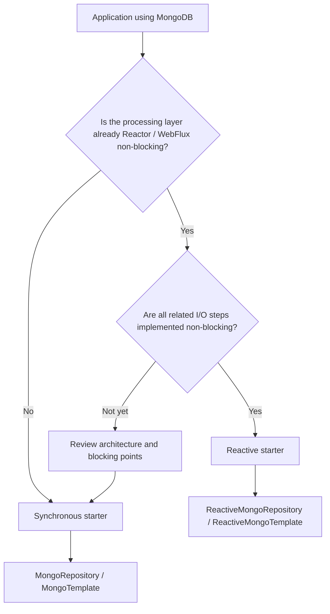

# Declaring the Right Synchronous or Reactive Starter

## 1. Objectives and Context

**Spring Data MongoDB** is the integration layer that helps Spring applications connect to MongoDB, map Java documents, and manipulate data via **repositories** or **MongoTemplate**. Beyond CRUD, an application can build dynamic queries, aggregations, indexes, transactions, integration tests, and performance diagnostic tools. Before those steps, we need to choose the **starter** that matches the application's processing model.

This lesson uses the **Mini Commerce** example application with three domain objects: **Product**, **Customer**, and **Order**. During the setup stage, we only need to read a single product from the `products` collection. The connection configuration and dependency chosen today determine which APIs are used in subsequent lessons.

After completing this lesson, you will be able to:

- Distinguish between the **synchronous (imperative/blocking)** and **reactive (non-blocking)** MongoDB starters.
- Declare the correct Maven or Gradle dependency so Spring Boot manages compatible versions.
- Choose the appropriate interface group: `MongoRepository`/`MongoTemplate` or `ReactiveMongoRepository`/`ReactiveMongoTemplate`.
- Configure the MongoDB URI according to the **Spring Boot 3.x or 4.x line**, as the property names differ.
- Verify dependencies, live connectivity, and common configuration mistakes before writing business logic.

**Prerequisites:** A Spring Boot project using Maven or Gradle, a JDK compatible with your Spring Boot version, and an accessible MongoDB instance (local machine, container, or managed service). The Java code examples focus on starter selection and omit the HTTP layer so learners can clearly see the persistence layer's role.

## 2. What Is a Starter? Two Paths to Accessing MongoDB

A starter is a **curated set of dependencies packaged by Spring Boot for a specific capability**. By declaring a starter, your project receives Spring Data MongoDB along with the required driver, mapping, and integration libraries without manually assembling individual JARs. Spring Boot also inspects the classpath and configuration to auto-configure the appropriate beans.

| Criterion | Synchronous (blocking) | Reactive (non-blocking) |
| --- | --- | --- |
| Artifact | `spring-boot-starter-data-mongodb` | `spring-boot-starter-data-mongodb-reactive` |
| Java driver | MongoDB synchronous driver | MongoDB Reactive Streams driver |
| Repository | `MongoRepository<Product, String>` | `ReactiveMongoRepository<Product, String>` |
| Template | `MongoTemplate` | `ReactiveMongoTemplate` |
| Typical client | `com.mongodb.client.MongoClient` | `com.mongodb.reactivestreams.client.MongoClient` |
| Method return types | `Product`, `Optional<Product>`, `List<Product>`, `Page<Product>` | `Mono<Product>`, `Flux<Product>` |
| I/O execution | Calling thread waits for the MongoDB result | Results are represented as publishers; I/O runs via the reactive driver |
| Best suited for | Spring MVC, batch jobs, sequential business operations | Reactor/WebFlux pipelines, overlapping I/O calls, consistent non-blocking requirements |
| Things to watch | Concurrency depends on thread pool size and I/O wait times | Never insert blocking calls into a reactive chain; must understand backpressure, subscription, and async error handling |

### 2.1. Selection Diagram



**Selection rule:** Prefer the model already used consistently throughout the application. A typical Spring MVC endpoint does not automatically become faster by swapping its repository for a reactive one. Reactive helps when the caller, service layer, and cooperating I/O segments all operate non-blocking. For basic CRUD exercises, the synchronous starter is usually easier to start with.

Web framework and database driver are **two related but distinct decisions**:

- `spring-boot-starter-data-mongodb` provides synchronous MongoDB access; it does not add HTTP API support by itself.
- `spring-boot-starter-data-mongodb-reactive` provides reactive MongoDB access; it does not turn the app into a WebFlux HTTP server by itself.
- When building synchronous REST APIs, choose the Spring MVC starter compatible with your Boot version. When building WebFlux REST APIs, add `spring-boot-starter-webflux` if the app does not already include it.
- Spring WebFlux can technically execute blocking code, but calling blocking MongoDB operations on the event loop can stall threads and degrade throughput; you must design thread offloading or reconsider the persistence model.

Do not add **both MongoDB starters "just in case"**. When both driver and repository types are present, there are extra beans and scanning configurations to manage. Only use both concurrently when there are genuinely two distinct access paths with clearly separated responsibilities.

## 3. Declaring Dependencies with Maven

The following Maven examples **assume the project uses `spring-boot-starter-parent` or imports the `spring-boot-dependencies` BOM**. In that setup, do not specify manual versions for the two starters. Choose **one** of the two options.

### 3.1. Option A: Synchronous

Add to `pom.xml`:

```xml
<dependencies>
    <!-- Spring Data MongoDB synchronous driver + mapping + repository -->
    <dependency>
        <groupId>org.springframework.boot</groupId>
        <artifactId>spring-boot-starter-data-mongodb</artifactId>
    </dependency>
</dependencies>
```

This option fits implementing product, customer, and order CRUD via `MongoRepository` and inventory updates via `MongoTemplate` in synchronous services. Typical injected class:

```java
import org.springframework.data.mongodb.core.MongoTemplate;
import org.springframework.stereotype.Service;

@Service
public class ProductLookupService {
    private final MongoTemplate mongoTemplate;

    public ProductLookupService(MongoTemplate mongoTemplate) {
        this.mongoTemplate = mongoTemplate;
    }

    public long countProducts() {
        return mongoTemplate.getCollection("products").countDocuments();
    }
}
```

`countDocuments()` is a synchronous I/O operation. To test calling it, MongoDB must be running and the URI properly configured.

### 3.2. Option B: Reactive

Replace the synchronous MongoDB dependency with:

```xml
<dependencies>
    <!-- Spring Data MongoDB with Reactive Streams driver -->
    <dependency>
        <groupId>org.springframework.boot</groupId>
        <artifactId>spring-boot-starter-data-mongodb-reactive</artifactId>
    </dependency>
</dependencies>
```

With reactive, operations return results wrapped in Reactor `Mono` (0 or 1 value) or `Flux` (0 to many values):

```java
import org.springframework.data.mongodb.core.ReactiveMongoTemplate;
import org.springframework.stereotype.Service;
import reactor.core.publisher.Mono;

@Service
public class ReactiveProductLookupService {
    private final ReactiveMongoTemplate mongoTemplate;

    public ReactiveProductLookupService(
            ReactiveMongoTemplate mongoTemplate) {
        this.mongoTemplate = mongoTemplate;
    }

    public Mono<Long> countProducts() {
        return mongoTemplate.count(
            new org.springframework.data.mongodb.core.query.Query(),
            "products"
        );
    }
}
```

`countProducts()` **returns a publisher**, not an immediate `long`. The query executes when the publisher is **subscribed to** (directly or via a component such as WebFlux or `StepVerifier`). Never call `.block()` on an event-loop thread to turn reactive back into synchronous.

## 4. Declaring Dependencies with Gradle

If using Gradle, the project needs the Spring Boot plugin along with compatible dependency version management. Pick the syntax matching your project's DSL.

### 4.1. Gradle Groovy DSL — `build.gradle`

**Synchronous:**

```groovy
dependencies {
    implementation 'org.springframework.boot:spring-boot-starter-data-mongodb'
}
```

**Reactive (replaces the line above):**

```groovy
dependencies {
    implementation 'org.springframework.boot:spring-boot-starter-data-mongodb-reactive'
}
```

### 4.2. Gradle Kotlin DSL — `build.gradle.kts`

**Synchronous:**

```kotlin
dependencies {
    implementation("org.springframework.boot:spring-boot-starter-data-mongodb")
}
```

**Reactive (replaces the line above):**

```kotlin
dependencies {
    implementation("org.springframework.boot:spring-boot-starter-data-mongodb-reactive")
}
```

When using Spring Boot dependency management via plugin/BOM, you do not need to manually specify versions for `spring-data-mongodb`, `mongodb-driver-sync`, `mongodb-driver-reactivestreams`, or `reactor-core`. Overriding driver versions without checking the compatibility matrix can cause class/method errors at runtime.

### 4.3. If You Don't Have a Spring Boot Project Yet

You can generate a project from Spring Initializr by selecting Maven/Gradle, Java, a Boot version suited to your environment, and one dependency:

- **Spring Data MongoDB** for the synchronous track.
- **Spring Data Reactive MongoDB** for the reactive track.

Only add a web starter when you actually need to build HTTP APIs. Choose Java and Spring Boot according to the official compatibility requirements of the selected Boot version rather than copying version numbers from another project.

## 5. Configuring the MongoDB URI for Your Spring Boot Version

A common source of confusion when reading documentation across versions is the **MongoDB connection property name**:

| Spring Boot Line | URI Property for Auto-Configuration |
| --- | --- |
| Spring Boot **3.x** | `spring.data.mongodb.uri` |
| Spring Boot **4.x** | `spring.mongodb.uri` |

The two MongoDB starters above keep the exact same artifact names across both lines. To confirm the exact property syntax for your project, check your Boot version and its corresponding reference documentation. Do not set both URI keys hoping Boot will pick the right one.

### 5.1. Example `application.yml` for Spring Boot 3.x

```yaml
spring:
  data:
    mongodb:
      uri: "mongodb://localhost:27017/mini_commerce"
```

### 5.2. Example `application.yml` for Spring Boot 4.x

```yaml
spring:
  mongodb:
    uri: "mongodb://localhost:27017/mini_commerce"
```

The database name here is `mini_commerce`. If no database/URI is explicitly specified, the default may point to a different database (such as `test`), leading to misleading test results. In deployed environments, read the URI from an environment variable or secret management system, for example:

**Spring Boot 3.x:**

```yaml
spring:
  data:
    mongodb:
      uri: "${MONGODB_URI:mongodb://localhost:27017/mini_commerce}"
```

**Spring Boot 4.x:**

```yaml
spring:
  mongodb:
    uri: "${MONGODB_URI:mongodb://localhost:27017/mini_commerce}"
```

When running locally, the default value allows connecting to an unauthenticated instance. In deployment, set `MONGODB_URI` with real credentials in the runtime environment and **never commit passwords** to the repository. If the URI contains a username, a password with special characters, or options like `authSource`, ensure they are properly URL-encoded/formatted according to URI syntax. With MongoDB Atlas, URIs typically use the `mongodb+srv://` prefix and require proper DNS/TLS/network configuration.

Pre-connection checklist:

1. Is MongoDB listening on the expected host/port, container network, or managed endpoint?
2. Does the URI point to the correct database and have sufficient read/write permissions on that database?
3. If running the app in a container, `localhost` refers to the **application container itself**, usually not the MongoDB container; use the service hostname on the same network.
4. If using Atlas, have IP/network access, credentials, TLS, and DNS SRV been configured for the environment?
5. For multi-document transactions, MongoDB requires a replica set or transaction-capable sharded cluster; adding a starter alone does not enable this capability.

## 6. From Starter to Your First Repository

Once the starter is declared and configured properly, Spring Boot can auto-configure the mapping context, client/factory, template, and repositories. Overall view:

```text
Mini Commerce service
        |
        +-- If synchronous is chosen:
        |      ProductRepository --> MongoTemplate --> synchronous MongoDB driver
        |
        +-- If reactive is chosen:
               ReactiveProductRepository --> ReactiveMongoTemplate
                                            --> Reactive Streams MongoDB driver
        |
        +------------------------------------> MongoDB / mini_commerce / products
```

In both tracks, documents can be mapped using a Java class. Minimal example:

```java
import org.springframework.data.annotation.Id;
import org.springframework.data.mongodb.core.mapping.Document;

@Document(collection = "products")
public class Product {
    @Id
    private String id;
    private String sku;
    private String name;
    private int stock;

    public Product() {}

    public String getId() { return id; }
    public void setId(String id) { this.id = id; }
    public String getSku() { return sku; }
    public void setSku(String sku) { this.sku = sku; }
    public String getName() { return name; }
    public void setName(String name) { this.name = name; }
    public int getStock() { return stock; }
    public void setStock(int stock) { this.stock = stock; }
}
```

This is a trimmed version of `Product` to demonstrate starter wiring; the data modeling lesson will add price (`BigDecimal`/`Decimal128`), category, active status, and creation timestamp.

### 6.1. Synchronous Repository

```java
import java.util.Optional;
import org.springframework.data.mongodb.repository.MongoRepository;

public interface ProductRepository
        extends MongoRepository<Product, String> {
    Optional<Product> findBySku(String sku);
}
```

A synchronous service can call `repository.findBySku("LAP-001")` and use `Optional` to handle the not-found case. The call returns after the I/O query completes.

### 6.2. Reactive Repository

```java
import org.springframework.data.mongodb.repository.ReactiveMongoRepository;
import reactor.core.publisher.Mono;

public interface ReactiveProductRepository
        extends ReactiveMongoRepository<Product, String> {
    Mono<Product> findBySku(String sku);
}
```

Calling `repository.findBySku("LAP-001")` returns `Mono<Product>`. In a reactive service, compose further:

```java
import reactor.core.publisher.Mono;
import org.springframework.stereotype.Service;

@Service
public class ProductQueryService {
    private final ReactiveProductRepository repository;

    public ProductQueryService(ReactiveProductRepository repository) {
        this.repository = repository;
    }

    public Mono<String> findProductName(String sku) {
        return repository.findBySku(sku)
                .map(Product::getName)
                .switchIfEmpty(Mono.error(
                        new IllegalArgumentException("Product not found")));
    }
}
```

The `ProductRepository` and `ReactiveProductRepository` examples are **two mutually exclusive alternatives** in this lesson. Only enable the repository type matching the starter you are practicing. For Spring Boot auto-detection, place the `@SpringBootApplication` class in a parent package above documents/repositories/services, or configure explicit scan packages if your project uses a different layout. Reactive repositories are enabled automatically when classpath/configuration conditions match; do not mistakenly add synchronous `@EnableMongoRepositories` for reactive repositories.

## 7. Verifying You Chose the Right Starter

Successful application startup is **not enough** to prove MongoDB connectivity: some clients only open an actual connection on the first query. Verify both dependencies and a live query.

### 7.1. Checking the Dependency Tree

With Maven:

```bash
./mvnw dependency:tree
```

With Gradle:

```bash
./gradlew dependencies --configuration runtimeClasspath
```

On Windows, you can use the corresponding `mvnw.cmd` or `gradlew.bat` wrapper. Look for these artifacts in the dependency tree:

| Choice | Expected Dependencies | What to verify |
| --- | --- | --- |
| Synchronous | `spring-boot-starter-data-mongodb`, `spring-data-mongodb`, synchronous driver | Reactive starter was not accidentally added |
| Reactive | `spring-boot-starter-data-mongodb-reactive`, `spring-data-mongodb`, Reactive Streams driver, Reactor | Synchronous starter was not accidentally added |

`spring-data-mongodb` is the shared core library, so its presence alone is **not sufficient** to tell the two starters apart. Check **which starter is declared and which driver appears in the dependency tree**.

### 7.2. Testing a Real Query

In Mini Commerce, ensure at least one valid document exists in the `products` collection, for example:

```javascript
use mini_commerce
db.products.insertOne({
  sku: "LAP-001",
  name: "Mini Mechanical Keyboard",
  stock: 20
})
db.products.findOne({ sku: "LAP-001" })
```

This data initialization step is for the practice environment and should be run **once** (running it repeatedly can insert duplicate SKUs if no unique index exists yet). Afterward, use `ProductRepository.findBySku(...)` or subscribe/test `ReactiveProductRepository.findBySku(...)` to confirm the application reads the document. If the query fails, inspect the URI, network, authentication, and database name.

For reactive, you can verify with `StepVerifier` in an integration test configured with MongoDB:

```java
StepVerifier.create(repository.findBySku("LAP-001"))
    .assertNext(product ->
        assertEquals("Mini Mechanical Keyboard", product.getName()))
    .verifyComplete();
```

This test snippet assumes `repository`, `assertEquals` from JUnit, and `StepVerifier` from Reactor Test are available. `StepVerifier` requires the appropriate test dependency; it actually subscribes and awaits results, making it useful for catching connection/mapping issues. For the synchronous branch, you can assert `repository.findBySku("LAP-001").isPresent()` in an integration test.

### 7.3. Diagnostic Checklist When the App Does Not Work

| Symptom | Common Cause | Resolution |
| --- | --- | --- |
| Cannot import `MongoRepository` or `MongoTemplate` | Missing synchronous starter, dependencies not refreshed | Check dependency declaration and dependency tree |
| Cannot import `ReactiveMongoRepository` or `ReactiveMongoTemplate` | Missing reactive starter | Select the right starter/driver and refresh IDE |
| `No qualifying bean of type MongoTemplate` | Only reactive starter is present or auto-configuration disabled | Use `ReactiveMongoTemplate` if reactive by design; check auto-config conditions |
| `No qualifying bean of type ReactiveMongoTemplate` | Only synchronous starter is present | Declare the reactive starter |
| `MongoTimeoutException` / server selection timeout | MongoDB not running, wrong host/port, network unreachable | Check URI, network, DNS, replica set, and driver logs |
| `Authentication failed` | Wrong user/password or auth database | Check credentials, URL encoding, `authSource` |
| Query runs but returns no data | Wrong database/collection, document not inserted, mismatched field name | Compare URI, `@Document`, and actual data in `mongosh` |
| URI is set, but app connects elsewhere | Wrong Boot 3.x/4.x property key, profile/env override | Inspect effective config and Boot version |
| Reactive does not execute queries | Publisher was never subscribed to | Use a WebFlux subscriber or `StepVerifier` |
| Reactive is slow / threads blocked | `block()` or blocking I/O inside the pipeline | Remove blocking calls; audit driver and execution threads |
| `NoSuchMethodError` / `ClassNotFoundException` | Incompatible manual Spring Data/driver version overrides | Use the versions managed by the Spring Boot BOM |
| Transactions do not work | Standalone MongoDB or missing matching transaction manager | Use a replica set; configure sync/reactive transaction manager |

## 8. When Do You Need MongoTemplate, Aggregation, Indexes, and Transactions?

Starter choice also affects the APIs used in advanced topics. Choose according to Mini Commerce business needs:

| Need | Synchronous | Reactive |
| --- | --- | --- |
| Find product by SKU | `MongoRepository.findBySku` | `ReactiveMongoRepository.findBySku` returning `Mono` |
| Product filtering, dynamic queries | `MongoTemplate` with `Query`/`Criteria` | `ReactiveMongoTemplate` with `Query`/`Criteria` |
| Conditional stock deduction | `MongoTemplate.updateFirst`, `$inc` and stock check filter | Equivalent update method returning a publisher |
| Revenue reports via aggregation | `MongoTemplate.aggregate` | `ReactiveMongoTemplate.aggregate` |
| Indexes | Declare mapping and create indexes per schema management workflow | Similar, except reactive index operations return publishers |
| Multi-document transactions | `MongoTransactionManager` with synchronous transactions | `ReactiveMongoTransactionManager` with Reactor transaction context |
| Testing | Integration tests with MongoDB, calling repository/template directly | Integration tests with MongoDB and `StepVerifier` |
| Performance diagnostics | Query logs, `explain`, index analysis | Same, plus observing subscriptions, latency, and blocking |

**Transaction note:** Multi-document transactions require a MongoDB deployment configured to support transactions. Do not take a synchronous annotation or transaction manager and use it directly as a substitute in the reactive track. Also avoid using transactions by default for every operation: updating a single MongoDB document is already atomic at the document level.

## 9. Decision Scenarios

**Scenario A — Product management REST API built with Spring MVC.** `POST /products` saves a document, `GET /products/{id}` reads details, and the service layer consists of regular Java methods. Choose `spring-boot-starter-data-mongodb` to work with `MongoRepository` or `MongoTemplate`. Easy to test and fits CRUD needs.

**Scenario B — WebFlux API handling high-concurrency I/O.** The catalog API combines calls to multiple external services in a Reactor pipeline. The team has committed to avoiding blocking calls on the request pipeline. Choose `spring-boot-starter-data-mongodb-reactive`, `ReactiveMongoRepository` or `ReactiveMongoTemplate`, and add the reactive web starter if building HTTP APIs.

**Scenario C — Existing Spring MVC app wanting to "turn on reactive to go faster".** Not enough reason to switch starters. Analyze MongoDB latency, queries, indexes, connection pool, real workload, and threading model first. Reactive MongoDB access cannot fix a query missing an index, nor does it guarantee higher throughput if most work remains blocking.

**Scenario D — Using both in one application.** Possible when there is a proven need, such as a synchronous batch module and a separate reactive API module. You must audit both drivers, templates, repository scanning, transaction managers, and monitoring, and avoid injecting the wrong API. For a single-module practice project, choosing one consistent model is far easier to follow.

## 10. Exercises and Completion Criteria

Complete the exercise along **one** chosen track:

1. Identify whether your app uses Spring Boot 3.x or 4.x; note the exact URI property for that version.
2. Add exactly one MongoDB starter in Maven or Gradle; sync dependencies through the build tool.
3. Configure the URI pointing to the `mini_commerce` database; verify MongoDB is reachable.
4. Create the `Product` document and matching repository; insert at least one sample product.
5. Run a query looking up `LAP-001`. If reactive, ensure there is a subscriber/test; if synchronous, invoke the repository directly.
6. Confirm the dependency tree matches your chosen track, data reads back accurately, and connection errors surface clearly.

Self-check questions:

- Why can't the two MongoDB starters be swapped merely by changing return types from `Optional` to `Mono`?
- When should you use `MongoRepository`, and when should you use `ReactiveMongoRepository`?
- Between Spring Boot 3.x and 4.x, how does the MongoDB URI configuration key differ?
- If the app starts up but the first query fails, what should you check?
- Why does adding the reactive starter not automatically make the entire application non-blocking?
- To implement aggregation or transactions in your chosen track, which group must your template and transaction manager belong to?

**Expected outcome:** the project declares only the starter it needs, has a valid dependency tree, configures the MongoDB URI for the exact Spring Boot line, and reads a `products` document via the chosen repository/template. This foundation will be reused across lessons on queries, aggregation, indexes, transactions, reactive access, testing, and data performance diagnostics.

## References

- [Spring Boot 3.5 — Working with NoSQL Technologies](https://docs.spring.io/spring-boot/3.5/reference/data/nosql.html) — MongoDB starters and `spring.data.mongodb.uri`.
- [Spring Boot 4.x — Working with NoSQL Technologies](https://docs.spring.io/spring-boot/reference/data/nosql.html) — MongoDB starters and `spring.mongodb.uri`.
- [Spring Data MongoDB Reference Documentation](https://docs.spring.io/spring-data/mongodb/reference/) — mapping, repositories, MongoTemplate, reactive, aggregation, and transactions.
