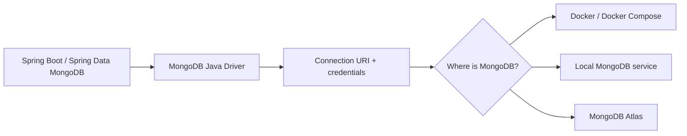

# Setting Up MongoDB with Docker, Local Installation, or MongoDB Atlas

## 1. Objectives and Scope

Spring Data MongoDB provides `MongoTemplate`, repositories, and reactive APIs for Java applications to work with MongoDB documents. Before writing queries, aggregations, indexes, or transactions, you need a running MongoDB instance, an account with appropriate privileges, and a connection string (`connection URI`) that the application can use.

This lesson in the **Setup** chapter walks through three ways to prepare a MongoDB environment:

1. **Docker Compose:** fast, reproducible, and ideal for learning, development, or local testing.
2. **Installing MongoDB Community Server locally:** suitable when you need to run MongoDB as a native service on Windows, macOS, or Linux.
3. **MongoDB Atlas:** managed cloud MongoDB service, ideal for getting familiar with remote connectivity, TLS, and access management.

Upon completion, you will be able to run a `ping` command, create a database and application user, write/read a document, and connect a Spring Boot application using Spring Data MongoDB. The examples prioritize development environments; for production, you must also design backups, monitoring, high availability, and secret management.

## 2. Choosing an Option and Understanding Connection Endpoints

| Criterion | Docker Compose | Local Native Installation | MongoDB Atlas |
|---|---|---|---|
| Primary dependencies | Docker Engine/Desktop and Compose | MongoDB Community Server, `mongosh` | Atlas account, Internet access, DNS |
| Process management | `docker compose` | Operating system service | Managed by Atlas |
| Where data is stored | Docker volume or bind-mounted directory | Host machine data directory | Atlas cluster storage |
| Typical address from host apps | `127.0.0.1:27017` when port is published | `127.0.0.1:27017` | Host in `mongodb+srv://...` URI |
| Authentication | Explicitly enabled via environment variables or config | Configured according to installation setup | Database user created by you |
| TLS and remote access | Requires additional configuration if needed | Requires additional configuration if needed | Usually uses TLS per Atlas URI |
| Best suited for | Demos and reproducible environments | Learning MongoDB admin or local tasks | Cloud connectivity and shared environments |

Basic flow:



Two points to keep in mind:

- `localhost` always refers to the **network namespace of the connecting process itself**. Spring Boot running on the host can use `127.0.0.1:27017` to reach a container with a published port. Spring Boot running inside another container must use the MongoDB service name on the same Compose network, typically `mongodb:27017`.
- The database name at the end of the URI, such as `/spring_demo`, is the default working database. A user account can be authenticated against a different database; when that happens, `authSource` must be specified accurately.

The commands below use `mongosh`, the MongoDB Shell. You can run it inside the MongoDB container, from a standalone local installation, or against an Atlas cluster.

## 3. Option A — Running MongoDB with Docker Compose

### 3.1. Prerequisites

Install Docker Desktop or Docker Engine with the Compose plugin, and ensure the daemon is running. Verify:

```bash
docker --version
docker compose version
docker info
```

On Windows/macOS, Docker Desktop must be started; on Linux, the user needs permissions to run Docker per system configuration. You can map a different host port if `27017` is already in use.

### 3.2. Creating Compose Config and Data Volume

Create a dedicated practice directory; place the following inside `compose.yaml`:

```yaml
services:
  mongodb:
    image: mongo:8.0
    restart: unless-stopped
    environment:
      MONGO_INITDB_ROOT_USERNAME: admin
      MONGO_INITDB_ROOT_PASSWORD: ${MONGO_ROOT_PASSWORD:?Set MONGO_ROOT_PASSWORD in .env}
    ports:
      - "127.0.0.1:27017:27017"
    volumes:
      - mongodb_data:/data/db

volumes:
  mongodb_data:
```

Configuration breakdown:

- `mongo:8.0` is the major version tag chosen for this example. In team setups, pick a specific patch tag or image digest so all machines run the same MongoDB build; verify compatibility with your driver.
- `MONGO_INITDB_ROOT_USERNAME` and `MONGO_INITDB_ROOT_PASSWORD` create an admin account **when initializing an empty data directory**. This is a demo admin account; the Spring Data application should use a lower-privilege account.
- `127.0.0.1:27017:27017` binds the port only on the Docker host's loopback interface, which is appropriate for local development. It does not expose MongoDB to other machines automatically.
- `mongodb_data:/data/db` persists data across container stops or recreations; a regular `docker compose down` does not delete named volumes.

Create a `.env` file **next to** `compose.yaml` with a strong password for the admin account:

```dotenv
MONGO_ROOT_PASSWORD=REPLACE_WITH_YOUR_STRONG_RANDOM_PASSWORD
```

Replace the placeholder value with an actual password; do not commit `.env` to Git. For real systems, use your runtime environment's secret manager instead of storing plaintext passwords long-term. If the password contains special characters, pay attention to how Compose parses `.env`.

Start and inspect status:

```bash
docker compose up -d
docker compose ps
docker compose logs mongodb
```

Once the database is ready, open `mongosh` inside the container and enter the password when prompted:

```bash
docker compose exec mongodb mongosh --username admin --authenticationDatabase admin --password
```

Inside `mongosh`, test:

```javascript
db.adminCommand({ ping: 1 })
// Expected output: { ok: 1 }
```

The `ping` command only checks whether the server responds to requests; it does not prove the application has read/write permissions on a specific database.

### 3.3. Creating a Database and Dedicated Application User

In the admin-authenticated `mongosh` session, run:

```javascript
use spring_demo

db.createUser({
  user: "spring_app",
  pwd: passwordPrompt(),
  roles: [
    { role: "readWrite", db: "spring_demo" }
  ]
})
```

`passwordPrompt()` prompts for the `spring_app` password without embedding the password directly in command history. The `readWrite` role is sufficient for data operations in `spring_demo`; administrative actions or special index operations may require corresponding privileges. MongoDB materializes the actual database and collection when data is written; `use` only switches the active database context.

Exit the shell, then reconnect as the application user:

```bash
docker compose exec mongodb mongosh "mongodb://localhost:27017/spring_demo?authSource=spring_demo" --username spring_app --password
```

Test read/write operations as shown in Section 7. This account does not need `root` privileges. From the host machine, use the URI with host `127.0.0.1` and the port published in Compose.

**Note on changing passwords:** `MONGO_INITDB_ROOT_*` variables only apply when the Docker image initializes a database on an empty data directory. Changing values in `.env` once the volume already holds data **does not update** existing MongoDB user passwords. Change passwords using MongoDB administrative commands when needed.

### 3.4. Stopping the Environment

```bash
docker compose stop         # Stops the container; data remains in the volume
docker compose start        # Restarts the container
docker compose down         # Removes Compose containers/networks; keeps named volumes
```

Running `docker compose down --volumes` (or `down -v`) also deletes Compose-managed volumes, wiping out demo data inside; only run it when you explicitly want to clean up data.

## 4. Option B — Installing MongoDB Community Server Locally

MongoDB Community Server can run directly as an operating system service. Installation steps depend on the OS version; download official packages from MongoDB matching your CPU/OS and verify supported versions.

### 4.1. Windows

1. Download the official MongoDB Community Server MSI installer and choose to install it as a Windows Service if you want it to start automatically with the system.
2. Install `mongosh` separately if the Server package does not include the shell.
3. Check the MongoDB service in **Services**; start it if stopped.
4. Open PowerShell or a terminal and connect:

```powershell
mongosh "mongodb://127.0.0.1:27017"
```

If another MongoDB installation exists on the machine, check the actual port and the `mongod.cfg` configuration file. The Windows Service uses the configuration specified during service installation.

### 4.2. macOS

With Homebrew and MongoDB's official tap, a common way to install MongoDB 8.0 is:

```bash
brew tap mongodb/brew
brew install mongodb-community@8.0
brew services start mongodb-community@8.0
mongosh "mongodb://127.0.0.1:27017"
```

If another version is already installed, select the appropriate formula and avoid starting two services listening on port 27017 simultaneously. Data and config paths vary between Intel and Apple Silicon machines and across Homebrew formulas.

### 4.3. Linux

On Linux, use the official `mongodb-org` repository and package matching your MongoDB-supported distribution/version. After installing, on systemd-based systems:

```bash
sudo systemctl enable --now mongod
sudo systemctl status mongod
mongosh "mongodb://127.0.0.1:27017"
```

If `mongod` fails to start, check service logs (e.g., `journalctl -u mongod`) and inspect data directory write permissions, listening ports, disk space, and network settings in `mongod.conf`.

### 4.4. Configuring Authentication and Networking for Native Installs

On some development installations, MongoDB listens only on loopback and may not require authentication yet. That setup makes single-machine experimentation easy, but it is unsuitable for exposing the service on a shared network.

When authentication is needed, the general sequence is:

1. In a fresh environment restricted to localhost, create an administrative user following MongoDB security guidance; verify you can log in.
2. Enable `security.authorization: enabled` in `mongod` configuration and restart the service via OS service management.
3. Log in with the admin user to create a dedicated database user for `spring_demo`, similar to Section 3.3.
4. Only open `bindIp`, firewall rules, and TLS to networks that are explicitly permitted. Never disable authentication or TLS as a shortcut to fix connection errors on shared hosts.

Example YAML configuration snippet at the `mongod.conf` level:

```yaml
net:
  bindIp: 127.0.0.1
  port: 27017
security:
  authorization: enabled
```

The snippet above illustrates two configuration blocks, **not the entire config file**: preserve existing sections such as `storage`, `systemLog`, `processManagement`, etc. Before enabling authorization, verify that the admin user has been created and tested in the proper order to avoid locking yourself out.

## 5. Option C — Creating MongoDB on Atlas

[MongoDB Atlas](https://www.mongodb.com/atlas) is a managed cloud MongoDB service. UI button labels may evolve, but the workflow follows the same steps: create a project, deploy a database, create a user, allow network IP access, and obtain the connection URI.

### 5.1. Creating a Cluster

1. Sign in to Atlas at [MongoDB Atlas](https://www.mongodb.com/atlas) and create a **Project** for the lab.
2. Create a deployment/cluster with a tier matching your needs and in a cloud region close to your application when possible.
3. Wait until Atlas reports the cluster is ready. Free/trial tiers may have limits on features, connection counts, or resources, so verify these before choosing a tier for transactions or heavy loads.

### 5.2. Creating a Database User and Network Access Rules

Under **Database Access**, create the database user `spring_app` with a strong password and sufficient privileges on the `spring_demo` database. For development examples, `readWrite` on that database is a good starting point; avoid granting full admin roles to regular applications.

Under **Network Access**, allow only the **outbound public IP** of the machine running your application (or approved infrastructure) to access the cluster. This IP may differ from internal `192.168.x.x` or `127.0.0.1` addresses and can change across networks, VPNs, or CI runners. Do not leave `0.0.0.0/0` open long-term as a quick fix for connectivity errors.

A **Database user** and an **Atlas UI login account** are two separate credentials and cannot be used interchangeably.

### 5.3. Retrieving the Connection String

In the cluster view, select **Connect → Drivers**, pick the Java driver if prompted, and copy the URI provided by Atlas. **Structural example**, not a real cluster:

```text
mongodb+srv://spring_app:<URL_ENCODED_PASSWORD>@cluster0.example.mongodb.net/spring_demo?retryWrites=true&w=majority
```

- Replace the hostname with the **exact** hostname from Atlas, and replace the password placeholder with your database user's password.
- The segment after `/` is the application database name, here `spring_demo`.
- Apply URL encoding (percent-encoding) to special characters in usernames/passwords when embedding them in a URI. For example, `@` in a password must be encoded as `%40`. If URI escaping becomes hard to manage, credentials can be configured separately via driver APIs where appropriate.
- `mongodb+srv://` uses DNS SRV/TXT lookups to locate nodes and connection options; Atlas normally requires TLS. Do not manually replace it with `mongodb://localhost` or disable certificate verification.
- `retryWrites` and `w` are options included in Atlas URI templates; depending on your cluster and driver version, keep or adjust them to meet your requirements.

Check DNS, firewall, and outbound IP allowlist rules if connection fails. In environments where DNS SRV queries are restricted, Atlas may offer a standard connection string option in some cases; use the official option rather than guessing node hostnames.

## 6. Connecting from Spring Boot / Spring Data MongoDB

### 6.1. Adding the Dependency

Example for a Maven project using Spring Boot and Spring Boot's dependency management:

```xml
<dependency>
    <groupId>org.springframework.boot</groupId>
    <artifactId>spring-boot-starter-data-mongodb</artifactId>
</dependency>
```

This starter provides components using the synchronous MongoDB driver, `MongoTemplate`, and repositories. If your application is designed around WebFlux/reactive, use the separate reactive starter:

```xml
<dependency>
    <groupId>org.springframework.boot</groupId>
    <artifactId>spring-boot-starter-data-mongodb-reactive</artifactId>
</dependency>
```

Within a single service, prefer one consistent access model (blocking or reactive) and avoid mixing them unintentionally. The examples below use the synchronous API.

### 6.2. Externalizing the URI Outside Source Code

With typical **Spring Boot 3.x** configuration, place in `src/main/resources/application.yml`:

```yaml
spring:
  data:
    mongodb:
      uri: ${MONGODB_URI}
```

The `MONGODB_URI` environment variable holds the full URI for your chosen setup. Examples:

| Where the App Runs | `MONGODB_URI` Pattern |
|---|---|
| Spring Boot on host ↔ MongoDB in Docker | `mongodb://spring_app:<ENCODED_PASSWORD>@127.0.0.1:27017/spring_demo?authSource=spring_demo` |
| Spring Boot on same host ↔ local native MongoDB, auth off (local testing only) | `mongodb://127.0.0.1:27017/spring_demo` |
| Spring Boot on **same Compose network** ↔ `mongodb` service | `mongodb://spring_app:<ENCODED_PASSWORD>@mongodb:27017/spring_demo?authSource=spring_demo` |
| Spring Boot ↔ MongoDB Atlas | `mongodb+srv://spring_app:<ENCODED_PASSWORD>@<ATLAS_HOST>/spring_demo?retryWrites=true&w=majority` |

Only substitute placeholders with real values when configuring the runtime environment. Never put URIs containing secrets into Git, application logs, or screenshots. When using a different Spring Boot version, check that version's **configuration metadata** for exact MongoDB property names; newer versions may change property namespaces.

**Note on passwords and `authSource`:** In the Docker example, user `spring_app` was created in the `spring_demo` database, so set `authSource=spring_demo`. The Docker root account is created in the `admin` database; if connecting as root for administrative tasks, `authSource` must match `admin`. Never use the root user in application config.

If running both Spring Boot and MongoDB via Docker Compose, place both services on the same Compose network and have the app connect via `mongodb:27017`. Publishing ports to the host is **not required** for communication between containers on the same network; `localhost` inside the app container does not point to the MongoDB container.

### 6.3. Checking Connectivity at Application Startup

With a Spring Boot 3.x setup using `MongoTemplate`:

```java
import org.bson.Document;
import org.springframework.boot.ApplicationRunner;
import org.springframework.context.annotation.Bean;
import org.springframework.context.annotation.Configuration;
import org.springframework.data.mongodb.core.MongoTemplate;

@Configuration
public class MongoConnectivityCheck {

    @Bean
    ApplicationRunner mongoPing(MongoTemplate template) {
        return args -> {
            Document result =
                    template.executeCommand(new Document("ping", 1));
            System.out.println("MongoDB ping result: " + result.toJson());
        };
    }
}
```

When the application starts, `MongoTemplate` asks MongoDB to execute the `ping` command. A response with `ok: 1` indicates the app can reach the server and execute commands. This is a simple startup check; in real systems, rely on the built-in health indicator in Spring Boot Actuator and never log sensitive connection details.

A reactive service can run the equivalent check using `ReactiveMongoTemplate` or the reactive driver API. Do not switch to blocking calls just to run a startup check inside a reactive stack.

## 7. Verifying Read and Write Access

Using `mongosh` authenticated as `spring_app` with database `spring_demo` selected:

```javascript
db.runCommand({ ping: 1 })

db.setupSmoke.updateOne(
  { _id: "mongodb-ready" },
  { $set: { source: "setup-003", checkedAt: new Date() } },
  { upsert: true }
)

db.setupSmoke.findOne({ _id: "mongodb-ready" })
db.getName()
```

Expected results:

- `ping` returns `ok: 1`.
- `updateOne` succeeds, inserting or updating the document depending on whether it already exists.
- `findOne` returns the document with `_id: "mongodb-ready"` and the fields `source` and `checkedAt`.
- `db.getName()` returns `spring_demo`.

The `updateOne(..., { upsert: true })` command can be run repeatedly without creating duplicate `_id` documents. If `ping` succeeds but writes fail with `not authorized`, the cause is usually database user roles or being connected to the wrong database.

To isolate connectivity issues from Spring logic, verify with `mongosh` first, then run Spring Boot with the exact same URI. When switching between Docker ↔ native ↔ Atlas, only the connection configuration and secrets change; code using `MongoTemplate` or repositories typically requires no changes for basic CRUD operations.

## 8. Common Issues and Troubleshooting

| Symptom | Causes to Check | Resolution |
|---|---|---|
| `Connection refused` to `127.0.0.1:27017` | MongoDB not running; service failed; container port not published; host port changed | Check `docker compose ps` or service status, port, and URI |
| `UnknownHostException` or SRV error with Atlas | Wrong URI hostname; DNS failed to resolve SRV/TXT records; restricted proxy/network | Re-copy URI from Atlas; check DNS and network policies |
| `Authentication failed` | Wrong password; user created in another database; wrong `authSource`; password not percent-encoded | Check database user, credentials, URI, and encoding |
| `not authorized on spring_demo` | Account authenticated but lacks operation privileges | Check `readWrite` role and target database |
| Atlas reports timeout / unreachable | Public IP not allowlisted; outbound firewall; cluster paused or not ready | Check Network Access, deployment status, and reachability |
| TLS/certificate errors | Machine missing trusted CA; proxy intercepting TLS; altered TLS config | Fix truststore/certificates and network config; keep TLS verification enabled |
| Container runs but loses data after recreation | Volume not mounted properly or deleted | Use a named volume; review stop/down workflow |
| Changed `MONGO_INITDB_ROOT_PASSWORD` but cannot log in | Volume was already initialized earlier; env vars do not update existing users | Change the password using the proper admin command |
| Spring Boot in container cannot reach `localhost` | `localhost` points to the app container itself | Use the `mongodb` service hostname on the same Compose network |
| CRUD works, but transactions fail | Standalone MongoDB does not provide transaction deployment requirements | Use a replica set/sharded cluster supporting transactions; verify Atlas tier capabilities |

When the program reports an access error, separate **network connectivity**, **authentication**, and **authorization**:

```text
Cannot open socket / host not found
    └─ Check service, host, port, Docker network, DNS, firewall
Connects to server, but authentication failed
    └─ Check username, password, authSource, URI encoding
Logs in, but receives not authorized
    └─ Check roles and target database/collection
Ping and CRUD both succeed
    └─ Environment is ready for repository/MongoTemplate lessons
```

### When Do You Need a Replica Set?

The Compose setup in Section 3 intentionally uses **standalone** MongoDB for CRUD, queries, basic aggregation, and learning mapping. MongoDB multi-document transactions and change streams require a supporting deployment topology such as a **replica set** or sharded cluster; running a single standalone container does not provide those capabilities. When lessons move to transactions or reactive change streams, prepare a development replica set (for instance, a properly configured single-node replica set) or a supported Atlas cluster, and re-verify your URI and driver version.

## 9. Minimum Security and Operations Practices

Even while keeping a learning environment convenient, follow clear principles:

1. **Application account:** create a dedicated user with only the required permissions instead of using `root` or an admin account.
2. **Secret management:** use environment variables, a secret manager, or your organization's configuration management solution. Avoid committing credentials or logging URIs containing passwords.
3. **Restrict network access:** locally, prefer binding/publishing ports on `127.0.0.1`; on Atlas, allowlist only source IPs. Configure firewalls and TLS for remote connections.
4. **Data persistence:** use proper Docker volumes or data directories; take backups before deleting data, altering volumes, or performing major upgrades.
5. **Version compatibility:** verify the support matrix across MongoDB Server, Java driver, Spring Data MongoDB, and Spring Boot. Never perform arbitrary major MongoDB upgrades without evaluating the app and data.
6. **Real verification:** `ping` is only step one; run actual read/write operations with the application user. For index, aggregation, transaction, or performance lessons, prepare matching configurations and dataset sizes.

## 10. Hands-On Exercise

**Scenario:** You are preparing the environment for a product management application using Spring Data MongoDB. The database is named `spring_demo`, and the application user is `spring_app`.

1. Choose Docker Compose to run MongoDB locally. Verify the `mongodb` container is running, has a persistent volume, and only publishes its port on loopback.
2. Log in with the admin account created during initialization and create user `spring_app` with the `readWrite` role on `spring_demo`.
3. Connect via `mongosh` using the application user and test `ping`, `updateOne`, and `findOne`.
4. Create a Spring Boot project with `spring-boot-starter-data-mongodb`; configure the URI via an environment variable and invoke `MongoTemplate.executeCommand(new Document("ping", 1))`.
5. Try switching MongoDB to Atlas by creating a database user, allowlisting your source IP, retrieving the URI, and updating `MONGODB_URI`. Observe that the data access layer requires no code changes for CRUD.
6. Verify the difference between the URI from the **host machine** (`127.0.0.1:27017`) and the URI from an **app container on the same Compose network** (`mongodb:27017`).

**Completion criteria:** the application connects, the database user has only necessary permissions, a document is written and read back successfully, Docker data survives stopping and restarting the container, and no URI containing secrets is stored in the repository.

Once these steps are complete, the environment is ready for upcoming lessons on `@Document`, `MongoRepository`, `MongoTemplate`, query design, aggregation, and indexes. For lessons requiring transactions or change streams, proceed to setting up a suitable replica set.
