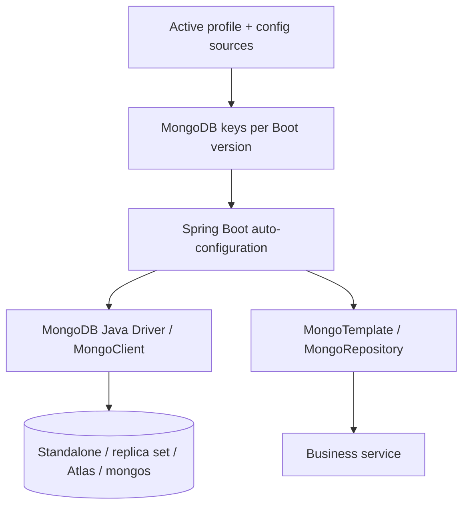

# Configuring URIs and Profiles Across Spring Boot Versions

> **Chapter:** Setup  
> **Module:** `SPRING_DATA_MONGODB` — connecting and mapping MongoDB documents, accessing data via `MongoTemplate` or repositories; followed by hands-on practice with queries, aggregation, indexes, transactions, reactive access, testing, and performance diagnostics. This lesson focuses on configuring MongoDB connections safely, consistently across environments, and **using the right property namespace for each Spring Boot version**.

## 1. Why Must Connection Configuration Match the Spring Boot Version?

In a Spring application, repositories and templates do not open sockets to MongoDB manually. When a starter is present and infrastructure beans are not manually replaced, **Spring Boot auto-configuration** creates `MongoClient`, `MongoDatabaseFactory`, `MongoTemplate`, or the corresponding reactive beans. These beans receive connection details from Boot configuration and the MongoDB Java Driver.

A common issue during upgrades: Java code still compiles and repositories are still created, yet **the MongoDB configuration key has changed**. The app may silently connect to a default address, write to the wrong database, or only fail when the first query runs. To prevent this, clearly separate:

1. **MongoDB URI:** server address, default database, authentication credentials, and connection options.
2. **Spring Boot property keys:** where Boot looks up the URI and binds it into the driver.
3. **Spring profiles:** selecting configuration sets for `local`, `test`, `staging`, and `prod`.
4. **Secret sources:** environment variables, secret managers, external configuration outside the package; never store real credentials in Git.

Configuration flow:



## 2. Spring Boot Version Comparison Table

This is the first difference to check when switching versions:

| Spring Boot Line | Primary URI Key | YAML Structure | Notes |
| --- | --- | --- | --- |
| **2.x** | `spring.data.mongodb.uri` | `spring → data → mongodb → uri` | Boot 2.4+ supports `spring.config.activate.on-profile`; older releases used different profile conventions. |
| **3.x**, including 3.4 and 3.5 | `spring.data.mongodb.uri` | `spring → data → mongodb → uri` | Still uses the `data` namespace for connection settings. |
| **4.x**, including 4.0 and 4.2 | `spring.mongodb.uri` | `spring → mongodb → uri` | Connection settings moved to `spring.mongodb.*`; some Spring Data-specific settings (e.g., `spring.data.mongodb.auto-index-creation`) remain under `spring.data.mongodb.*`. |

**Never assume Boot 3.x configuration continues to be read unchanged after upgrading to 4.x.** When moving to Boot 4, update YAML keys, directly bound environment variables, and test configurations. Check the exact documentation for the minor version in use; the table above summarizes major Spring Boot lines and does not replace a migration guide.

### 2.1. Minimal Configuration for Spring Boot 3.x

```yaml
# application.yml — Spring Boot 3.x
spring:
  data:
    mongodb:
      uri: "${MONGODB_URI}"
```

### 2.2. Minimal Configuration for Spring Boot 4.x

```yaml
# application.yml — Spring Boot 4.x
spring:
  mongodb:
    uri: "${MONGODB_URI}"
```

Both examples read the **environment variable named `MONGODB_URI`**, though the target Spring Boot property differs across the two branches. `${MONGODB_URI}` is a placeholder resolved from the environment when needed; if missing, configuration cannot complete and may fail when connection beans are created or used. In real environments, proactively test the missing-variable case to avoid falling back to a default connection.

Without placeholders, Spring Boot also supports *relaxed binding* from corresponding environment variables:

| Version | Environment Variable Bound Directly to the URI Property |
| --- | --- |
| Boot 2.x/3.x | `SPRING_DATA_MONGODB_URI` |
| Boot 4.x | `SPRING_MONGODB_URI` |

**`MONGODB_URI` and `SPRING_MONGODB_URI` do not mean the same thing:** `MONGODB_URI` in these examples is referenced **indirectly** via a placeholder. `SPRING_MONGODB_URI` is the environment variable name that Boot 4 binds **directly** to `spring.mongodb.uri`, even when no placeholder is present in YAML.

### 2.3. Companion Properties Also Depend on Version

When not using a URI or when checking specialized settings:

| Purpose | Boot 3.x | Boot 4.x |
| --- | --- | --- |
| URI | `spring.data.mongodb.uri` | `spring.mongodb.uri` |
| Separate database property | `spring.data.mongodb.database` | `spring.mongodb.database` |
| Separate host/port | `spring.data.mongodb.host`, `spring.data.mongodb.port` | `spring.mongodb.host`, `spring.mongodb.port` |
| Enable SSL/TLS via property | `spring.data.mongodb.ssl.enabled` | `spring.mongodb.ssl.enabled` |
| SSL bundle configuration | `spring.data.mongodb.ssl.bundle` | `spring.mongodb.ssl.bundle` |
| Auto-create indexes from annotations | `spring.data.mongodb.auto-index-creation` | `spring.data.mongodb.auto-index-creation` |

Configuring a URI can override or cause individual host/port/credential properties to be ignored. Never scatter addresses and passwords across both a URI and separate fields; **pick one consistent way to declare connection settings**, checking property precedence rules when needed.

## 3. Understanding the MongoDB URI Before Using It

### 3.1. Basic URI and Default Database

```text
mongodb://localhost:27017/orders_local
          └ host  ┘└port┘└ database ┘
```

- `mongodb://` is the standard connection scheme.
- `localhost:27017` specifies the server; if the Java app runs inside Docker, `localhost` inside the app container refers to that container itself. Use a host reachable in practice, such as a service DNS name on the same container network.
- `orders_local` is the default database chosen from the URI. Never rely on an implicit default database for important data.

### 3.2. Replica Sets and Retries

```text
mongodb://mongo1.example.net:27017,mongo2.example.net:27017,mongo3.example.net:27017/orders?replicaSet=rs0&retryWrites=true&w=majority
```

The driver uses the seed list to discover replica set members and route operations to the appropriate node. `replicaSet=rs0` asserts the expected replica set name; hostnames advertised by the replica set must also be reachable. `retryWrites=true` applies only to supported operations and conditions; business logic still requires idempotency and handling ambiguous write outcomes.

`w=majority` requests majority write acknowledgment; this is a durability setting and does not automatically ensure every read observes the latest write. For multi-document transactions, MongoDB requires a compatible topology, not standalone.

### 3.3. MongoDB Atlas and DNS SRV

```text
mongodb+srv://<db-user>:<url-encoded-password>@<cluster-hostname>/orders?retryWrites=true&w=majority
```

A `mongodb+srv://` URI uses DNS SRV/TXT records to discover server addresses and certain options. Replace placeholders with values **supplied by Atlas**, create a least-privilege database user, and configure network access and TLS properly for your environment. To avoid errors when passwords contain `@`, `:`, `/`, `?`, or other special characters, percent-encode username/password values per URI rules.

Never place URIs containing real credentials in source code, console screenshots, logs, issues, or docs. Never disable TLS certificate verification just to bypass connection errors; fix the trust material, DNS, or network configuration instead.

### 3.4. Timeouts and Connection Pool

To surface errors early in development, you can add **MongoDB Java Driver** options to the URI:

```text
mongodb://localhost:27017/orders_local?serverSelectionTimeoutMS=3000&connectTimeoutMS=2000&maxPoolSize=20
```

| URI Option | Meaning | Notes |
| --- | --- | --- |
| `serverSelectionTimeoutMS` | Maximum time the driver waits to select a suitable server. | Expiring usually indicates topology or server reachability issues. |
| `connectTimeoutMS` | Timeout for opening a network socket to the server. | Distinct from query execution time. |
| `socketTimeoutMS` | Timeout waiting for socket reads/writes where applicable. | Balance against long queries/aggregations; never use as a substitute for query optimization. |
| `maxPoolSize` | Maximum connections in the driver pool per eligible server. | Too small causes waiting; too large increases server resource and connection usage. |
| `authSource` | Database used for authentication when applicable. | Do not assume the application database is the authentication database. |

These exact numbers are **learning examples**. In production, measure actual traffic, election times, network latency, and MongoDB/Atlas connection limits when tuning timeouts, pools, and retry policies. You can also use `MongoClientSettingsBuilderCustomizer` to configure the driver when needs exceed URI expressiveness.

## 4. Spring Boot Profiles: Separating Local, Test, and Production Connections

Profiles let you select **Spring properties and beans** per environment. Spring Boot loads `application.yml` as shared configuration and can load `application-{profile}.yml`; environment variables, system properties, and command-line arguments can override values according to Boot's externalized configuration precedence rules.

Three-environment example:

| Profile | Target Connection | Principle |
| --- | --- | --- |
| `local` | Developer workstation MongoDB or local container. | May use a local default URI dedicated to development. |
| `test` | Dedicated MongoDB for integration tests, such as from Testcontainers. | Isolate data; strictly avoid production URIs. |
| `prod` | Real replica set/Atlas/cluster via production secrets and network. | No automatic fallback to localhost or development databases. |

### 4.1. Multi-Document YAML Example for Spring Boot 3.x

This is **one sample file** `src/main/resources/application.yml`. The `---` separators split three YAML documents; documents with `on-profile` apply only when that profile is active.

```yaml
# Spring Boot 3.x — application.yml
spring:
  application:
    name: order-service

---
spring:
  config:
    activate:
      on-profile: local
  data:
    mongodb:
      uri: "${MONGODB_URI:mongodb://localhost:27017/orders_local}"

---
spring:
  config:
    activate:
      on-profile: prod
  data:
    mongodb:
      uri: "${MONGODB_URI}"
```

When running with `local` without `MONGODB_URI` set, Boot defaults to `mongodb://localhost:27017/orders_local`. When running with `prod`, the runtime must supply `MONGODB_URI`; no fallback default is provided in this example. Any profile not defined here receives no MongoDB properties from `local`/`prod`; define `test` or required test settings explicitly before running.

### 4.2. Same Design for Spring Boot 4.x

Move the connection property to `spring.mongodb.uri`, keeping the same secret variable name and profile structure:

```yaml
# Spring Boot 4.x — application.yml
spring:
  application:
    name: order-service

---
spring:
  config:
    activate:
      on-profile: local
  mongodb:
    uri: "${MONGODB_URI:mongodb://localhost:27017/orders_local}"

---
spring:
  config:
    activate:
      on-profile: prod
  mongodb:
    uri: "${MONGODB_URI}"
```

**Never combine both sample configurations in the same real file.** Pick the one matching your project's Boot version. In particular, do not leave Boot 3's `spring.data.mongodb.uri` in place when upgrading to Boot 4 and expect it to keep configuring the connection.

### 4.3. One File per Profile: Alternative Organization

Instead of `---` document separators, you can organize files as:

```text
src/main/resources/
  application.yml
  application-local.yml
  application-test.yml
  application-prod.yml
```

Example `application-prod.yml` on Boot **4.x**:

```yaml
spring:
  mongodb:
    uri: "${MONGODB_URI}"
```

For Boot 3.x, add the `data` nesting directly under `spring`. Do not put `spring.profiles.active: prod` inside `application-prod.yml`: Boot automatically loads the file matching the active profile. Avoid maintaining both `application-prod.yml` and an `on-profile: prod` document with overlapping keys unless the team clearly understands override precedence.

### 4.4. Activating Profiles at Runtime

Select a profile using one of the following methods:

```bash
# Platform-neutral executable JAR form
java -jar app.jar --spring.profiles.active=local

# Production example: URI provided as a secret by the deployment platform
java -jar app.jar --spring.profiles.active=prod
```

Or use the `SPRING_PROFILES_ACTIVE` environment variable. PowerShell example for Windows development:

```powershell
$env:SPRING_PROFILES_ACTIVE = "local"
$env:MONGODB_URI = "mongodb://localhost:27017/orders_local"
java -jar app.jar
```

These commands assume `app.jar` has been built. When running from an IDE, Gradle, or Maven, pass the same environment variables and active profile using that tool's run configuration without editing repository files.

**Important profile rules:**

- Only set `spring.profiles.active` and `spring.profiles.default` in a **profile-agnostic document** or external configuration source; never inside a `spring.config.activate.on-profile` document or `application-prod.yml`.
- `spring.config.activate.on-profile` applies to Spring Boot **2.4 and newer**. If a project is still on Boot 2.3 or older, do not copy this multi-document sample verbatim; use `application-{profile}.yml` appropriate for that version or upgrade.
- Multiple profiles can be activated as a comma-separated list, but **order and source precedence** affect the final configuration; for database URIs, keep a single unambiguous connection environment per run.
- `spring.profiles.group` or `spring.profiles.include` (if used) belong in profile-agnostic configuration; do not use them to turn a production deployment into a tangled web of profiles.

## 5. Configuring via Environment Variables and Secret Managers

**Decouple secrets from build artifacts.** A production URI typically embeds hostname, username, password, and security options. It should be supplied by a secret manager, deployment platform environment variables, or an external config file with restricted permissions.

Recommended practices:

1. In Git, keep placeholders like `uri: "${MONGODB_URI}"` or variable documentation; never commit secrets.
2. Provision a separate `MONGODB_URI` per deployment; each environment should use its own user, database, and privileges.
3. Production must enforce network controls, TLS, credential rotation, and configuration change auditing.
4. Never print raw URIs in logs, error messages, or CI output. When debugging, log only the hostname or database name if allowed and with sensitive segments stripped.
5. Restrict access to Actuator `env`/`configprops` endpoints and configuration dashboards; masking in one place does not guarantee every log or endpoint is safe.

### URI vs. Individual Properties: Pick One Source of Truth

For Boot 4, here is an example configuring a connection via **individual properties** as an alternative to a URI:

```yaml
spring:
  mongodb:
    host: mongo.internal.example
    port: 27017
    database: orders
    username: "${MONGO_USER}"
    password: "${MONGO_PASSWORD}"
    authentication-database: admin
```

This snippet omits TLS/replica set settings and only illustrates property mapping; do not copy it as-is for production. If using a URI, place all primary connection choices inside the URI and avoid repeating host/port/password elsewhere. In Boot 3.x, these properties live under `spring.data.mongodb.*`. Certain standalone properties such as database name follow specific precedence rules: consult version documentation if intentionally overriding a database specified in the URI.

## 6. Separating MongoDB Connection Config from Data Access Code

With the right starter and package scanning configured, the repository layer does not depend on hostnames:

```java
import java.util.Optional;
import org.springframework.data.mongodb.repository.MongoRepository;

public interface OrderRepository extends MongoRepository<Order, String> {
    Optional<Order> findFirstByCustomerIdOrderByCreatedAtDesc(String customerId);
}
```

`Order` here is a class mapped with `@Document` in another lesson; it is not an entity defined inside this configuration example. For flexible queries, services inject `MongoTemplate`; for reactive access, use `ReactiveMongoRepository` or `ReactiveMongoTemplate` with the matching reactive starter. Switching from standalone to Atlas/replica set usually only changes connection settings and read/write policies, though topology still impacts transactions, retries, latency, and indexes.

**Connection verification probe:** in a component scoped strictly to the `local` profile, you can add a small probe to send a live ping to MongoDB:

```java
import org.springframework.boot.ApplicationArguments;
import org.springframework.boot.ApplicationRunner;
import org.springframework.context.annotation.Profile;
import org.springframework.data.mongodb.core.MongoTemplate;
import org.springframework.stereotype.Component;

@Component
@Profile("local")
public class MongoLocalPing implements ApplicationRunner {

    private final MongoTemplate mongoTemplate;

    public MongoLocalPing(MongoTemplate mongoTemplate) {
        this.mongoTemplate = mongoTemplate;
    }

    @Override
    public void run(ApplicationArguments args) {
        mongoTemplate.executeCommand("{ ping: 1 }");
    }
}
```

This example targets the **imperative** stack and proactively runs a ping when the `local` profile starts. MongoDB connections may be established lazily, so seeing the app boot is not enough to confirm database connectivity. In reactive applications, use `ReactiveMongoTemplate` APIs and subscribe/chain reactively without blocking on the event loop.

If you define custom `MongoClient`/`MongoDatabaseFactory` beans or override infrastructure beans, Spring Boot auto-configuration and properties may no longer control the connection as shown above; inspect the Java configuration creating those beans.

## 7. Configuring Integration Tests and Testcontainers

For CRUD and mapping tests, use a dedicated test MongoDB instance. When testing multi-document transactions, the test topology must support transactions (such as a replica set), not standalone. **Property names passed in tests must also match your Boot version.**

Spring Boot 3.x example with Testcontainers and `@DynamicPropertySource`:

```java
import org.junit.jupiter.api.Test;
import org.springframework.boot.test.context.SpringBootTest;
import org.springframework.test.context.DynamicPropertyRegistry;
import org.springframework.test.context.DynamicPropertySource;
import org.testcontainers.junit.jupiter.Container;
import org.testcontainers.junit.jupiter.Testcontainers;
import org.testcontainers.mongodb.MongoDBContainer;

@Testcontainers
@SpringBootTest
class MongoConnectionIT {

    @Container
    static final MongoDBContainer mongo =
        new MongoDBContainer("mongo:7.0");

    @DynamicPropertySource
    static void configureMongo(DynamicPropertyRegistry registry) {
        registry.add("spring.data.mongodb.uri", mongo::getReplicaSetUrl);
    }

    @Test
    void applicationContextStarts() {
        // Add real query/ping assertions if you need to verify connectivity.
    }
}
```

This is an **illustrative template**, not pinned to a specific Testcontainers release. Testcontainers package/class names and container APIs can vary across versions; verify against your project's actual dependencies. With Spring Boot **4.x**, update the key in `registry.add` to `spring.mongodb.uri`. Also ensure tests cannot accidentally fall back to a higher-priority config source pointing at production MongoDB. To verify transactions, write a test that exercises actual operations and rollback, not just context startup.

## 8. Common Errors and Troubleshooting

| Symptom | Possible Cause | How to Check |
| --- | --- | --- |
| Upgraded Boot 3 → 4 and app connects to unexpected address | Still setting `spring.data.mongodb.uri` instead of `spring.mongodb.uri` | Compare against the version table, actual active config, and bound property sources. |
| Works locally, but `prod` profile fails to connect | Missing `MONGODB_URI`, DNS/TLS, firewall, credentials, or network allowlist | Check active profile, provisioned secret, and reachability to the hostname. |
| Connects, but data lands in the wrong database | Wrong `/database` segment in URI or overriding database property | Check effective database against URI and Boot version. |
| Authentication failed | Wrong username/password, missing percent-encoding, wrong `authSource` | Verify database user and properly encoded URI without printing passwords. |
| `MongoTimeoutException: Timed out after ...` | Server selection failed due to DNS, replica set, election, network, or pool | Inspect secret-redacted driver logs, advertised hostnames, TLS, and server selection timeout. |
| Transaction test fails even though CRUD works | Running on standalone or missing transaction manager/session | Switch to a transaction-capable topology and test rollback. |
| `SPRING_PROFILES_ACTIVE=prod` set, yet local URI is used | Higher-precedence property source or duplicate keys | Check command-line args, env vars, external files outside JAR, profiles, and config imports. |
| Custom `MongoClient` defined and YAML URI seems ignored | User bean overrides auto-configured infrastructure | Inspect bean definitions, customizers, and driver configuration. |

When tracing **property sources**, inspect Spring Boot externalized configuration rules and Actuator `env`/`configprops` in a secured environment. Never enable verbose debug details containing credentials in production. Separate three distinct cases: URI was not bound; URI bound correctly but network/auth connection failed; URI connected properly but queries/indexes/transactions did not behave as expected. Only the first case relates directly to profiles and property names.

## 9. Checklist for Upgrading Boot 3.x to 4.x

Suppose a service runs with `spring.data.mongodb.uri` on Boot 3.5 and is preparing to upgrade to Boot 4:

1. **Verify the new Spring Boot BOM/dependencies** along with compatible driver, Spring Data MongoDB, and starter versions; read the target minor version's migration guide.
2. **Update the connection property namespace:** `spring.data.mongodb.uri` → `spring.mongodb.uri`; audit database, host/port, SSL, credentials, and companion properties. Do not mechanically rename `spring.data.mongodb.*` mapping/index keys if Boot 4 documentation retains them.
3. **Audit all environment configurations** (YAML profiles, env vars, Kubernetes Secrets/ConfigMaps, Helm values, CI, IDE run configs). For direct binding, change `SPRING_DATA_MONGODB_URI` → `SPRING_MONGODB_URI`; with `${MONGODB_URI}` placeholders, the secret variable name can stay unchanged.
4. **Verify every profile** with an actual connection to the right database name; test at least `local`, `test`, and a production-like staging deployment. Verify behavior when the secret is missing.
5. **Test data behavior:** repositories, `MongoTemplate`, indexes, aggregations, transactions, and reactive flows (if used). Upgrading Boot can also upgrade Spring Data and the driver, bringing changes beyond URI keys.
6. **Monitor post-deployment metrics:** timeout/auth failure rates, server selection duration, pool usage, query latency, and failover behavior if using a replica set.

One classic trap: updating keys in `application.yml` while forgetting `@DynamicPropertySource` in integration tests. Tests may connect to an unintended address or fail only when queries run. **Auditing property keys in test code** is mandatory during an upgrade.

## 10. Hands-On Exercise

**Goal:** keep the same repository while switching connection targets by profile, then observe the effect of changing the property namespace.

1. Initialize a Spring Boot application with the Spring Data MongoDB starter matching your Spring Boot version.
2. Pick one of the two `application.yml` templates in Section 4 matching your **actual Boot version**; run the `local` profile against local MongoDB.
3. Create an `Order` class annotated with `@Document` and a `MongoRepository`; write and read back a document, confirming it lands in `orders_local`.
4. Add a `test` profile backed by a dedicated test MongoDB or Testcontainers; ensure tests never share a database with `local` or `prod`.
5. Switch to the `prod` profile in a **production-like test environment**, provide `MONGODB_URI` via a secret, and confirm that omitting the secret fails configuration/connection rather than hitting a local database.
6. Compare the Boot 3.x and Boot 4.x templates and list every key that must change on upgrade; also review what changes if transactions on a replica set are needed.

**Pass criteria:** learners can explain why the same `MongoRepository` works across environments, identify the exact source providing the active URI, select the right property key for Boot 3/4, and verify connectivity with real operations without leaking credentials.

## 11. References

Official documentation is the authoritative source in real projects because property names and auto-configuration behavior can change across releases:

- [Spring Boot 3.5 — Working with NoSQL Technologies / MongoDB](https://docs.spring.io/spring-boot/3.5/reference/data/nosql.html)
- [Spring Boot 4.2 — Working with NoSQL Technologies / MongoDB](https://docs.spring.io/spring-boot/reference/data/nosql.html)
- [Spring Boot — Externalized Configuration](https://docs.spring.io/spring-boot/reference/features/external-config.html)
- [Spring Boot — Profiles](https://docs.spring.io/spring-boot/reference/features/profiles.html)

**Remember:** the URI key is `spring.data.mongodb.uri` for **Boot 2.x/3.x**, and `spring.mongodb.uri` for **Boot 4.x**. Profiles determine which configuration set is loaded; the URI determines the MongoDB connection; repositories and `MongoTemplate` operate on that configured connection. Safe practice requires all three: **right version, right environment, and externally managed secrets**.
